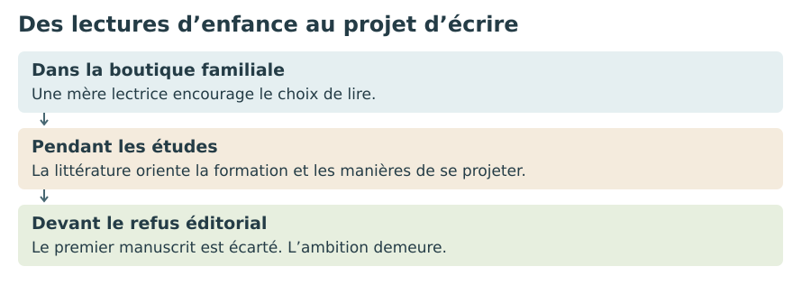
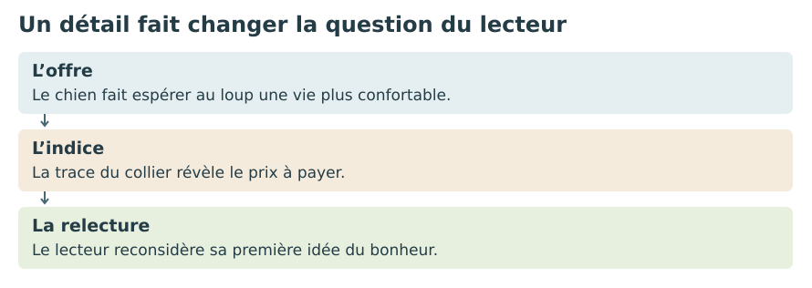

# École polytechnique FUI-FF, session 2 — Français 2024 · Corrigé guidé

*Corrigé rédigé par IA, non officiel.*

**Rédaction** · modèle exact non renseigné (famille GPT-6) · effort non renseigné · vitesse non renseignée

**Révision** · modèle exact non renseigné (famille GPT-6) · effort non renseigné · vitesse non renseignée

**Révision** · GPT-6.2 Astra Ultra · vitesse non renseignée

**Révision (tour 3)** · GPT-6.2 Astra Ultra · vitesse non renseignée

Cette épreuve de la filière universitaire internationale de formation francophone dure deux heures. La garde interdit les dictionnaires et traducteurs électroniques. Le texte est tiré du discours prononcé à Stockholm par Annie Ernaux le 7 décembre 2022. La compréhension comporte quatre questions pour dix points. Le bref essai libre, appuyé sur des exemples précis, vaut également dix points. Le sujet laisse au candidat le choix de sa longueur.

[Sujet officiel de la session 2](https://www.polytechnique.edu/admission-cycle-ingenieur/sites/admission/files/content/2024%20FUI-FF%20Session%202%20FRANCAIS.pdf)

## A1 · La place de la littérature dans sa vie

> [!INDICATION]
> Suivre l’ordre du passage depuis l’enfance jusqu’aux premiers refus des éditeurs.

La littérature accompagne Annie Ernaux depuis l’enfance et organise progressivement sa vie. Sa mère, qui lit elle-même des romans entre deux clients de la boutique, préfère voir sa fille avec un livre plutôt qu’occupée à des travaux d’aiguille. Le prix élevé des livres et la méfiance de l’école religieuse contribuent même à les rendre plus désirables. Plus tard, elle choisit ses études pour rester proche des œuvres et commence à écrire. Le refus de son premier roman par des éditeurs ne suffit pas à la détourner de cette ambition.

## A2 · Son rapport personnel aux œuvres

> [!INDICATION]
> Relever ce qui gouverne ses choix de lecture et ce que signifie pour elle entrer dans un roman.

Son rapport aux œuvres est d’abord intime et libre. Elle se souvient de lectures choisies surtout au gré du hasard, des contes de Grimm à *La Nausée*. Elle dit que les livres lui tenaient compagnie. Par la suite, elle se projette dans les univers de Flaubert ou de Virginia Woolf. Ces lectures constituent pour elle un autre monde, qu’elle oppose alors, sans en avoir pleinement conscience, au milieu social où elle a grandi.

> [!METHODE]
> Le « continent » de la deuxième partie est une métaphore de la littérature. Que change l’adverbe « inconsciemment » ? Dans son discours, l’écrivaine peut nommer la distance sociale introduite par ses lectures. Elle ne dit pas que l’adolescente avait décidé de rompre avec sa famille. Cette distinction évite de faire disparaître de la réponse la mère, elle-même lectrice.

## A3 · Une manière de vivre

> [!INDICATION]
> Chercher deux conséquences d’une lecture qui se prolongent une fois le livre refermé.

Un « mode de vie » est ici une manière d’orienter durablement ses choix et son regard. La littérature détermine les études qu’Ernaux entreprend, nourrit son imagination et infléchit la manière dont elle perçoit sa propre existence. Le verbe « vivre », qu’elle applique à son expérience des romans, donne la mesure de ce déplacement. Un livre de Flaubert ou de Virginia Woolf devient pour elle un lieu où imaginer sa propre existence. Cette projection éclaire aussi son choix d’études.

## A4 · La recherche d’une forme nouvelle

> [!INDICATION]
> Distinguer l’ambition de la jeune autrice et le jugement qu’elle porte rétrospectivement sur ce premier travail.

Dans ce premier roman, elle cherche à renouveler la forme du récit. À l’époque, elle attend de l’écriture qu’elle transforme la réalité par le travail littéraire. L’idée que cette recherche était le seul mérite du texte exprime le jugement rétrospectif, assez sévère, de l’écrivaine devenue adulte. Le mot « recherche » indique une tentative. Ernaux reconnaît une ambition d’invention sans affirmer que le roman ait atteint son but. Elle conserve le désir d’écrire après le refus de deux ou trois éditeurs. Le discours ne leur attribue aucun motif précis.

## B · Essai personnel sur la lecture et la littérature

> [!INDICATION]
> Prendre deux exemples dans lesquels on peut expliquer précisément ce que le texte fait éprouver au lecteur.

Un bon livre peut me faire changer d’avis sans me présenter une seule fois sa conclusion comme une consigne. Quand quelqu’un me dit que je juge trop vite un personnage, j’ai tendance à défendre mon opinion. Un récit dispose de plus de patience que mon interlocuteur. Il peut me laisser avancer avec un jugement qui me paraît juste, puis me conduire à en reconnaître moi-même la fragilité.

Dans *Le Loup et le Chien*, de La Fontaine, j’ai d’abord compris le désir du loup de quitter sa vie de privations. Le chien est bien nourri, accueillant, presque convaincant. Un détail suffit pourtant à modifier la portée de son invitation. Le loup aperçoit à son cou la trace du collier. J’avais d’abord comparé deux façons de se nourrir, j’ai dû comparer deux façons de disposer de sa vie. L’intérêt de cette fable tient pour moi au moment où le lecteur découvre ce qu’il avait oublié de demander.

Mais lire ne consiste pas toujours à chercher une leçon. Dans la scène des comices agricoles de *Madame Bovary*, les discours officiels et les paroles de séduction de Rodolphe s’entrecroisent. J’ai pris plaisir à entendre les deux voix se répondre à leur insu. En revenant au passage, j’ai remarqué que le rapprochement des formules révèle ce que les déclarations les plus personnelles peuvent emprunter à un langage tout fait. Ce sens vient de la disposition des voix. Un résumé exact de la rencontre ne me l’aurait pas donné.

La littérature représente ainsi pour moi une manière de devenir plus attentif à ce qu’une parole fait, à ce qu’un récit laisse attendre et à l’instant où cette attente change. Cela vaut aussi lorsque je ferme le livre. Avant d’accepter un récit séduisant, il m’arrive désormais de chercher le petit détail que, comme le loup, je n’ai pas encore regardé.

> [!METHODE]
> Vérifier que chaque exemple est suivi d’une observation personnelle sur son effet. La copie peut être défendue sans supposer que le lecteur connaît déjà toutes les œuvres mentionnées.

> [!METHODE]
> Pour la quatrième réponse, souligner « seul mérite ». L’adjectif introduit une restriction dans le bilan d’Ernaux, tandis que « recherche » désigne ce que tentait la jeune autrice. Le refus éditorial et le jugement rétrospectif ont des auteurs distincts.
