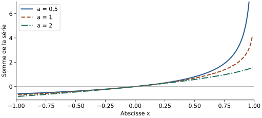
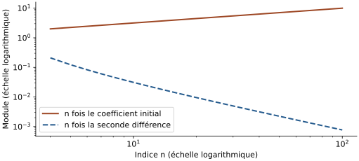
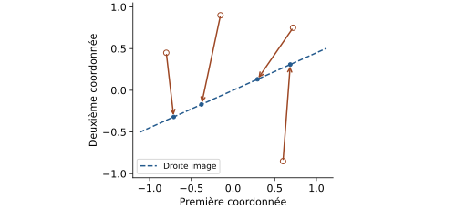
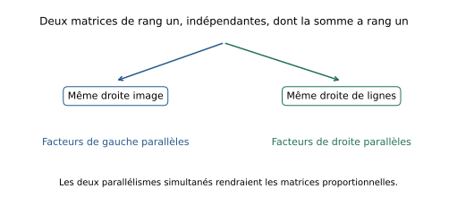

# École polytechnique FUI-FF, session 2 — Mathématiques 2024 · Corrigé brut

*Corrigé rédigé par IA, non officiel.*

**Rédaction** · modèle exact non renseigné (famille GPT-6) · effort non renseigné · vitesse non renseignée

**Révision (tour 1)** · GPT-6.2 Astra Ultra · vitesse non renseignée · 24 novembre 2026

**Révision (tour 2)** · GPT-6.2 Astra Ultra · vitesse non renseignée · 26 novembre 2026

## Exercice · Régularité d’une série entière

### E.1 · Domaine réel de la série

Le rayon de convergence vaut 1 car la racine $n$-ième de $n^{-a}$ tend vers 1. Si $|x|>1$, le terme général ne tend pas vers zéro. En $1$, la série de Riemann converge exactement pour $a>1$. En $-1$, la série alternée converge pour tout $a>0$, puisque $n^{-a}$ décroît vers zéro. Ainsi $D_a=[-1,1]$ si $a>1$, et $D_a=[-1,1[$ si $0<a\leq1$.

### E.2 · Régularité à l’intérieur

Une série entière est indéfiniment dérivable sur l’intervalle ouvert de convergence. En effet, sur $[-r,r]$ avec $0<r<1$, les termes de toute dérivée d’ordre fixé $k$ sont majorés, pour $n\ge k$, par $n^{k-a}r^{n-k}$, de somme finie. La dérivation terme à terme est donc justifiée à chaque ordre.

### E.3 · Continuité en un

Il faut déjà que $f_a(1)$ existe, ce qui impose $a>1$. Pour ces valeurs, la majoration $|x^n/n^a|\leq1/n^a$ sur $[-1,1]$ assure la convergence uniforme. La somme est continue, notamment à gauche en 1. Ainsi $E_1=]1,+\infty[$.

### E.4 · Divergence au bord droit

Si $0<a\leq1$, fixons un réel $L>0$. On peut choisir $N$ tel que $\sum_{n=1}^N n^{-a}>2L$. Ce polynôme en $x$, avec ses facteurs $x^n$ rétablis, dépasse $L$ pour tout $x$ assez proche de 1. Sur $[0,1[$ ses termes ainsi que la queue sont positifs. Alors $f_a(x)>L$ au voisinage de 1 à gauche, d’où la limite $+\infty$.

### E.5 · Continuité en moins un

Écrivons $x=-t$, $0\le t\le1$. Les termes positifs $t^n/n^a$ décroissent avec $n$. Le reste après $N$ termes de la série alternée est donc en module au plus $(N+1)^{-a}$, uniformément en $t$. La limite des sommes partielles est continue sur $[-1,0]$. On obtient $E_{-1}=]0,+\infty[$.

### E.6 · Dérivabilité au bord alterné

Pour tout $a>0$, posons $c_n=n^{-a}$ pour $n\ge1$ et $c_0=c_{-1}=0$. Sur $]-1,1[$, le produit $h(x)=(1-x)^2 f_a(x)$ a pour coefficients $b_n=c_n-2c_{n-1}+c_{n-2}$. Pour $n\ge3$, écrivons $v(t)=t^{-a}$. Le théorème fondamental appliqué deux fois donne
$$b_n=\int_0^1\!\int_0^1 v''(n-2+s+t)\,ds\,dt.$$
Comme $v''(t)=a(a+1)t^{-a-2}$, on obtient $0\le b_n\le a(a+1)(n-2)^{-a-2}$. Par suite $\sum n|b_n|<\infty$. Les séries $H(x)=\sum_{n\ge1}b_nx^n$ et $\sum_{n\ge1}nb_nx^{n-1}$ convergent donc uniformément sur $[-1,1]$. La première prolonge $h$ et admet en $-1$ une dérivée à droite donnée par la seconde. Par E.5, $f_a(x)=H(x)/(1-x)^2$ jusqu’en $-1$ inclus. La règle du quotient donne alors
$$f'_a(-1^+)=\frac{H'(-1^+)+H(-1)}4,\qquad E'_{-1}=]0,+\infty[.$$
Par exemple, $f_1(x)=-\log(1-x)$ a pour dérivée à droite $1/2$ en $-1$, alors que l’insertion de $x=-1$ dans la série dérivée initiale donne la série divergente $1-1+1-\cdots$.

### E.7 · Calcul des deux valeurs en moins un

Pour $a=2$, la somme sur les entiers pairs est $\tfrac14 f_2(1)$. La somme alternée, qui commence par un terme négatif, vaut deux fois la somme paire moins la somme totale. Donc $f_2(-1)=-\pi^2/12$. Sur $]-1,1[$, on a $x f'_2(x)=\sum_{n\ge1}x^n/n=-\log(1-x)$ par intégration de la série géométrique. La dérivée ainsi écrite a pour limite $\log 2$ en $-1$. Le théorème des accroissements finis appliqué entre $-1$ et $x$ donne $f'_2(-1)=\log 2$.

## Problème, partie 1 · Rang un

### P.1 · Factoriser un endomorphisme de rang un

Prendre un vecteur $y\ne0$ qui engendre l’image. Pour tout $x$, il existe un unique scalaire $\lambda(x)$ tel que $u(x)=\lambda(x)y$. L’unicité de ce coefficient et la linéarité de $u$ rendent $\lambda$ linéaire. Comme $u$ a une image non nulle, $\lambda$ est non nulle.

### P.2 · Traduire la factorisation en coordonnées

Choisir une colonne non nulle $Y$ de $A$. Toutes les colonnes s’écrivent $\lambda_jY$. En posant $\Lambda=(\lambda_1,\ldots,\lambda_n)^T$, on obtient $A=Y\Lambda^T$. Au moins un des coefficients vaut 1 pour la colonne choisie, donc les deux facteurs sont non nuls.

### P.3a · La trace comme condition nécessaire

Si $A$ est diagonalisable, son rang égale celui de sa diagonale dans une base propre. Le rang un impose une unique entrée diagonale non nulle. La trace, invariante par similitude, est cette entrée et ne s’annule pas.

### P.3b · Exhiber le vecteur propre

On a $AY=Y(\Lambda^T Y)$ et $\operatorname{tr}A=\sum_iY_i\Lambda_i=\Lambda^TY$. Le vecteur $Y$ est non nul et vérifie donc $AY=(\operatorname{tr}A)Y$, y compris lorsque la trace est nulle.

### P.3c · Compléter une base propre

Si la trace est non nulle, la droite $\mathbb RY$ est supplémentaire de $\ker A$ : leur intersection est nulle par P.3b et leurs dimensions totalisent $n$. Adjoindre $Y$ à une base du noyau donne une base propre, donc $A$ est diagonalisable.

## Problème, partie 2 · Multiplication à gauche

### P.4 · Multiplication à gauche et inversibilité

La distributivité de la multiplication matricielle et sa compatibilité avec les scalaires rendent $\varphi_A$ linéaire. Si $A$ est inversible, son inverse comme opérateur est $\varphi_{A^{-1}}$. Si $A$ est singulière, choisir $X\ne0$ dans son noyau. La matrice dont la première colonne vaut $X$ et les autres zéro appartient au noyau de $\varphi_A$, qui ne peut donc être inversible.

### P.5a · Une colonne non nulle suffit

L’égalité $AM=\lambda M$ donne $(A-\lambda I_n)M=0$. Au moins une colonne de $M$ est non nulle, et cette colonne appartient au noyau de $A-\lambda I_n$. Cette dernière matrice est singulière.

### P.5b · Première inclusion des spectres

Toute valeur propre réelle de $\varphi_A$ admet une matrice propre non nulle. Par P.5a, cette valeur annule le déterminant de $A-\lambda I_n$, donc appartient au spectre de $A$.

### P.6a · Construire des matrices propres

Par hypothèse, l’image de $M$ est la droite propre $\mathbb RX$. Ainsi, pour tout $z$, le vecteur $Mz$ appartient à cette droite et $A(Mz)=\lambda Mz$. En conséquence $AM=\lambda M$. Le rang de $M$ étant un, $M$ est une matrice propre non nulle.

### P.6b · Inclusion réciproque

À tout $X$ propre pour $\lambda$, on peut associer la matrice $Xe_1^T$, de rang un et d’image $\mathbb RX$. La question précédente fournit $\lambda\in\operatorname{Sp}(\varphi_A)$. La première inclusion donne finalement l’égalité des deux spectres.

### P.6c · Décrire l’espace propre

La condition $AM=\lambda M$ signifie que chacune des $n$ colonnes de $M$ appartient indépendamment à $E_\lambda(A)=\ker(A-\lambda I_n)$. Par l’isomorphisme qui prend la liste des colonnes, l’espace propre de $\varphi_A$ s’identifie à $E_\lambda(A)^n$ et a pour dimension $n\dim E_\lambda(A)$.

### P.7 · Diagonaliser l’opérateur sur les matrices

Si $X_1,\ldots,X_n$ forment une base propre réelle de $A$, les $n^2$ matrices $X_i e_j^T$ forment une base de $M_n(\mathbb R)$ en plaçant cette base dans une colonne à la fois. Chacune est propre pour $\varphi_A$ d’après P.6a. Cela prouve la diagonalisabilité.

## Problème, partie 3 · Transformations préservant le rang

### P.8 · Reconnaître deux formes proportionnelles

Des formes non nulles proportionnelles ont le même noyau. Réciproquement, supposons que $\ell_1,\ell_2$ aient le même noyau et choisissons $x_0$ tel que $\ell_1(x_0)=1$. Alors $x-\ell_1(x)x_0$ appartient au noyau commun, donc $\ell_2(x)=\ell_2(x_0)\ell_1(x)$ pour tout $x$. Le facteur est non nul puisque $x_0$ est extérieur au noyau.

### P.9 · Somme de deux matrices de rang un

Par P.2, écrire $A_i=U_iV_i^T$. Si les $V_i$ sont indépendants, l’application $x\mapsto(V_1^Tx,V_2^Tx)$ est surjective sur $\mathbb R^2$. L’image de la somme est alors exactement $\operatorname{Vect}(U_1,U_2)$. Le rang un force les $U_i$ à être proportionnels. Si les $V_i$ sont dépendants, l’autre possibilité demandée est déjà réalisée.

### P.10 · Une préservation qui impose l’injectivité

Si $\varphi(M)=0$, la conservation du rang donne $\operatorname{rg} M=0$, donc $M=0$. En dimension finie, un endomorphisme injectif est bijectif.

### P.11 · Déterminer quel facteur reste fixe

On prend $U_1,U_2$ dans $M_{n,1}(\mathbb R)$, conformément au produit $U_iV^T$ et à la factorisation de P.2. Les matrices $U_1V^T,U_2V^T$ sont indépendantes et leur somme $(U_1+U_2)V^T$ a rang un. Les images sont donc indépendantes et leur somme a rang un. Écrire ces images $Y_iW_i^T$. Par P.9, $Y_1$ et $Y_2$ sont parallèles ou $W_1$ et $W_2$ sont parallèles. Les deux parallélismes simultanés rendraient les images proportionnelles, en contradiction avec l’injectivité.

### P.12a · Comparer avec un troisième terme

Fixons désormais la seconde possibilité, avec $W_1$ et $W_2$ parallèles et $Y_1,Y_2$ indépendants. Si $U_3$ est proportionnel à $U_1$, les images sont proportionnelles, donc leurs deux droites coïncident. Sinon $(U_1+U_3)V^T$ a rang un et P.9 appliquée aux images donne $Y_1$ parallèle à $Y_3$ ou $W_1$ parallèle à $W_3$.

### P.12b · Propager le facteur commun

Si $W_3$ n’était pas parallèle à $W_1$, P.12a imposerait $Y_3$ parallèle à $Y_1$. En appliquant le même raisonnement avec l’indice 2, le parallélisme de $W_1,W_2$ imposerait aussi $Y_3$ parallèle à $Y_2$, impossible puisque $Y_1,Y_2$ sont indépendants. Ainsi toutes les secondes droites sont la même.

### P.13 · Une transformation linéaire sur les colonnes

Fixer un représentant $W$ de cette droite. Il existe un unique vecteur $L(U)$ tel que $\varphi(UV^T)=L(U)W^T$, en incluant $U=0$. En effet, l’application $Y\mapsto YW^T$ est injective. L’unicité entraîne la linéarité de $L$, et P.10 entraîne son injectivité. Son espace de départ et d’arrivée étant $\mathbb R^n$, sa matrice $A$ est inversible.

### P.14a · Faire varier le second facteur

Fixer $U\ne0$ et $V_2$ non parallèle à $V$. Les matrices $UV^T,UV_2^T$ sont indépendantes, leur somme $U(V+V_2)^T$ a rang un. Par linéarité et P.13, l’image de la somme s’écrit $(AU)W^T+Y_2W_2^T$. P.9 et l’indépendance des images donnent exactement un des parallélismes $AU\parallel Y_2$ et $W\parallel W_2$.

### P.14b · Éliminer le mauvais parallélisme

Si $W_2=cW$, alors $\varphi(UV_2^T)=cY_2W^T$. Choisir $U_0=A^{-1}(cY_2)$. P.13 donnerait $\varphi(U_0V^T)=\varphi(UV_2^T)$. Par injectivité les matrices initiales coïncideraient, donc leurs espaces de lignes seraient identiques, contrairement au choix de $V_2$. Il reste nécessairement $AU\parallel Y_2$.

### P.15 · Rendre le facteur de droite indépendant de U

Pour chaque $U\ne0$, P.14b et la linéarité dans la direction initiale $V$ permettent d’écrire, pour tout $Z$, $\varphi(UZ^T)=(AU)(C_U Z)^T$ avec un unique vecteur $C_U Z$. L’unicité donne une application linéaire $C_U$, injective par P.10, donc inversible. Si $U,U'$ sont indépendants, écrire la même identité pour $U+U'$ puis développer par linéarité. Pour voir cette comparaison colonne par colonne, fixons $j$ et posons $v=C_{U+U'}Z-C_UZ$, $w=C_{U+U'}Z-C_{U'}Z$. La colonne $j$ de l’identité est $v_j AU+w_j AU'=0$. L’inversibilité de $A$ conserve l’indépendance de $U,U'$, donc $v_j=w_j=0$. Comme ceci vaut pour chaque $j$, on a $C_UZ=C_{U+U'}Z=C_{U'}Z$. Pour deux vecteurs proportionnels, l’égalité résulte directement de l’homogénéité. Tous les $C_U$ coïncident donc avec une matrice inversible $C$. En posant $B=C^T$, on obtient $\varphi(UZ^T)=AUZ^TB$ pour tous $U,Z$, y compris $U=0$.

### P.16 · Étendre la formule à tout rang

La formule s’applique notamment aux matrices élémentaires $e_ie_j^T$, qui forment une base. Par linéarité elle donne $\varphi(M)=AMB$ pour toute matrice $M$. Dans l’autre branche de P.11, les deux images $Y_i W_i^T$ ont leurs premiers facteurs parallèles. Posons $\psi(M)=\varphi(M)^T$. Cette application linéaire conserve le rang et ses images $W_iY_i^T$ ont leurs seconds facteurs parallèles. La branche que nous venons de démontrer donne donc $\psi(M)=CMD$ avec $C,D$ inversibles. En transposant, on obtient $\varphi(M)=D^TM^TC^T$. Réciproquement, les multiplications à gauche et à droite par des matrices inversibles et la transposition conservent le rang. Si $n=1$, tout isomorphisme est une multiplication par un scalaire non nul et la conclusion reste vraie directement.
