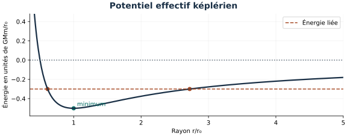
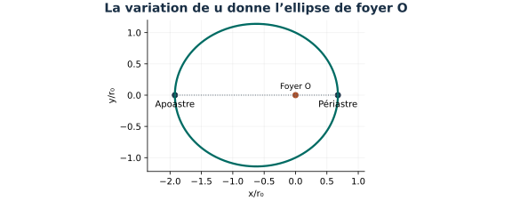
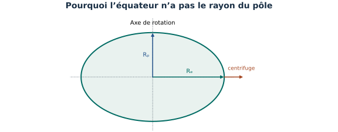
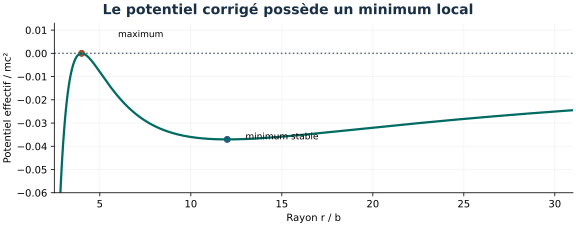
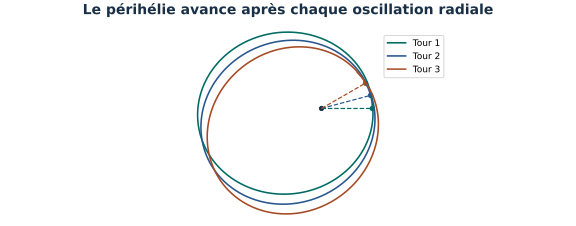

# École polytechnique, FUI-FF session 2 — Physique 2024 · Corrigé guidé

*Corrigé rédigé par IA, non officiel. Signalez toute erreur.*

**Rédaction** · modèle exact non renseigné (famille GPT-6) · effort non renseigné · vitesse non renseignée

**Révision** · modèle exact non renseigné (famille GPT-6) · effort non renseigné · vitesse non renseignée

**Révision (tour 2)** · GPT-6.2 Astra Ultra · vitesse non renseignée

**Révision (tour 3)** · GPT-6.2 Astra Ultra · vitesse non renseignée · 26 novembre 2026

Épreuve de printemps de la formation francophone, trois heures sans calculatrice. Les estimations suivent la précision demandée dans le sujet.

## Présentation du sujet

La démarche part de deux quantités conservées, l’énergie et le moment cinétique. On passe ensuite du potentiel de la Terre au champ relativiste du Soleil. Pour les deux perturbations, il est utile de conserver une notation distincte pour la masse M et pour la longueur gravitationnelle GM/c². La partie II du sujet passe directement de la question 11.a à la question 11.c.

## Partie I — Orbites képlériennes

### Question 1

> [!INDICATION]
> Écrire le champ d’un astre sphérique en fonction du vecteur unitaire radial.

#### Solution

Dans le référentiel galiléen centré en $O$, $m\ddot{\mathbf r}=-GMm\,\mathbf u_r/r^2=-GMm\,\mathbf r/r^3$. La force gravitationnelle est dirigée vers $O$.

### Question 2

> [!INDICATION]
> Multiplier scalairement la deuxième loi de Newton par la vitesse.

#### Solution

La puissance de la gravitation est $-GMm\dot r/r^2$. Elle vaut $d(mv^2/2)/dt$ et aussi $-d(-GMm/r)/dt$. Il s’ensuit **$E=mv^2/2-GMm/r=\mathrm{constante}$**.

### Question 3

> [!INDICATION]
> Calculer le moment de la force par rapport au centre attracteur.

#### Solution

$\dot{\boldsymbol\ell}=\dot{\mathbf r}\times m\mathbf v+\mathbf r\times m\dot{\mathbf v}=\mathbf0$ puisque la première paire est colinéaire et la gravitation est centrale. Pour $\ell\ne0$, $\mathbf r$ reste orthogonal à $\boldsymbol\ell$ et appartient au plan fixe passant par $O$ de normale $\boldsymbol\ell$. Le cas $\ell=0$ correspond à un mouvement radial.

### Question 4

> [!INDICATION]
> Utiliser les deux composantes de la vitesse en coordonnées polaires.

#### Solution

$\mathbf v=\dot r\mathbf u_r+r\dot\theta\mathbf u_\theta$ donne $\boldsymbol\ell=mr^2\dot\theta\mathbf u_z$, où $\mathbf u_z$ est choisi dans le sens de $\boldsymbol\ell$. Ainsi **$C=r^2\dot\theta=\ell/m$**.

### Question 5

> [!INDICATION]
> Remplacer la vitesse angulaire par la constante des aires dans l’expression de l’énergie.

#### Solution

Avec $v^2=\dot r^2+r^2\dot\theta^2$, on obtient
$$E=\tfrac12m\dot r^2+U(r),\qquad U(r)=\frac{\ell^2}{2mr^2}-\frac{GMm}{r}.$$
L’équation radiale s’écrit $m\ddot r=-U'(r)$. La barrière centrifuge domine aux petits $r$ lorsque $\ell\ne0$.

### Question 6.a

> [!INDICATION]
> Comparer les deux termes aux extrémités puis chercher le point stationnaire.

#### Solution

$U$ tend vers $+\infty$ à l’origine et vers $0^-$ à l’infini. Son minimum unique vérifie $U'(r_0)=-\ell^2/(mr_0^3)+GMm/r_0^2=0$, donc
$$r_0=\frac{\ell^2}{GMm^2},\qquad U(r_0)=-\frac{GMm}{2r_0}.$$
Le quotient a bien la dimension d’une longueur puisque $[\ell/m]=L^2/T$ et $[GM]=L^3/T^2$. Au minimum avec $\dot r=0$, le rayon reste fixe et la trajectoire est circulaire. Pour $U_{\min}<E<0$, le rayon oscille entre deux bornes. Les énergies $E\ge0$ permettent un départ à l’infini.

### Question 6.b

> [!INDICATION]
> Appliquer la constante des aires au rayon du cercle.

#### Solution

La vitesse angulaire vaut **$\omega_a=\ell/(mr_0^2)=\sqrt{GM/r_0^3}$**. Le cercle est décrit uniformément.

### Question 7

> [!INDICATION]
> Développer la force radiale autour du minimum du potentiel.

#### Solution

Écrivons $r=r_0+\varepsilon(t)$ avec $|\varepsilon|\ll r_0$. Comme $U'(r_0)=0$, on a $m\ddot\varepsilon\simeq-U''(r_0)\varepsilon$, soit $\omega_r=\sqrt{U''(r_0)/m}$. Or $U''=3\ell^2/(mr^4)-2GMm/r^3$ et la condition circulaire donne $U''(r_0)=GMm/r_0^3>0$. Toute petite perturbation radiale oscille autour du rayon stable.

### Question 8

> [!INDICATION]
> Comparer la pulsation radiale calculée avec celle de rotation.

#### Solution

On a **$\omega_r^2=GM/r_0^3=\omega_a^2$**. Au premier ordre autour du cercle, le retour au même état radial s’effectue après un tour de l’angle azimutal. L’orbite liée proche du cercle se ferme. La question 9 étend exactement cette conclusion aux ellipses d’excentricité quelconque.

### Question 9.a

> [!INDICATION]
> Exprimer la vitesse radiale par la dérivée de $u$ par rapport à l’angle.

#### Solution

Avec $u=1/r$, $u'=du/d\theta$, $\dot r=-u'\dot\theta/u^2=-(\ell/m)u'$. Multiplier l’énergie par $2m/\ell^2$ donne
$$\mathcal E=(u')^2+u^2-2u_0u,\qquad \mathcal E=2mE/\ell^2,\qquad u_0=GMm^2/\ell^2=1/r_0.$$
$\mathcal E$ a la dimension $L^{-2}$ et $u_0$ la dimension $L^{-1}$. L’angle est mesuré en radians.

### Question 9.b

> [!INDICATION]
> Compléter le carré puis dériver l’intégrale première.

#### Solution

$(u')^2+(u-u_0)^2=\mathcal E+u_0^2$. En dérivant, on trouve $u''+(u-u_0)=0$ sur les arcs mobiles, puis aux points de retournement par continuité. C’est l’équation d’un oscillateur de pulsation 1 vis-à-vis de la variable $\theta$.

### Question 9.c

> [!INDICATION]
> Imposer les deux conditions initiales sur la solution harmonique.

#### Solution

La solution générale est $u=u_0+A\cos\theta+B\sin\theta$. Les conditions $u(0)=u_0(1+e)$ et $u'(0)=0$ imposent **$u(\theta)=u_0(1+e\cos\theta)$**.

### Question 9.d

> [!INDICATION]
> Évaluer l’intégrale première au périastre.

#### Solution

L’amplitude vérifie $e^2u_0^2=\mathcal E+u_0^2$. Pour $e\ge0$,
$$r=\frac{r_0}{1+e\cos\theta},\quad r_0=1/u_0=\frac{\ell^2}{GMm^2},\quad
e=\sqrt{1+\frac{\mathcal E}{u_0^2}}=\sqrt{1+\frac{2E\ell^2}{G^2M^2m^3}}.$$
Le symbole $L$ dans la dernière demande du sujet désigne ici la norme $\ell$ du moment cinétique.

### Question 9.e

> [!INDICATION]
> Utiliser $x=r\cos\theta$ et $r^2=x^2+y^2$.

#### Solution

L’équation $r+ex=r_0$ donne $(1-e^2)x^2+y^2+2er_0x-r_0^2=0$, avec $r_0-ex\ge0$. C’est une conique de foyer $O$, de paramètre $r_0$ et d’excentricité $e$. Pour $0\le e<1$ elle est elliptique (cercle pour $e=0$), parabolique pour $e=1$ et hyperbolique pour $e>1$. Pour l’ellipse, le périastre et l’apoastre sont à $r_0/(1+e)$ et $r_0/(1-e)$.

## Partie II — Effet de l’aplatissement terrestre

### Question 10.a

> [!INDICATION]
> Sommer les potentiels gravitationnel et centrifuge dans le référentiel tournant.

#### Solution

Au niveau monopolaire le potentiel gravitationnel massique est $-GM_T/R$. La force centrifuge par unité de masse est dirigée vers l’extérieur de l’axe de rotation et vaut $+\omega_T^2r_z\mathbf e_s$, où $s=r_z$ est la distance à cet axe. Elle dérive de $-\omega_T^2 r_z^2/2$. Ainsi **$V_{\rm pes}=-GM_T/R-\omega_T^2r_z^2/2$**. En projetant sur $\mathbf e_s$ vers les $r_z$ croissants, on obtient $-\partial_{r_z}(-\omega_T^2r_z^2/2)=+\omega_T^2r_z$. Le signe moins imprimé devant la force centrifuge dans le texte de 10.a est incompatible avec ce choix et avec le potentiel donné.

### Question 10.b

> [!INDICATION]
> À pression constante sur une surface libre, la force massique ne doit pas avoir de composante tangentielle.

#### Solution

Pour un milieu déformable en équilibre hydrostatique, $\nabla p=-\rho\nabla V_{\rm pes}$. La pression étant uniforme à la surface, celle-ci est équipotentielle. Au pôle $r_z=0$ et à l’équateur $r_z=R_e$. D’où
$$GM_T\left(\frac1{R_p}-\frac1{R_e}\right)=\frac12\omega_T^2R_e^2.$$
Au premier ordre, $1/R_p-1/R_e\simeq A/R_T$ et $g\simeq GM_T/R_T^2$. Ainsi **$A\simeq \omega_T^2R_T/(2g)$**.

### Question 10.c

> [!INDICATION]
> Calculer la fréquence de rotation à partir d’une journée en secondes.

#### Solution

$\omega_T=2\pi/86400\simeq7{,}3\times10^{-5}\ \mathrm{s^{-1}}$. Avec $R_T=6{,}4\times10^6\ \mathrm m$, il vient **$A\simeq1{,}7\times10^{-3}$** (environ $0{,}17\ \%$).

### Question 10.d

> [!INDICATION]
> Comparer le nouveau coefficient au coefficient précédent.

#### Solution

$A\simeq5\omega_T^2R_T/(4g)$, soit $5/2$ fois la valeur précédente, donc **$A\simeq4{,}3\times10^{-3}$** ($0{,}43\ \%$) dans cette seconde approximation.

### Question 10.e

> [!INDICATION]
> Identifier ce qui change dès que la distribution de masse prend une forme ellipsoïdale.

#### Solution

Le calcul élémentaire conserve le champ d’une Terre sphérique alors qu’une déformation redistribue sa masse et modifie aussi son propre potentiel. Ce changement intervient déjà au premier ordre en $A$. Un modèle d’équilibre incluant la gravitation de la masse déformée modifie donc le coefficient. Pour la Terre réelle, la stratification en densité et la rigidité de certaines couches limitent également le modèle de fluide homogène. Les renvois « 6 b » et « 6 d » de la question désignent les calculs 10.b et 10.d.

### Question 11.a

> [!INDICATION]
> Développer la distance inverse et intégrer en utilisant les axes de symétrie.

#### Solution

Pour un élément en $(x,y,z)$, posons $s^2=x^2+y^2+z^2$. À distance $r\gg R_T$,
$$\frac1{|r\mathbf e_x-\mathbf s|}=\frac1r+\frac{x}{r^2}+\frac{3x^2-s^2}{2r^3}+\frac{5x^3-3xs^2}{2r^4}+O(R_T^4/r^5).$$
Les intégrales des termes impairs en $x$ s’annulent. La masse monopolaire et le terme quadrupolaire donnent $V_1=-G[M_T/r+\rho Q/(2r^3)]+O(GM_TR_T^4/r^5)$, avec $Q=\int(2x^2-y^2-z^2)\,d^3s$. La symétrie axiale donne $\int x^2d^3s=\int y^2d^3s$, donc $Q=\tfrac12\int(x^2+y^2-2z^2)\,d^3s$. Le terme de degré trois du développement en coordonnées internes ne contribue pas après intégration.

### Question 11.c

> [!INDICATION]
> Factoriser le terme monopolaire et développer la différence de carrés.

#### Solution

Avec $\rho Q=(M_T/5)(R_e^2-R_p^2)$,
$$V_1\simeq-\frac{GM_T}{r}\left[1+\frac{R_e^2-R_p^2}{10r^2}\right]
=-\frac{GM_T}{r}\left[1+\alpha\frac{R_T^2}{r^2}\right].$$
Donc $\alpha=(R_e^2-R_p^2)/(10R_T^2)\simeq A/5$. Avec $A\simeq4{,}3\times10^{-3}$ de 10.d, $\alpha\simeq8{,}6\times10^{-4}$, d’ordre $10^{-3}$. La première estimation de 10.c donnerait $3{,}4\times10^{-4}$.

### Question 11.d

> [!INDICATION]
> Effectuer mentalement une rotation autour de l’axe polaire.

#### Solution

La distribution de masse est invariante par rotation autour de $Oz$. Dans le plan équatorial, $V_1(x,y,0)$ dépend donc seulement de $r=\sqrt{x^2+y^2}$ et garde l’expression de la question précédente.

### Question 11.e

> [!INDICATION]
> Introduire le terme cubique du potentiel dans l’intégrale première de $u$ puis dériver.

#### Solution

Dans le plan équatorial, le moment cinétique est toujours conservé. Avec $u_0=GM_Tm^2/\ell^2$, on trouve
$$\mathcal E=(u')^2+u^2-2u_0u-2u_0\alpha R_T^2u^3,$$
puis
$$u''+u=u_0+3u_0\alpha R_T^2u^2.$$
Le terme $u^2$ rend l’équation non linéaire. La périodicité en angle de l’oscillateur képlérien ne s’en déduit plus.

## Partie III — Précession du périhélie de Mercure

### Question 12

> [!INDICATION]
> Chercher les points stationnaires à moment cinétique fixé et distinguer le minimum local du maximum intérieur.

#### Solution

Les deux termes attractifs de $U_{\rm RG}$ sont des énergies puisque le rapport de la correction à $-GMm/r$ est $\ell^2/(m^2c^2r^2)$, sans dimension. Notons $b=GM/c^2$ (la longueur $\mathcal M$ du sujet). À la surface du Soleil ou à l’extérieur, le potentiel d’étude est celui de l’approximation de champ faible donnée dans l’énoncé. Algébriquement, $U'_{\rm RG}=0$ donne
$$-\frac{\ell^2}{mr^3}+\frac{GMm}{r^2}+\frac{3GM\ell^2}{mc^2r^4}=0,\qquad
\boxed{\ell^2=m^2c^2\frac{br_1^2}{r_1-3b}}.$$
La branche circulaire stable satisfait $r_1>6b$ (voir 14). Si $r_0=\ell^2/(GMm^2)>12b$, l’équation a deux racines $r_\pm=[r_0\pm\sqrt{r_0^2-12br_0}]/2$. La plus grande $r_+=r_1$ est le minimum local, la petite un maximum. Le potentiel formel tend vers $-\infty$ à $r\to0^+$ et vers $0^-$ à l’infini. L’extrapolation du terme en $1/r^3$ au voisinage du centre excède le domaine de champ faible. Pour le Soleil $b\simeq1{,}5\times10^3\ \mathrm m$.

Le cas limite des deux extrema permet de préciser le domaine de stabilité. À $r_0=12b$, leur rayon commun est $r=6b$ et la dérivée du potentiel comporte une racine double. Elle conserve son signe de part et d’autre, si bien que le point stationnaire est une inflexion horizontale. La pulsation radiale calculée à la question 14 s’y annule. La branche stable de ce potentiel est celle des rayons strictement supérieurs à $6b$.

### Question 13

> [!INDICATION]
> Éliminer le moment cinétique de la vitesse angulaire sur le cercle.

#### Solution

$\Omega_a=\ell/(mr_1^2)$. La relation précédente donne
$$\boxed{\Omega_a^2=\frac{\ell^2}{m^2r_1^4}=\frac{c^2b}{r_1^2(r_1-3b)}}.$$

### Question 14

> [!INDICATION]
> Dériver deux fois le potentiel effectif en gardant le moment cinétique constant.

#### Solution

On a $U''_{\rm RG}/m=3\ell^2/(m^2r^4)-2GM/r^3-12GM\ell^2/(m^2c^2r^5)$. En reportant $r=r_1$ et $\ell^2/m^2=c^2br_1^2/(r_1-3b)$, on obtient
$$\boxed{\Omega_r^2=\frac{c^2b(r_1-6b)}{r_1^3(r_1-3b)}=\Omega_a^2(1-6b/r_1)}.$$
Le carré est positif sur la branche stable $r_1>6b$.

### Question 15

> [!INDICATION]
> Soustraire les carrés avant de faire l’approximation de champ faible.

#### Solution

$\Omega_a^2-\Omega_r^2=(6b/r_1)\Omega_a^2$. Comme les fréquences sont proches, on peut assimiler leur somme à $2\Omega_a$, d’où $(\Omega_a-\Omega_r)/\Omega_a\simeq3b/r_1$. Pour Mercure, **$3b/r_1\simeq7{,}7\times10^{-8}$**.

### Question 16

> [!INDICATION]
> Calculer l’angle parcouru au cours d’une période radiale.

#### Solution

Entre deux périhélies successifs il s’écoule $2\pi/\Omega_r$. L’angle augmente alors de $2\pi\Omega_a/\Omega_r>2\pi$. Le périhélie avance dans le sens du mouvement de
$$\Delta\varpi=2\pi\left(\Omega_a/\Omega_r-1\right)\simeq\frac{6\pi b}{r_1}.$$
La courbe se décale à chaque révolution au lieu de retracer une ellipse fixe. Une stricte fermeture après plusieurs tours exigerait un rapport de fréquences rationnel particulier.

### Question 17

> [!INDICATION]
> Convertir l’avance par tour en avance sur cent ans puis en secondes d’arc.

#### Solution

Un siècle contient environ $100\times365/88\simeq415$ tours. Dans l’approximation quasi circulaire avec les valeurs fournies,
$$\Delta\varpi_{100}\simeq415\times360^\circ\times7{,}7\times10^{-8}\simeq0{,}0115^\circ\simeq41''.$$
En gardant les constantes du sujet jusqu’au dernier calcul, la valeur circulaire est $0{,}01145^\circ$, soit $41{,}2''$ par siècle. La valeur de $0{,}012^\circ$ annoncée correspond à $43{,}2''$. L’écart s’explique par l’excentricité de Mercure. Avec $r_1$ pris pour le demi-grand axe et $e\simeq0{,}20$, le facteur $1/(1-e^2)$ donne environ $43''$ par siècle.

Le remplacement du rayon par le paramètre orbital se démontre directement avec le potentiel du sujet. Posons $u=1/r$ et $p=\ell^2/(GMm^2)$. L’équation de Binet devient $u''+u=1/p+3bu^2$ (dérivées en angle polaire). Dans la correction du premier ordre on insère $u_0=(1+e\cos\theta)/p$. La composante résonante du second membre est $(6be/p^2)\cos\theta$. Elle produit le terme $(3be/p^2)\theta\sin\theta$, c’est-à-dire le premier développement de $(e/p)\cos[(1-3b/p)\theta]$. La précession vaut donc $6\pi b/p$ par révolution. Pour une ellipse $p=a(1-e^2)$, ce qui justifie le facteur de correction cité pour Mercure.

## Bilan

La force newtonienne en inverse du carré impose des fréquences radiale et angulaire égales sur les orbites quasi circulaires. Une correction en inverse du cube dans le potentiel change leur rapport et fait tourner le périhélie. Les effets de forme et de relativité peuvent ainsi produire une précession, même si leurs origines physiques diffèrent.
