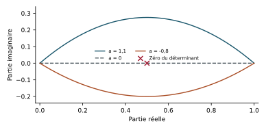
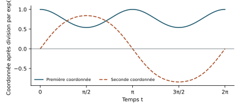

# X MP — Mathématiques B 2024 · Corrigé guidé

*Corrigé rédigé par IA, non officiel. Signalez toute erreur.*

**Attribution archivée** · « IA (GPT-6.2 Sol), relue et révisée par IA »

**Révision (tour 1)** · GPT-6.2 Astra Ultra · vitesse non renseignée

**Révision (tour 2)** · GPT-6.2 Astra Ultra · vitesse non renseignée · 26 novembre 2026

## Présentation du sujet

L’épreuve de Mathématiques B de l’École polytechnique est commune aux filières MP et MPI. Elle dure quatre heures, sans calculatrice. Les 22 numéros officiels donnent 39 réponses élémentaires, chacune accompagnée de son repère d’origine.

- **Première partie.** Étudier une équation scalaire à l’aide du Wronskien et de la translation d’une période. Cette partie est indépendante.
- **Deuxième partie.** Construire une réciproque locale en combinant une estimation par la différentielle et une minimisation sur une boule fermée.
- **Troisième partie.** Montrer que toute matrice complexe inversible possède un logarithme, via l’exponentielle sur une algèbre commutative et la connexité par arcs.
- **Quatrième partie.** Décomposer une matrice de solutions en un facteur périodique et une exponentielle, puis étudier les conditions de périodicité.

Le sujet mobilise les équations différentielles linéaires, le calcul différentiel, la topologie en dimension finie et la réduction. Le jury recommande de travailler plusieurs questions consécutives avec soin. Les questions 3, 6a et 7b débloquent des résultats importants dans la suite.

## Première partie — Équation scalaire à coefficient périodique

Les solutions forment un espace de dimension deux. La translation conserve cet espace et son polynôme caractéristique gouverne les solutions périodiques à un facteur exponentiel près.

### Question 1a

> [!INDICATION]
> Transformez l’équation d’ordre deux en un système d’ordre un et utilisez l’évaluation initiale.

#### Solution

Avec $Y=(y,y')^{\mathsf T}$, l’équation (1) équivaut à $Y'=C(t)Y$ où
$$
C(t)=\begin{pmatrix}0&1\\-q(t)&0\end{pmatrix}.
$$
La matrice $C$ est continue sur $\mathbb R$. Le théorème de Cauchy–Lipschitz linéaire donne pour toute donnée $(y(0),y'(0))\in\mathbb C^2$ une unique solution sur $\mathbb R$.

La première composante est de classe $C^2$, car sa dérivée est la seconde, de classe $C^1$. L’évaluation initiale est donc un isomorphisme complexe de l’espace des solutions vers $\mathbb C^2$. Les antécédents des deux vecteurs canoniques sont $y_1,y_2$. **Ils forment une base des solutions.**

> [!JURY]
> Le jury relève que des conditions initiales simplement distinctes ne garantissent pas l’indépendance. Ici, les deux données forment une base de l’espace des conditions initiales.

### Question 1b

> [!INDICATION]
> Dérivez le déterminant formé par les deux solutions et leurs dérivées.

#### Solution

Pour $W(t)=y_1(t)y_2'(t)-y_1'(t)y_2(t)$, on a $W'=y_1y_2''-y_1''y_2=0$ par (1). Les conditions initiales donnent $W(0)=1$, donc **$W(t)=1$ pour tout $t$**.

### Question 2

> [!INDICATION]
> Vérifiez l’équation pour la translatée, puis relevez ses données initiales.

#### Solution

Pour $v(t)=y(t+T)$, la périodicité donne $v''(t)=-q(t+T)y(t+T)=-q(t)v(t)$. La solution $v$ a pour données initiales $y(T)$ et $y'(T)$. Par 1a, **$y(t+T)=y(T)y_1(t)+y'(T)y_2(t)$**.

### Question 3

> [!INDICATION]
> Interprétez la translation d’une période comme un endomorphisme de l’espace des solutions.

> [!INDICATION]
> Utilisez les deux conditions initiales pour afficher la matrice dans la base de 1a. Pour comparer (a) et (c), extrayez le facteur exponentiel.

#### Solution

Soit $\tau$ l’endomorphisme $y\mapsto y(\,\cdot+T)$ de l’espace des solutions, bien défini par 2. Dans la base $(y_1,y_2)$, la même question donne la matrice
$$
M_T=\begin{pmatrix}y_1(T)&y_2(T)\\y_1'(T)&y_2'(T)\end{pmatrix}.
$$
La relation (a) signifie que $\mu$ est une valeur propre de $\tau$. Le déterminant de $M_T$ vaut $1$ par 1b, donc le polynôme caractéristique est $X^2-(y_1(T)+y_2'(T))X+1$. Cela établit (a) $\Longleftrightarrow$ (b).

Si (a) vaut, posons $u(t)=e^{-\lambda t}y(t)$. Cette fonction est de classe $C^2$ et $u(t+T)=e^{-\lambda T}\mu u(t)=u(t)$, donc (c) vaut. Réciproquement, sous (c), $y(t+T)=e^{\lambda T}e^{\lambda t}u(t)=\mu y(t)$, d’où (a).

### Question 4a

> [!INDICATION]
> Utilisez le produit des racines et les deux espaces propres de la translation.

#### Solution

Puisque $\mu_1\mu_2=1$, on a $\mu_2=e^{-\lambda T}$.

La question 3 donne deux solutions propres non nulles $e^{\lambda t}w_1(t)$ et $e^{-\lambda t}w_2(t)$ de $\tau$, avec $w_1,w_2$ de classe $C^2$ et $T$-périodiques.

Leurs valeurs propres distinctes rendent ces solutions indépendantes. Par 1a, elles forment une base, d’où la décomposition demandée.

> [!JURY]
> Le jury signale une confusion entre produit des racines et conjugaison complexe. L’indépendance des solutions vient de leurs deux valeurs propres distinctes pour la translation.

### Question 4b

> [!INDICATION]
> Déduisez la racine double du produit et appliquez la translation deux fois si nécessaire.

#### Solution

La racine double $\mu$ vérifie $\mu^2=1$, donc $\mu=\pm1$. Par 3, il existe une solution non nulle telle que $y(t+T)=\mu y(t)$.

Elle est $T$-périodique pour $\mu=1$ et $2T$-périodique pour $\mu=-1$.

## Deuxième partie — Inversion locale

La boule fermée permet d’atteindre le minimum. Pour exploiter la différentielle, il faut choisir un minimiseur dans la boule ouverte.

### Question 5a

> [!INDICATION]
> Intégrez la dérivée de $h$ le long du segment joignant les deux points.

#### Solution

Le segment $x(s)=x_1+s(x_2-x_1)$, $s\in[0,1]$, est inclus dans $V$ par convexité. Par la règle de dérivation d’une composée, puis le théorème fondamental de l’analyse,
$$
h(x_2)-h(x_1)=\int_0^1 dh(x(s))(x_2-x_1)\,ds.
$$
La norme du membre de droite est majorée par l’intégrale des normes, donc par $C\|x_2-x_1\|$.

### Question 5b

> [!INDICATION]
> Appliquez 5a à l’écart entre $f$ et l’identité, sur une boule ouverte qui contient la boule fermée choisie.

> [!INDICATION]
> Utilisez la continuité de la différentielle pour obtenir une borne valable simultanément pour tous les couples de points.

#### Solution

Posons $h=f-\operatorname{Id}_E$.

Comme $dh(a)=0$ et $dh$ est continue, il existe $R>0$ tel que $B(a,R)\subset U$ et $\|dh(x)\|\leq1/2$ sur $B(a,R)$.

Prenons $0<r<R$. La boule fermée $\overline{B}(a,r)$ est incluse dans $B(a,R)$, qui est convexe. Par 5a, pour $x_1,x_2$ dans cette boule fermée,
$$
\|f(x_1)-f(x_2)\|\geq
\|x_1-x_2\|-\|h(x_1)-h(x_2)\|
\geq \tfrac12\|x_1-x_2\|.
$$

### Question 5c

> [!INDICATION]
> Gardez la direction fixe et appliquez la borne à une perturbation de taille variable.

#### Solution

Pour $x\in B(a,r)$ et $v\in E$, les points $x+sv$ restent dans la boule pour $s$ assez petit.

Par 5b, pour $s\ne0$ assez petit, $\|(f(x+sv)-f(x))/s\|\geq\|v\|/2$. En passant à la limite en $s=0$, on obtient $\|df(x)v\|\geq \|v\|/2$. Donc **$df(x)$ est injective**, et surjective car c’est un endomorphisme en dimension finie.

### Question 6a

> [!INDICATION]
> Minimisez d’abord sur la boule fermée, puis comparez la valeur au bord à celle au centre.

> [!INDICATION]
> Si la comparaison sur la sphère donne une égalité, comparez avec le centre de la boule.

#### Solution

La boule fermée est compacte en dimension finie et $g$ est continue, donc $g$ y atteint son minimum. Pour $x$ sur sa frontière, 5b et l’inégalité triangulaire donnent
$$
\begin{aligned}
\|y_0-f(x)\|&\geq \|f(x)-f(a)\|-\|y_0-f(a)\|\\
&\geq r/2-\|y_0-f(a)\|\\
&\geq\|y_0-f(a)\|.
\end{aligned}
$$
La dernière inégalité utilise $\|y_0-f(a)\|\leq r/4$. Ainsi $g(x)\geq g(a)$ sur le bord. Si un minimiseur se trouve sur le bord, $a$ est donc lui aussi minimiseur. **On peut choisir un minimiseur $x_0\in B(a,r)$.**

> [!JURY]
> Le jury relève que la présence éventuelle d’un minimum sur le bord ne permet pas de conclure sans comparer sa valeur à celle en un point intérieur.

### Question 6b

> [!INDICATION]
> Choisissez une direction dont l’image par $df(x_0)$ est le résidu à annuler.

#### Solution

Supposons $w=y_0-f(x_0)\ne0$. Par 5c, prenons $v$ tel que $df(x_0)v=w$. Pour $s>0$ assez petit, $x_0+sv$ est dans la boule et
$$
y_0-f(x_0+sv)=(1-s)w+o(s).
$$
Pour $0<s<1$ suffisamment petit, la norme du reste est inférieure à $s\|w\|/2$. La norme du résidu devient alors strictement inférieure à $\|w\|$, contredisant la minimalité. Donc **$f(x_0)=y_0$**.

> [!JURY]
> Le jury souligne que l’hypothèse de norme euclidienne est inutile. La surjectivité de la différentielle donne la direction de variation voulue.

### Question 7a

> [!INDICATION]
> Utilisez la continuité de $f$ sur son ouvert de définition.

#### Solution

L’ensemble $W=B(f(a),r/4)$ est une boule ouverte de $E$.

L’image réciproque $f^{-1}(W)$ est ouverte dans $U$, donc dans $E$ puisque $U$ est ouvert. Son intersection avec $B(a,r)$ est ouverte.

### Question 7b

> [!INDICATION]
> Utilisez une question différente pour l’injectivité et la surjectivité, puis relisez l’inégalité de 5b dans l’autre sens.

#### Solution

Par définition, $f(V)\subset W$. Pour $y_0\in W$, 6a et 6b donnent $x_0\in B(a,r)$ tel que $f(x_0)=y_0$, donc $x_0\in V$. La question 5b assure l’injectivité et fournit, pour $y_1,y_2\in W$,
$$
\|(f|_V)^{-1}(y_1)-(f|_V)^{-1}(y_2)\|\leq 2\|y_1-y_2\|.
$$
La restriction est continue et son inverse est lipschitzien. **C’est un homéomorphisme de $V$ vers $W$.**

## Troisième partie — Surjectivité de l’exponentielle matricielle

L’algèbre des polynômes en une matrice permet de multiplier les exponentielles de ses éléments. L’inversion locale donne un premier voisinage à transporter.

### Question 8a

> [!INDICATION]
> Vérifiez la stabilité par produit et inverse au sein de l’algèbre des polynômes en $A$.

#### Solution

L’ensemble $\mathbb C[A]$ est une sous-algèbre commutative contenant $I_n$, par les règles de calcul des polynômes en $A$.

Si $M,N\in(\mathbb C[A])^*$, alors $MN$ et $(MN)^{-1}=N^{-1}M^{-1}$ appartiennent à $\mathbb C[A]$.

L’inverse de $M$ appartient lui-même à $(\mathbb C[A])^*$ puisque son inverse est $M$. Ainsi **$(\mathbb C[A])^*$ est un sous-groupe abélien**.

### Question 8b

> [!INDICATION]
> Appliquez Cayley–Hamilton à un élément inversible de $\mathbb C[A]$ et isolez son inverse.

#### Solution

Si $M\in\mathbb C[A]\cap GL_n(\mathbb C)$, son polynôme caractéristique $X^n+c_{n-1}X^{n-1}+\cdots+c_0$ a $c_0\ne0$. Cayley–Hamilton, après multiplication par $M^{-1}$, donne
$$
\begin{aligned}
M^{-1}&=-c_0^{-1}\sum_{j=1}^{n}c_jM^{j-1},\\
c_n&=1.
\end{aligned}
$$
Cette expression appartient à l’algèbre engendrée par $M$. C’est un élément de $\mathbb C[A]$. L’inclusion réciproque vient de la définition, donc **$(\mathbb C[A])^*=\mathbb C[A]\cap GL_n(\mathbb C)$**.

### Question 9

> [!INDICATION]
> Utilisez les sommes partielles de la série exponentielle et la fermeture du sous-espace.

#### Solution

Pour $M\in\mathbb C[A]$, les sommes partielles de $\sum_{k\geq0}M^k/k!$ appartiennent à $\mathbb C[A]$. Le sous-espace $\mathbb C[A]$ de $M_n(\mathbb C)$ est fermé en dimension finie.

Par passage à la limite, $e^M\in\mathbb C[A]$, et $e^{-M}$ y appartient aussi. L’identité $e^Me^{-M}=I_n$ donne $\exp(\mathbb C[A])\subset(\mathbb C[A])^*$.

> [!JURY]
> Le jury demande de justifier le passage à la limite dans $\mathbb C[A]$ pour conclure que l’exponentielle d’un élément y appartient.

### Question 10a

> [!INDICATION]
> Lisez la partie réelle avant de comparer les parties imaginaires.

#### Solution

Si $Z_a(t)=Z_b(s)$, les parties réelles donnent $t=s$. Les parties imaginaires donnent $(a-b)t(1-t)=0$. Comme $0<t<1$, on obtient $a=b$. **L’application est injective.**

### Question 10b

> [!INDICATION]
> Repérez les paramètres complexes qui annulent un déterminant, puis utilisez 10a pour éviter ces valeurs.

> [!INDICATION]
> Le déterminant est un polynôme de la variable complexe qui paramètre la combinaison des deux matrices.

#### Solution

Le polynôme
$$
P(z)=\det\bigl(zM_1+(1-z)M_2\bigr)
$$
est non nul puisque $P(0)=\det M_2\ne0$. Il a donc un nombre fini de racines. L’injectivité de 10a montre que chaque racine appartient à au plus un arc ouvert $Z_a(]0,1[)$, donc seuls un nombre fini de réels $a$ sont interdits. Aux extrémités, $Z_a(0)=0$ et $Z_a(1)=1$ ne sont pas des racines.

Par exemple, pour $M_1=1$ et $M_2=-1$, on a $P(z)=2z-1$. Seul $a=0$ fait passer l’arc par la racine $1/2$. Les extrémités sont inchangées.

On choisit un réel $a$ permis. Alors $M(t)$ est une combinaison linéaire de $M_1,M_2$, inversible pour tout $t$, donc appartient à $(\mathbb C[A])^*$ d’après 8b.

### Question 10c

> [!INDICATION]
> Vérifiez la continuité en $t$ et l’ordre des deux extrémités du chemin.

#### Solution

Pour deux éléments quelconques $M_1,M_2$, le chemin de 10b est continu, reste dans $(\mathbb C[A])^*$ et va de $M_2$ à $M_1$. **Le groupe est connexe par arcs.**

### Question 11a

> [!INDICATION]
> Calculez la différentielle dans l’algèbre commutative avant d’appliquer 7b.

> [!INDICATION]
> Écrivez le développement de $e^{M+H}$ pour $H\to0$ en utilisant la commutation dans $\mathbb C[A]$.

#### Solution

Munissons $E=\mathbb C[A]$, considéré comme espace réel de dimension finie, d’une norme matricielle sous-multiplicative. L’exponentielle $f:E\to E$ est bien définie par 9. Pour $M,H\in E$, les matrices commutent et le produit de Cauchy des séries exponentielles, absolument convergentes, donne $e^{M+H}=e^Me^H$.

La série de $e^H$ donne $e^H=I_n+H+O(\|H\|^2)$ lorsque $\|H\|\to0$. D’où $df(M)H=e^M H$.

La différentiabilité assure la continuité de $M\mapsto e^M$ et la multiplication vérifie $\|(e^M-e^{M'})H\|\leq\|e^M-e^{M'}\|\|H\|$. Ainsi $f$ est de classe $C^1$ et $df(0)=\operatorname{Id}_E$.

On applique 7b à $f$ en $0$.

Elle fournit des ouverts $U$ de $0$ et $V$ de $I_n$ dans $E$ tels que **$f|_U:U\to V$ est un homéomorphisme**.

### Question 11b

> [!INDICATION]
> Transportez le voisinage de $I_n$ obtenu en 11a par multiplication.

#### Solution

Notons $\mathcal H=\exp(\mathbb C[A])$. Par commutativité et le produit des exponentielles établi en 11a, $\mathcal H$ est un sous-groupe de $(\mathbb C[A])^*$.

La question 11a fournit un ouvert $V$ de $\mathbb C[A]$ tel que $I_n\in V\subset\mathcal H$.

Pour $L\in\mathcal H$, la multiplication par $L$ est un homéomorphisme de $\mathbb C[A]$, d’inverse la multiplication par $L^{-1}$.

L’ensemble $LV$ est un ouvert contenant $L$ et inclus dans $\mathcal H$. **Donc $\mathcal H$ est ouvert dans $\mathbb C[A]$.**

### Question 12

> [!INDICATION]
> Employez le même voisinage de l’identité pour un élément extérieur à l’image de l’exponentielle.

#### Solution

Pour $L\in(\mathbb C[A])^*\setminus\mathcal H$, l’ensemble $LV$ est un voisinage ouvert de $L$ dans $(\mathbb C[A])^*$.

Si $Lv\in\mathcal H$ pour un $v\in V\subset\mathcal H$, la propriété de groupe donnerait $L=(Lv)v^{-1}\in\mathcal H$. Ainsi $LV$ est disjoint de $\mathcal H$.

Le complémentaire est ouvert dans $(\mathbb C[A])^*$, donc **$\mathcal H$ y est fermé**.

> [!JURY]
> Le jury rappelle que des exponentielles matricielles bornées ne donnent pas nécessairement des exposants bornés.

### Question 13a

> [!INDICATION]
> Utilisez les deux ouverts complémentaires pour définir une fonction à deux valeurs.

#### Solution

Définissons $f$ égale à $0$ sur $\mathcal H$ et à $1$ sur $(\mathbb C[A])^*\setminus\mathcal H$.

Ces deux parties sont ouvertes dans $(\mathbb C[A])^*$ par 11b et 12. Ce sont les préimages des deux singletons ouverts de $\{0,1\}$, d’où la continuité. On a $f(M_1)=0$ et $f(M_2)=1$.

### Question 13b

> [!INDICATION]
> Composez cette fonction avec un chemin entre $M_1$ et $M_2$.

#### Solution

Par 10c, un chemin continu $\gamma:[0,1]\to(\mathbb C[A])^*$ relie $M_1$ à $M_2$.

La fonction réelle continue $f\circ\gamma$ prend les valeurs $0$ et $1$. Le théorème des valeurs intermédiaires lui impose de prendre $1/2$, contradiction. **Ainsi $\exp(\mathbb C[A])=(\mathbb C[A])^*$.**

### Question 14

> [!INDICATION]
> Pour une matrice inversible $A$, choisissez l’algèbre associée à cette matrice.

#### Solution

Si $A$ est inversible, alors $A\in(\mathbb C[A])^*$ par 8b. Le résultat de 13b donne $A=e^M$ pour un $M\in\mathbb C[A]\subset M_n(\mathbb C)$. Toute exponentielle matricielle est par ailleurs inversible, d’inverse $e^{-M}$. **Donc $\exp(M_n(\mathbb C))=GL_n(\mathbb C)$.**

## Quatrième partie — Forme normale des solutions

La translation d’une période est encore à la base de la preuve. Elle est représentée par une matrice constante que la partie précédente permet d’écrire comme exponentielle.

### Question 15

> [!INDICATION]
> Faites agir la translation d’une période sur l’espace des solutions et utilisez le corps complexe.

#### Solution

L’espace complexe $S$ des solutions de (2) est de dimension $n$ par le théorème de Cauchy–Lipschitz linéaire, applicable car $A$ est continue sur $\mathbb R$.

La translation $\tau:Y\mapsto Y(\,\cdot+T)$ envoie $S$ dans $S$ puisque $A(t+T)=A(t)$. La translation de $-T$ en est l’inverse.

Comme $n\geq1$ et que le corps est $\mathbb C$, $\tau$ admet une valeur propre, nécessairement non nulle. Un vecteur propre $Y$ associé donne **$Y(t+T)=\mu Y(t)$**.

> [!JURY]
> Le jury relève que l’exponentielle d’une primitive des coefficients ne résout pas en général un système à coefficients variables. La preuve par translation s’applique sans hypothèse de commutation.

### Question 16a

> [!INDICATION]
> Pour un temps quelconque, l’unicité d’un problème de Cauchy relie une dépendance entre colonnes à une dépendance entre solutions.

#### Solution

Chaque colonne de $M$ satisfait (2), donc $M'=AM$. Si $M(t)c=0$ à un certain temps, la combinaison de solutions $Y=\sum_j c_jY_j$ s’annule en ce temps.

L’unicité pour la donnée nulle donne $Y=0$ sur $\mathbb R$. La famille $(Y_j)$ étant libre, $c=0$.

Ainsi **$M(t)$ est inversible pour tout $t$**.

### Question 16b

> [!INDICATION]
> Comparez les deux matrices de solutions normalisées à la même valeur au temps zéro.

> [!INDICATION]
> Les deux matrices normalisées doivent avoir la même valeur initiale. Une preuve de leur égalité évite de dériver une matrice inverse.

#### Solution

La matrice $M(t+T)M(T)^{-1}$ satisfait la même équation matricielle $U'=A(t)U$ que $M(t)M(0)^{-1}$, par périodicité de $A$.

Toutes deux valent $I_n$ à $t=0$. L’unicité appliquée colonne par colonne donne leur égalité sur $\mathbb R$. En réarrangeant,
$$
\boxed{M(t)^{-1}M(t+T)=M(0)^{-1}M(T).}
$$

### Question 16c

> [!INDICATION]
> Appliquez la surjectivité de l’exponentielle à la matrice constante trouvée en 16b.

#### Solution

La matrice constante $K=M(0)^{-1}M(T)$ est inversible. Par 14, $K=e^C$ pour un $C\in M_n(\mathbb C)$. Comme $T>0$, prenons $B=C/T$. La question 16b donne $M(t+T)=M(t)e^{TB}$.

### Question 16d

> [!INDICATION]
> Isolez le facteur périodique dans la forme annoncée, puis testez sa translation.

#### Solution

Posons $Q(t)=M(t)e^{-tB}$. C’est une matrice inversible pour tout $t$, continue en $t$. Par 16c et la commutation des multiples de $B$,
$$
\begin{aligned}
Q(t+T)&=M(t)e^{TB}e^{-(t+T)B}\\
&=M(t)e^{-tB}\\
&=Q(t).
\end{aligned}
$$
D’où **$M(t)=Q(t)e^{tB}$** avec $Q$ $T$-périodique.

### Question 17a

> [!INDICATION]
> Interprétez la multiplication à droite par $P$ comme un changement de base de l’espace des solutions.

#### Solution

Chaque colonne de $M(t)P$ est une combinaison linéaire à coefficients constants des $Y_j$, donc une solution. La matrice $P$ est inversible, donc ces combinaisons forment une nouvelle base $(Z_1,\ldots,Z_n)$ de $S$.

### Question 17b

> [!INDICATION]
> Séparez les deux exponentielles à l’aide de la commutation, puis placez le facteur diagonal à droite.

#### Solution

Comme $DN=ND$ par l’hypothèse admise, $e^{tB}=e^{tN}e^{tD}$. La nilpotence en taille $n$ donne $N^n=0$, et $D=P\Delta P^{-1}$ donne $e^{tD}P=Pe^{t\Delta}$. Par 16d,
$$
M(t)P=\sum_{i=0}^{n-1}\frac{t^i}{i!}Q(t)N^iP\,e^{t\Delta}.
$$
En notant $R_{i,k}(t)$ la colonne $k$ de $Q(t)N^iP/i!$ et en utilisant la forme diagonale de $e^{t\Delta}$, la colonne $k$ vaut $e^{\lambda_k t}\sum_{i=0}^{n-1}t^iR_{i,k}(t)$.

Chaque $R_{i,k}$ est continue et $T$-périodique puisque $Q$ l’est et que $N^iP/i!$ est constante.

> [!JURY]
> Le jury rappelle que la factorisation de l’exponentielle utilisée ici repose sur la commutation de $D$ et $N$.

### Question 17c

> [!INDICATION]
> Majorez les facteurs périodiques sur une période et comparez les puissances à la décroissance exponentielle.

#### Solution

Les $R_{i,k}$ sont bornées sur $\mathbb R$ par continuité et périodicité.

Pour tout $i$ fixé et chaque $k$, $t^i e^{t\operatorname{Re}\lambda_k}\to0$ si $\operatorname{Re}\lambda_k<0$. La formule de 17b donne alors $Z_k(t)\to0$.

Par 17a, toute solution est combinaison à coefficients constants des $Z_k$. **Donc $Y(t)\to0$.**

### Question 18a

> [!INDICATION]
> Utilisez un vecteur propre de $B$ comme coefficient constant dans la base de solutions.

#### Solution

Prenons un vecteur propre $c\ne0$ de $B$ pour $\lambda=i\,2k\pi/(mT)$. La série exponentielle donne $e^{tB}c=e^{t\lambda}c$.

La solution $Y(t)=M(t)c=Q(t)e^{t\lambda}c$ est non nulle puisque $M(t)$ est inversible.

Elle est $mT$-périodique car $Q$ est $T$-périodique et $e^{mT\lambda}=1$.

### Question 18b

> [!INDICATION]
> Traduisez la périodicité dans les coordonnées d’une base de solutions, puis factorisez $X^m-1$.

#### Solution

Soit $Y=M(\,\cdot\,)c$ une solution $mT$-périodique non nulle, donc $c\ne0$. En itérant 16c, on obtient $M(t+mT)=M(t)K^m$ avec $K=e^{TB}$.

La périodicité et l’inversibilité de $M(t)$ donnent $(K^m-I_n)c=0$.

Or $K^m-I_n$ est le produit des $K-\omega I_n$ sur toutes les racines $m$-ièmes de l’unité $\omega$.

Ce produit est singulier, donc au moins un facteur l’est. **$K$ a une valeur propre racine $m$-ième de l’unité.**

### Question 19

> [!INDICATION]
> Combinez les deux périodes de part et d’autre de l’équation, puis utilisez la densité du sous-groupe obtenu.

#### Solution

Comme $X$ et $X'$ sont $T'$-périodiques, pour tout $\ell\in\mathbb Z$ on a
$$
\begin{aligned}
A(t+\ell T')X(t)&=A(t+\ell T')X(t+\ell T')\\
&=X'(t+\ell T')\\
&=X'(t).
\end{aligned}
$$
La périodicité de $A$ donne donc $A(t+jT+\ell T')X(t)=A(t)X(t)$ pour tout $j,\ell\in\mathbb Z$.

Le sous-groupe $\mathbb ZT+\mathbb ZT'$ n’est pas de la forme $a\mathbb Z$, car sinon $T>0$ et $T'$ seraient des multiples entiers d’un même réel non nul et $T'/T$ serait rationnel. Il est dense par le résultat admis.

En passant à la limite par continuité de $A$, on obtient **$A(u)X(t)=A(t)X(t)$** pour tout $u,t$.

### Question 20

> [!INDICATION]
> Distinguez les périodes commensurables avec $T$ des autres. Pour les secondes, étudiez l’espace engendré par toutes les valeurs de la solution.

> [!INDICATION]
> Dans le cas des périodes incommensurables, vérifiez que l’espace engendré contient toutes les dérivées de la solution. Gardez en vue la dimension un.

#### Solution

Sous l’hypothèse d’irréductibilité de l’énoncé, le système possède une solution périodique non nulle si et seulement si au moins l’une des conditions suivantes est vérifiée.

- La matrice $B$ possède une valeur propre $i\,2k\pi/(mT)$ pour $k\in\mathbb Z$ et $m\geq1$ entier.
- On a $n=1$ et $A$ est constante, de valeur imaginaire pure, zéro compris.

La première condition suffit par 18a. Sous la seconde, en notant $A=i\omega$ avec $\omega\in\mathbb R$, la solution $t\mapsto e^{i\omega t}$ est périodique, constante si $\omega=0$.

Réciproquement, soit $X$ une solution non nulle de période $T'>0$. Si $T'/T$ est rationnel, écrivons $T'/T=p/q$ avec $p,q$ entiers strictement positifs.

Alors $pT=qT'$ est une période de $X$. Par 18b, $e^{TB}$ a une valeur propre $\eta$ telle que $\eta^p=1$.

En trigonalisant $B$ sur $\mathbb C$, on voit par la série exponentielle que les valeurs propres de $e^{TB}$ sont les $e^{T\lambda}$ pour $\lambda$ valeur propre de $B$.

Donc pour l’une d’elles, $e^{pT\lambda}=1$ et $\lambda=i\,2k\pi/(pT)$.

Si $T'/T$ est irrationnel, posons $W=\operatorname{Vect}\{X(t):t\in\mathbb R\}$. C’est un sous-espace fermé en dimension finie, donc $X'(t)\in W$ comme limite des quotients de différences. Par 19, pour tout $u$, $A(u)X(t)=X'(t)\in W$.

Ainsi $W$ est stable par toutes les matrices $A(u)$ et, étant non nul, vaut $\mathbb C^n$. Les matrices $A(u)$ coïncident sur les générateurs $X(t)$ et sont donc toutes égales.

En dimension $n\geq2$, une matrice complexe constante possède une droite propre, contraire à l’hypothèse. Il reste $n=1$.

Une solution d’une équation scalaire constante $X'=aX$ a la forme $ce^{at}$, et sa périodicité avec $c\ne0$ impose $|e^{aT'}|=1$, donc $\operatorname{Re}a=0$.

Cette seconde possibilité est effective. Fixons $T=2\pi$, $A(t)=i\sqrt2$, $M(t)=e^{i\sqrt2 t}$ et $B=i\sqrt2$. La solution non nulle a pour période $2\pi/\sqrt2$, tandis que $e^{TB}$ n’est pas une racine de l’unité. Le théorème 2 du rapport se place dès le départ en dimension au moins deux.

> [!PIEGE]
> Le rapport présente le critère dans le cas $n\geq2$. Le sujet autorise aussi $n=1$. Pour $A=i\sqrt{2}$ et $T=2\pi$, la solution $e^{i\sqrt{2}t}$ est périodique alors que son multiplicateur sur $T$ n’est pas une racine de l’unité.

### Question 21

> [!INDICATION]
> Écrivez $X=M c$ et imposez l’égalité entre les valeurs aux temps $0$ et $T$.

> [!INDICATION]
> Il suffit d’imposer une égalité aux deux extrémités d’une période, puis d’appliquer l’unicité à la solution et à sa translatée.

#### Solution

Par la variation des constantes et $M'=AM$, toutes les solutions s’écrivent
$$
X(t)=M(t)\left(c_0+\int_0^t M(s)^{-1}b(s)\,ds\right)
$$
avec $c_0\in\mathbb C^n$. Notons $K=e^{TB}$ et $d=\int_0^T M(s)^{-1}b(s)\,ds$.

Comme $M(T)=M(0)K$, la condition $X(T)=X(0)$ équivaut à $(I_n-K)c_0=Kd$. L’hypothèse garantit que $I_n-K$ est inversible, donc cette condition fixe un unique $c_0$.

Pour ce choix, $t\mapsto X(t+T)$ satisfait la même équation que $X$ puisque $A$ et $b$ sont périodiques, et a la même valeur en zéro.

L’unicité du problème de Cauchy montre que $X$ est $T$-périodique. Toute solution $T$-périodique vérifie la même condition, d’où l’unicité.

### Question 22

> [!INDICATION]
> Repérez la rotation du plan dans la matrice des coefficients et isolez la croissance scalaire.

#### Solution

Avec $J=\begin{pmatrix}0&-1\\1&0\end{pmatrix}$, la matrice des coefficients est $I_2+\cos(t)J$. Comme $J^2=-I_2$,
$$
Q(t)=e^{\sin(t)J}=
\begin{pmatrix}\cos(\sin t)&-\sin(\sin t)\\
\sin(\sin t)&\cos(\sin t)\end{pmatrix}.
$$
Cette matrice est $2\pi$-périodique, inversible et vérifie $Q'(t)=\cos(t)JQ(t)$. Ainsi $M(t)=e^tQ(t)$ satisfait $M'=(I_2+\cos(t)J)M$ et $M(0)=I_2$. Toutes les solutions sont donc
$$
\boxed{\binom{x(t)}{y(t)}=e^t Q(t)\binom{x(0)}{y(0)}.}
$$
Une forme normale pour cette matrice fondamentale est **$M(t)=Q(t)e^{tB}$ avec $B=I_2$ et $T=2\pi$**.

Pour une donnée initiale réelle, le rayon est multiplié par $e^t$ pendant que l’angle augmente de $\sin t$. En particulier $M(2\pi)=e^{2\pi}I_2$ et les deux multiplicateurs de monodromie coïncident.

## Bilan

- Pour étudier des équations à coefficients périodiques, représentez la translation d’une période sur la base des solutions.
- En inversion locale, la compacité fournit le minimum et la comparaison au bord permet d’utiliser la différentielle en un point intérieur.
- Dans un groupe, un voisinage de l’identité se transporte par multiplication. Vérifiez l’espace dans lequel l’ouvert ou le fermé est considéré.
- Pour recoller une solution sur des périodes successives, imposez la condition aux deux extrémités d’une période et utilisez l’unicité du problème de Cauchy.
