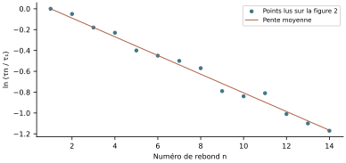
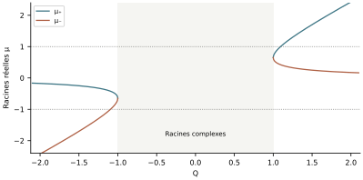
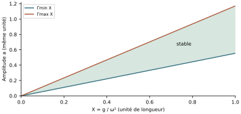
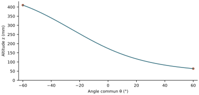
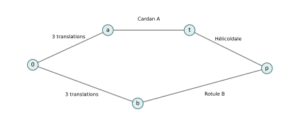
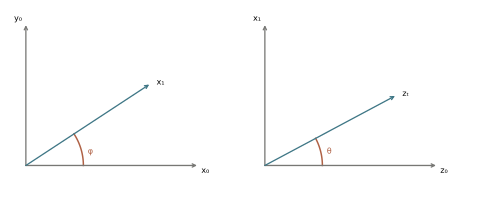

# Physique et SI — X MP 2024 · Corrigé guidé

*Corrigé rédigé par IA, non officiel.*

**Rédaction** · GPT-6.2 Astra Ultra · vitesse non renseignée

Les deux parties ont des numérotations indépendantes. Pour les rebonds, les conditions d’existence et de stabilité se déduisent de relations distinctes. Pour le robot, on fixe le sens des angles et la branche géométrique avant de dériver les relations de mouvement.

## Physique — Modèle d’un choc

### Question P.1 — Déformation pendant le contact

> [!INDICATION]
> Utiliser le régime pseudo-périodique et identifier les deux constantes avec les conditions au premier contact.

#### Solution

L’origine des temps est le premier contact. Le ressort et l’amortisseur en parallèle exercent $-ks-\lambda\dot s$ sur la masse. La deuxième loi de Newton donne $\ddot s+2\alpha\omega_0\dot s+\omega_0^2s=0$, avec $s(0)=0$, $\dot s(0)=V_0$. Pour $\alpha<1$, posons $\omega_d=\omega_0\sqrt{1-\alpha^2}$. On trouve $s(t)=(V_0/\omega_d)e^{-\alpha\omega_0t}\sin(\omega_dt)$. L’intervalle du choc retenu par ce modèle va de zéro au premier retour à $s=0$, soit $I_c=[0,\pi/\omega_d]$.

### Question P.2 — Coefficient de restitution

> [!INDICATION]
> Dériver la solution à l’instant où le sinus s’annule pour la première fois après zéro.

#### Solution

À la fin du contact, $V_1=\dot s(\pi/\omega_d)=-V_0e^{-\alpha\omega_0\pi/\omega_d}$. Ainsi $r=-V_1/V_0=\exp[-\pi\alpha/\sqrt{1-\alpha^2}]$. Il passe de 1 (choc élastique sans amortissement) à 0 quand $\alpha\to1^-$. La fraction d’énergie cinétique restituée vaut $r^2$. La solution d’une équation linéaire homogène est ici proportionnelle à $V_0$ et le temps de contact est indépendant de son amplitude, d’où l’indépendance de $r$ vis-à-vis de $V_0$.

### Question P.3 — Temps de vol sur la table fixe

> [!INDICATION]
> Sur un diagramme semi-logarithmique, calculer une pente sur plusieurs impacts.

#### Solution

Si $v_n^+$ est la vitesse verticale après le choc $n$, le vol jusqu’au même niveau dure $\tau_n=2v_n^+/g$. Le rebond suivant commence avec $v_{n+1}^+=rv_n^+$. Donc $\ln(\tau_n/\tau_1)=(n-1)\ln r$. Les points de la figure 2 sont approximativement alignés, avec une dispersion visible. Du premier point $(1,0)$ au dernier $(14,-1{,}17)$, la pente vaut environ $-0{,}090$, d’où $r\simeq e^{-0{,}090}\simeq0{,}91$. Ce résultat appuie l’hypothèse d’un coefficient constant sur cette gamme.

## Synchronisation et stabilité des rebonds

### Question P.4 — Choc contre une paroi mobile

> [!INDICATION]
> La restitution s’applique à la vitesse relative normale.

#### Solution

Pendant le choc très bref, la vitesse $v_s$ de la paroi est pratiquement constante. Dans son référentiel instantané, $v^+-v_s=-r(v^--v_s)$. Dans le référentiel du laboratoire, $v^+=-rv^-+(1+r)v_s$. Pour une paroi immobile on retrouve la loi précédente.

### Question P.5 — Carte d’un impact au suivant

> [!INDICATION]
> Alterner la loi de choc et le mouvement uniformément accéléré, en respectant les indices avant et après impact.

#### Solution

Au choc $n$, $v_n^+=-rv_n^-+(1+r)a\omega\cos\phi_n$. Le vol libre donne
$$z_s(t_{n+1})=z_s(t_n)+v_n^+\tau_n-\tfrac12g\tau_n^2,\qquad v_{n+1}^-=v_n^+-g\tau_n.$$
En appliquant à nouveau la restitution, $v_{n+1}^+=-r v_n^++rg\tau_n+(1+r)a\omega\cos\phi_{n+1}$. La surface impose sa position aux deux extrémités du vol.

### Question P.6 — Un rebond par période

> [!INDICATION]
> Retrouver d’abord la vitesse du vol balistique qui dure exactement une période.

#### Solution

En synchronisme, $\tau_n=T$, $z_s(t_{n+1})=z_s(t_n)$ et $v_{n+1}^+=v_n^+$. La parabole impose $v_n^+=gT/2=\pi g/\omega$ et $v_n^-=-v_n^+$. La loi de restitution donne alors
$$\cos\phi_n=\frac{1-r}{1+r}\frac{\pi}{\Gamma},\qquad \Gamma=\frac{a\omega^2}{g}.$$
La vitesse de départ est fixée par la durée du vol, indépendamment de l’amplitude de vibration.

### Question P.7 — Existence du synchronisme

> [!INDICATION]
> Un cosinus réel est compris entre moins un et un. Relier le signe de ce cosinus à la vitesse de la surface.

#### Solution

Pour $0\le r<1$, il faut $\Gamma\ge\pi(1-r)/(1+r)$. Au-dessus du seuil, deux phases opposées modulo $2\pi$ ont le même cosinus positif. La paroi monte au moment des chocs et compense les pertes d’énergie. À la limite du seuil elle monte à vitesse maximale. Quand $r\to1^-$ à $\Gamma>0$ fixé, $\cos\phi_n\to0$ et les impacts tendent vers les extrema de position de la paroi. L’échange d’énergie nécessaire tend vers zéro. La stabilité des deux branches demande un examen supplémentaire.

### Question P.8 — Estimation avec l’enregistrement acoustique

> [!INDICATION]
> L’amplitude mécanique se lit sur la sinusoïde. Les impulsions acoustiques donnent seulement l’instant des chocs.

#### Solution

La figure 5 donne $a\simeq0{,}10\ \mathrm{mm}=10^{-4}\ \mathrm m$. Les impulsions se répètent à la même phase sur le flanc montant, près de $\pi/4$. À $\omega\simeq157\ \mathrm{rad\,s^{-1}}$, $\Gamma\simeq0{,}25$. En posant $c=\Gamma\cos\phi_n/\pi\simeq0{,}056$, on a $r=(1-c)/(1+c)\simeq0{,}89$ à $0{,}90$. La lecture est compatible en ordre de précision avec les rebonds sur table fixe.

### Question P.9 — Relation entre phases perturbées

> [!INDICATION]
> Écrire la hauteur à l’impact suivant avant d’introduire une approximation.

#### Solution

Avec $D_n=\phi'_{n+1}-\phi'_n$, le temps de vol perturbé vaut $D_n/\omega$. L’égalité de position à l’arrivée s’écrit
$$a(\sin\phi'_{n+1}-\sin\phi'_n)=\frac{v_n^{+\prime}}{\omega}D_n-\frac{g}{2\omega^2}D_n^2.$$
Les phases sont déroulées, de sorte que $D_n$ est voisin de $2\pi$ pour un rebond synchronisé.

### Question P.10 — Vitesse perturbée au rebond suivant

> [!INDICATION]
> Conserver le signe de la variation de vitesse pendant le vol.

#### Solution

La vitesse juste avant le choc suivant est $v_n^{+\prime}-gD_n/\omega$. Après restitution,
$$v_{n+1}^{+\prime}=-rv_n^{+\prime}+\frac{rg}{\omega}D_n+(1+r)a\omega\cos\phi'_{n+1}.$$
La vitesse de la surface est évaluée à la phase d’arrivée.

### Question P.11 — Élimination de l’écart de vitesse

> [!INDICATION]
> Partir de la première relation à l’indice $n+1$ et éliminer successivement les deux termes de vitesse.

#### Solution

Des relations $\varepsilon_{n+1}=A\varepsilon_n+B\eta_n$ et $\eta_{n+1}=C\varepsilon_n+D\eta_n$, on tire $B\eta_n=\varepsilon_{n+1}-A\varepsilon_n$. Substituons à l’indice suivant. On obtient $\varepsilon_{n+2}=(A+D)\varepsilon_{n+1}-(AD-BC)\varepsilon_n$. Les coefficients sont la trace et le déterminant de la matrice de récurrence.

### Question P.12 — Condition d’amortissement

> [!INDICATION]
> Examiner le module, même si le mode oscille ou change de signe.

#### Solution

Un mode $K\mu^n$ de coefficient non nul tend vers zéro si et seulement si $|\mu|<1$. Pour que toute perturbation s’amortisse, il faut cette condition pour chacune des deux racines. Une racine double intérieure au disque unité amortit également le terme $n\mu^n$.

### Question P.13 — Polynôme caractéristique

> [!INDICATION]
> Calculer séparément la trace et le déterminant. Les termes en tangente s’éliminent du déterminant.

#### Solution

En posant $t=\tan\phi_n$, les relations données conduisent à $A=1$, $B=(1+r)/2$, $C=-2\pi(1-r)t$ et $D=r^2-\pi(1-r^2)t$. Donc $AD-BC=r^2$ et $2Qr=A+D=1+r^2-\pi(1-r^2)t$. Le mode géométrique vérifie $\mu^2-2Qr\mu+r^2=0$.

### Question P.14 — Racines complexes conjuguées

> [!INDICATION]
> Les deux racines ont le même module, que l’on obtient aussi par leur produit.

#### Solution

Pour $|Q|<1$, $\mu_\pm=r(Q\pm i\sqrt{1-Q^2})=re^{\pm i\beta}$, avec $\cos\beta=Q$. La perturbation réelle combine des oscillations amorties en $r^n$. Pour $Q=\pm1$, la racine double est $\pm r$ et un terme en $n(\pm r)^n$ peut apparaître. Dans les deux cas toutes les perturbations décroissent si $0<r<1$, donc le synchronisme est linéairement stable.

### Question P.15 — Racines réelles

> [!INDICATION]
> Pour approcher la petite racine loin du seuil, utiliser le produit constant des deux racines.

#### Solution

Sur $|Q|\ge1$, $\mu_\pm=r(Q\pm\sqrt{Q^2-1})$. Elles se rejoignent en $(1,r)$ ou $(-1,-r)$ et ont pour produit $r^2$. Pour $Q\to+\infty$, $\mu_+\sim2rQ$ et $\mu_-\to0^+$. Pour $Q\to-\infty$, $\mu_-\sim2rQ$ et $\mu_+\to0^-$. Les deux demi-graphes s’échangent par symétrie centrale.

### Question P.16 — Frontières de stabilité réelle

> [!INDICATION]
> Repérer sur le tracé la première rencontre de chaque branche extérieure avec les horizontales de module un.

#### Solution

Sur la branche positive, la plus grande racine atteint $+1$ lorsque $1-2Qr+r^2=0$. Sur la branche négative, la racine de plus grand module atteint $-1$ lorsque $1+2Qr+r^2=0$. Les autres racines ont alors le module $r^2$. La stabilité stricte sur le domaine réel impose $-(1+r^2)<2Qr<1+r^2$ en plus de $|Q|\ge1$.

### Question P.17 — Phase stable

> [!INDICATION]
> Substituer l’expression de la trace et distinguer le rôle des deux bornes.

#### Solution

Sur $|Q|\le1$, $|2Qr|\le2r<1+r^2$. L’encadrement précédent couvre donc les deux domaines. En remplaçant la trace on trouve
$$0<\tan\phi_n< F(r)=\frac{2(1+r^2)}{\pi(1-r^2)}.$$
Avec $\cos\phi_n>0$, l’inégalité de gauche sélectionne la branche montante située après le passage par zéro, où la paroi décélère avant d’atteindre son sommet. Un retard y diminue l’apport de vitesse. La borne supérieure élimine les corrections excessives produites près du sommet. Elle croît de $2/\pi$ à l’infini pour $r\to1^-$. Pour $r=0$, on obtient le même critère directement avec les racines $0$ et $1-\pi\tan\phi_n$.

### Question P.18 — Domaine amplitude–fréquence

> [!INDICATION]
> Tracer deux droites par l’origine avec les valeurs limites d’un rapport $Y/X$.

#### Solution

Posons $X=g/\omega^2>0$, $Y=a$. Comme $\Gamma=Y/X$, le domaine stable est l’intérieur du secteur $\Gamma_{\min}X<Y<\Gamma_{\max}X$, avec $\Gamma_{\min}=\pi(1-r)/(1+r)$ et $\Gamma_{\max}=\Gamma_{\min}\sqrt{1+F(r)^2}$. En dessous, la surface ne peut fournir assez de vitesse pour entretenir un vol de durée $T$. Au-dessus, le rebond synchrone demeure algébriquement possible mais ses perturbations s’amplifient. Au premier franchissement on peut observer le doublement de période décrit dans l’énoncé.

## Sciences de l’ingénieur — Robots Delta

### Question SI.1 — Orientation de la plateforme

> [!INDICATION]
> Utiliser deux côtés non parallèles pour établir à la fois le parallélisme des plans et l’absence de rotation dans leur plan.

#### Solution

Les trois rayons $\overrightarrow{CC_i}=L_3\boldsymbol u_i$ ont les mêmes directions fixes que $\overrightarrow{OA_i}=L_0\boldsymbol u_i$. En particulier, $\overrightarrow{C_iC_j}=L_3(\boldsymbol u_j-\boldsymbol u_i)=(L_3/L_0)\overrightarrow{A_iA_j}$. Deux côtés non colinéaires du triangle mobile sont donc parallèles aux côtés correspondants du triangle fixe pour tout mouvement. Les deux plans restent parallèles et deux axes du triangle mobile gardent une direction fixe. Avec le choix initial du sujet, $\mathcal B_3=\mathcal B_0$. Les paires de biellettes en parallélogrammes assurent ce guidage.

### Question SI.2 — Mobilité d’une plateforme Delta

> [!INDICATION]
> Une translation d’un solide peut suivre une trajectoire courbe.

#### Solution

L’orientation restant fixe, les degrés de liberté utiles sont les trois translations du centre $C$, pilotées par les trois angles moteurs en configuration régulière. La trajectoire de $C$ peut être spatiale, mais tous les points de la plateforme ont au même instant le même vecteur vitesse.

### Question SI.3 — Trois équations de sphères

> [!INDICATION]
> Éliminer l’orientation inconnue des biellettes en imposant la longueur de leur côté commun.

#### Solution

Posons $d_i=L_0-L_3+L_1\cos\theta_i$ et $s_i=L_1\sin\theta_i$. Le sens de $\theta_i$ sur la figure donne $\boldsymbol x_{1i}=\cos\theta_i\boldsymbol u_i-\sin\theta_i\boldsymbol z_0$. La fermeture fournit $\overrightarrow{B_iC_i}=\overrightarrow{OC}-d_i\boldsymbol u_i+s_i\boldsymbol z_0$. Sa norme vaut $L_2$. Avec $\boldsymbol u_i=\cos\alpha_i\boldsymbol x_0+\sin\alpha_i\boldsymbol y_0$, le développement donne
$$A_i=-2d_i\cos\alpha_i,\quad B_i=-2d_i\sin\alpha_i,\quad C_i=2s_i,\quad D_i=L_2^2-d_i^2-s_i^2.$$
Ces coefficients entrent dans $x^2+y^2+z^2+A_ix+B_iy+C_iz=D_i$. Le symbole $C_i$ désigne ici le coefficient de l’équation lorsque le contexte est algébrique.

### Question SI.4 — Élimination des termes quadratiques

> [!INDICATION]
> Les trois équations ont leur partie quadratique en commun.

#### Solution

Soustraire l’équation du bras $j$ de celle du bras $i$ élimine $x^2+y^2+z^2$. Chaque coefficient est la différence correspondante, $A_{ij}=A_i-A_j$, etc. Avec les abréviations de SI.3,
$$A_{ij}=-2(d_i\cos\alpha_i-d_j\cos\alpha_j),\quad B_{ij}=-2(d_i\sin\alpha_i-d_j\sin\alpha_j),$$
$$C_{ij}=2(s_i-s_j),\qquad D_{ij}=d_j^2+s_j^2-d_i^2-s_i^2.$$
On a $A_{ij}x+B_{ij}y+C_{ij}z=D_{ij}$. Les trois différences cycliques ont une somme nulle et deux suffisent. Dans la dernière ligne imprimée du système (2), le coefficient de $z$ issu de la soustraction est bien $C_{31}$.

### Question SI.5 — Configurations à trois angles égaux

> [!INDICATION]
> Exploiter la symétrie ternaire et les projections sur les rayons horizontaux.

#### Solution

**a)** Les trois $d_i$ sont un même $d$ et les trois $s_i$ un même $s$. Les différences imposent $(\boldsymbol u_i-\boldsymbol u_j)\cdot(x\boldsymbol x_0+y\boldsymbol y_0)=0$. Deux de ces directions sont indépendantes dans le plan de base et $d$ est non nul pour les dimensions proposées. D’où $x=y=0$ et $C$ décrit l’axe vertical.
**b)** $O,A_i,B_i,C_i,C$ appartiennent au plan radial $(O,\boldsymbol u_i,\boldsymbol z_0)$. Le côté $B_iC_i$ est dans ce plan et les segments entre les deux rotules de chaque paire sont parallèles à $\boldsymbol v_i$, perpendiculaire au plan. Le parallélogramme devient un rectangle.
**c)** Une rotation de $2\pi/3$ autour de $(O,\boldsymbol z_0)$ permute circulairement les trois bras. Les trois plans radiaux passant par un bras et l’axe vertical sont des plans de symétrie, chacun échangeant les deux autres bras.

### Question SI.6 — Débattement vertical

> [!INDICATION]
> Choisir la racine correspondant à la plateforme représentée puis évaluer les limites du débattement angulaire.

#### Solution

Sur la branche de la figure, la plateforme est au-dessus des coudes. Pour $x=y=0$,
$$z(\theta)=-L_1\sin\theta+\sqrt{L_2^2-(L_0-L_3+L_1\cos\theta)^2}.$$
Ce terme décroît entre $-60^\circ$ et $+60^\circ$ pour les longueurs proposées. Par exemple, pour $\theta\ge0$, le terme positif de la dérivée reste inférieur à $L_1\cos\theta$ car $0<d<L_2\cos\theta$. Pour $\theta<0$, les deux termes de la dérivée sont négatifs. Posons $Z=\sqrt{L_2^2-(L_0-L_3+L_1/2)^2}$. Les bornes sont $z_{\min}=Z-\sqrt3 L_1/2$, $z_{\max}=Z+\sqrt3 L_1/2$. Numériquement, $Z\simeq237\ \mathrm{mm}$, $z_{\min}\simeq64\ \mathrm{mm}$, $z_{\max}\simeq410\ \mathrm{mm}$ et $\Delta z=\sqrt3 L_1\simeq346\ \mathrm{mm}$. Le débattement axial excède les $200\ \mathrm{mm}$ demandés. La vérification du cube de travail complet exigerait aussi les directions transversales.

### Question SI.7 — Deux commandes égales

> [!INDICATION]
> Identifier le plan qui échange les bras à commande identique.

#### Solution

Quand $\theta_2=\theta_3$, le plan $(O,\boldsymbol x_0,\boldsymbol z_0)$ passant par le bras 1 échange les bras 2 et 3. La différence de leurs équations donne $y=0$ dans la branche régulière. Faire varier indépendamment $\theta_1$ et l’angle commun déplace donc la plateforme en translation dans le plan $xz$, avec deux degrés de liberté. La symétrie de rotation ternaire reparaît quand les trois angles coïncident.

### Question SI.8 — Lecture des trois allers-retours

> [!INDICATION]
> Comparer les courbes sur chaque plage en s’appuyant sur les conditions de symétrie déjà établies.

#### Solution

Sur $T_1=[1,80]\ \mathrm s$, les trois courbes se superposent en valeur, ce qui correspond à un déplacement suivant $z_0$. Sur $T_2=[81,160]\ \mathrm s$, les courbes des moteurs 2 et 3 sont égales et distinctes de celle du moteur 1, ce qui identifie $x_0$ puisque $z$ est maintenu fixe. Sur $T_3=[161,240]\ \mathrm s$, les bras 2 et 3 ont des réponses échangées entre les deux sens du mouvement et les trois angles ne coïncident pas. Il s’agit de $y_0$.

### Question SI.9 — Biellette à deux forces

> [!INDICATION]
> Utiliser d’abord les moments en l’un des deux centres de rotule.

#### Solution

Isolons une biellette. Son inertie et son poids sont négligés. Les rotules parfaites exercent seulement deux forces en $B'_i$ et $C'_i$. Le théorème de la résultante impose leur opposition, celui du moment en $B'_i$ impose que la force en $C'_i$ soit dirigée selon la droite $B'_iC'_i$. Les deux forces sont donc axiales, de même norme et de sens opposés. La seconde biellette obéit au même raisonnement.

### Question SI.10 — Équations entre forces et couples

> [!INDICATION]
> Utiliser les sommes des efforts des deux biellettes, puis prendre les moments autour des axes moteurs pour éliminer les réactions des pivots.

#### Solution

Notons $\boldsymbol n_i=\overrightarrow{B_iC_i}/L_2$ et $T'_i\boldsymbol n_i,T''_i\boldsymbol n_i$ les forces des deux biellettes sur la plateforme. Posons $S_i=T'_i+T''_i$. Le théorème de la résultante dynamique sur la plateforme, en translation, fournit les trois équations scalaires de
$$\boldsymbol F+\sum_i S_i\boldsymbol n_i=m(\ddot x\boldsymbol x_0+\ddot y\boldsymbol y_0+\ddot z\boldsymbol z_0).$$
Pour chaque bras et son inertie moteur ramenée, le moment dynamique projeté sur l’axe $(A_i,\boldsymbol v_i)$ fournit une équation,
$$C_{mi}-[\overrightarrow{A_iB_i}\times S_i\boldsymbol n_i]\cdot\boldsymbol v_i=J_i\ddot\theta_i,\qquad i=1,2,3.$$
Transporter les deux forces de $B'_i,B''_i$ en $B_i$ pour cette projection est permis, leurs écarts étant parallèles à $\boldsymbol v_i$. Ces six équations suffisent aux trois sommes axiales et aux trois couples pour une force et un mouvement donnés. La position en hauteur du point d’application de $\boldsymbol F$ n’entre pas dans la résultante.

## Mouvements et efforts du Delthaptic

### Question SI.11 — Graphe des liaisons

> [!INDICATION]
> Partir d’une plateforme et suivre le chemin jusqu’à l’autre en passant par la tige et la poignée.

#### Solution

La chaîne fermée du modèle est $0\to a\to t\to p\to b\to0$. Les plateformes $a$ et $b$ ont chacune trois translations par rapport à 0. Entre $a$ et $t$ se trouve un cardan, équivalent à une rotule à doigt de centre $A$. Entre $t$ et $p$ intervient une liaison hélicoïdale d’axe $(AB)$. Entre $p$ et $b$ se trouve une rotule de centre $B$. La figure détaille ces cinq liaisons.

### Question SI.12 — Deux paires de roulements

> [!INDICATION]
> Trouver l’unique axe commun à deux rotules, puis composer les deux pivots ainsi obtenus.

#### Solution

Deux roulements assimilés à des rotules entre les mêmes pièces imposent deux centres fixes dans leur mouvement relatif. La seule rotation permise a pour axe la droite des deux centres. Chaque paire forme donc un pivot. Les deux pivots en série, plateforme–cardan extérieur puis cardan extérieur–tige, ont des axes concourants en $A$ et perpendiculaires sur le montage. Le centre $A$ est commun et la tige dispose de deux rotations relatives. Ces contraintes réalisent le cardan du schéma.

### Question SI.13 — Orientation déduite des positions

> [!INDICATION]
> Décomposer d’abord la verticale de la tige dans le plan de la seconde rotation, puis projeter sa composante horizontale.

#### Solution

La première rotation donne $\boldsymbol x_1=\cos\varphi\boldsymbol x_0+\sin\varphi\boldsymbol y_0$. La seconde donne $\boldsymbol z_t=\sin\theta\boldsymbol x_1+\cos\theta\boldsymbol z_0$. Comme $\overrightarrow{AB}=\lambda\boldsymbol z_t$,
$$\Delta x=\lambda\sin\theta\cos\varphi,\quad\Delta y=\lambda\sin\theta\sin\varphi,\quad\Delta z=\lambda\cos\theta.$$
Posons $r_\perp=\sqrt{\Delta x^2+\Delta y^2}$. Sur la branche usuelle $\lambda>0$, $0\le\theta\le\pi$, l’inverse est $\lambda=\sqrt{r_\perp^2+\Delta z^2}$, $\theta=\operatorname{atan2}(r_\perp,\Delta z)$ et $\varphi=\operatorname{atan2}(\Delta y,\Delta x)$. Lorsque $r_\perp=0$, la direction est verticale et son azimut est indéterminé. Les deux projections sur les plans de rotation figurent ci-dessous.

### Question SI.14 — Torseur du cardan

> [!INDICATION]
> Les axes de rotation successifs sont exprimés dans des bases différentes, leurs vecteurs vitesses s’ajoutent.

#### Solution

Au point $A$, commun aux deux solides, $\boldsymbol V(A,t/a)=\boldsymbol0$. La paramétrisation retenue fait succéder la rotation $\varphi$ autour de $\boldsymbol z_0$ puis $\theta$ autour de $\boldsymbol y_t$. Le torseur réduit en $A$ est donc $\{\dot\varphi\boldsymbol z_0+\dot\theta\boldsymbol y_t\,;\,\boldsymbol0\}_A$, la première ligne étant la vitesse angulaire.

### Question SI.15 — Vis à droite et plateformes

> [!INDICATION]
> Une rotation d’un tour de la liaison hélicoïdale à droite avance d’un pas dans le sens positif.

#### Solution

**a)** Au point $B$ de l’axe, le mouvement hélicoïdal s’écrit $\{\dot\psi\boldsymbol z_t\,;\,\dot\lambda\boldsymbol z_t\}_B$. Pour un pas à droite positif $P=\mathrm{pas}$, la relation est $\dot\lambda=P\dot\psi/(2\pi)$ avec les directions positives du sujet.
**b)** Les plateformes effectuent des translations pures. Leurs torseurs sont $\{\boldsymbol0\,;\,\boldsymbol v_A\}_A$ et $\{\boldsymbol0\,;\,\boldsymbol v_B\}_B$, avec $\boldsymbol v_J=\dot x_J\boldsymbol x_0+\dot y_J\boldsymbol y_0+\dot z_J\boldsymbol z_0$ pour $J=A,B$.

### Question SI.16 — Vitesse de la poignée

> [!INDICATION]
> La vitesse au centre de la rotule est connue. Transporter ce vecteur au centre de masse de la poignée.

#### Solution

La composition des mouvements donne $\boldsymbol\Omega_{p/0}=\dot\varphi\boldsymbol z_0+\dot\theta\boldsymbol y_t+\dot\psi\boldsymbol z_t$. La rotule $p/b$ impose à $B$ la vitesse $\boldsymbol v_B$. Le transport du torseur du solide $p$ jusqu’en $G$ fournit
$$\boldsymbol V(G,p/0)=\boldsymbol v_B+\boldsymbol\Omega_{p/0}\times\overrightarrow{BG}=\boldsymbol v_B+\boldsymbol\Omega_{p/0}\times(-H\boldsymbol z_t).$$
Les angles sont déduits de $\overrightarrow{AB}$ et $\dot\psi=2\pi\dot\lambda/P$. Cela exprime les deux vecteurs à partir des commandes et de la géométrie.

### Question SI.17 — Vitesses initiales pour les quatre mouvements

> [!INDICATION]
> Pour une rotation pure autour de $G$, imposer aussi sa vitesse nulle et vérifier les bras de levier des deux plateformes.

#### Solution

Dans la position verticale, voici les signes des commandes, avec $V>0$. La rotation autour de $x_0$ dans le tableau utilise le cas centré $AG=GB$ pour que les deux vitesses opposées puissent avoir la même norme.

|Mouvement|$\dot x_A$|$\dot y_A$|$\dot z_A$|$\dot x_B$|$\dot y_B$|$\dot z_B$|
|---|---:|---:|---:|---:|---:|---:|
|Translation $+y_0$|0|$V$|0|0|$V$|0|
|Translation $+z_0$|0|0|$V$|0|0|$V$|
|Rotation directe $(G,x_0)$, cas centré|0|$V$|0|0|$-V$|0|
|Rotation directe $(G,z_0)$|0|0|$-V$|0|0|0|

En effet, pour une rotation pure $\Omega\boldsymbol x_0$ et $G$ fixe entre $A$ et $B$, les composantes exactes sont $\dot y_A=(\lambda_0-H)\Omega$, $\dot y_B=-H\Omega$. Leurs signes sont ceux demandés, mais leurs normes coïncident seulement si $\lambda_0=2H$, condition absente du texte. Pour la dernière ligne, $B$ reste fixe et $A$ descend, ce qui augmente $\lambda$ et fait tourner la poignée dans le sens direct de la vis.

### Question SI.18 — Moment cinétique de la poignée

> [!INDICATION]
> La rotation propre $\psi$ laisse inchangée la matrice d’inertie d’une pièce axisymétrique.

#### Solution

L’approximation d’une poignée de révolution autour de $\boldsymbol z_t$ donne $A=B=I_\perp$, $C=I_\parallel$ et des produits d’inertie nuls. Cette matrice diagonale est la même dans la base de la tige et dans celle de la poignée, qui se distinguent par une rotation autour de $\boldsymbol z_t$. Avec $\boldsymbol z_0=-\sin\theta\boldsymbol x_t+\cos\theta\boldsymbol z_t$, on obtient
$$\boldsymbol\sigma_G=-I_\perp\dot\varphi\sin\theta\boldsymbol x_t+I_\perp\dot\theta\boldsymbol y_t+I_\parallel(\dot\psi+\dot\varphi\cos\theta)\boldsymbol z_t.$$
Le centre $G$ étant le centre de masse, le moment cinétique y est simplement $\boldsymbol I_G\boldsymbol\Omega$.

### Question SI.19 — Relations d’efforts au niveau de la poignée

> [!INDICATION]
> Isoler les deux solides situés entre les plateformes pour supprimer les forces et les couples de la vis.

#### Solution

Isolons ensemble $p+t$ dans le référentiel galiléen de la base. L’action hélicoïdale interne disparaît. Avec l’inertie de la tige négligée et les actions extérieures du modèle, le théorème de la résultante et celui du moment dynamique en $G$ donnent
$$\boldsymbol F_A+\boldsymbol F_B+\boldsymbol F=m_p\left(\frac{\mathrm d\boldsymbol V_G}{\mathrm dt}\right)_0,$$
$$\boldsymbol M+\overrightarrow{GA}\times\boldsymbol F_A+\overrightarrow{GB}\times\boldsymbol F_B=\left(\frac{\mathrm d\boldsymbol\sigma_G}{\mathrm dt}\right)_0.$$
Ici $\overrightarrow{GA}=-(\lambda-H)\boldsymbol z_t$, $\overrightarrow{GB}=H\boldsymbol z_t$. La dérivée de $\boldsymbol\sigma_G$ est prise dans le repère fixe, y compris lorsque ses composantes sont écrites dans la base mobile.

[Sujet officiel](https://www.polytechnique.edu/admission-cycle-ingenieur/sites/admission/files/content/2024%20MP%20SUJET%20PHYSIQUE%20ET%20S.I.%20(X).pdf) · [Rapport du jury](https://www.polytechnique.edu/admission-cycle-ingenieur/sites/admission/files/content/2024%20MP%20RAPPORT%20ECRIT%20PHYSIQUE%20ET%20S.I.%20(X).pdf)
