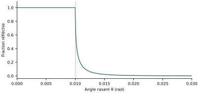
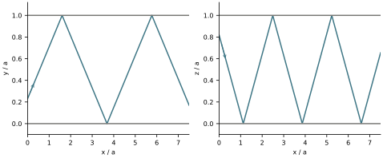
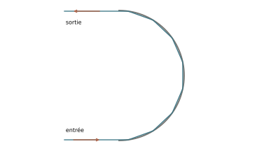
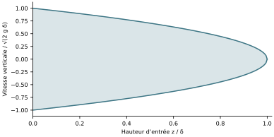
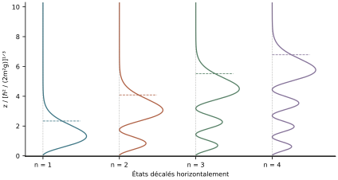

# Physique MPI — X MPI 2024 · Corrigé brut

*Corrigé rédigé par IA, non officiel.*

**Rédaction** · GPT-6.2 Astra Ultra · vitesse non renseignée

## I — Réflexion sur une paroi

### Question 1 — Longueur d’onde de de Broglie

Avec les ordres de grandeur fournis, $\lambda=h/(mv)=2\pi\hbar/(mv)\simeq6\times10^{-8}\ \mathrm m$ à $10\ \mathrm{m\,s^{-1}}$. Elle dépasse de plusieurs centaines de fois une distance interatomique de l’ordre de $10^{-10}\ \mathrm m$. Le neutron sonde ainsi une paroi moyennée sur de nombreux atomes.

### Question 2 — Évolution de l’onde

Dans le potentiel de la paroi, la fonction d’onde vérifie $i\hbar\partial_t\Psi=-(\hbar^2/2m)\partial_x^2\Psi+V(x)\Psi$, avec $V=0$ pour $x<0$ et $V=V_0$ pour $x>0$.

### Question 3 — État stationnaire et raccordement

En écrivant $\Psi=\psi(x)e^{-iEt/\hbar}$, on obtient $\psi''+(2mE/\hbar^2)\psi=0$ à gauche et $\psi''+[2m(E-V_0)/\hbar^2]\psi=0$ à droite. La marche est finie. $\psi$ et $\psi'$ sont continues en $x=0$, ce qu’on vérifie pour la dérivée en intégrant l’équation sur un intervalle infinitésimal autour de zéro.

### Question 4 — Amplitudes réfléchie et transmise

Normalisons l’amplitude incidente à un et posons $k=\sqrt{2mE}/\hbar$. À gauche $\psi=e^{ikx}+r e^{-ikx}$. Pour $E>V_0$, $k'=\sqrt{2m(E-V_0)}/\hbar$ et $\psi=t e^{ik'x}$ à droite. Les raccordements $1+r=t$ et $k(1-r)=k't$ donnent $r=(k-k')/(k+k')$, $t=2k/(k+k')$.
Pour $E<V_0$, $\kappa=\sqrt{2m(V_0-E)}/\hbar$ et on conserve la seule solution bornée $\psi=t e^{-\kappa x}$ à droite. Les mêmes formules avec $k'=i\kappa$ donnent $r=(k-i\kappa)/(k+i\kappa)$, $t=2k/(k+i\kappa)$. Ainsi $|r|=1$, bien que la fonction d’onde pénètre un peu dans la paroi.

### Question 5 — Vitesse critique

La réflexion est totale si $mv^2/2<V_0$. La vitesse critique est donc $v_c=\sqrt{2V_0/m}$. À la limite, le flux normal transmis tend également vers zéro.

### Question 6 — Lecture de la courbe du nickel

La courbe quitte son plateau de réflexion totale à $\theta_c\simeq0{,}010\ \mathrm{rad}$. Comme $\theta$ est mesuré depuis la paroi, la composante normale est $v_0\sin\theta$. Ainsi $v_c=v_0\sin\theta_c\simeq500\times0{,}010=5\ \mathrm{m\,s^{-1}}$.

### Question 7 — Fraction réfléchie

Pour $0\le\theta\le\theta_c$, $\mathcal R=1$. Pour $\theta>\theta_c$, les nombres d’onde normaux incident et transmis sont proportionnels à $\sin\theta$ et $\sqrt{\sin^2\theta-\sin^2\theta_c}$. La fraction de flux réfléchi est le carré du module de l’amplitude de la question 4,
$$\mathcal R=\left(\frac{\sin\theta-\sqrt{\sin^2\theta-\sin^2\theta_c}}{\sin\theta+\sqrt{\sin^2\theta-\sin^2\theta_c}}\right)^2.$$
Elle décroît rapidement après le seuil. Aux petits angles, les sinus peuvent être remplacés par leurs arguments en radians.

### Question 8 — Indice optique associé

L’angle d’incidence depuis la normale vaut $i=\pi/2-\theta$. À l’angle limite la réfraction est rasante, et Snell donne $n=\sin i_c=\cos\theta_c=\sqrt{1-(v_c/v_0)^2}$. La valeur inférieure à un est cohérente avec la réflexion totale à incidence rasante.

## II — Ralentissement des neutrons

### Question 9 — Quantité de mouvement lors d’un choc frontal

Orientons l’axe dans le sens du neutron incident. Le neutron repart à la vitesse algébrique $-v'$, le noyau à $v_R$. La conservation de la quantité de mouvement donne $mv=-mv'+Am v_R$, soit $Av_R=v+v'$.

### Question 10 — Partage élastique de l’énergie

La conservation de l’énergie cinétique donne $v^2=v'^2+Av_R^2$. Remplaçons $Av_R$ par $v+v'$ et divisons par $v+v'>0$. On obtient $A(v-v')=v+v'$, donc $v'/v=(A-1)/(A+1)$ et $v_R=2v/(A+1)$.

### Question 11 — Cas limites du choc

Pour $A\to1$, $v'/v\to0$ et le noyau reprend la vitesse incidente. Deux masses égales échangent leurs vitesses dans un choc frontal élastique. Pour $A\to\infty$, $v'/v\to1$ et $v_R\to0$. Le neutron rebondit presque sans perte d’énergie sur un obstacle très massif.

### Question 12 — Noyaux légers dans le liquide

Le rapport $(A-1)/(A+1)$ croît avec $A>1$. Une cible légère retire davantage d’énergie au neutron à chaque choc frontal. Pour le deutérium $A=2$, la vitesse est divisée par 3 et l’énergie par 9 dans ce modèle. La phase liquide est beaucoup plus dense en noyaux que le gaz. À longueur traversée donnée, elle accroît le nombre moyen de collisions.

### Question 13 — Nombre de chocs idéaux

Après $N$ collisions frontales sur les noyaux initialement immobiles du modèle, $v_N=10^7/3^N$ en mètres par seconde. L’égalité à $10^3$ donne $N=\ln(10^4)/\ln3\simeq8{,}4$. Il faut donc neuf chocs entiers pour passer sous $10^3\ \mathrm{m\,s^{-1}}$ (huit donnent encore environ $1{,}5\times10^3\ \mathrm{m\,s^{-1}}$).

### Question 14 — Évacuation de la chaleur à basse température

La chaleur peut se transmettre par conduction, par convection du fluide et par rayonnement thermique. La puissance radiative nette est proportionnelle à la différence des quatrièmes puissances des températures absolues. Elle devient très faible aux températures cryogéniques. La conduction et, dans le liquide, la convection peuvent continuer à transporter de la chaleur.

### Question 15 — Refroidissement jusqu’à la phase solide

Une température plus basse réduit l’agitation thermique des noyaux et permet d’atteindre des vitesses neutroniques plus faibles. Le solide maintient aussi une forte densité de cibles. En contrepartie, il perd le transport de chaleur par convection interne. Les dépôts d’énergie doivent être évacués principalement par conduction, ce qui favorise les gradients de température.

### Question 16 — Guide droit

Pour un neutron allant vers la sortie ($v_x>0$), il faut $|v_y|<v_c$ et $|v_z|<v_c$ dans le modèle de réflexion totale. Dans un tube arbitrairement long, chaque composante transversale non nulle finit par rencontrer une paroi de la famille correspondante. Le rebond change seulement le signe de la composante normale. Les projections $(x,y)$ et $(x,z)$ sont ainsi des lignes brisées de pentes alternées $\pm |v_y|/v_x$ et $\pm |v_z|/v_x$. Une composante nulle donne une projection rectiligne.

### Question 17 — Effet de la courbure du guide

Entre deux rebonds la trajectoire est rectiligne. Dans le guide courbé, même un neutron entré parallèlement à l’axe finit par atteindre le bord extérieur sous un angle fini. À angle donné, la composante normale croît avec la vitesse. Les neutrons les plus rapides peuvent donc traverser la paroi et quitter le guide.

### Question 18 — Abscisse du premier impact

La droite incidente se trouve à distance $R-z$ du centre du cercle extérieur de rayon $R$ (remplacer $R$ par le rayon extérieur si la courbure est définie au milieu du guide change seulement l’ordre supérieur en $a/R$). Pythagore donne $x^2+(R-z)^2=R^2$, donc $x=\sqrt{2Rz-z^2}\simeq\sqrt{2Rz}$ pour $z\ll R$.

### Question 19 — Incidence rasante

La tangente au point d’impact est perpendiculaire au rayon. Ainsi $\cos\theta=(R-z)/R$ ou $\sin\theta=x/R$, d’où $\theta\simeq\sqrt{2z/R}$ en radians au premier ordre non nul.

### Question 20 — Condition de réflexion

Il faut $v\sin\theta<v_c$, d’où $v<v_cR/\sqrt{2Rz-z^2}\simeq v_c\sqrt{R/(2z)}$. Plus l’entrée est proche du bord extérieur (petit $z$), plus le premier choc est rasant.

### Question 21 — Réflexions successives

La distance du centre de courbure à la droite suivie par le neutron reste constante après toute réflexion spéculaire sur un cercle concentrique. En effet, la droite entrante et la droite sortante sont symétriques par rapport au rayon du point d’impact. Le prochain contact extérieur a donc le même angle rasant. Si un bord intérieur de rayon $r<R$ est atteint, la relation $\cos\theta=b/r$, avec $b$ cette distance conservée, donne un angle plus petit que sur le bord extérieur. Une première réflexion extérieure totale garantit les suivantes dans ce modèle.

### Question 22 — Seuil de passage de toute la section

La condition la plus restrictive correspond à $z=a$. Au premier ordre en $a/R$, la vitesse qui permet le passage pour tout $z$ est $v^*=v_c\sqrt{R/(2a)}$. La définition concerne les incidences parallèles à l’axe d’entrée, conformément au sujet.

### Question 23 — Application au guide de l’expérience

Avec $a=0{,}07\ \mathrm m$ et $R=14\ \mathrm m$, $R/(2a)=100$. On obtient $v^*=10v_c\simeq50\ \mathrm{m\,s^{-1}}$.

### Question 24 — Probabilité de transmission

La condition sur $z$ est $z<a(v^*/v)^2$. La distribution uniforme sur la section rend $z$ uniforme entre 0 et $a$. Par conséquent $P=1$ pour $v\le v^*$ et $P=(v^*/v)^2$ pour $v>v^*$. La transmission des neutrons rapides diminue, mais reste positive pour toute vitesse finie, grâce aux entrées très proches du bord extérieur.

### Question 25 — Importance de la gravité

À la vitesse caractéristique, comparer $g$ à l’accélération de courbure $v^{*2}/R$. Pour une influence gravitationnelle faible il faut $gR/v^{*2}\ll1$, ou $v^*\gg\sqrt{gR}$. Ici $gR/v^{*2}\simeq140/2500\simeq0{,}056$. L’approximation est raisonnable à cette vitesse caractéristique, elle devient moins favorable pour des neutrons beaucoup plus lents.

### Question 26 — Trajet dans le référentiel de la turbine

Dans ce référentiel galiléen, la surface est immobile et le neutron arrive vers la droite à la vitesse $v_n-v_t$. Son trajet est une succession de cordes rectilignes avec réflexions rasantes, toutes à la même vitesse en norme. Près du bord inférieur il entre presque tangentiellement. Après avoir suivi le demi-cercle, il ressort près du bord supérieur pratiquement vers la gauche. La figure exagère l’espacement des contacts pour rendre le chemin visible.

### Question 27 — Retour au laboratoire

La vitesse de sortie relative vaut environ $-(v_n-v_t)$ sur l’axe incident. L’addition galiléenne donne $v_{\rm sortie}\simeq 2v_t-v_n$. Le choix $v_t\simeq v_n/2$ rend cette vitesse presque nulle, tout en assurant le rattrapage de la turbine.

## III — Rebonds gravitationnels et quantification

### Question 28 — Hauteur d’un rebond

Au miroir, l’énergie verticale est $m v_0^2/2$. Au sommet elle est $mgH$. Par conservation, $H=v_0^2/(2g)$ ou $v_0=\sqrt{2gH}$. Une éventuelle vitesse horizontale se conserve et s’élimine du bilan.

### Question 29 — Temps de vol entre contacts

La montée dure $v_0/g$ et la descente autant. Le temps entre deux rebonds est donc $T=2v_0/g=2\sqrt{2H/g}$. C’est la durée d’un aller-retour vertical complet.

### Question 30 — Sélection de l’absorbeur

À l’injection, le plafond accessible a pour altitude $z_{\max}=z+v_z^2/(2g)$, y compris pour un premier mouvement descendant car le miroir est élastique. Pour $z_{\max}>\delta$, le neutron rencontre l’absorbeur si le dispositif est assez long. Il suffit ainsi de $|v_z|>\sqrt{2g(\delta-z)}$. L’égalité est le cas de contact tangent.

### Question 31 — Flux classique en fonction de l’ouverture

La densité incidente par intervalle de $z$ et de $v_z$ est uniforme. Le domaine transmis est donc l’aire comprise, pour $0<z<\delta$, entre $-\sqrt{2g(\delta-z)}$ et $+\sqrt{2g(\delta-z)}$. À densité incidente fixée, le débit est proportionnel à
$$\int_0^\delta 2\sqrt{2g(\delta-z)}\,\mathrm dz=\frac43\sqrt{2g}\,\delta^{3/2}.$$
L’exposant prévu est $\alpha=3/2$. La hauteur du faisceau admis augmente elle aussi avec l’ouverture.

### Question 32 — Échelles gravitationnelles quantiques

Le quotient $\hbar/m$ a la dimension $L^2/T$ et $g$ la dimension $L/T^2$. À des facteurs sans dimension près, les trois combinaisons sont
$$\ell_q=(\hbar^2/(m^2g))^{1/3},\qquad t_q=(\hbar/(mg^2))^{1/3},\qquad v_q=(\hbar g/m)^{1/3}.$$
Elles vérifient $\ell_q=v_qt_q$ et $v_q=gt_q$. On retrouve la première en équilibrant énergie cinétique quantique et pesanteur à la même altitude.

### Question 33 — Ordres de grandeur

Avec $\hbar/m\sim10^{-7}\ \mathrm{m^2\,s^{-1}}$ et $g\sim10\ \mathrm{m\,s^{-2}}$ on trouve $\ell_q\sim10^{-5}\ \mathrm m$ (dix micromètres), $t_q\sim10^{-3}\ \mathrm s$ et $v_q\sim10^{-2}\ \mathrm{m\,s^{-1}}$.

### Question 34 — Équation dans la pesanteur

Au-dessus du miroir, prenons $z$ vertical vers le haut et $V(0)=0$. Pour un état stationnaire d’énergie verticale $E$,
$$-\frac{\hbar^2}{2m}\frac{\mathrm d^2\psi}{\mathrm dz^2}+mgz\,\psi=E\psi\quad(z>0).$$
Le signe positif du potentiel correspond à une force $-mg\,\boldsymbol e_z$.

### Question 35 — Condition au miroir

La vitesse verticale $v_q\sim0{,}01\ \mathrm{m\,s^{-1}}$ est près de 500 fois plus petite que $v_c\simeq5\ \mathrm{m\,s^{-1}}$. Le rapport $E_{\rm cin,z}/V_0\sim(v_q/v_c)^2$ est de l’ordre de $4\times10^{-6}$. La longueur de pénétration $\hbar/(m v_c)$ de l’ordre de quelques dizaines de nanomètres est aussi très petite devant $\ell_q$. À l’échelle du rebond on peut donc employer un mur infini, avec $\psi(0)=0$.

### Question 36 — Taille des premiers états

D’après la figure, le premier état occupe surtout les dix à vingt premiers micromètres et le quatrième s’étend sur plusieurs dizaines de micromètres. Ce sont des multiples de $\ell_q\sim10\ \mu\mathrm m$. Les extensions augmentent avec l’énergie, conformément à la croissance du point de retournement classique $E/(mg)$. Une queue évanescente subsiste au-delà de ce point dans le modèle quantique.

### Question 37 — Comparaison au puits carré infini

Pour $0<z<L$, le puits carré infini a $\psi_n(z)=\sqrt{2/L}\sin(n\pi z/L)$ et $E_n=n^2\pi^2\hbar^2/(2mL^2)$, $n=1,2,\ldots$. Les fonctions s’annulent aux deux bords et hors du puits. Comme dans la pesanteur, les niveaux sont discrets, et le $n$-ième état possède $n-1$ nœuds intérieurs. Dans le puits carré, tous les états occupent la même largeur $L$ et les espacements augmentent. Dans le champ de pesanteur sur le demi-axe, la borne inférieure est fixe, la hauteur explorée croît avec $E$, les fonctions ont des queues décroissantes et les quatre énergies de la figure sont de plus en plus rapprochées.

### Question 38 — Débit mesuré et états discrets

Le calcul classique remplit continûment les hauteurs admissibles. Les mesures sont très faibles pour une ouverture inférieure à l’extension du fondamental, puis augmentent de façon irrégulière et restent sous la courbe classique. Si l’absorbeur recoupe une part importante de la densité verticale d’un état, cet état est fortement atténué. À mesure qu’on relève l’absorbeur, les premiers états puis des états plus élevés peuvent être transmis, par groupes de hauteurs correspondant à leurs extensions. Des queues de probabilité et la résolution expérimentale arrondissent les marches. Sur la figure, le début de la transmission se situe vers une dizaine à une quinzaine de micromètres.

### Question 39 — Temps disponible pour les rebonds

Le temps de traversée horizontal est $L/v_x\sim0{,}10/5=2\times10^{-2}\ \mathrm s$. Pour $H\sim10\ \mu\mathrm m$, la durée d’un rebond vaut $2\sqrt{2H/g}\sim2{,}8\times10^{-3}\ \mathrm s$. Le rapport est de l’ordre de sept. Pour des hauteurs de quelques dizaines de micromètres, il reste quelques rebonds pendant le passage. La condition de plusieurs rebonds est donc raisonnable pour les premiers états étudiés.

[Sujet officiel](https://www.polytechnique.edu/admission-cycle-ingenieur/sites/admission/files/content/2024%20MPI%20SUJET%20PHYSIQUE%20MPI%20(X).pdf) · [Rapport du jury](https://www.polytechnique.edu/admission-cycle-ingenieur/sites/admission/files/content/2024%20MPI%20RAPPORT%20ECRIT%20PHYSIQUE%20(X)_0.pdf)
