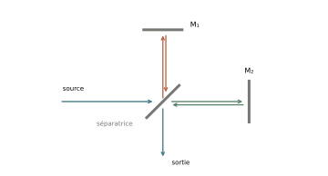
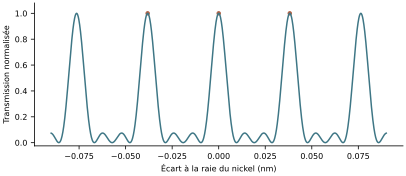
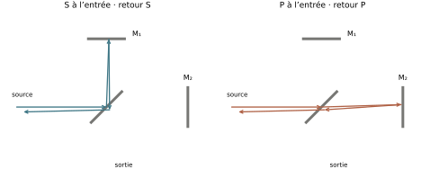
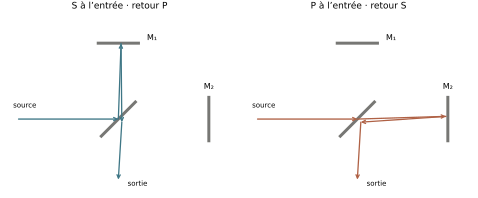
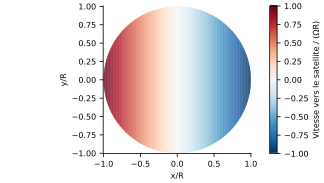
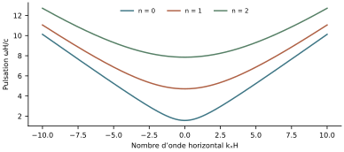
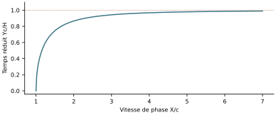
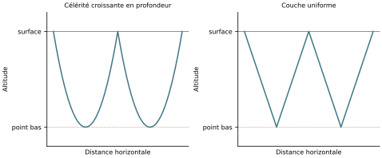

# Physique A — X PC 2024 · Corrigé guidé

*Corrigé rédigé par IA, non officiel.*

**Rédaction** · GPT-6.2 Astra Ultra · vitesse non renseignée

La première partie relie un déphasage à une mesure de vitesse par pixel. Dans la seconde, le comportement d’un mode au fond et à la surface fixe sa composante verticale. L’acoustique géométrique explique ensuite pourquoi des modes de fréquences différentes peuvent suivre le même rayon.

## I · Une mesure optique de la photosphère

### Question 1 — Raie du nickel

> [!INDICATION]
> Situer la longueur d’onde par rapport à l’intervalle usuel du visible.

#### Solution

La longueur d’onde $676{,}778$ nm appartient au visible, dans le rouge. Il s’agit d’une raie d’absorption dans le spectre solaire mesuré.

### Question 2 — Les deux bras du Michelson

> [!INDICATION]
> Suivre un aller-retour complet depuis la source jusqu’à la sortie commune.

#### Solution

Une lame séparatrice semi-réfléchissante à $45^\circ$ partage le faisceau entre deux miroirs plans dont les normales sont perpendiculaires. Après réflexion, les deux ondes reviennent sur la séparatrice et se superposent vers la sortie d’observation. Le décalage des longueurs de bras est $d$, l’épaisseur de la lame d’air équivalente. Une compensatrice de même épaisseur de verre que la séparatrice peut égaliser les parcours dans le verre.

### Question 3 — Ordre à incidence normale

> [!INDICATION]
> Un écart entre miroirs intervient deux fois dans un aller-retour.

#### Solution

Le bras le plus long ajoute $d$ à l’aller puis $d$ au retour. La différence de marche vaut $\delta=2d$ dans l’air d’indice pris égal à un. L’ordre est $p=\delta/\lambda=2d/\lambda$ pour le port et l’origine de phase choisis dans le sujet.

### Question 4 — Ordre central

> [!INDICATION]
> Convertir les deux longueurs en mètres avant de les diviser.

#### Solution

À $\lambda_0=676{,}778$ nm et $d=6$ mm, $p_0=(12\times10^{-3})/(6{,}76778\times10^{-7})\simeq1{,}77\times10^4$, soit $2\times10^4$ à un chiffre significatif. L’ordre est sans dimension.

### Question 5 — Transmission d’un Michelson équilibré

> [!INDICATION]
> Normaliser la loi des interférences à la valeur mesurée lors d’un accord de phase.

#### Solution

Deux amplitudes de même module et de différence de phase $2\pi p$ donnent une intensité proportionnelle à $1+\cos(2\pi p)$. En imposant que le maximum vaille $I_0$, on trouve $I=I_0[1+\cos(2\pi p)]/2=I_0\cos^2(\pi p)$.

### Question 6 — Filtrage autour de la raie

> [!INDICATION]
> Un pic supplémentaire correspond à une variation unitaire de l’ordre.

#### Solution

À $\lambda=\lambda_0+\delta\lambda$ proche de $\lambda_0$, $p\simeq p_0-(2d/\lambda_0^2)\delta\lambda$. Si $p_0$ est entier, la périodicité du cosinus au carré donne
$$I\simeq I_0\cos^2\!\left(\pi\,\frac{\delta\lambda}{D}\right),\qquad D=\frac{\lambda_0^2}{2d}.$$
Deux pics consécutifs sont séparés par $D$, intervalle spectral libre local. Le développement porte sur $1/\lambda$ et l’on conserve la variation du cosinus, car le grand ordre central amplifie les petits décalages.

### Question 7 — Valeur de l’intervalle

> [!INDICATION]
> Le pic voisin est séparé du premier de quelques dizaines de picomètres.

#### Solution

On obtient $D\simeq(6{,}76778\times10^{-7})^2/(1{,}2\times10^{-2})=3{,}82\times10^{-11}$ m. À un chiffre significatif, cela représente $4\times10^{-2}$ nm, soit $40$ pm.

### Question 8 — Double épaisseur d’air

> [!INDICATION]
> Examiner la dépendance de l’intervalle libre en épaisseur.

#### Solution

Doubler $d$ double la pente de l’ordre avec $\lambda$. Le second Michelson seul a donc pour intervalle libre $D/2=\lambda_0^2/(4d)\simeq0{,}02$ nm.

### Question 9 — Deux filtres en série

> [!INDICATION]
> Un pourcentage de transmission du second filtre s’applique uniquement à la lumière issue du premier.

#### Solution

L’intensité en sortie du premier filtre devient celle à l’entrée du deuxième. En négligeant les retours, les transmissions se multiplient. Si $u=\pi\delta\lambda/D$, on trouve $I=I_0\cos^2u\cos^2(2u)$. Le choix $p_0$ entier assure aussi l’accord central du second bras de double épaisseur.

### Question 10 — Lecture de la figure 2

> [!INDICATION]
> Trouver les valeurs extrêmes du produit, puis comparer leurs positions à l’échelle graduée.

#### Solution

Les pics principaux $I/I_0=1$ correspondent à $\delta\lambda=jD$. La figure les place à $0$, environ $\pm0{,}038$ et $\pm0{,}076$ nm. Entre deux pics contigus, les zéros se trouvent aux fractions $1/4$, $1/2$ et $3/4$ de $D$, soit pour le premier intervalle environ $0{,}0095$, $0{,}019$ et $0{,}029$ nm. Pour les maxima secondaires, posons $s=\cos^2u$. La transmission devient $s(2s-1)^2$, dont la dérivée vaut $(2s-1)(6s-1)$. Les deux petits lobes atteignent $2/27\simeq0{,}074$ aux fractions $\arccos(1/\sqrt6)/\pi\simeq0{,}37$ et $0{,}63$. On retrouve leur faible hauteur de part et d’autre du zéro médian.

### Question 11 — Sélection d’une bande

> [!INDICATION]
> Lire l’action d’un filtre en série comme une multiplication point par point des transmissions.

#### Solution

Le filtre de Lyot centre une bande passante de $0{,}047$ nm sur la raie du nickel. Les deux Michelson apportent des pics plus fins séparés d’environ $0{,}038$ nm. Le produit de leurs transmissions avec celle du filtre de Lyot privilégie le pic central dans l’enveloppe et atténue les pics voisins. Le spectre solaire dans une bande étroite peut ainsi être échantillonné.

### Question 12 — Séparatrice polarisante seule

> [!INDICATION]
> Suivre les trajets de retour avec la règle « S réfléchi, P transmis ».

#### Solution

Le faisceau S incident est réfléchi vers le premier miroir. Sa polarisation au retour reste S et la séparatrice le réfléchit vers la source. Le faisceau P est transmis vers le second miroir, reste P et retraverse la séparatrice vers la source. Chaque polarisation explore un seul bras et le port d’observation reste sombre. Ce montage ne fournit pas le filtre interférentiel recherché.

### Question 13 — Double passage dans une lame quart d’onde

> [!INDICATION]
> Dessiner les deux directions orthogonales de part et d’autre de la bissectrice.

#### Solution

Les deux passages équivalent à une lame demi-onde. L’axe neutre est à $45^\circ$ des deux directions. La symétrie de l’angle de polarisation autour de cet axe échange donc S et P. Au retour d’un miroir, une onde S est devenue P et une onde P est devenue S, à une phase globale près.

### Question 14 — Routage vers la sortie

> [!INDICATION]
> Sur chaque retour, réappliquer la règle de la séparatrice au nouvel état de polarisation.

#### Solution

Une onde S est réfléchie vers le miroir du premier bras, devient P après le double passage, puis traverse la séparatrice vers le port de sortie. Une onde P traverse d’abord la séparatrice vers le second bras, revient S, puis est réfléchie vers le même port. La nouvelle géométrie fait coïncider les directions de sortie tout en conservant deux polarisations orthogonales.

### Question 15 — État de polarisation en sortie

> [!INDICATION]
> Distinguer la cohérence temporelle, nécessaire, du recouvrement des directions de polarisation.

#### Solution

Le polariseur d’entrée à $45^\circ$ prépare deux composantes S et P cohérentes de même amplitude. En sortie du Michelson, les deux composantes sont orthogonales et déphasées de $2\pi p$ avec l’origine de phase adoptée. Leur somme est en général polarisée elliptiquement. On obtient une droite pour $p$ entier ou demi-entier et un cercle pour un retard impair d’un quart de période. Un détecteur insensible à la polarisation mesure la somme des carrés. Le produit scalaire croisé est nul, donc aucune modulation interférentielle de l’intensité totale.

### Question 16 — Vérification à ordre entier

> [!INDICATION]
> Une composante selon l’autre axe neutre est-elle excitée si le champ est déjà aligné sur un axe ?

#### Solution

Si $p$ est entier, les composantes ont la même phase. Le champ résultant est rectiligne selon la diagonale à $45^\circ$ choisie comme ligne neutre de la lame de sortie. Une lame quart d’onde recevant une polarisation sur sa ligne neutre la conserve. L’angle avec cette ligne vaut donc $0$ modulo $\pi$, conformément à $\pi p$.

### Question 17 — Réglage de l’analyseur

> [!INDICATION]
> Projeter le champ linéaire sortant de la quart d’onde sur l’axe de transmission.

#### Solution

Si l’analyseur fait l’angle $\theta$ avec la ligne neutre, la loi de Malus donne une transmission proportionnelle à $\cos^2[\pi p(\lambda)-\theta]$. L’accord a lieu pour $\pi p(\lambda)=\theta+j\pi$. Une rotation de l’analyseur déplace donc l’ordre requis et la longueur d’onde transmise au maximum. Près de $\lambda_0$, $\mathrm d\lambda\simeq-(D/\pi)\,\mathrm d\theta$ pour le premier Michelson.

### Question 18 — Taille de l’image solaire

> [!INDICATION]
> Comparer le diamètre de l’image au côté de la matrice dans le même plan focal.

#### Solution

Le diamètre de l’image est $f\alpha\simeq1{,}867\times9\times10^{-3}=16{,}8$ mm. Le côté du capteur est $1\,024\times21\ \mu\mathrm m=21{,}5$ mm. Même à un chiffre significatif pour les données, la comparaison avant arrondi montre que le disque centré tient sur le capteur. Son diamètre représente environ $800$ pixels.

### Question 19 — Indicateur signé de vitesse

> [!INDICATION]
> Relire l’ordre en longueur d’onde des cinq indices avant d’appliquer une symétrie.

#### Solution

Le changement $v\mapsto-v$ échange par symétrie $F_1$ et $F_4$, $F_3$ et $F_2$, en laissant $F_0$ inchangé. Ainsi $A$ et $B$ sont pairs en $v$. La combinaison $C=F_1-F_4+F_2-F_3$ est impaire et nulle au repos. Pour un petit décalage, son premier terme de Taylor peut être linéaire en $v$ et son signe distingue les deux sens. La pente, issue de la forme de la raie et du réglage, se calibre expérimentalement.

### Question 20 — Carte due à la rotation

> [!INDICATION]
> Projeter le produit vectoriel sur la ligne de visée, avec un sens précisé.

#### Solution

Orientons $+Oz$ vers le satellite et le vecteur rotation selon $+\mathbf e_y$. Pour $\mathbf r=(x,y,z)$, la vitesse de rotation vaut $\boldsymbol\Omega\times\mathbf r=\Omega(z\mathbf e_x-x\mathbf e_z)$. Sa composante vers le satellite est donc $v_z=-\Omega x$. Pour une vitesse spectroscopique comptée positive à l’éloignement, le signe s’inverse. Le méridien $x=0$ sépare les deux moitiés de signes opposés.

### Question 21 — Amplitude Doppler

> [!INDICATION]
> Un pixel regardant une zone donnée mesure la translation locale de la raie.

#### Solution

Pour $|v|=2\times10^3\ \mathrm{m\,s^{-1}}$, le déplacement en valeur absolue est $\lambda_0|v|/c\simeq4{,}5\times10^{-3}$ nm, soit environ $5$ pm à un chiffre significatif. La largeur est $12$ pm. Le décalage approche quatre dixièmes de la largeur et reste mesurable par échantillonnage sur les flancs, tout en demeurant inférieur à la largeur de la raie.

## II · Oscillations acoustiques solaires

### Question 22 — Propagation d’une petite surpression

> [!INDICATION]
> Linéariser les deux lois de conservation autour d’un fluide homogène avant d’éliminer la vitesse.

#### Solution

Écrivons $\rho=\rho_0+\rho_1$ et notons $u$ la petite vitesse longitudinale. La conservation de la masse et l’équation d’Euler, linéarisées autour du repos homogène, donnent $\partial_t\rho_1=-\rho_0\partial_xu$ et $\rho_0\partial_tu=-\partial_xp$. Pour une perturbation adiabatique réversible, $p=c^2\rho_1$, avec $c^2=(\partial P/\partial\rho)_s$. En dérivant la première équation en temps et la seconde en espace, on obtient $\partial_{tt}p=c^2\partial_{xx}p$.

### Question 23 — Propagation dans l’espace

> [!INDICATION]
> Remplacer la dérivée spatiale seconde par son équivalent isotrope.

#### Solution

L’équation de d’Alembert à trois dimensions est $\partial_{tt}p=c^2\Delta p$, où $\Delta p=\partial_{xx}p+\partial_{yy}p+\partial_{zz}p$. Elle suppose ici une célérité uniforme.

### Question 24 — Modes azimutaux

> [!INDICATION]
> Exiger qu’un tour complet produise un déphasage multiple de $2\pi$.

#### Solution

La fermeture de la bande équatoriale impose $e^{ik_x(x+2\pi R)}=e^{ik_xx}$, donc $2\pi Rk_x=2\pi l$, avec $l\in\mathbb Z$. On obtient $k_x=l/R$. Deux signes opposés décrivent deux sens azimutaux de propagation.

### Question 25 — Résolution angulaire disponible

> [!INDICATION]
> Compter les périodes sur la seule moitié visible de l’équateur.

#### Solution

Le diamètre du disque couvre environ $800$ pixels. Un mode $l=200$ fait $200$ périodes autour de l’équateur entier et environ $100$ sur l’hémisphère visible, soit environ huit pixels par période en moyenne le long de son diamètre projeté. Au centre, un pixel correspond à un angle d’environ $1/400$ rad et la période $2\pi/200$ occupe environ treize pixels. La projection tasse les motifs vers le limbe. La reconstruction jusqu’à quelques centaines est donc plausible compte tenu de l’échantillonnage et des pertes de résolution. Le chiffre précis dépend aussi de l’optique, du bruit et du traitement.

### Question 26 — Équation verticale

> [!INDICATION]
> La dérivée seconde verticale agit sur $f$, les deux autres sur l’exponentielle.

#### Solution

La substitution de $p=\mathrm{Re}[e^{i(k_xx-\omega t)}f(z)]$ dans l’équation d’onde donne $-\omega^2 f=c^2(-k_x^2 f+f'')$. Ainsi $f''+(\omega^2/c^2-k_x^2)f=0$ sur $[-H,0]$.

### Question 27 — Deux limites physiques différentes

> [!INDICATION]
> Interpréter la dérivée de pression via l’équation de quantité de mouvement.

#### Solution

En $z=0$, $f(0)=0$ impose une surpression nulle, comme à une surface libre en contact avec un milieu de pression imposée. En $z=-H$, $f'(-H)=0$ impose un gradient vertical de pression nul. D’après $\rho_0\partial_tv_z=-\partial_zp$, la vitesse normale oscillante est alors nulle, comme à une paroi rigide imperméable. La surface supérieure est un nœud de pression et la limite inférieure un nœud de vitesse normale.

### Question 28 — Spectre propre de la couche

> [!INDICATION]
> Utiliser les conditions au bord sur l’intervalle fini pour sélectionner la branche oscillante.

#### Solution

Posons $q^2=\omega^2/c^2-k_x^2$. L’intégration de l’équation sur la couche après multiplication par $f^*$ donne $q^2\int|f|^2=\int|f'|^2$ puisque le terme de bord est nul. Une solution non triviale impose $q^2>0$ (une constante est exclue par $f(0)=0$). La condition au fond sélectionne $f=A\cos[q(z+H)]$. La surface impose $\cos(qH)=0$, donc
$$q_n=\frac{(n+1/2)\pi}{H},\qquad \omega_n=c\sqrt{k_x^2+q_n^2},\qquad n=0,1,2,\ldots.$$
Le rang $n$ compte les nœuds intérieurs de pression.

### Question 29 — Trois premières branches

> [!INDICATION]
> Calculer les ordonnées à l’origine puis l’asymptote commune.

#### Solution

À $k_x=0$, les trois pulsations sont $c\pi/(2H)$, $3c\pi/(2H)$ et $5c\pi/(2H)$. Chaque courbe est paire, a une tangente horizontale en zéro, augmente pour $k_x>0$ et approche $c|k_x|$ à grand $|k_x|$. Elles gardent l’ordre $\omega_0<\omega_1<\omega_2$.

### Question 30 — Réduction des branches uniformes

> [!INDICATION]
> Les deux rapports choisis permettent d’effacer l’indice $n$ de la dispersion.

#### Solution

En divisant $\omega_n^2/c^2=k_x^2+[(n+1/2)\pi/H]^2$ par $\omega_n^2$, on obtient
$$Y(X)=H\sqrt{c^{-2}-X^{-2}},\qquad X=\omega_n/k_x,\qquad Y=(n+1/2)\pi/\omega_n.$$
Pour $k_x>0$, $X>c$. La courbe part de $Y=0$ quand $X\to c^+$ et tend vers $H/c$ quand $X\to+\infty$ ($k_x\to0$). Pour $k_x<0$, la branche miroir s’obtient par parité en $X$.

### Question 31 — Dispersion locale dans une couche

> [!INDICATION]
> Appliquer la relation du milieu uniforme au voisinage du point du rayon.

#### Solution

À l’échelle d’une longueur d’onde assez petite pour que $c$ varie peu, l’onde est localement plane et satisfait la dispersion du fluide homogène de célérité locale. Ainsi $\omega^2=c(z)^2[k_x^2+k_z(z)^2]$. La stationnarité conserve $\omega$ et l’invariance horizontale permet ici un $k_x$ conservé.

### Question 32 — Invariant de réfraction

> [!INDICATION]
> Les couches sont horizontales et la normale utilisée pour mesurer l’angle est verticale.

#### Solution

Le rapport de la composante horizontale au module de $\mathbf k$ donne $\sin i=|k_x|c(z)/\omega$ pour l’angle géométrique non orienté. Ainsi $\sin i/c(z)$ reste constant. C’est l’analogue de la loi de Snell-Descartes dans un milieu optique stratifié, où $n(z)\sin i$ est invariant puisque l’indice est inversement proportionnel à la vitesse de phase.

### Question 33 — Profondeur de retournement

> [!INDICATION]
> À la limite de propagation le carré du nombre d’onde vertical s’annule.

#### Solution

La propagation impose $k_z^2=\omega^2/c(z)^2-k_x^2\ge0$. Pour $k_x\ne0$, la vitesse qui augmente vers l’intérieur atteint $\omega/|k_x|$ à l’altitude $z_{\min}$. Là $k_z=0$ et le rayon est tangent à l’horizontale. Plus bas, la branche propagative cesse d’exister. Un rayon strictement vertical ($k_x=0$) ne présente pas ce retournement dans ce modèle.

### Question 34 — Rayon dans le Soleil stratifié

> [!INDICATION]
> Le retournement profond est continu alors que la réflexion de surface change le signe de la composante normale.

#### Solution

Un rayon oblique entrant depuis la surface s’incline de plus en plus vers l’horizontale en descendant, puisque $c$ augmente. Au point bas il a une tangente horizontale et remonte continûment. À la surface il se réfléchit, conserve $k_x$ et repart vers l’intérieur. Le trajet est une succession d’arcs identiques dans une stratification stationnaire et horizontalement uniforme.

### Question 35 — Rayon dans la couche uniforme

> [!INDICATION]
> Comparer le gradient de célérité dans les deux modèles.

#### Solution

Quand $c$ est constant, l’inclinaison du rayon est constante entre deux frontières. Le trajet est un zigzag de segments droits entre la surface $z=0$ et le fond $z=-H$. À chaque réflexion, seul le signe de $k_z$ change. Le point bas est imposé par le fond de la couche.

### Question 36 — Phase verticale du mode uniforme

> [!INDICATION]
> Calculer l’intégrale de phase avant de comparer les deux suites ordonnées.

#### Solution

Dans la couche uniforme, la limite inférieure est le fond $-H$ et le module $k_z=q_n$ est constant. La condition de phase devient $Hq_n=(n+\alpha)\pi$. Or les conditions de pression et de vitesse au bord ont donné $Hq_n=(n+1/2)\pi$. On identifie $\alpha=1/2$ pour cette couche.

### Question 37 — Rayons de même forme

> [!INDICATION]
> Chercher la combinaison de paramètres qui fixe les tangentes, puis la cote du point bas.

#### Solution

Dans une même stratification, l’inclinaison ne dépend que du rapport $k_x/\omega$ et de $z$. Pour un même point initial et une même branche descendante ou montante, deux ondes suivent le même rayon orienté si $k_x/\omega=k'_x/\omega'$. Pour un trajet géométrique à un sens près on compare les valeurs absolues et on tient compte de l’orientation initiale. Les fréquences et nombres d’onde peuvent être différents.

### Question 38 — Une courbe de temps de parcours

> [!INDICATION]
> Diviser l’intégrale de phase par la pulsation et déterminer de quoi dépend sa borne.

#### Solution

Pour la branche positive de $k_z$, la quantification de l’énoncé impose
$$\frac{(n+\alpha)\pi}{\omega_n}=\int_{z_{\min}(X)}^0\sqrt{\frac{1}{c(z)^2}-\frac{1}{X^2}}\,\mathrm dz,\qquad X=\frac{\omega_n}{k_x}.$$
Le point bas est lui-même fixé par $c(z_{\min})=|X|$. Le membre de droite est donc une fonction du seul $X$ pour une stratification donnée. Chaque couple $(l,n)$ échantillonne la même courbe, ce qui explique l’organisation de la figure 3 après le réglage de $\alpha$.

### Question 39 — Validité de l’acoustique géométrique

> [!INDICATION]
> Comparer les longueurs d’onde horizontale et verticale aux échelles du problème.

#### Solution

Il faut que les longueurs d’onde soient petites devant les dimensions et les longueurs de variation du milieu. Horizontalement, $2\pi/|k_x|=2\pi R/|l|$ doit être petite devant le rayon solaire, ce qui requiert $|l|\gg1$. Verticalement, une phase accumulée de nombreux multiples de $\pi$ correspond à $n\gg1$, avec $|k'_z|\ll k_z^2$ loin des extrémités. La condition locale échoue tout près du point de retournement où $k_z=0$. Le raccord de phase, représenté par $\alpha$, permet de quantifier les grands ordres malgré cette petite région.

[Sujet officiel](https://banques-ecoles.fr/cms/wp-content/uploads/2024/08/24_pc_sujet_PhyA.pdf) · [Rapport du jury](https://banques-ecoles.fr/cms/wp-content/uploads/2024/10/24_pc_rap_ePhyA.pdf)
