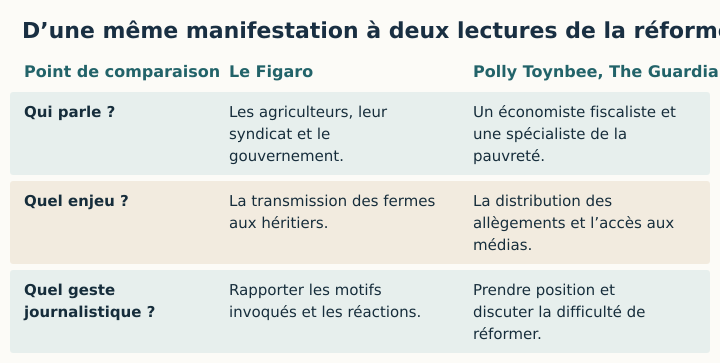

# Agro-Véto · BCPST · Anglais 2025 — Corrigé brut

*Corrigé rédigé par IA, non officiel. Signalez toute erreur.*

**Rédaction** · GPT-6.2 Astra Ultra · vitesse non renseignée

Écrit de deux heures. La comparaison est obligatoire. En expression, le candidat choisit un seul des deux sujets. Le jury rectifie la date de la tribune du Guardian au 22 novembre 2024.

## I · Compréhension des deux articles

The farmers outside Downing Street appear in both Le Figaro and The Guardian, but they play quite different roles. The French report asks what has brought them to London. Polly Toynbee uses their protest to ask whose objections ministers and newspaper readers are most likely to hear.

Le Figaro lets the farmers' union explain why inheritance matters to families who expect to pass on a working farm. Its leader sees a promise dating back to the war being broken. Readers learn about the planned lobbying as well as the tractors. They also hear the government's prediction that most farms will escape the charge. Even the suggestion that selling land could help younger farmers is reported alongside an angry response to it.

Toynbee treats the very prominence of the demonstration as evidence of inequality. She quotes an economist who argues that wealthy buyers have used land to shelter their fortunes, driving up its price, and points out that the proposed rate is still preferential. Children growing up in poverty have no comparable opportunity to put their interests on the front pages. Where Le Figaro describes a disagreement over the future of farms, Toynbee argues that favourable coverage of vocal losers makes it exceptionally difficult for an elected government to finance public services by removing privileges.

*214 words.*

## II · Expression, sujet 1 · Protest and democracy

A ballot gives voters a choice between whole programmes every few years. It seldom allows them to say which particular injustice cannot wait. A protest can communicate that urgency efficiently, although public attention and an enforceable decision are two different measures of success.

The Montgomery bus boycott offers a good test. Black residents of the Alabama city kept the issue of segregated seating before the public by organising alternative transport for months. Their absence also mattered to the bus operators in a way that a single petition might not have done. Yet it took a federal court ruling, ultimately upheld by the Supreme Court in 1956, to make desegregation binding. The boycott helped turn an everyday indignity into an issue that public authorities had to confront. Litigation supplied a remedy that demonstrators alone could not enact.

Numbers can also mislead. Large crowds marched in London against the invasion of Iraq in February 2003, but Britain joined the invasion the following month. The march made public disagreement unmistakable without changing the immediate decision. Nor should the best organised crowd automatically outweigh citizens who cannot afford to take a day off. I would judge a protest by the people it enables to be heard and the institutional route it opens. Its democratic value can outlast a particular defeat, while its immediate effectiveness can be measured against its stated demand.

*227 words.*

## II · Expression, sujet 2 · Can growth continue without limits?

Reagan's claim, made by a president in office during the 1980s, captures a reason to doubt forecasts based on yesterday's technology. Economic growth means producing more goods and services in real terms. The same inputs can produce much more when somebody finds a better way to use them.

Consider electric lighting. Replacing an incandescent bulb with an efficient LED allows a household to obtain the same light using less electricity. Improvements like this can release resources for other uses and expand what an economy can offer. They can also make lighting affordable where it was once a luxury. An account of growth that simply counts existing fuels and assumes unchanged efficiency misses both possibilities.

It is a further step, however, to infer that ingenuity removes all significant limits. Cheaper lighting may encourage a shop to illuminate its windows all night. A gain per lamp then need not reduce the total electricity consumed. Moreover, even exceptionally clever engineers cannot spend the same carbon budget twice. If today's extra production locks in emissions, a future invention cannot be assumed to undo the damage in time.

I therefore share Reagan's confidence about the capacity to improve living standards. I would judge a new technology by its total resource use and the services it delivers. Calling growth limitless in advance removes precisely the incentive to direct invention towards those improvements.

*226 words.*

[Sujet officiel, pp. 2–3](https://www.concours-agro-veto.fr/sites/default/files/media/2025-10/bcpst_0925_sp.pdf#page=2) · [Rapport du jury, erratum et critères](https://www.concours-agro-veto.fr/sites/default/files/media/2025-10/0-rapport_anglais_bcpst-2025-vdef.pdf#page=2) · [Notice du concours de l’X, filière BCPST](https://www.polytechnique.edu/admission-cycle-ingenieur/sites/admission/files/content/Notice%20du%20concours%202025%20publi%C3%A9e.pdf#page=19)
