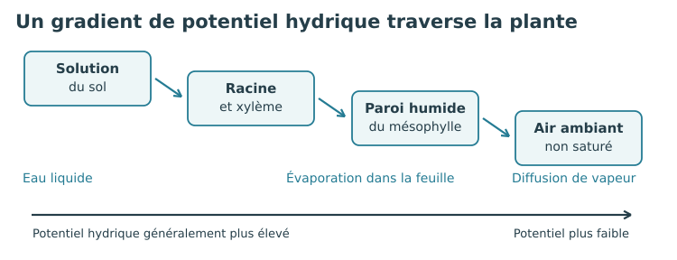
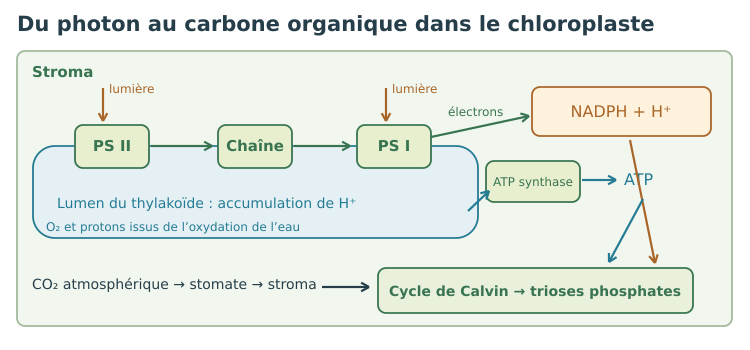
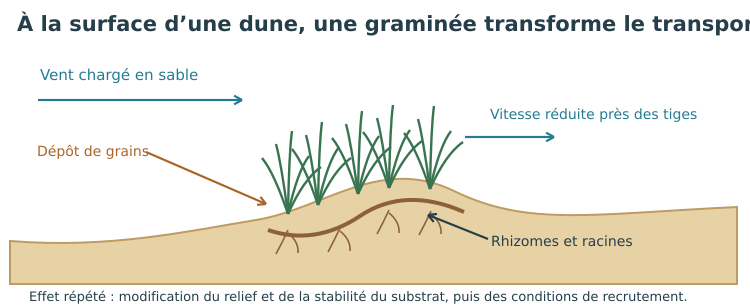

# Agro-Véto — BCPST, Biologie 2025 · Corrigé brut

*Corrigé rédigé par IA, non officiel.*

**Rédaction (tour 1)** · GPT-6.2 Astra Ultra · vitesse non renseignée

# Les Angiospermes et leur environnement abiotique

## Introduction

Sous un chêne, un jour d’été, la lumière et la température du sol diffèrent de celles d’une clairière voisine. Pourtant l’arbre dépend lui-même de la lumière qui l’atteint et de l’eau du sol. Les Angiospermes sont des plantes à fleurs dont les ovules sont contenus dans un carpelle. Après la double fécondation, les ovules deviennent des graines, et l’ovaire participe à la formation du fruit. Leur environnement abiotique comprend les composantes physiques et chimiques du milieu, parmi lesquelles la lumière, la température, l’eau, les gaz, les ions, le substrat et le vent. Une interaction peut être un flux de matière, un transfert d’énergie ou un effet de ce milieu sur l’organisme ou de l’organisme sur son milieu.

Comment une plante fixée peut-elle exploiter des ressources variables, ajuster son cycle à leur disponibilité et, par son activité répétée sur plusieurs générations, transformer les conditions qu’elle rencontre ? Nous suivrons d’abord les flux aux interfaces avec le sol et l’atmosphère, puis les réponses aux variations du milieu, avant de changer d’échelle pour examiner la dynamique des populations et des écosystèmes.

## I. Des surfaces d’échange couplent le sol, la plante et l’atmosphère

### Les gradients d’eau relient une racine à toute une colonne de sève

Chez une plante terrestre, l’appareil racinaire ramifié explore un volume de sol et les poils absorbants accroissent la surface au contact de sa solution. Lorsque le potentiel hydrique du sol est supérieur à celui de la racine, l’eau entre spontanément. Elle progresse par les parois ou par les cytoplasmes reliés par les plasmodesmes. À l’endoderme, les bandes de Caspary interrompent le trajet apoplastique et imposent un passage membranaire aux solutés qui l’empruntaient. Les vaisseaux du xylème assurent le transport longitudinal vers les feuilles. L’évaporation au niveau des parois humides du mésophylle, suivie de la diffusion de vapeur par les stomates, met la colonne d’eau en tension. La cohésion de l’eau transmet cette tension vers les racines. Un air sec et un sol qui se dessèche modifient ainsi le même flux par ses deux extrémités.

### Les membranes rendent le prélèvement minéral sélectif

L’eau du sol contient des ions dont les concentrations, la mobilité et la disponibilité diffèrent. Une ATPase de la membrane du poil absorbant expulse des protons et établit un gradient électrochimique. Le retour des protons peut fournir l’énergie nécessaire au cotransport du nitrate jusque dans la cellule. Le potassium peut entrer par des canaux lorsque le gradient électrochimique lui est favorable. Le nitrate absorbé, réduit puis incorporé aux acides aminés, contribue à la production de protéines. L’absorption est sélective et consomme indirectement de l’énergie. Une disponibilité minérale accrue ne garantit donc pas à elle seule une production plus élevée lorsque la lumière ou l’eau devient limitante. Chez certaines Fabacées, une faible disponibilité en azote minéral peut en outre favoriser la mise en place de nodosités si le partenaire symbiotique est présent. Le facteur abiotique intervient ici dans le coût et l’intérêt d’une voie distincte d’acquisition de l’azote.

### L’énergie lumineuse alimente la fixation du carbone atmosphérique

Dans une feuille, le dioxyde de carbone diffuse de l’air vers les espaces intercellulaires par les stomates, puis jusqu’au stroma des chloroplastes. Les photons absorbés par les pigments des thylakoïdes permettent les transferts d’électrons. Au photosystème II, l’oxydation de l’eau fournit des électrons, libère du dioxygène et contribue à l’accumulation de protons dans le lumen. La chaîne transfère les électrons au photosystème I. Une nouvelle excitation permet la réduction du NADP⁺ du côté du stroma. Le retour des protons du lumen vers le stroma par l’ATP synthase fournit de l’ATP. Dans le cycle de Calvin, la Rubisco fixe le CO₂ sur le ribulose-1,5-bisphosphate. Les composés à trois carbones sont réduits grâce à l’ATP et au NADPH, et une partie des produits régénère l’accepteur. Un bilan simplifié pour un équivalent hexose est $6\,\mathrm{CO_2}+6\,\mathrm{H_2O}\rightarrow\mathrm{C_6H_{12}O_6}+6\,\mathrm{O_2}$ sous apport d’énergie lumineuse. L’origine du dioxygène se vérifie par marquage isotopique : quand une plante éclairée reçoit de l’eau enrichie en oxygène 18, le dioxygène dégagé porte ce marqueur. Le bilan global seul ne permettait pas de l’attribuer à l’eau.

Le carbone assimilé alimente la respiration, la croissance, l’export de saccharose par le phloème vers les organes consommateurs et la mise en réserve. Une feuille peut accumuler de l’amidon pendant le jour puis le remobiliser la nuit. Les échanges avec l’atmosphère persistent la nuit par la respiration, tandis que la fixation photosynthétique cesse dans l’obscurité. Ces flux varient aussi au cours de la vie de la plante. La même ouverture stomatique laisse entrer le CO₂ tout en favorisant la perte d’eau, ce qui impose un ajustement à court terme.

## II. Les variations du milieu règlent le fonctionnement et le calendrier de développement

### Des minutes aux jours, un individu ajuste ses échanges et sa croissance

À la lumière bleue, l’activation de pompes à protons dans les cellules de garde favorise leur hyperpolarisation, l’entrée de potassium et l’accumulation d’autres osmolytes. La baisse du potentiel osmotique provoque une entrée d’eau. Les cellules deviennent turgescentes et leurs parois de structure anisotrope ouvrent l’ostiole. La diffusion du CO₂ augmente mais celle de vapeur d’eau aussi. Lors d’un déficit hydrique, l’acide abscissique favorise la sortie d’anions puis de potassium. L’eau quitte les cellules de garde et l’ouverture diminue. La variation d’éclairement et d’humidité est ainsi convertie en variation de conductance stomatique, avec un compromis entre gain de carbone et perte d’eau.

Le milieu possède aussi une direction. Dans une jeune tige éclairée latéralement, les phototropines perçoivent la lumière bleue. Une redistribution de l’auxine favorise davantage l’élongation sur le côté ombragé. La croissance différentielle courbe durablement la tige vers la source. À un même génotype peuvent également correspondre des feuilles d’ombre plus minces et des feuilles de lumière plus épaisses. Ces ajustements individuels au milieu relèvent de la plasticité phénotypique.

### Des saisons à la génération, des signaux synchronisent croissance et reproduction

Chez un chêne tempéré, la succession des saisons gouverne l’activité cambiale. Le bois initial produit au printemps comporte de larges vaisseaux, le bois final des vaisseaux plus petits. La répétition de ces deux zones forme un cerne. Température et disponibilité en eau modulent l’accroissement annuel. Dans un organe pérenne, les réserves formées lors d’une période de photosynthèse peuvent soutenir le redémarrage avant que les nouvelles feuilles n’exportent assez de saccharose.

La durée du jour ou l’histoire thermique peuvent annoncer une saison propice à la reproduction. Chez certaines accessions hivernales d’Arabidopsis, FLC réprime des gènes qui favorisent la floraison. Une période prolongée de froid conduit à une répression épigénétique durable de FLC à l’échelle de l’individu. Cette vernalisation lève un frein. Lorsque la durée du jour est ensuite favorable, la protéine FT produite dans les feuilles rejoint l’apex, où elle participe au passage du méristème à l’état floral. Le froid prépare ainsi la compétence à fleurir. La floraison elle-même peut survenir après l’hiver.

Le vent intervient ensuite comme vecteur physique. Chez le noisetier, les chatons exposent de nombreuses anthères et libèrent un pollen léger que des stigmates peuvent intercepter. Après fécondation, le vent peut transporter un autre stade du cycle, par exemple la samare ailée de l’érable qui ralentit la chute du fruit. L’environnement abiotique intervient donc tantôt dans le transport du gamétophyte mâle, tantôt dans la dispersion d’un fruit contenant la graine. L’imbibition d’une graine dont la dormance est levée permet enfin la reprise du métabolisme si température et oxygénation sont adéquates.

### Des générations successives conservent certaines réponses aux contraintes

Chez le laurier-rose, une cuticule épaisse et des stomates enfoncés dans des cryptes limitent les échanges avec un air sec. À l’inverse, chez un nénuphar à feuilles flottantes, les stomates de la face supérieure communiquent avec l’air et de grands espaces aérifères favorisent les échanges internes jusque vers les organes immergés. Ces formes héritables expriment une histoire évolutive. Elles se distinguent de la fermeture rapide d’un stomate ou des feuilles d’ombre produites par un même pied. Dans des lignées distinctes soumises à des contraintes similaires, des traits comme la succulence ont pu apparaître indépendamment, par convergence. Si la survie et le nombre de descendants diffèrent entre variants héréditaires selon la disponibilité de l’eau, leur fréquence peut évoluer au fil des générations.

## III. Les peuplements transforment à leur tour le sol, le climat local et les cycles de matière

### La végétation participe à la formation du sol dont elle dépend

Dans une fissure, la croissance d’une racine exerce une pression qui contribue à fragmenter la roche. La respiration produit du CO₂ dont la dissolution acidifie localement l’eau. L’altération de certains minéraux libère alors des ions. Les feuilles mortes et les racines renouvelées fournissent de la matière organique au sol. Sous l’action des décomposeurs, une fraction est minéralisée et une autre peut être stabilisée en association avec des particules minérales. Les surfaces chargées des argiles et des matières organiques retiennent des cations échangeables. La rétention de l’eau dépend aussi de la texture et de la porosité. En retour, ces propriétés influencent l’enracinement, l’alimentation minérale et la production végétale. À l’échelle d’une parcelle, un couvert racinaire peut améliorer la stabilité des agrégats et limiter l’érosion par le ruissellement.

### La tolérance des organismes devient une propriété mesurable des populations

Sur un marais littoral, durée de submersion, salinité et oxygénation du sol varient avec l’altitude. Des espèces tolérant le sel et l’inondation peuvent s’établir là où de nombreuses autres Angiospermes germent mal ou survivent peu. Si la production de graines viables ne compense plus la mortalité et l’émigration d’une population, son effectif diminue. Une distribution observée résulte à la fois de ces performances démographiques, de l’arrivée des graines et des interactions biologiques. Elle ne démontre donc pas à elle seule une limite physiologique. À plus long terme, le réchauffement peut avancer certaines dates de floraison et déplacer les zones climatiques favorables. Une population isolée, à dispersion lente, peut se contracter si la vitesse du changement dépasse celle du recrutement dans de nouveaux sites.

### La production primaire et les modifications du milieu donnent des rétroactions

À l’échelle d’un peuplement, le flux de carbone fixé par photosynthèse constitue la production primaire brute. Après soustraction de la respiration des producteurs, la production primaire nette correspond au carbone disponible pour la croissance, le renouvellement des tissus et l’alimentation des réseaux trophiques. Une partie du carbone fixé séjourne des décennies dans le bois ou le sol, une autre retourne rapidement à l’atmosphère par respiration et décomposition. Le devenir d’une forêt comme puits de carbone dépend donc aussi de sa mortalité, de ses exportations et de ses perturbations. La transpiration restitue de l’eau à l’atmosphère, et l’ombrage de la canopée modifie la lumière reçue et la température du sous-bois.

Dans une dune littorale, l’oyat freine le vent près du sol et retient du sable transporté. Sa croissance et celle de ses rhizomes contribuent à la tenue du dépôt. La modification du relief, de l’humidité et de la mobilité du substrat permet alors l’installation d’autres espèces. Une tempête peut arracher le couvert, remettre le sable en mouvement et engager une nouvelle trajectoire de succession. Un effet local d’une tige sur la vitesse du vent peut ainsi, répété sur de nombreuses plantes et plusieurs années, changer le milieu physique à l’échelle d’un paysage.

## Conclusion

Une racine, un chloroplaste et un stomate traduisent des gradients physiques en flux sélectifs d’eau, d’ions, de carbone et d’énergie. L’ouverture d’un ostiole varie en quelques minutes, alors que l’induction florale peut garder la mémoire d’un hiver. Ces ajustements se répercutent sur la survie et la reproduction et, au fil des générations, sur la distribution des populations. En sens inverse, un couvert végétal transforme la circulation de l’eau, le sable, le sol et les stocks de carbone. Pour comprendre l’avenir d’un peuplement exposé à des sécheresses plus fréquentes, il faut ainsi relier la réponse immédiate des stomates à la capacité durable du sol à retenir l’eau, elle-même modifiée par l’histoire de la végétation.
