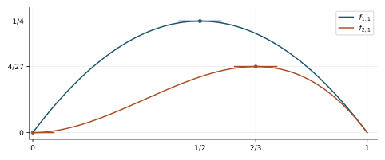
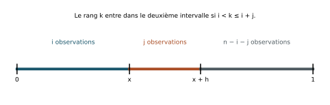
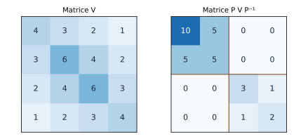

# Agro-Véto BCPST 2025 · Mathématiques, méthodes de calcul et raisonnement · Corrigé brut

*Corrigé rédigé par IA, non officiel. Signalez toute erreur.*

**Rédaction** · GPT-6.2 Astra Ultra · vitesse non renseignée

**Révision (tour 1)** · GPT-6.2 Astra Ultra · vitesse non renseignée

Le sujet comporte trois parties. Sa numérotation imprimée place la question 9 puis les questions 9.a à 9.d à la fin de la première partie. Le rapport du jury numérote ce second groupe 10 et décale ensuite les numéros d’une unité. Les repères ci-dessous suivent le sujet.

Les valeurs propres de la dernière partie se calculent dans les deux blocs associés au renversement des coordonnées. [Sujet officiel](https://www.concours-agro-veto.fr/sites/default/files/media/2025-10/bcpst_0425_sp.pdf) · [Rapport du jury](https://www.concours-agro-veto.fr/sites/default/files/media/2025-10/rapport_bcpst_methodes_de_calcul_et_raisonnement_2025.pdf)

## I. Autour d’une intégrale

### Question 1

Les deux graphes passent par $(0,0)$ et $(1,0)$. La parabole $f_{1,1}(x)=x-x^2$ a pour dérivée $1-2x$. Elle croît jusqu’au sommet $(1/2,1/4)$ puis décroît. Pour $f_{2,1}(x)=x^2-x^3$, la dérivée $x(2-3x)$ est positive sur $]0,2/3[$ et négative sur $]2/3,1]$. Le maximum vaut $4/27$ en $2/3$. Les tangentes sont horizontales en $0$ et en $2/3$. Enfin $f_{2,1}(x)=x f_{1,1}(x)$ place la seconde courbe sous la première sur $]0,1[$.

### Question 2

Pour tout $n\ge0$, $I_{0,n}=[-(1-x)^{n+1}/(n+1)]_0^1=1/(n+1)$.

### Question 3

Les fonctions $u(x)=x^a$ et $v(x)=-(1-x)^{b+1}/(b+1)$ sont de classe $C^1$ sur $[0,1]$. Le produit $uv$ s’annule en $1$, et il s’annule en $0$ car $a\ge1$. L’intégration par parties donne
$$I_{a,b}=\frac{a}{b+1}\int_0^1x^{a-1}(1-x)^{b+1}\,dx=\frac{a}{b+1}I_{a-1,b+1}.$$

### Question 4

Pour $a=0$, la question 2 donne $I_{0,b}=1/(b+1)=0!b!/(b+1)!$ pour tout $b\ge0$. Supposons la formule vraie à l’indice $a$ pour tout $b$. Pour un $b$ arbitraire, on peut donc l’appliquer en $b+1$. La question 3 donne
$$I_{a+1,b}=\frac{a+1}{b+1}I_{a,b+1}=\frac{a+1}{b+1}\frac{a!(b+1)!}{(a+b+2)!}=\frac{(a+1)!b!}{(a+b+2)!}.$$
Cela établit la formule $I_{a,b}=a!b!/(a+b+1)!$ pour tout couple.

### Question 5

Les intégrales sont strictement positives puisque l’intégrande est strictement positif sur $]0,1[$. Leur quotient vaut
$$\frac{I_{n+1,n+1}}{I_{n,n}}=\frac{(n+1)^2}{(2n+3)(2n+2)}=\frac{n+1}{2(2n+3)}\longrightarrow\frac14.$$

### Question 6

On a $u_n\to\ell$ si et seulement si
$$\forall\varepsilon>0,\quad\exists N\in\mathbb N,\quad\forall n\in\mathbb N,\quad n\ge N\Rightarrow |u_n-\ell|<\varepsilon.$$

### Question 7

Appliquons la question 6 au quotient de la question 5 avec $\ell=1/4$ et $\varepsilon=1/4$. Il existe $n_0$ tel que, pour tout $n\ge n_0$, le quotient est strictement inférieur à $1/4+1/4=1/2$. Cela donne en particulier l’inégalité large demandée.

On peut aussi déterminer un rang explicite. Le quotient vaut $(n+1)/(4n+6)$, strictement inférieur à $1/4$ dès $n=0$. Ainsi $n_0=0$ convient si la suite est indexée à partir de zéro. La preuve par la définition de la limite explique pourquoi aucun calcul explicite du rang n’était nécessaire.

### Question 8

À $n=n_0$, l’inégalité demandée est une égalité. Si $n\ge n_0$ et $I_{n,n}\le 2^{n_0}I_{n_0,n_0}/2^n$, la question 7 et la positivité de $I_{n,n}$ donnent
$$I_{n+1,n+1}\le\tfrac12 I_{n,n}\le \frac{2^{n_0}I_{n_0,n_0}}{2^{n+1}}.$$
La récurrence établit la majoration pour tout $n\ge n_0$.

### Question 9

Avec $C=2^{n_0}I_{n_0,n_0}$, on a $0\le I_{n,n}\le C(1/2)^n$ à partir de $n_0$. La série géométrique de raison $1/2$ converge. Le théorème de comparaison des séries à termes positifs établit la convergence de $\sum I_{n,n}$.

### Question 9.a

On a $2n/(2n+1)=1-1/(2n+1)$. Comme $\ln(1+u)\sim u$ quand $u\to0$, on obtient
$$\ln\!\left(\frac{2n}{2n+1}\right)\sim -\frac1{2n+1}\sim-\frac1{2n}.$$

### Question 9.b

La question 9.a donne $(2n+1)\ln(2n/(2n+1))\to-1$. La continuité de l’exponentielle entraîne la limite $e^{-1}$.

### Question 9.c

La formule intégrale donne $4^n I_{n,n}=4^n(n!)^2/((2n+1)(2n)!)$. Stirling appliqué à $n$ et à $2n$ fournit
$$4^n I_{n,n}\sim\frac{4^n n^{2n}e^{-2n}2\pi n}{(2n+1)(2n)^{2n}e^{-2n}\sqrt{4\pi n}}=\frac{\sqrt{\pi n}}{2n+1}\sim\frac{\sqrt{\pi}}{2\sqrt n}.$$
En appliquant directement Stirling à $2n+1$, la puissance $(2n/(2n+1))^{2n+1}$ a la limite obtenue à la question 9.b et compense le facteur $e$ issu des exponentielles.

La formule peut être contrôlée en termes du coefficient binomial central. On a $4^n I_{n,n}=4^n/((2n+1)\binom{2n}{n})$. Le coefficient central est équivalent à $4^n/\sqrt{\pi n}$ par Stirling, ce qui redonne le facteur $\sqrt\pi/2$.

### Question 9.d

Les termes sont positifs et équivalents à $(\sqrt\pi/2)n^{-1/2}$. La série de Riemann d’exposant $1/2\le1$ diverge. Par équivalence, $\sum 4^n I_{n,n}$ diverge.

## II. Loi bêta et statistique d’ordre

### Question 10

La statistique $X_{((n+1)/2)}$ est la médiane de l’échantillon. Pour $n=2m+1$, elle occupe le rang $m+1$ dans la liste ordonnée.

### Question 11

Pour $X_1$ uniforme sur $[0,1]$, on a $F(x)=0$ si $x<0$, $F(x)=x$ si $0\le x\le1$, et $F(x)=1$ si $x>1$. L’intégration de la densité donne $\mathbb E(X_1)=\int_0^1 t\,dt=1/2$ et $\mathbb E(X_1^2)=\int_0^1 t^2\,dt=1/3$. Donc $\operatorname{Var}(X_1)=1/3-1/4=1/12$.

### Question 12

Pour tout $x$, l’événement $\{X_{(1)}>x\}$ signifie que tous les $X_i$ sont strictement supérieurs à $x$. L’indépendance lui donne la probabilité $(1-F(x))^n$. De même $\{X_{(n)}\le x\}$ signifie que tous les $X_i$ sont au plus égaux à $x$. Ainsi, sur $[0,1]$,
$$F_{X_{(1)}}(x)=1-(1-x)^n,\qquad F_{X_{(n)}}(x)=x^n.$$
Les deux fonctions valent $0$ pour $x<0$ et $1$ pour $x>1$.

### Question 13.a

Avec $i,j\ge0$ et $i+j\le n$, les $n-i-j$ observations restantes appartiennent à $]x+h,1]$. La probabilité demandée est donc
$$p_{i,j,n-i-j}(x,x+h)=\frac{n!}{i!j!(n-i-j)!}x^i h^j(1-x-h)^{n-i-j}.$$
Une puissance d’exposant nul vaut ici $1$, y compris pour un intervalle de longueur nulle.

### Question 13.b

La différence des fonctions de répartition vaut $\mathbb P(x<X_{(k)}\le x+h)$. Si $i$ observations sont au plus égales à $x$ et $j$ supplémentaires au plus égales à $x+h$, l’événement équivaut à $i<k\le i+j$. Les couples d’effectifs décrivent des événements disjoints, avec $0\le i\le k-1$ et $k-i\le j\le n-i$. Par la question 13.a,
$$F_{X_{(k)}}(x+h)-F_{X_{(k)}}(x)=\sum_{i=0}^{k-1}\sum_{j=k-i}^{n-i}\frac{n!x^i h^j(1-x-h)^{n-i-j}}{i!j!(n-i-j)!}.$$

### Question 13.c

Fixons $0\le x<1$. Tous les termes de la somme sont divisibles par $h$ puisque $j\ge k-i\ge1$. Pour $j\ge2$, le produit $h^{j-1}(1-x-h)^{n-i-j}$ tend vers zéro à droite. Pour $j=1$, on a nécessairement $i=k-1$. La somme est finie, donc la limite cherchée vaut
$$\frac{n!}{(k-1)!(n-k)!}x^{k-1}(1-x)^{n-k}=n\binom{n-1}{k-1}x^{k-1}(1-x)^{n-k}.$$
Le texte admet que la fonction obtenue, prolongée par zéro hors de $[0,1]$, est une densité. La valeur choisie en un point isolé ne change pas la loi.

Aux rangs extrêmes, la limite devient $n(1-x)^{n-1}$ pour $k=1$ et $nx^{n-1}$ pour $k=n$. Ce sont les dérivées des deux fonctions de répartition déjà obtenues en 12. Au rang général, on peut aussi compter les observations de $[0,x]$ selon une loi binomiale, puis dériver la somme de sa queue.

### Question 14

La variable $X_{(k)}$ appartient presque sûrement à $[0,1]$, ce qui garantit l’existence de ses moments d’ordres 1 et 2. Écrivons $C=n!/((k-1)!(n-k)!)$. Alors
$$\mathbb E(X_{(k)})=C I_{k,n-k}=\frac{k}{n+1},\qquad \mathbb E(X_{(k)}^2)=C I_{k+1,n-k}=\frac{k(k+1)}{(n+1)(n+2)}.$$
En soustrayant le carré de l’espérance et en réduisant au même dénominateur, on obtient
$$\operatorname{Var}(X_{(k)})=\frac{k((k+1)(n+1)-k(n+2))}{(n+1)^2(n+2)}=\frac{k(n+1-k)}{(n+1)^2(n+2)}.$$

Au rang minimal, on obtient $\mathbb E(X_{(1)})=1/(n+1)$ et, au rang maximal, $\mathbb E(X_{(n)})=n/(n+1)$. Les deux variances coïncident, ce que confirme la symétrie de l’échantillon transformé par $x\mapsto1-x$.

## III. Matrices bisymétriques et application

### Question 15

Par définition $E_n\subset\mathcal M_n(\mathbb R)$ et la matrice nulle vérifie les deux égalités. Soient $A,B\in E_n$ et $u,v\in\mathbb R$. Pour $L=uA+vB$, la linéarité de la transposition donne $L^T=uA^T+vB^T=L$. Par distributivité, $J_n L J_n=uJ_n A J_n+vJ_n B J_n=uA^T+vB^T=L^T$. Ainsi $L\in E_n$, ce qui prouve que $E_n$ est un sous-espace vectoriel.

### Question 16

Si $e_i$ désigne le $i$-ème vecteur de base, $J_4e_i=e_{5-i}$. Les deux vecteurs $e_1+e_4,e_2+e_3$ sont fixes. Les deux vecteurs $e_1-e_4,e_2-e_3$ sont envoyés sur leur opposé. Ces quatre vecteurs non nuls sont orthogonaux deux à deux, donc forment une base. En les prenant dans cet ordre,
$$Q=\begin{pmatrix}1&0&1&0\\0&1&0&1\\0&1&0&-1\\1&0&-1&0\end{pmatrix},\qquad D=\operatorname{diag}(1,1,-1,-1).$$
On a $J_4Q=QD$. La matrice $Q$ étant inversible, $J_4=QDQ^{-1}$.

### Question 17

Pour tout $i$, $J_4^2e_i=J_4e_{5-i}=e_i$. Donc $J_4J_4=I_4$, ce qui prouve l’inversibilité et donne $J_4^{-1}=J_4$.

### Question 18

Si $M$ est symétrique, $m_{ij}=m_{ji}$. Sous cette condition, la persymétrie devient $M=J_4MJ_4$, c’est-à-dire $m_{ij}=m_{5-i,5-j}$. Les deux égalités imposent à partir des entrées $m_{11}=a,m_{12}=b,m_{13}=c,m_{14}=d,m_{22}=e,m_{23}=f$ la forme
$$M(a,b,c,d,e,f)=\begin{pmatrix}a&b&c&d\\b&e&f&c\\c&f&e&b\\d&c&b&a\end{pmatrix}.$$
Réciproquement, toute matrice affichée est inchangée par transposition et par renversement simultané des lignes et colonnes. Elle vérifie donc $M^T=M=J_4MJ_4$ et est bisymétrique.

### Question 19

Pour la notation $M(a,b,c,d,e,f)$ de la question 18, une base est
$$\big(M(1,0,0,0,0,0),M(0,1,0,0,0,0),M(0,0,1,0,0,0),M(0,0,0,1,0,0),M(0,0,0,0,1,0),M(0,0,0,0,0,1)\big).$$
La dimension de $E_4$ vaut $6$.

### Question 20

Si $Mu=\lambda u$ pour $u\ne0$, alors $Qu\ne0$ car $Q$ est inversible, et $(QMQ^{-1})(Qu)=QMu=\lambda Qu$. Réciproquement, si $(QMQ^{-1})v=\lambda v$ avec $v\ne0$, alors $Q^{-1}v\ne0$ et $M(Q^{-1}v)=\lambda(Q^{-1}v)$. Cela établit l’équivalence.

### Question 21

Notons $U$ et $W$ les deux blocs diagonaux de taille 2. Un vecteur propre $(u,w)$ associé à $\lambda$ est caractérisé par $Uu=\lambda u$, $Ww=\lambda w$ et $(u,w)\ne(0,0)$. L’une au moins des composantes est non nulle. Ainsi $\lambda$ appartient au spectre d’au moins un bloc. Réciproquement, si $u\ne0$ est propre pour $U$, alors $(u,0)$ est propre pour $M$. Le choix $(0,w)$ donne la même conclusion pour une valeur propre de $W$. Donc $\operatorname{Sp}(M)=\operatorname{Sp}(U)\cup\operatorname{Sp}(W)$.

### Question 22

La matrice $V$ est réelle et symétrique car $v_{ij}=v_{ji}$ pour tout $i,j$. Le théorème spectral fournit une base orthonormale de vecteurs propres réels de $V$. Elle est donc diagonalisable sur $\mathbb R$.

### Question 23

On lit $(a,b,c,d,e,f)=(4,3,2,1,6,4)$. L’identité donnée pour $PVP^{-1}$ fournit les blocs
$$U=\begin{pmatrix}10&5\\5&5\end{pmatrix},\qquad W=\begin{pmatrix}3&1\\1&2\end{pmatrix}.$$
Les questions 20 et 21 ramènent le spectre de $V$ à la réunion de ceux de $U$ et $W$. Pour $U$, l’équation $(10-\lambda)(5-\lambda)-25=0$ devient $\lambda^2-15\lambda+25=0$, de discriminant $125$. Pour $W$, on obtient $(3-\lambda)(2-\lambda)-1=\lambda^2-5\lambda+5=0$, de discriminant $5$. Finalement,
$$\operatorname{Sp}(V)=\left\{\frac{15-5\sqrt5}{2},\frac{15+5\sqrt5}{2},\frac{5-\sqrt5}{2},\frac{5+\sqrt5}{2}\right\}.$$
Leur somme vaut $20$, comme la trace de $V$.

Les déterminants des deux blocs valent $25$ et $5$, d’où $\det V=125$. La factorisation $(z^2-15z+25)(z^2-5z+5)$ donne pour coefficient de $z^3$ la valeur $-20$, opposée de la trace de $V$. Ces deux contrôles utilisent directement les invariants de la matrice.

