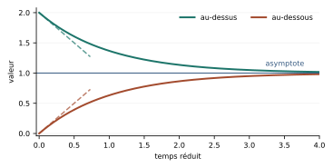
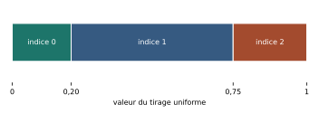
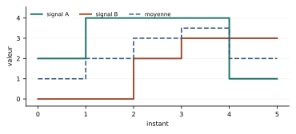
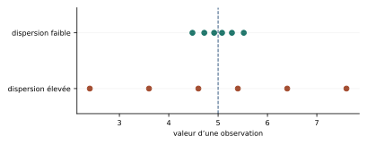

# Agro-Véto · BCPST · Modélisation mathématique et informatique 2025 — corrigé brut

*Corrigé rédigé par IA, non officiel. Signalez toute erreur.*

**Rédaction** · GPT-6.2 Astra Ultra · vitesse non renseignée · 25 novembre 2026

**Couverture partielle.** Les questions 1, 3, 6, 8, 15, 17.1, 19 et 22 à 24 sont traitées, ainsi que les calculs de cours des questions 18, 25 et 26. Les questions 2, 4, 5, 7, 9 à 14, 16, 17.2, 20, 21 et 27 à 33 et les interprétations biologiques de 18, 25 et 26 sont hors du périmètre de cette édition.

## I. Unités, variations et algèbre linéaire

### Question 1 · Homogénéité d’un flux

Les grandeurs étudiées s’expriment en picogrammes, le temps en secondes. Un terme ajouté directement à une dérivée a pour unité $\mathrm{pg}\,\mathrm{s}^{-1}$. Ainsi $a$ s’exprime en $\mathrm{pg}\,\mathrm{s}^{-1}$. Lorsqu’un terme est un coefficient multiplié par une grandeur en pg, le coefficient s’exprime en $\mathrm{s}^{-1}$. C’est le cas de $b$, $c$ et $d$.

### Question 3.1 · Asymptote d’une exponentielle

Écrivons $u(t)=L+(u_0-L)e^{-ct}$ avec $c>0$. Comme $e^{-ct}$ tend vers zéro, la limite vaut $L$. Dans la notation de la question, $m_\infty=a/c$.

### Question 3.2 · Tangente initiale

La dérivée est $u'(t)=-c(u_0-L)e^{-ct}$. Le point de contact est $(0,u_0)$ et la pente vaut $c(L-u_0)$. Dans les notations imprimées, la droite a donc pour équation $y=m_0+(a-cm_0)t$.

### Question 3.3 · Les deux allures possibles

Si $u_0>L$, alors $u(t)>L$ et $u'(t)<0$ à tout temps fini. La courbe descend vers son asymptote horizontale et elle est convexe car $u''(t)>0$. Si $u_0<L$, la courbe croît sous l’asymptote et elle est concave. Si $u_0=L$, la droite $y=L$ est la courbe entière.



### Question 6.1 · Valeurs propres et directions propres

La matrice de l’énoncé est triangulaire de diagonale $(-1,-2)$. Son polynôme caractéristique est $(X+1)(X+2)$. Les deux racines réelles distinctes fournissent deux espaces propres indépendants dans un espace de dimension deux. Pour $-1$, l’équation restante est $x-y=0$. Pour $-2$, c’est $x=0$. En imposant que la seconde coordonnée vaille $1$, on obtient respectivement $(1,1)$ et $(0,1)$.

### Question 6.2 · Matrice de passage

On obtient les matrices suivantes.

$$
P=\begin{pmatrix}1&0\\1&1\end{pmatrix},\qquad D=\begin{pmatrix}-1&0\\0&-2\end{pmatrix}.
$$

Leurs colonnes vérifient $AP=PD$ et $\det P=1$. En multipliant cette égalité à droite par l’inverse de $P$, on obtient $A=PDP^{-1}$.

### Question 6.3 · Inversion

L’image de $(x,y)$ par $P$ est $(x,x+y)$. Son antécédent en $(u,v)$ est donc $(u,v-u)$. Par conséquent,

$$
P^{-1}=\begin{pmatrix}1&0\\-1&1\end{pmatrix}.
$$

On contrôle le signe de la case inférieure gauche en calculant la seconde ligne de $P^{-1}P$, qui vaut $(0,1)$.

### Question 8 · Deux équations scalaires

Les solutions constantes des deux équations imprimées sont respectivement $a$ et $-a/2$. Posons $w_1=z_1-a$ et $w_2=z_2+a/2$. Alors $w'_1=-w_1$ et $w'_2=-2w_2$. Avec des conditions initiales scalaires quelconques,

$$
z_1(t)=a+(z_1(0)-a)e^{-t},\qquad
z_2(t)=-\frac a2+\left(z_2(0)+\frac a2\right)e^{-2t}.
$$

## II. Lois de probabilité

### Question 15.1 · Identifier la loi de mystere

Pour $0\le p\le1$, la fonction renvoie 1 lorsque le tirage uniforme atteint ou dépasse $1-p$, événement de probabilité $p$. Elle renvoie 0 avec probabilité $1-p$. C’est la loi de Bernoulli de paramètre $p$. Les cas $p=0$ et $p=1$ donnent une constante avec le tirage Python sur $[0,1[$.

### Question 15.2 · Repérer et corriger le décalage de l’équation (13)

Posons $S_0=0$ et $S_i=\sum_{j=0}^{i-1}p_j$ pour $1\le i\le I$. Alors $S_I=1$ et la longueur de $[S_i,S_{i+1}[$ est $S_{i+1}-S_i=p_i$. Un tirage uniforme dans cet intervalle donne donc l’issue $a_i$ avec la bonne probabilité. La copie imprimée place les sommes aux rangs $i$ et $i+1$ inclus, ce qui décale les masses et ferait intervenir $p_I$ au dernier rang. Le rapport du jury confirme le décalage. Les conventions aux bornes ont une probabilité nulle pour la variable continue. L’intervalle vide représente naturellement une issue de masse nulle.



### Question 15.3 · Simuler une loi discrète finie

Sous les hypothèses du sujet, les blancs sont `pcumul + liste_p[i]`, `X < pcumul` et `i`. Une version qui pallie un arrondi du cumul juste au-dessous de 1 est la suivante. Elle suppose, comme l’énoncé, une liste non vide de masses positives ou nulles dont la somme vaut 1.

```python
from random import random

def loi_discrete_finie(liste_p):
    x = random()
    cumul = 0
    for i, masse in enumerate(liste_p):
        if masse > 0:
            dernier_positif = i
        cumul += masse
        if x < cumul:
            return i
    return dernier_positif
```

Le test strict ignore les intervalles vides, y compris lorsque $x=0$. Pour les masses $(1/4,0,3/4)$, le tirage $1/4$ renvoie ainsi l’indice $2$. Le coût maximal est de $I$ itérations et l’espace auxiliaire est constant.

### Question 17.1 · Absence de mémoire

Pour une variable $X$ exponentielle de paramètre $r>0$, la fonction de survie est $\Pr(X\ge v)=e^{-rv}$ pour $v\ge0$. Comme $t+s>t$ et que la loi ne possède pas d’atome en $t$, on obtient

$$
\Pr(X\ge t+s\mid X>t)=\frac{e^{-r(t+s)}}{e^{-rt}}=e^{-rs}=\Pr(X\ge s).
$$

### Question 18 · Espérance de la loi exponentielle

Pour $X\sim\mathcal E(r)$, $r>0$, l’espérance vaut $1/r$. Lorsque $r$ est en $\mathrm{s}^{-1}$, l’espérance est bien en secondes. Ce résultat répond au calcul de cours demandé dans la première partie de la question.

### Question 19 · Transformer une uniforme

Soit $U$ uniforme sur $[0,1]$. L’événement $U=0$ a une probabilité nulle. La variable $Y=-\ln(U)/\mu$ est presque sûrement positive. Pour $y<0$, sa fonction de répartition vaut zéro. Pour $y\ge0$ et $\mu>0$,

$$
\Pr(Y\le y)=\Pr(\ln U\ge-\mu y)=\Pr(U\ge e^{-\mu y})=1-e^{-\mu y}.
$$

Ce sont les deux branches de la fonction de répartition de $\mathcal E(\mu)$.

## III. Grilles temporelles et moyennes

### Question 22 · Moyenner deux fonctions en escalier

Deux enregistrements peuvent partager les dates initiale et finale et avoir des dates de saut différentes. En prenant la moyenne des éléments de même indice on risque donc de combiner des valeurs prises à des dates différentes. Il faut former la réunion triée des dates, puis, à chaque date, retenir pour chaque signal sa dernière valeur connue. Une valeur enregistrée au temps $t$ est celle adoptée dès $t$.



### Question 23.1 · Date propre au premier signal

Si $T_1[i_1]<T_2[i_2]$, la première série acquiert ses nouvelles valeurs à $T_1[i_1]$. La seconde série garde les valeurs du dernier échantillon traité, d’indice $i_2-1$. On inscrit la date commune de lecture et les deux couples de valeurs, puis on avance seulement $i_1$. Cet indice $i_2-1$ est valide car les deux séries commencent ensemble et le premier passage a consommé leur première date commune.

### Question 23.2 · Date commune

Les lignes 24 à 29 inscrivent une seule date et les nouvelles valeurs des deux séries à cette date. Les lignes 30 et 31 avancent ensuite les deux indices. Cela se produit au moins au premier et au dernier instant, communs par hypothèse, et à chaque saut simultané éventuel. Si les listes sont réduites à un seul instant, le premier est aussi le dernier.

### Question 23.3 · Sortie et invariant de la fusion

La première liste renvoyée est la réunion triée et sans doublons des deux grilles strictement croissantes. Les quatre autres contiennent, sur cette même grille, les deux composantes du premier signal puis les deux du second. Avant chaque tour, toutes les dates strictement antérieures à la plus petite tête restante sont déjà traitées. Les trois branches maintiennent cet invariant. Grâce à la dernière date commune, on épuise les deux listes ensemble. Le nombre d’avancements est $n_1+n_2$, ce qui donne un temps $O(n_1+n_2)$.

### Question 24 · Mettre à jour une moyenne en ligne

Pour chaque indice de la grille déjà alignée, si $k$ séries ont une moyenne $u$, leur somme vaut $ku$. En incorporant la valeur $v$ d’une nouvelle série, on obtient $(ku+v)/(k+1)$. Les lignes 12 et 13 sont donc

```python
Mmoy[i] = (nbmoy * Mmoy[i] + liste_M[i]) / (nbmoy + 1)
Pmoy[i] = (nbmoy * Pmoy[i] + liste_P[i]) / (nbmoy + 1)
```

La valeur de `nbmoy` reste celle de l’effectif antérieur pendant toute la mise à jour. Si les trois valeurs à une date sont 2, 4 et 9, les moyennes successives sont 2, 3 et 5, conformément au calcul direct.

### Question 25 · Interpréter deux moments à temps fixé

À un instant fixé $t$, écrivons $X_i$ pour une observation, $\mu_t$ pour son espérance. La formule $\mathbb E(X_i)=\mu_t$ donne le centre de la distribution. La formule $\mathbb E[(X_i-\mu_t)^2]=\sigma^2$ quantifie sa dispersion. Un grand $\sigma$ correspond à de grands écarts quadratiques en moyenne. Le paramètre $\sigma$ a la même unité que $X_i$.

### Question 26 · Moyenne empirique, variance et convergence

Pour $n$ observations indépendantes de moyenne $\mu_t$ et de variance $\sigma^2$ à un même instant, posons $\bar X_n=n^{-1}\sum_i X_i$. La linéarité de l’espérance donne $\mathbb E\bar X_n=\mu_t$. Les covariances entre observations distinctes sont nulles, donc

$$
\operatorname{Var}(\bar X_n)=\frac{1}{n^2}\sum_{i=1}^n\operatorname{Var}(X_i)=\frac{\sigma^2}{n}.
$$

Ainsi $\mathbb E[(\bar X_n-\mu_t)^2]=\sigma^2/n$ tend vers zéro. La moyenne converge en moyenne quadratique et donc en probabilité vers $\mu_t$. Pour tout $\varepsilon>0$, Bienaymé–Tchebychev donne explicitement $\Pr(|\bar X_n-\mu_t|\ge\varepsilon)\le\sigma^2/(n\varepsilon^2)$. Comparer deux dispersions à centre identique permet de distinguer la variabilité d’une observation de l’erreur-type $\sigma/\sqrt n$ de la moyenne.


