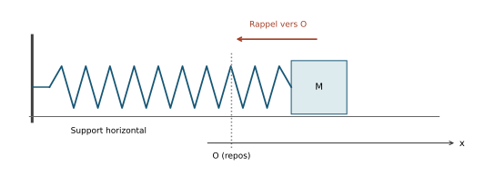
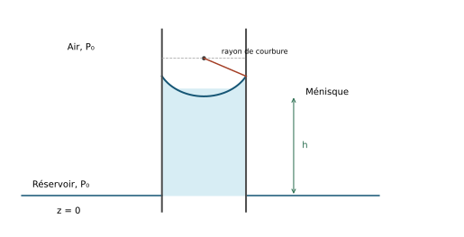
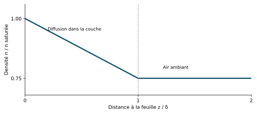
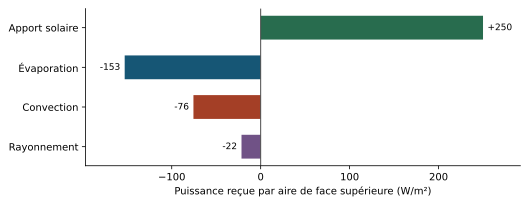

# Agro-Véto BCPST 2025 — Physique · Corrigé brut

*Corrigé rédigé par IA, non officiel. Signalez toute erreur.*

**Lecture du rapport du jury** · GPT-6.2 Astra Ultra · vitesse non renseignée

**Rédaction** · GPT-6.2 Astra Ultra · vitesse non renseignée

## Un peu de physique autour des arbres

## I — Sédimentation des grains

### Question 1 — Poids et poussée

Soit $V_p=4\pi r_p^3/3$. Le poids a pour norme $\rho_p V_pg$, la poussée d'Archimède $\rho_aV_pg$. Leur rapport (poussée sur poids) vaut $\rho_a/\rho_p\simeq1{,}2/1000\simeq1{,}2\,10^{-3}$ pour un grain riche en eau. La négliger entraîne une erreur relative de l'ordre du millième sur la force motrice.

### Question 2 — Vitesse orientée vers le haut

Dans le référentiel terrestre galiléen, la pesanteur est dirigée vers le bas et le frottement s'oppose à la vitesse. En projetant selon $+\mathbf e_z$ et en négligeant la poussée,
$$m\dot v=-mg-6\pi\eta r_pv,\qquad m=\rho_pV_p.$$
En chute, $v<0$ et le dernier terme est positif : il ralentit la chute.

### Question 3 — Temps de réponse et vitesse limite

L'équation s'écrit $\tau\dot v+v=-v_S$ avec
$$\tau=\frac{m}{6\pi\eta r_p}=\frac{2\rho_pr_p^2}{9\eta},\qquad v_S=g\tau=\frac{2r_p^2\rho_pg}{9\eta}>0.$$
La composante limite est $-v_S$. Avec $v(0)=0$, $v(t)=-v_S(1-e^{-t/\tau})$.

### Question 4 — Distance de mise en régime

Les mesures donnent $v_S=0{,}21$ à $0{,}32\ {\rm m\,s^{-1}}$. L'estimation $\tau=v_S/g$ donne 21 à 33 ms (valeur centrale proche de 27 ms). À $5\tau$, la vitesse atteint 99,3 % de sa limite. La distance parcourue depuis le repos vaut
$$d(t)=v_S[t-\tau(1-e^{-t/\tau})],\qquad d(5\tau)=(4+e^{-5})v_S\tau.$$
Avec les valeurs maximales, $d(5\tau)\simeq4{,}2$ cm ; la borne simple $d\le5v_S\tau$ vaut $5{,}2$ cm. Ces ordres de grandeur concordent avec la zone d'accélération annoncée sous 5 cm et le début du chronométrage à 40 cm. La mesure porte sur le régime établi.

### Question 5 — Régime d'écoulement autour du grain

Le fluide est l'air et la longueur caractéristique est le diamètre du grain. Pour $d_p\simeq90\ \mu{\rm m}$ et $v_S\simeq0{,}26\ {\rm m\,s^{-1}}$,
$$\mathrm{Re}=\frac{\rho_a v_S d_p}{\eta}\simeq\frac{1{,}2(0{,}26)(90\,10^{-6})}{1{,}8\,10^{-5}}\simeq1{,}6.$$
Les extrêmes du document donnent environ 1 à 2,3 : le sillage est laminaire. La traînée de Stokes au sens strict exige en outre que l'inertie soit négligeable ($\mathrm{Re}\ll1$), hypothèse ici seulement approchée.

### Question 6 — Pente de la loi de Stokes

À masse volumique et viscosité constantes, $v_S=[2\rho_pg/(9\eta)]\,r_p^2$. C'est une fonction linéaire de l'abscisse $r_p^2$ sur tout le domaine de cette loi. Avec $\rho_p=1{,}2\,10^3\ {\rm kg\,m^{-3}}$, sa pente théorique est $a_{\rm St}=1{,}453\,10^8\ {\rm m^{-1}\,s^{-1}}$, en utilisant les valeurs centrales de l'énoncé.

### Question 7 — Ajustement et écart normalisé

La figure 1 fournit $a_{\rm exp}=(126{,}59\pm0{,}85)\,10^6\ {\rm m^{-1}\,s^{-1}}$, pour une régression contrainte à l'origine. Si les paramètres de Stokes sont pris à leurs valeurs nominales et le $\pm0{,}85$ comme incertitude-type, l'écart normalisé vaut $|145{,}33-126{,}59|/0{,}85\simeq22$, très supérieur à 2. La pente physique de Stokes surestime donc les mesures sur cette plage. La droite ajustée suit la croissance moyenne du nuage ; les points sont dispersés et l'intervalle de rayons restreint. Cet accord descriptif n'établit ni la loi exacte en $r_p^2$ ni l'accord du coefficient théorique. Si une incertitude sur $\rho_p$ ou $\eta$ était fournie, il faudrait l'inclure dans le dénominateur en quadrature.

### Question 8 — Correction à Reynolds fini

Avec $\mathrm{Re}\simeq1{,}6$, $0{,}158\,\mathrm{Re}^{2/3}\simeq0{,}22$ (environ 0,16 à 0,27 aux extrêmes). Si l'on supprime ce terme, $C_x=24/\mathrm{Re}$. En insérant $\mathrm{Re}=2\rho_a r_pv_S/\eta$ dans le bilan fourni,
$$v_S^2=\frac{8\rho_pr_pg}{3\rho_a}\frac{2\rho_a r_pv_S}{24\eta}
\quad\Longrightarrow\quad v_S=\frac{2\rho_pr_p^2g}{9\eta}.$$
Le terme correctif accroît la traînée à vitesse fixée ; il réduit donc la vitesse limite par rapport à Stokes. Son importance s'accorde avec le sens et l'ordre de grandeur du désaccord en Q7.

## I — Mesure par micro-oscillateur

### Question 9 — Oscillateur horizontal

La force de rappel est $-kx\,\mathbf e_x$ car la longueur du ressort vaut $\ell_0+x$. La masse $M$ a son abscisse nulle à la longueur à vide ; poids et réaction verticale se compensent dans le modèle horizontal. Newton donne $M\ddot x=-kx$, soit $\ddot x+(k/M)x=0$.

### Question 10 — Fréquence propre

L'équation harmonique a la pulsation $\omega_0=\sqrt{k/M}$, en radians par seconde. Par conséquent $f_0=(2\pi)^{-1}\sqrt{k/M}$, en hertz.

### Question 11 — Charge par un grain

Le grain accompagne la masse sans modifier la raideur. L'inertie devient $M+m$ et $f=(2\pi)^{-1}\sqrt{k/(M+m)}=f_0(1+m/M)^{-1/2}<f_0$. L'oscillateur chargé oscille plus lentement.

### Question 12 — Petit déplacement de la fréquence

Avec $\epsilon=m/M\ll1$, le développement $(1+\epsilon)^{-1/2}=1-\epsilon/2+O(\epsilon^2)$ conduit à $\Delta f/f_0=(f-f_0)/f_0=-m/(2M)+O((m/M)^2)$. Le signe est celui de l'abaissement de fréquence observé.

### Question 13 — Masse d'un oscillateur suffisamment sensible

Au seuil, $m/(2M)=50\,10^{-6}$. Pour $m=10$ ng, $M=10\,{\rm ng}/10^{-4}=10^5$ ng $=100\ \mu{\rm g}=0{,}10$ mg. Une masse oscillante plus petite donnerait un signal relatif plus grand, tant que $m\ll M$.

## II — Statique de la sève

### Question 14 — Équilibre d'une tranche de liquide

En référentiel galiléen, considérons une tranche horizontale de section $S$ et hauteur $dz$. La pression inférieure pousse vers le haut, la pression supérieure et le poids vers le bas. La projection de la résultante nulle donne $P(z)S-P(z+dz)S-\rho gS\,dz=0$. Au premier ordre, $dP/dz=-\rho g$.

### Question 15 — Profil de pression

La masse volumique de l'eau étant supposée constante et $P(0)=P_0$, l'intégration donne $P(z)=P_0-\rho gz$. La pression augmente lorsqu'on descend.

### Question 16 — Hauteur apparente de dix mètres

Si l'on imposait à la pression absolue de rester positive, $P_0-\rho gh\ge0$ donnerait $h\le P_0/(\rho g)\simeq10{,}3$ m pour $P_0\simeq1{,}01\,10^5$ Pa. Le séquoia de 112 m contredit cette limite apparente. La possibilité d'une traction dans un liquide cohésif remettra en question l'inégalité supposée.

## II — Ascension capillaire

### Question 17 — Longueur capillaire

La tension superficielle $\gamma$ s'exprime en N/m et $\rho g$ en $\rm N\,m^{-3}$. Ainsi $\gamma/(\rho g)$ est une surface et $\ell_c=\sqrt{\gamma/(\rho g)}$ une longueur. Pour l'eau, $\ell_c=\sqrt{0{,}073/(1000\times9{,}81)}=2{,}73$ mm.

### Question 18 — Forme du ménisque

Les rayons des canaux, 25 à $250\ \mu{\rm m}$, sont petits devant $2{,}73$ mm. Le nombre de Bond $r^2/\ell_c^2$ est compris entre environ $8\,10^{-5}$ et $8\,10^{-3}$. Le poids déforme peu l'interface à l'échelle du tube, et la courbure est sensiblement uniforme. En mouillage marqué, le rayon de courbure $\tilde r=r/\cos\alpha$ est lui aussi de cet ordre ; si l'angle était presque droit, on ne pourrait conclure à $\tilde r\ll\ell_c$ à partir du seul rayon du tube.

### Question 19 — Énergie de pesanteur gagnée

Le système est toute l'eau du tube et du grand réservoir. Lorsque le niveau monte de $dz$, le volume gagné en haut vaut $\pi r^2dz$ ; une même quantité quitte le réservoir au voisinage du niveau zéro. Le déplacement de l'ensemble est énergétiquement équivalent au transfert de cette masse de 0 à $z$ au premier ordre. Ainsi $dE_{\rm pp}=\rho\pi r^2 dz\,gz$. L'écart entre $z$ et l'altitude moyenne de la lamelle ajoutée ne contribue qu'en $(dz)^2$, dans l'approximation de colonne du sujet.

### Question 20 — Variation de l'énergie de surface

Sur une hauteur $dz$, l'interface solide–gaz perd $2\pi r\,dz$, l'interface solide–liquide gagne cette même aire. Le ménisque se translate sans changer d'aire ; le niveau du grand réservoir est considéré fixe. Ainsi
$$dE_{\rm ps}=2\pi r(\gamma_{SL}-\gamma_{SG})\,dz=-2\pi r\gamma\cos\alpha\,dz.$$
Pour un tube mouillant cette baisse d'énergie interfaciale favorise l'ascension.

### Question 21 — Équilibre et loi de Jurin

Le coefficient de $dz$ dans $d(E_{\rm pp}+E_{\rm ps})$ s'annule à $z=h$. Ainsi $\rho g\pi r^2h=2\pi r\gamma\cos\alpha$, d'où $h=2\gamma\cos\alpha/(r\rho g)$. La dérivée seconde de l'énergie, $\rho g\pi r^2$, est positive. La géométrie du ménisque sphérique donne $r=\tilde r\cos\alpha$ ; finalement $h=2\gamma/(\tilde r\rho g)$.

### Question 22 — Contrôle par le saut de pression

À l'intérieur de la sphère de courbure, au-dessus du ménisque, l'air communique avec l'atmosphère : $P_{\rm int}=P_0$. Dans le liquide juste au-dessous, la continuité hydrostatique avec le réservoir donne $P_{\rm ext}=P_0-\rho gh$. Leur différence $\rho gh=2\gamma/\tilde r$ redonne exactement Q21. La pression du liquide sous le ménisque concave est inférieure à celle du gaz.

### Question 23 — Ascension maximale dans le xylème

Le mouillage total donne $\alpha=0$, $\cos\alpha=1$. La hauteur maximale est atteinte pour le plus petit rayon disponible, $25\ \mu{\rm m}$. Elle vaut $2(0{,}073)/(25\,10^{-6}\times1000\times9{,}81)\simeq0{,}60$ m (0,060 m pour $250\ \mu{\rm m}$). La capillarité de ces canaux ne suffit donc pas à rendre compte de la montée sur 112 m.

## II — Pression négative

### Question 24 — Pression de l'eau sous un piston

Sur le piston de masse négligeable, la force appliquée $F$ et la poussée $PS$ sont dirigées vers le haut selon les signes algébriques ; l'air extérieur exerce $P_0S$ vers le bas. L'équilibre $F+PS-P_0S=0$ donne $P=P_0-F/S$.

### Question 25 — Force limite pour un gaz parfait

Pour une quantité de gaz positive et une température absolue positive, $P=nRT/V>0$. Le piston peut donc être en équilibre pour $F<P_0S$. La valeur limite $F_{\max}=P_0S$ correspond au vide dans le modèle, ou à la limite de volume infini pour une quantité fixée.

### Question 26 — Traction dans un liquide

Pour $F>P_0S$, la formule d'équilibre donne $P<0$, même en pression absolue : le liquide est en tension. Les interactions attractives, notamment les liaisons hydrogène dans l'eau, permettent à la colonne continue de transmettre cette traction. Le gaz parfait ignore ces interactions. La nucléation d'une bulle peut rompre l'état métastable.

### Question 27 — Sommet d'un séquoia

Avec $h=112$ m, $\rho=10^3\ {\rm kg\,m^{-3}}$ et $P_0\simeq1{,}01\,10^5$ Pa, $P(h)=P_0-\rho gh\simeq-9{,}98\,10^5$ Pa, soit environ $-1{,}0$ MPa ou $-10$ bar absolus. La colonne liquide transmet une forte tension ; l'apparition d'une bulle peut l'interrompre, ce qui explique la sensibilité au manque d'eau.

## III — Convection et rayonnement

### Question 28 — Convection sur deux faces

Une face de surface $S$ reçoit $Sh_c(T_0-T)$. Les deux faces étant en contact avec l'air, $P_c=2Sh_c(T_0-T)$. Pour $T>T_0$ cette puissance algébrique est négative.

### Question 29 — Résistance convective

En écrivant $P_c=(T_0-T)/R_c$, on trouve $R_c=1/(2Sh_c)$, en $\rm K\,W^{-1}$. Les deux faces subissent le même écart de température et leurs conductances s'ajoutent.

### Question 30 — Résistance radiative

Dans l'approximation linéaire donnée, $P_r=2Sh_r(T_0-T)$ et $R_r=1/(2Sh_r)$. La puissance émise et celle reçue du milieu sont déjà toutes deux prises en compte par cette loi d'échange net.

### Question 31 — Température de la feuille avec et sans Soleil

Le premier principe pour la feuille en régime permanent impose un bilan nul des puissances. Sans Soleil, $0=2S(h_c+h_r)(T_0-T_1)$ et $T_1=T_0=20\,^\circ{\rm C}$. Avec le Soleil, la seule face supérieure reçoit $Sj_{\rm th,s}$. Alors
$$T_2=T_0+\frac{j_{\rm th,s}}{2(h_c+h_r)}
=20\,^\circ{\rm C}+\frac{250}{2(20+5{,}7)}\,{\rm K}\simeq24{,}9\,^\circ{\rm C}.$$
Le facteur deux porte sur les pertes et non sur la puissance solaire incidente.

## III — Transpiration de la feuille

### Question 32 — Conservation du débit de molécules

Pour une tranche d'air de section $S$ entre $z$ et $z+dz$, sans production de molécules d'eau, la variation du nombre contenu par unité de temps est $E(z)-E(z+dz)$. Elle s'annule en régime permanent. Le débit particulaire $E$ est donc constant. Comme $D$ et $S$ sont constants dans la couche, la loi de Fick $E=-DS\,dn/dz$ implique un gradient indépendant de $z$ pour $0<z<\delta$.

### Question 33 — Profil de concentration

Les conditions $n(0)=n_{\rm sat}$ et $n(\delta)=n_e$ imposent dans la couche $n(z)=n_{\rm sat}+(n_e-n_{\rm sat})z/\delta$. Pour $\delta\le z\le2\delta$, le profil reste horizontal à $n_e$. Pour un air non saturé, il décroît sur la première partie. Le flux positif vers l'extérieur vaut $E=DS(n_{\rm sat}-n_e)/\delta$, en molécules par seconde.

### Question 34 — Densité de particules et pression partielle

Pour un volume $V$, le nombre de molécules de vapeur est $n_eV$ et le nombre de moles $n_eV/N_A$. La loi du gaz parfait pour la pression partielle donne $P_eV=(n_eV/N_A)RT_0$, donc $n_e=N_AP_e/(RT_0)$ avec $T_0$ en kelvins.

### Question 35 — Débit particulaire en fonction de l'humidité

À la surface, $n_{\rm sat}=N_AP_{\rm sat}/(RT_0)$ dans l'approximation $T=T_0$. Par substitution dans Q33,
$$E=\frac{DN_AS}{\delta RT_0}(P_{\rm sat}-P_e).$$
Le débit s'annule à saturation de l'air ambiant et croît avec le déficit de pression de vapeur.

### Question 36 — Débit massique

Chaque molécule a pour masse $M_e/N_A$, avec $M_e=0{,}018\ {\rm kg\,mol^{-1}}$. La masse évaporée par seconde vaut $e=EM_e/N_A$, soit $e=DM_eS(P_{\rm sat}-P_e)/(\delta RT_0)$ en $\rm kg\,s^{-1}$. Une seule face porte des stomates dans le modèle du sujet.

### Question 37 — Volume quotidien pour un chêne

L'eau liquide a une masse volumique $\rho\simeq10^3\ {\rm kg\,m^{-3}}$. Choisissons pour une feuille de chêne de quelques centimètres une face de $S=20\ {\rm cm^2}=2{,}0\,10^{-3}\ {\rm m^2}$. Le déficit de pression à 75 % d'humidité est $0{,}25\times2300=575$ Pa. Avec $D=3{,}0\,10^{-5}\ {\rm m^2s^{-1}}$, $\delta=2{,}0\,10^{-3}$ m et $T_0=293$ K,
$$\frac eS=\frac{DM_e(575\,{\rm Pa})}{\delta RT_0}\simeq6{,}4\,10^{-5}\ {\rm kg\,m^{-2}\,s^{-1}}.$$
Cent mille feuilles représentent ici 200 $\rm m^2$ d'aire transpirante. En supposant le flux uniforme pendant 86 400 s, le volume est $(e/S)\times200\times86400/\rho\simeq1{,}1\ {\rm m^3}$, soit de l'ordre de mille litres par jour. La réserve nécessaire est considérable. Cet ordre de grandeur varie proportionnellement à la taille des feuilles et à la durée effective de transpiration ; la fermeture des stomates et les variations de l'humidité modifient un bilan réel.

### Question 38 — Puissance de refroidissement

L'évaporation requiert une enthalpie $\ell_{\rm vap}$ par kilogramme transféré en vapeur. Le bilan algébrique pour la feuille est donc $P_{\rm vap}=-e\ell_{\rm vap}$ et
$$P_{\rm vap}=KS(P_e-P_{\rm sat}),\qquad K=\frac{DM_e\ell_{\rm vap}}{\delta RT_0}.$$
Pour un air ambiant non saturé, ce terme est négatif ; à saturation il disparaît. $K$ s'exprime en $\rm W\,m^{-2}\,Pa^{-1}$.

### Question 39 — Équilibre complet en rayonnement solaire

Avec l'approximation de faible écart thermique qui maintient $P_{\rm sat}$ et $K$ à leur valeur pour $20\,^\circ{\rm C}$, le bilan stationnaire sur les deux faces est
$$0=2S(h_c+h_r)(T_0-T_3)+Sj_{\rm th,s}+KS(P_e-P_{\rm sat}).$$
On trouve $K\simeq0{,}266\ {\rm W\,m^{-2}\,Pa^{-1}}$ avec $\ell_{\rm vap}=2{,}4\,10^6\ {\rm J\,kg^{-1}}$. L'évaporation prélève environ $153\ {\rm W\,m^{-2}}$ par unité de surface supérieure ; il reste $250-153\simeq97\ {\rm W\,m^{-2}}$ à évacuer par convection et rayonnement. Alors
$$T_3=T_0+\frac{j_{\rm th,s}-K(P_{\rm sat}-P_e)}{2(h_c+h_r)}\simeq21{,}9\,^\circ{\rm C}.$$
Sous cette exposition, la transpiration refroidit la feuille d'environ $3\,^\circ{\rm C}$ par rapport à Q31. Le léger excès d'environ $2$ K sur l'air est cohérent avec la linéarisation prise pour ce calcul.

