# Agro-Véto — BCPST, SVT 2025 · Corrigé brut

*Corrigé rédigé par IA, non officiel.*

**Rédaction (tour 1)** · GPT-6.2 Astra Ultra · vitesse non renseignée

Les deux cahiers et les deux annexes A3 sont exploités. Les repères G1 à G13 renvoient à la géologie, B1 à B12 à la biologie. Les sous-questions comptées séparément donnent 39 repères. B8 couvre les observations histologiques et les concentrations du marqueur inflammatoire. B9a couvre le témoin de charge, les différences de signal et le principe général d’action d’un microARN. B9c relie les observations à la fonction protectrice normale de la muqueuse. Le modèle d’induction expérimentale et la manipulation ciblée des défenses ne sont pas développés.

## Géologie — Les îles et leur marge

### Question G1 — Lire les trois flèches de la carte

A1, à Guernesey, recoupe des orthogneiss icartiens d’environ 2 milliards d’années. Le préfixe « ortho » indique un protolithe magmatique. A2, à Jersey, repère un corps magmatique plutonique cadomien. La légende de la carte au millionième mentionne des granitoïdes calco-alcalins de collision ou des microgranites indifférenciés, vers 500 à 600 Ma. A3, à Oléron, appartient à une formation sédimentaire du Jurassique supérieur, vers 150–135 Ma sur l’échelle de cette carte de 1996. Sa couleur seule ne précise pas la lithologie.

### Question G2 — Associer une texture à chaque affleurement

| Échantillon | Observation, interprétation | Localisation |
| --- | --- | --- |
| Ra | Les bancs stratifiés contiennent une coquille enroulée, côtelée, de type ammonite. Un calcaire ou une marne déposés en milieu marin conviennent. Le fossile concorde avec l’âge jurassique de la carte. Une détermination à l’espèce affinerait la datation. | A3, Oléron |
| Rb | Des bandes claires et sombres forment une foliation, déformée, localement recoupée par une fracture. Il s’agit d’un gneiss. | A1, Guernesey |
| Rc | Des cristaux jointifs visibles à l’œil nu constituent un granite. Sur l’agrandissement, 1 est du quartz gris translucide, 2 de la biotite sombre en lamelles, 3 du feldspath blanchâtre à faces planes. | A2, Jersey |

### Question G3 — Identifier deux roches plutoniques

La roche A sombre est une diorite, grenue, riche en plagioclases et en amphiboles. Pour placer B dans la classification de Streckeisen, on retient quartz Q, feldspaths alcalins A et plagioclases P. Ils totalisent 66 % de la roche. Dans cette fraction, $Q=100\times10/66=15,2\,\%$, $A=100\times2/66=3,0\,\%$ et $P=100\times54/66=81,8\,\%$. Le point tombe dans le champ 10, du côté des plagioclases. Les baguettes sombres allongées M sont des amphiboles. La composition donnée conduit à une diorite quartzifère.

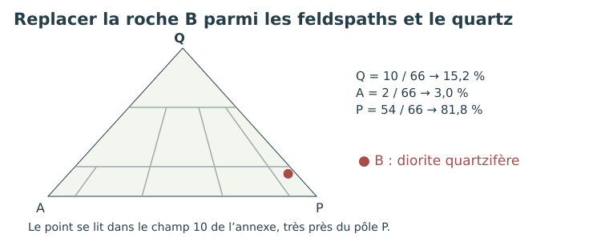

### Question G4 — Tester une origine commune

Les deux matériaux se côtoient avec des limites diffuses. B, plus claire, contient davantage de silice et d’alcalins que A. Un magma initial commun a pu cristalliser par étapes. La soustraction de cristaux précoces, notamment ferromagnésiens, enrichit le liquide résiduel en éléments relativement incompatibles. La solidification de cette fraction donnerait B. L’association répétée et la parenté chimique rendent cette filiation plausible. Pour la tester, on mesurerait les éléments majeurs sur plusieurs échantillons des deux types. Des tendances continues en fonction de la silice appuieraient la différenciation. Des rapports isotopiques initiaux Sr–Nd comparables conforteraient la parenté de la source. Des compositions discontinues ou des sources isotopiquement distinctes conduiraient à réexaminer le modèle, notamment le rôle d’un mélange ou d’une contamination.

### Question G5 — Lire la concordia

La concordia relie les deux rapports fille radiogénique/père produits depuis la fermeture d’un système. L’abscisse suit $^{207}\mathrm{Pb}^*/{}^{235}\mathrm U$, l’ordonnée $^{206}\mathrm{Pb}^*/{}^{238}\mathrm U$. Dans chaque chaîne, le parent décroît et le plomb radiogénique s’accumule. Pour un âge $t$, le rapport correspondant vaut $e^{\lambda t}-1$. Les deux rapports croissent avec le temps mais les constantes de décroissance diffèrent, d’où la courbure. L’astérisque désigne la part radiogénique du plomb.

### Question G6 — Dater les deux roches par construction graphique

À Jersey, les deux rapports des zircons sont groupés près de $(0,59\,;\,0,0755)$, sur la concordia à l’échelle de la planche. On lit un âge de l’ordre du demi-milliard d’années. Le rapport de jury retient 500–550 Ma. Si l’on convertit séparément les rapports arrondis du tableau avec les constantes de désintégration usuelles, on obtient environ 470 Ma, donc une lecture légèrement plus jeune que le créneau cadomien donné en G1. La précision du diagramme ne justifie pas une identité d’âge au million d’années près.

À Guernesey, chacun des quatre zircons donne un point distinct sous la courbe. On prolonge leur droite, la discordia, jusqu’à ses deux intersections avec la concordia. L’intersection ancienne, vers 2,1 Ga, indique la cristallisation initiale des zircons et convient au protolithe icartien de A1. L’intersection récente correspond, dans un modèle simple, à une réouverture du système avec perte inégale de plomb. Le jury accepte 400–600 Ma en lecture graphique et envisage un épisode métamorphique. L’extrapolation de la régression des quatre valeurs imprimées donne plutôt 0,31 Ga à l’intersection basse et 2,05 Ga à la haute. L’âge jeune est donc mal contraint par ces quatre points éloignés de l’intersection. L’événement ancien et la réouverture successive sont les conclusions robustes.

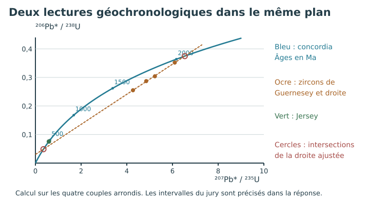

### Question G7a — Comparer deux colonnes à la même profondeur

On choisit deux colonnes de même section. Sous les deux Moho, la surface de compensation est une même horizontale à la profondeur $D$. La colonne A comporte une croûte continentale d’épaisseur $H_{CC}$, puis du manteau. La colonne B contient de l’eau sur $p$, une croûte océanique d’épaisseur $H_{CO}$, puis du manteau. À la compensation, la pression est identique de part et d’autre.

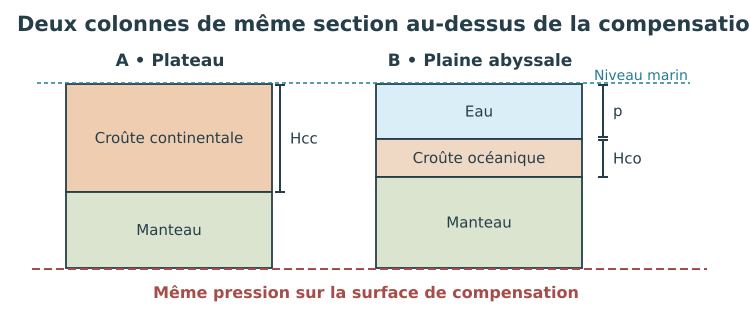

### Question G7b — Calculer la bathymétrie prédite

En divisant l’égalité des pressions par $g$ et par la masse volumique de référence qui définit les densités, on obtient

$$d_{CC}H_{CC}+d_{ML}(D-H_{CC})=d_e p+d_{CO}H_{CO}+d_{ML}(D-p-H_{CO}).$$

Le terme $d_{ML}D$ s’élimine. Il vient

$$p=\frac{(d_{ML}-d_{CC})H_{CC}-(d_{ML}-d_{CO})H_{CO}}{d_{ML}-d_e}.$$

Les densités sont sans dimension. En prenant les épaisseurs en kilomètres, on trouve bien $p$ en kilomètres.

### Question G7c — Relier relief et anomalie de Bouguer

Au point B, le fond de la plaine abyssale est à plusieurs kilomètres sous le niveau de la mer, environ 4 à 5 km d’après la teinte de la carte. L’anomalie de Bouguer y est positive, de l’ordre de plusieurs centaines de mGal, tandis que le plateau continental est près du niveau marin. Après correction de l’effet du relief et de l’eau, l’excès de masse s’explique par une croûte océanique plus mince et plus dense que la croûte continentale. Le manteau, encore plus dense, se rapproche de la surface. Une anomalie de Bouguer peut ainsi subsister alors même que les pressions s’égalisent à la compensation.

### Question G8 — Construire une carte au 1/50 000

Le cartographe repère les affleurements sur un fond topographique, identifie lithologie et structures, mesure direction et pendage et place les contacts observés. Il croise ces données avec les sondages ou les coupes disponibles. Entre les points, il interprète le prolongement des contacts et leur intersection avec le relief. Le tracé est donc un modèle contraint par les observations. Un centimètre sur l’original représente 500 mètres sur le terrain.

### Question G9 — Expliquer la plage rouge

Les micaschistes et gneiss à grenat de Groix affleurent près de la côte. Leur désagrégation mécanique libère des grains de grenat résistants. Ruissellement et vagues les érodent et les transportent sur une faible distance. Quand le courant ralentit, les grains se déposent. Leur concentration locale donne au sable sa couleur rouge.

### Question G10 — Distinguer tri par taille et tri par densité

Sur l’abaque de Hjulström, un courant de quelques dizaines de cm/s peut arracher du sable de 1 mm (environ 35–45 cm/s), alors qu’il faut de l’ordre de $10^2$ cm/s pour remobiliser un galet de 10 mm. À vitesse décroissante, la limite inférieure transport–dépôt est d’environ 30 cm/s à 10 mm et de quelques cm/s à 1 mm. Un courant peut donc encore transporter les sables quand les galets se déposent déjà. L’abaque sépare les tailles pour un matériau de référence. Il place les deux sables de 1 mm à la même abscisse. À taille comparable, le grenat, de densité supérieure à 3, décante plus vite que quartz et calcite, de densité inférieure à 3. Les remaniements successifs laissent ainsi la frange de grenats entre les galets et le sable blanc, comme sur la photographie. Les seuils sont des ordres de grandeur.

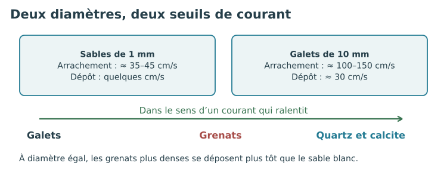

### Question G11 — Décrire deux déformations successives

Les plans de schistosité dessinent des flancs et une charnière convexe vers le haut. C’est une antiforme. L’épaisseur des bandes varie entre flancs et charnière, d’où un pli anisopaque. Une première déformation par aplatissement a donné la schistosité, approximativement horizontale avant plissement. Un second raccourcissement, de composante horizontale dans le plan de la photo, a replissé cette surface en déformation ductile. Les âges stratigraphiques manquent pour affirmer que le cœur est plus ancien.

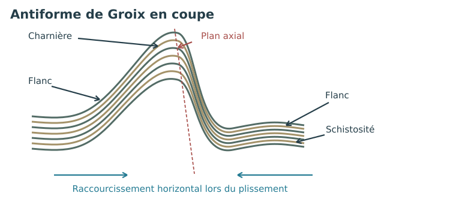

### Question G12 — Reconstituer le trajet pression–température

Une roche métamorphique résulte de transformations minéralogiques ou structurales d’un protolithe à l’état solide, en réponse aux changements de pression, température et, éventuellement, à la circulation de fluides. Un faciès est un domaine de pression et de température dans lequel des paragenèses caractéristiques sont stables pour une composition globale donnée.

La roche foliée porte de grands grenats dans une matrice bleutée à glaucophane. Cette métabasite de faciès schistes bleus témoigne d’une pression élevée à température modérée, comme lors de l’enfouissement d’une lithosphère océanique en subduction. Sur le détail, le minéral vert en couronne autour du grenat est postérieur à celui-ci. Il témoigne d’une rééquilibration partielle dans le faciès des schistes verts, pendant l’exhumation. Sur l’abaque, ce dernier domaine est à pression plus basse, du côté albite–chlorite–trémolite de la limite avec glaucophane, et à gauche de la limite avec amphibole–plagioclase. Une trajectoire possible monte d’abord à haute pression dans le domaine bleu puis redescend vers le domaine vert. La couronne détermine le sens du trajet rétrograde, sans fixer un pic $P,T$ unique.

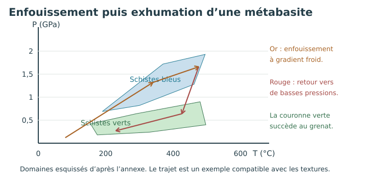

### Question G13 — Deux explications à la diversité de Groix

**Composition initiale.** La carte juxtapose des terrains différents. À pression et température égales, des protolithes de compositions distinctes ne disposent pas des mêmes proportions de Fe, Mg, Al, Ca ou Na. Ils peuvent donc stabiliser des associations minérales différentes. **Histoire tectonométamorphique.** Le document 14 distingue une unité inférieure à l’ouest et une unité supérieure à l’est. Le glaucophane figure dans plusieurs associations de l’unité supérieure, avec grenat et parfois épidote ou chloritoïde, tandis que l’unité inférieure présente notamment grenat–chlorite–rutile. Des pics d’enfouissement ou des degrés de rééquilibration à l’exhumation différents sont compatibles avec cette répartition. On distinguerait les deux hypothèses en comparant des roches de composition initiale proche dans les deux unités.

## Biologie — Quelques aspects de la lactation

### Question B1 — Développement des alvéoles

Chez la souris vierge, la coupe A montre surtout des adipocytes, avec quelques vaisseaux sanguins. Au 18ᵉ jour de gestation (B), des groupes de cellules épithéliales forment des ébauches d’alvéoles autour des canaux galactophores. Quatorze jours après la mise bas (C), de nombreuses alvéoles à lumière délimitée forment des lobules reliés aux canaux. Le tissu glandulaire occupe progressivement la place du tissu adipeux. Les coupes ne montrent pas une transformation individuelle des adipocytes en cellules sécrétrices.

### Question B2a — Annoter une cellule en activité

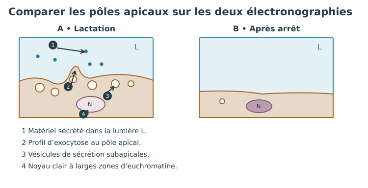

Sur l’électronographie A, les vésicules de sécrétion sont nombreuses près de la lumière L. Certains profils s’ouvrent au pôle apical, où du matériel est visible dans la lumière. Le noyau épithélial N présente de larges régions claires, riches en euchromatine. Ces indices concordent avec une activité de synthèse et d’export. Sur B, après l’arrêt de l’allaitement, les vésicules apicales et le matériel sécrété sont moins apparents. My désigne le noyau d’une cellule myoépithéliale périphérique.

### Question B2b — Attribuer une fonction aux compartiments

Le réticulum endoplasmique rugueux, riche en ribosomes, assure la synthèse des protéines exportées. Les membranes du réticulum participent à la synthèse des lipides et à la formation des gouttelettes lipidiques. Dans l’épithélium mammaire, ces gouttelettes peuvent aussi être associées au réticulum rugueux. Le Golgi modifie et trie les protéines et porte la lactose synthase. Ses vésicules déversent protéines et lactose dans la lumière par exocytose. Les gouttelettes lipidiques suivent une sécrétion apicale distincte. La densité du cytoplasme est compatible avec cette activité mais ne suffit pas, seule, à identifier chaque organite.

### Question B3a — Interpréter le marquage nucléaire

Le BrdU est un analogue de la thymidine. Pendant la phase S, il peut être incorporé dans l’ADN nouvellement synthétisé. Son signal révèle ainsi les cellules ayant répliqué leur ADN pendant la période de marquage. Une cellule positive a progressé dans le cycle, sans être nécessairement en mitose au moment de la photographie.

### Question B3b — Attribuer les deux types de flèches

Les flèches blanches associent un marquage rouge de l’actine caractéristique des cellules myoépithéliales dans cette expérience et un signal vert de BrdU. Elles pointent des cellules myoépithéliales ayant répliqué leur ADN. Les flèches noires désignent des noyaux de cellules épithéliales sécrétrices marqués au DAPI et au BrdU, à l’intérieur de la couche myoépithéliale.

### Question B3c — Effet du traitement hormonal

Après trois jours en présence d’œstrogènes et de progestérone, les deux populations contiennent des noyaux doublement marqués. Le témoin sans traitement ne présente pas ce double signal. La combinaison des deux hormones favorise donc l’entrée en phase S et la prolifération dans ces conditions. Le document ne sépare pas leurs effets individuels.

### Question B4a — Rôle de la prolactine

Avant l’intervention, les trois courbes de production des brebis sont voisines, vers 1,2 à 1,6 kg de lait par jour. Vers le quatrième jour après inhibition de la voie de la prolactine, le témoin produit encore environ 1,1 kg/j, le groupe correspondant à la courbe rouge près de 0,65 kg/j et celui en bleu près de 0,45 kg/j. La prolactine soutient donc la production de lait. Le groupe ayant reçu la plus faible des deux doses étudiées présente la chute la plus forte. Cette réponse non monotone ne permet pas de généraliser une relation dose–effet décroissante.

### Question B4b — Cellules cibles probables

Les cellules épithéliales sécrétrices synthétisent les constituants du lait. Elles sont donc des cibles plausibles de la prolactine et devraient posséder un récepteur à cette hormone. Le document 4 mesure une production à l’échelle de la brebis et ne localise pas directement le récepteur.

### Question B5a — Distinguer production et éjection du lait

D’après 5A, la contraction des cellules myoépithéliales sauvages passe d’environ 1 unité sans ocytocine à 4 unités à 5 nmol/L. Au dernier point, les cellules mutantes pour l’actine n’atteignent qu’environ 2,7 unités. Le cytosquelette d’actine contribue donc à la composante contractile stimulée par l’ocytocine. En 5B, la lumière alvéolaire sauvage est dégagée. Chez la souris dont le canal calcique myoépithélial est déficient, une même lumière est encombrée de produits de sécrétion. Une entrée de calcium fonctionnelle contribue à la contraction. Les cellules périphériques pressent l’alvéole et chassent le lait déjà produit vers le canal galactophore.

### Question B5b — De la gestation à l’éjection

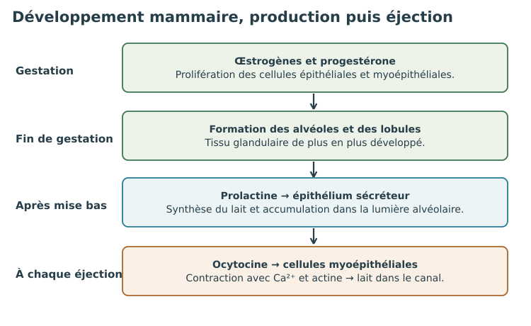

### Question B6a — Comparer protéines du lait et contenu des vésicules

Dans le lait entier non traité, le gel 6A montre de fortes bandes autour de 25–35 kDa et d’autres vers 11–20 kDa. Après digestion simulée, beaucoup disparaissent et il reste notamment une bande vers 11 kDa. Cette perte des bandes de grande masse est compatible avec l’hydrolyse des protéines accessibles en peptides plus courts. L’essai se déroule *in vitro*. La disparition du signal précède donc toute absorption intestinale.

Les exosomes sont encore visibles en 6B. Les distributions de diamètre en 6C présentent des maxima proches, entre 100 et quelques centaines de nanomètres. En 6D, FLOT1, ICAM et ALIX restent détectables avec des intensités comparables, avant et après digestion simulée. La membrane et les protéines vésiculaires étudiées résistent donc mieux que la plupart des protéines libres dans cet essai. Les flèches de la micrographie repèrent des exemples, sans mesurer un nombre total de vésicules.

### Question B6b — Rôle possible des exosomes

L’enveloppe des exosomes peut protéger certains constituants du lait pendant les premières étapes digestives. Ces vésicules pourraient ainsi transporter une fraction de la charge du lait jusqu’à l’épithélium intestinal sous une forme encore reconnaissable.

### Question B7 — Interpréter la capture cellulaire

Dans le témoin de 7A, on voit les noyaux rouges. Avec les exosomes, le signal vert d’une de leurs protéines apparaît aussi à l’intérieur des contours cellulaires. À lui seul ce marquage localise une protéine et laisse ouvertes plusieurs voies d’entrée. En 7B, l’inhibition de l’endocytose réduit l’internalisation à environ 50 % du témoin, différence significative. En 7C, la vitesse augmente puis tend vers un plateau d’environ 0,11 ng/min pour les fortes concentrations. Il existe donc une étape de capacité limitée, compatible avec un nombre fini de récepteurs membranaires. Ensemble, les observations soutiennent la liaison aux récepteurs suivie d’endocytose. Une simple fusion proportionnelle à la concentration ne rend pas compte seule des résultats.

### Question B8 — Lire les indices d’inflammation intestinale

Le témoin présente des villosités bien individualisées et une teneur en IL-1β proche de 10 pg/mg de protéines. Dans le groupe inflammatoire, les reliefs sont altérés et la teneur passe à environ 60–65 pg/mg. Dans le groupe inflammatoire recevant aussi des exosomes du lait, les reliefs sont davantage conservés et la valeur est voisine de 30 pg/mg. Les trois lettres distinctes signalent des différences significatives entre les groupes. Dans ce modèle, la présence d’exosomes est associée à une atténuation de l’inflammation et à une meilleure préservation du tissu. Le marqueur reste plus élevé que chez le témoin. Cette lecture porte sur les résultats tissulaires et quantitatifs.

### Question B9a — Lire le témoin de charge et un effet post-transcriptionnel

Le signal de l’actine à 42 kDa est comparable dans les trois pistes. Le profil à 130 kDa varie, avec un signal plus intense dans la piste « exosomes » que dans le témoin. La variation sélective est compatible avec un changement de quantité de la protéine étudiée. Le schéma représente le principe physiologique général d’action d’un microARN. Le western blot renseigne sur une abondance protéique et ne démontre pas directement une liaison moléculaire.

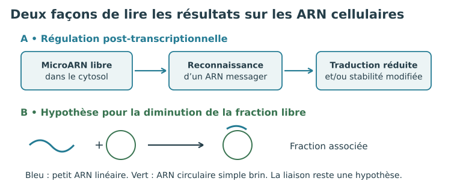

### Question B9b — Distinguer ARN libre et ARN associé

En 9B, la quantité relative du petit ARN libre passe d’environ 1,05 à 0,72 unité en présence d’exosomes. L’astérisque indique une différence significative. Une association réversible à une autre molécule d’ARN pourrait diminuer la fraction libre à quantité totale constante. Le document ne mesure ni la quantité totale ni directement l’existence d’un duplex. Le second volet du schéma de B9a représente cette hypothèse avec un ARN circulaire simple brin.

### Question B9c — Relier les observations à la protection de la muqueuse

Les exosomes du lait résistent en partie à la digestion simulée, des protéines qu’ils contiennent se retrouvent dans les cellules épithéliales, et les villosités sont mieux conservées en présence d’exosomes dans le groupe inflammatoire. Le récepteur pIgR contribue normalement au passage d’anticorps vers la lumière. Ces observations suggèrent une contribution à la protection de la muqueuse. L’épreuve mesure une réponse tissulaire et des marqueurs moléculaires, sans mesurer ici directement la protection contre une infection. La synthèse s’arrête à l’interprétation physiologique de ces observations.

### Question B10a — Situer une innovation sur une branche

Tous les Mammifères représentés, y compris les Monotrèmes, produisent du lait. Les groupes externes figurés, dont les Oiseaux et les Crocodiliens, n’en produisent pas. L’hypothèse la plus parcimonieuse place donc l’acquisition sur la branche menant à l’ancêtre commun des Mammifères. Le caractère dérivé partagé est une synapomorphie de ce groupe monophylétique, qui comprend cet ancêtre et tous ses descendants.

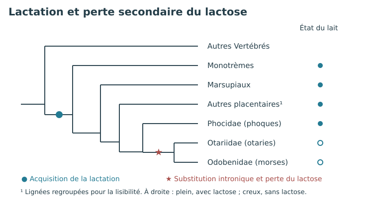

### Question B10b — Expliquer les deux états du lactose

Chez l’ancêtre des Mammifères, une modification héréditaire et l’expression mammaire d’une α-lactalbumine fonctionnelle ont pu permettre la synthèse de lactose. Cette protéine s’associe à la galactosyltransférase dans la lactose synthase. L’état « lactose présent » aurait été transmis aux lignées descendantes. Sur la branche commune aux Otariidae et aux Odobenidae, une autre modification héréditaire aurait altéré la production ou la fonction de l’α-lactalbumine. Cela expliquerait une perte secondaire de lactose dans leur lait, tout en conservant la lactation.

### Question B11a — Placer les Phocidae

Sur l’arbre de B10a, les Phocidae, ou phoques, sont le groupe frère de l’ensemble formé par les Otariidae et les Odobenidae, au sein des Pinnipèdes.

### Question B11b — Placer l’étoile

L’étoile du schéma se place sur la branche commune aux Otariidae et aux Odobenidae, après sa divergence d’avec les Phocidae. Elle représente une substitution partagée dans l’intron du gène de l’α-lactalbumine, associée ici à la perte secondaire du lactose dans le lait.

### Question B11c — Relier un intron à un phénotype

Au site indiqué, la vache, le cheval et les Phocidae portent un A, les Otariidae et les Odobenidae un C. Même si un intron est normalement excisé, une variation de sa séquence peut perturber la reconnaissance d’un site d’épissage. Un exon sauté, un intron retenu ou un site alternatif modifierait le transcrit mature. Une α-lactalbumine absente ou non fonctionnelle ne permettrait plus à la lactose synthase de fonctionner normalement. L’alignement établit l’association, sans départager à lui seul ces effets possibles.

### Question B11d — Tester l’hypothèse d’épissage

Comparer l’ARN du tissu mammaire de sujets allaitants d’une espèce dont le lait contient du lactose (phoque, par exemple) et d’une otarie ou d’un morse. À partir des ARN, obtenir des ADN complémentaires, puis comparer par RT-PCR la région comprise entre les deux exons qui encadrent l’intron. Une différence de longueur ou de séquence des jonctions montrerait une différence de maturation. Le séquençage des produits distinguerait une rétention d’intron d’un saut d’exon, y compris si deux produits avaient des tailles voisines. Une comparaison du même stade de lactation, un transcrit témoin effectivement exprimé et un contrôle sans transcription inverse permettent d’écarter un prélèvement trop pauvre et une contamination par l’ADN génomique. Vérifier ensuite, dans le lait des mêmes espèces, l’abondance de la protéine et du lactose relierait le défaut de maturation au phénotype. L’association interspécifique seule ne démontre pas que cette substitution est l’unique cause.

### Question B12 — El Niño et croissance des jeunes otaries

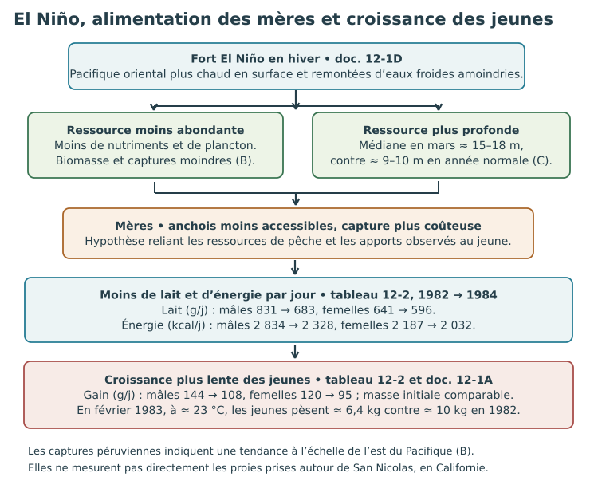
