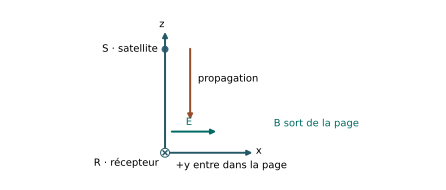
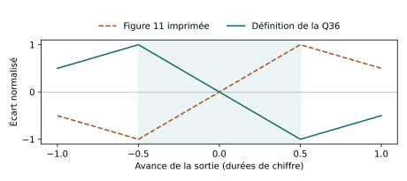

# Banque PT 2025 — Informatique et modélisation · Corrigé guidé

*Corrigé rédigé par IA, non officiel. Signalez toute erreur.*

**Rédaction** · GPT-6.2 Astra Ultra · vitesse non renseignée

**Révision (tour 1)** · GPT-6.2 Astra Ultra · vitesse non renseignée

Géolocalisation par satellites. Épreuve de quatre heures, sans calculatrice. [Sujet officiel, p. 1–21](https://www.banquept.fr/documents/2025/info_mod_2025_pt.pdf) · [Rapport du jury, p. 1–3](https://www.banquept.fr/documents/ecrit/rapport/2025/rapport_info_model_ecrit_2025.pdf)

## A. Orbite circulaire et trace au sol

### Q1. Attraction et champ terrestres

**Piste.** Repérez les deux longueurs de la figure 3. La gravitation se calcule à partir du centre de la Terre.

Le rayon orbital vaut $r=R_T+h=2,64\times10^7\ \mathrm{m}$. Avec $\vec e_r$ dirigé de la Terre vers le satellite,
$$\vec F=-\frac{GM_Tm}{r^2}\vec e_r,\qquad \vec g(M)=-\frac{GM_T}{r^2}\vec e_r.$$
On trouve $\lVert\vec F\rVert\simeq4,0\times10^2\ \mathrm{N}$ et $\lVert\vec g\rVert\simeq0,58\ \mathrm{m\,s^{-2}}$. Le champ est indépendant de la masse du satellite.

### Q2. Terre sphérique

**Piste.** Choisissez comme surface fermée une sphère de rayon orbital. Quelles composantes du champ restent compatibles avec toutes les symétries ?

L’invariance de la distribution de masse par rotation impose un champ radial d’amplitude constante sur une sphère concentrique. Pour $r>R_T$, le théorème de Gauss gravitationnel donne $4\pi r^2g_r=-4\pi GM_T$. On retrouve exactement le champ de la masse $M_T$ concentrée au centre. La symétrie sphérique suffit à ce résultat extérieur.

### Q3. Vitesse et uniformité

**Piste.** Une projection donne la norme de la vitesse. L’autre projection détermine si cette norme change.

Dans le référentiel géocentrique supposé galiléen, l’accélération d’un mobile sur le cercle de rayon constant vaut $-r\dot\theta^2\vec e_r+r\ddot\theta\vec e_\theta$. La force est centrale, donc $r\ddot\theta=0$. La vitesse angulaire est constante et le mouvement uniforme. La projection radiale donne $r\dot\theta^2=GM_T/r^2$, soit $v^2=GM_T/r$ et $v\simeq3,9\ \mathrm{km\,s^{-1}}$.

### Q4. Troisième loi de Kepler

**Piste.** Éliminez la vitesse entre la longueur d’un tour divisée par sa durée et la loi radiale.

Un tour a pour longueur $2\pi r$. Comme $T=2\pi r/v$, la substitution du résultat précédent donne
$$\frac{T^2}{r^3}=\frac{4\pi^2}{GM_T}.$$
Le rapport est le même pour toutes les orbites circulaires autour du même astre dans ce modèle.

### Q5. Période en secondes

**Piste.** Conservez les secondes jusqu’à la comparaison avec une journée.

$T=2\pi\sqrt{(2,64\times10^7)^3/(4,02\times10^{14})}\simeq4,3\times10^4\ \mathrm{s}$, soit environ $12\ \mathrm{h}$. Un satellite géostationnaire décrit une orbite équatoriale prograde en un jour sidéral, environ $8,6\times10^4\ \mathrm{s}$. Le satellite GPS fait approximativement deux tours dans ce temps.

### Q6. Inclinaison du plan orbital

**Piste.** Dans quel sens faut-il mesurer un angle depuis l’équateur pour qu’il coïncide avec une latitude ?

Pour une orbite circulaire prograde inclinée d’un angle $i$, la latitude géocentrique maximale du point sous le satellite vaut $i$. En effet, avec $u$ l’angle orbital depuis le nœud ascendant, $z/r=\sin i\sin u=\sin\varphi$. La limite méridionale de la trace est à peu près à la latitude du cap Horn, voisine de $56^\circ$ S. On lit $i\simeq55^\circ$ à la précision demandée.

### Q7. Sens et répétition de la trace

**Piste.** Comparez où se trouve le sol après un seul tour du satellite, puis après deux. Distinguez ces deux passages.

L’est est à droite. À la latitude extrême, la vitesse orbitale prograde est dirigée vers l’est et dépasse celle de rotation du sol. À l’extrême de latitude, le point sous le satellite avance dans le référentiel inertiel à environ $vR_T/r=0,95\ \mathrm{km\,s^{-1}}$, plus vite que le sol à cette latitude (environ $0,27\ \mathrm{km\,s^{-1}}$). La trace se parcourt donc **vers la droite**. À un tour d’intervalle, la Terre a tourné d’environ un demi-tour sous le plan orbital, d’où deux arches successives à des longitudes différentes. Après deux révolutions et environ une rotation terrestre, la trace se répète, soit **environ un jour sidéral**. Cette répétition est celle de la figure idéalisée. L’altitude arrondie de la Q5 ne fixe pas une résonance exacte.

## B. Onde électromagnétique au récepteur

### Q8. Équation de propagation

**Piste.** Prenez un second rotationnel pour faire disparaître le champ magnétique. Utilisez ensuite la divergence du champ électrique.

Dans le vide sans sources, $\nabla\cdot\vec E=0$, $\nabla\cdot\vec B=0$, $\nabla\times\vec E=-\partial_t\vec B$ et $\nabla\times\vec B=\mu_0\varepsilon_0\partial_t\vec E$. On prend le rotationnel de la loi de Faraday. L’identité $\nabla\times(\nabla\times\vec E)=\nabla(\nabla\cdot\vec E)-\Delta\vec E$ fournit
$$\Delta\vec E-\mu_0\varepsilon_0\partial_t^2\vec E=\vec 0,\qquad c=\frac{1}{\sqrt{\mu_0\varepsilon_0}}.$$

### Q9. Direction, sens et polarisation

**Piste.** Suivez une crête de phase constante et choisissez la direction du troisième axe par la règle de la main droite.

Plaçons le récepteur à l’origine et le satellite sur l’axe $+z$. Une phase constante vérifie $\omega t+kz=\mathrm{constante}$, donc $\mathrm dz/\mathrm dt=-\omega/k$. Pour $k>0$, l’onde descend suivant $-\vec e_z$. Le champ électrique oscille suivant $\vec e_x$ et la polarisation est rectiligne.



### Q10. Dispersion et longueur d’onde

**Piste.** Les dérivées secondes font apparaître le carré de la pulsation et le carré du nombre d’onde. Vérifiez les unités.

Les dérivées secondes en espace et en temps multiplient le champ par $-k^2$ et $-\omega^2$. L’équation impose $k=\omega/c$. Pour $f=1,6\times10^9\ \mathrm{Hz}$, on obtient $\lambda=c/f=0,1875\ \mathrm{m}\simeq19\ \mathrm{cm}$ et $k=2\pi/\lambda\simeq34\ \mathrm{rad\,m^{-1}}$.

### Q11. Champ magnétique

**Piste.** Utilisez la direction de propagation comme premier facteur du produit vectoriel.

Pour l’onde progressive, $\vec B=\vec u\times\vec E/c$ avec $\vec u=-\vec e_z$. Ainsi
$$\vec B=-\frac{E_0}{c}\cos(\omega t+kz)\,\vec e_y.$$
Les deux champs oscillent en phase selon les directions orientées indiquées sur le schéma.

### Q12. Flux d’énergie

**Piste.** Faites la moyenne du flux instantané avant d’utiliser une amplitude de champ.

Le vecteur de Poynting $\vec\Pi=\vec E\times\vec B/\mu_0$ est dirigé vers le sol. Comme $1/(\mu_0c)=\varepsilon_0c$, il vaut $-\varepsilon_0c E_0^2\cos^2(\omega t+kz)\vec e_z$. La puissance moyenne reçue par unité de surface normale au rayon vaut
$$I=\frac{\varepsilon_0c E_0^2}{2}.$$
Le facteur $1/2$ est la moyenne temporelle du carré du cosinus.

### Q13. Intensité reçue

**Piste.** Le carré du facteur $10^{-6}$ contribue $10^{-12}$ au résultat.

$I=(8,8\times10^{-12})(3,0\times10^8)(2,5\times10^{-6})^2/2\simeq8,3\times10^{-15}\ \mathrm{W\,m^{-2}}$. Il s’agit d’une densité surfacique de puissance.

### Q14. Puissance isotrope équivalente

**Piste.** Quel est le centre de la surface qui répartit la puissance dans l’hypothèse isotrope ?

La distance émetteur–récepteur à la verticale vaut $h=2,0\times10^7\ \mathrm{m}$. La sphère de rayonnement est centrée sur le satellite et a pour surface $4\pi h^2$. L’estimation isotrope donne $P_{\rm iso}=4\pi h^2 I\simeq42\ \mathrm W$. À intensité identique sur Terre, une antenne qui concentre le rayonnement vers la Terre peut émettre une puissance totale inférieure. Cette comparaison suppose les mêmes pertes de propagation.

## C. Retard atmosphérique à la verticale

### Q15. Masse volumique de l’air

**Piste.** Convertissez les grammes en kilogrammes et la pression en pascals.

La loi $PV=(m/M_{\rm air})RT$ implique $\rho=M_{\rm air}P/(RT)$. Avec $M_{\rm air}=0,029\ \mathrm{kg\,mol^{-1}}$ et $P_0=10^5\ \mathrm{Pa}$, on trouve $\rho_0\simeq1,3\ \mathrm{kg\,m^{-3}}$.

### Q16. Loi de Gladstone

**Piste.** Déduisez la dimension de la constante à partir d’un indice sans dimension.

En reportant la masse volumique dans $n=1+K\rho$, il vient $n=1+K'P/T$ avec $K'=KM_{\rm air}/R$. L’indice étant sans dimension, $K'$ s’exprime en $\mathrm{K\,Pa^{-1}}$.

### Q17. Équilibre hydrostatique

**Piste.** Écrivez le bilan de pression d’une couche horizontale au repos. La masse volumique varie avec la pression.

Pour un axe vertical ascendant, $\mathrm dP/\mathrm dz=-\rho g$. À température et pesanteur constantes, $\mathrm dP/P=-M_{\rm air}g\,\mathrm dz/(RT)$. En intégrant depuis $P(0)=P_0$, on obtient $P(z)=P_0\exp(-z/H)$ avec $H=RT/(M_{\rm air}g)$.

### Q18. Hauteur caractéristique

**Piste.** Évaluez séparément la constante de longueur et la pression à une hauteur caractéristique.

$H=8,3\times270/(0,029\times9,8)\simeq7,9\times10^3\ \mathrm m$. À $z=H$, $P=P_0/e\simeq3,7\times10^4\ \mathrm{Pa}$, soit $0,37\ \mathrm{bar}$.

### Q19. Indice selon l’altitude

**Piste.** Isolez dans la loi d’indice le produit qui reste constant tout le long du trajet.

Avec $\alpha=K'/T\simeq2,9\times10^{-9}\ \mathrm{Pa^{-1}}$, la loi s’écrit $n(z)=1+\alpha P_0e^{-z/H}$. Au sol l’excès d’indice est donc d’environ $2,9\times10^{-4}$.

### Q20. Temps de parcours élémentaire

**Piste.** Un temps de traversée doit être positif. Vous pouvez raisonner sur l’épaisseur de chaque couche.

La célérité locale est $c/n$. Pour l’épaisseur positive $\mathrm dz$ d’une couche, le temps de traversée vaut $\mathrm dt=(1+\alpha P_0e^{-z/H})\,\mathrm dz/c$. Le choix d’une épaisseur positive permet de sommer les couches du sol vers le haut même si la propagation s’effectue vers le bas.

### Q21. Traversée de la couche entière

**Piste.** Conservez séparément le terme de propagation dans le vide et le terme atmosphérique.

L’intégrale de $e^{-z/H}$ sur $[0,L]$ vaut $H(1-e^{-L/H})$. On en déduit
$$\Delta t=\frac{L}{c}+\frac{\alpha P_0H}{c}(1-e^{-L/H}).$$
Les $50\ \mathrm{km}$ sont l’épaisseur du modèle imposé.

### Q22. Biais de distance

**Piste.** Une vitesse plus faible allonge la durée mesurée. Vérifiez le signe de la distance calculée avec la vitesse du vide.

Le supplément sur le vide est $t_{\rm sup}=\alpha P_0H(1-e^{-L/H})/c\simeq7,6\times10^{-9}\ \mathrm s$. Multiplier la durée mesurée par $c$ conduit à **surestimer** la distance de $ct_{\rm sup}\simeq2,3\ \mathrm m$. Le signe est cohérent avec un indice supérieur à l’unité.

## D. Codes périodiques et acquisition

### Q23. Corrélation normalisée

**Piste.** Parcourez les deux codes avec le même indice et ne divisez qu’une fois.

Chaque produit vaut $+1$ ou $-1$. L’accumulateur somme les produits avant la division finale. Les codes considérés ont une longueur strictement positive.

```python
def corr(a, b):
    """Moyenne des produits de deux codes de même longueur."""
    total = 0
    for i in range(len(a)):
        total += a[i] * b[i]
    return total / len(a)
```

### Q24. Retard circulaire

**Piste.** Dans le code retardé, quelle position ancienne arrive maintenant à l’indice zéro ?

À l’indice $i$ doit figurer l’ancien terme d’indice $i-k$. Le modulo ramène tout indice dans la période, même si $k$ est négatif ou dépasse la longueur du code.

```python
def retarde(a, k):
    """Décale le code périodique de k échantillons vers la droite."""
    n = len(a)
    return [a[(i - k) % n] for i in range(n)]
```

### Q25. Autocorrélation

**Piste.** Que vaut le carré de chacun des niveaux NRZ ?

Comme $a_i^2=1$ pour chaque chiffre NRZ, $\langle a,a\rangle=(1/n)\sum_i1=1$. Un retard multiple de $n$ donne le même résultat par périodicité.

### Q26. Bornes et opposition

**Piste.** Comptez séparément les positions qui concordent et celles qui s’opposent.

Si $m$ positions sur $n$ sont en désaccord, la corrélation vaut $[(n-m)-m]/n=1-2m/n$. Ses valeurs sont donc comprises entre $-1$ et $1$, et elle vaut $-1$ exactement quand $b_i=-a_i$ pour tout $i$. Par exemple, les listes `[1,-1]` et `[-1,1]` ont une corrélation de $-1$.

### Q27. Nombre de mots candidats

**Piste.** Identifiez ce qui se choisit indépendamment à chaque place. Gardez la valeur exacte avant d’utiliser un arrondi.

À origine d’indice fixée, il y a deux choix indépendants à chacune des 1 023 positions. Cela donne $2^{1023}=8(2^{10})^{102}$. En utilisant seulement le repère de l’énoncé, on obtient $8\times10^{306}$, donc une estimation par $10^{307}$. L’approximation répétée 102 fois sous-estime sensiblement le nombre exact. Avec $\log_{10}2\simeq0,30103$, $2^{1023}\simeq8,99\times10^{307}$, dont la puissance de dix la plus proche est $10^{308}$. Seule une petite famille de ces mots satisfait aux propriétés requises et est utilisée par le GPS.

### Q28. Construire les décalages et leurs corrélations

**Piste.** Distinguez les 1023 séquences décalées des deux listes de 1023 nombres.

La dernière puce de la question répète `correls11[i]`. La comparaison avec le deuxième code doit remplir `correls12`. La fonction `codeCA` est fournie par hypothèse.

```python
code1 = codeCA(1, 5)
code2 = codeCA(2, 6)
codes1 = [retarde(code1, i) for i in range(len(code1))]
correls11 = [corr(decale, code1) for decale in codes1]
correls12 = [corr(decale, code2) for decale in codes1]
```

Le pic unitaire se trouve en `correls11[0]`. Les autres valeurs de cette liste et celles de `correls12` restent de faible amplitude pour la famille étudiée.

### Q29. Indices de la plus forte corrélation

**Piste.** Essayez une table dont la valeur de plus grande amplitude est négative.

Le signe peut être renversé par le message de navigation. On compare donc les valeurs absolues. En cas d’égalité, le parcours conserve la première position rencontrée.

```python
def indmax(T):
    """Indices du maximum en valeur absolue dans une table non vide."""
    assert len(T) > 0 and len(T[0]) > 0
    meilleur = abs(T[0][0])
    position = (0, 0)
    for i, ligne in enumerate(T):
        for j, valeur in enumerate(ligne):
            if abs(valeur) > meilleur:
                meilleur = abs(valeur)
                position = (i, j)
    return position
```

### Q30. Résolution d’un chiffre

**Piste.** Une cadence en bits par seconde doit être inversée pour obtenir une durée de chiffre.

Un chiffre C/A dure $1/(1,023\times10^6)\simeq0,978\ \mathrm{\mu s}$. La lumière parcourt pendant ce temps environ $293\ \mathrm m$, soit $3\times10^2\ \mathrm m$. Le retard ainsi identifié est une phase de code modulo la milliseconde. Une période correspond à environ 300 km de propagation. La distance absolue demande aussi le nombre de périodes entières.

### Q31. Suréchantillonnage

**Piste.** Vérifiez sur deux chiffres distincts dans quel ordre ils sont répétés.

On répète chaque chiffre avant de passer au suivant. Pour le facteur positif $k$, la sortie possède $k\,\mathrm{len}(a)$ éléments.

```python
def surech(a, k):
    """Répète k fois consécutivement chaque valeur de a."""
    resultat = []
    for valeur in a:
        resultat.extend([valeur] * k)
    return resultat
```

### Q32. Coût de l’acquisition directe

**Piste.** Quand la grille est affinée, la longueur de chaque corrélation et le nombre de retards à tester augmentent ensemble.

Chaque corrélation demande $n$ produits et une somme de $n$ termes, donc un temps $\Theta(n)$. Tester les $n$ retards par cette méthode coûte $\Theta(n^2)$ par satellite. Multiplier $n$ par 100 multiplie approximativement le temps par $10^4$. La distance par échantillon descend alors à environ $2,93\ \mathrm m$.

## E. Asservissement et simulation des retards

### Q33. Transferts du modèle continu

**Piste.** Écrivez la somme au dernier sommateur, puis ramenez au membre gauche tous les termes qui contiennent la sortie.

Le comparateur forme $T_{\rm ref}-T_s$ et $T_e$ s’ajoute au signal intégré. Ainsi $T_s=T_e+(AK/p)(T_{\rm ref}-T_s)$. En posant $\tau=1/(AK)$, on obtient
$$H_1(p)=\frac{1}{1+\tau p},\qquad H_2(p)=\frac{\tau p}{1+\tau p}.$$
Le pôle commun est $p=-AK$. Les gains sont choisis tels que $AK>0$, condition de stabilité de cette rétroaction.

### Q34. Valeur finale

**Piste.** Évaluez séparément à fréquence nulle le transfert de la référence et celui de l’entrée.

Sous cette condition, le théorème de la valeur finale s’applique aux échelons. On obtient $\lim_{t\to\infty}t_s(t)=\lim_{p\to0}(H_1(p)T_{\rm ref0}+H_2(p)T_{e0})=T_{\rm ref0}$. La correction soustrait en régime établi tout l’écart constant acquis initialement.

### Q35. Remplacement de l’intégrateur par un gain

**Piste.** Imaginez une erreur finale nulle. Quel dispositif peut encore fournir une correction constante ?

Avec un simple gain, un écart nul produirait une correction nulle et la sortie reprendrait alors la seule valeur d’entrée. Si l’entrée diffère de la référence, une correction constante non nulle est nécessaire et exige un écart résiduel. L’intégrateur, lui, peut conserver une correction après l’annulation de l’écart. Le bloc concerné figure sur la **figure 10**.

### Q36. Discriminateur avancé–retardé

**Piste.** Écrivez séparément la copie avancée et la copie retardée avant de les corréler.

On applique littéralement la définition imprimée page 14. Un argument négatif avance la copie, un argument positif la retarde. Les 50 échantillons correspondent à un demi-chiffre pour le suréchantillonnage choisi.

```python
def decal(s, r):
    """Corrélation de la copie avancée moins celle de la copie retardée."""
    avancee = retarde(s, -50)
    retardee = retarde(s, 50)
    return corr(avancee, r) - corr(retardee, r)
```

### Q37. Éléments des trois listes

**Piste.** L’indice de liste commence à zéro. Le premier décalage testé vaut pourtant −100.

Les trois listes ont 201 éléments. Pour $0\le i\le200$, posons $k=i-100$. `cr` est une liste de listes et `cr[i]` est une copie de `cc` retardée de $k$ échantillons, de longueur $1023\times100=102300$. `d` est une liste simple de flottants avec `d[i]` égal à $-k/100$, l’avance de la sortie sur la référence en durées de chiffre. `e` est une liste simple de flottants avec `e[i]` égal à `decal(cr[i], cc)`.

### Q38. Domaine linéaire et signe de la figure 11

**Piste.** Alignez exactement l’une des deux copies sur la référence. Ce test fixe le signe de la différence sans calcul numérique.

La partie centrale de la figure s’étend de $-0,5$ à $+0,5$ chiffre, soit de $-50$ à $+50$ échantillons. En dehors de cet intervalle, la pente change et le même gain ne convient plus. **Le sens de la pente tracée est inversé par rapport à la formule donnée.** Prenons une sortie avancée d’un demi-chiffre. Sa copie retardée est exactement la référence et sa corrélation vaut 1. Sa copie avancée est distante d’un chiffre, de corrélation voisine de zéro. La différence de la Q36 vaut donc environ $-1$, alors que la figure 11 montre $+1$. Le domaine de proportionnalité reste identique.



### Q39. Compléter la boucle de poursuite

**Piste.** Prenez une sortie qui doit être retardée davantage et examinez le signe du premier incrément.

Si la sortie locale est en avance, il faut **augmenter** son retard. Avec la définition littérale de `decal`, l’écart est alors négatif. On le soustrait dans l’accumulation. À l’inverse, si l’on adopte la pente dessinée en figure 11, on peut inverser les deux termes dans `decal` et additionner l’écart. Les deux modifications ensemble produisent la même rétroaction.

```python
def simu(ref, entree, imax, K):
    """Renvoie les codes et les retards accumulés sur imax périodes."""
    retard = 0.0
    sortie = entree[:]
    sorties, retards = [sortie], [retard]
    for i in range(imax - 1):
        ecart = decal(sortie, ref)
        retard = retard - K * ecart
        sortie = retarde(entree, int(retard))
        sorties.append(sortie)
        retards.append(retard)
    return sorties, retards
```

On retarde à chaque fois l’entrée initiale. La variable `retard` demeure flottante pour conserver les fractions accumulées. La conversion en entier par troncature porte seulement sur le décalage effectivement appliqué. Le choix de la quantification influe sur le transitoire discret. Le texte page 16 appelle par inadvertance « sortie » la somme cumulée, laquelle se nomme `retard` dans le programme.

### Q40. Oscillations et convergence en temps fini

**Piste.** Distinguez la valeur de l’accumulateur réel de celle du retard entier effectivement appliqué.

Dans le modèle continu de premier ordre, pour les échelons étudiés, $t_s(t)=T_{\rm ref0}+(T_{e0}-T_{\rm ref0})e^{-AKt}$. Pour $AK>0$, la réponse est monotone et, sauf alignement initial, elle ne rejoint la valeur finale qu’asymptotiquement. Ni les oscillations observées pour $K=80$ ni l’alignement en temps fini ne s’en déduisent. Dans la simulation, une correction importante peut dépasser la cible d’une période à la suivante. Dès que le décalage entier appliqué vaut exactement 20 échantillons, les codes coïncident et le discriminateur s’annule. La corrélation reste alors à 1, même si l’accumulateur flottant n’est pas exactement égal à 20.

## F. Lire une trame NMEA

### Q41. Extraire l’heure

**Piste.** Le découpage en champs précède le découpage en chiffres.

Le champ de rang 1 commence par deux chiffres d’heures puis deux de minutes. Le reste représente les secondes, avec leur partie fractionnaire.

```python
def heure(trame):
    """Décompose le champ horaire d'une trame GGA."""
    champ = trame.split(',')[1]
    return int(champ[:2]), int(champ[2:4]), float(champ[4:])
```

L’exemple du sujet donne `(6, 40, 36.289)`.

### Q42. Latitude en degrés signés

**Piste.** Le signe s’applique à la somme des degrés et des minutes converties.

Le champ de latitude utilise deux chiffres de degrés, puis des minutes. Une minute vaut $1/60$ de degré. Le sens sud change le signe de toute la valeur.

```python
def latitude(trame):
    """Latitude GGA en degrés, positive au nord."""
    champs = trame.split(',')
    texte = champs[2]
    valeur = int(texte[:2]) + float(texte[2:]) / 60
    return -valeur if champs[3] == 'S' else valeur
```

L’exemple vaut $48+36,5375/60\simeq48,60896^\circ$ N.

### Q43. Contrôle de transmission

**Piste.** Faites le contrôle à la main sur les trois caractères du petit exemple avant de le généraliser.

Le XOR commence à zéro. Les délimiteurs et les deux chiffres de la somme annoncée sont exclus du calcul. Après retrait d’un éventuel terminateur de ligne, on vérifie la forme du champ de contrôle.

```python
def controle(trame):
    """Teste les deux chiffres hexadécimaux du contrôle NMEA."""
    trame = trame.rstrip('\r\n')
    fin = trame.find('*')
    if not trame.startswith('$') or fin < 1:
        return False
    attendu = trame[fin + 1:]
    hexa = '0123456789abcdefABCDEF'
    if len(attendu) != 2 or any(c not in hexa for c in attendu):
        return False
    somme = 0
    for caractere in trame[1:fin]:
        somme ^= ord(caractere)
    return somme == int(attendu, 16)
```

Pour `$0,1*2D`, le résultat du calcul est $45=\mathtt{2D}_{16}$. La trame GGA de l’énoncé donne $14=\mathtt{0E}_{16}$.

## G. Distances minimales dans le graphe routier

### Q44. Dictionnaire d’adjacence et hachage

**Piste.** Pour vérifier le dictionnaire, recherchez chaque liaison dans les deux sens avec le même poids.

Le graphe est non orienté. Chaque arête se rencontre donc dans les listes des deux sommets reliés.

```python
graphe = {
    0: [(1, 5), (2, 6)],
    1: [(0, 5), (3, 8), (4, 3)],
    2: [(0, 6), (4, 1), (5, 9)],
    3: [(1, 8), (4, 2), (5, 4)],
    4: [(1, 3), (2, 1), (3, 2), (5, 7)],
    5: [(2, 9), (3, 4), (4, 7)],
}
```

Les listes décrivent 8 arêtes non orientées, soit 16 entrées de voisinage, contre 36 cases dans une matrice $6\times6$. Elles permettent surtout de parcourir directement les voisins utiles. Dans une table de hachage, le haché d’une clé détermine une position initiale dans la table. En cas de collision, d’autres emplacements sont examinés et l’égalité des clés est vérifiée. L’accès est en temps moyen $O(1)$ avec une charge maîtrisée. Pour un si petit graphe, ces décomptes ne garantissent pas une économie d’octets en Python.

### Q45. États successifs depuis le sommet 0

**Piste.** N’inscrivez une valeur définitive qu’au moment où son sommet est sélectionné.

La valeur $-1$ représente l’infini. Une ligne correspond à l’état après relaxation de tous les voisins du sommet choisi. Les sommets sont fixés dans l’ordre de leurs distances définitives.

| Sommet traité | Vers 0 | Vers 1 | Vers 2 | Vers 3 | Vers 4 | Vers 5 |
|---|---:|---:|---:|---:|---:|---:|
| Initial | 0 | −1 | −1 | −1 | −1 | −1 |
| 0 | 0 | 5 | 6 | −1 | −1 | −1 |
| 1 | 0 | 5 | 6 | 13 | 8 | −1 |
| 2 | 0 | 5 | 6 | 13 | 7 | 15 |
| 4 | 0 | 5 | 6 | 9 | 7 | 14 |
| 3 | 0 | 5 | 6 | 9 | 7 | 13 |
| 5 | 0 | 5 | 6 | 9 | 7 | 13 |

Un chemin minimisant la distance de 0 à 5 est $0\to2\to4\to3\to5$, de longueur $6+1+2+4=13$.

### Q46. Choisir le sommet accessible le plus proche

**Piste.** Le nombre −1 est plus petit que tous les poids mais représente précisément une distance inconnue.

```python
def sommet_min(dist, deja_visites):
    """Cherche le minimum non visité en ignorant le marqueur -1."""
    meilleur = None
    for i, distance in enumerate(dist):
        if deja_visites[i] or distance == -1:
            continue
        if meilleur is None or distance < dist[meilleur]:
            meilleur = i
    return meilleur
```

L’initialisation à `None` évite de supposer que le premier sommet est admissible. Si aucun sommet ne convient, la fonction rend `None`.

### Q47. Actualiser les voisins

**Piste.** Testez séparément un voisin encore inconnu et un voisin déjà doté d’une meilleure estimation.

```python
def actualiser(k, dist, deja_visites, g):
    """Fixe k et met à jour en place les distances provisoires."""
    deja_visites[k] = True
    for voisin, poids in g[k]:
        if not deja_visites[voisin]:
            proposition = dist[k] + poids
            if dist[voisin] == -1 or proposition < dist[voisin]:
                dist[voisin] = proposition
```

Le marqueur $-1$ doit être distingué d’une distance réelle avant la comparaison.

### Q48. Dijkstra et arrêt

**Piste.** Sur un graphe déconnecté, le minimum admissible peut disparaître avant que tout le graphe ait été visité.

```python
def dijkstra(g, depart):
    """Distances depuis depart, ou -1 pour un sommet inaccessible."""
    dist = [-1] * len(g)
    deja_visites = [False] * len(g)
    dist[depart] = 0
    while True:
        k = sommet_min(dist, deja_visites)
        if k is None:
            return dist
        actualiser(k, dist, deja_visites, g)
```

Les identifiants sont les entiers de 0 à $n-1$ et les poids sont positifs ou nuls. Quand le plus petit sommet provisoire est sélectionné, un détour par un autre sommet non fixé ne peut améliorer sa distance. L’arrêt sur `None` traite aussi un graphe non connexe. Avec la recherche linéaire du minimum, le coût est $O(n^2+|E|)$.

## H. Statistiques de trajets en SQL

### Q49. Départs à une date et dans un sens donnés

**Piste.** Une ligne de la table est déjà un trajet orienté. La table des adresses est inutile ici.

```sql
SELECT heure, durée
FROM trajets
WHERE date = '2025-04-01'
  AND id_from = 123 AND id_to = 456;
```

Les deux identifiants sont orientés. La date au format ISO comprend le mois et le jour sur deux chiffres.

### Q50. Trois durées minimales

**Piste.** Triez avant de limiter le nombre de lignes retournées.

```sql
SELECT date, heure, durée
FROM trajets
WHERE id_from = 123 AND id_to = 456
ORDER BY durée ASC, date ASC, heure ASC
LIMIT 3;
```

Les deux critères supplémentaires départagent chronologiquement les trajets de même durée.

### Q51. Nombre de trajets depuis une adresse

**Piste.** Identifiez le côté du trajet dont l’adresse est imposée.

```sql
SELECT COUNT(*)
FROM trajets AS t
JOIN noeuds AS n ON n.id = t.id_from
WHERE n.num = 7 AND n.voie = 'rue des Plantes'
  AND n.ville = 'Paris';
```

On joint le nœud de départ et l’on compte les lignes de trajets qui vérifient les trois critères d’adresse.

### Q52. Durées par ville de départ, vers Lyon

**Piste.** Attribuez un rôle différent à chacune des deux jointures vers la table des adresses, puis comptez les trajets après filtrage.

```sql
SELECT origine.ville, MIN(t.durée), AVG(t.durée), MAX(t.durée)
FROM trajets AS t
JOIN noeuds AS origine ON origine.id = t.id_from
JOIN noeuds AS destination ON destination.id = t.id_to
WHERE destination.ville = 'Lyon' AND t.date = '2025-04-01'
GROUP BY origine.ville
HAVING COUNT(*) >= 10;
```

La même table des nœuds joue deux rôles. Le filtre de date et de destination agit avant le regroupement. Le seuil de dix porte ensuite sur le nombre de trajets de chaque groupe et inclut les groupes de taille exactement dix.
