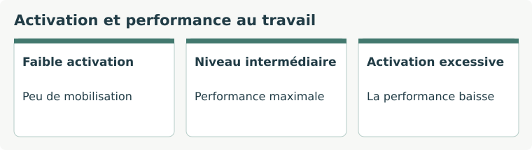

# Banque PT — Langue vivante A 2025 · Corrigé guidé

*Corrigé rédigé par IA, non officiel.*

**Rédaction** · GPT-6.2 Astra Ultra · vitesse non renseignée

L’épreuve dure trois heures. Chaque candidat compose dans la langue choisie à l’inscription. Ce fascicule présente les cinq synthèses de 450 à 500 mots. Le décompte indiqué inclut le titre.

## Allemand

*Stress am Arbeitsplatz: produktiv?*

### Construire la synthèse

Passer du modèle de performance à l’évaluation individuelle des ressources, puis du risque perçu par les dirigeants aux conditions de travail qu’ils organisent.

**Document 1** · Milad Safar analyse rémunération, climat entre collègues, communication et équité du management comme composantes de la satisfaction au travail.

**Document 2** · Sarah Korba identifie les symptômes du stress prolongé et des facteurs organisationnels ou matériels sur lesquels l’employeur peut agir.

**Document 3** · Nadine Brunner distingue le défi perçu comme accessible de la surcharge, en fonction des ressources et des conséquences anticipées.

**Document 4** · Sur la courbe en cloche de Zentor, la performance augmente puis diminue avec l’activation. Le graphique n’établit pas un seuil individuel chiffré.

**Document 5** · Les dirigeants interrogés évaluent l’impact de risques simultanés. Inflation et volatilité des prix ont un fort impact pour 58 %, la pénurie de talents pour 42 %.

### Proposition rédigée

**Wann spornt eine Herausforderung an?**

Ein enger Termin kann dazu führen, dass ein Team seine Kräfte bündelt und eine schwierige Aufgabe erfolgreich abschließt. Derselbe Termin kann Beschäftigten auch den Schlaf rauben und die Fehler häufen. Wie produktiv Stress am Arbeitsplatz ist, lässt sich daher weder am Umfang der Aufgabe noch an der sichtbaren Geschäftigkeit der Beteiligten ablesen. Zu erklären ist vielmehr, wie Anforderungen, verfügbare Mittel und erwartete Folgen in einer bestimmten Situation zusammenwirken.

Die Kurve von Zentor stellt diesen Zusammenhang vereinfacht dar. Bei geringer Aktivierung bleibt die Leistung niedrig. Mit zunehmender Aktivierung steigt sie zunächst, erreicht einen Höhepunkt und fällt bei weiterer Steigerung wieder ab. Damit widerspricht das Schaubild der Annahme, zusätzlicher Druck müsse stets zu zusätzlicher Leistung führen. Es liefert allerdings weder eine allgemeingültige Arbeitszeit noch einen für alle Beschäftigten gleichen Grenzwert. Wo die Herausforderung für eine bestimmte Person liegt, erklärt der Beitrag von Nadine Brunner mit Blick auf ihre Fähigkeiten, ihre Unterstützung und die Bedeutung eines möglichen Erfolgs.

Wer eine anspruchsvolle Aufgabe für machbar hält und mit Anerkennung rechnen darf, kann auch unter Anspannung konzentriert arbeiten. Gelingt die Aufgabe, stärkt das Vertrauen in die eigene Fähigkeit, eine weitere Herausforderung zu bewältigen. Genau hier berührt sich Brunners Analyse mit der Frage nach der Zufriedenheit im Beruf. Milad Safar nennt neben der Vergütung das Verhältnis zu Vorgesetzten und Kollegen. Ob eine Führungskraft fair entscheidet und sich für die Arbeitsbedingungen interessiert, beeinflusst, wie jemand eine neue Anforderung deutet. Was in einem verlässlichen Team als Zeichen des Zutrauens erscheint, kann bei anhaltenden Konflikten als zusätzliche Zumutung ankommen.

Das Umfeld der Unternehmen begrenzt wiederum die Möglichkeiten ihrer Führungskräfte. Die von Accenture veröffentlichte Befragung zeigt, dass die meisten Unternehmenschefs mindestens zehn Herausforderungen zugleich bewältigen müssen. Bei Inflation und Preisschwankungen berichten 58 Prozent von starken Auswirkungen, beim Fachkräftemangel 42 Prozent. Das sind Einschätzungen betrieblicher Risiken, keine Messungen der Anspannung einzelner Beschäftigter. Sie erklären aber, warum mehrere Anforderungen gleichzeitig auf ein Team treffen können und warum gerade unter solchen Bedingungen eine verständliche Festlegung der Prioritäten wichtig wird.

Sarah Korba beschreibt die Folgen, wenn die Belastung anhält und Erholung ausbleibt. Konzentrationsstörungen, körperliche Beschwerden und krankheitsbedingte Ausfälle können den vermeintlichen Zeitgewinn aufzehren. Unklare Zuständigkeiten, kurze Fristen, ungeeignete Räume oder organisatorische Veränderungen erhöhen den Aufwand, ohne den eigentlichen Arbeitsinhalt anspruchsvoller zu machen. Unternehmen können solche Ursachen untersuchen und Ressourcen bereitstellen. Dafür müssen Beschäftigte Schwierigkeiten ansprechen können, bevor aus einer vorübergehenden Überforderung ein dauerhafter Zustand wird.

Produktiv ist Stress demnach unter Bedingungen, die eine erreichbare Aufgabe, Handlungsspielraum, Rückmeldung und Erholung miteinander verbinden. Der Gipfel der dargestellten Kurve bezeichnet kein Ziel, an dem sich Beschäftigte ständig halten müssten. Er macht vielmehr sichtbar, warum die Gestaltung der Arbeit ebenso wichtig ist wie die Bereitschaft des Einzelnen, sich anzustrengen. Langfristig zählt auch, mit welchen Kräften und Erfahrungen jemand die nächste Aufgabe beginnt.

**(459 Wörter, einschließlich Titel)**

## Anglais

*Sleeper trains across Europe and beyond: the future of traveling?*

### Construire la synthèse

Partir du déclin, expliquer les ressorts du regain puis examiner sa faisabilité. Distinguer une desserte annoncée d’un service ouvert, une agence australienne d’une preuve de renaissance en Australie.

**Document 1** · Forbes revient sur le déclin des anciens trains de nuit face aux liaisons rapides et aériennes, et sur les coûts qui freinent une relance.

**Document 2** · Le Financial Times confronte la demande et les difficultés matérielles d’European Sleeper et des opérateurs existants.

**Document 3** · Condé Nast Traveler rappelle des liaisons historiques et distingue les projets d’entreprises des initiatives portées par plusieurs pays européens.

**Document 4** · Visual Capitalist exprime les émissions en g d’équivalent CO₂ par passager-kilomètre. Le rail national, Eurostar et le vol court sont trois catégories.

**Document 5** · L’agence australienne Railbookers montre les pieds d’un voyageur devant une large fenêtre. Son appel à réserver tôt utilise aussi la rareté comme argument commercial.

### Proposition rédigée

**Is there room on board for a sleeper revival?**

For a traveller considering a European night train a few years ago, the alternatives seemed to be an expensive journey steeped in nostalgia and a rather uncomfortable bunk on a disappearing service. Forbes recalls Andrew Martin attempting to retrace the routes celebrated in fiction and finding little resemblance between his couchette and the luxurious hotels on wheels of the past. Today operators report full trains. The contrast raises two questions. What brought passengers back, and can railways offer enough suitable accommodation to keep them?

Cheap flights and faster daytime trains had made many overnight routes difficult to sustain. Condé Nast Traveler recalls services that once linked major cities and explains how luxury trains preserved the experience at prices beyond most passengers. Yet features that appeared outdated when speed was paramount are acquiring a new appeal. Sleeping through the journey can free up a day at the destination, while passengers who enjoy the scenery can treat the ride itself as part of their holiday. This is particularly attractive when the alternative involves flying.

The Visual Capitalist comparison gives that choice an environmental dimension. It puts the emissions of a short flight at 255 grams of carbon dioxide equivalent per passenger kilometre, compared with 41 for national rail and six for Eurostar. These are comparisons between transport categories, rather than measurements taken on every proposed sleeper route. Nonetheless, they explain why overnight rail can appeal to passengers seeking a practical alternative to a short flight. The Australian travel agency Railbookers markets a different benefit. Feet resting beside a large window frame an unhurried view of the landscape. The invitation to book early turns the scarcity of cabins into a selling point.

For the operators interviewed by the Financial Times, scarcity is more than advertising. An Austrian railway spokesperson reports that trains are full, while independent entrepreneurs have had to raise funds and find suitable rolling stock. Forbes points to track access charges and competing demands on railway capacity. A berth takes up more space than a seat, and high demand on one service does not settle the economics of running a wider network. Finding an available route across several national systems adds a further difficulty.

Both governments and private companies are nevertheless considering new services. Condé Nast Traveler describes plans to link major European cities again, alongside projects offering greater comfort. Their ambitions need to be distinguished from the routes already carrying passengers. The Australian website illustrates the reach of the market for rail holidays, while the articles chiefly document developments in Europe. Whether night trains become an enduring part of future travel therefore depends on matching a renewed willingness to travel slowly with affordable fares, reliable connections and enough carriages. A memorable view from a cabin can help attract passengers only once they can actually book a place.

**(476 words, title included)**

## Arabe

*اعتمادا على الوثائق الخمس المقدمة أدناه، بين انعكاسات الهجرة على القرية والمدينة على حد سواء وكذلك التحديات التي يواجهها المهاجرون والمهاجرات محليا ودوليا.*

### Construire la synthèse

Organiser le développement autour des effets sur les deux territoires, des parcours de sens opposé et de ce qui sépare le souhait de départ de l’expérience vécue.

**Document 1** · Samar Othman décrit le départ des actifs ruraux, l’espoir d’un meilleur accès aux services et les besoins nouveaux des villes d’accueil.

**Document 2** · Le rapport sur le sud de la Méditerranée distingue des formes de migration et met en relation intégration, retour et réinsertion.

**Document 3** · L’article d’Al-Arab examine le mouvement inverse de citadins séduits par le calme et les possibilités d’une vie rurale.

**Document 4** · Arabi21 compare des intentions de départ. La Jordanie atteint 48 %, le Soudan 46 % et l’Égypte 13 % dans les pays figurés.

**Document 5** · Dans la caricature libyenne, un homme compte les billets tandis que des mains apparaissent autour d’un bateau en train de sombrer.

### Proposition rédigée

**ما الذي ينتقل مع المهاجر بين القرية والمدينة؟**

عندما يغادر شاب قريته بحثا عن عمل في المدينة، لا يتغير عنوانه وحده. فقد تخسر الأسرة يدا عاملة وتنتظر في الوقت نفسه دخلا يساعدها على البقاء، فيما تستقبل المدينة عاملا جديدا يحتاج بدوره إلى مسكن وخدمات. وتزداد الصورة تعقيدا حين يعبر المهاجر حدود بلده أو يقرر أحد سكان المدينة أن يسلك الطريق المعاكس. لذلك تقتضي دراسة الهجرة النظر إلى ما يحدث في مكان الانطلاق كما في مكان الوصول، والانتباه إلى اختلاف الظروف التي تسمح للبعض بالاختيار وتدفع آخرين إلى الرحيل.

تعرض سمر عثمان بعض دوافع النزوح الريفي وآثاره. فتركز فرص العمل والتعليم والخدمات في المدن يجعل الانتقال إليها مفهوما، خصوصا لمن لا يوفر له النشاط الزراعي موردا مستقرا. لكن تتابع الرحيل قد يحرم القرية من شباب قادرين على الإنتاج ويزيد الفوارق التي دفعتهم أصلا إلى المغادرة. أما المدينة فقد تستفيد من عمل الوافدين فيما يعجز السكن أو النقل أو المرافق عن مواكبة نمو السكان. ويتوقف تحول الانتقال إلى فرصة للتنمية على قدرة المؤسسات على معالجة هذه الآثار المتزامنة، بدلا من النظر إلى وجود المهاجر نفسه بوصفه المشكلة.

ويبين تقرير أليكسيس ماكلين عن جنوب المتوسط أن الهجرة قد تكون موسمية أو دائمة، اختيارية أو مفروضة. وهذا التمييز مهم لفهم مسألة الاندماج. فمن يتنقل من أجل موسم عمل يبقى مرتبطا بأرضه وأهله بطريقة تختلف عن شخص اضطر إلى ترك مكانه دون أن يعرف متى يستطيع العودة. كما أن العودة لا تنهي بالضرورة الصعوبات، إذ يحتاج العائد إلى مورد ومكان داخل الجماعة التي تغيرت أثناء غيابه. وفي جميع الحالات تتشابك العوامل الاقتصادية مع ما يصيب البيئة ومع الأوضاع الاجتماعية والسياسية.

وفي الاتجاه المقابل يصف مقال العرب سكان مدن يغريهم الانتقال إلى الريف هربا من الضجيج ورغبة في حياة أقرب إلى الطبيعة. وقد يحمل بعضهم معرفة أو مشروعا يفتح للقرية فرصة جديدة. لكن من يختار الهدوء بعد تجربة المدينة لا يعيش الظروف نفسها التي يواجهها من غادر القرية أصلا بحثا عن العلاج أو التعليم. فالجاذبية التي يراها القادم ومواطن النقص التي يراها المغادر يمكن أن تجتمعا في المكان ذاته.

وعندما يتعلق الأمر بالخروج من البلد ينبغي أيضا التمييز بين الرغبة والقدرة على السفر. يضع رسم عربي واحد وعشرين الأردن في مقدمة البلدان المعروضة، بنسبة ثمانية وأربعين في المئة من المستطلعين الراغبين في الهجرة، مقابل ثلاثة عشر في المئة في مصر. وهذه النسب تصف نوايا معلنة ولا تعد المسافرين فعلا. وتصور الرسمة الليبية وجها من المسافة بين حلم المغادرة وواقعها، إذ يعد رجل النقود على الشاطئ بينما يصارع ركاب قارب الماء خلفه. فالربح الذي يجنيه طرف آخر لا يوفر للمسافر حماية.

تكشف هذه المسارات أن نجاح الهجرة لا يقاس بمجرد الوصول إلى وجهة جديدة. ما يهم المهاجر وأسرته هو إمكان بناء حياة مستقرة والحفاظ على الروابط واختيار البقاء أو العودة بقدر من الحرية والأمان. وما يهم القرية والمدينة معا هو اتساع فرص العيش فيهما بحيث لا تصبح المغادرة شرطا لازما للحصول على أبسط الخدمات.

**(457 كلمة، بما فيها العنوان)**

## Espagnol

*El Street art, ¿qué papel desempeña en la ciudad?*

### Construire la synthèse

Croiser les œuvres de Barcelone avec le statut du support à Mendoza et l’expérience du passant à Buenos Aires. Le consentement constitue l’enjeu du message de Tvboy.

**Document 1** · Roc BlackBlock relie un travail scolaire sur les Brigades internationales à une fresque ensuite détériorée par des inscriptions hostiles.

**Document 2** · À Mendoza, commerçants et autorités invoquent l’usage du bâtiment, le défaut d’autorisation et les règles de protection de l’espace commun.

**Document 3** · À Buenos Aires, Nandon et Perfil soulignent la rencontre imprévue avec l’œuvre, son usage contestataire et l’existence de commandes autorisées.

**Document 4** · L’infographie de La Razón présente 75 % pour l’art et 25 % pour le vandalisme. Elle mentionne le coût et les sanctions, sans expliciter l’échantillon.

**Document 5** · La fresque de Tvboy oppose le mot « Respect! » à l’image du baiser imposé par Luis Rubiales à Jenni Hermoso. La photographie a aussi circulé en ligne.

### Proposition rédigée

**¿De quién es la pared que habla?**

En una calle de Buenos Aires, alguien que nunca ha entrado en una galería puede reconocer una frase de Nandon sin conocer siquiera el nombre de su autor. Esa forma de encuentro involuntario distingue el arte callejero de una exposición. También explica por qué genera desacuerdos. Cuando una obra ocupa una pared, invita a los transeúntes a mirar un lugar compartido de otra manera, aunque ni el propietario ni todos los vecinos hayan decidido convertirse en su público.

El trabajo de Roc BlackBlock muestra qué puede ganar la ciudad con esta intervención. Para reproducir en Barcelona unas imágenes de las Brigadas Internacionales, estudiantes de secundaria investigaron el episodio histórico documentado por el fotógrafo Henry Buckley. El mural hizo visible el resultado en el barrio y convirtió parte del proceso artístico en una experiencia educativa. Después aparecieron encima mensajes de odio. El artista explica que prefiere dejar constancia de la agresión, porque cubrirla ocultaría también la persistencia de un conflicto presente. La memoria expuesta en la calle queda abierta incluso a respuestas que intentan borrarla.

La obra de Tvboy sobre Jenni Hermoso y Luis Rubiales lleva al espacio urbano una controversia mucho más reciente. Bajo una palabra que exige respeto, la imagen reproduce el gesto que convirtió una celebración deportiva en un debate sobre el consentimiento. El choque entre el gesto y el mensaje impide interpretar el mural como una simple felicitación a la selección. Quien paseaba por el parque barcelonés podía encontrarse ante esa pregunta sin haber ido a buscarla. Además, la fotografía difundida por el propio artista prolongó la conversación fuera del barrio.

Esa capacidad de interpelación depende de una exposición que también puede ser impuesta. El artículo sobre Mendoza recoge la preocupación de comercios, escuelas y autoridades ante pintadas no autorizadas. Su normativa distingue, entre otros casos, las intervenciones que dañan el mobiliario o reducen su utilidad. En Buenos Aires, en cambio, el testimonio de Nandon recuerda que hay murales encargados por propietarios y obras que buscan cuestionar el orden establecido. La técnica empleada por sí sola apenas permite distinguir esos casos. También hace falta saber quién decide sobre el soporte y qué consecuencias tiene la intervención.

La infografía de La Razón condensa la disyuntiva al repartir las opiniones entre arte y vandalismo, con una mayoría del 75 por ciento a favor de la primera opción. Al mencionar también multas y costes del material, sitúa el debate en unas condiciones prácticas. El porcentaje publicado difícilmente expresa la opinión de cada barrio o resuelve un desacuerdo concreto. Las paredes pueden enseñar historia, denunciar abusos y modificar los recorridos cotidianos. Precisamente porque están a la vista de todos, también ponen en discusión los límites del derecho a intervenir en ellas y la posibilidad de compartir un espacio sin compartir una interpretación.

**(468 palabras, incluido el título)**

## Italien

*In che misura l’Italia subisce e fa fronte all’invecchiamento della popolazione?*

### Construire la synthèse

Distinguer la photographie démographique d’une projection puis changer d’échelle. Une pension est une charge collective et peut soutenir des générations plus jeunes dans un foyer.

**Document 1** · Geopop décrit l’allongement de la vie et le recul de la fécondité, puis les conséquences pour le travail, les retraites et les soins à domicile.

**Document 2** · Gianmarco Aprile présente la transmission de la mémoire, des repères et des expériences entre grands-parents et petits-enfants.

**Document 3** · La fondation Ca’ d’Industria envisage les outils numériques pour garder contact et accéder aux soins, tout en documentant l’inégalité des usages.

**Document 4** · Le graphique ISTAT au 1er janvier 2022 est une répartition par âge, sexe et état civil. Les très jeunes cohortes sont moins nombreuses que les classes centrales.

**Document 5** · Paparelli dessine un homme à la canne qui se présente comme le soutien de la jeunesse, car sa pension contribue au budget familial.

### Proposition rédigée

**Chi sostiene chi in un’Italia che invecchia?**

Un anziano seduto su una panchina tiene un bastone e osserva che spesso sono le pensioni dei nonni a salvare i bilanci delle famiglie. Si definisce così, con ironia, il bastone della gioventù. La vignetta di Paparelli rovescia l’immagine consueta di una persona anziana che ha bisogno di essere sostenuta. Questo rovesciamento permette di cogliere la doppia questione posta dall’invecchiamento italiano. Il cambiamento demografico accresce i bisogni di assistenza, ma rende anche più importanti le risorse economiche, sociali e affettive che circolano tra le generazioni.

Il grafico costruito sui dati ISTAT del 2022 mostra che le fasce centrali della popolazione sono molto più numerose delle classi di età più giovani. Alle età più avanzate, inoltre, la parte femminile si estende maggiormente di quella maschile. È una fotografia della popolazione in un momento preciso. L’articolo di Geopop ne chiarisce la formazione, collegando la maggiore sopravvivenza alla riduzione della fecondità. L’ingresso tardivo nel lavoro e il rinvio dell’uscita dalla casa dei genitori contribuiscono a ridurre gli anni disponibili per avere figli. Anche le politiche a sostegno della natalità incidono sulle scelte delle famiglie.

Con un numero crescente di anziani rispetto alle generazioni che entrano nel lavoro, cambiano le esigenze dei sistemi previdenziale e sanitario e la disponibilità di lavoratori. Secondo Geopop, le migrazioni possono attenuare lo squilibrio soprattutto nel breve termine. Intanto gran parte della cura avviene in casa, con un impegno notevole dei familiari. A questo livello la vignetta introduce una distinzione importante. La pensione che compare come spesa nelle valutazioni collettive può costituire, nel bilancio domestico, il reddito su cui contano anche figli e nipoti. Descrivere tutti gli anziani come semplici beneficiari farebbe perdere di vista questa circolazione.

Gianmarco Aprile mostra che gli scambi non si limitano al denaro. I racconti dei nonni trasmettono ricordi, valori e modi di affrontare difficoltà, mentre il dialogo con i giovani offre occasioni di partecipazione e scoperta. Non tutte le famiglie possono però frequentarsi ogni giorno. La Fondazione Ca’ d’Industria presenta gli strumenti digitali come una possibile risposta alla solitudine, anche per chi vive in una residenza assistenziale. Una videochiamata può mantenere un rapporto, così come l’accesso ai servizi online può semplificare una prenotazione medica. Il divario nell’uso di tali strumenti resta ampio, perciò la disponibilità di un dispositivo deve accompagnarsi all’apprendimento.

L’Italia affronta dunque un mutamento che riguarda l’organizzazione del lavoro e dei servizi quanto le relazioni più immediate. Scambi familiari e tecnologie possono migliorare la vita quotidiana, purché raggiungano anche chi dispone di meno aiuto. La figura del nonno con il bastone riassume bene questa interdipendenza. La stessa persona può aver bisogno di assistenza per alcuni gesti, sostenere economicamente un giovane e trasmettergli un’esperienza che nessun servizio potrebbe fornire nello stesso modo.

**(457 parole, titolo compreso)**
