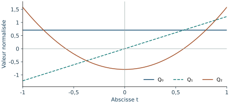

# Banque PT — Mathématiques A · 2025 · Corrigé guidé

*Corrigé rédigé par IA, non officiel. Signalez toute erreur.*

**Rédaction** · GPT-6.2 Astra Ultra · vitesse non renseignée

Le premier exercice étudie les polynômes de Legendre avec la normalisation du sujet. Le second est un calcul de lois, d’espérances et de covariances dans un modèle de partage. Les numéros I et II désignent respectivement ces deux exercices.

## Exercice 1 · Préliminaire et polynômes de Legendre

### Question I.1.a

> [!INDICATION]
> La dérivation et la multiplication par un polynôme fixé sont des applications linéaires.

#### Solution

Pour $P\in\mathbb R[X]$, les opérations successives de dérivation, multiplication par $X^2-1$ et dérivation donnent encore un polynôme réel. Chacune de ces trois opérations respecte les combinaisons linéaires réelles. Leur composée $\varphi:P\mapsto[(X^2-1)P']'$ est donc un endomorphisme de $\mathbb R[X]$.

### Question I.1.b

> [!INDICATION]
> Écarter les petites valeurs de $n$ avant d’écrire une puissance de degré $n-2$.

#### Solution

On a $\varphi(1)=0$ et $\varphi(X)=2X$. Pour $n\ge2$, en dérivant $n(X^{n+1}-X^{n-1})$, on obtient $\varphi(X^n)=n(n+1)X^n-n(n-1)X^{n-2}$.

### Question I.2

> [!INDICATION]
> L’ordre de dérivation est l’indice du polynôme.

#### Solution

$P_1=(X^2-1)'=2X$. Pour $n=2$, $U_2=X^4-2X^2+1$, donc $P_2=U_2''=12X^2-4$.

### Question I.3

> [!INDICATION]
> Partir du monôme de tête de $U_n$.

#### Solution

$U_n$ est unitaire de degré $2n$. Après $n$ dérivations, son terme dominant est $[(2n)!/n!]X^n$. Ainsi $\deg P_n=n$, y compris pour $n=0$ où les deux polynômes sont égaux à $1$.

### Question I.4.a

> [!INDICATION]
> Différencier la puissance puis réintroduire le facteur manquant.

#### Solution

Pour $n\ge1$, $U'_n=2nX(X^2-1)^{n-1}$. En multipliant par $X^2-1$, on obtient $(X^2-1)U'_n=2nXU_n$. Si $n=0$, les deux membres sont nuls.

### Question I.4.b

> [!INDICATION]
> Préciser les deux ordres de dérivation dans chaque terme.

#### Solution

Pour tous polynômes $A,B$ et tout entier $p\ge0$, la formule de Leibniz est $(AB)^{(p)}=\sum_{j=0}^p\binom pj A^{(j)} B^{(p-j)}$.

### Question I.4.c

> [!INDICATION]
> Après dérivation, seuls les ordres zéro, un et deux du facteur quadratique subsistent.

#### Solution

Au rang zéro, $P_0=1$ et $\varphi(P_0)=0$. Pour $n\ge1$, en appliquant la formule de Leibniz à la dérivée d’ordre $n+1$ du membre gauche de I.4.a, on trouve $(X^2-1)P_n''+2(n+1)XP_n'+n(n+1)P_n$. Au membre droit, on obtient $2n[XP_n'+(n+1)P_n]$. Après regroupement, $(X^2-1)P_n''+2XP_n'=n(n+1)P_n$. Le membre gauche est $\varphi(P_n)$.

## Exercice 1 · Endomorphisme induit

### Question I.5

> [!INDICATION]
> Tester toutes les puissances d’une base de l’espace.

#### Solution

Chaque monôme $X^j$, $0\le j\le N$, a une image de degré au plus $j$ ou une image nulle par I.1.b. La linéarité entraîne $\varphi(\mathbb R_N[X])\subset\mathbb R_N[X]$.

### Question I.6

> [!INDICATION]
> La colonne associée à $X^j$ est constituée des coefficients de son image.

#### Solution

Dans la base $(1,X,\ldots,X^N)$, la matrice de taille $(N+1)\times(N+1)$ a pour coefficients, avec des indices $0\le i,j\le N$, $M_{j,j}=j(j+1)$ et $M_{j-2,j}=-j(j-1)$ pour $j\ge2$. Tous les autres coefficients sont nuls. Ainsi la seconde surdiagonale commence par $-2,-6,-12$ lorsque la taille les permet.

### Question I.7

> [!INDICATION]
> Lire la diagonale puis démontrer que ses coefficients sont distincts.

#### Solution

La matrice est triangulaire supérieure. Ses valeurs propres sont donc $j(j+1)$ pour $j=0,\ldots,N$. La différence entre deux termes consécutifs est $2(j+1)>0$. On a $N+1$ valeurs propres réelles distinctes en dimension $N+1$. Ainsi $\varphi_N$ est diagonalisable.

### Question I.8

> [!INDICATION]
> Utiliser le polynôme propre déjà construit pour identifier la droite propre entière.

#### Solution

Pour $0\le j\le N$, $P_j$ a degré $j$, est non nul et vérifie $\varphi_N(P_j)=j(j+1)P_j$. Cette valeur propre étant simple par I.7, son espace propre est exactement $\mathbb R P_j$.

### Question I.9

> [!INDICATION]
> Chaque vecteur propre de l’espace infini est encore un polynôme de degré fini.

#### Solution

Toutes les valeurs $j(j+1)$ pour $j\ge0$ sont obtenues sur $P_j$. Inversement, si $\varphi(P)=\lambda P$ pour un polynôme non nul de degré $m$, il appartient à $\mathbb R_N[X]$ pour $N=\max(1,m)$. La restriction a nécessairement $\lambda$ parmi les valeurs de I.7. Le spectre ponctuel demandé est donc $\{j(j+1):j\in\mathbb N\}$.

## Exercice 1 · Produit scalaire et normalisation

### Question I.10

> [!INDICATION]
> Pour le caractère défini, passer de l’intégrale nulle à une infinité de racines.

#### Solution

Le produit $P(t)Q(t)$ est continu sur $[-1,1]$, donc son intégrale existe et est réelle. La symétrie vient du produit usuel et la bilinéarité de la distributivité et de la linéarité de l’intégrale. Enfin $\int_{-1}^1 P(t)^2\,dt\ge0$. Si cette intégrale est nulle, la fonction continue positive ou nulle $P^2$ est identiquement nulle sur le segment. Comme $P$ a alors une infinité de racines, c’est le polynôme nul. Ces propriétés donnent un produit scalaire.

### Question I.11.a

> [!INDICATION]
> Le facteur $t^2-1$ annule le terme de bord.

#### Solution

Une intégration par parties donne $\langle\varphi(P_n),P_m\rangle=-\int_{-1}^1(t^2-1)P_n'(t)P_m'(t)\,dt$, le crochet étant nul aux deux extrémités. L’expression est symétrique en $n,m$. Elle est donc aussi égale à $\langle P_n,\varphi(P_m)\rangle$.

### Question I.11.b

> [!INDICATION]
> Les valeurs propres sont distinctes lorsque les indices diffèrent.

#### Solution

Avec I.4.c, l’identité de I.11.a donne $[n(n+1)-m(m+1)]\langle P_n,P_m\rangle=0$. Pour $n\ne m$, le facteur est non nul et les deux polynômes sont orthogonaux.

### Question I.12.a

> [!INDICATION]
> Factoriser $U_n$ en facteurs linéaires distincts avant la prise de puissance.

#### Solution

Pour $n\ge1$, $U_n=(X-1)^n(X+1)^n$. Ses seules racines sont $1$ et $-1$, chacune de multiplicité $n$. Pour $n=0$, $U_0=1$ n’a aucune racine.

### Question I.12.b

> [!INDICATION]
> Déplacer les dérivées d’un facteur vers l’autre en contrôlant chaque terme de bord.

#### Solution

Au départ $\|P_n\|^2=\int_{-1}^1 U_n^{(n)}U_n^{(n)}$. On transfère par parties les $n$ dérivées du second facteur vers le premier. Chaque crochet contient une dérivée $U_n^{(j)}$ d’ordre $j<n$ et s’annule aux deux extrémités par I.12.a. Il reste donc $\|P_n\|^2=(-1)^n\langle U_n^{(2n)},U_n\rangle$. Si $n=0$, c’est directement la définition.

### Question I.12.c

> [!INDICATION]
> Le seul monôme susceptible de survivre est celui de degré $2n$.

#### Solution

Comme $U_n$ est unitaire de degré $2n$, $U_n^{(2n)}$ est le polynôme constant $(2n)!$. La formule donne aussi $1$ au rang zéro.

### Question I.12.d

> [!INDICATION]
> Substituer l’intégrale admise et prendre la racine positive.

#### Solution

Par I.12.b–c, $\|P_n\|^2=(-1)^n(2n)!\int_{-1}^1 U_n(t)\,dt=2^{2n+1}(n!)^2/(2n+1)$. Par conséquent $\|P_n\|=2^n n!\sqrt{2/(2n+1)}$.

### Question I.13

> [!INDICATION]
> L’orthonormalité seule ne prouve pas encore que la famille engendre l’espace.

#### Solution

Posons $Q_n=P_n\sqrt{(2n+1)/2}/(2^n n!)$. D’après I.11–12, ces polynômes sont orthonormés. Pour chaque $n$, les $n+1$ premiers appartiennent à $\mathbb R_n[X]$, sont libres par orthonormalité et ont pour cardinal la dimension de cet espace. Ils en forment donc une base orthonormée.

## Exercice 2 · Modèle de partage et loi individuelle

### Question II.1

> [!INDICATION]
> Distinguer l’équilibre des issues et celui des choix des participants.

#### Solution

Pour tout choix indépendant du résultat, $\mathbb P(Y_k=1)=1/2$ en conditionnant sur l’équipe choisie. Ainsi $Y_k$ est de Bernoulli de paramètre $1/2$. La liste des hypothèses imprimées ne précise pas que les choix sont équiprobables. Des choix constants, tous pour A, sont indépendants et donneraient $N=0$ ou $n$ avec probabilités $1/2$ chacune. La loi binomiale demandée par le jury suppose en plus que chaque participant choisit A ou B avec probabilité $1/2$. Sous cette convention, conditionnellement à chacune des deux issues, tout profil des $Y_k$ a probabilité $2^{-n}$. Cette loi ne dépend pas de l’issue. Ainsi les $Y_k$ sont indépendantes et $\mathbb P(N=i)=\binom ni2^{-n}$ pour $0\le i\le n$. Pour les deux versions du retour, on utilisera également des choix équilibrés et renouvelés indépendamment du premier match, conformément aux formules de l’énoncé.

### Question II.2

> [!INDICATION]
> La somme des montants distribués ne dépend que de la présence d’au moins un gagnant.

#### Solution

Si $N=0$, la somme $S$ reçue par les participants vaut zéro. Si $N>0$, elle vaut $n$, car la somme entière est partagée. Posons $d=2^{-n}$. Les deux valeurs ont probabilités respectives $d$ et $1-d$, toutes deux positives, et $\mathbb ES=n(1-d)$.

### Question II.3

> [!INDICATION]
> Utiliser la symétrie entre les personnes puis la linéarité de la moyenne.

#### Solution

Sous la convention de II.1, les $X_k$ ont même loi. Comme $S=\sum_j X_j$, il vient $n\mathbb E X_k=\mathbb E S$ et $\mathbb E X_k=1-2^{-n}$. L’espérance du montant reçu est inférieure à l’unité versée à l’origine.

### Question II.4

> [!INDICATION]
> Comparer les deux expressions d’espérance en gardant la définition du montant brut.

#### Solution

Le modèle à $n+1$ donne $1-2^{-(n+1)}$ par personne. L’écart avec le modèle à $n$ est $2^{-(n+1)}>0$. La comparaison mathématique porte sur une moyenne brute qui reste inférieure à un dans les deux cas.

### Question II.5

> [!INDICATION]
> Le joueur reçoit zéro exactement quand son indicatrice est nulle.

#### Solution

Si $Y_k=1$, $N\ge1$ et $X_k=n/N>0$. Sinon $X_k=0$. Donc $\mathbb P(X_k=0)=1/2$.

### Question II.6.a

> [!INDICATION]
> Conditionner sur l’indicatrice particulière avant d’additionner les autres.

#### Solution

Sous $Y_k=1$, $N-1=\sum_{j\ne k}Y_j$. Par indépendance dans le modèle complété, la loi conditionnelle est binomiale de paramètres $n-1,1/2$. Sa masse en $h$ vaut $\binom{n-1}{h}2^{-(n-1)}$ pour $0\le h\le n-1$.

### Question II.6.b

> [!INDICATION]
> Un montant strictement positif détermine le nombre total de gagnants.

#### Solution

Pour $1\le i\le n$, $\{X_k=n/i\}=\{Y_k=1\}\cap\{N=i\}$. En multipliant la probabilité du premier événement par la probabilité conditionnelle de II.6.a, on obtient $\mathbb P(X_k=n/i)=\binom{n-1}{i-1}2^{-n}$.

### Question II.7

> [!INDICATION]
> Transformer le facteur $n/i$ à l’aide de l’identité des coefficients binomiaux.

#### Solution

Par la formule de transfert, $\mathbb E X_k=2^{-n}\sum_{i=1}^n(n/i)\binom{n-1}{i-1}=2^{-n}\sum_{i=1}^n\binom ni=1-2^{-n}$. Le terme associé à $X_k=0$ n’ajoute rien.

### Question II.8

> [!INDICATION]
> Tester deux événements dont les probabilités sont positives mais dont la réalisation conjointe est impossible.

#### Solution

Pour $j\ne k$, chacun des événements $X_j=n$ et $X_k=n$ a probabilité $2^{-n}$. Chacun exige un unique gagnant, donc leur intersection est vide. Sa probabilité ne vaut pas $2^{-2n}$. Les variables ne sont pas indépendantes.

## Exercice 2 · Deuxième expérience avec tous les participants

### Question II.9.a

> [!INDICATION]
> Distinguer le montant disponible et l’existence de bénéficiaires au retour.

#### Solution

Si $S=0$, rien ne peut être distribué et $\mathbb P(T=0\mid S=0)=1$. Si $S=n$, il faut qu’aucun des $n$ participants ne trouve la seconde issue pour que $T=0$. Avec les nouveaux choix de II.1, $\mathbb P(T=0\mid S=n)=d$.

### Question II.9.b

> [!INDICATION]
> Appliquer les probabilités totales aux deux valeurs de $S$.

#### Solution

On obtient $\mathbb P(T=0)=d+(1-d)d=d(2-d)$. Les deux seules valeurs de $T$ sont $0,n$. La seconde a probabilité $1-d(2-d)=(1-d)^2$.

### Question II.9.c

> [!INDICATION]
> Le total est $n$ fois l’indicatrice d’un événement.

#### Solution

Avec $h=(1-d)^2$, $T/n$ est de Bernoulli de paramètre $h$. Donc $\mathbb ET=n(1-d)^2$ et $\operatorname{Var}(T)=n^2(1-d)^2d(2-d)$.

### Question II.9.d

> [!INDICATION]
> Lorsque $T=n$, la première somme valait nécessairement $n$.

#### Solution

L’identité $ST=nT$ vaut pour les deux valeurs possibles de $T$. Ainsi $\operatorname{Cov}(S,T)=n\mathbb ET-(\mathbb ES)(\mathbb ET)=n^2 d(1-d)^2$.

### Question II.10

> [!INDICATION]
> Le modèle conserve l’échangeabilité des étiquettes des participants.

#### Solution

Les $Z_k$ ont même espérance et $\sum_k Z_k=T$. Alors $\mathbb E Z_k=(1-d)^2$.

### Question II.11

> [!INDICATION]
> Comparer l’espérance de la quantité initiale et celle de la quantité transformée.

#### Solution

Le passage de la première à la deuxième expérience remplace une moyenne $1-d$ par $(1-d)^2$. La variation est $-d(1-d)<0$, pour la définition du montant distribué adoptée par le sujet.

## Exercice 2 · Deuxième expérience limitée au premier groupe gagnant

### Question II.12.a

> [!INDICATION]
> Conditionner sur chaque valeur possible du premier effectif.

#### Solution

Si $N=i>0$, le second total $U$ vaut $i$ ou zéro. Pour chaque $1\le i\le n$, l’événement $N=i$ a probabilité positive et il est possible qu’au moins un des $i$ trouve la seconde issue. Le zéro est possible, par exemple lorsque $N=0$. Ainsi $U(\Omega)=\{0,\ldots,n\}$.

### Question II.12.b

> [!INDICATION]
> Pour une somme non nulle, il faut distribuer exactement le montant mis en commun.

#### Solution

Pour $i,j>0$, $\mathbb P(U=j\mid N=i)=0$ si $j\ne i$. Si $j=i$, elle vaut $1-2^{-i}$ car il faut au moins un succès sur les $i$ choix du retour.

### Question II.12.c

> [!INDICATION]
> Traiter séparément les masses positives et celle en zéro.

#### Solution

Pour $1\le j\le n$, $\mathbb P(U=j)=2^{-n}\binom nj(1-2^{-j})$. En incluant le cas $N=0$, on a $\mathbb P(U=0)=\mathbb E(2^{-N})=[(1+1/2)/2]^n=(3/4)^n$. Pour l’espérance, le polynôme $G(t)=\mathbb E(t^N)=[(1+t)/2]^n$ donne $\mathbb E(Nt^N)=tG'(t)$. Ainsi
$$
\mathbb E U=\mathbb E[N(1-2^{-N})]=\frac n2-\frac n4(3/4)^{n-1}.
$$

### Question II.13

> [!INDICATION]
> Inclure les participants absents du retour avec la valeur zéro prévue.

#### Solution

Les $W_k$ ont même espérance, absents compris, et leur somme est $U$. Par conséquent $\mathbb E W_k=\frac12-\frac14(3/4)^{n-1}$.

### Question II.14

> [!INDICATION]
> Comparer les quantités sur une même population en tenant compte du versement conditionnel.

#### Solution

Sur l’ensemble des participants initiaux, le second versement du joueur $k$ vaut $Y_k$, de moyenne $1/2$. Le solde moyen de cette seule étape est donc $\mathbb E(W_k-Y_k)=-\frac14(3/4)^{n-1}$. Conditionnellement à sa présence au retour, son montant reçu a pour moyenne $2\mathbb E W_k=1-\frac12(3/4)^{n-1}$, inférieure au versement de un. Les deux comparaisons d’espérances du modèle concordent.

## Sources et rapport du jury

Le rapport distingue la base algébrique de la famille orthonormée (exercice 1). Pour l’exercice 2, il demande de justifier l’égalité des lois individuelles, puis de traiter séparément la masse du total en zéro et la covariance des deux étapes (p. 4–5).

[Énoncé de la Banque PT](https://www.banquept.fr/documents/2025/math_a_2025_pt.pdf) · [Rapport du jury](https://www.banquept.fr/documents/ecrit/rapport/2025/rapport_math_a_ecrit_2025.pdf)
