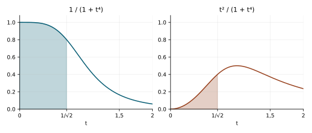
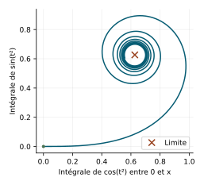

# Banque PT — Mathématiques C · Session 2025 · Corrigé guidé

*Corrigé rédigé par IA, non officiel. Signalez toute erreur.*

**Rédaction** · GPT-6.2 Astra Ultra · vitesse non renseignée

Le changement de variable réciproque compare deux intégrales rationnelles sur la demi-droite. Les valeurs à borne finie et les séries entières servent ensuite au calcul des deux intégrales de Fresnel.

Écrit de quatre heures, sans calculatrice. La grille d’admissibilité attribue à Math C le coefficient 6 pour l’École polytechnique et 3 pour chacune des ENS Paris-Saclay et Rennes. [Sujet](https://www.banquept.fr/documents/2025/math_c_2025_pt.pdf) · [Livret, p. 13](https://www.banquept.fr/documents/livret/2025/Livret_PT_2025.pdf#page=13)

Le rapport détaille les erreurs de bornes dans les changements de variable, la recherche des constantes des primitives et la domination des intégrales impropres. [Rapport du jury](https://www.banquept.fr/documents/ecrit/rapport/2025/rapport_math_c_ecrit_2025.pdf)

## Repères de lecture

- En I, fixez une borne supérieure finie avant d’additionner les morceaux de la décomposition.
- En II, suivez la classe de l’indice modulo quatre dans la récurrence.
- Dans la dernière question, reportez le signe de la phase complexe au moment de prendre la partie imaginaire.

## Préambule. Intégrales réciproques

### Question P.1

> [!INDICATION]
> Examiner les deux bornes pour chacun des deux numérateurs.

#### Solution

Les fonctions $1/(1+t^4)$ et $t^2/(1+t^4)$ sont continues sur $[0,+\infty[$. Pour $t\ge1$, elles sont respectivement majorées par $1/t^4$ et $1/t^2$, dont les intégrales de Riemann convergent en $+\infty$. Les deux intégrales proposées convergent absolument.

### Question P.2

> [!INDICATION]
> Préciser les domaines, la monotonie et le sens des bornes.

#### Solution

Soit $u=\varphi(t)$ une bijection strictement monotone de classe $C^1$ d’un intervalle ouvert vers un autre (on peut supposer sa dérivée non nulle à l’intérieur). Pour $g$ continue par morceaux, l’intégration de $g(\varphi(t))\varphi'(t)$ sur des segments tronqués se transforme en celle de $g(u)$ entre les images des bornes. En faisant tendre les bornes vers les extrémités correspondantes, les intégrales impropres convergent simultanément et sont égales avec leurs bornes orientées. Si les deux extrémités sont impropres, on les traite séparément à partir d’un point intérieur. Une substitution décroissante inverse les bornes.

### Question P.3

> [!INDICATION]
> Poser x égal à l’inverse de t et transformer aussi le différentiel.

#### Solution

La bijection décroissante $x=1/t$ de $]0,+\infty[$ sur lui-même donne $dt=-dx/x^2$. Donc
$$
\int_0^\infty\frac{t^2}{1+t^4}dt
=\int_\infty^0 \frac{x^{-2}}{1+x^{-4}}\frac{-dx}{x^2}
=\int_0^\infty\frac{dx}{1+x^4}.
$$
Les convergences sont justifiées en P.1.

## I. Décomposition réelle d’une fraction quartique

### Question I.1

> [!INDICATION]
> Mettre le dénominateur sous forme canonique.

#### Solution

Posons $q(t)=t^2-\sqrt2 t+1=(t-1/\sqrt2)^2+1/2>0$. Le quotient $h(t)=(2t-\sqrt2)/q(t)$ est défini sur $D_h=\mathbb R$.

### Question I.2

> [!INDICATION]
> Distinguer la borne inversée du signe introduit par la substitution.

#### Solution

Comme $h=q'/q$, $\int_0^X h(t)dt=\log q(X)-\log q(0)=\log q(X)$. En posant $u=-t$ dans l’intégrale orientée de $X$ à zéro, on a $\int_X^0 h(-t)dt=\int_0^{-X}h(u)du=\log q(-X)$.

### Question I.3

> [!INDICATION]
> Former le rapport des deux polynômes avant de prendre la limite.

#### Solution

D’après I.2, $\int_0^X(h(t)+h(-t))dt=\log q(X)-\log q(-X)=\log(q(X)/q(-X))$. Les deux polynômes ont même terme dominant $X^2$. Leur quotient tend vers 1 et l’intégrale vers zéro.

### Question I.4

> [!INDICATION]
> Faire apparaître le dénominateur de la dérivée d’arctangente.

#### Solution

La dérivée de $\sqrt2\arctan(\sqrt2t-1)$ est $2/(1+(\sqrt2t-1)^2)$. C’est la fonction $\varphi(t)=2/(1+2(t-1/\sqrt2)^2)$ du sujet. On obtient ainsi une primitive sur $\mathbb R$.

### Question I.5

> [!INDICATION]
> Réutiliser le même dénominateur et ajuster le facteur constant.

#### Solution

Comme $q(t)>0$, $D_g=\mathbb R=D_h$. On a $g(t)=\sqrt2/q(t)=\sqrt2\varphi(t)$. Une primitive est donc $G(t)=2\arctan(\sqrt2t-1)$.

### Question I.6

> [!INDICATION]
> Une primitive de g(−t) est −G(−t).

#### Solution

Pour $X\ge0$, $\int_0^Xg(-t)dt=G(0)-G(-X)$. Avec $G(0)=-\pi/2$ et l’imparité de l’arctangente, cela vaut $2\arctan(\sqrt2X+1)-\pi/2$.

### Question I.7

> [!INDICATION]
> Les valeurs en zéro s’annulent lorsque les deux intégrales sont ajoutées.

#### Solution

On trouve $\int_0^X(g(t)+g(-t))dt=G(X)-G(-X)=2\arctan(\sqrt2 X-1)+2\arctan(\sqrt2 X+1)$. Chaque arctangente tend vers $\pi/2$, donc la limite vaut $2\pi$.

### Question I.8

> [!INDICATION]
> Regrouper les termes portant le même dénominateur.

#### Solution

On a $h(t)+g(t)=2t/q(t)$ et $h(-t)+g(-t)=-2t/q(-t)$. Or $q(-t)-q(t)=2\sqrt2t$ et $q(t)q(-t)=(t^2+1)^2-2t^2=t^4+1$. La somme des quatre termes vaut donc $4\sqrt2t^2/(t^4+1)$.

### Question I.9.a

> [!INDICATION]
> Intégrer d’abord sur un segment, où tous les regroupements sont licites.

#### Solution

Par I.8 sur $[0,X]$, puis par I.3 et I.7 en laissant $X\to\infty$, on obtient $4\sqrt2\int_0^\infty t^2dt/(t^4+1)=0+2\pi$. Ainsi l’intégrale vaut $\pi/(2\sqrt2)$.

### Question I.9.b

> [!INDICATION]
> Revenir à l’égalité des deux intégrales établie dans le préambule.

#### Solution

Par P.3 et I.9.a, $\int_0^\infty dt/(1+t^4)=\pi/(2\sqrt2)$.

### Question I.10

> [!INDICATION]
> Évaluer les deux contributions à la borne finie avant de simplifier.

#### Solution

Prenons $b=1/\sqrt2$. Les deux quadratiques valent $q(b)=1/2$, $q(-b)=5/2$. L’intégrale de $h(t)+h(-t)$ de zéro à $b$ vaut donc $-\log5$. Celle de $g(t)+g(-t)$ vaut $2\arctan0+2\arctan2=2\arctan2$. En divisant l’égalité de I.8 par $4\sqrt2$, on trouve
$$
\int_0^{1/\sqrt2}\frac{t^2}{1+t^4}dt=\frac{2\arctan2-\log5}{4\sqrt2}.
$$

## II. Deux séries entières et une intégrale à borne finie

### Question II.1.a

> [!INDICATION]
> Dériver les séries à l’intérieur du disque de convergence et traiter la constante.

#### Solution

Écrivons $C=\sum a_nx^n$, $S=\sum b_nx^n$. Les conditions initiales sont $a_0=1$, $b_0=0$. Dans l’intervalle ouvert de convergence on peut dériver terme à terme. En identifiant les coefficients constants dans $C'=-2xS$ et $S'=2xC$, on trouve $a_1=b_1=0$. Pour tout $n\ge1$, l’identification au degré $n$ donne
$$
(n+1)a_{n+1}=-2b_{n-1},\qquad (n+1)b_{n+1}=2a_{n-1}.
$$

### Question II.1.b

> [!INDICATION]
> Relier le coefficient de C à un coefficient de S, puis revenir à C.

#### Solution

Pour $n\ge4$, $na_n=-2b_{n-2}$ et $(n-2)b_{n-2}=2a_{n-4}$ d’après II.1.a. En substituant, on obtient $a_n=-4a_{n-4}/(n(n-2))$.

### Question II.1.c

> [!INDICATION]
> Comparer les séries en x et en −x.

#### Solution

La parité des deux fonctions et l’unicité des coefficients de leurs séries entières imposent $a_n=(-1)^na_n$ et $b_n=(-1)^nb_n$. Ainsi $a_n=b_n=0$ pour chaque indice impair.

### Question II.1.d.i

> [!INDICATION]
> Diviser l’indice entier par quatre.

#### Solution

La division euclidienne fournit un unique quotient $p\in\mathbb N$ et un unique reste $r\in\{0,1,2,3\}$ tels que $n=4p+r$. Cela donne les quatre formes proposées.

### Question II.1.d.ii

> [!INDICATION]
> Il ne reste à traiter qu’une classe d’indices pairs.

#### Solution

Les indices impairs sont déjà réglés. Au rang deux, $2a_2=-2b_0=0$. Pour $n=4p+2$, $p\ge1$, II.1.b exprime $a_{4p+2}$ comme un multiple de $a_{4(p-1)+2}$. Par récurrence depuis $a_2=0$, tous ces coefficients sont nuls. Ainsi seul un rang divisible par quatre peut porter un coefficient non nul.

### Question II.1.e

> [!INDICATION]
> Simplifier la récurrence entre deux multiples de quatre.

#### Solution

On a $a_0=1=(-1)^0/0!$. Pour $p\ge1$, II.1.b donne $a_{4p}=-a_{4p-4}/((2p)(2p-1))$. Si $a_{4p-4}=(-1)^{p-1}/(2p-2)!$, alors $a_{4p}=(-1)^p/(2p)!$. La récurrence conclut pour tout $p$.

### Question II.1.f

> [!INDICATION]
> Reconnaître une série usuelle et utiliser la seconde équation pour identifier S.

#### Solution

Pour $x\ne0$, le rapport de deux termes non nuls successifs de la série de $C$, en module, vaut $|x|^4/((2p+2)(2p+1))\to0$. Donc $R=+\infty$. L’expression $C(x)=\sum_{p\ge0}(-1)^p(x^2)^{2p}/(2p)!=\cos(x^2)$ s’ensuit. Puis $S'=2x\cos(x^2)$, $S(0)=0$, donc $S(x)=\sin(x^2)$. Ces deux fonctions paires satisfont bien le système. Pour l’unicité, la différence de deux solutions vérifie le même système avec données nulles, et la dérivée de la somme des carrés de ses deux composantes est nulle. La différence est donc identiquement nulle.

### Question II.2.a

> [!INDICATION]
> Identifier la raison de la série géométrique.

#### Solution

La série $\sum_{n\ge0}(-1)^n x^{4n}$ a pour raison $-x^4$. Elle converge si et seulement si $|x|<1$, et sa somme est $D(x)=1/(1+x^4)$. Le rayon est $R'=1$.

### Question II.2.b

> [!INDICATION]
> Le segment d’intégration est strictement à l’intérieur du disque de convergence.

#### Solution

Par convergence uniforme sur $[0,1/\sqrt2]$, on peut intégrer terme à terme la série de II.2.a. Comme $(1/\sqrt2)^{4n+1}=1/(\sqrt2\,4^n)$, il vient
$$
\int_0^{1/\sqrt2}\frac{dx}{1+x^4}=\frac1{\sqrt2}\sum_{n=0}^\infty\frac{(-1)^n}{4^n(4n+1)} .
$$

### Question II.2.c

> [!INDICATION]
> À borne finie, les deux intégrales du préambule ne sont plus égales.

#### Solution

Par l’expression de $g$ et le dénominateur commun de I.8,
$$
g(t)+g(-t)=2\sqrt2\frac{1+t^2}{1+t^4}.
$$
L’intégrale du membre de gauche de zéro à $b=1/\sqrt2$ vaut $2\arctan2$ par I.7 évaluée en $b$. On en déduit que la somme des intégrales des deux fractions du préambule, sur $[0,b]$, vaut $\arctan2/\sqrt2$. En retranchant I.10, la valeur de l’intégrale à numérateur 1, donc de la série de II.2.b, est $(2\arctan2+\log5)/(4\sqrt2)$.

## III. Intégrales oscillantes de Fresnel

Pour $X>0$, on pose $I(X)=\int_1^X\cos(t^2)dt$ et $J(X)=\int_1^X\sin(t^2)dt$. En III.6, la fonction à paramètre est
$$
f(x)=\int_0^{+\infty}\frac{e^{-(t^2+i)x^2}}{t^2+i}\,dt.
$$

### Question III.1

> [!INDICATION]
> Utiliser la continuité près de l’origine et une comparaison à l’infini.

#### Solution

L’intégrande $e^{-t^2}$ est continu sur $[0,1]$. Pour $t\ge1$, il est majoré par $e^{-t}$, intégrable. Donc $\int_0^\infty e^{-t^2}dt$ converge. Sa valeur $\sqrt\pi/2$ est ensuite donnée par le sujet.

### Question III.2

> [!INDICATION]
> Prendre le module des numérateurs bornés.

#### Solution

Sur $[1,+\infty[$, les modules des fonctions $\sin(t^2)/t^2$ et $\cos(t^2)/t^2$ sont au plus $1/t^2$. Elles sont continues et le majorant est intégrable. Les deux intégrales convergent absolument.

### Question III.3

> [!INDICATION]
> Faire apparaître la dérivée de la phase t² dans chaque intégrale.

#### Solution

Pour $X\ge1$, écrivons $\cos(t^2)=(\sin(t^2))'/(2t)$ et $\sin(t^2)=-(\cos(t^2))'/(2t)$. L’intégration par parties sur $[1,X]$ donne
$$
I(X)=\left[\frac{\sin(t^2)}{2t}\right]_1^X+\frac12\int_1^X\frac{\sin(t^2)}{t^2}dt,
\qquad
J(X)=\left[-\frac{\cos(t^2)}{2t}\right]_1^X-\frac12\int_1^X\frac{\cos(t^2)}{t^2}dt .
$$
Les termes en $X$ des crochets tendent vers zéro et les deux intégrales restantes convergent par III.2. Les limites sont donc réelles et finies.

### Question III.4

> [!INDICATION]
> Réunir les deux composantes réelles d’un complexe.

#### Solution

Les parties réelle et imaginaire de $\int_1^X e^{it^2}dt$ sont $I(X)$ et $J(X)$. Les deux ont une limite finie, donc l’intégrale complexe converge. Le module de son intégrande étant 1, la convergence est conditionnelle.

### Question III.5

> [!INDICATION]
> Substituer l’argument imaginaire dans l’exponentielle.

#### Solution

La série exponentielle est absolument convergente pour tout argument complexe. Pour tout réel $t$,
$$
e^{it^2}=\sum_{n=0}^\infty\frac{i^n}{n!}t^{2n}.
$$
Son rayon est infini.

### Question III.6.a

> [!INDICATION]
> Calculer le module avant de tester la convergence, y compris quand x est nul.

#### Solution

Pour $x\in\mathbb R$, le module du quotient vaut $e^{-t^2x^2}/\sqrt{t^4+1}$. Il est au plus $1/\sqrt{1+t^4}$, qui est continu et au plus $1/t^2$ pour $t\ge1$. L’intégrale converge absolument pour tout réel $x$, donc $D_f=\mathbb R$. La même domination et la continuité point par point assurent en particulier la continuité de $f$ en zéro.

### Question III.6.b

> [!INDICATION]
> Ramener l’exposant à un carré sans paramètre.

#### Solution

Pour $x>0$, la substitution croissante $u=xt$ donne $\int_0^\infty e^{-t^2x^2}dt=x^{-1}\int_0^\infty e^{-u^2}du=\sqrt\pi/(2x)$.

### Question III.6.c

> [!INDICATION]
> Majorer le module de l’intégrale en supprimant le dénominateur de module au moins un.

#### Solution

Pour $x>0$,
$$
|f(x)|\le \int_0^\infty\frac{e^{-t^2x^2}}{\sqrt{t^4+1}}dt\le\int_0^\infty e^{-t^2x^2}dt=\frac{\sqrt\pi}{2x}.
$$
Ainsi $f(x)\to0$ en $+\infty$.

### Question III.6.d

> [!INDICATION]
> Établir une domination uniforme de la dérivée sur chaque segment positif.

#### Solution

Pour $0<\varepsilon\le x\le a$, la dérivée partielle de l’intégrande en $x$ vaut $-2x\exp(-(t^2+i)x^2)$. Son module est au plus $2a e^{-\varepsilon^2t^2}$, intégrable par III.6.b. Le noyau et sa dérivée sont continus, et le noyau est dominé comme en III.6.a. Le théorème de dérivation sous l’intégrale donne pour $x>0$ la dérivée $f'(x)=-2x\int_0^\infty e^{-(t^2+i)x^2}dt$. En recouvrant la demi-droite par ces segments, on obtient $f\in C^1(]0,+\infty[)$.

### Question III.6.e

> [!INDICATION]
> Le facteur oscillant est indépendant de t.

#### Solution

On peut extraire $e^{-ix^2}$ de l’intégrale de III.6.d. Par III.6.b, $f'(x)=-2xe^{-ix^2}\sqrt\pi/(2x)=-\sqrt\pi e^{-ix^2}$.

### Question III.6.f

> [!INDICATION]
> Calculer f(0) puis utiliser les deux limites du paramètre.

#### Solution

On a $1/(t^2+i)=(t^2-i)/(t^4+1)$. Les deux intégrales de I.9 donnent $f(0)=(1-i)\pi/(2\sqrt2)$. Pour $0<\varepsilon<X$, intégrer III.6.e donne $\int_\varepsilon^X e^{-ix^2}dx=(f(\varepsilon)-f(X))/\sqrt\pi$. En prenant $\varepsilon\downarrow0$ par continuité en zéro puis $X\to\infty$ par III.6.c, on obtient
$$
\int_0^\infty e^{-ix^2}dx=(1-i)\sqrt{\pi/8}.
$$
La partie réelle vaut l’intégrale de $C(x)=\cos(x^2)$ et l’opposé de la partie imaginaire celle de $S(x)=\sin(x^2)$. Toutes deux valent donc $\sqrt{\pi/8}$.

