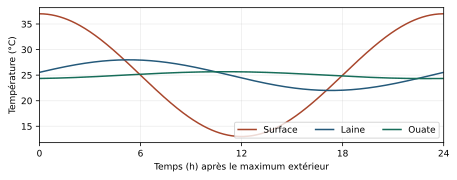
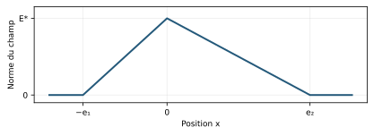
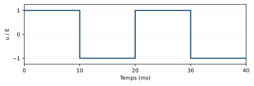
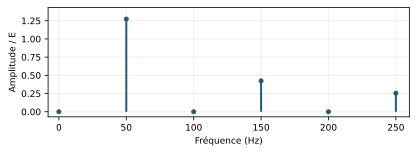
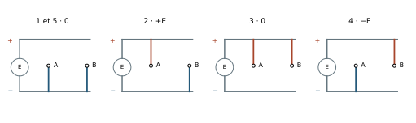
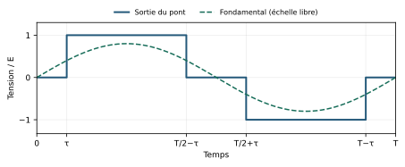
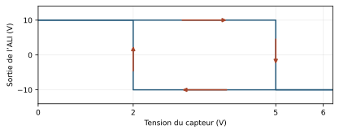
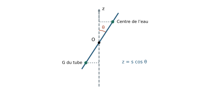

# Banque PT 2025 — Physique A · Corrigé guidé

*Corrigé rédigé par IA, non officiel. Signalez toute erreur.*

**Rédaction** · GPT-6.2 Astra Ultra · vitesse non renseignée

**Révision (tour 1)** · GPT-6.2 Astra Ultra · vitesse non renseignée

Confort et performances énergétiques de l’habitat. Épreuve de quatre heures, sans calculatrice. Les pages du sujet sont comptées depuis la couverture. [Sujet et documents, p. 1–12](https://www.banquept.fr/documents/2025/ph_a_2025_pt.pdf) · [Rapport du jury, p. 1–2](https://www.banquept.fr/documents/ecrit/rapport/2025/rapport_phys_a_ecrit_2025.pdf)

## I. Isolation thermique d’un toit

### Q1. Loi de Fourier

**Piste.** Dans quel sens la température augmente-t-elle lorsque l’on suit son gradient ?

Dans un isolant isotrope de conductivité $\lambda>0$, $\vec{\jmath}=-\lambda\,\nabla T$, en W/m². Le gradient pointe vers les températures croissantes. Le signe négatif traduit un transport spontané de chaleur du chaud vers le froid. Avec $x$ dirigé vers l’intérieur de la maison, $j=-\lambda\partial_x T$.

### Q2. Bilan d’une tranche

**Piste.** Isolez une tranche et comptez séparément les flux qui entrent et qui sortent.

Prenons la tranche immobile d’aire $S$ comprise entre $x$ et $x+\mathrm dx$. Sans source interne, elle reçoit pendant $\mathrm dt$ la chaleur $S[j(x,t)-j(x+\mathrm dx,t)]\mathrm dt$. L’augmentation de son énergie interne vaut $\rho cS\,\mathrm dx\,\partial_tT\,\mathrm dt$. En divisant et en passant à la limite, $\rho c\partial_t T=-\partial_x j$. Pour des propriétés constantes, la loi de Fourier donne

$$
\partial_t T=D\,\partial_x^2 T,\qquad D=\frac{\lambda}{\rho c}.
$$

La diffusivité $D$ s’exprime en m²/s.

### Q3. Résistance en régime stationnaire

**Piste.** Fixez le sens positif du flux avant de comparer les températures des deux faces.

Le flux thermique algébrique $\Phi=Sj$, compté vers $+x$, est alors constant. En intégrant $\partial_x T=-\Phi/(\lambda S)$, on obtient $T(0)-T(d)=\Phi d/(\lambda S)$. La résistance thermique est le rapport de la chute de température au flux, soit $R_{\rm th}=d/(\lambda S)$, en K/W. Sa valeur est positive pour les deux sens de transfert.

### Q4. Résistance à ajouter

**Piste.** Le toit conserve sa résistance initiale une fois isolé. Écrivez la résistance totale visée.

Pour une même différence de température entre les deux ambiances, diviser le flux par dix exige de multiplier la résistance totale par dix. Comme le toit initial et l’isolant sont traversés par le même flux, leurs résistances s’additionnent. Il faut donc $R_{\rm isolant}=9R_{\rm toit}=0{,}090$ K/W.

### Q5. Épaisseurs comparées

**Piste.** À résistance égale, quel matériau doit être posé avec la plus grande épaisseur ?

La relation $d=9R_{\rm toit}\lambda S$ donne, pour $S=100$ m², $d_{\ell}=0{,}090\times0{,}032\times100=0{,}288$ m de laine de verre et $d_o=0{,}090\times0{,}040\times100=0{,}360$ m de ouate de cellulose. Ces épaisseurs donnent la même résistance en régime stationnaire.

### Q6. Excitation journalière

**Piste.** Écrivez le maximum et le minimum puis convertissez la durée du cycle en pulsation.

Les températures extrêmes vérifient $T_0+T_1=37$ °C et $T_0-T_1=13$ °C. Ainsi $T_0=25$ °C et $T_1=12$ °C d’amplitude (écart de 12 K). Sur 24 h, $\omega=2\pi/24=\pi/12\simeq0{,}262$ rad/h, soit $7{,}27\times10^{-5}$ rad/s.

### Q7. Équation spatiale complexe

**Piste.** Dérivez séparément le facteur temporel et le facteur spatial.

Dans l’écriture $T_0+f(x)e^{i\omega t}$, la dérivée temporelle de la partie variable multiplie celle-ci par $i\omega$. La substitution dans l’équation de diffusion, puis la simplification de l’exponentielle commune, donnent $f''-(i\omega\rho c/\lambda)f=0$. La condition en surface est $f(0)=T_1$.

### Q8. Profondeur de pénétration

**Piste.** Élevez l’exposant complexe au carré avant d’examiner sa dimension.

Le carré de $(1+i)/\delta$ vaut $2i/\delta^2$. L’équation caractéristique impose donc

$$
\delta=\sqrt{\frac{2\lambda}{\rho c\omega}}=\sqrt{\frac{2D}{\omega}}.
$$

Comme $D$ est en m²/s et $\omega$ en s⁻¹, $D/\omega$ est une surface et $\delta$ une longueur. À la profondeur $\delta$, l’amplitude est divisée par $e$.

### Q9. Atténuation et retard au plafond

**Piste.** Suivez un point de phase constante, puis comparez l’amplitude aux deux faces.

Le terme en $e^{-(1+i)x/\delta}$ donne à l’onde la phase $\omega t-x/\delta$, dont les points de phase constante avancent vers les $x$ croissants. Le choix demandé élimine l’autre terme. À $x=0$, sa constante vaut $T_1$. La partie réelle est donc

$$
T(x,t)=T_0+T_1e^{-x/\delta}\cos(\omega t-x/\delta).
$$

Au plafond $x=d$, l’amplitude devient $T_1e^{-d/\delta}$ et le retard temporel vaut $\tau=d/(\omega\delta)=d\sqrt{\rho c/(2\lambda\omega)}$. Ce retard en heures ou secondes se distingue de l’angle $\omega\tau$ en radians. On trouve environ 5,3 h pour la laine et 11 h pour la ouate.

### Q10. Déplacer le pic vers la nuit

**Piste.** Tracez un maximum de surface puis cherchez à quel moment le plafond doit atteindre le sien.

L’opposition de phase impose $\omega\tau=(2k+1)\pi$. Le plus court retard positif recherché vaut donc 12 h, modulo 24 h. À résistance thermique égale, la ouate de cellulose, avec un retard voisin de 11 h, rapproche le maximum intérieur du milieu de la nuit si la température extérieure culmine à midi. Elle atténue également davantage l’oscillation dans ce modèle.

## II. De la cellule photovoltaïque au panneau

### Q11. Neutralité de la jonction

**Piste.** Comptez la charge de chaque couche pour une même aire choisie.

Par unité de surface de jonction, la charge vaut $\rho_1 e_1+\rho_2e_2$. La neutralité exige $\rho_1 e_1=-\rho_2 e_2$, les deux densités étant de signes opposés.

### Q12. Loi de Gauss

**Piste.** Passez d’un volume à sa frontière en précisant l’orientation de la normale.

La loi locale est $\operatorname{div}\vec E=\rho/\varepsilon_0$. En intégrant sur un volume $V$ et en appliquant le théorème de la divergence, on obtient

$$
\iint_{\partial V}\vec E\cdot\vec n\,\mathrm dS
=\frac{1}{\varepsilon_0}\iiint_V\rho\,\mathrm dV
=\frac{Q_{\rm int}}{\varepsilon_0}.
$$

La surface est fermée, et $\vec n$ est sa normale sortante. La permittivité retenue ici est celle du modèle imprimé.

### Q13. Direction et dépendance

**Piste.** Identifiez deux plans de symétrie qui passent par le point d’observation.

Les translations selon $y$ et $z$ laissent les couches uniformes inchangées. Le champ dépend donc seulement de $x$. Par tout point $M$, les plans parallèles à $xOy$ et à $xOz$ sont des plans de symétrie des charges. Le champ polaire appartient à ces deux plans, donc à leur intersection parallèle à $Ox$. On écrit $\vec E=E_x(x)\vec u_x$.

### Q14. Champ dans les deux couches

**Piste.** Intégrez à partir d’une interface extérieure de chaque côté de la jonction.

Dans chaque couche, Maxwell-Gauss se réduit à $\mathrm dE_x/\mathrm dx=\rho_i/\varepsilon_0$. En intégrant depuis le bord gauche, puis depuis le bord droit où le champ est également nul, on trouve

$$
E_x(x)=
\begin{cases}
\rho_1(x+e_1)/\varepsilon_0,&-e_1\le x\le0,\\
(\rho_1e_1/\varepsilon_0)(1-x/e_2),&0\le x\le e_2.
\end{cases}
$$

Dans la seconde ligne, on a utilisé $\rho_2=-\rho_1e_1/e_2$. Les expressions coïncident en zéro et donnent le champ vectoriel par multiplication par $\vec u_x$.

### Q15. Tracé de la norme

**Piste.** Comparez les valeurs de champ au centre et aux deux extrémités.

Le champ pointe vers $+x$ dans toute la jonction. Sa norme est nulle hors de la zone de déplétion. Elle croît linéairement de 0 à $E_*=\rho_1e_1/\varepsilon_0$ entre $-e_1$ et 0, puis décroît jusqu’à 0 entre 0 et $e_2$. Les pentes peuvent avoir des modules différents.

### Q16. Arrêt du flux net de diffusion

**Piste.** Pour un électron, quel est le sens de la force par rapport au champ ?

Les électrons mobiles tendent à diffuser de N (à gauche) vers P. Le champ dirigé de N vers P exerce sur un électron la force $-e\vec E$, vers N. Pour les trous, la diffusion tend vers N tandis que la dérive électrique est vers P. À l’équilibre, les courants de dérive compensent les courants de diffusion des porteurs. Leur agitation microscopique persiste.

### Q17. Courbes d’iso-puissance

**Piste.** Sur une même iso-puissance, que devient le courant si la tension double ?

En convention générateur la puissance délivrée vaut $P=UI$. Pour $P>0$ fixé, $I=P/U$ : les iso-puissances sont des hyperboles décroissantes du premier quadrant, asymptotes aux axes. À tension donnée, la puissance augmente avec l’ordonnée.

### Q18. Point de puissance maximale

**Piste.** Suivez le point de fonctionnement depuis le court-circuit jusqu’au circuit ouvert.

Pour $R$ donné, la droite de charge $I=U/R$ coupe la caractéristique du panneau au point de fonctionnement. En court-circuit $U=0$ et en circuit ouvert $I=0$, donc la puissance s’annule aux deux extrêmes. Elle est positive entre les deux et atteint son maximum près du coude, au contact de la plus grande iso-puissance accessible. À 1 kW/m², la figure 3 donne par exemple $U_\star\simeq17$ V et $I_\star\simeq5{,}0$ A, soit **environ 85 W**. La charge correspondante vaut $R_\star=U_\star/I_\star\simeq3{,}4$ Ω. Une lecture légèrement différente au voisinage du coude donne le même ordre de précision.

### Q19. Rendement du panneau

**Piste.** Retrouvez l’aire totale active avant de convertir l’irradiance en puissance.

Le rendement est le rapport de la puissance électrique utile à la puissance solaire incidente sur les cellules. Leur aire active vaut $36c^2\simeq36/64=0{,}5625$ m². À 1 kW/m², cela donne $\eta\simeq85/562{,}5\simeq0{,}15$, soit **15 %**. Cette valeur se situe dans l’intervalle de 13 à 18 % annoncé pour le silicium polycristallin.

### Q20. Branches en parallèle

**Piste.** Le courant de la charge est-il le même que celui qui passe dans une cellule ?

Les $x$ branches identiques, chacune constituée de $y=N/x$ cellules en série, se partagent le courant total $I=U/R$. Une branche débite $I/x$ et fixe à ses bornes $U=yE-yrI/x$. En remplaçant $y$ et en isolant $U$, on obtient

$$
U=\frac{N E R x}{R x^2+Nr}.
$$

La tension à vide équivalente est $yE$ et la résistance interne équivalente est $yr/x=Nr/x^2$.

### Q21. Choisir le câblage

**Piste.** Pour maximiser la tension, observez le dénominateur écrit avec un terme en x et un terme en 1/x.

La puissance utile vaut $U^2/R$. Pour $x>0$ et $U>0$, il suffit de maximiser $U=NE/[x+(Nr/R)/x]$. Le dénominateur atteint son minimum lorsque ses deux termes sont égaux. L’optimum continu est

$$
x_\star=\sqrt{Nr/R},\qquad y_\star=\sqrt{NR/r}.
$$

Il correspond à $Nr/x^2=R$. Le câblage réel exige des entiers dont le produit vaut $N$. Si l’optimum continu n’est pas réalisable, on compare la puissance pour les diviseurs admissibles qui l’encadrent, ou l’extrémité du domaine si nécessaire.

### Q22. Puissance utile et pertes internes

**Piste.** Calculez le courant dans une seule cellule avant de sommer les pertes.

À l’optimum adapté, $U=yE/2$, donc $P_{\max}=y^2 E^2/(4R)=N E^2/(4r)$. Le courant dans chaque cellule est $I/x=E/(2r)$, d’où $P_J=Nr[E/(2r)]^2=N E^2/(4r)$. La puissance utile égale la puissance dissipée dans les résistances internes. Le rendement électrique du modèle de générateur à ce point vaut donc 1/2. Le rendement solaire de Q19 portait sur une autre conversion.

## III. De la tension continue au signal alternatif

### Q23. Commande symétrique

**Piste.** Repérez la pointe de la flèche u et attribuez à chaque borne le potentiel du rail auquel elle est reliée.

Appelons A le point milieu de la branche gauche, B celui de droite. La flèche imprimée définit $u=V_A-V_B$. Quand $K_1$ et $K_3$ sont fermés, A est au rail haut et B au rail bas, d’où $u=+E$. Sur la seconde demi-période, l’inversion des connexions donne $u=-E$. Le créneau est périodique de période $T=1/f=20$ ms.

### Q24. Spectre unilatéral en amplitude

**Piste.** Séparez les rangs pairs et impairs, puis donnez les fréquences en hertz.

Pour les rangs pairs, $1-\cos(n\pi)=0$. Pour les rangs impairs, $b_n=4E/(n\pi)$. Le signal n’a aucune composante continue. Les amplitudes crête des raies à 50, 150 et 250 Hz sont respectivement $4E/\pi$, $4E/(3\pi)$ et $4E/(5\pi)$. Les amplitudes à 100 et 200 Hz sont nulles.

### Q25. Commande décalée

**Piste.** Remplacez chaque contact fermé par un fil. Laissez les deux bornes de sortie distinctes.

Sur les cinq intervalles successifs du tableau 1, les configurations des bornes et la tension s’obtiennent directement en remplaçant chaque interrupteur fermé par un fil et en laissant l’interrupteur ouvert déconnecté. Le signe est celui de Q23.

| Intervalle | Connexions fermées | Potentiels A et B | Tension |
|---|---|---|---|
| $0<t<\tau$ | $K_4,K_3$ | bas, bas | 0 |
| $\tau<t<T/2-\tau$ | $K_1,K_3$ | haut, bas | $+E$ |
| $T/2-\tau<t<T/2+\tau$ | $K_1,K_2$ | haut, haut | 0 |
| $T/2+\tau<t<T-\tau$ | $K_4,K_2$ | bas, haut | $-E$ |
| $T-\tau<t<T$ | $K_4,K_3$ | bas, bas | 0 |

Pour que les intervalles du tableau imprimé restent dans cet ordre avec des plateaux non nuls, il faut $0<\tau<T/4$. La seule indication $\tau<T/2$ donnée au début du texte ne suffit pas. Le choix de Q28 satisfait cette condition. Les quatre circuits distincts sont dessinés ci-dessous ; la dernière configuration reprend la première. Les points A et B sont les bornes de sortie.

### Q26. Valeurs moyenne et efficace

**Piste.** Comptez la durée totale pendant laquelle le carré de la tension vaut E².

Les définitions sur une période sont $U_0=T^{-1}\int_0^T u(t)\,\mathrm dt$ et $U_{\rm eff}=\sqrt{T^{-1}\int_0^T u^2(t)\,\mathrm dt}$. Chacun des plateaux de tension $+E$ et $-E$ dure $T/2-2\tau$, les autres intervalles ont une tension nulle. Les deux aires algébriques s’annulent et les aires quadratiques s’ajoutent. Il en résulte

$$
U_0=0,\qquad U_{\rm eff}=E\sqrt{1-4\tau/T}.
$$

On retrouve $E$ pour la commande symétrique dans la limite $\tau\to0$.

### Q27. Mode fondamental

**Piste.** Placez d’abord les passages par zéro du sinus fondamental.

Le mode s’écrit $b_1\sin(2\pi t/T)$ avec $b_1=(4E/\pi)\cos(2\pi\tau/T)>0$ dans la plage du tableau. Il traverse zéro en montant à l’origine, atteint son maximum à $T/4$, repasse par zéro à $T/2$, atteint son minimum à $3T/4$, puis revient à zéro. Le tracé en tirets de Q25 utilise cette phase.

### Q28. Supprimer l’harmonique de rang trois

**Piste.** Quel est le premier rang supérieur à un que la commande symétrique laisse subsister ?

Au-dessus du fondamental, la première raie potentiellement non nulle est celle de rang 3. Il faut $\cos(6\pi f\tau)=0$. Sa première annulation pour un retard positif correspond à $6\pi f\tau=\pi/2$. Ainsi $\tau=1/(12f)=T/12$, soit **1,67 ms** à 50 Hz. Le fondamental subsiste puisque $\cos(\pi/6)\ne0$, de même que le rang 5 puisque $\cos(5\pi/6)\ne0$.

### Q29. Prélever la tension sur la résistance

**Piste.** Comparez l’effet d’une bobine sur une variation lente et sur une variation rapide du courant.

La bobine s’oppose d’autant plus aux variations du courant qu’elles sont rapides. En série, les composantes rapides du courant, donc de la tension $Ri$ prélevée sur la résistance, sont ainsi atténuées. La tension sur la bobine privilégierait ces variations rapides. Le prélèvement sur $R$ permet d’extraire un signal proche de la sinusoïde fondamentale.

### Q30. Transfert et coupure

**Piste.** Utilisez le rapport de la tension d’une des deux impédances à la tension totale.

Le diviseur d’impédances donne $H(j\omega)=R/(R+j\omega L)=1/(1+j\omega L/R)$. Le gain statique est unité. Le module vaut $1/\sqrt{1+(\omega L/R)^2}$ et atteint $1/\sqrt2$ pour $\omega_c=R/L$. La fréquence de coupure est donc $f_c=R/(2\pi L)$, en hertz.

### Q31. Compromis sur l’inductance

**Piste.** Imaginez une inductance presque nulle, puis une inductance qui gêne fortement même le courant à 50 Hz.

Une petite inductance donne une coupure élevée. Les harmoniques résiduels sont alors peu atténués et la sortie reste déformée. Une très grande inductance place la coupure sous le fondamental. La sortie peut être mieux lissée, mais aussi trop faible à la fréquence utile. Il faut donc préserver assez de tension à 50 Hz tout en atténuant les premières raies restantes.

### Q32. Vérifier le cahier des charges

**Piste.** Vérifiez d’abord quelle est la première raie restante après la commande décalée.

Le gain en décibels vaut $G_{\rm dB}(\nu)=-10\log_{10}[1+(\nu/f_c)^2]$. Si $f_c=f$, on obtient au fondamental $-10\log_{10}2\simeq-3{,}01$ dB, soit moins de 4 dB d’atténuation. Après suppression du rang 3, la première raie supérieure est à $5f$, avec $G_{\rm dB}=-10\log_{10}26\simeq-14{,}15$ dB, soit plus de 14 dB d’atténuation. Pour $R=100$ Ω, $L=100/(2\pi\times50)=1/\pi$ H, soit environ **0,318 H**.

### Q33. Accentuer la sélectivité

**Piste.** Quelle propriété du filtre permet de mieux séparer deux fréquences au-delà de la bande passante ?

On peut utiliser un filtre passe-bas d’ordre supérieur, par exemple un étage LC chargé et dimensionné pour conserver le fondamental. Une pente de coupure plus prononcée réduit davantage les composantes à $5f$ et au-delà. Il faut vérifier à nouveau le gain à 50 Hz après modification du filtre.

## IV. Réguler le niveau d’un bassin

### Q34. Régime de l’ALI

**Piste.** Suivez une petite perturbation de sortie jusqu’à l’entrée sur laquelle elle revient.

Le potentiomètre ramène une fraction positive de la sortie vers l’entrée non inverseuse. Près d’un seuil, une fluctuation positive de la sortie augmente la différence d’entrée et s’amplifie. Le régime linéaire intermédiaire est instable. L’amplificateur idéal fonctionne en comparateur saturé à $+U_{sat}$ ou $-U_{sat}$.

### Q35. Potentiel de référence

**Piste.** Partez du rail de sortie et franchissez la portion Rx du diviseur.

L’entrée positive ne consomme pas de courant. Elle se situe entre la résistance $Rx$ du côté de $u_s$ et la résistance $R(1-x)$ du côté du potentiel $+E$. Le courant algébrique de la sortie vers la source vaut $(u_s-E)/R$, d’où

$$
V^+=u_s-x(u_s-E)=(1-x)u_s+xE.
$$

Si $x=1$, le curseur est du côté de la source et $V^+=E$, ce qui vérifie la pondération.

### Q36. Cycle d’hystérésis

**Piste.** Commencez sur la branche haute, augmentez la tension du capteur, puis inversez le sens de parcours.

On a $V^-=u_{cn}$. Posons $V_H=xE+(1-x)U_{sat}$ et $V_B=xE-(1-x)U_{sat}$. À sortie haute, elle reste haute tant que $u_{cn}<V_H$ et descend au rail bas quand $u_{cn}$ franchit $V_H$ en montant. À sortie basse, elle remonte seulement lorsque $u_{cn}$ franchit $V_B$ en descendant. Entre les deux seuils, l’état dépend donc du passé. Il s’agit d’un **comparateur inverseur à hystérésis**.

### Q37. Cycle de marche de la pompe

**Piste.** Décrivez un cycle entier en commençant au moment où l’évaporation abaisse le niveau.

Pendant l’évaporation, $h$ et $u_{cn}=\alpha h$ baissent. Au seuil bas, la sortie devient positive, le relais se ferme et la pompe remplit le bassin. Le niveau remonte si le débit de remplissage dépasse les pertes. Le haut seuil atteint, la sortie devient négative et la pompe s’arrête. Cette alternance conserve le niveau entre les hauteurs de déclenchement dans le modèle idéal.

### Q38. Placer les seuils

**Piste.** Associez chaque hauteur au seuil réellement franchi dans ce sens de variation.

Le seuil bas doit correspondre à $h_{\min}$ et le seuil haut à $h_{\max}$. Cela impose

$$
xE-(1-x)U_{sat}=\alpha h_{\min},\qquad
xE+(1-x)U_{sat}=\alpha h_{\max}.
$$

La somme fixe la valeur centrale $xE$ et la différence la largeur $2(1-x)U_{sat}$.

### Q39. Réglages numériques

**Piste.** La différence des équations détermine la largeur et leur somme détermine le centre.

Les hauteurs de 0,40 et 1,00 m donnent des seuils de 2,0 et 5,0 V. Avec $U_{sat}=10$ V, $1-x=(5-2)/(2\times10)=0{,}15$, donc $x=0{,}85$. De $xE=(5+2)/2=3{,}5$ V on déduit $E=3{,}5/0{,}85\simeq4{,}12$ V. Pour $R=100$ kΩ, les deux portions sont ainsi 85 et 15 kΩ.

### Q40. Puissance électrique sans frottements

**Piste.** Prenez la surface du réservoir comme point de départ et le jet libre comme point d’arrivée.

Appliquons le bilan d’énergie mécanique en écoulement permanent, incompressible et sans pertes entre la surface libre du réservoir et le jet sortant du tuyau. Les pressions aux extrémités valent toutes deux $P_{atm}$. La vitesse en surface est négligeable ($D_v/S\simeq2\times10^{-5}$ m/s), tandis que la vitesse du jet est $v=4D_v/(\pi d^2)$. La hauteur à élever est $z_s-z_e=7$ m. La puissance hydraulique reçue est le débit massique fois l’augmentation de l’énergie mécanique massique. Comme $r=P_{hyd}/P_e$,

$$
P_e=\frac{\rho D_v}{r}\left[g(z_s-z_e)+\frac12\left(\frac{4D_v}{\pi d^2}\right)^2\right]\simeq186\ \mathrm W.
$$

Si l’on conserve la vitesse à la surface, on soustrait $(D_v/S)^2/2$ dans le crochet. La sortie du tuyau est au-dessus du bassin, d’où l’emploi de $z_s$.

### Q41. Régime dans le tuyau

**Piste.** Utilisez la section circulaire pour passer du débit à la vitesse et choisissez la longueur du Reynolds.

$Re=\rho vd/\eta$ compare les effets d’inertie aux effets visqueux, avec le diamètre intérieur comme longueur caractéristique. Ici $D_v=2{,}0\times10^{-3}$ m³/s, $d=0{,}040$ m et $v\simeq1{,}59$ m/s. Ainsi $Re\simeq6{,}4\times10^4$, dans le domaine turbulent du diagramme fourni.

### Q42. Lecture de Moody

**Piste.** Sur une abscisse logarithmique, repérez la décade avant de chercher la courbe de rugosité.

Se placer entre $10^4$ et $10^5$ à $Re\simeq6{,}4\times10^4$ sur l’axe logarithmique. Monter jusqu’à la courbe $\varepsilon/d=5\times10^{-4}$ identifiée à droite, puis lire l’ordonnée sur l’axe de gauche. On obtient un coefficient de Darcy sans dimension $\xi\simeq0{,}022$, à la précision du tracé. En l’insérant dans $\xi\rho v^2 L/(2d)$, on retrouve environ $1{,}4\times10^4$ Pa.

### Q43. Puissance avec pertes de charge

**Piste.** Une différence de pression multipliée par un débit donne quelle puissance ?

La puissance dissipée dans les conduites est $D_v\Delta P_c$. Pour la fournir à l’eau, il faut augmenter la puissance électrique de $D_v\Delta P_c/r$. Ainsi

$$
P'_e=P_e+\frac{D_v\Delta P_c}{r}
\simeq186+\frac{0{,}002\times14000}{0{,}75}
\simeq223\ \mathrm W.
$$

La perte hydraulique de 28 W impose donc environ 37 W électriques supplémentaires.

### Q44. Nombre de panneaux

**Piste.** Utilisez la caractéristique correspondant à l’irradiance indiquée et arrondissez le nombre de panneaux au-dessus.

Sous 0,6 kW/m², la courbe correspondante de la figure 3 atteint une puissance d’environ 50 W au coude, pour une tension de 17 à 18 V et un courant d’environ 2,8 à 2,9 A. Quatre panneaux fourniraient environ 200 W et cinq environ 250 W. Il faut donc **cinq panneaux au minimum** en supposant leur fonctionnement au voisinage du maximum, dans les conditions d’irradiance et de rendement du sujet.

## V. Basculement d’une horloge à eau

### Q45. Centre de la colonne liquide

**Piste.** Situez d’abord le fond par rapport au pivot.

L’origine verticale est à la hauteur du pivot et le fond est à l’altitude $-b$. La section est constante et l’eau homogène. Son centre de masse est donc à mi-hauteur de la colonne verticale, soit $z_e=-b+h/2$.

### Q46. Énergie du tube incliné

**Piste.** Projetez sur la verticale un segment solidaire du tube après rotation.

Considérons un petit basculement à remplissage fixé. Le modèle de l’énoncé attribue aux centres de masse les positions portées par l’axe du tube. Un point dont la coordonnée signée sur l’axe vaut $s$ a, après rotation, l’altitude $s\cos\theta$. Pour le tube vide $s=-a$, pour la colonne d’eau $s=h/2-b$ et sa masse vaut $m_e=\rho Sh$. En prenant la même origine d’énergie au pivot, on trouve

$$
E_p(\theta)=g\cos\theta\,\underbrace{\left[-ma+\rho Sh\left(\frac h2-b\right)\right]}_{X}.
$$

Le facteur $\cos\theta$ vient ainsi de la projection verticale des deux positions. Le calcul repose sur la représentation du liquide comme une colonne axiale et néglige la redistribution transversale de l’eau lors de la petite inclinaison.

### Q47. Critère de stabilité

**Piste.** Le signe de la courbure de l’énergie à l’équilibre détermine la stabilité.

La dérivée $E_p'(\theta)=-Xg\sin\theta$ s’annule à zéro. La dérivée seconde en zéro vaut $-Xg$. Si $X<0$, l’énergie est minimale et la verticale est stable. Si $X>0$, elle est maximale et la verticale est instable. Pour $X=0$, le moment de pesanteur s’annule dans ce modèle : c’est le seuil entre les deux régimes. À vide $X=-ma<0$, tandis que le terme quadratique en $h$ finit par rendre $X$ positif. Poser $X(h_c)=0$ donne

$$
h_c^2-2b h_c-\frac{2ma}{\rho S}=0.
$$

### Q48. Hauteur critique et période

**Piste.** Comparez chacune des deux racines à zéro avant de calculer le volume à fournir.

Les racines sont $b\pm\sqrt{b^2+2ma/(\rho S)}$. Avec $m,a>0$, la racine portant le signe moins est négative. La hauteur critique est donc

$$
h_c=b+\sqrt{b^2+\frac{2ma}{\rho S}}.
$$

La vidange et le retour étant très rapides devant le remplissage, une période est le temps pour apporter le volume $S h_c$. Avec le débit constant alimentant effectivement l’horloge, $T=S h_c/D_v$. Ce débit est ici la fraction dérivée vers le tube.

### Q49. Possibilité de basculement

**Piste.** Comparez le moment pondéré des masses au remplissage maximal à sa valeur au repos.

Si le tube est trop lourd, le seuil devient supérieur à sa hauteur disponible. L’eau déborde alors avant d’avoir rendu la verticale instable. Pour permettre le basculement avant le bord, imposer $h_c<H$. Comme $X(0)<0$ et que l’équation possède une seule racine positive, cela équivaut à $X(H)>0$, soit

$$
H>2b,\qquad m<\frac{\rho S H(H-2b)}{2a}.
$$

L’égalité correspond à l’équilibre neutre au ras du bord, sans marge pour déclencher le renversement.
