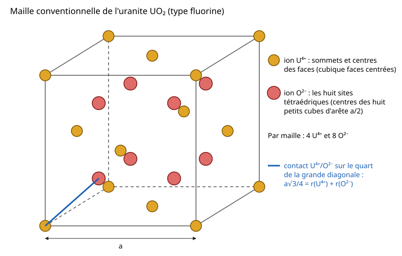
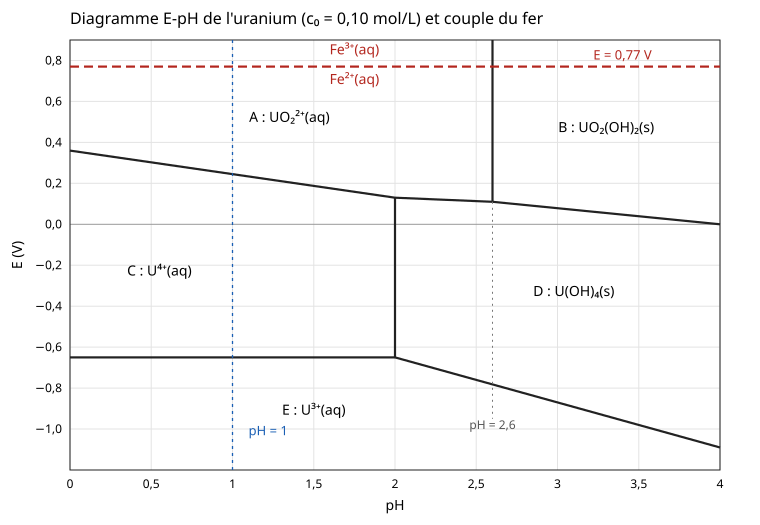
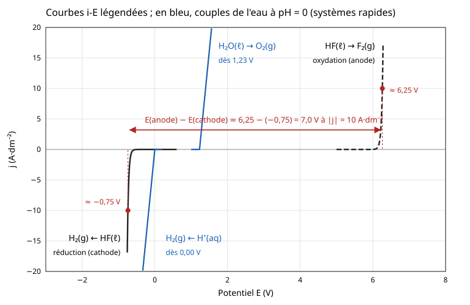
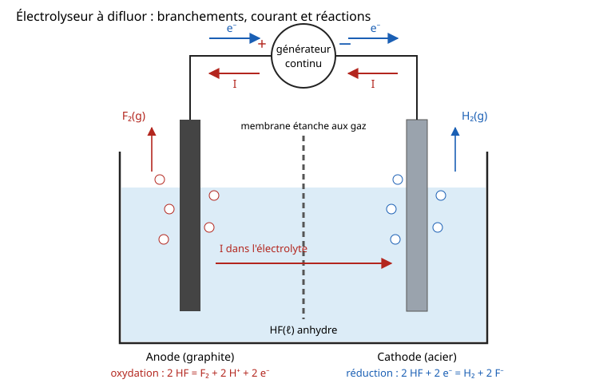

# Banque PT PT — Physique B - Chimie 2025 · Corrigé brut

*Corrigé rédigé par IA, non officiel. Signalez toute erreur.*

**Rédaction** · modèle exact non renseigné (famille Claude) · effort non renseigné · vitesse non renseignée

Épreuve de 2 heures, sans calculatrice, sur l'extraction et la transformation de l'uranium : 32 questions en cinq parties indépendantes, deux annexes à rendre (diagramme E-pH, courbes i-E). Les 32 questions sont traitées. Les valeurs lues sur les annexes et sur le graphique de cinétique sont signalées à l'endroit où elles servent. Les applications numériques emploient les valeurs approchées fournies par l'énoncé.

[Sujet officiel](https://www.banquept.fr/documents/2025/ph_b_ch_2025_pt.pdf) · [Rapport du jury](https://www.banquept.fr/documents/ecrit/rapport/2025/rapport_phys_b_ecrit_2025.pdf)

## Partie A — Étude structurale de l'uranium et du dioxyde d'uranium

### Question 1 — Nombres 235 et 92

Dans la notation $^{235}_{\ 92}\mathrm{U}$ :

- $A = 235$ est le **nombre de masse** : nombre de nucléons (protons et neutrons) du noyau ;
- $Z = 92$ est le **numéro atomique** (ou nombre de charge) : nombre de protons du noyau, qui caractérise l'élément uranium.

### Question 2 — Composition du noyau

Le noyau contient $Z = 92$ protons et $N = A - Z$ neutrons :

$$N = 235 - 92 = 143$$

$$\boxed{\text{92 protons et 143 neutrons}}$$

(Les 92 électrons de l'atome neutre n'appartiennent pas au noyau.)

### Question 3 — Masse d'uranium naturel pour 1 kg d'uranium 235

La masse molaire de l'isotope 235 est $M_{235} \approx 235\ \mathrm{g\cdot mol^{-1}}$ (nombre de masse), celle de l'uranium naturel est $M_{\mathrm U} = 240\ \mathrm{g\cdot mol^{-1}}$ (donnée). Avec $x = 0{,}7\ \% = 7\cdot 10^{-3}$ la fraction molaire d'uranium 235 :

$$n_{235} = \frac{m_{235}}{M_{235}}$$

$$n_{\mathrm{nat}} = \frac{n_{235}}{x}$$

$$m_{\mathrm{nat}} = n_{\mathrm{nat}}\,M_{\mathrm U} = \frac{m_{235}}{x}\,\frac{M_{\mathrm U}}{M_{235}}$$

Application numérique : $1/x = 1/0{,}007 \approx 143$ et $240/235 \approx 1{,}02$, d'où

$$\boxed{m_{\mathrm{nat}} \approx 1{,}5\cdot 10^{2}\ \mathrm{kg}}$$

(valeur calculée : 146 kg). Il faut donc traiter environ 150 kg d'uranium naturel pour disposer d'un kilogramme d'uranium 235, ce qui est cohérent avec la rareté de l'isotope.

### Question 4 — Maille de l'uranite et stœchiométrie

Les ions $\mathrm{U^{4+}}$ occupent les sommets et les centres des faces du cube d'arête $a$. Les ions $\mathrm{O^{2-}}$ occupent les huit sites tétraédriques, situés aux centres des huit petits cubes d'arête $a/2$ (coordonnées réduites formées de $1/4$ et de $3/4$). C'est la structure de type fluorine.

Population de la maille :

$$N(\mathrm{U^{4+}}) = 8\times\frac18 + 6\times\frac12 = 4$$

$$N(\mathrm{O^{2-}}) = 8\times 1 = 8$$

Le rapport est de deux ions oxyde pour un ion uranium : la formule est bien $\mathrm{UO_2}$, et la maille est neutre puisque $4\times(+4) + 8\times(-2) = 0$.

$$\boxed{\text{4 motifs } \mathrm{UO_2} \text{ par maille}}$$

### Question 5 — Paramètre de maille

Les ions de même signe se repoussent : le contact a lieu entre un cation et un anion voisins. L'ion oxyde placé en $(1/4, 1/4, 1/4)$ est à la distance $a\sqrt3/4$ du cation du sommet (quart de la grande diagonale). La tangence s'écrit

$$\frac{a\sqrt3}{4} = r(\mathrm{U^{4+}}) + r(\mathrm{O^{2-}})$$

$$a = \frac{4\,\bigl(r(\mathrm{U^{4+}}) + r(\mathrm{O^{2-}})\bigr)}{\sqrt3}$$

Application numérique : $r(\mathrm{U^{4+}}) + r(\mathrm{O^{2-}}) = 114 + 124 = 238\ \mathrm{pm}$, et avec $\sqrt3 \approx 1{,}7$ :

$$a \approx \frac{4\times 238}{1{,}7} = \frac{952}{1{,}7}$$

$$\boxed{a \approx 5{,}6\cdot 10^{2}\ \mathrm{pm}}$$

(avec $\sqrt3 = 1{,}732$ on trouve 550 pm.) Contrôle : les anions voisins sont distants de $a/2 \approx 280\ \mathrm{pm}$, supérieur à $2\,r(\mathrm{O^{2-}}) = 248\ \mathrm{pm}$, et les cations voisins de $a\sqrt2/2 \approx 390\ \mathrm{pm}$, supérieur à $2\,r(\mathrm{U^{4+}}) = 228\ \mathrm{pm}$ : les ions de même signe ne se touchent pas, le modèle est cohérent.

## Partie B — Concentration des minerais

### Question 6 — Attribution des domaines du diagramme E-pH

Nombres d'oxydation de l'uranium : $+\mathrm{III}$ dans $\mathrm{U^{3+}}$ ; $+\mathrm{IV}$ dans $\mathrm{U^{4+}}$ et $\mathrm{U(OH)_4}$ ; $+\mathrm{VI}$ dans $\mathrm{UO_2^{2+}}$ et $\mathrm{UO_2(OH)_2}$.

Le nombre d'oxydation croît avec le potentiel, et, pour un même nombre d'oxydation, l'hydroxyde (obtenu par action de $\mathrm{HO^-}$ sur le cation) est stable aux pH les plus élevés, à droite d'une frontière verticale. D'où :

| Domaine | Espèce | Nombre d'oxydation | Nature du domaine |
|---|---|---|---|
| A | $\mathrm{UO_2^{2+}(aq)}$ | $+\mathrm{VI}$ | prédominance |
| B | $\mathrm{UO_2(OH)_2(s)}$ | $+\mathrm{VI}$ | existence |
| C | $\mathrm{U^{4+}(aq)}$ | $+\mathrm{IV}$ | prédominance |
| D | $\mathrm{U(OH)_4(s)}$ | $+\mathrm{IV}$ | existence |
| E | $\mathrm{U^{3+}(aq)}$ | $+\mathrm{III}$ | prédominance |

### Question 7 — Produit de solubilité de l'hydroxyde d'uranyle

Équilibre de dissolution :

$$\mathrm{UO_2(OH)_2(s)} = \mathrm{UO_2^{2+}(aq)} + 2\,\mathrm{HO^-(aq)}$$

$$K_s = \frac{[\mathrm{UO_2^{2+}}]\,[\mathrm{HO^-}]^2}{(c^\circ)^3}$$

La frontière verticale A/B se lit sur l'annexe 1 à $\mathrm{pH} = 2{,}6$ (trait vertical issu du point d'abscisse 2,6). Sur cette frontière, le solide commence à exister avec $[\mathrm{UO_2^{2+}}] = c_0 = 1{,}0\cdot 10^{-1}\ \mathrm{mol\cdot L^{-1}}$ et $[\mathrm{HO^-}] = K_e/[\mathrm{H_3O^+}] = 10^{\,2{,}6-14} = 10^{-11{,}4}\ \mathrm{mol\cdot L^{-1}}$ :

$$K_s = 10^{-1}\times\bigl(10^{-11{,}4}\bigr)^2 = 10^{-23{,}8}$$

$$\boxed{\mathrm{p}K_s = 23{,}8 \quad\text{soit}\quad K_s \approx 1{,}6\cdot 10^{-24}}$$

### Question 8 — Pente de la frontière A/C

Demi-équation du couple $\mathrm{UO_2^{2+}/U^{4+}}$ :

$$\mathrm{UO_2^{2+}} + 4\,\mathrm{H^+} + 2\,e^- = \mathrm{U^{4+}} + 2\,\mathrm{H_2O}$$

Relation de Nernst à 298 K (concentrations rapportées à $c^\circ$) :

$$E = E^\circ + \frac{0{,}06}{2}\,\log\frac{[\mathrm{UO_2^{2+}}]\,[\mathrm{H^+}]^4}{[\mathrm{U^{4+}}]}$$

Sur la frontière, $[\mathrm{UO_2^{2+}}] = [\mathrm{U^{4+}}] = c_0$ :

$$E = E^\circ - \frac{0{,}06\times 4}{2}\,\mathrm{pH} = 0{,}36 - 0{,}12\,\mathrm{pH}$$

$$\boxed{\text{pente} = -0{,}12\ \mathrm{V\ par\ unité\ de\ pH}}$$

Contrôle sur l'annexe 1 : la frontière part de 0,36 V à pH = 0 et arrive vers 0,12 à 0,13 V à pH = 2, soit une pente de $-0{,}12\ \mathrm{V}$ par unité de pH.

### Question 9 — Domaines de prédominance du fer(III) et du fer(II)

Demi-équation : $\mathrm{Fe^{3+}} + e^- = \mathrm{Fe^{2+}}$. Elle n'échange aucun proton, et la relation de Nernst donne

$$E = E^\circ(\mathrm{Fe^{3+}/Fe^{2+}}) + 0{,}06\,\log\frac{[\mathrm{Fe^{3+}}]}{[\mathrm{Fe^{2+}}]}$$

Sur la frontière, $[\mathrm{Fe^{3+}}] = [\mathrm{Fe^{2+}}]$ :

$$\boxed{E_{\mathrm{front}} = 0{,}77\ \mathrm{V}\ \text{quel que soit le pH}}$$

Sur l'annexe 1, on trace donc une droite horizontale à 0,77 V (un peu au-dessous de la graduation 0,8 V) : $\mathrm{Fe^{3+}}$ prédomine au-dessus, $\mathrm{Fe^{2+}}$ au-dessous. Le tracé est reporté en tirets sur la figure 2. (On ne considère ici, comme le demande l'énoncé, que les deux ions en solution.)

### Question 10 — Attaque du minerai par le fer(III) à pH = 1

**Mise en solution.** À pH = 1, on se trouve à gauche des frontières verticales pH = 2 et pH = 2,6 : les deux hydroxydes ne sont pas stables et se dissolvent dans la solution acide,

$$\mathrm{UO_2(OH)_2(s)} + 2\,\mathrm{H^+} = \mathrm{UO_2^{2+}} + 2\,\mathrm{H_2O}$$

$$\mathrm{U(OH)_4(s)} + 4\,\mathrm{H^+} = \mathrm{U^{4+}} + 4\,\mathrm{H_2O}$$

**Réaction d'oxydoréduction.** À pH = 1, la frontière A/C est à $0{,}36 - 0{,}12 = 0{,}24\ \mathrm{V}$, très en dessous de 0,77 V : les domaines de $\mathrm{Fe^{3+}}$ et de $\mathrm{U^{4+}}$ sont disjoints, ces deux espèces réagissent. En revanche $\mathrm{Fe^{3+}}$ et $\mathrm{UO_2^{2+}}$ ont un domaine commun : l'uranium(VI) n'est pas modifié. En combinant

$$\mathrm{Fe^{3+}} + e^- = \mathrm{Fe^{2+}} \quad (\times 2)$$

$$\mathrm{U^{4+}} + 2\,\mathrm{H_2O} = \mathrm{UO_2^{2+}} + 4\,\mathrm{H^+} + 2\,e^-$$

on obtient

$$\boxed{2\,\mathrm{Fe^{3+}} + \mathrm{U^{4+}} + 2\,\mathrm{H_2O} = 2\,\mathrm{Fe^{2+}} + \mathrm{UO_2^{2+}} + 4\,\mathrm{H^+}}$$

Tout l'uranium du minerai passe ainsi en solution sous la forme $\mathrm{UO_2^{2+}}$.

**Constante d'équilibre.** À l'équilibre, les potentiels des deux couples sont égaux :

$$E^\circ_{\mathrm{Fe}} + \frac{0{,}06}{2}\log\frac{[\mathrm{Fe^{3+}}]^2}{[\mathrm{Fe^{2+}}]^2} = E^\circ_{\mathrm{U}} + \frac{0{,}06}{2}\log\frac{[\mathrm{UO_2^{2+}}]\,[\mathrm{H^+}]^4}{[\mathrm{U^{4+}}]}$$

$$\log K^\circ = \frac{2\,\bigl(E^\circ_{\mathrm{Fe}} - E^\circ_{\mathrm{U}}\bigr)}{0{,}06}$$

Application numérique : $2\times(0{,}77 - 0{,}36)/0{,}06 = 0{,}82/0{,}06 \approx 13{,}7$.

$$\boxed{K^\circ = 10^{13{,}7} \approx 5\cdot 10^{13}}$$

$K^\circ \gg 1$ : la réaction est quantitative, ce qui justifie le choix du fer(III) pour solubiliser l'uranium.

## Partie C — Étude thermodynamique de l'obtention du tétrafluorure d'uranium

### Question 11 — Enthalpie standard de réaction

Pour $\mathrm{UO_2(s)} + 4\,\mathrm{HF(g)} = \mathrm{UF_4(s)} + 2\,\mathrm{H_2O(g)}$, la loi de Hess donne

$$\Delta_r H^\circ = \Delta_f H^\circ(\mathrm{UF_4}) + 2\,\Delta_f H^\circ(\mathrm{H_2O}) - \Delta_f H^\circ(\mathrm{UO_2}) - 4\,\Delta_f H^\circ(\mathrm{HF})$$

Application numérique : $-1921 + 2\times(-242) + 1085 + 4\times 273 = -1921 - 484 + 1085 + 1092$.

$$\boxed{\Delta_r H^\circ = -228\ \mathrm{kJ\cdot mol^{-1}}}$$

$\Delta_r H^\circ < 0$ : la réaction est exothermique.

### Question 12 — Entropie standard de réaction

$$\Delta_r S^\circ = S^\circ(\mathrm{UF_4}) + 2\,S^\circ(\mathrm{H_2O}) - S^\circ(\mathrm{UO_2}) - 4\,S^\circ(\mathrm{HF})$$

Application numérique : $152 + 2\times 189 - 77 - 4\times 174 = 152 + 378 - 77 - 696$.

$$\boxed{\Delta_r S^\circ = -243\ \mathrm{J\cdot K^{-1}\cdot mol^{-1}}}$$

Le signe négatif était prévisible : la réaction consomme 4 mol de gaz et n'en forme que 2. La quantité de matière gazeuse diminue ($\sum \nu_{i,\mathrm{gaz}} = -2$), donc le désordre du système diminue.

### Question 13 — Constante d'équilibre à 500 °C

Les données étant indépendantes de la température (approximation d'Ellingham), on calcule l'enthalpie libre standard de réaction à $T = 500\ {}^\circ\mathrm{C} = 773\ \mathrm{K}$ :

$$\Delta_r G^\circ(T) = \Delta_r H^\circ - T\,\Delta_r S^\circ$$

puis la constante d'équilibre par

$$\Delta_r G^\circ(T) = -RT\ln K^\circ(T)$$

$$K^\circ(T) = \exp\!\left(-\frac{\Delta_r H^\circ - T\,\Delta_r S^\circ}{RT}\right)$$

Application numérique : $T\,\Delta_r S^\circ = 773\times(-243) \approx -1{,}88\cdot 10^{5}\ \mathrm{J\cdot mol^{-1}}$, donc $\Delta_r G^\circ \approx -228 + 188 = -40\ \mathrm{kJ\cdot mol^{-1}}$ ; $RT = 8{,}3\times 773 \approx 6{,}4\cdot 10^{3}\ \mathrm{J\cdot mol^{-1}}$, d'où $\ln K^\circ \approx 40\,200/6\,400 \approx 6{,}3$.

$$\boxed{K^\circ(773\ \mathrm K) = e^{6{,}3} \approx 5\cdot 10^{2}}$$

On retrouve la valeur annoncée (calcul complet : $\Delta_r G^\circ = -40{,}2\ \mathrm{kJ\cdot mol^{-1}}$, $\ln K^\circ = 6{,}26$, $K^\circ \approx 5{,}2\cdot 10^{2}$).

### Question 14 — Choix de la température industrielle

**Aspect thermodynamique.** La relation de Van't Hoff s'écrit

$$\frac{\mathrm d\ln K^\circ}{\mathrm dT} = \frac{\Delta_r H^\circ}{RT^2}$$

Comme $\Delta_r H^\circ < 0$, $K^\circ$ diminue quand la température augmente : une température basse favorise la formation de $\mathrm{UF_4}$. À titre de repère, $\Delta_r G^\circ$ s'annule ($K^\circ = 1$) pour $T_i = \Delta_r H^\circ/\Delta_r S^\circ = 228\cdot 10^{3}/243 \approx 9{,}4\cdot 10^{2}\ \mathrm K$, soit environ $670\ {}^\circ\mathrm C$ : au-delà, la réaction n'est plus favorable.

**Aspect cinétique.** La constante de vitesse croît avec la température (loi d'Arrhenius) : une température élevée est nécessaire pour que la réaction, qui met en jeu un solide, soit suffisamment rapide.

**Conclusion.** Les deux critères s'opposent. La température de $500\ {}^\circ\mathrm C$ est un compromis : assez élevée pour une vitesse acceptable, assez basse pour que la constante d'équilibre reste grande ($K^\circ \approx 5\cdot 10^{2} \gg 1$).

### Question 15 — Tableau d'avancement et expression du taux de conversion

| | $\mathrm{UO_2(s)}$ | $4\,\mathrm{HF(g)}$ | $\mathrm{UF_4(s)}$ | $2\,\mathrm{H_2O(g)}$ | total gaz |
|---|---|---|---|---|---|
| État initial | excès | $n_0$ | $0$ | $0$ | $n_0$ |
| Avancement $\xi$ | excès | $n_0 - 4\xi$ | $\xi$ | $2\xi$ | $n_0 - 2\xi$ |

La quantité de $\mathrm{HF}$ ayant réagi est $4\xi$, donc

$$\boxed{\alpha = \frac{4\,\xi}{n_0}}$$

En fonction de $\alpha$ : $n(\mathrm{HF}) = n_0(1-\alpha)$, $n(\mathrm{H_2O}) = n_0\,\alpha/2$ et $n_{\mathrm{gaz}} = n_0\,(1 - \alpha/2)$.

### Question 16 — Relation entre la constante d'équilibre, le taux de conversion et la pression

Les solides sont purs dans leur phase (activité 1) et les gaz sont parfaits (activité $P_i/P^\circ$). À l'équilibre :

$$K^\circ = \frac{\bigl(P_{\mathrm{H_2O}}/P^\circ\bigr)^2}{\bigl(P_{\mathrm{HF}}/P^\circ\bigr)^4} = \frac{P_{\mathrm{H_2O}}^{\,2}\,(P^\circ)^2}{P_{\mathrm{HF}}^{\,4}}$$

Avec la loi de Dalton $P_i = x_i\,P_T$ et le tableau de la question 15 ($n_{\mathrm{gaz}} = n_0(2-\alpha_{eq})/2$) :

$$x_{\mathrm{H_2O}} = \frac{n_0\,\alpha_{eq}/2}{n_0\,(2-\alpha_{eq})/2} = \frac{\alpha_{eq}}{2-\alpha_{eq}}$$

$$x_{\mathrm{HF}} = \frac{n_0\,(1-\alpha_{eq})}{n_0\,(2-\alpha_{eq})/2} = \frac{2\,(1-\alpha_{eq})}{2-\alpha_{eq}}$$

On reporte :

$$K^\circ = \frac{x_{\mathrm{H_2O}}^{\,2}}{x_{\mathrm{HF}}^{\,4}}\left(\frac{P^\circ}{P_T}\right)^2 = \frac{\alpha_{eq}^{\,2}}{(2-\alpha_{eq})^2}\times\frac{(2-\alpha_{eq})^4}{16\,(1-\alpha_{eq})^4}\left(\frac{P^\circ}{P_T}\right)^2$$

$$\boxed{K^\circ = \frac{\bigl(\alpha_{eq}\,(2-\alpha_{eq})\bigr)^2}{16\,(1-\alpha_{eq})^4}\left(\frac{P^\circ}{P_T}\right)^2}$$

### Question 17 — Pression totale pour un taux de conversion de 0,9

On isole la pression :

$$\left(\frac{P_T}{P^\circ}\right)^2 = \frac{\bigl(\alpha_{eq}\,(2-\alpha_{eq})\bigr)^2}{16\,(1-\alpha_{eq})^4\,K^\circ}$$

$$P_T = P^\circ\,\frac{\alpha_{eq}\,(2-\alpha_{eq})}{4\,(1-\alpha_{eq})^2\,\sqrt{K^\circ}}$$

Application numérique avec $\alpha_{eq} = 0{,}9$ et $K^\circ = 5\cdot 10^{2}$ : $\alpha_{eq}(2-\alpha_{eq}) = 0{,}9\times 1{,}1 = 0{,}99$ ; $4\,(1-\alpha_{eq})^2 = 4\cdot 10^{-2}$ ; $\sqrt{K^\circ} = \sqrt{500} = 10\sqrt5 \approx 22$.

$$\frac{P_T}{P^\circ} \approx \frac{0{,}99}{4\cdot 10^{-2}\times 22} = \frac{0{,}99}{0{,}88}$$

$$\boxed{P_T \approx 1{,}1\ \mathrm{bar}}$$

Une pression voisine de la pression atmosphérique suffit donc pour convertir 90 % du fluorure d'hydrogène à 500 °C.

### Question 18 — Effet d'une augmentation de pression

À température constante, $K^\circ$ est inchangée. Le quotient de réaction s'écrit, comme à la question 16,

$$Q_r = \frac{x_{\mathrm{H_2O}}^{\,2}}{x_{\mathrm{HF}}^{\,4}}\left(\frac{P^\circ}{P_T}\right)^2$$

Partant d'un état d'équilibre ($Q_r = K^\circ$), une augmentation de $P_T$ à composition fixée diminue $Q_r$ : on a alors $Q_r < K^\circ$ et le système évolue dans le sens direct, celui de la consommation de $\mathrm{HF}$.

$$\boxed{\alpha \text{ augmente lorsque la pression totale augmente}}$$

C'est conforme au principe de modération de Le Chatelier : une élévation de pression déplace l'équilibre dans le sens d'une diminution de la quantité de matière de gaz (4 mol de gaz donnent 2 mol). On le voit aussi sur la relation de la question 16 : $K^\circ (P_T/P^\circ)^2$ est une fonction croissante de $\alpha_{eq}$.

## Partie D — Étude cinétique de l'obtention du tétrafluorure d'uranium

### Question 19 — Proportionnalité entre concentration et fraction molaire

Le mélange gazeux est parfait : $P\,V = n_{\mathrm{gaz}}\,R\,T$, et par définition $n_{\mathrm{HF}} = x_{\mathrm{HF}}\,n_{\mathrm{gaz}}$. Donc

$$[\mathrm{HF}] = \frac{n_{\mathrm{HF}}}{V} = x_{\mathrm{HF}}\,\frac{n_{\mathrm{gaz}}}{V}$$

$$\boxed{[\mathrm{HF}] = \frac{P}{RT}\,x_{\mathrm{HF}}}$$

Dans l'expérience, $P = 1\ \mathrm{bar}$ et $T = 350\ {}^\circ\mathrm C = 623\ \mathrm K$ sont constantes : le facteur $P/(RT)$ est une constante et $[\mathrm{HF}]$ est proportionnelle à $x_{\mathrm{HF}}$.

Valeur du coefficient : $P/(RT) = 10^{5}/(8{,}3\times 623) \approx 19\ \mathrm{mol\cdot m^{-3}} = 1{,}9\cdot 10^{-2}\ \mathrm{mol\cdot L^{-1}}$.

### Question 20 — Ordre partiel par rapport au fluorure d'hydrogène et constante de vitesse

**Ordre.** Le solide $\mathrm{UO_2}$ est en excès : on cherche une loi de vitesse $v = k\,[\mathrm{HF}]^{p}$. Avec la question 19,

$$v_0 = k\left(\frac{P}{RT}\right)^{p} x_{\mathrm{HF},0}^{\,p}$$

Le graphique du sujet porte $v_0$ en ordonnée et $x_{\mathrm{HF},0}$ en abscisse. Les points s'alignent sur une droite d'équation $y = 0{,}997\,x + 0{,}0016$, dont l'ordonnée à l'origine est négligeable devant les vitesses mesurées (de 0,03 à 0,5 $\mathrm{mol\cdot L^{-1}\cdot min^{-1}}$) : la droite passe par l'origine. La vitesse est donc proportionnelle à $x_{\mathrm{HF},0}$, c'est-à-dire à $[\mathrm{HF}]$ :

$$\boxed{p = 1 : \text{ordre partiel 1 par rapport à } \mathrm{HF}}$$

**Constante de vitesse.** Pour $p = 1$, $v_0 = k\,\dfrac{P}{RT}\,x_{\mathrm{HF},0}$ : la pente de la droite vaut $a = k\,P/(RT)$, avec $a = 0{,}997 \approx 1{,}0\ \mathrm{mol\cdot L^{-1}\cdot min^{-1}}$ (équation de la droite affichée sur le graphique). D'où

$$k = a\,\frac{RT}{P}$$

Application numérique : $RT/P = 8{,}3\times 623/10^{5} \approx 5{,}2\cdot 10^{-2}\ \mathrm{m^{3}\cdot mol^{-1}} = 52\ \mathrm{L\cdot mol^{-1}}$.

$$\boxed{k \approx 52\ \mathrm{min^{-1}} \approx 0{,}86\ \mathrm{s^{-1}}}$$

L'unité (inverse d'un temps) est bien celle d'une constante de vitesse d'ordre 1.

## Partie E — Obtention du difluor par électrolyse

### Question 21 — Électrons de valence du fluor

Le fluor est dans la deuxième période (couche de valence $n = 2$) et dans la colonne 17, avant-dernière colonne (halogènes) : sa configuration électronique est $1s^2\,2s^2\,2p^5$, cohérente avec $Z = 9$.

$$\boxed{\text{7 électrons de valence } (2s^2\,2p^5)}$$

### Question 22 — Potentiel standard élevé du couple du difluor

Le fluor est situé en haut à droite de la classification : c'est l'élément **le plus électronégatif**. Il lui manque un seul électron pour saturer sa couche de valence et atteindre la configuration du néon. Il a donc une très forte tendance à attirer et à capter les électrons.

Or capter des électrons, c'est être réduit : le difluor est un **oxydant très fort**, qui passe très facilement au nombre d'oxydation $-\mathrm I$ (dans $\mathrm{HF}$). Un oxydant est d'autant plus fort que le potentiel standard de son couple est élevé, d'où la valeur exceptionnelle $E^\circ(\mathrm{F_2/HF}) = 3{,}05\ \mathrm V$.

### Question 23 — Structure de Lewis du difluor

La molécule possède $2\times 7 = 14$ électrons de valence, soit 7 doublets. Les deux atomes mettent en commun un électron chacun : une liaison simple et trois doublets non liants par atome,

$$\boxed{|\overline{\underline{\mathrm F}}-\overline{\underline{\mathrm F}}|}$$

Chaque atome de fluor porte trois doublets non liants et un doublet liant : il est entouré de 8 électrons (règle de l'octet), sans charge formelle.

### Question 24 — Température d'ébullition du difluor

Lors de l'ébullition, on sépare les molécules les unes des autres : ce sont les interactions **intermoléculaires** qui sont rompues, et non la liaison covalente $\mathrm{F{-}F}$.

La molécule $\mathrm{F_2}$ est symétrique, donc **apolaire**, et ne peut pas former de liaison hydrogène. Les seules interactions entre molécules sont des interactions de van der Waals de type London (dipôle instantané - dipôle induit). Elles sont ici très faibles, car la molécule est petite et très peu polarisable (peu d'électrons, fortement retenus par des noyaux très électronégatifs).

La cohésion du liquide est donc très faible : une très faible agitation thermique suffit à la vaincre, d'où une température d'ébullition très basse ($-188\ {}^\circ\mathrm C$).

### Question 25 — Signification des pictogrammes

De gauche à droite sur le sujet :

1. **Bouteille de gaz** : gaz sous pression, risque d'explosion sous l'effet de la chaleur.
2. **Flamme au-dessus d'un cercle** : **comburant**, qui peut provoquer ou aggraver un incendie (à ne pas confondre avec la flamme seule des produits inflammables).
3. **Corrosion** : corrosif, provoque de graves brûlures de la peau et des lésions oculaires, attaque les métaux.
4. **Tête de mort sur deux tibias** : toxicité aiguë, mortel par inhalation.

Ces dangers imposent de manipuler le difluor en installation étanche et ventilée, loin de tout combustible, avec des protections individuelles ; ils expliquent l'intérêt de le produire sur place plutôt que de le stocker.

### Question 26 — Légende des courbes i-E

Au départ, la cellule ne contient que $\mathrm{HF(\ell)}$ : c'est à la fois le réducteur du couple $\mathrm{F_2/HF}$ et l'oxydant du couple $\mathrm{HF/H_2}$.

- **Couple 1 (tirets, courant positif, à droite)** : couple $\mathrm{F_2(g)/HF(\ell)}$. La branche anodique correspond à l'**oxydation** $\mathrm{HF(\ell)} \to \mathrm{F_2(g)}$, soit $2\,\mathrm{HF} = \mathrm{F_2} + 2\,\mathrm{H^+} + 2\,e^-$. Elle ne démarre que vers 6,1 V alors que $E^\circ = 3{,}05\ \mathrm V$ : le système est lent sur graphite (surtension anodique d'environ 3 V). Il n'y a pas de branche cathodique, car $\mathrm{F_2}$ est absent de la solution.
- **Couple 2 (trait plein, courant négatif, à gauche)** : couple $\mathrm{HF(\ell)/H_2(g)}$. La branche cathodique correspond à la **réduction** $\mathrm{HF(\ell)} \to \mathrm{H_2(g)}$, soit $2\,\mathrm{HF} + 2\,e^- = \mathrm{H_2} + 2\,\mathrm{F^-}$. Elle démarre vers $-0{,}6\ \mathrm V$ pour $E^\circ = -0{,}12\ \mathrm V$ (surtension cathodique d'environ $-0{,}5\ \mathrm V$ sur acier). Il n'y a pas de branche anodique, car $\mathrm{H_2}$ est absent.

### Question 27 — Schéma de l'électrolyseur

Un électrolyseur est un récepteur : le générateur impose le sens du courant.

- L'**anode** (graphite) est reliée à la borne **positive** du générateur. Il s'y produit l'oxydation $2\,\mathrm{HF} = \mathrm{F_2(g)} + 2\,\mathrm{H^+} + 2\,e^-$ : le difluor se dégage dans le compartiment anodique.
- La **cathode** (acier) est reliée à la borne **négative**. Il s'y produit la réduction $2\,\mathrm{HF} + 2\,e^- = \mathrm{H_2(g)} + 2\,\mathrm{F^-}$ : le dihydrogène se dégage dans le compartiment cathodique.
- Dans le circuit extérieur, le courant $I$ va de la borne positive vers l'anode et revient de la cathode vers la borne négative ; les électrons circulent en sens inverse, de l'anode vers la cathode en passant par le générateur. Dans l'électrolyte, le courant va de l'anode vers la cathode, porté par les ions.
- La membrane sépare les deux compartiments et empêche le mélange des gaz $\mathrm{F_2}$ et $\mathrm{H_2}$, qui réagiraient violemment.

### Question 28 — Absence de palier de diffusion

Un palier de diffusion traduit la limitation du courant par le transport de matière : le réactif, dissous en faible concentration, n'arrive plus assez vite à la surface de l'électrode.

Ici, l'espèce électroactive est $\mathrm{HF}$ aux deux électrodes, et c'est le **solvant** lui-même (liquide pur) : il est toujours présent en très grande quantité au contact des électrodes et n'a pas à diffuser. Le courant n'est donc pas limité par le transport et croît sans palier (on parle de mur du solvant).

### Question 29 — Courbes de l'eau à pH = 0 et impossibilité de l'électrolyse en présence d'eau

**Tracé.** À pH = 0 et pour des systèmes rapides (sans surtension), les branches démarrent aux potentiels standard (tracé en bleu sur la figure 3) :

- oxydation de l'eau, $2\,\mathrm{H_2O} = \mathrm{O_2(g)} + 4\,\mathrm{H^+} + 4\,e^-$ : branche anodique montant très vite à partir de $1{,}23\ \mathrm V$, sans palier (solvant) ;
- réduction des ions $\mathrm{H^+}$, $2\,\mathrm{H^+} + 2\,e^- = \mathrm{H_2(g)}$ : branche cathodique descendant à partir de $0{,}00\ \mathrm V$, sans palier à pH = 0 (espèce très concentrée).

**Conséquence.** À l'anode, l'oxydation qui se produit est celle qui démarre au potentiel le plus bas. En présence d'eau, l'oxydation de l'eau commence dès 1,23 V, bien avant celle de $\mathrm{HF}$ (vers 6,1 V) : on obtiendrait du dioxygène et le potentiel de l'anode ne pourrait jamais atteindre la valeur nécessaire à la formation de $\mathrm{F_2}$ (mur du solvant).

De plus, d'un point de vue thermodynamique, le difluor éventuellement formé oxyderait l'eau, puisque $E^\circ(\mathrm{F_2/HF}) = 3{,}05\ \mathrm V \gg E^\circ(\mathrm{O_2/H_2O}) = 1{,}23\ \mathrm V$ :

$$2\,\mathrm{F_2} + 2\,\mathrm{H_2O} = 4\,\mathrm{HF} + \mathrm{O_2}$$

Le difluor ne peut donc ni se former ni subsister en présence d'eau : d'où l'emploi de fluorure d'hydrogène **anhydre**.

### Question 30 — Équation de fonctionnement de l'électrolyseur

Anode : $2\,\mathrm{HF} = \mathrm{F_2} + 2\,\mathrm{H^+} + 2\,e^-$. Cathode : $2\,\mathrm{HF} + 2\,e^- = \mathrm{H_2} + 2\,\mathrm{F^-}$. Les ions $\mathrm{H^+}$ et $\mathrm{F^-}$ produits se recombinent en $\mathrm{HF}$ ; le bilan est

$$\boxed{2\,\mathrm{HF(\ell)} = \mathrm{H_2(g)} + \mathrm{F_2(g)}}$$

avec deux électrons échangés par mole de difluor formé. Cette réaction est très défavorable thermodynamiquement ($E^\circ_{\mathrm{anode}} - E^\circ_{\mathrm{cathode}} = 3{,}05 + 0{,}12 = 3{,}17\ \mathrm V$ au minimum) : elle est forcée par le générateur.

### Question 31 — Tension minimale à imposer

En fonctionnement, le même courant traverse les deux électrodes (de même surface) : $j_a = -j_c = 10\ \mathrm{A\cdot dm^{-2}}$. La tension à imposer est

$$U = E_a(j) - E_c(-j) + U_{\Omega}$$

Lecture sur l'annexe 2 (2 V par carreau en abscisse ; les deux branches sont presque verticales, ce qui rend la lecture peu sensible à la valeur du courant) :

- courbe en tirets à $j = +10\ \mathrm{A\cdot dm^{-2}}$ : $E_a \approx 6{,}25\ \mathrm V$ ;
- courbe en trait plein à $j = -10\ \mathrm{A\cdot dm^{-2}}$ : $E_c \approx -0{,}75\ \mathrm V$.

D'où $E_a - E_c \approx 7{,}0\ \mathrm V$, et avec la chute ohmique $U_\Omega = 3{,}0\ \mathrm V$ :

$$\boxed{U_{\min} \approx 7{,}0 + 3{,}0 = 10\ \mathrm V}$$

Cette tension est très supérieure au minimum thermodynamique de 3,17 V : l'écart vient des surtensions (environ 3,2 V à l'anode et 0,6 V à la cathode) et de la chute ohmique.

### Question 32 — Rendement faradique et durée de production

**Définition.** Le rendement faradique $\eta$ est le rapport entre la charge électrique effectivement utilisée par la réaction souhaitée (ici la formation de $\mathrm{F_2}$) et la charge totale $Q = I\,t$ fournie par le générateur ; c'est aussi le rapport entre la quantité de difluor réellement obtenue et celle que prévoit la loi de Faraday. Il est inférieur à 1 à cause des réactions parasites.

**Durée.** La formation d'une mole de $\mathrm{F_2}$ demande 2 moles d'électrons :

$$\eta\,I\,t = 2\,n(\mathrm{F_2})\,\mathcal F$$

$$n(\mathrm{F_2}) = \frac{m}{M(\mathrm{F_2})}$$

$$t = \frac{2\,m\,\mathcal F}{\eta\,I\,M(\mathrm{F_2})}$$

Application numérique avec $m = 1{,}0\cdot 10^{3}\ \mathrm g$, $M(\mathrm{F_2}) = 2\times 18 = 36\ \mathrm{g\cdot mol^{-1}}$ (donnée de l'énoncé), $\mathcal F = 1\cdot 10^{5}\ \mathrm{C\cdot mol^{-1}}$, $\eta = 0{,}9$ et $I = 10\ \mathrm A$ :

$$t = \frac{2\times 10^{3}\times 10^{5}}{0{,}9\times 10\times 36} = \frac{2\cdot 10^{8}}{324} \approx 6{,}2\cdot 10^{5}\ \mathrm s$$

Un jour dure $86\,400\ \mathrm s$, donc

$$\boxed{t \approx 7\ \text{jours}}$$

**Remarque sur les données.** L'énoncé de cette question fixe $I = 10\ \mathrm A$ pour des électrodes de $1\ \mathrm{m^2}$, et c'est la valeur retenue ici ; elle correspond à une densité de courant de $0{,}1\ \mathrm{A\cdot dm^{-2}}$ seulement. Avec la densité de courant de la question 31 ($10\ \mathrm{A\cdot dm^{-2}}$ sur $100\ \mathrm{dm^2}$, soit $1\,000\ \mathrm A$), la durée serait cent fois plus courte, environ $6{,}2\cdot 10^{3}\ \mathrm s$, soit 1,7 h. La demande d'un résultat en jours confirme que la valeur attendue est celle obtenue avec 10 A.
