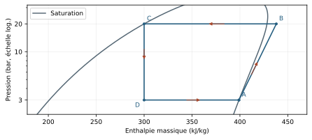
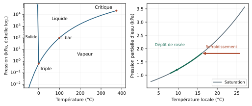

# Banque PT 2025 — Physique B - Thermodynamique · Corrigé brut

*Corrigé rédigé par IA, non officiel.*

**Rédaction** · GPT-6.2 Astra Ultra · vitesse non renseignée

**Révision (tour 1)** · GPT-6.2 Astra Ultra · vitesse non renseignée

Fabriquer de l’eau à partir de l’air. Épreuve de deux heures, sans calculatrice. [Sujet et documents](https://www.banquept.fr/documents/2025/ph_b_th_2025_pt.pdf) · [Rapport du jury, p. 4–6](https://www.banquept.fr/documents/ecrit/rapport/2025/rapport_phys_b_ecrit_2025.pdf)

## I. Cycle du fluide réfrigérant

### Q1. Éléments du circuit

Le **détendeur** est le tube capillaire C–D dont la faible section provoque une chute de pression. L'**échangeur 1** est le condenseur B–C. Il extrait de la chaleur du frigorigène, qui se liquéfie, et la transmet à l'air de sortie. L'**échangeur 2** est l'évaporateur D–A. Il fournit au frigorigène la chaleur prélevée à l'air humide, qui se refroidit. L'eau de cet air se condense sur la paroi froide tandis que le frigorigène, dans les tubes, s'évapore. L'annexe et le tableau identifient le frigorigène comme **R134a**. La graphie R314a en deux endroits du texte est une coquille.

### Q2. Sens de circulation

Le sens 1 ramène la vapeur basse pression quittant l'évaporateur en A à l'aspiration du compresseur. Après compression, la vapeur chaude en B alimente le condenseur, d'où le liquide haute pression en C traverse le capillaire vers D. La différence de pression entretient cette détente. Dans le sens opposé, le schéma n'alimenterait plus correctement le compresseur en vapeur ni le détendeur en liquide haute pression.

### Q3. Ventilation du condenseur

L'air forcé accroît le coefficient d'échange par convection. Il emporte plus efficacement la chaleur de condensation et réduit la température de condenseur nécessaire pour la rejeter. Un réfrigérateur domestique muni d'une grille arrière peut utiliser la convection naturelle. Certains appareils compacts ventilent également le condenseur. Le besoin de rejeter la chaleur existe dans les deux cas.

### Q4. Tracé du cycle A–B–C–D

Le diagramme R134a de l'annexe p. 15 du PDF porte $h$ en abscisse et $p$ sur une échelle logarithmique. A est sur la courbe de rosée à 3 bar, soit 0,30 MPa. De A on suit l'isentrope jusqu'à 20 bar (2,0 MPa) pour placer B dans la vapeur surchauffée. B–C suit l'isobare supérieure jusqu'au liquide saturé sans sous-refroidissement. Dans le capillaire adiabatique sans travail, avec variations cinétique et potentielle négligeables, le premier principe impose $h_D=h_C$. On descend verticalement jusqu'à l'isobare de 3 bar, où D est diphasique. La vaporisation D–A est isobare et rejoint la vapeur saturée, sans surchauffe à l'aspiration.

| État | Pression (bar) | Enthalpie lue (kJ/kg, environ) | Nature |
|---|---:|---:|---|
| A | 3 | 399 à 400 | Vapeur saturée |
| B | 20 | 438 à 440 | Vapeur après compression |
| C | 20 | 300 | Liquide saturé |
| D | 3 | 300 | Mélange liquide-vapeur |

### Q5. Températures du condenseur

La lecture donne environ **75 °C en B**, puis **67 à 68 °C en C**. À 20 bar, la première partie du trajet refroidit la vapeur surchauffée jusqu'à saturation. La liquéfaction de ce corps pur se poursuit à température constante pour cette pression.

### Q6. Titre en sortie de détente

À 3 bar, le liquide et la vapeur saturés ont respectivement $h_l\simeq201$ et $h_v\simeq399\ \mathrm{kJ/kg}$. De $h_D=x_Dh_v+(1-x_D)h_l$ vient $x_D\simeq(300-201)/(399-201)\simeq\boxed{0{,}50}$. L'isotitre de D confirme qu'environ la moitié de la masse est vapeur.

### Q7. Chaleur reçue dans l'évaporateur

Pour l'écoulement permanent de D à A, sans travail d'arbre ni variation sensible d'énergie mécanique, $q_F=h_A-h_D\simeq+99\ \mathrm{kJ/kg}$, soit environ **100 kJ/kg**. La chaleur reçue positive provient du courant d'air refroidi.

### Q8. Travail reçu dans le compresseur

Le compresseur est adiabatique dans le modèle isentropique. Le premier principe en régime permanent donne $w_i=h_B-h_A\simeq+39\ \mathrm{kJ/kg}$, soit environ **40 kJ/kg**. Le fluide reçoit ce travail.

### Q9. COP frigorifique

L'effet utile est le froid produit dans l'évaporateur. Le coefficient frigorifique est $\mathrm{COP}=q_F/w_i\simeq99/39\simeq\boxed{2{,}5}$. Le condenseur rejette environ $99+39=138\ \mathrm{kJ/kg}$ pour fermer le bilan du cycle.

### Q10. Comparaison au cycle réversible

La source chaude représente l'environnement où est rejetée la chaleur, de l'ordre de l'air ambiant chaud à 30 °C. La source froide modélise l'air et l'eau à refroidir au voisinage d'une surface proche de 0 °C, assez froide pour obtenir de la condensation. Ce sont des températures représentatives de sources pour une comparaison idéalisée. Le cycle frigorifique réversible donne $\mathrm{COP}_{\rm C}=T_F/(T_C-T_F)\simeq273/(303-273)=9{,}1$. Le COP d'environ 2,5 est inférieur à cette borne. La détente irréversible et les différences finies de température, en particulier du côté chaud, participent à cet écart.

## II. Humidité de l'air et psychromètre

### Q11. Diagramme de phases de l'eau

Le point triple vaut **0,01 °C, 611 Pa**. Les frontières solide–vapeur, solide–liquide et liquide–vapeur s'y rejoignent. La courbe liquide–vapeur passe près de **100 °C à 1 bar**, puis se termine au point critique, vers **374 °C et 22,1 MPa**. À basse pression, abaisser la température depuis la vapeur peut conduire au solide. Au-dessus du point triple, l'eau liquide occupe le côté des hautes pressions par rapport à la courbe liquide–vapeur. Pour la glace ordinaire, la courbe de fusion possède une pente négative parce que le liquide est plus dense que la glace.

### Q12. Égalité des potentiels à saturation

À l'équilibre liquide–vapeur d'un corps pur, $\mu_l(T)=\mu_v(T,P_{\rm sat})$. Avec la phase condensée assimilée à sa valeur standard et la vapeur parfaite,
$$
\mu_l^\circ(T)-\mu_v^\circ(T)=RT\ln\!\left(\frac{P_{\rm sat}(T)}{P^\circ}\right).
$$
L'état standard se définit à la pression standard $P^\circ$ pour la température considérée.

### Q13. Mélange à 10 °C et 3,6 kPa

Le tableau donne $P_{\rm sat}=1{,}2\ \mathrm{kPa}$ à 10 °C. La vapeur d'eau pure à 3,6 kPa est sursaturée. En utilisant Q12,
$$
\mu_l-\mu_v=RT\ln(P_{\rm sat}/P)=-RT\ln3\simeq-2{,}6\ \mathrm{kJ/mol}.
$$
L'équilibre biphasé est donc impossible à ces deux valeurs imposées. Le transfert spontané de la vapeur vers le liquide abaisse le potentiel thermodynamique. Dans une enceinte isotherme à volume fixé, la pression partielle baisse vers la saturation si les deux phases subsistent. Sous pression maintenue à 3,6 kPa, le liquide est la phase stable.

### Q14. Formation de rosée

La toile peut se refroidir par rayonnement au-dessous de la température de l'air. L'air voisin se refroidit d'abord sans perdre de vapeur, à pression partielle $P_v$ à peu près constante. La courbe $P_{\rm sat}(T)$ diminue et rejoint $P_v$ au point de rosée. En poursuivant le refroidissement sans condensation, on aurait $P_v>P_{\rm sat}$ et donc $\mu_v>\mu_l$. Le dépôt de gouttes est alors favorable. Au contact du liquide, la condensation réduit la quantité de vapeur et sa pression partielle suit approximativement $P_{\rm sat}(T)$. Le tracé de Q11 utilise pour ordonnée cette pression partielle, la pression totale de l'air restant voisine de 1 bar.

### Q15. Masse récupérable par mètre cube

Pour 1 m³ saturé à 27 °C, $m_{v,\max}=P_{\rm sat}VM_{\rm eau}/(RT)$. Avec 3 568 Pa, 300 K et $0{,}018\ \mathrm{kg/mol}$, on trouve $0{,}0257\ \mathrm{kg}$, soit **26 g par mètre cube**. Un mètre cube d'eau liquide pèse environ $10^3\ \mathrm{kg}$ et nécessite donc au minimum $1000/0{,}0257\simeq3{,}9\times10^4\ \mathrm{m^3}$ d'air. La récupération réelle exige davantage d'air puisque l'entrée peut être moins humide et que la sortie contient encore de la vapeur.

### Q16. Lecture des deux thermomètres

Le numéro 16 introduit le psychromètre par un texte et un schéma. Le rapport du jury confirme « Pas de question ». Le thermomètre sec donne $T$, le bulbe mouillé ventilé donne $T_h$. Ces deux lectures sont les données dont les questions suivantes établissent le lien avec l'humidité.

### Q17. Température du bulbe humide

Quand l'air n'est pas saturé, l'évaporation endothermique de l'eau du tissu prélève de la chaleur au bulbe. Sa température diminue jusqu'à ce que la chaleur reçue de l'air équilibre l'énergie emportée par l'évaporation. D'où $T_h<T$ dans ce cas. En air saturé, il n'y a pas d'évaporation nette à l'équilibre, donc $T_h=T$. On obtient $T_h\le T$ dans le modèle décrit.

### Q18. Rapport de mélange

La loi de Dalton donne $P_{as}=P-P_{ve}$. Puisque $m_i=M_iP_iV/(RT)$, en posant $\delta=M_{\rm eau}/M_{\rm air}=18/29$, on obtient
$$
X_a=\frac{m_{ve}}{m_{as}}=\frac{\delta P_{ve}}{P-P_{ve}},\qquad
X_{as}=\frac{\delta}{P/P_{\rm sat}-1}.
$$
À 27 °C et 1 bar, $X_{as}\simeq0{,}02296\ \mathrm{kg/kg}$, soit **23 g de vapeur par kilogramme d'air sec**.

### Q19. Humidité relative

À $T,V$ constants, les masses de vapeur sont proportionnelles à leurs pressions partielles. Ainsi
$$
X_r=\frac{P_{ve}}{P_{\rm sat}}=\frac{P}{P_{\rm sat}}\frac{X_a}{\delta+X_a},
$$
la seconde égalité provenant de l'inversion de Q18. À 27 °C, dans 1 m³ contenant 10 g d'eau, $P_{ve}=m_{ve}RT/(M_{\rm eau}V)\simeq1{,}39\ \mathrm{kPa}$. Avec $P=100\ \mathrm{kPa}$ on en déduit $X_a\simeq0{,}0087\ \mathrm{kg/kg}$ et $X_r\simeq0{,}39$, soit **39 %**. Le rapport $10/25{,}7$ en grammes retrouve directement cette valeur.

### Q20. Conservation de l'eau

Par définition du rapport massique, à l'entrée $D_{mve}=X_aD_{ma}$. En sortie il vaut $X_{as}D_{ma}$ puisque l'air sec est conservé. Le niveau liquide reste constant et il n'y a pas d'accumulation. Le bilan en eau est donc $X_aD_{ma}+D_{me}=X_{as}D_{ma}$, soit $D_{me}=D_{ma}(X_{as}-X_a)$. Le rapport saturant en sortie est évalué à **la température de sortie $T_s$**.

### Q21. Premier principe écrit en puissance

En régime permanent, pour un volume ouvert à plusieurs entrées et sorties,
$$
\sum_{\rm sorties}\dot m_j(h_j+v_j^2/2+gz_j)
-\sum_{\rm entrées}\dot m_j(h_j+v_j^2/2+gz_j)
=\dot Q+\dot W_i.
$$
Les travaux d'écoulement sont inclus dans $h=u+p/\rho$. $\dot W_i$ représente la puissance mécanique utile reçue par le fluide, hors travail d'écoulement. Chaque membre est en watts.

### Q22. Enthalpies de l'air sec et de l'eau liquide

Avec les capacités constantes et les références du sujet, $h_a(T)=c_a T$ et $h_{el}(T)=c_l T$, où $T$ est la valeur en degrés Celsius. La différence entre $T$ et 0 °C a la même valeur numérique en kelvins. Ces relations donnent des énergies massiques.

### Q23. Enthalpie de la vapeur

Depuis l'eau liquide à 0 °C, chauffons le liquide jusqu'à 27 °C pour un coût $27c_l$, vaporisons-le à 27 °C pour $\ell_v(27)$, puis amenons la vapeur de 27 °C à $T$ pour $c_{vap}(T-27)$. L'enthalpie est une fonction d'état. La somme des étapes donne
$$
h_{ve}(T)=27(c_l-c_{vap})+\ell_v(27)+c_{vap}T .
$$
Cette construction évite de faire intervenir une chaleur latente inconnue à la température finale.

### Q24. Relation psychrométrique

Dans le volume calorifugé de la figure 4, sans arbre et avec variations d'énergie mécanique négligeables, le débit d'enthalpie total se conserve. Après division par $D_{ma}$, les apports d'air humide et d'eau liquide conduisent à
$$
h_a(T)+X_a h_{ve}(T)+(X_{as}-X_a)h_{el}(T_s)
=h_a(T_s)+X_{as}h_{ve}(T_s).
$$
Posons $\Delta T=T-T_s$, puis $A=h_{ve}(T_s)-h_{el}(T_s)=\ell_v(27)+(27-T_s)(c_l-c_{vap})$. Comme $h_{ve}(T)-h_{el}(T_s)=A+c_{vap}\Delta T$, le bilan devient $c_a\Delta T+X_a(A+c_{vap}\Delta T)=A X_{as}$. Ainsi
$$
\boxed{X_a=\frac{A X_{as}-B\Delta T}{A+D\Delta T}},\qquad B=c_a,\quad D=c_{vap}.
$$
$A$ est une enthalpie massique de vaporisation à $T_s$ dans ce modèle et $B,D$ sont des capacités thermiques massiques.

### Q25. Hiérarchie des termes

Pour $T_s=17$ °C et $\Delta T=10$ K, en kJ/kg, $(27-T_s)(c_l-c_{vap})\simeq23$, $c_{vap}\Delta T\simeq18{,}5$ et $\ell_v(27)=2454$. Au dénominateur, ces corrections sont chacune de l'ordre du pour cent. En revanche $c_a\Delta T\simeq10\ \mathrm{kJ/kg}$ et $AX_{as}$ est d'environ 30 kJ/kg d'air sec, avec $X_{as}$ voisin de 0,012. Les deux termes du numérateur comptent. On obtient
$$
X_a\simeq X_{as}(T_s)-\frac{c_a}{\ell_v(27)}\Delta T .
$$

### Q26. Application à 27 °C et 10 K d'écart

$T_s=27-10=17$ °C. Pour compléter les données, on peut interpoler $\ln P_{\rm sat}$ en fonction de $1/T_K$ entre 10 °C (1,2 kPa) et 27 °C (3,568 kPa). Cette interpolation, motivée par la loi de Clausius–Clapeyron à chaleur latente presque constante, donne $P_{\rm sat}(17)\simeq1{,}91\ \mathrm{kPa}$. Ainsi $X_{as}(17)\simeq(18/29)\,1{,}91/(100-1{,}91)\simeq0{,}0121$. Q25 donne $X_a\simeq0{,}0121-10/2454\simeq\boxed{0{,}0080\ \mathrm{kg/kg}}$, environ **8 g de vapeur par kilogramme d'air sec**. La relation non simplifiée donne également environ 0,0080. Un autre mode d'interpolation peut déplacer le dernier chiffre. Réutiliser directement la valeur saturante à 27 °C de Q18 ferait intervenir la température d'entrée à la place de celle de sortie.
