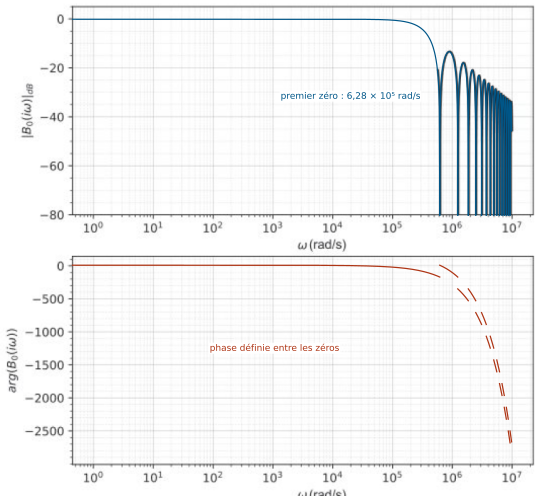
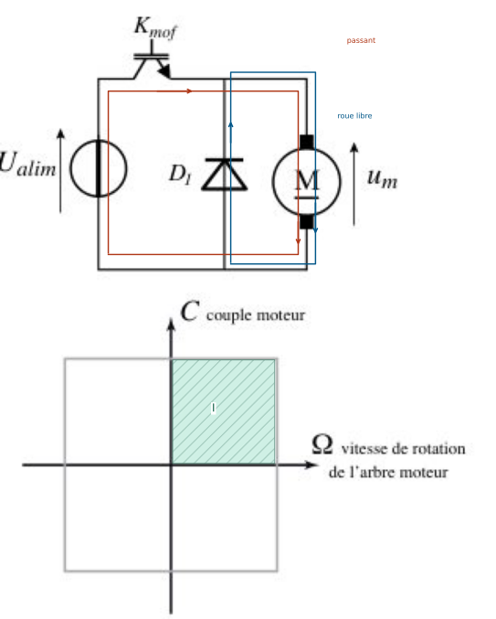
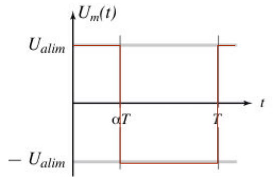
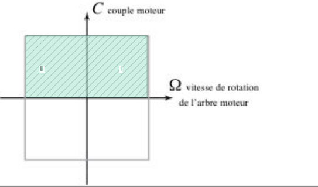
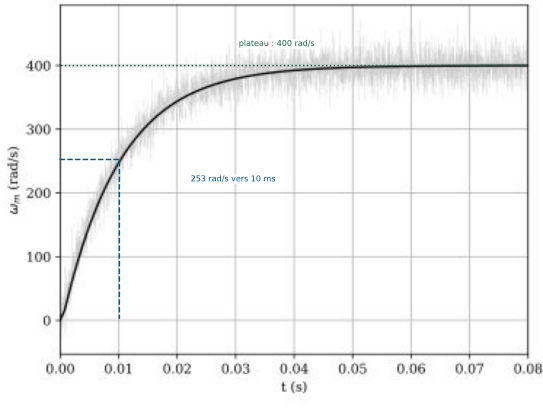
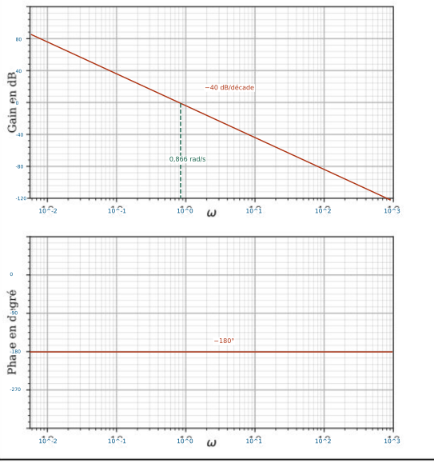

# Banque PT 2025 — Sciences industrielles A · Corrigé brut

*Corrigé rédigé par IA, non officiel. Signalez toute erreur.*

**Rédaction** · GPT-6.2 Astra Ultra · vitesse non renseignée · 26 novembre 2026

**Révision (tour 1)** · GPT-6.2 Astra Ultra · vitesse non renseignée · 26 novembre 2026

La cellule GEMINI combine fabrication additive et usinage de grandes pièces. Le sujet étudie un robot chargé, son réducteur et le contrôle du poignet. Le rapport annonce 48 questions. L’énoncé imprimé p. 23 et la dernière page du cahier portent tous deux une question 49 sur le bloqueur. Les 49 questions sont traitées ici, avec la numérotation du feuillet.

[Sujet et cahier officiels](https://www.banquept.fr/documents/2025/si_a_2025_pt.pdf) · [Rapport du jury](https://www.banquept.fr/documents/ecrit/rapport/2025/rapport_si_a_ecrit_2025.pdf)

## I — Actions mécaniques et mouvement du robot

### Question 1 — Équilibrer les poids en A

Les actions entre solides de E s’éliminent. En A, le pivot parfait n’exerce aucun moment selon son axe. Équilibrer les poids donne $C_A^{stat}=g[\alpha\cos\theta_1+\beta\cos(\theta_1+\theta_2)+\gamma\cos(\theta_1+\theta_2+\theta_3)]$, avec $\alpha=a(m_1/2+m_2+m_3+m_4)$, $\beta=b(m_2/2+m_3+m_4)$ et $\gamma=c(m_3/2+m_4)$. Chaque masse contribue pour sa distance horizontale au pivot.

[Sujet p. 6](https://www.banquept.fr/documents/2025/si_a_2025_pt.pdf#page=6) · [Cahier p. 29 du PDF](https://www.banquept.fr/documents/2025/si_a_2025_pt.pdf#page=29)

### Question 2 — Majoriser le couple de maintien

Les trois coefficients positifs valent 1 500, 550 et 175 kg·m. Les trois cosinus peuvent valoir 1 simultanément, bras déployé horizontalement à droite. La valeur absolue maximale vaut donc $g(\alpha+\beta+\gamma)=21\,827$ N·m, environ 21,8 kN·m. Les calculs ultérieurs du feuillet imposent 20 kN·m.

### Question 3 — Répartir l’effort des ressorts

L’effort axial total vaut $F=nF_r$. L’intégration de la pression uniforme sur une couronne donne $F=p\pi(R_e^2-R_i^2)$, donc $p=nF_r/[\pi(R_e^2-R_i^2)]$. Les deux garnitures sont serrées en série et chacune porte ce même effort axial.

### Question 4 — Intégrer le couple des deux garnitures

À la limite de glissement, le couple résistant élémentaire a pour module $\mu p r^2 dr\,d\theta$. Intégrer sur la couronne et multiplier par deux faces donne $|C_f|=4\pi\mu p(R_e^3-R_i^3)/3=(4/3)\mu nF_r(R_e^3-R_i^3)/(R_e^2-R_i^2)$. Le couple s’oppose au mouvement relatif envisagé.

### Question 5 — Déterminer le nombre de ressorts

À rendement idéal, le couple de frein requis sur l’arbre moteur est $\kappa C_{A,max}=1000$ N·m. Le rayon moyen de frottement vaut $(2/3)(R_e^3-R_i^3)/(R_e^2-R_i^2)=0,1083$ m. Un ressort à 1 000 N apporte $2\mu F_r R_{moy}=86,7$ N·m. Il faut donc 12 ressorts. La distance entre centres voisins sur le cercle de 400 mm est $400\sin(\pi/12)=103,5$ mm, supérieure au diamètre de 20 mm. La place circonférentielle suffit dans l’hypothèse du modèle.

### Question 6 — Choisir l’arbre portant le frein

Le couple de maintien à fournir sur l’arbre rapide est environ vingt fois plus faible. Le frein peut être plus compact. En fonctionnement sa vitesse est vingt fois plus élevée, ce qui accroît les contraintes de vitesse périphérique, d’usure et d’évacuation thermique au freinage. En maintien, le réducteur reste chargé, et un jeu ou un défaut en aval se répercute sur la position bloquée.

### Question 7 — Passer du bilan statique au bilan dynamique

Le moment des poids est l’opposé du couple statique et les liaisons intérieures s’éliminent. Ainsi $C_A^{dyn}-C_A^{stat}=\delta(A,E/0)\cdot z_0$. Le terme inertiel peut s’ajouter au couple de maintien ou le réduire suivant le signe de l’accélération.

### Question 8 — Former les deux matrices d’inertie

Le solide B homogène présente à travers A les plans médians $x_1y_1$ et $x_1z_1$. Les produits $xy$, $xz$ et $yz$ s’annulent par symétrie et sa matrice en A est diagonale. La masse ponctuelle en $(L,0,0)$ a pour matrice en A $\mathrm{diag}(0,J,J)$ avec $J=m_4L^2$. Sa distance à l’axe longitudinal est nulle.

### Question 9 — Calculer les moments cinétique et dynamique

$\sigma(A,E/0)=(I_z+J)\dot\theta_1 z_0$. Le point A et la direction $z_0$ étant fixes, $\delta(A,E/0)=(I_z+J)\ddot\theta_1 z_0$. On obtient $C_A^{dyn}=C_A^{stat}+(I_z+m_4L^2)\ddot\theta_1$. La projection axiale ne comporte pas de terme en vitesse au carré pour cet axe principal.

### Question 10 — Comparer les couples limites

$J=300\times3^2=2700$ kg·m² et $\ddot\theta_{max}=\pi$ rad/s². La borne pour gravité et accélération de même sens est $20\,000+(1440+2700)\pi=33\,006$ N·m, soit 65 % de plus que le maintien statique imposé. Le dimensionnement de maintien n’établit donc pas l’aptitude aux changements de vitesse.

### Question 11 — Calculer les puissances pour le poignet seul

La liaison encastrement entre 3 et 4 a une puissance intérieure nulle. La réaction idéale du pivot en C a une puissance nulle. Les puissances extérieures restantes se somment en $P_{ext}=[C_C^{dyn}-gc(m_3/2+m_4)\cos\theta_3]\dot\theta_3$, car les altitudes des centres de masse varient comme $(c/2)\sin\theta_3$ et $c\sin\theta_3$.

### Question 12 — Écrire l’énergie cinétique du poignet équipé

La tête est ramenée à une masse ponctuelle en D qui décrit un cercle de rayon $c$ à vitesse $c|\dot\theta_3|$. En négligeant l’énergie propre du poignet, $T(U/0)=m_4c^2\dot\theta_3^2/2$.

### Question 13 — Déduire l’équation du mouvement

Dans le référentiel galiléen du sol, $dT/dt=P_{int}+P_{ext}$. Substituer Q11 et Q12, puis simplifier sur un intervalle de mouvement donne $m_4c^2\ddot\theta_3+gc(m_3/2+m_4)\cos\theta_3=C_C^{dyn}$. Cette identité dynamique se prolonge aux instants de vitesse nulle. Ainsi $k_c=1/(m_4c^2)$ et $\omega_c^2=g(m_3/2+m_4)/(m_4c)$.

### Question 14 — Programmer le couple en trapèze

La commande vaut zéro hors de la fenêtre et retrouve zéro au dernier instant. Les constantes du feuillet vérifient $t_0<t_1\le t_2<t_f$.

~~~python
def C(t):
    if t < t_0 or t > t_f:
        return 0.0
    if t < t_1:
        return C_max * (t - t_0) / (t_1 - t_0)
    if t > t_2:
        return C_max * (t_f - t) / (t_f - t_2)
    return C_max
~~~

### Question 15 — Implémenter Euler explicite

Le pas est la différence de deux instants consécutifs, y compris lorsque la grille est irrégulière. La ligne initiale est conservée dans le résultat.

~~~python
import numpy as np

def euler(F, Y0, T):
    Y = np.zeros((len(T), len(Y0)))
    Y[0] = Y0
    for i in range(len(T) - 1):
        Y[i + 1] = Y[i] + (T[i + 1] - T[i]) * F(Y[i], T[i])
    return Y
~~~

### Question 16 — Programmer le second membre du système

Le premier argument est l’état courant. Le second est l’instant scalaire utilisé pour évaluer le couple.

~~~python
def F(Y, T):
    theta, vitesse = Y
    acceleration = kc * C(T) - wc**2 * np.cos(theta)
    return np.array([vitesse, acceleration])
~~~

## II — Précision et déformation du réducteur

### Question 17 — Calculer la portée horizontale

$x_D=a\cos\theta_1+b\cos(\theta_1+\theta_2)+c\cos(\theta_1+\theta_2+\theta_3)$. Dans la posture $(90^\circ,-90^\circ,-90^\circ)$, ces trois cosinus valent 0, 1 et 0, d’où $x_D=b=1000$ mm.

[Sujet p. 11](https://www.banquept.fr/documents/2025/si_a_2025_pt.pdf#page=11) · [Cahier p. 36 du PDF](https://www.banquept.fr/documents/2025/si_a_2025_pt.pdf#page=36)

### Question 18 — Linéariser la portée perturbée

Dans la formule générale de Q17, remplacer chaque $\theta_i$ par $\theta_i+\Delta\theta_i$. Dans la posture donnée, en posant $d_i=\Delta\theta_i$ en radians, $x_D+\Delta x_D=-a\sin d_1+b\cos(d_1+d_2)+c\sin(d_1+d_2+d_3)$. Au premier ordre, $\Delta x_D=(c-a)d_1+cd_2+cd_3$. La contribution de la barre b est du deuxième ordre dans cette posture.

### Question 19 — Calculer le pire cumul angulaire

Comme $c-a<0$, l’erreur positive maximale est obtenue avec $d_1=-\Delta\theta$ et $d_2=d_3=+\Delta\theta$. La portée dévie alors de $(a-c+2c)\Delta\theta=(a+c)\Delta\theta$. L’exigence de 0,1 mm donne $\Delta\theta_{max}=0,1/2000=5,0\times10^{-5}$ rad, soit $2,86\times10^{-3}$ degré.

### Question 20 — Appliquer la relation de Willis

Au contact intérieur I, $Z_0(0-\omega_{m0})=Z_s(\omega_{s0}-\omega_{m0})$. Au contact extérieur J, $Z_{s'}(\omega_{s0}-\omega_{m0})=-Z_p(\omega_{p0}-\omega_{m0})$. Éliminer la vitesse du satellite donne $\kappa=Z_p Z_s/(Z_pZ_s+Z_0Z_{s'})=600/12600=1/21$. Les arbres d’entrée et de sortie tournent dans le même sens. La suite retient séparément $1/20$.

### Question 21 — Ramener défaut et couple au pignon

L’angle de sortie étant $\kappa$ fois l’angle d’entrée, $\Delta\theta_{p,max}=\Delta\theta_{max}/\kappa=10^{-3}$ rad. La conservation de puissance en transmission idéale donne $|C_p|=\kappa|C_A^{dyn}|=1500$ N·m.

### Question 22 — Calculer la flexion de la dent

Sur le cercle primitif, $r_p=m_0Z_p/2=50$ mm, donc la composante tangentielle est $T=C_p/r_p=30$ kN. L’angle de pression détermine une composante radiale supplémentaire, non retenue dans la flexion tangentielle du modèle. À l’abscisse $x$ depuis l’encastrement, $EI_z v''=T(h-x)$ avec $I_z=\ell e^3/12$. Intégrer avec $v(0)=v'(0)=0$ donne $\delta_p=Th^3/(3EI_z)$. Pour $h=11,25$ mm, $e=7,85$ mm, $\ell=10$ mm et $E=200$ GPa, $I_z=4,04\times10^{-10}$ m⁴ et $\delta_p\simeq0,176$ mm.

### Question 23 — Comparer l’erreur due à la denture

En petite rotation, $\Delta\theta_p\simeq\delta_p/r_p=0,176/50=3,53\times10^{-3}$ rad. C’est environ 3,5 fois le défaut de $10^{-3}$ rad autorisé à l’entrée. Ramenée en sortie, l’erreur est $1,76\times10^{-4}$ rad. Dans ce calcul à une dent chargée, le critère n’est pas tenu.

## III.1 à III.3 — Bloqueur et codeur

### Question 24 — Construire les créneaux du maintien

$C_r(t)=u(t)-u(t-T_e)$. Après un retard entier de $k$ périodes, $C_r(t-kT_e)=u(t-kT_e)-u(t-(k+1)T_e)$. Cela maintient la valeur entre deux échantillons.

[Sujet p. 15](https://www.banquept.fr/documents/2025/si_a_2025_pt.pdf#page=15) · [Cahier p. 40 du PDF](https://www.banquept.fr/documents/2025/si_a_2025_pt.pdf#page=40)

### Question 25 — Transformer le peigne pondéré

Avec la normalisation du sujet, $s^*(t)=T_e\sum_{k\ge0}s_k\delta(t-kT_e)$. Par linéarité, $S^*(p)=T_e\sum_{k\ge0}s_ke^{-kT_ep}$. Le facteur $T_e$ appartient ici au modèle de l’échantillonneur.

### Question 26 — Déterminer le transfert du bloqueur

$B(p)=[(1-e^{-T_ep})/p]\sum_{k\ge0}s_ke^{-kT_ep}$. En divisant par $S^*(p)$, on obtient $B_0(p)=(1-e^{-T_ep})/(T_ep)$, donc $a_b=T_e$, $b_b=1$. Par continuité $B_0(0)=1$.

### Question 27 — Faire apparaître le sinus cardinal

Sur l’axe $p=i\omega$, poser $u=T_e\omega/2$. Comme $1-e^{-2iu}=2i e^{-iu}\sin u$, $B_0(i\omega)=e^{-iu}\sin(u)/u$. Le sinus cardinal est pair, d’où la forme indiquée avec $T_e|p|/2$ pour son argument. Cette écriture avec un module est une écriture fréquentielle.

### Question 28 — Distinguer module et phase par lobe

$|B_0(i\omega)|=|\sin u/u|$. Hors des zéros, une phase est $-u$ si $\sin u/u>0$ et $-u+\pi$ si $\sin u/u<0$, modulo $2\pi$. À zéro la phase vaut zéro par continuité. Aux zéros non nuls du sinus cardinal, l’argument est indéfini.

### Question 29 — Tracer les lobes sur l’échelle logarithmique

Pour $f_e=10^5$ Hz, les zéros sont à $\omega_n=2\pi n10^5$ rad/s. Le gain $20\log_{10}|\sin u/u|$ part de 0 dB et plonge à chaque zéro. À $\omega=\pi f_e$, il vaut −3,92 dB et la phase vaut −90°. Le premier lobe secondaire culmine vers −13,3 dB. La phase décroît linéairement en pulsation sur chaque lobe, ce qui devient une courbe sur une abscisse logarithmique. Les sauts de 180° rendent compte du changement de signe. Une branche de phase est tracée et les zéros sont exclus.

[Sujet p. 17](https://www.banquept.fr/documents/2025/si_a_2025_pt.pdf#page=17) · [Cahier p. 42 du PDF](https://www.banquept.fr/documents/2025/si_a_2025_pt.pdf#page=42)

### Question 30 — Justifier le modèle de retard pur

Lorsque $u=\pi f/f_e\ll1$, $\mathrm{sinc}(u)=1-u^2/6+\cdots$ et le bloqueur est assimilable à un retard de $T_e/2$. Par exemple, pour $f\le f_e/10$, le module est au moins 0,984, soit une perte inférieure à 0,15 dB. Pour appliquer le critère du revers autour de la coupure, il suffit en pratique de choisir $f_e\ge10 f_{0dB}$ pour cette tolérance, où $f_{0dB}=\omega_{0dB}/(2\pi)$. Il faut garder la bande fréquentielle pertinente loin du premier zéro.

### Question 31 — Déduire l’erreur de codeur acceptable

L’erreur angulaire correspondant à 0,01 mm à 250 mm du poignet est $0,01/250=4,0\times10^{-5}$ rad, soit environ $0,00229^\circ$.

### Question 32 — Choisir le nombre de pistes

Le pas vaut $2\pi/2^N$. Il faut $2^N>2\pi/(4\times10^{-5})=157\,080$. Seize ou dix-sept pistes sont insuffisantes. Dix-huit pistes fournissent 262 144 secteurs, donc un pas de $2,40\times10^{-5}$ rad.

### Question 33 — Expliquer le codage à transition unique

À une frontière, les tolérances mécaniques et les temps de réponse décalent les transitions des pistes. Un code de Gray ne change qu’un bit entre voisins. Une lecture transitoire hésite donc entre les deux secteurs adjacents au lieu de pouvoir désigner un secteur éloigné.

## III.4 et III.5 — Hacheurs et identification

### Question 34 — Tracer les mailles du hacheur série

Transistor passant, le courant suit la source, le transistor, le moteur puis le retour à la source. Transistor bloqué, il passe du bas vers le haut dans D1 et du haut vers le bas dans le moteur. Courant et tension moyenne ne peuvent être commandés négatifs. Dans le fonctionnement moteur considéré, seul le quadrant $\Omega>0,C>0$ est obtenu. L’entraînement demandé dans les deux sens exige une autre commande.

[Sujet p. 18](https://www.banquept.fr/documents/2025/si_a_2025_pt.pdf#page=18) · [Cahier p. 44 du PDF](https://www.banquept.fr/documents/2025/si_a_2025_pt.pdf#page=44)

### Question 35 — Construire la tension du pont à deux interrupteurs

Sur $[0,\alpha T[$, les transistors appliquent $+U_{alim}$ ; sur $[\alpha T,T[$ les deux diodes conduisent et donnent $-U_{alim}$. Ainsi $\langle u_m\rangle=(2\alpha-1)U_{alim}$ varie entre $-U_{alim}$ et $+U_{alim}$. Les deux signes de tension sont disponibles, ce qui est nécessaire à l’inversion de vitesse. Il reste à examiner le sens du couple.

[Sujet p. 19](https://www.banquept.fr/documents/2025/si_a_2025_pt.pdf#page=19) · [Cahier p. 45 du PDF](https://www.banquept.fr/documents/2025/si_a_2025_pt.pdf#page=45)

### Question 36 — Identifier les quadrants du pont

Le courant garde le même sens, donc le couple demeure positif. Avec l’abscisse vitesse et l’ordonnée couple de la grille, les quadrants I et II sont accessibles. En vitesse négative, le couple positif freine et la puissance mécanique est négative. Le quadrant III, nécessaire pour entraîner activement en marche inverse, manque. Une commande assurant les deux signes de courant et de tension permettrait les deux marches motrices, le traitement du freinage dépendant du dispositif prévu.

[Sujet p. 19](https://www.banquept.fr/documents/2025/si_a_2025_pt.pdf#page=19) · [Cahier p. 45 du PDF](https://www.banquept.fr/documents/2025/si_a_2025_pt.pdf#page=45)

### Question 37 — Orienter l’axe pour identifier le moteur

Les poids sont parallèles à l’axe du poignet lorsqu’il est vertical. Leur moment projeté sur cet axe est nul, quelle que soit l’orientation de l’outil. L’essai identifie donc la chaîne chargée de son inertie sans superposer un couple gravitaire dépendant de l’angle.

### Question 38 — Choisir l’amortissement du filtre

Avec $\xi_f\simeq1/\sqrt2\simeq0,707$, la réponse en gain est plate en basse fréquence, vaut environ −3 dB à la pulsation propre puis décroît à −40 dB/décade. Cela évite une bosse de résonance appréciable qui amplifierait certaines composantes du bruit.

### Question 39 — Revenir à l’équation différentielle

Avec $w_{mf}$ la vitesse filtrée et $w_m$ la mesure, $\ddot w_{mf}+2\xi_f\Omega_f\dot w_{mf}+\Omega_f^2w_{mf}=\Omega_f^2w_m$. Cette équation suppose les conditions initiales de repos pour l’identité de Laplace écrite sur le sujet.

### Question 40 — Discrétiser le filtre par différence arrière

Posons $q=\Omega_fT_e$, $D=1+2\xi_f q+q^2$. Remplacer $\dot y_i$ par $(y_i-y_{i-1})/T_e$ et $\ddot y_i$ par $(y_i-2y_{i-1}+y_{i-2})/T_e^2$. Il vient $y_i=a_0w_{m,i}+b_0y_{i-1}+b_1y_{i-2}$ avec $a_0=q^2/D$, $b_0=(2+2\xi_fq)/D$, $b_1=-1/D$. Le test sur un signal constant donne $a_0+b_0+b_1=1$, donc le gain continu est bien conservé.

### Question 41 — Choisir un ordre de grandeur pour la cassure

La montée utile dure quelques dizaines de millisecondes, avec une constante proche de 10 ms, soit une bande caractéristique de 100 rad/s. Les fluctuations rapides visibles se succèdent à l’échelle de la milliseconde ou en moins de temps. Une cassure de l’ordre de $10^3$ rad/s, soit environ 160 Hz, conserve la tendance et atténue fortement des fluctuations à plusieurs milliers de rad/s. Il s’agit d’un choix de séparation des bandes. La figure 22 ne fournit pas un spectre permettant d’identifier une fréquence parasite unique.

### Question 42 — Identifier le transfert tension-vitesse

La figure 23 part du repos, monte de manière presque exponentielle et tend sans dépassement vers 400 rad/s. Pour l’échelon de 24 V, $K_m\simeq400/24=16,7$ rad·s⁻¹·V⁻¹. La courbe atteint $0,632\times400\simeq253$ rad/s vers 0,010 à 0,011 s, d’où $\tau_m\simeq0,010$ s. Les calculs suivants adoptent les valeurs prescrites, 15 et 0,01 s.

[Sujet p. 21](https://www.banquept.fr/documents/2025/si_a_2025_pt.pdf#page=21) · [Cahier p. 48 du PDF](https://www.banquept.fr/documents/2025/si_a_2025_pt.pdf#page=48)

## III.6 et III.7 — Correcteurs et stabilité

### Question 43 — Mettre consigne et mesure à la même échelle

$\varepsilon=A_c\theta_c-C_{abs}\theta$. Pour que l’écart soit proportionnel à $\theta_c-\theta$, imposer $A_c=C_{abs}=1$ V/rad. Le capteur mesure l’angle de sortie après transmission.

[Sujet p. 22](https://www.banquept.fr/documents/2025/si_a_2025_pt.pdf#page=22) · [Cahier p. 48 du PDF](https://www.banquept.fr/documents/2025/si_a_2025_pt.pdf#page=48)

### Question 44 — Fixer la classe du correcteur

L’intégration de la vitesse fournit un premier pôle à l’origine. Une boucle stable de classe 1 suit l’échelon sans erreur, mais garde une erreur constante sur la rampe. Pour annuler aussi le traînage, il faut une boucle de classe au moins 2 et donc un intégrateur supplémentaire dans le correcteur. La stabilité est une condition de ces conclusions de valeur finale.

### Question 45 — Examiner la compensation de pôle

Avec $\tau_{PI}=\tau_m$, le zéro du PI compense le pôle du modèle dans le produit de boucle. Une erreur d’identification, des variations de charge ou de température laissent une dynamique résiduelle. La simplification algébrique peut masquer un mode dans des réponses internes ou aux perturbations. La compensation d’un pôle instable est à proscrire.

### Question 46 — Tracer la boucle avec le PI seul

$L(p)=K_{PI}\kappa K_m C_{abs}/p^2=0,75K_{PI}/p^2$. Pour $K_{PI}=1$, le gain vaut $20\log_{10}(0,75)-40\log_{10}\omega$, la coupure $\sqrt{0,75}=0,866$ rad/s et la phase −180° partout. Les pôles fermés sont $\pm i\sqrt{0,75}$, donc le bouclage n’est pas asymptotiquement stable. Il n’y a pas de réserve de stabilité : marge de phase nulle et point critique atteint à la coupure.

[Sujet p. 22](https://www.banquept.fr/documents/2025/si_a_2025_pt.pdf#page=22) · [Cahier p. 50 du PDF](https://www.banquept.fr/documents/2025/si_a_2025_pt.pdf#page=50)

### Question 47 — Fixer la pulsation de coupure du PI

$\omega_{0dB}^2=0,75K_{PI}$. Pour la valeur minimale demandée de 100 rad/s, $K_{PI}=100^2/0,75=1,333\times10^4$ s⁻¹. Ce changement translate le module et laisse la phase à −180°.

### Question 48 — Dimensionner le correcteur à avance de phase

L’avance minimale est $60^\circ$. Avec $\sin\phi_m=(1-a_a)/(1+a_a)$, $a_a=(1-\sin60^\circ)/(1+\sin60^\circ)=0,07180$. Imposer $\omega_m=1/(\tau_a\sqrt{a_a})=100$ donne $\tau_a=0,03732$ s. Au maximum de phase $|H_a|=K_a/\sqrt{a_a}$. Choisir $K_a=\sqrt{a_a}=0,26795$ maintient la coupure à 100 rad/s. La marge nominale sans bloqueur est exactement de 60°.

### Question 49 — Quantifier l’effet final de l’échantillonnage

À 100 rad/s et $T_e=10^{-5}$ s, la perte vaut $\omega T_e/2=0,0005$ rad, soit $0,02865^\circ$. La marge passe théoriquement de 60° à 59,971°. L’effet est minime mais une avance réglée exactement au minimum manque strictement le seuil de 60°. Prévoir au moins 0,029° d’avance supplémentaire à la même coupure, outre les incertitudes réelles. La seule marge ne certifie pas non plus $t_{5\%}\le0,03$ s. À titre de contrôle, le modèle continu avec les réglages minimaux de Q47–Q48 donne environ 0,075 s pour une consigne en échelon. Ce choix de paramètres ne valide donc pas l’ensemble du tableau.
