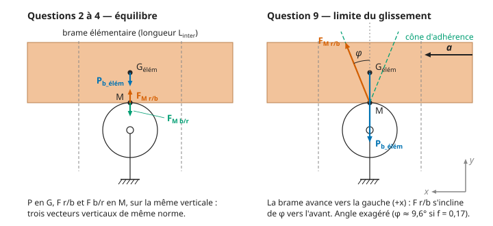
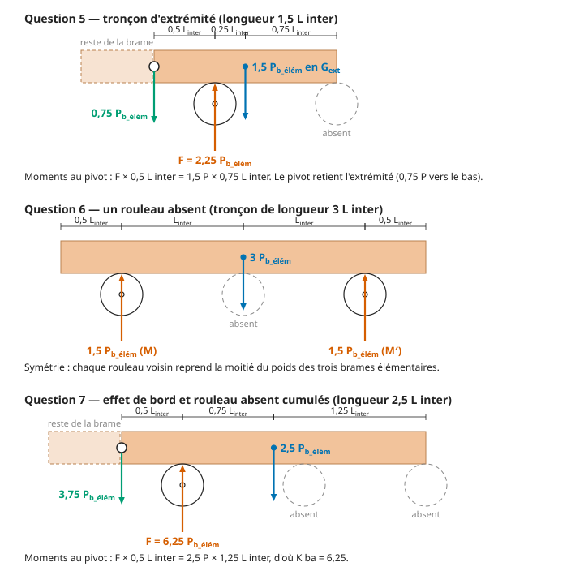
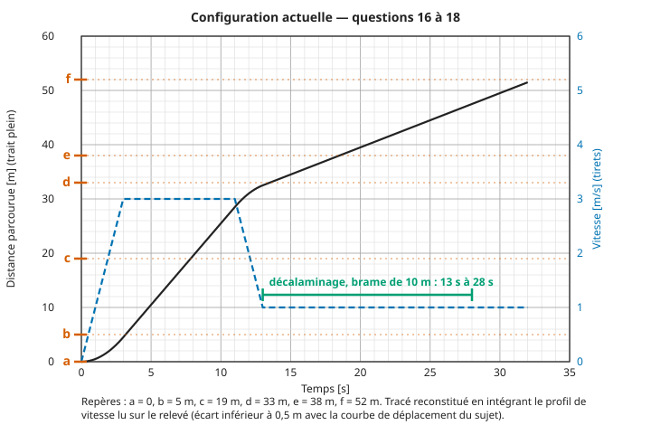
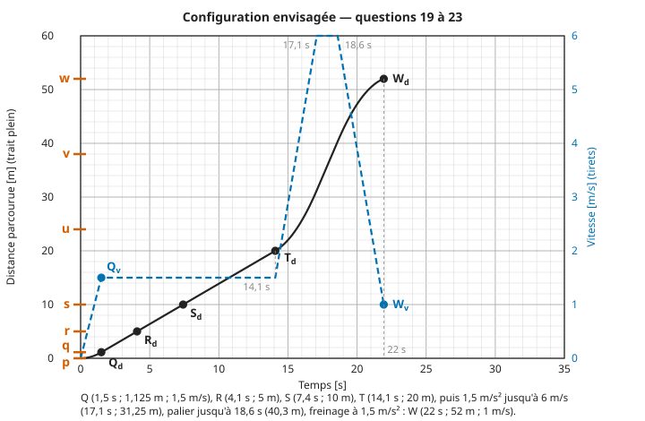
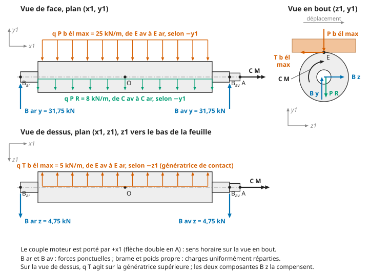
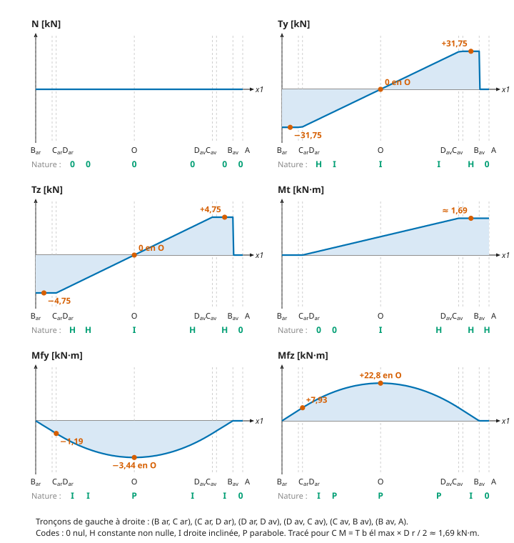
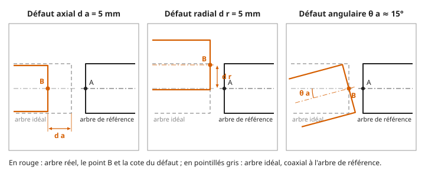

# Banque PT PT — Sciences industrielles B 2025 · Corrigé brut

*Corrigé rédigé par IA, non officiel. Signalez toute erreur.*

**Rédaction** · modèle exact non renseigné (famille Claude) · effort non renseigné · vitesse non renseignée

**Révision (tour 2)** · modèle exact non renseigné (famille Claude) · effort non renseigné · vitesse non renseignée · 28 novembre 2026

Épreuve de 6 h, sans calculatrice ni document. Support : table à rouleaux d'une ligne de laminage à chaud (transfert des brames du four au laminoir réversible). Les 50 questions sont traitées dans l'ordre ; les tracés demandés sur le cahier réponse sont redessinés dans des figures originales.

Notations abrégées : $P_e = P_{b,\text{élém}}$ (poids d'une brame élémentaire), $L_i = L_{inter}$ (entraxe de deux rouleaux voisins). Données principales : $g = 10\ \mathrm{m\cdot s^{-2}}$, $\rho_a = 7800\ \mathrm{kg\cdot m^{-3}}$, $f = 0{,}17$, $D_r = 356\ \mathrm{mm}$, $L_r = 2000\ \mathrm{mm}$, brames de $6$ à $10\ \mathrm{m}$ de long, $0{,}9$ à $1{,}9\ \mathrm{m}$ de large, $0{,}24\ \mathrm{m}$ d'épaisseur.

---

## Partie I — Réduction de la durée du déplacement des brames

### Question 1 — Masse et poids d'une brame élémentaire

La brame élémentaire est le tronçon de longueur $L_{inter}$ porté par un seul rouleau ; la brame entière repose sur $N_r$ rouleaux.

$$\boxed{m_{b,\text{élém}} = \rho_a\, l_b\, e_b\, L_{inter} = \frac{m_b}{N_r} = \frac{\rho_a\, L_b\, l_b\, e_b}{N_r}}$$

$$\boxed{P_{b,\text{élém}} = m_{b,\text{élém}}\; g = \rho_a\, l_b\, e_b\, L_{inter}\, g}$$

### Question 2 — Tracé des efforts sur la brame élémentaire

$G_{\text{élém}}$ est au centre du rectangle représentant la brame élémentaire, à la verticale de $M$. Le poids $\vec P_{b,\text{élém}}$ est vertical descendant, appliqué en $G_{\text{élém}}$. L'action du rouleau sur la brame $\vec F_{M\,r/b}$ est verticale ascendante, appliquée en $M$. L'action de la brame sur le rouleau $\vec F_{M\,b/r}$ est verticale descendante, appliquée en $M$. Les trois vecteurs ont la même longueur.

### Question 3 — Relation entre le poids et l'action du rouleau

$$\boxed{\vec P_{b,\text{élém}} + \vec F_{M\,r/b} = \vec 0}$$

- **Système isolé** : la brame élémentaire.
- **Théorème utilisé** : théorème de la résultante statique (principe fondamental de la statique).
- **Hypothèse posée** : la brame est immobile dans le référentiel du bâti, supposé galiléen ; le rouleau étudié étant loin des bords, les tronçons voisins n'exercent aucune action sur le tronçon isolé (chaque tronçon est porté par son propre rouleau).

### Question 4 — Actions réciproques

$$\boxed{\vec F_{M\,b/r} = -\vec F_{M\,r/b}}$$

**Justification** : principe des actions réciproques (ou mutuelles). Aucun isolement n'est nécessaire. On en déduit $\vec F_{M\,b/r} = \vec P_{b,\text{élém}}$ : le rouleau reçoit exactement le poids de la brame élémentaire.

### Question 5 — Effet de bord

Lecture de l'annexe C et du cadre réponse : le pivot qui relie l'extrémité au reste de la brame est à mi-distance du rouleau étudié et du rouleau précédent, donc à $L_i/2$ de $M$ ; le bout de la brame est à l'aplomb du rouleau qu'elle vient de quitter, donc à $L_i$ de $M$ de l'autre côté. Le tronçon d'extrémité a pour longueur $1{,}5\,L_i$.

$G_{ext}$ est au milieu du tronçon, à $0{,}75\,L_i$ du pivot, soit $0{,}25\,L_i$ au-delà de $M$ vers le bout libre.

$$\boxed{P_{b,extrem} = 1{,}5\; P_{b,\text{élém}}}$$

Efforts sur le tronçon isolé : son poids en $G_{ext}$, l'action du rouleau en $M$ (verticale ascendante), l'action du reste de la brame au pivot (une force, pas de moment). Théorème du moment statique au pivot, qui élimine l'action inconnue du pivot :

$$\begin{aligned}
F_{M\_EXTREM\;r/b}\times \frac{L_i}{2} &= 1{,}5\,P_e \times 0{,}75\,L_i\\
F_{M\_EXTREM\;r/b} &= 2{,}25\,P_e
\end{aligned}$$

Par actions réciproques :

$$\boxed{F_{M\_EXTREM\;b/r} = \frac{9}{4}\,P_{b,\text{élém}} = 2{,}25\;P_{b,\text{élém}}}$$

La résultante donne l'action du reste de la brame sur l'extrémité : $0{,}75\,P_e$ vers le bas. Le rouleau de bord porte donc plus que le poids du tronçon.

### Question 6 — Rouleau absent

Le tronçon porté par les deux rouleaux voisins $M$ et $M'$ couvre trois brames élémentaires (celle du rouleau absent et celles des deux voisins) : longueur $3\,L_i$, poids $3\,P_e$ appliqué au milieu, à l'aplomb du rouleau absent. Efforts : ce poids, et les deux actions verticales ascendantes en $M$ et $M'$. Par symétrie (ou moment en $M'$) :

$$2\,F = 3\,P_e$$

$$\boxed{F_{M\_ROUL\_ABST\;b/r} = \frac{3}{2}\,P_{b,\text{élém}} = 1{,}5\;P_{b,\text{élém}}}$$

### Question 7 — Coefficient de sécurité

Le schéma du cadre réponse cumule les deux cas : le rouleau qui suit le rouleau de bord est absent. En mesurant sur ce schéma, le tronçon articulé va du pivot (à $L_i/2$ avant $M$) jusqu'au bout de la brame, situé $2\,L_i$ après $M$ : longueur $2{,}5\,L_i$, poids $2{,}5\,P_e$ appliqué à $1{,}25\,L_i$ du pivot. Moment au pivot :

$$\begin{aligned}
F\times\frac{L_i}{2} &= 2{,}5\,P_e\times 1{,}25\,L_i\\
F &= 6{,}25\,P_e
\end{aligned}$$

$$\boxed{K_{ba} = 6{,}25}$$

Remarque : le simple produit des deux coefficients précédents ($2{,}25\times1{,}5\approx3{,}4$) sous-estime ce cas, car le bras de levier du poids s'allonge en même temps que le poids augmente. La valeur retenue dépend du modèle articulé, très pénalisant puisqu'il ignore la rigidité de la brame. La partie II, indépendante, fournit directement $P_{b\,\text{él}\,max} = 47{,}5\ \mathrm{kN}$ sans donner $L_{inter}$ : cette donnée ne permet ni de retrouver ni d'infirmer la valeur de $K_{ba}$.

### Question 8 — Angle et coefficient d'adhérence

$$\boxed{\tan\varphi = f}$$

### Question 9 — Cône d'adhérence

Sur la figure 1 (partie droite) : le cône d'adhérence a pour sommet $M$, pour axe la normale au contact (verticale) et pour demi-angle au sommet $\varphi$. À la limite du glissement, $\vec F_{M\,r/b}$ est porté par la génératrice du cône inclinée vers l'avant, c'est-à-dire vers la gauche ($+\vec x$), sens du déplacement et de l'accélération. $\vec P_{b,\text{élém}}$ est vertical descendant en $G_{\text{élém}}$ ; $\vec a$ est horizontal, dirigé vers la gauche.

### Question 10 — Théorème et projections

Cases à cocher : **théorème de la résultante dynamique**, appliqué à la brame élémentaire, en projection **sur $Ox$** (horizontale, sens du mouvement) **et sur $Oy$** (verticale).

### Question 11 — Deux expressions de l'action du rouleau

Projection sur la verticale (pas d'accélération verticale) :

$$F_{M\,r/b}\cos\varphi - m_{b,\text{élém}}\,g = 0$$

Projection sur l'horizontale :

$$F_{M\,r/b}\sin\varphi = m_{b,\text{élém}}\,a$$

$$\boxed{\begin{aligned}
(1)\quad F_{M\,r/b} &= \frac{m_{b,\text{élém}}\; g}{\cos\varphi}\\
(2)\quad F_{M\,r/b} &= \frac{m_{b,\text{élém}}\; a}{\sin\varphi}
\end{aligned}}$$

### Question 12 — Accélération limite

En égalant (1) et (2) :

$$\boxed{a = g\,\tan\varphi = f\,g}$$

### Question 13 — Risque de glissement et accélération admissible

L'accélération limite ne dépend ni de la masse ni des dimensions de la brame : case **« Ce risque est indépendant de la masse de la brame »**.

$$a_{adm} = f\,g = 0{,}17\times10$$

$$\boxed{a_{adm} = 1{,}7\ \mathrm{m\cdot s^{-2}}}$$

### Question 14 — Mouvement rectiligne uniformément accéléré

Avec $x_0$ et $v_0$ la position et la vitesse à $t = 0$ :

$$\boxed{\begin{aligned}
a &= \text{constante}\\
v &= a\,t + v_0\\
x &= \tfrac12\,a\,t^2 + v_0\,t + x_0
\end{aligned}}$$

### Question 15 — Distance et durée d'accélération

Avec $v_0 = 0$ et $x_0 = 0$ : $t = v/a$, donc

$$\boxed{x = \frac{v^2}{2a}}$$

Avec l'accélération admissible retenue par l'énoncé pour la suite, $a_{adm} = 1{,}5\ \mathrm{m\cdot s^{-2}}$, et $v_{max\_act} = 3\ \mathrm{m\cdot s^{-1}}$ :

$$\begin{aligned}
d_{min} &= \frac{3^2}{2\times1{,}5}\\
t_{min} &= \frac{3}{1{,}5}
\end{aligned}$$

$$\boxed{d_{min} = 3\ \mathrm{m}\qquad t_{min} = 2\ \mathrm{s}}$$

### Question 16 — Repères de la ligne actuelle

D'après la figure 17 (distances cumulées depuis la sortie du four) :

| Repère | a | b | c | d | e | f |
|---|---|---|---|---|---|---|
| Déplacement de l'avant de la brame | $0$ | $5\ \mathrm{m}$ | $19\ \mathrm{m}$ | $33\ \mathrm{m}$ | $38\ \mathrm{m}$ | $52\ \mathrm{m}$ |

Le poste de décalaminage occupe l'intervalle $[d, e]$ et l'entrée du réversible est en $f$. Ces repères se placent sur l'axe des ordonnées (distances).

### Question 17 — Lecture du relevé actuel

Lectures sur la courbe de vitesse du cadre « Question 16 » : palier haut à $3\ \mathrm{m\cdot s^{-1}}$, palier bas à $1\ \mathrm{m\cdot s^{-1}}$ pendant la traversée du poste de décalaminage, montée de $0$ à $3\ \mathrm{m\cdot s^{-1}}$ en $3\ \mathrm{s}$. La courbe de déplacement atteint $52\ \mathrm{m}$ (repère f) à $t = 32\ \mathrm{s}$.

$$\boxed{\begin{aligned}
v_{max\_act} &= 3\ \mathrm{m\cdot s^{-1}}\\
v_{\text{décal}\_act} &= 1\ \mathrm{m\cdot s^{-1}}\\
a_{a-b\_act} &= \frac{3}{3} = 1\ \mathrm{m\cdot s^{-2}}\\
T_{a-f} &= 32\ \mathrm{s}
\end{aligned}}$$

### Question 18 — Durée du décalaminage d'une brame de 10 m

La brame est en décalaminage depuis l'entrée de son avant dans le poste (déplacement de $33\ \mathrm{m}$, repère d) jusqu'à la sortie de son arrière (déplacement de l'avant égal à $38 + 10 = 48\ \mathrm{m}$). Sur le relevé, ces déplacements sont atteints à $t \approx 13\ \mathrm{s}$ et $t \approx 28\ \mathrm{s}$. Le symbole se place donc sur le palier de vitesse à $1\ \mathrm{m\cdot s^{-1}}$, **de 13 s à 28 s**, soit une durée de $15\ \mathrm{s}$ (figure 3).

Contrôle : $15\ \mathrm{m}$ parcourus à $1\ \mathrm{m\cdot s^{-1}}$ (longueur du poste, $5\ \mathrm{m}$, plus longueur de la brame, $10\ \mathrm{m}$).

### Question 19 — Début du mouvement envisagé

Même accélération qu'actuellement ($1\ \mathrm{m\cdot s^{-2}}$) jusqu'à la vitesse maximale de décalaminage : droite de $(0 ; 0)$ à $(1{,}5\ \mathrm{s} ; 1{,}5\ \mathrm{m\cdot s^{-1}})$, puis palier horizontal à $1{,}5\ \mathrm{m\cdot s^{-1}}$ jusqu'à $5\ \mathrm{s}$. Le point $Q_v$ est à la cassure.

$$\boxed{v_q = 1{,}5\ \mathrm{m\cdot s^{-1}}\qquad T_{p-q} = t_q = 1{,}5\ \mathrm{s}}$$

### Question 20 — Position du repère q

$$x_q = \tfrac12\,a\,t_q^2 = 0{,}5\times1\times1{,}5^2$$

(l'annexe D donne directement $0{,}5\,x^2 = 1{,}125$ pour $x = 1{,}5$).

$$\boxed{x_q = 1{,}125\ \mathrm{m}\approx 1{,}1\ \mathrm{m}}$$

$Q_d$ a pour coordonnées $(1{,}5\ \mathrm{s} ; 1{,}125\ \mathrm{m})$ ; le repère q se place à $1{,}1\ \mathrm{m}$ sur l'axe des distances, entre p et r. À partir de $Q_d$, le déplacement est une droite de pente $1{,}5\ \mathrm{m\cdot s^{-1}}$, tangente à l'arc de parabole qui précède : elle gagne $7{,}5\ \mathrm{m}$ toutes les $5\ \mathrm{s}$.

### Question 21 — Points caractéristiques du décalaminage

Sur la droite de pente $1{,}5\ \mathrm{m\cdot s^{-1}}$, $t = t_q + (x - x_q)/1{,}5$. D'après la figure 18, le poste occupe $[r, s]$, avec r à $5\ \mathrm{m}$ et s à $10\ \mathrm{m}$.

| Point | Événement | Déplacement | Instant |
|---|---|---|---|
| $R_d$ | l'avant entre dans le poste (repère r) | $5\ \mathrm{m}$ | $1{,}5 + 3{,}875/1{,}5 \approx 4{,}1\ \mathrm{s}$ |
| $S_d$ | l'avant sort du poste (repère s) | $10\ \mathrm{m}$ | $1{,}5 + 8{,}875/1{,}5 \approx 7{,}4\ \mathrm{s}$ |
| $T_d$ | l'arrière d'une brame de $10\ \mathrm{m}$ sort du poste | $10 + 10 = 20\ \mathrm{m}$ | $1{,}5 + 18{,}875/1{,}5 \approx 14{,}1\ \mathrm{s}$ |

### Question 22 — Accélération jusqu'à la vitesse maximale

À partir de $T_d$ ($t \approx 14{,}1\ \mathrm{s}$, $v = 1{,}5\ \mathrm{m\cdot s^{-1}}$), accélération de $1{,}5\ \mathrm{m\cdot s^{-2}}$ jusqu'à $v_{max\_env} = 6\ \mathrm{m\cdot s^{-1}}$ :

$$\begin{aligned}
\Delta t &= \frac{6-1{,}5}{1{,}5} = 3\ \mathrm{s}\\
\Delta x &= \frac{6^2-1{,}5^2}{2\times1{,}5} = 11{,}25\ \mathrm{m}
\end{aligned}$$

La vitesse est une droite de $(14{,}1\ \mathrm{s} ; 1{,}5)$ à $(17{,}1\ \mathrm{s} ; 6\ \mathrm{m\cdot s^{-1}})$ ; l'avant de la brame est alors à $31{,}25\ \mathrm{m}$.

### Question 23 — Fin du mouvement jusqu'au réversible

Points imposés : $W_d\,(22\ \mathrm{s} ; 52\ \mathrm{m})$ et $W_v\,(22\ \mathrm{s} ; 1\ \mathrm{m\cdot s^{-1}})$, le repère w étant à $5+5+14+14+14 = 52\ \mathrm{m}$.

Freinage final de $6$ à $1\ \mathrm{m\cdot s^{-1}}$ à $1{,}5\ \mathrm{m\cdot s^{-2}}$ :

$$\begin{aligned}
\Delta t &= \frac{6-1}{1{,}5} \approx 3{,}3\ \mathrm{s}\\
\Delta x &= \frac{6^2-1^2}{2\times1{,}5} \approx 11{,}7\ \mathrm{m}
\end{aligned}$$

Le freinage commence donc à $52 - 11{,}7 = 40{,}3\ \mathrm{m}$. Le palier à $6\ \mathrm{m\cdot s^{-1}}$ couvre $40{,}3 - 31{,}25 \approx 9{,}1\ \mathrm{m}$ en $1{,}5\ \mathrm{s}$, de $17{,}1$ à $18{,}6\ \mathrm{s}$. Arrivée : $18{,}6 + 3{,}3 \approx 21{,}9\ \mathrm{s}$, en accord avec les $22\ \mathrm{s}$ annoncés.

Allure de la vitesse : palier à $6\ \mathrm{m\cdot s^{-1}}$ de $17{,}1$ à $18{,}6\ \mathrm{s}$, puis droite descendante jusqu'à $W_v$. Allure du déplacement : arc de parabole convexe de $T_d$ à $(17{,}1\ \mathrm{s} ; 31{,}25\ \mathrm{m})$, segment de pente $6\ \mathrm{m\cdot s^{-1}}$ jusqu'à $(18{,}6\ \mathrm{s} ; 40{,}3\ \mathrm{m})$, arc de parabole concave jusqu'à $W_d$, où la pente vaut $1\ \mathrm{m\cdot s^{-1}}$ (figure 4).

### Question 24 — Gain de temps

$$T_{a-f} - T_{p-w} = 32 - 22$$

$$\boxed{\text{Gain} = 10\ \mathrm{s}}$$

---

## Partie II — Étude des nouveaux rouleaux

### Question 25 — Poids du rouleau plein

Seule la partie centrale, cylindre plein de diamètre $D_r$ et de longueur $L_r$, est prise en compte :

$$\boxed{P_R = \rho_a\,\frac{\pi D_r^2}{4}\,L_r\,g}$$

Unités : $\rho_a$ en $\mathrm{kg\cdot m^{-3}}$, $D_r$ et $L_r$ en $\mathrm{m}$, $g$ en $\mathrm{m\cdot s^{-2}}$, $P_R$ en $\mathrm{N}$. (Contrôle : $7800\times0{,}0995\times2\times10\approx 15{,}5\ \mathrm{kN}$, cohérent avec les $16\ \mathrm{kN}$ de l'énoncé.)

### Question 26 — Démarche pour les actions de liaison

- **Théorèmes** : principe fondamental de la statique, c'est-à-dire théorème de la résultante statique et théorème du moment statique (écrit en $B_{av}$ ou en $B_{ar}$).
- **Système isolé** : le rouleau.
- **Hypothèses supplémentaires** : le rouleau est à l'équilibre (immobile ou en rotation uniforme, donc sans couple moteur ni effort tangentiel de la brame) ; le problème est plan dans $(\vec x_1, \vec y_1)$, les charges étant verticales et symétriques par rapport au plan médian passant par $O$ ; aucune charge axiale.

### Question 27 — Actions des roulements à l'arrêt

Charges verticales : $P_{b\,\text{él}\,max} = 47{,}5\ \mathrm{kN}$ et $P_R = 16\ \mathrm{kN}$, toutes deux centrées en $O$. Or $O$ est le milieu de $[B_{ar}, B_{av}]$ ($B_{ar}O = 200 + 1000 = 1200\ \mathrm{mm}$ et $OB_{av} = 1000 + 200 = 1200\ \mathrm{mm}$). Moment en $B_{ar}$ puis résultante :

$$\begin{aligned}
Y_{B_{av}} \times 2{,}4 &= (47{,}5 + 16)\times 1{,}2\\
Y_{B_{av}} &= Y_{B_{ar}} = \frac{63{,}5}{2} = 31{,}75\ \mathrm{kN}
\end{aligned}$$

La rotule et la linéaire annulaire ne transmettent aucun moment en leur centre.

$$\boxed{\vec R_{B_{av}} = \begin{pmatrix}0\\ 31\,750\\ 0\end{pmatrix}\mathrm{N}\qquad \vec M_{B_{av}} = \begin{pmatrix}0\\0\\0\end{pmatrix}\mathrm{N\cdot m}}$$

$$\boxed{\vec R_{B_{ar}} = \begin{pmatrix}0\\ 31\,750\\ 0\end{pmatrix}\mathrm{N}\qquad \vec M_{B_{ar}} = \begin{pmatrix}0\\0\\0\end{pmatrix}\mathrm{N\cdot m}}$$

### Question 28 — Tableau des actions mécaniques en phase d'accélération

Le centre de gravité du rouleau reste sur l'axe fixe : la résultante des actions extérieures est nulle même en phase d'accélération. La brame accélère vers $+\vec z_1$ ; le rouleau la pousse vers $+\vec z_1$ et reçoit en retour un effort tangentiel dirigé vers $-\vec z_1$. Par symétrie, chaque roulement reprend la moitié des charges.

| Action | Type | Sens | Point ou segment | Valeur | Unité |
|---|---|---|---|---|---|
| $\vec C_{mot}$ | couple ponctuel | $\vec x_1$ | $A$ | $800$ (prérempli) | $\mathrm{N\cdot m}$ |
| $\vec B_{av}$ | force ponctuelle | $\vec y_1$ et $\vec z_1$ | $B_{av}$ | $B_{av\,x_1} = 0$ ; $B_{av\,y_1} = 31{,}75$ ; $B_{av\,z_1} = 4{,}75$ | $\mathrm{kN}$ |
| $\vec B_{ar}$ | force ponctuelle | $\vec y_1$ et $\vec z_1$ | $B_{ar}$ | $B_{ar\,y_1} = 31{,}75$ ; $B_{ar\,z_1} = 4{,}75$ | $\mathrm{kN}$ |
| $\vec P_{b\,\text{él}\,max}$ | charge uniformément répartie | $-\vec y_1$ | de $E_{av}$ à $E_{ar}$ | $q_{P_{b\,\text{él}\,max}} = 47{,}5/1{,}9 = 25$ | $\mathrm{kN\cdot m^{-1}}$ |
| $\vec T_{b\,\text{él}\,max}$ | charge uniformément répartie | $-\vec z_1$ | de $E_{av}$ à $E_{ar}$ | $q_{T_{b\,\text{él}\,max}} = 9{,}5/1{,}9 = 5$ | $\mathrm{kN\cdot m^{-1}}$ |
| $\vec P_R$ | charge uniformément répartie | $-\vec y_1$ | de $C_{av}$ à $C_{ar}$ | $q_{P_R} = 16/2 = 8$ | $\mathrm{kN\cdot m^{-1}}$ |

Remarque : la valeur préremplie $C_{mot} = 800\ \mathrm{N\cdot m}$ n'est pas égale au couple maximal de la question 30 (environ $1700\ \mathrm{N\cdot m}$). Elle n'intervient pas dans les efforts des roulements, l'accouplement transmettant un couple pur.

### Question 29 — Représentation sur les trois vues

Avec les conventions de la figure 11 de l'énoncé :

- vue de face $(\vec x_1, \vec y_1)$ : flèches réparties descendantes de $E_{ar}$ à $E_{av}$ (brame, $25\ \mathrm{kN\cdot m^{-1}}$) et de $C_{ar}$ à $C_{av}$ (poids propre, $8\ \mathrm{kN\cdot m^{-1}}$), deux flèches ascendantes en $B_{ar}$ et $B_{av}$ ($31{,}75\ \mathrm{kN}$), flèche double selon $+\vec x_1$ en $A$ pour le couple moteur ;
- vue de dessus $(\vec x_1, \vec z_1)$ : flèches réparties selon $-\vec z_1$ de $E_{ar}$ à $E_{av}$ ($5\ \mathrm{kN\cdot m^{-1}}$), deux flèches selon $+\vec z_1$ en $B_{ar}$ et $B_{av}$ ($4{,}75\ \mathrm{kN}$), flèche double en $A$ ;
- vue en bout $(\vec z_1, \vec y_1)$ : en $E$, $P_{b\,\text{él}\,max}$ vers le bas et $T_{b\,\text{él}\,max}$ vers $-\vec z_1$ ; en $O$, $P_R$ vers le bas et les actions des roulements (vers le haut et vers $+\vec z_1$) ; couple moteur représenté par une flèche courbe dans le sens horaire (sens de rotation qui entraîne la brame vers $+\vec z_1$).

### Question 30 — Couple moteur maximal

Le couple moteur équilibre le moment, par rapport à l'axe du rouleau, de l'effort tangentiel appliqué au rayon $D_r/2$ (l'inertie du rouleau est négligée ici ; elle est prise en compte à la question 43) :

$$\boxed{C_{M\,max} = T_{b\,\text{él}\,max}\times\frac{D_r}{2}}$$

Unités : $T_{b\,\text{él}\,max}$ en $\mathrm{N}$, $D_r$ en $\mathrm{m}$, $C_{M\,max}$ en $\mathrm{N\cdot m}$. (Ordre de grandeur : $9500\times0{,}178\approx1690\ \mathrm{N\cdot m}$.)

### Question 31 — Torseur de cohésion sur le tronçon central

Le torseur $\{\tau_{coh\,2/1}\}$ est l'action de la partie droite (2, côté $+\vec x_1$) sur la partie gauche (1). L'équilibre de la partie gauche donne $\{\tau_{coh\,2/1}\} = -\{\text{actions extérieures sur la partie gauche}\}$, réduit au point $X_G$ d'abscisse $x$ comptée depuis $B_{ar}$. L'énoncé écrit « z » dans la liste des variables autorisées ; il s'agit de l'abscisse $x$. Pour $x\in(D_{ar}, D_{av})$, la partie gauche reçoit l'action du roulement arrière, le poids propre réparti depuis $C_{ar}$ et les deux charges de la brame réparties depuis $D_{ar}$.

$$\boxed{\begin{aligned}
N &= 0\\
T_{y_1} &= -B_{ar\,y} + q_{P_R}\,(x - B_{ar}C_{ar}) + q_{P_{b\,\text{él}\,max}}\,(x - B_{ar}D_{ar})\\
T_{z_1} &= -B_{ar\,z} + q_{T_{b\,\text{él}\,max}}\,(x - B_{ar}D_{ar})\\
M_t &= q_{T_{b\,\text{él}\,max}}\,\frac{D_r}{2}\,(x - B_{ar}D_{ar})\\
M_{fy_1} &= -B_{ar\,z}\,x + q_{T_{b\,\text{él}\,max}}\,\frac{(x - B_{ar}D_{ar})^2}{2}\\
M_{fz_1} &= B_{ar\,y}\,x - q_{P_R}\,\frac{(x - B_{ar}C_{ar})^2}{2} - q_{P_{b\,\text{él}\,max}}\,\frac{(x - B_{ar}D_{ar})^2}{2}
\end{aligned}}$$

Avec $B_{ar}C_{ar} = 0{,}2\ \mathrm{m}$ et $B_{ar}D_{ar} = 0{,}25\ \mathrm{m}$ (la brame de $1900\ \mathrm{mm}$ est centrée sur la partie centrale de $2000\ \mathrm{mm}$).

Forme équivalente du moment de torsion, obtenue avec la partie droite (rouleau supposé à l'équilibre en rotation) :

$$M_t = C_{moteur} - q_{T_{b\,\text{él}\,max}}\,\frac{D_r}{2}\,(B_{ar}D_{av} - x)$$

Contrôles : $\dfrac{dM_{fz_1}}{dx} = -T_{y_1}$ et $\dfrac{dM_{fy_1}}{dx} = T_{z_1}$ ; en $O$ ($x = 1{,}2\ \mathrm{m}$), $T_{y_1} = T_{z_1} = 0$.

### Question 32 — Diagrammes des sollicitations

Abscisses depuis $B_{ar}$, en mètres : $C_{ar}$ à $0{,}2$, $D_{ar}$ à $0{,}25$, $O$ à $1{,}2$, $D_{av}$ à $2{,}15$, $C_{av}$ à $2{,}2$, $B_{av}$ à $2{,}4$, $A$ à $2{,}52$. Valeurs numériques avec $B_{ar\,y} = 31{,}75\ \mathrm{kN}$, $B_{ar\,z} = 4{,}75\ \mathrm{kN}$ et un couple moteur égal à $T_{b\,\text{él}\,max}D_r/2\approx1{,}69\ \mathrm{kN\cdot m}$.

| Tronçon | $N$ | $T_y$ | $T_z$ | $M_t$ | $M_{fy}$ | $M_{fz}$ |
|---|---|---|---|---|---|---|
| $(B_{ar}, C_{ar})$ | 0 | H | H | 0 | I | I |
| $(C_{ar}, D_{ar})$ | 0 | I | H | 0 | I | P |
| $(D_{ar}, D_{av})$ | 0 | I | I | I | P | P |
| $(D_{av}, C_{av})$ | 0 | I | H | H | I | P |
| $(C_{av}, B_{av})$ | 0 | H | H | H | I | I |
| $(B_{av}, A)$ | 0 | 0 | 0 | H | 0 | 0 |

Valeurs extrêmes à repérer :

- $N$ : nul partout ;
- $T_y$ : $-31{,}75\ \mathrm{kN}$ de $B_{ar}$ à $C_{ar}$, puis croissant ($-31{,}35\ \mathrm{kN}$ en $D_{ar}$), nul en $O$, $+31{,}75\ \mathrm{kN}$ de $C_{av}$ à $B_{av}$, nul au-delà (saut en $B_{av}$) ;
- $T_z$ : $-4{,}75\ \mathrm{kN}$ jusqu'à $D_{ar}$, droite croissante nulle en $O$, $+4{,}75\ \mathrm{kN}$ de $D_{av}$ à $B_{av}$, nul au-delà ;
- $M_t$ : nul jusqu'à $D_{ar}$, croissant linéairement jusqu'à $\approx1{,}69\ \mathrm{kN\cdot m}$ en $D_{av}$, constant jusqu'en $A$ ;
- $M_{fy}$ : nul en $B_{ar}$ et $B_{av}$, $-0{,}95\ \mathrm{kN\cdot m}$ en $C_{ar}$, $-1{,}19\ \mathrm{kN\cdot m}$ en $D_{ar}$, extremum $-4{,}75\times1{,}2 + 5\times0{,}95^2/2\approx-3{,}44\ \mathrm{kN\cdot m}$ en $O$ ;
- $M_{fz}$ : nul en $B_{ar}$ et $B_{av}$, $6{,}35\ \mathrm{kN\cdot m}$ en $C_{ar}$, $7{,}93\ \mathrm{kN\cdot m}$ en $D_{ar}$, maximum $31{,}75\times1{,}2 - 8\times1^2/2 - 25\times0{,}95^2/2\approx22{,}8\ \mathrm{kN\cdot m}$ en $O$.

Les diagrammes de $T_y$ et $T_z$ sont antisymétriques par rapport à $O$, ceux de $M_{fy}$ et $M_{fz}$ symétriques.

### Question 33 — Sollicitations par tronçon

| Tronçon | Traction compression | Cisaillement | Flexion | Torsion | Contraintes normales longitudinales | Contraintes tangentielles transversales |
|---|---|---|---|---|---|---|
| $(B_{ar}, C_{ar})$ | | X | X | | X | X |
| $(C_{ar}, D_{ar})$ | | X | X | | X | X |
| $(D_{ar}, D_{av})$ | | X | X | X | X | X |
| $(D_{av}, C_{av})$ | | X | X | X | X | X |
| $(C_{av}, B_{av})$ | | X | X | X | X | X |
| $(B_{av}, A)$ | | | | X | | X |

Les contraintes normales viennent de la flexion ; les contraintes tangentielles viennent de l'effort tranchant et, là où elle existe, de la torsion.

### Question 34 — Coefficient de sécurité du rouleau plein

Contrainte de Von Mises maximale lue sur la figure 13 : $87{,}5\ \mathrm{MPa}$, sur un bout d'arbre.

$$S_{RP} = \frac{R_e}{\sigma_{VM\,max}} = \frac{360}{87{,}5}$$

$$\boxed{S_{RP}\approx 4{,}1}$$

Partie centrale : les contraintes y sont très faibles ($1{,}6$ à $3{,}6\ \mathrm{MPa}$ d'après la figure 13, soit environ cent fois moins que $R_e$). Le cylindre plein est largement surdimensionné en résistance : la matière au cœur ne travaille presque pas, ce qui autorise un allègement.

### Question 35 — Coefficient de sécurité du rouleau creux

Contrainte maximale lue sur la figure 15 : $82{,}5\ \mathrm{MPa}$, toujours sur un bout d'arbre.

$$S_{RC} = \frac{360}{82{,}5}$$

$$\boxed{S_{RC}\approx 4{,}4}$$

Partie centrale : les contraintes augmentent ($4{,}4$ à $18\ \mathrm{MPa}$ d'après la figure 15) mais restent au moins vingt fois inférieures à $R_e$. Le tube de $10\ \mathrm{mm}$ suffit ; la zone dimensionnante reste le bout d'arbre et le coefficient de sécurité global n'est pas dégradé.

### Question 36 — Énergie cinétique d'un rouleau

Rouleau en rotation autour de son axe fixe à $\omega_R = \dfrac{v_R}{D_r/2}$ :

$$\boxed{E_R = \frac12\,J_R\,\omega_R^2 = \frac{2\,J_R\,v_R^2}{D_r^2}}$$

$$\boxed{E_{R1} = \frac{2\,J_R\,v_{R1}^2}{D_r^2}\qquad E_{R2} = \frac{2\,J_R\,v_{R2}^2}{D_r^2}}$$

avec $J_R = J_{RP}$ (plein) ou $J_{RC}$ (creux).

### Question 37 — Énergie de l'ensemble des rouleaux

$$\boxed{E_{GR} = Nb_1\,E_{R1} + Nb_2\,E_{R2} = \frac{2\,J_R}{D_r^2}\left(Nb_1\,v_{R1}^2 + Nb_2\,v_{R2}^2\right)}$$

Application numérique :

$$\begin{aligned}
Nb_1\,v_{R1}^2 + Nb_2\,v_{R2}^2 &= 33\times2{,}25 + 55\times36 = 2054\ \mathrm{m^2\cdot s^{-2}}\\
\frac{2}{D_r^2} &= \frac{2}{0{,}1267}\approx 15{,}8\ \mathrm{m^{-2}}\\
\frac{E_{GR}}{J_R} &\approx 3{,}24\times10^{4}\ \mathrm{s^{-2}}
\end{aligned}$$

$$\boxed{E_{GRP}\approx 25\times3{,}24\times10^4\approx 810\ \mathrm{kJ}\qquad E_{GRC}\approx 5{,}5\times3{,}24\times10^4\approx 178\ \mathrm{kJ}}$$

### Question 38 — Énergie cinétique d'une brame

Brame aux dimensions maximales, en translation à $V_{R2}$ :

$$\boxed{E_B = \frac12\,\rho_a\,L_{b\,max}\,l_{b\,max}\,e_{b\,max}\,V_{R2}^2}$$

$$\begin{aligned}
m_b &= 7800\times10\times1{,}9\times0{,}24 = 35\,568\ \mathrm{kg}\\
E_B &= 0{,}5\times35\,568\times36
\end{aligned}$$

$$\boxed{E_B\approx 640\ \mathrm{kJ}}$$

### Question 39 — Énergie totale d'un transfert

$$\boxed{E_{T\,RP} = E_{GRP} + E_B\qquad E_{T\,RC} = E_{GRC} + E_B}$$

Numériquement : $E_{T\,RP}\approx1450\ \mathrm{kJ}$ et $E_{T\,RC}\approx818\ \mathrm{kJ}$.

### Question 40 — Gain énergétique

$$\boxed{G_\% = 100\times\frac{E_{T\,RP} - E_{T\,RC}}{E_{T\,RP}} = 100\times\frac{E_{GRP} - E_{GRC}}{E_{GRP} + E_B}}$$

$$G_\% = 100\times\frac{810 - 178}{810 + 640} = 100\times\frac{632}{1450}$$

$$\boxed{G_\%\approx 44\ \%}$$

Conclusion : les rouleaux creux réduisent de près de moitié l'énergie de mise en mouvement à chaque transfert (environ $630\ \mathrm{kJ}$ économisés par brame), sans dégrader le coefficient de sécurité (question 35). La modification est pertinente : moins d'énergie, des moteurs moins sollicités à l'accélération et des rouleaux plus faciles à manutentionner ($236\ \mathrm{kg}$ au lieu de $1602\ \mathrm{kg}$).

---

## Partie III — Choix de composants

### Question 41 — Vitesse et nombres de tours

Rouleau le plus rapide, vitesse périphérique $v_{R2}$ :

$$\boxed{N_R = \frac{60\,v_{R2}}{\pi\,D_R}}$$

$$N_R = \frac{360}{\pi\times0{,}356} = \frac{360}{1{,}118}\approx 322\ \mathrm{min^{-1}}$$

soit $N_R\approx320\ \mathrm{min^{-1}}$. Le rouleau n'est chargé que pendant que la brame de longueur $L_b$ roule sans glisser sur lui :

$$\boxed{Nb_{t/B} = \frac{L_b}{\pi\,D_R} = \frac{10}{1{,}118}\approx 9\ \text{tours}}$$

Une brame toutes les $\Delta T = 7\ \mathrm{min}$, soit $24\times60/7\approx206$ brames par jour :

$$\boxed{Nb_{t/J} = \frac{L_b}{\pi\,D_R}\times\frac{24\times60}{\Delta T}\approx 8{,}94\times206\approx 1840\ \text{tours par jour}}$$

### Question 42 — Durée de vie des roulements

Roulements à rouleaux (exposant $10/3$), charge purement radiale $F_R$ corrigée par $f_L$ :

$$\boxed{L_{10\,C} = \left(\frac{C}{f_L\,F_R}\right)^{10/3}\ \text{millions de tours}}$$

$$\frac{C}{f_L\,F_R} = \frac{743}{3\times26} = \frac{743}{78}\approx 9{,}5$$

L'annexe D donne $x^{10/3} = 1516$ pour $x = 9$ et $2154$ pour $x = 10$ ; pour $x\approx9{,}5$ :

$$\boxed{L_{10\,C}\approx 1{,}8\times10^{3}\ \text{millions de tours}}$$

$$\boxed{Nb_{JR} = \frac{L_{10\,C}\times10^{6}}{Nb_{t/J}}\approx\frac{1{,}8\times10^{9}}{1840}\approx 10^{6}\ \text{jours}}$$

$$\boxed{D_{VR}\approx\frac{10^{6}}{365}\approx 2700\ \text{ans}}$$

Conclusion : la durée de vie calculée dépasse de très loin les 2 mois à 3 ans conseillés. Le roulement 22228 CC/W33 convient ; il est très surdimensionné en fatigue parce que son choix est imposé par le diamètre d'arbre ($100\ \mathrm{mm}$ au minimum). En pratique, sa durée de vie sera limitée par la lubrification, la pollution et la température, non par la fatigue.

### Question 43 — Couple moteur maximal

Rouleau isolé ; l'axe de rotation est celui que l'énoncé note $z$ dans cette partie (axe $\vec x_1$ de la partie II). Le poids, la résultante des roulements et la composante normale en $E$ passent par l'axe : seuls le couple moteur et l'effort tangentiel ont un moment. Théorème du moment dynamique en $G$, en projection sur l'axe de rotation, avec $\dot\omega$ l'accélération angulaire du rouleau :

$$\boxed{J_{RC}\,\dot\omega = C_M - T_{b\,\text{él}\,max}\,\frac{D_r}{2}}$$

Roulement sans glissement en $E$ : $\dot\omega = \dfrac{2\,a_{B\,max}}{D_r}$.

$$\boxed{C_{M\,max} = T_{b\,\text{él}\,max}\,\frac{D_r}{2} + \frac{2\,J_{RC}\,a_{B\,max}}{D_r}}$$

$$\begin{aligned}
T_{b\,\text{él}\,max}\,\frac{D_r}{2} &= 9500\times0{,}178 = 1691\ \mathrm{N\cdot m}\\
\frac{2\,J_{RC}\,a_{B\,max}}{D_r} &= \frac{5{,}5\times1{,}5}{0{,}178}\approx 46\ \mathrm{N\cdot m}
\end{aligned}$$

$$\boxed{C_{M\,max}\approx 1740\ \mathrm{N\cdot m}}$$

L'inertie du rouleau creux ne représente que 3 % du couple : l'essentiel sert à accélérer la brame.

### Question 44 — Choix du moteur

$$C_{M\,max\,\text{réel}} = s_M\times C_{M\,max} = 1{,}2\times1737$$

$$\boxed{C_{M\,max\,\text{réel}}\approx 2085\ \mathrm{N\cdot m}}$$

Dans l'annexe E, on retient le premier moteur dont le couple maximal $T_{max}$ dépasse cette valeur : le M3RP280 MB ($1920\ \mathrm{N\cdot m}$) est insuffisant, le suivant convient.

$$\boxed{\text{M3RP280 MC}\quad(18{,}5\ \mathrm{kW},\ T_{max} = 2490\ \mathrm{N\cdot m},\ N = 340\ \mathrm{min^{-1}})}$$

Sa vitesse ($340\ \mathrm{min^{-1}}$) couvre les $320\ \mathrm{min^{-1}}$ nécessaires. Le critère porte sur $T_{max}$ parce que le couple calculé n'est demandé que pendant les quelques secondes d'accélération ; le maintien de la vitesse demande beaucoup moins.

Remarque : un choix sur le couple nominal ($T_n\geq2085\ \mathrm{N\cdot m}$) conduirait au M3RP400 MA ; la donnée $C_{MN} = 1700\ \mathrm{N\cdot m}$ de la sous-partie C correspond au couple transmis à la brame ($T_{b\,\text{él}\,max}D_r/2\approx1691\ \mathrm{N\cdot m}$), non au couple nominal du moteur retenu ici ($520\ \mathrm{N\cdot m}$).

### Question 45 — Défauts d'alignement

- **Défaut axial** $d_a$ : l'arbre réel reste coaxial à l'arbre de référence mais il est décalé le long de l'axe ; $B$ est déplacé de $d_a$ sur l'axe, la cote se place entre la position idéale et la position réelle de $B$, parallèlement à l'axe.
- **Défaut radial** $d_r$ : l'axe de l'arbre réel est parallèle à celui de l'arbre de référence, décalé de $d_r$ ; $B$ est déplacé perpendiculairement à l'axe, la cote est la distance entre les deux axes.
- **Défaut angulaire** $\theta_a$ : les deux axes sont concourants et forment l'angle $\theta_a$ ; l'arbre réel est tourné de $\theta_a$ autour de $B$, la cote est l'angle entre les deux axes.

### Question 46 — Choix de l'accouplement

| Critère | Exigence | Première taille qui convient (annexe F) |
|---|---|---|
| Couple nominal | $T_{KN}\geq C_{MN} = 1700\ \mathrm{N\cdot m}$ | 0015 ($2860\ \mathrm{N\cdot m}$) |
| Alésage | $D_a = 90\ \mathrm{mm}$ compris entre alésage mini et maxi | 0025 ($32$ à $98\ \mathrm{mm}$) |
| Désalignement radial | au moins $1\ \mathrm{mm}$ | 0020 ($1{,}0\ \mathrm{mm}$) |
| Désalignement axial | au moins $0{,}5\ \mathrm{mm}$ | toutes ($\pm0{,}5\ \mathrm{mm}$ ou plus) |
| Désalignement angulaire | au moins $0{,}5°$ | toutes ($1{,}5°$) |
| Vitesse | au moins $320\ \mathrm{min^{-1}}$ | toutes |

$$\boxed{\text{RDZ 0025 DTO}}$$

Justification : le critère dimensionnant est le diamètre des arbres. La taille 0025 est la plus petite qui accepte un alésage de $90\ \mathrm{mm}$ (maxi $80\ \mathrm{mm}$ pour la taille 0020). Elle satisfait tous les autres critères : couple nominal $10\,000\ \mathrm{N\cdot m}$, désalignements admissibles $\pm0{,}5\ \mathrm{mm}$ en axial, $1{,}2\ \mathrm{mm}$ en radial et $1{,}5°$ en angulaire, vitesse maximale $5000\ \mathrm{min^{-1}}$.

---

## Partie IV — Bilan de l'étude

### Question 47 — Bilan qualitatif

| Modification | Réduction des émissions de $\mathrm{CO_2}$ | Facilitation de la maintenance | Temps d'arrêt de la ligne |
|---|---|---|---|
| Diminution du temps de transfert de la brame | X | | |
| Changement d'architecture de la motorisation | | X | X |
| Remplacement des rouleaux pleins par des rouleaux creux | X | X | |

- Transfert plus court : la brame se refroidit moins, la consigne du four peut baisser, donc moins de gaz brûlé.
- Motorisation individuelle : un rouleau motorisé se remplace seul, sans renvoi d'angle ni réducteur commun, et la ligne continue de fonctionner avec un rouleau absent (hypothèse A.3).
- Rouleaux creux : moins d'énergie à chaque mise en rotation (question 40) ; en second lieu, une pièce de $236\ \mathrm{kg}$ se manutentionne plus facilement qu'une pièce de $1602\ \mathrm{kg}$.

### Question 48 — Nouvelle consigne du four

Gain de temps de $10\ \mathrm{s}$ (question 24) et refroidissement de $0{,}5\ \mathrm{°C}$ par seconde : la brame arrive plus chaude de $10\times0{,}5 = 5\ \mathrm{°C}$, dont on peut abaisser la consigne.

$$\boxed{T_{consigne} = 1300 - 5 = 1295\ \mathrm{°C}}$$

Lecture du tableau de l'annexe G à $1295\ \mathrm{°C}$ :

$$\boxed{\text{réduction de consommation spécifique} = 1{,}27\ \%}$$

### Question 49 — Bilan quantitatif annuel

| Libellé | Calcul | Valeur | Unité |
|---|---|---|---|
| Production annuelle d'acier | $250\times20\times300$ | $1\,500\,000$ | t/an |
| Consommation annuelle de gaz naturel | $1{,}2\times1\,500\,000$ | $1\,800\,000$ | GJ/an |
| Tonnage de $\mathrm{CO_2}$ rejeté annuellement | $60\times1\,800\,000\ \mathrm{kg}$ | $108\,000$ | t/an |
| Coût annuel du gaz naturel consommé | $15\times1\,800\,000$ | $27\,000\,000$ | €/an |
| Montant annuel de la taxe sur les rejets de $\mathrm{CO_2}$ | $80\times108\,000$ | $8\,640\,000$ | €/an |
| Coût annuel cumulé | $27\,000\,000 + 8\,640\,000$ | $35\,640\,000$ | €/an |
| Pourcentage de réduction de consommation spécifique envisagé | question 48 | $1{,}27$ | % |
| Gain annuel envisagé (coût) | $0{,}0127\times35\,640\,000$ | $\approx 453\,000$ | €/an |
| Gain annuel envisagé ($\mathrm{CO_2}$) | $0{,}0127\times108\,000$ | $\approx 1370$ | t/an |

### Question 50 — Avis sur les gains

Le gain relatif est faible ($1{,}27\ \%$), mais il porte sur des volumes considérables : environ $450\ \mathrm{k€}$ et $1400\ \mathrm{t}$ de $\mathrm{CO_2}$ économisés chaque année, de façon récurrente. Ces gains vont dans le sens des trois objectifs (décarbonation, qualité, maintenabilité) et se cumulent avec ceux de la motorisation modulaire. Ils sont à comparer au coût de l'investissement (88 moteurs et accouplements, rouleaux neufs, déplacement du poste de décalaminage, arrêt de la ligne pendant les travaux) pour estimer le temps de retour.

Réserves : l'estimation suppose un refroidissement linéaire de $0{,}5\ \mathrm{°C\cdot s^{-1}}$, une production maximale 20 h sur 24 et 300 jours par an, et une accélération de $1{,}5\ \mathrm{m\cdot s^{-2}}$ toujours disponible sans glissement. À titre de comparaison, l'énergie économisée par les rouleaux creux (environ $0{,}63\ \mathrm{MJ}$ par brame) est négligeable devant l'énergie de chauffe d'une brame ($1{,}2\ \mathrm{GJ\cdot t^{-1}}\times35{,}6\ \mathrm{t}\approx43\ \mathrm{GJ}$) : c'est bien le gain de temps de transfert qui porte l'essentiel du bénéfice énergétique.
