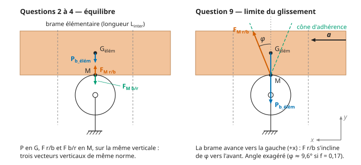
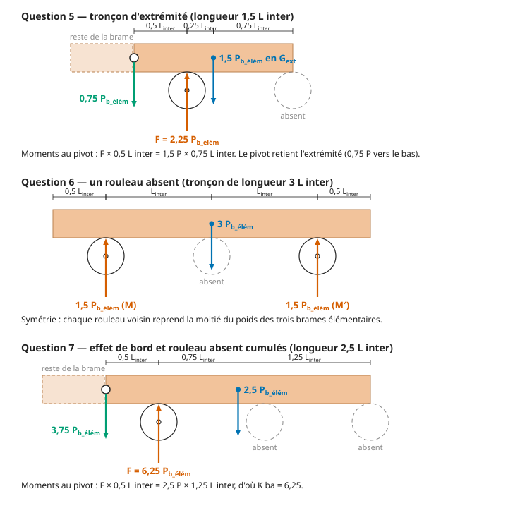
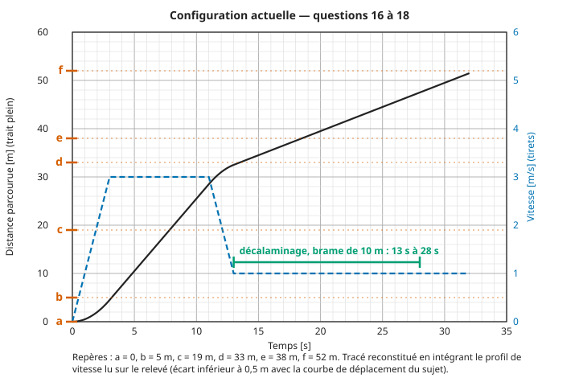
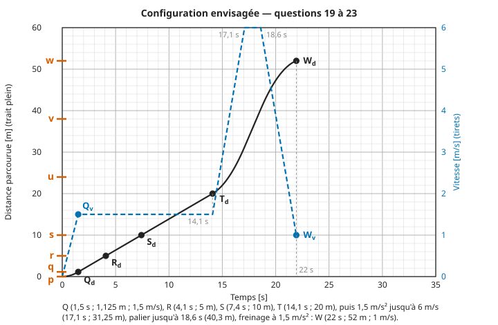
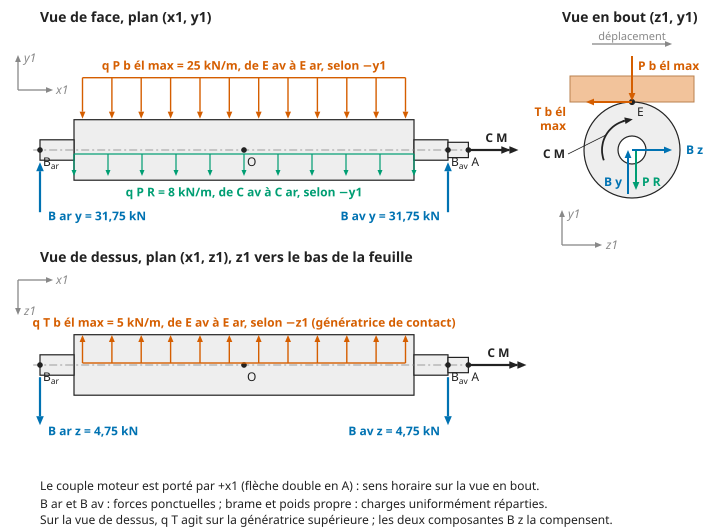
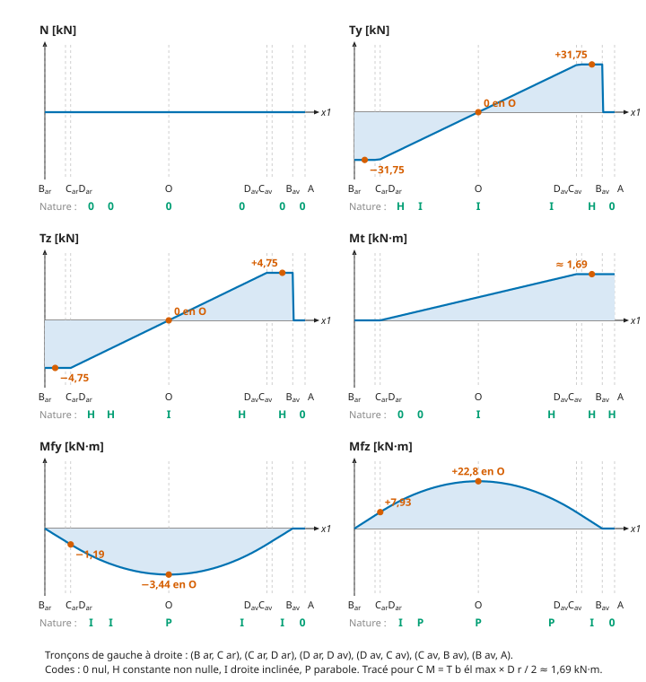
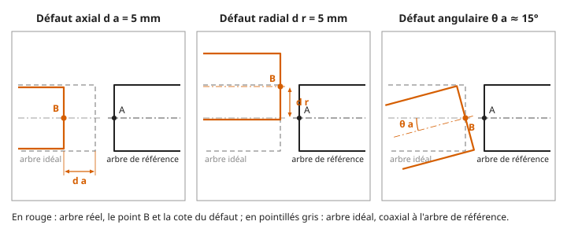

# Banque PT PT — Sciences industrielles B 2025 · Corrigé guidé

*Corrigé rédigé par IA, non officiel. Signalez toute erreur.*

**Rédaction** · modèle exact non renseigné (famille Claude) · effort non renseigné · vitesse non renseignée

## Présentation du sujet

**Support.** Une ligne de laminage à chaud transforme des brames d'acier (jusqu'à $10\ \mathrm{m}\times1{,}9\ \mathrm{m}\times0{,}24\ \mathrm{m}$, soit près de 36 tonnes) en tôle. Entre le four et le premier laminoir (le « réversible »), les brames roulent sur des tables à rouleaux motorisés et passent par un poste de décalaminage. Le bureau d'études propose de rapprocher ce poste du four et de motoriser chaque rouleau individuellement, pour transférer les brames plus vite, donc plus chaudes, et abaisser la consigne du four.

**Durée et format.** 6 heures, calculatrice interdite, réponses à porter dans les cadres d'un cahier réponse de 15 pages. 50 questions, quatre parties indépendantes.

| Partie | Contenu | Questions | Durée conseillée | Poids (rapport du jury) |
|---|---|---|---|---|
| I | Statique d'une brame sur ses rouleaux, adhérence et accélération limite, lois horaires, tracés vitesse et déplacement | 1 à 24 | 1 h 30 à 2 h | 36 % |
| II | Actions sur un rouleau, torseur de cohésion et diagrammes, lecture de simulations, énergie cinétique | 25 à 40 | 1 h 30 à 2 h | 37 % |
| III | Durée de vie de roulements, couple moteur et choix sur catalogue, accouplement | 41 à 46 | 1 h à 1 h 30 | 18 % |
| IV | Bilan qualitatif, économique et écologique | 47 à 50 | 15 à 30 min | 9 % |

L'énoncé conseille 30 minutes de lecture préalable.

**Notions mobilisées.** Principe fondamental de la statique, actions réciproques, lois de Coulomb, théorème de la résultante dynamique, mouvement uniformément accéléré, modélisation des liaisons et des charges réparties, torseur de cohésion, diagrammes de sollicitations, coefficient de sécurité, énergie cinétique d'un solide en rotation ou en translation, durée de vie $L_{10}$, théorème du moment dynamique, choix de composants sur documents constructeurs.

**Documents-réponses.** Plusieurs questions demandent un tracé sur le cahier (questions 2, 5, 6, 9, 16, 18 à 23, 29, 32, 45). Les sept figures de ce corrigé les redessinent ; elles ne reproduisent pas les fonds de l'énoncé.

**Notations abrégées.** $P_e = P_{b,\text{élém}}$ et $L_i = L_{inter}$.

> [!JURY]
> Le rapport 2025 juge le sujet long mais sans difficulté de compréhension, chaque question ayant été réussie intégralement par plusieurs candidats. Il regrette que des connaissances de base ne soient pas maîtrisées, que la fin de la partie III et la partie IV soient souvent délaissées, et que certains détaillent leurs calculs dans les cadres au détriment de la lisibilité. Il demande de respecter les notations de l'énoncé, de distinguer expression littérale et application numérique, de donner les unités et de mener les applications numériques à la main, avec une tolérance de quelques pourcents.

**Sources officielles.** [Sujet](https://www.banquept.fr/documents/2025/si_b_2025_pt.pdf) · [Rapport du jury](https://www.banquept.fr/documents/ecrit/rapport/2025/rapport_si_b_ecrit_2025.pdf)

---

## Partie I — Réduction de la durée du déplacement des brames

### Question 1

> [!INDICATION]
> La brame élémentaire est le tronçon porté par un seul rouleau : quelle est sa longueur ?

> [!INDICATION]
> Masse = masse volumique × volume ; on peut aussi répartir la masse totale sur les $N_r$ rouleaux.

#### Solution

$$\boxed{m_{b,\text{élém}} = \rho_a\, l_b\, e_b\, L_{inter} = \frac{m_b}{N_r}}$$

$$\boxed{P_{b,\text{élém}} = m_{b,\text{élém}}\; g = \rho_a\, l_b\, e_b\, L_{inter}\, g}$$

### Question 2

> [!INDICATION]
> Trois vecteurs verticaux : un poids appliqué au centre de gravité, deux actions de contact appliquées en $M$, de sens opposés.

#### Solution

$G_{\text{élém}}$ est au centre du rectangle de la brame élémentaire, à la verticale de $M$. $\vec P_{b,\text{élém}}$ est vertical descendant en $G_{\text{élém}}$ ; $\vec F_{M\,r/b}$ (rouleau sur brame) est vertical ascendant en $M$ ; $\vec F_{M\,b/r}$ (brame sur rouleau) est vertical descendant en $M$. Les trois ont la même norme.

> [!PIEGE]
> Un effort se dessine sur le solide qui le subit et à son point d'application. $\vec F_{M\,r/b}$ et $\vec F_{M\,b/r}$ ne s'appliquent pas au même solide.

### Question 3

> [!INDICATION]
> La brame est immobile. Quel solide isoler pour faire apparaître à la fois le poids et l'action du rouleau ?

#### Solution

$$\boxed{\vec P_{b,\text{élém}} + \vec F_{M\,r/b} = \vec 0}$$

Système isolé : la brame élémentaire. Théorème : résultante statique (principe fondamental de la statique). Hypothèse : équilibre dans le référentiel du bâti supposé galiléen, sans action des tronçons voisins sur le tronçon isolé (rouleau loin des bords).

> [!JURY]
> Le rapport indique que les trois quarts des candidats réussissent les deux premières questions. Les difficultés commencent avec la justification des relations.

### Question 4

> [!INDICATION]
> Cette relation relie deux actions entre les deux mêmes solides : aucun isolement n'est nécessaire.

#### Solution

$$\boxed{\vec F_{M\,b/r} = -\vec F_{M\,r/b}}$$

Justification : principe des actions réciproques (ou mutuelles). On en déduit $\vec F_{M\,b/r} = \vec P_{b,\text{élém}}$.

> [!JURY]
> D'après le rapport, la moitié seulement des candidats cite ici les actions réciproques (question numérotée 3 dans le rapport) et 40 % invoquent à tort le principe fondamental de la dynamique.

> [!PIEGE]
> Les questions 3 et 4 ne se justifient pas de la même façon : la première est un théorème appliqué à un système isolé, la seconde un principe valable sans isolement, même en mouvement.

### Question 5

> [!INDICATION]
> Mesurer le tronçon sur le schéma : où est le pivot par rapport à $M$ ? Où s'arrête la brame ? En déduire sa longueur en multiples de $L_{inter}$.

> [!INDICATION]
> L'action du pivot est inconnue : écrire le théorème du moment statique au pivot pour l'éliminer.

#### Solution

Le pivot est à mi-distance entre le rouleau étudié et le précédent, à $L_i/2$ de $M$. Le bout de la brame est à l'aplomb du rouleau qu'elle vient de quitter, à $L_i$ de $M$. Longueur du tronçon : $1{,}5\,L_i$ ; $G_{ext}$ est en son milieu, à $0{,}75\,L_i$ du pivot ($0{,}25\,L_i$ après $M$).

$$\boxed{P_{b,extrem} = 1{,}5\; P_{b,\text{élém}}}$$

Efforts : le poids en $G_{ext}$, l'action du rouleau en $M$ (vers le haut), l'action du reste de la brame au pivot (force seule). Moment au pivot :

$$\begin{aligned}
F_{M\_EXTREM\;r/b}\times \frac{L_i}{2} &= 1{,}5\,P_e \times 0{,}75\,L_i\\
F_{M\_EXTREM\;r/b} &= 2{,}25\,P_e
\end{aligned}$$

$$\boxed{F_{M\_EXTREM\;b/r} = \frac{9}{4}\,P_{b,\text{élém}} = 2{,}25\;P_{b,\text{élém}}}$$

Le pivot exerce $0{,}75\,P_e$ vers le bas sur l'extrémité.

> [!PIEGE]
> Écrire que le rouleau porte seulement le poids du tronçon ($1{,}5\,P_e$) revient à oublier l'action du pivot. Le porte-à-faux fait levier : le rouleau porte plus que le poids du tronçon.

> [!JURY]
> Selon le rapport, 10 % seulement des candidats obtiennent l'expression juste : modéliser et résoudre un problème de statique simple reste difficile.

> [!METHODE]
> Pour éliminer une action de liaison inconnue, écrire le moment au centre de cette liaison.

### Question 6

> [!INDICATION]
> Quelle longueur de brame les deux rouleaux voisins portent-ils à eux deux ? Penser à la symétrie.

#### Solution

Le tronçon isolé couvre trois brames élémentaires : poids $3\,P_e$ appliqué à l'aplomb du rouleau absent, deux appuis symétriques en $M$ et $M'$ (figure 2).

$$2\,F = 3\,P_e$$

$$\boxed{F_{M\_ROUL\_ABST\;b/r} = 1{,}5\;P_{b,\text{élém}}}$$

### Question 7

> [!INDICATION]
> Le schéma du cadre réponse combine les deux cas. Refaire le calcul de la question 5 avec la nouvelle longueur de tronçon.

#### Solution

Sur ce schéma, le rouleau qui suit le rouleau de bord est absent : le tronçon articulé va du pivot jusqu'au bout de la brame, $2\,L_i$ après $M$. Longueur $2{,}5\,L_i$, poids $2{,}5\,P_e$ à $1{,}25\,L_i$ du pivot.

$$\begin{aligned}
F\times\frac{L_i}{2} &= 2{,}5\,P_e\times 1{,}25\,L_i\\
F &= 6{,}25\,P_e
\end{aligned}$$

$$\boxed{K_{ba} = 6{,}25 \approx 6}$$

> [!PIEGE]
> Multiplier les deux coefficients précédents ($2{,}25\times1{,}5\approx3{,}4$) sous-estime ce cas : le poids et son bras de levier augmentent ensemble. La question demande de « proposer » une valeur ; ce qui compte est de la justifier par le schéma.

### Question 8

> [!INDICATION]
> Définition de l'angle d'adhérence dans le modèle de Coulomb.

#### Solution

$$\boxed{\tan\varphi = f}$$

> [!JURY]
> Le rapport relève que 24 % des candidats ne donnent pas cette relation.

### Question 9

> [!INDICATION]
> Le cône a pour axe la normale au contact. À la limite du glissement, l'action de contact est sur le cône.

> [!INDICATION]
> De quel côté s'incline l'action du rouleau sur la brame ? C'est elle qui accélère la brame.

#### Solution

Sur la figure 1 (partie droite) : cône de sommet $M$, d'axe vertical, de demi-angle $\varphi$. $\vec F_{M\,r/b}$ est sur la génératrice inclinée vers la gauche ($+\vec x$), sens du déplacement et de l'accélération ; $\vec P_{b,\text{élém}}$ est vertical descendant en $G_{\text{élém}}$ ; $\vec a$ est horizontal vers la gauche.

### Question 10

> [!INDICATION]
> La brame accélère en translation : statique exclue. Deux inconnues, la norme de l'action de contact et l'accélération.

#### Solution

Cases à cocher : **théorème de la résultante dynamique**, en projection **sur $Ox$ et sur $Oy$**.

### Question 11

> [!INDICATION]
> Projeter sur la verticale (accélération nulle) puis sur l'horizontale (accélération $a$).

#### Solution

$$\begin{aligned}
F_{M\,r/b}\cos\varphi - m_{b,\text{élém}}\,g &= 0\\
F_{M\,r/b}\sin\varphi &= m_{b,\text{élém}}\,a
\end{aligned}$$

$$\boxed{\begin{aligned}
(1)\quad F_{M\,r/b} &= \frac{m_{b,\text{élém}}\; g}{\cos\varphi}\\
(2)\quad F_{M\,r/b} &= \frac{m_{b,\text{élém}}\; a}{\sin\varphi}
\end{aligned}}$$

### Question 12

> [!INDICATION]
> Égaler les deux expressions.

#### Solution

$$\boxed{a = g\,\tan\varphi = f\,g}$$

> [!JURY]
> 55 % des candidats obtiennent cette expression d'après le rapport.

### Question 13

> [!INDICATION]
> La masse figure-t-elle dans l'expression de la question 12 ?

#### Solution

Case **« Ce risque est indépendant de la masse de la brame »**.

$$\boxed{a_{adm} = f\,g = 0{,}17\times10 = 1{,}7\ \mathrm{m\cdot s^{-2}}}$$

> [!JURY]
> Le rapport note qu'un candidat sur dix ayant trouvé $a = f\,g$ n'en déduit pas l'indépendance vis-à-vis de la masse.

### Question 14

> [!INDICATION]
> Intégrer deux fois une accélération constante, sans oublier les conditions initiales.

#### Solution

$$\boxed{\begin{aligned}
a &= \text{constante}\\
v &= a\,t + v_0\\
x &= \tfrac12\,a\,t^2 + v_0\,t + x_0
\end{aligned}}$$

> [!JURY]
> 57 % seulement des candidats énoncent clairement ces équations selon le rapport.

### Question 15

> [!INDICATION]
> Éliminer le temps entre $v = a\,t$ et $x = \tfrac12 a\,t^2$.

> [!INDICATION]
> Pour l'application numérique, utiliser la valeur retenue par l'énoncé pour la suite de l'étude : $a_{adm} = 1{,}5\ \mathrm{m\cdot s^{-2}}$.

#### Solution

$$\boxed{x = \frac{v^2}{2a}}$$

$$\boxed{d_{min} = \frac{3^2}{2\times1{,}5} = 3\ \mathrm{m}\qquad t_{min} = \frac{3}{1{,}5} = 2\ \mathrm{s}}$$

> [!PIEGE]
> L'accélération admissible calculée à la question 13 ($1{,}7\ \mathrm{m\cdot s^{-2}}$) n'est pas celle à utiliser ici : la partie C impose $1{,}5\ \mathrm{m\cdot s^{-2}}$.

### Question 16

> [!INDICATION]
> Cumuler les distances de la figure 17 depuis le repère a.

#### Solution

| Repère | a | b | c | d | e | f |
|---|---|---|---|---|---|---|
| Déplacement de l'avant de la brame | $0$ | $5\ \mathrm{m}$ | $19\ \mathrm{m}$ | $33\ \mathrm{m}$ | $38\ \mathrm{m}$ | $52\ \mathrm{m}$ |

Ces repères se placent sur l'axe des distances. Le poste de décalaminage occupe $[d, e]$.

### Question 17

> [!INDICATION]
> Trois lectures sur la courbe de vitesse (les deux paliers, la pente initiale), une sur la courbe de déplacement (instant où elle atteint le repère f).

#### Solution

La vitesse monte de $0$ à $3\ \mathrm{m\cdot s^{-1}}$ en $3\ \mathrm{s}$, tient le palier à $3\ \mathrm{m\cdot s^{-1}}$, puis descend à $1\ \mathrm{m\cdot s^{-1}}$ pour le décalaminage. Le déplacement atteint $52\ \mathrm{m}$ à $32\ \mathrm{s}$.

$$\boxed{\begin{aligned}
v_{max\_act} &= 3\ \mathrm{m\cdot s^{-1}}\\
v_{\text{décal}\_act} &= 1\ \mathrm{m\cdot s^{-1}}\\
a_{a-b\_act} &= 1\ \mathrm{m\cdot s^{-2}}\\
T_{a-f} &= 32\ \mathrm{s}
\end{aligned}}$$

> [!JURY]
> 52 % des candidats interprètent correctement ces courbes d'après le rapport.

### Question 18

> [!INDICATION]
> Le décalaminage commence quand l'avant entre dans le poste et finit quand l'arrière en sort : de combien l'avant a-t-il avancé entre les deux ?

#### Solution

Début : avant de la brame en d ($33\ \mathrm{m}$), à $t\approx13\ \mathrm{s}$. Fin : arrière en e, donc avant à $38 + 10 = 48\ \mathrm{m}$, à $t\approx28\ \mathrm{s}$. Le symbole se place sur le palier à $1\ \mathrm{m\cdot s^{-1}}$ **de 13 s à 28 s** (figure 3), soit $15\ \mathrm{s}$ : longueur du poste plus longueur de la brame, parcourues à $1\ \mathrm{m\cdot s^{-1}}$.

> [!PIEGE]
> Ne pas arrêter le symbole au passage de l'avant en e : la brame mesure $10\ \mathrm{m}$ et son arrière est encore sous les jets.

### Question 19

> [!INDICATION]
> L'accélération est celle relevée à la question 17 ; la vitesse est plafonnée par le décalaminage.

#### Solution

Droite de $(0 ; 0)$ à $(1{,}5\ \mathrm{s} ; 1{,}5\ \mathrm{m\cdot s^{-1}})$, puis palier à $1{,}5\ \mathrm{m\cdot s^{-1}}$ jusqu'à $5\ \mathrm{s}$ ; $Q_v$ est à la cassure.

$$\boxed{v_q = 1{,}5\ \mathrm{m\cdot s^{-1}}\qquad T_{p-q} = 1{,}5\ \mathrm{s}}$$

### Question 20

> [!INDICATION]
> $x = \tfrac12 a\,t^2$ ; l'annexe D donne $0{,}5\,x^2$ sans calcul.

#### Solution

$$\boxed{x_q = 0{,}5\times1\times1{,}5^2 = 1{,}125\ \mathrm{m}\approx1{,}1\ \mathrm{m}}$$

$Q_d\,(1{,}5\ \mathrm{s} ; 1{,}125\ \mathrm{m})$ ; le repère q est à $1{,}1\ \mathrm{m}$ sur l'axe des distances. Ensuite, le déplacement est une droite de pente $1{,}5\ \mathrm{m\cdot s^{-1}}$ ($7{,}5\ \mathrm{m}$ toutes les $5\ \mathrm{s}$), tangente à la parabole en $Q_d$.

> [!METHODE]
> Sur un double graphique, la pente de la courbe de déplacement se lit sur la courbe de vitesse au même instant : un palier de vitesse donne un segment de droite, une rampe de vitesse donne un arc de parabole, et les raccords se font sans cassure.

### Question 21

> [!INDICATION]
> Trois déplacements de l'avant : entrée du poste, sortie du poste, sortie du poste augmentée de la longueur de la brame.

#### Solution

Sur la droite, $t = 1{,}5 + (x - 1{,}125)/1{,}5$. Le poste occupe $[r, s]$ : $5\ \mathrm{m}$ à $10\ \mathrm{m}$.

| Point | Déplacement | Instant |
|---|---|---|
| $R_d$ (avant en r) | $5\ \mathrm{m}$ | $\approx4{,}1\ \mathrm{s}$ |
| $S_d$ (avant en s) | $10\ \mathrm{m}$ | $\approx7{,}4\ \mathrm{s}$ |
| $T_d$ (arrière d'une brame de $10\ \mathrm{m}$ en s) | $20\ \mathrm{m}$ | $\approx14{,}1\ \mathrm{s}$ |

### Question 22

> [!INDICATION]
> Durée pour passer de $1{,}5$ à $6\ \mathrm{m\cdot s^{-1}}$ à $1{,}5\ \mathrm{m\cdot s^{-2}}$ ?

#### Solution

$$\begin{aligned}
\Delta t &= \frac{6-1{,}5}{1{,}5} = 3\ \mathrm{s}\\
\Delta x &= \frac{6^2-1{,}5^2}{2\times1{,}5} = 11{,}25\ \mathrm{m}
\end{aligned}$$

Vitesse : droite de $(14{,}1\ \mathrm{s} ; 1{,}5)$ à $(17{,}1\ \mathrm{s} ; 6\ \mathrm{m\cdot s^{-1}})$. L'avant est alors à $31{,}25\ \mathrm{m}$.

### Question 23

> [!INDICATION]
> Partir de la fin : le point d'arrivée est imposé, la décélération aussi. En déduire où et quand commence le freinage.

#### Solution

$W_d\,(22\ \mathrm{s} ; 52\ \mathrm{m})$ et $W_v\,(22\ \mathrm{s} ; 1\ \mathrm{m\cdot s^{-1}})$. Freinage de $6$ à $1\ \mathrm{m\cdot s^{-1}}$ :

$$\begin{aligned}
\Delta t &= \frac{6-1}{1{,}5}\approx3{,}3\ \mathrm{s}\\
\Delta x &= \frac{6^2-1^2}{2\times1{,}5}\approx11{,}7\ \mathrm{m}
\end{aligned}$$

Le freinage commence à $40{,}3\ \mathrm{m}$. Palier à $6\ \mathrm{m\cdot s^{-1}}$ de $17{,}1$ à $18{,}6\ \mathrm{s}$ ($9{,}1\ \mathrm{m}$ en $1{,}5\ \mathrm{s}$). Arrivée à $18{,}6 + 3{,}3\approx21{,}9\ \mathrm{s}$, cohérent avec les $22\ \mathrm{s}$ annoncés. Déplacement : parabole convexe, segment de pente $6\ \mathrm{m\cdot s^{-1}}$, parabole concave arrivant en $W_d$ avec une pente de $1\ \mathrm{m\cdot s^{-1}}$ (figure 4).

> [!JURY]
> Le rapport indique que 20 % des candidats tracent l'évolution complète et que 44 % n'y parviennent pas du tout.

### Question 24

> [!INDICATION]
> Deux durées déjà connues : l'une lue à la question 17, l'autre donnée avant la question 23.

#### Solution

$$\boxed{\text{Gain} = T_{a-f} - T_{p-w} = 32 - 22 = 10\ \mathrm{s}}$$

> [!JURY]
> Cette soustraction de deux valeurs fournies n'est réussie que par 52 % des candidats selon le rapport : une question à ne pas abandonner même si les tracés précédents n'ont pas abouti.

---

## Partie II — Étude des nouveaux rouleaux

### Question 25

> [!INDICATION]
> Volume d'un cylindre plein de diamètre $D_r$ et de longueur $L_r$.

#### Solution

$$\boxed{P_R = \rho_a\,\frac{\pi D_r^2}{4}\,L_r\,g}$$

$\rho_a$ en $\mathrm{kg\cdot m^{-3}}$, $D_r$ et $L_r$ en $\mathrm{m}$, $g$ en $\mathrm{m\cdot s^{-2}}$, $P_R$ en $\mathrm{N}$. Contrôle : environ $15{,}5\ \mathrm{kN}$, proche des $16\ \mathrm{kN}$ de l'énoncé.

> [!JURY]
> 30 % des candidats répondent faux ou ne répondent pas à cette question, d'après le rapport.

> [!PIEGE]
> L'unité de chaque paramètre est demandée : les millimètres de l'énoncé doivent être convertis en mètres pour obtenir des newtons.

### Question 26

> [!INDICATION]
> Le rouleau est-il en mouvement accéléré dans cette sous-partie ? Combien d'inconnues de liaison dans le plan ?

#### Solution

Théorèmes : résultante statique et moment statique (en $B_{av}$ ou $B_{ar}$). Système isolé : le rouleau. Hypothèses supplémentaires : équilibre (rouleau immobile ou en rotation uniforme, sans couple moteur ni effort tangentiel), problème plan dans $(\vec x_1,\vec y_1)$ avec des charges symétriques par rapport au plan médian, aucune charge axiale.

### Question 27

> [!INDICATION]
> Situer $O$ par rapport aux deux roulements à l'aide des cotes de la figure 10.

#### Solution

$O$ est au milieu de $[B_{ar}, B_{av}]$ ($1200\ \mathrm{mm}$ de chaque côté) et les deux charges ($47{,}5\ \mathrm{kN}$ et $16\ \mathrm{kN}$) y sont centrées.

$$Y_{B_{av}} = Y_{B_{ar}} = \frac{47{,}5 + 16}{2} = 31{,}75\ \mathrm{kN}$$

$$\boxed{\vec R_{B_{av}} = \vec R_{B_{ar}} = \begin{pmatrix}0\\ 31\,750\\ 0\end{pmatrix}\mathrm{N}\qquad \vec M_{B_{av}} = \vec M_{B_{ar}} = \begin{pmatrix}0\\0\\0\end{pmatrix}\mathrm{N\cdot m}}$$

> [!PIEGE]
> Une rotule et une linéaire annulaire ne transmettent aucun moment en leur centre : les deux cadres « moment » se remplissent avec des zéros, il ne faut pas les laisser vides.

### Question 28

> [!INDICATION]
> Le centre de gravité du rouleau est sur son axe fixe : que vaut la résultante des actions extérieures, même en phase d'accélération ?

> [!INDICATION]
> Sens de l'effort tangentiel : le rouleau pousse la brame vers $+\vec z_1$ ; que reçoit-il en retour ?

#### Solution

| Action | Type | Sens | Point ou segment | Valeur | Unité |
|---|---|---|---|---|---|
| $\vec C_{mot}$ | couple ponctuel | $\vec x_1$ | $A$ | $800$ (prérempli) | $\mathrm{N\cdot m}$ |
| $\vec B_{av}$ | force ponctuelle | $\vec y_1$ et $\vec z_1$ | $B_{av}$ | $B_{av\,x_1} = 0$ ; $B_{av\,y_1} = 31{,}75$ ; $B_{av\,z_1} = 4{,}75$ | $\mathrm{kN}$ |
| $\vec B_{ar}$ | force ponctuelle | $\vec y_1$ et $\vec z_1$ | $B_{ar}$ | $B_{ar\,y_1} = 31{,}75$ ; $B_{ar\,z_1} = 4{,}75$ | $\mathrm{kN}$ |
| $\vec P_{b\,\text{él}\,max}$ | charge uniformément répartie | $-\vec y_1$ | de $E_{av}$ à $E_{ar}$ | $q_{P_{b\,\text{él}\,max}} = 47{,}5/1{,}9 = 25$ | $\mathrm{kN\cdot m^{-1}}$ |
| $\vec T_{b\,\text{él}\,max}$ | charge uniformément répartie | $-\vec z_1$ | de $E_{av}$ à $E_{ar}$ | $q_{T_{b\,\text{él}\,max}} = 9{,}5/1{,}9 = 5$ | $\mathrm{kN\cdot m^{-1}}$ |
| $\vec P_R$ | charge uniformément répartie | $-\vec y_1$ | de $C_{av}$ à $C_{ar}$ | $q_{P_R} = 16/2 = 8$ | $\mathrm{kN\cdot m^{-1}}$ |

Les composantes selon $\vec z_1$ des roulements équilibrent l'effort tangentiel : $9{,}5/2 = 4{,}75\ \mathrm{kN}$ chacune, par symétrie. La valeur préremplie $C_{mot} = 800\ \mathrm{N\cdot m}$ diffère du couple maximal de la question 30 ; elle n'intervient pas dans ces efforts, l'accouplement transmettant un couple pur.

> [!PIEGE]
> La charge de la brame se répartit sur $1{,}9\ \mathrm{m}$ (de $E_{av}$ à $E_{ar}$), le poids propre sur $2\ \mathrm{m}$ (de $C_{av}$ à $C_{ar}$) : deux longueurs différentes pour les charges linéiques.

### Question 29

> [!INDICATION]
> Respecter la figure 11 : flèches réparties pour les charges linéiques, flèche double pour un couple vu de profil, flèche courbe pour un couple vu de face.

#### Solution

- Vue de face $(\vec x_1,\vec y_1)$ : charges réparties descendantes de la brame ($E_{ar}$ à $E_{av}$) et du poids propre ($C_{ar}$ à $C_{av}$), forces ascendantes en $B_{ar}$ et $B_{av}$, flèche double selon $+\vec x_1$ en $A$.
- Vue de dessus $(\vec x_1,\vec z_1)$ : charge répartie tangentielle selon $-\vec z_1$ de $E_{ar}$ à $E_{av}$, forces selon $+\vec z_1$ en $B_{ar}$ et $B_{av}$, flèche double en $A$.
- Vue en bout $(\vec z_1,\vec y_1)$ : en $E$, effort normal vers le bas et effort tangentiel vers $-\vec z_1$ ; en $O$, poids et actions des roulements ; couple en flèche courbe, dans le sens horaire.

> [!JURY]
> Le rapport signale que la représentation des forces et des moments sur les trois vues met en difficulté de très nombreux candidats.

### Question 30

> [!INDICATION]
> Moment de l'effort tangentiel par rapport à l'axe du rouleau.

#### Solution

$$\boxed{C_{M\,max} = T_{b\,\text{él}\,max}\times\frac{D_r}{2}}$$

$T_{b\,\text{él}\,max}$ en $\mathrm{N}$, $D_r$ en $\mathrm{m}$, $C_{M\,max}$ en $\mathrm{N\cdot m}$ (ordre de grandeur : $1690\ \mathrm{N\cdot m}$). L'inertie du rouleau est négligée ici ; elle apparaît à la question 43.

### Question 31

> [!INDICATION]
> Couper en $X_G$ et isoler la partie gauche : elle ne voit que le roulement arrière et les charges réparties déjà rencontrées. Attention au signe : le torseur demandé est l'action de la droite sur la gauche.

> [!INDICATION]
> Une charge linéique $q$ appliquée de $s_0$ à $x$ a pour résultante $q\,(x - s_0)$ et pour moment en $X_G$ un terme en $q\,(x - s_0)^2/2$. L'effort tangentiel, appliqué au rayon $D_r/2$, crée aussi un moment de torsion.

#### Solution

L'équilibre de la partie gauche donne $\{\tau_{coh\,2/1}\} = -\{\text{actions extérieures sur la partie gauche}\}$, avec $x$ l'abscisse depuis $B_{ar}$ (l'énoncé écrit « z » pour cette variable).

$$\boxed{\begin{aligned}
N &= 0\\
T_{y_1} &= -B_{ar\,y} + q_{P_R}\,(x - B_{ar}C_{ar}) + q_{P_{b\,\text{él}\,max}}\,(x - B_{ar}D_{ar})\\
T_{z_1} &= -B_{ar\,z} + q_{T_{b\,\text{él}\,max}}\,(x - B_{ar}D_{ar})\\
M_t &= q_{T_{b\,\text{él}\,max}}\,\frac{D_r}{2}\,(x - B_{ar}D_{ar})\\
M_{fy_1} &= -B_{ar\,z}\,x + q_{T_{b\,\text{él}\,max}}\,\frac{(x - B_{ar}D_{ar})^2}{2}\\
M_{fz_1} &= B_{ar\,y}\,x - q_{P_R}\,\frac{(x - B_{ar}C_{ar})^2}{2} - q_{P_{b\,\text{él}\,max}}\,\frac{(x - B_{ar}D_{ar})^2}{2}
\end{aligned}}$$

avec $B_{ar}C_{ar} = 0{,}2\ \mathrm{m}$ et $B_{ar}D_{ar} = 0{,}25\ \mathrm{m}$. Par la partie droite, à l'équilibre en rotation : $M_t = C_{moteur} - q_{T_{b\,\text{él}\,max}}\,\dfrac{D_r}{2}\,(B_{ar}D_{av} - x)$.

> [!METHODE]
> Contrôler un torseur de cohésion par les relations différentielles : ici $\dfrac{dM_{fz_1}}{dx} = -T_{y_1}$ et $\dfrac{dM_{fy_1}}{dx} = T_{z_1}$, et par la symétrie ($T_{y_1} = T_{z_1} = 0$ en $O$).

> [!PIEGE]
> Le signe dépend de la convention : l'énoncé impose l'action de la partie droite sur la partie gauche. En isolant la partie gauche, il faut changer le signe des actions extérieures.

### Question 32

> [!INDICATION]
> Raisonner tronçon par tronçon : sans charge répartie, l'effort tranchant est constant et le moment fléchissant linéaire ; avec une charge uniforme, l'effort tranchant est linéaire et le moment parabolique.

> [!INDICATION]
> Au-delà de $B_{av}$, il ne reste à droite que le couple moteur.

#### Solution

| Tronçon | $N$ | $T_y$ | $T_z$ | $M_t$ | $M_{fy}$ | $M_{fz}$ |
|---|---|---|---|---|---|---|
| $(B_{ar}, C_{ar})$ | 0 | H | H | 0 | I | I |
| $(C_{ar}, D_{ar})$ | 0 | I | H | 0 | I | P |
| $(D_{ar}, D_{av})$ | 0 | I | I | I | P | P |
| $(D_{av}, C_{av})$ | 0 | I | H | H | I | P |
| $(C_{av}, B_{av})$ | 0 | H | H | H | I | I |
| $(B_{av}, A)$ | 0 | 0 | 0 | H | 0 | 0 |

Valeurs extrêmes : $T_y = \mp31{,}75\ \mathrm{kN}$ aux roulements, nul en $O$ ; $T_z = \mp4{,}75\ \mathrm{kN}$, nul en $O$ ; $M_t\approx1{,}69\ \mathrm{kN\cdot m}$ de $D_{av}$ à $A$ ; $M_{fy}\approx-3{,}44\ \mathrm{kN\cdot m}$ en $O$ ; $M_{fz}\approx22{,}8\ \mathrm{kN\cdot m}$ en $O$ ($6{,}35\ \mathrm{kN\cdot m}$ en $C_{ar}$, $7{,}93\ \mathrm{kN\cdot m}$ en $D_{ar}$).

> [!JURY]
> Le rapport juge cette sous-partie un peu longue, mais plus des trois quarts des candidats y prennent des points : seules l'allure et les proportions sont évaluées, il ne faut pas la sauter.

### Question 33

> [!INDICATION]
> Lire le tableau de la question 32 ligne par ligne : chaque composante non nulle correspond à une sollicitation.

#### Solution

| Tronçon | Traction compression | Cisaillement | Flexion | Torsion | Contraintes normales longitudinales | Contraintes tangentielles transversales |
|---|---|---|---|---|---|---|
| $(B_{ar}, C_{ar})$ | | X | X | | X | X |
| $(C_{ar}, D_{ar})$ | | X | X | | X | X |
| $(D_{ar}, D_{av})$ | | X | X | X | X | X |
| $(D_{av}, C_{av})$ | | X | X | X | X | X |
| $(C_{av}, B_{av})$ | | X | X | X | X | X |
| $(B_{av}, A)$ | | | | X | | X |

La flexion donne des contraintes normales ; l'effort tranchant et la torsion donnent des contraintes tangentielles.

### Question 34

> [!INDICATION]
> Le coefficient de sécurité compare la limite d'élasticité à la contrainte équivalente maximale lue sur la simulation.

#### Solution

$$\boxed{S_{RP} = \frac{R_e}{\sigma_{VM\,max}} = \frac{360}{87{,}5}\approx4{,}1}$$

Dans la partie centrale, les contraintes vont de $1{,}6$ à $3{,}6\ \mathrm{MPa}$ (figure 13) : environ cent fois moins que $R_e$. Le cylindre plein est très surdimensionné ; le maximum est sur un bout d'arbre.

> [!PIEGE]
> Utiliser $R_e$ et non $R_m$ : on dimensionne pour rester dans le domaine élastique.

### Question 35

> [!INDICATION]
> Même démarche avec la figure 15 ; comparer ensuite les niveaux de contrainte de la partie centrale aux précédents.

#### Solution

$$\boxed{S_{RC} = \frac{360}{82{,}5}\approx4{,}4}$$

Dans la partie centrale, les contraintes augmentent ($4{,}4$ à $18\ \mathrm{MPa}$) mais restent au moins vingt fois inférieures à $R_e$. Le tube suffit ; la zone dimensionnante reste le bout d'arbre et la sécurité globale n'est pas dégradée.

### Question 36

> [!INDICATION]
> Solide en rotation autour d'un axe fixe ; relier la vitesse angulaire à la vitesse périphérique.

#### Solution

$$\boxed{E_R = \frac12\,J_R\left(\frac{2\,v_R}{D_r}\right)^2 = \frac{2\,J_R\,v_R^2}{D_r^2}}$$

$$\boxed{E_{R1} = \frac{2\,J_R\,v_{R1}^2}{D_r^2}\qquad E_{R2} = \frac{2\,J_R\,v_{R2}^2}{D_r^2}}$$

> [!JURY]
> 42 % de réponses justes à cette question selon le rapport.

> [!PIEGE]
> Le rayon est $D_r/2$ : l'oubli du facteur 2 donne une énergie quatre fois trop faible.

### Question 37

> [!INDICATION]
> Additionner les énergies des 33 rouleaux amont et des 55 rouleaux aval, puis factoriser.

#### Solution

$$\boxed{E_{GR} = \frac{2\,J_R}{D_r^2}\left(Nb_1\,v_{R1}^2 + Nb_2\,v_{R2}^2\right)}$$

$$\begin{aligned}
Nb_1\,v_{R1}^2 + Nb_2\,v_{R2}^2 &= 33\times2{,}25 + 55\times36 = 2054\ \mathrm{m^2\cdot s^{-2}}\\
\frac{2}{D_r^2} &\approx 15{,}8\ \mathrm{m^{-2}}
\end{aligned}$$

$$\boxed{E_{GRP}\approx810\ \mathrm{kJ}\qquad E_{GRC}\approx178\ \mathrm{kJ}}$$

> [!METHODE]
> Sans calculatrice, calculer une seule fois le facteur commun ($\approx3{,}24\times10^4\ \mathrm{s^{-2}}$), puis multiplier par chaque moment d'inertie. Les rouleaux amont ne comptent que pour 4 % du total.

### Question 38

> [!INDICATION]
> Solide en translation : $\tfrac12 m v^2$, avec la masse de la plus grande brame.

#### Solution

$$\boxed{E_B = \frac12\,\rho_a\,L_{b\,max}\,l_{b\,max}\,e_{b\,max}\,V_{R2}^2}$$

$$\boxed{E_B = 0{,}5\times35\,568\times36\approx640\ \mathrm{kJ}}$$

### Question 39

> [!INDICATION]
> Les rouleaux sont arrêtés entre deux brames : toute leur énergie cinétique est à fournir à chaque passage.

#### Solution

$$\boxed{E_{T\,RP} = E_{GRP} + E_B\qquad E_{T\,RC} = E_{GRC} + E_B}$$

soit environ $1450\ \mathrm{kJ}$ et $818\ \mathrm{kJ}$.

> [!JURY]
> 66 % de réponses justes d'après le rapport.

### Question 40

> [!INDICATION]
> Gain relatif : écart rapporté à la situation de référence, celle des rouleaux pleins. $E_B$ disparaît du numérateur.

#### Solution

$$\boxed{G_\% = 100\times\frac{E_{GRP} - E_{GRC}}{E_{GRP} + E_B}}$$

$$\boxed{G_\% = 100\times\frac{632}{1450}\approx44\ \%}$$

Conclusion : près de la moitié de l'énergie de mise en mouvement est économisée à chaque transfert, sans perte de sécurité (question 35). La modification est pertinente.

> [!PIEGE]
> Le dénominateur est l'énergie totale avec rouleaux pleins, brame comprise. Rapporter le gain aux seuls rouleaux donnerait 78 %, ce qui surestime le bénéfice.

---

## Partie III — Choix de composants

### Question 41

> [!INDICATION]
> Un tour de rouleau fait avancer la brame d'un périmètre $\pi D_R$.

> [!INDICATION]
> Le rouleau n'est chargé que pendant le passage d'une brame de longueur $L_b$ ; combien de brames par jour ?

#### Solution

$$\boxed{N_R = \frac{60\,v_{R2}}{\pi\,D_R} = \frac{360}{1{,}118}\approx320\ \mathrm{min^{-1}}}$$

$$\boxed{Nb_{t/B} = \frac{L_b}{\pi\,D_R}\approx9\ \text{tours}}$$

$$\boxed{Nb_{t/J} = \frac{L_b}{\pi\,D_R}\times\frac{24\times60}{\Delta T}\approx8{,}94\times206\approx1840\ \text{tours par jour}}$$

> [!PIEGE]
> Le nombre de tours par brame ne dépend pas de la vitesse : c'est une longueur divisée par un périmètre. Inutile de passer par une durée de passage.

### Question 42

> [!INDICATION]
> Roulement à rouleaux : exposant $10/3$. La charge à utiliser est la charge corrigée $f_L\,F_R$.

> [!INDICATION]
> L'annexe D donne $x^{10/3}$ pour $x = 9$ et $x = 10$.

#### Solution

$$\boxed{L_{10\,C} = \left(\frac{C}{f_L\,F_R}\right)^{10/3} = \left(\frac{743}{78}\right)^{10/3}\approx1{,}8\times10^3\ \text{millions de tours}}$$

(le rapport $743/78$ vaut environ $9{,}5$, entre $1516$ et $2154$ dans l'annexe D).

$$\boxed{Nb_{JR} = \frac{L_{10\,C}\times10^6}{Nb_{t/J}}\approx10^6\ \text{jours}\qquad D_{VR}\approx2700\ \text{ans}}$$

Conclusion : la durée de vie calculée dépasse de très loin les 2 mois à 3 ans conseillés. Le roulement convient ; il est surdimensionné en fatigue parce que son alésage est imposé par l'arbre. Sa durée de vie réelle dépendra de la lubrification, de la pollution et de la température.

> [!JURY]
> 20 % seulement des candidats produisent des résultats acceptables pour la durée de vie, selon le rapport. Le jury demande aussi de s'interroger sur la plausibilité d'un résultat : ici, le nombre obtenu est surprenant mais s'explique, et il faut le dire.

> [!PIEGE]
> $L_{10}$ s'exprime en millions de tours : ne pas oublier le facteur $10^6$ en passant aux jours. L'exposant 3 est celui des roulements à billes.

### Question 43

> [!INDICATION]
> Quelles actions ont un moment non nul par rapport à l'axe du rouleau ?

> [!INDICATION]
> Roulement sans glissement en $E$ : relier l'accélération angulaire du rouleau à l'accélération de la brame.

#### Solution

L'axe de rotation est noté $z$ par l'énoncé dans cette partie. Le poids, les actions des roulements et l'effort normal en $E$ passent par l'axe.

$$\boxed{J_{RC}\,\dot\omega = C_M - T_{b\,\text{él}\,max}\,\frac{D_r}{2}}$$

Avec $\dot\omega = 2\,a_{B\,max}/D_r$ :

$$\boxed{C_{M\,max} = T_{b\,\text{él}\,max}\,\frac{D_r}{2} + \frac{2\,J_{RC}\,a_{B\,max}}{D_r}}$$

$$\boxed{C_{M\,max} = 1691 + 46\approx1740\ \mathrm{N\cdot m}}$$

> [!JURY]
> Le rapport associe à cette étape un taux de réussite de 15 % pour le calcul du couple maximal nécessaire.

> [!METHODE]
> Comparer les deux termes avant de conclure : l'inertie du rouleau creux ne pèse que 3 % du couple. Le moteur sert presque entièrement à accélérer la brame.

### Question 44

> [!INDICATION]
> Appliquer la marge, puis comparer au couple maximal $T_{max}$ du catalogue, non au couple nominal.

#### Solution

$$\boxed{C_{M\,max\,\text{réel}} = 1{,}2\times1737\approx2085\ \mathrm{N\cdot m}}$$

Le M3RP280 MB ($T_{max} = 1920\ \mathrm{N\cdot m}$) est insuffisant ; le suivant convient.

$$\boxed{\text{M3RP280 MC}\quad(18{,}5\ \mathrm{kW},\ T_{max} = 2490\ \mathrm{N\cdot m},\ N = 340\ \mathrm{min^{-1}})}$$

Sa vitesse couvre les $320\ \mathrm{min^{-1}}$ nécessaires. Le couple calculé n'est demandé que pendant les quelques secondes d'accélération, ce qui justifie le critère sur $T_{max}$.

### Question 45

> [!INDICATION]
> Trois mouvements élémentaires de l'arbre réel par rapport à sa position idéale : glisser le long de l'axe, se décaler perpendiculairement, pivoter.

#### Solution

- Défaut axial : arbre réel coaxial mais décalé de $d_a$ le long de l'axe ; cote parallèle à l'axe entre les deux positions de $B$.
- Défaut radial : axes parallèles distants de $d_r$ ; cote perpendiculaire à l'axe.
- Défaut angulaire : axes concourants formant l'angle $\theta_a$ ; cote angulaire entre les deux axes.

> [!JURY]
> Le rapport note que 25 % des candidats identifient clairement les trois défauts et que 37 % inversent radial et axial.

> [!PIEGE]
> « Axial » signifie le long de l'axe, « radial » le long d'un rayon, donc perpendiculairement à l'axe.

### Question 46

> [!INDICATION]
> Passer en revue tous les critères du catalogue : couple, alésage, trois désalignements, vitesse. Lequel élimine le plus de tailles ?

#### Solution

| Critère | Exigence | Première taille qui convient |
|---|---|---|
| Couple nominal | $T_{KN}\geq1700\ \mathrm{N\cdot m}$ | 0015 |
| Alésage | $90\ \mathrm{mm}$ entre mini et maxi | 0025 ($32$ à $98\ \mathrm{mm}$) |
| Désalignement radial | au moins $1\ \mathrm{mm}$ | 0020 |
| Désalignements axial et angulaire, vitesse | $0{,}5\ \mathrm{mm}$, $0{,}5°$, $320\ \mathrm{min^{-1}}$ | toutes |

$$\boxed{\text{RDZ 0025 DTO}}$$

Le diamètre des arbres est le critère dimensionnant : la taille 0025 est la plus petite acceptant un alésage de $90\ \mathrm{mm}$, et elle satisfait tous les autres critères ($10\,000\ \mathrm{N\cdot m}$, $\pm0{,}5\ \mathrm{mm}$, $1{,}2\ \mathrm{mm}$, $1{,}5°$).

> [!METHODE]
> Sur un catalogue, chercher pour chaque critère la plus petite taille admissible, puis retenir la plus grande de ces tailles.

---

## Partie IV — Bilan de l'étude

### Question 47

> [!INDICATION]
> Pour chaque modification, se demander quel objectif de la problématique initiale elle sert en premier.

#### Solution

| Modification | Réduction des émissions de $\mathrm{CO_2}$ | Facilitation de la maintenance | Temps d'arrêt de la ligne |
|---|---|---|---|
| Diminution du temps de transfert de la brame | X | | |
| Changement d'architecture de la motorisation | | X | X |
| Remplacement des rouleaux pleins par des rouleaux creux | X | X | |

Transfert plus court : consigne du four abaissée. Motorisation individuelle : remplacement d'un seul rouleau motorisé, ligne maintenue en marche avec un rouleau absent. Rouleaux creux : moins d'énergie à chaque démarrage et, en second lieu, manutention facilitée.

### Question 48

> [!INDICATION]
> Convertir le gain de temps en écart de température, puis lire l'annexe G.

#### Solution

$$\boxed{T_{consigne} = 1300 - 10\times0{,}5 = 1295\ \mathrm{°C}}$$

$$\boxed{\text{réduction de consommation spécifique} = 1{,}27\ \%}$$

> [!JURY]
> 25 % des candidats obtiennent les points de cette question d'après le rapport, alors qu'elle ne demande qu'une multiplication et une lecture de tableau.

### Question 49

> [!INDICATION]
> Remplir le tableau ligne après ligne : chaque valeur se déduit des précédentes par une multiplication. Surveiller la conversion des kilogrammes en tonnes.

#### Solution

| Libellé | Calcul | Valeur | Unité |
|---|---|---|---|
| Production annuelle d'acier | $250\times20\times300$ | $1\,500\,000$ | t/an |
| Consommation annuelle de gaz naturel | $1{,}2\times1\,500\,000$ | $1\,800\,000$ | GJ/an |
| Tonnage de $\mathrm{CO_2}$ rejeté annuellement | $60\times1\,800\,000\ \mathrm{kg}$ | $108\,000$ | t/an |
| Coût annuel du gaz naturel consommé | $15\times1\,800\,000$ | $27\,000\,000$ | €/an |
| Montant annuel de la taxe sur les rejets de $\mathrm{CO_2}$ | $80\times108\,000$ | $8\,640\,000$ | €/an |
| Coût annuel cumulé | somme | $35\,640\,000$ | €/an |
| Pourcentage de réduction envisagé | question 48 | $1{,}27$ | % |
| Gain annuel envisagé (coût) | $0{,}0127\times35\,640\,000$ | $\approx453\,000$ | €/an |
| Gain annuel envisagé ($\mathrm{CO_2}$) | $0{,}0127\times108\,000$ | $\approx1370$ | t/an |

> [!JURY]
> 30 % des candidats prennent des points ici selon le rapport, qui rappelle que la partie IV ne présente aucune difficulté scientifique et qu'elle est trop souvent abandonnée.

### Question 50

> [!INDICATION]
> Donner un ordre de grandeur, le comparer à ce qu'il coûte, puis nuancer par les hypothèses.

#### Solution

Le gain relatif est faible ($1{,}27\ \%$) mais porte sur des volumes considérables : environ $450\ \mathrm{k€}$ et $1400\ \mathrm{t}$ de $\mathrm{CO_2}$ par an, de façon récurrente, en accord avec les objectifs de décarbonation, de qualité et de maintenabilité. Il faut le rapporter au coût de l'investissement (88 moteurs et accouplements, rouleaux neufs, déplacement du poste de décalaminage, arrêt pendant les travaux).

Réserves : refroidissement supposé linéaire, production maximale 20 h sur 24 et 300 jours par an, accélération de $1{,}5\ \mathrm{m\cdot s^{-2}}$ toujours disponible. L'énergie économisée par les rouleaux creux ($0{,}63\ \mathrm{MJ}$ par brame) est négligeable devant l'énergie de chauffe d'une brame ($1{,}2\ \mathrm{GJ\cdot t^{-1}}\times35{,}6\ \mathrm{t}\approx43\ \mathrm{GJ}$) : le bénéfice énergétique vient presque entièrement du gain de temps de transfert.

---

## Bilan

**Méthodes à retenir.**

- Statique : choisir le système isolé, faire le bilan des actions, écrire le moment au point qui élimine l'inconnue inutile ; exploiter les symétries.
- Adhérence : $\tan\varphi = f$, action de contact sur le cône à la limite du glissement, résultante dynamique projetée sur deux axes ; l'accélération limite $f\,g$ ne dépend pas de la masse.
- Cinématique : $v = a\,t + v_0$, $x = \tfrac12 a\,t^2 + v_0 t + x_0$, $\Delta x = (v_2^2 - v_1^2)/(2a)$ ; sur un graphique, construire le profil de vitesse en remontant depuis les points imposés.
- Résistance des matériaux : torseur de cohésion par le tronçon le plus simple, attention à la convention de signe, contrôle par les relations différentielles, codage des allures (constante, linéaire, parabolique).
- Énergie : $\tfrac12 J\omega^2$ et $\tfrac12 m v^2$, avec $\omega = 2v/D$ ; un gain relatif se rapporte à la situation de référence complète.
- Composants : $L_{10} = (C/P)^{10/3}$ en millions de tours pour des rouleaux, moment dynamique autour de l'axe pour le couple moteur, lecture critère par critère d'un catalogue.

**Ce que le rapport 2025 retient.** La partie I est la mieux réussie, la partie II un peu moins, la partie III beaucoup moins (20 % des candidats n'y prennent aucun point) et la partie IV, pourtant simple, est souvent délaissée. Les points les plus discriminants sont la statique du tronçon d'extrémité (question 5), les tracés des questions 19 à 23, les représentations sur trois vues (question 29), la durée de vie (question 42) et le couple moteur (question 43). Le jury attend des réponses lisibles, limitées au résultat dans le cadre, avec les notations de l'énoncé et les unités.

**Prérequis à revoir.** Liaisons rotule et linéaire annulaire, charges réparties et leur résultante, lois de Coulomb, torseur de cohésion et sollicitations simples, contrainte équivalente et coefficient de sécurité, durée de vie des roulements, défauts d'alignement et accouplements.

**Questions à ne pas laisser passer.** Les questions 1 à 4, 8, 12 à 15, 17, 24, 25, 34 à 40, 41, 47 à 49 sont directes et indépendantes des tracés. Les questions 24 et 48 ne demandent qu'une soustraction et une lecture.

**Fil conducteur.** Dix secondes gagnées sur le transfert valent cinq degrés sur la consigne du four, soit 1,27 % de gaz : à l'échelle d'une ligne produisant 1,5 million de tonnes par an, cela représente environ 450 k€ et 1400 tonnes de $\mathrm{CO_2}$ chaque année.
