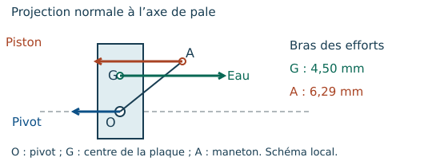
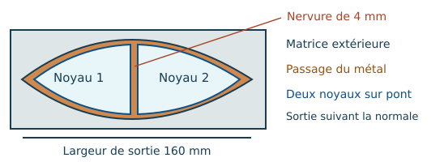
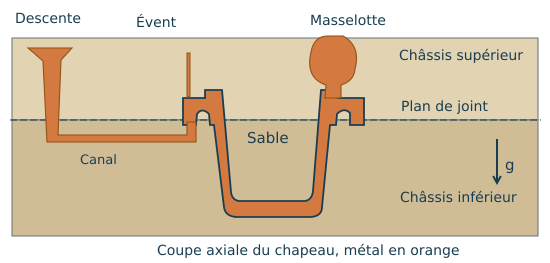
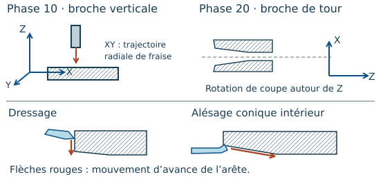
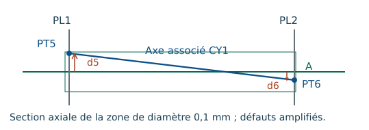
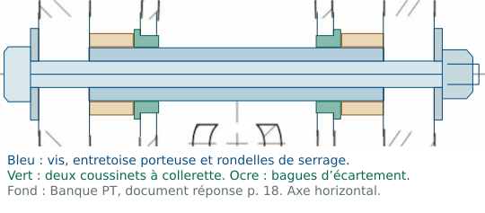
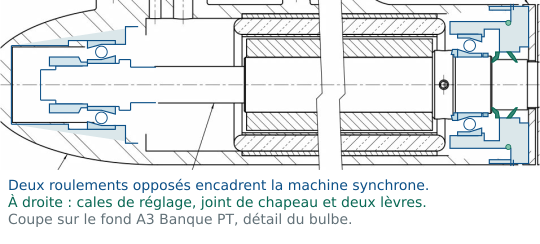
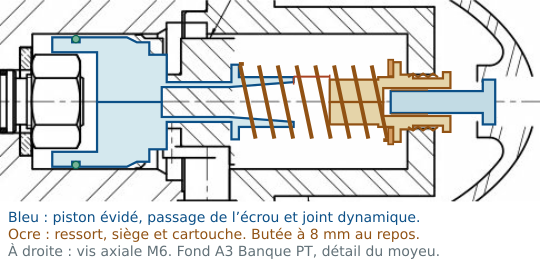

# Banque PT 2025 — Sciences industrielles C · Corrigé brut

*Corrigé rédigé par IA, non officiel. Signalez toute erreur.*

**Rédaction** · GPT-6.2 Astra Ultra · vitesse non renseignée · 26 novembre 2026

**Révision (tour 1)** · GPT-6.2 Astra Ultra · vitesse non renseignée · 26 novembre 2026

**Hydrogénérateur Racing Alu.** Épreuve de six heures. Les 41 questions couvrent le bilan énergétique, la commande du pas, les procédés de fabrication et la conception. Le rapport du jury donne 15 %, 20 %, 30 % et 35 % de la note par partie. La garde suggère respectivement 10 %, 25 %, 30 % et 35 % du temps. Les points individuels ne sont pas publiés.

[Sujet et planches](https://www.banquept.fr/documents/2025/si_c_2025_pt.pdf) · [Rapport du jury](https://www.banquept.fr/documents/ecrit/rapport/2025/rapport_si_c_ecrit_2025.pdf)

## I · Alimenter un voilier de course

### I.1 · Autonomie de quarante-huit heures

La consommation de 240 Wh chaque heure correspond à une puissance moyenne de 240 W. Il faut 240 × 48 = 11 520 Wh aux équipements. À la tension de service de 24 V, la capacité minimale vaut **480 Ah**. Le calcul suppose une décharge utilisable sur toute la plage annoncée et néglige les pertes.

### I.2 · Association des cellules

Huit cellules en série donnent 8 × 3,2 = 25,6 V en haut de la plage et 8 × 2,5 = 20 V en bas. Le groupe série garde la capacité d’une cellule, 100 Ah. Quatre branches ne fourniraient que 400 Ah. Cinq branches en parallèle donnent **8S5P, soit 40 cellules**, conformes en tension et en capacité.

### I.3 · Énergie du parc retenu

La capacité est **500 Ah**. L’estimation à tension de service constante donne 24 × 500 = **12,0 kWh**, soit 50 h à 240 W. La valeur de catalogue à 3,2 V par cellule serait 40 × 3,2 × 100 = 12,8 kWh. Une énergie réellement délivrée se mesure en intégrant la tension variable sur la charge débitée.

### I.4 · Durée de production quotidienne

Chaque jour il faut **5,76 kWh**. Le diesel livre 3,6 kW, soit 1,60 h de marche. Le photovoltaïque fournit en moyenne 3 kWh par jour, soit 1,92 journée de production, ou **46,1 h de temps calendaire moyen** pour obtenir 5,76 kWh. À sa puissance crête de 1,3 kW, il faudrait 4,43 heures de plein soleil équivalent, alors que la production annoncée en représente 2,31 par jour. L’hydrogénérateur actif fournit 0,6 kW dans les conditions de la ressource III, soit **9,60 h**. Diesel et hélice peuvent couvrir seuls la journée si le combustible ou la vitesse sont disponibles. Le solaire moyen est insuffisant.

### I.5 · Masses au départ et complémentarité

Le diesel consomme 80 × 1,60 × 0,75 = 96 L en 80 jours. À 0,83 kg/L, le combustible pèse 79,68 kg. Avec les 160 kg du système, il faut embarquer **environ 240 kg**. Le solaire pèse **25 kg** et les deux équipements hydrauliques de bord **20 kg** au total. On compte les deux appareils installés pour la masse et celui mis en production sur le bord favorable pour la puissance. Le diesel obligatoire couvre une avarie ou une pétole, le soleil réduit le combustible sans traînée d’hélice et l’hélice prend le relais la nuit lorsque le voilier avance. La relever quand le parc est chargé réduit sa traînée.

### I.6 · Conversion et stockage

Dans l’ordre des cases du document réponse, l’eau entre avec une énergie mécanique de translation, vitesse relative V. Après l’hélice, la puissance mécanique de rotation est le produit du couple par la vitesse angulaire. La génératrice synchrone délivre de l’électricité alternative triphasée, de fréquence liée au régime. Le redresseur fournit une tension continue ondulée. L’élévateur délivre une tension continue relevée. Le régulateur fournit un courant et une tension continus adaptés à la charge. Dans la batterie, l’énergie est stockée sous forme chimique, puis restituée aux usages en électricité continue, 24 V de service. Dans chaque tronçon électrique, tension et courant déterminent la puissance, en tenant compte du déphasage en alternatif.

### I.7 · Puissance de la veine d’eau

Pendant un intervalle dt, le volume qui franchit le disque est SV dt, pour un flux uniforme et normal au disque de surface S. La masse correspondante vaut ρSV dt. Son énergie cinétique vaut la moitié de cette masse multipliée par le carré de la vitesse. En divisant par dt, on obtient **P = ½ρSV³**. Les unités donnent kg·m²·s⁻³, soit des watts.

### I.8 · De la limite de Betz aux bornes électriques

Le disque de diamètre 0,20 m balaie 0,0314 m². À 7,5 m/s la veine transporte environ 6,8 kW, dont au plus 16/27, environ **4 kW**, sont récupérables dans le modèle de Betz. Les 600 W électriques annoncés représentent près de 15 % de cette borne. Une hélice réelle à trois pales a des pertes de bout de pale et un rendement lié à l’incidence et au régime. Les pertes de la génératrice et du convertisseur diminuent encore la puissance. La régulation plafonne délibérément le courant de charge.

### I.9 · Calage variable

La ressource VI donne à 39° un maximum proche de 600 W vers 12–14 nœuds, puis un décrochage. À 70° les 600 W sont atteints vers 24 nœuds et la traînée y reste proche de 100 N. Les deux axes verticaux portent des unités différentes. Adapter le calage élargit la plage productive et limite la traînée à grande vitesse. Le mécanisme ajoute de la masse et de la complexité, et introduit des risques de fuite ou de panne avec entretien supplémentaire.

### I.10 · Puissance plafonnée

À 24 V, 600 W correspondent déjà à 25 A. Une limite évite la surcharge thermique des bobinages et de l’électronique, protège la batterie et permet de contenir les dimensions des câbles et de l’ensemble. Lorsque le besoin est couvert, un supplément d’énergie prélevé sur l’eau pénaliserait la marche du voilier. Une commande du pas permet de tenir compte des deux objectifs.

## II · Dimensionner la commande des trois pales

### II.1 · Course de la commande

Le maneton est à e = 10 mm de l’axe de pivot. Avec le calage β mesuré à partir du plan de rotation, sa projection axiale vaut, à un signe de repère près, e cos β. L’écart entre 39° et 90° vaut donc **c = 10(cos 39° − cos 90°) = 7,77 mm**, arrondi à 8 mm pour la construction. La longueur d’arc du maneton ne représente pas la translation du piston.

### II.2 · Effort du vérin

La surface utile pleine de diamètre 30 mm vaut π × 30²/4 = 706,9 mm². La pression manométrique maximale est 5 bar = 0,50 N/mm². Hors frottement et contre-pression, **F = pS = 353,4 N**.

### II.3 · Position de sécurité et préactionneur

À zéro pression le ressort ramène le piston sur la butée correspondant à **β = 39°**, pour continuer à produire à petite vitesse. Une seule chambre motrice suffit, le retour étant mécanique. On peut commander une valve proportionnelle de pression à trois voies P, A, T, de plage 0–5 bar et de débit adapté au déplacement du piston. Elle alimente A depuis P pour augmenter le pas, décharge A vers le réservoir T pour le diminuer et relie A à T au repos par rappel mécanique. Cette mise à l’échappement hydraulique évite de piéger l’huile lors de la perte de commande.

### II.4 · Actions sur une pale

On isole une seule pale arrêtée. L’eau exerce au centre géométrique une force de traînée parallèle au courant. Le piston agit axialement sur le maneton, en sens opposé pour empêcher la rotation. Le pivot parfait en O peut transmettre deux composantes de moment perpendiculaires à son axe, ainsi que trois composantes de force, mais aucun couple suivant l’axe de pivot. La projection dans le plan en conserve la réaction en O. Poids, poussée d’Archimède et frottement sont négligés dans ce modèle.

### II.5 · Équilibre de la pale

L’allongement 50/25 = 2 donne Cx = 1,15. Avec A = 0,025 × 0,050 m², ρ = 1 027 kg/m³ et V = 7,5 m/s, la traînée est ½ρAV²Cx = **41,5 N**. Son bras de levier par rapport à O est 25/2 − 8 = 4,5 mm. Celui du piston est 10 cos 51° = 6,29 mm. L’équilibre des moments autour de l’axe du pivot donne Fp × 6,29 = 41,5 × 4,5, soit **29,7 N**. Une réaction de pivot compense le reliquat de résultante.

### II.6 · Précharge de rappel

Les trois pales appliquent chacune l’effort axial conventionnel de 30 N au même piston. La précharge minimale du ressort est **3 × 30 = 90 N**. Sa réaction est opposée à la somme de ces efforts.

### II.7 · Raideur idéale

Sous les hypothèses du sujet, l’effort passe de 90 N au repos à 353,4 N en bout de course. La loi linéaire donne **k = (353,4 − 90)/7,77 = 33,9 N/mm**, ou 32,9 N/mm en arrondissant la course à 8 mm. La pression doit d’abord compenser la précharge avant que le piston quitte sa butée.

### II.8 · Choix du ressort de catalogue

Une solution réalisable est le ressort inox **23290**. Diamètre extérieur 19,2 mm, libre 40 mm, raideur 27,46 N/mm, longueur sous charge limite 24,9 mm et charge limite 414,65 N. Pour la longueur implantée de 35 mm, la précharge est 137,3 N, supérieure aux 90 N requis. Après 7,77 mm, la longueur vaut 27,23 mm et l’effort 350,7 N, soit **4,96 bar**. Les spires restent dans leur course admissible et le diamètre est inférieur à 30 mm. Pour garantir exactement les 8 mm du dessin sous 5 bar, on peut installer le même ressort à **35,2 mm** au repos, conforme au minimum de 35 mm. On obtient 131,8 N au repos et 351,5 N à 8 mm. La référence 23580, de raideur plus proche du calcul idéal, demanderait déjà environ 408 N en fin de course si on la montait à 35 mm. La raideur seule ne suffit pas.

### II.9 · Couple de l’emmanchement

À 600 tr/min, la vitesse angulaire vaut 600 × 2π/60 = 20π rad/s. À 600 W, **C = P/ω = 9,55 N·m** dans le bilan simplifié qui assimile puissance à l’hélice et puissance utile. Le rendement total, s’il était fourni, conduirait à diviser ce couple par ce rendement. La traînée de 300 N est une charge axiale distincte.

### II.10 · Pression normale et effort axial

Soit α le demi-angle du cône. Pour une couronne de rayon r et de largeur méridienne dr/sin α, la surface est 2πr dr/sin α. Sa pression normale a une composante axiale p₀ sin α. Les composantes transversales se compensent par symétrie. L’intégration de p₀ 2πr dr entre d/2 et D/2 donne **Fp = p₀π(D² − d²)/4**. Avec 6 N/mm², D = 20 mm et d = 14 mm, il faut 961 N. Doubler cette valeur conduit à 1,92 kN, cohérents avec les 2 kN imposés pour la suite.

### II.11 · Sollicitation du bout d’arbre

Le serrage tire axialement sur la partie filetée. Dans le modèle sans torsion résiduelle, la section résistante la plus faible est à la gorge de dégagement, de diamètre extérieur 10 mm, traversée par le canal de diamètre 4 mm. L’aire annulaire vaut π(10² − 4²)/4 = 65,97 mm². La contrainte nominale de traction est **σ = 2 000/65,97 = 30,3 MPa**.

### II.12 · Résistance

Pour l’inox 316 de l’arbre, la limite conventionnelle d’élasticité de la ressource VIII est 207 MPa. Avec le facteur 3 prescrit, 3 × 30,3 = **90,9 MPa < 207 MPa**. La vérification en traction statique est satisfaite. Le rapport à la contrainte nominale est 6,8 avant cette majoration.

## III · Fabriquer et contrôler les pièces

### III.1 · Chape en tôle

Une tôle inoxydable 316L de 3 mm se plie et résiste en milieu marin. On découpe le flan développé, on poinçonne ou découpe les trous par référence au futur pli, puis on ébavure. Une presse plieuse avec vé et poinçon de rayon intérieur compatible forme les ailes. Un gabarit contrôle l’ouverture et la coaxialité des trous traversés par l’axe. Si nécessaire, ils sont alésés ensemble après pliage. On termine par passivation. Au contact d’aluminium, des rondelles et une isolation adaptées limitent la corrosion galvanique.

### III.2 · Développé de pliage

Les fibres externes s’allongent, les internes se raccourcissent. La longueur conservée est celle de la fibre neutre, décalée vers l’intérieur du pli. Pour un angle θ en radians, son développé local vaut θ(Rint + K e), e = 3 mm et K issu d’un essai ou d’abaques matériau/outillage. On ajoute ces arcs aux longueurs droites jusqu’aux tangences pour positionner découpes et trous. Le retour élastique impose aussi un réglage d’angle à la presse.

### III.3 · Filière à deux chambres

Un piston refoule une billette d’alliage d’aluminium chauffée dans une filière. La sortie calibre l’enveloppe profilée. Deux noyaux solidaires d’un pont amont forment les deux vides. Le métal contourne les ponts, se ressoude sous pression dans la chambre de soudure puis passe entre les noyaux et la matrice. L’intervalle entre noyaux forme la nervure de **4 mm** du croquis de réponse, sur un profil de **160 mm** de largeur. Le double évidement court sur toute la longueur. On refroidit, étire, coupe à longueur et usine les détails locaux. Le croquis simplifié demandé et la section industrielle plus élaborée de X présentent des géométries différentes.

### III.4 · Usiner ou mouler le chapeau

L’usinage dans la masse a peu de frais fixes, autorise des modifications et donne une bonne précision, au prix d’un temps machine et d’une masse de copeaux importants. Un brut moulé se rapproche du volume utile et réduit enlèvement et durée de reprise. Il demande modèle, préparation des moules, fusion et contrôle des porosités. Les plans d’appui, guidages et fixations restent à usiner. Les copeaux et jets peuvent être recyclés, avec de l’énergie de refusion. La voie sable consomme énergie, sable et liants et peut créer du rebut. Pour un effectif N, comparer coût fixe + N × coût variable, en intégrant rendement matière, rebuts, reprises, contrôle et énergie. Le passage se justifie si l’effectif prévu franchit le seuil économique tout en tenant les exigences de service.

### III.5 · Moulage en sable par gravité

On fabrique le modèle avec retrait de solidification, dépouilles et surépaisseurs d’usinage. On tasse le sable en deux châssis. Après séparation et extraction du modèle, on installe les noyaux éventuels et referme le moule en repérant les deux moitiés. La coulée entre par le bassin, descend au canal puis rejoint l’empreinte. L’air sort aux évents. La masselotte reste liquide plus longtemps et nourrit les zones massives en solidification. Après refroidissement on détruit le moule, sépare les appendices puis contrôle et usine le brut.

### III.6 · Coupe des demi-moules

La figure reprend la coupe A–A de XI tournée pour couler avec la bride horizontale. Le plan de joint passe sur la bride, à son plus grand diamètre. En haut, le sable en saillie pénètre par l’ouverture et forme le grand évidement borgne. En bas, l’empreinte épouse l’extérieur du corps et comporte des formes saillantes pour les évidements de bride regardant ce côté. Les dépouilles permettent de sortir le modèle suivant la verticale de part et d’autre du joint. Le canal bas remplit progressivement la pièce. La masselotte est reliée à la bride épaisse, le col, la descente et l’évent débouchent effectivement. Les appendices sont à éliminer au décochage.

### III.7 · Trois détails de la coupe A–A

**Zone 1.** Le congé au raccord du fond et de la paroi adoucit l’angle rentrant. Une transition progressive limite les criques à chaud dues au retrait contrarié et le risque d’arracher une arête fragile en sable. **Zone 2.** L’évidement dans l’épaisseur de la bride approche l’épaisseur des nervures de celle des parois voisines. Il évite un point chaud, donc une retassure, cavité produite par la contraction du dernier métal liquide s’il manque d’alimentation. **Zone 3.** La paroi extérieure inclinée comporte une dépouille dans la direction de démoulage. Sans ce jeu croissant, l’extraction du modèle frotte et arrache du sable, d’où manque local de matière dans le moule, surépaisseur ou inclusion sur la pièce. Ces trois zones sont distinctes sur la feuille réponse.

### III.8 · Renseigner les trois fiches GPS

**Profil de surface, 0,02.** L’élément unique tolérancé est la *surface extraite du cône intérieur*. La zone est l’enveloppe comprise entre deux surfaces équidistantes de la surface conique théoriquement exacte, à 0,01 mm de chaque côté suivant la normale. Le demi-angle est défini par la cote encadrée de 10°. Il n’y a pas de référence spécifiée. La zone peut s’ajuster en position et orientation à la surface extraite. Toute la surface doit y tenir.

**Localisation, diamètre 0,1 relativement à B puis C.** L’élément unique est la ligne médiane extraite de l’alésage de chambre Ø30 H7. B est associé au plan réel d’appui du chapeau, C au centrage court réel Ø40 H7 après établissement de B. La référence secondaire fournit la position de l’axe dans le plan primaire. La zone est un cylindre unique de diamètre 0,1 mm, d’axe normal à B passant au centre défini par C. La ligne extraite doit rester intégralement dans ce cylindre.

**Coaxialité, diamètre 0,1 relativement à A.** L’élément unique est la ligne médiane extraite du cylindre *extérieur* Ø70 ±0,05. La référence A est l’axe du cône idéal associé à la surface conique extraite. La zone est un cylindre de diamètre 0,1 mm, coaxial à A, dans lequel la ligne doit se trouver sur toute la longueur spécifiée. La cote de diamètre admissible et la coaxialité sont deux exigences indépendantes. Les trois fiches n’appellent ni zone commune ni groupe de perçages.

### III.9 · Besoins fonctionnels

La forme du cône conditionne la portée de l’emmanchement, la qualité du centrage et la répartition de pression nécessaire au couple transmis par adhérence. Un cône mal formé ne porterait que sur quelques zones. La localisation de la chambre par rapport au montage du chapeau aligne le piston guidé dans le moyeu avec son appui et les trois interfaces de commande. Elle limite efforts transversaux, coincement et usure des joints.

### III.10 · Priorité du plan et du centrage

Le chapeau se pose d’abord sur la grande face B. Cet appui supprime une translation normale et deux basculements. Son court emboîtement cylindrique en C le centre dans le plan, supprimant les deux translations transversales. L’ordre **B puis C** reproduit ces contacts. Le centrage court ne doit pas imposer l’inclinaison de l’ensemble, déjà établie par B. La rotation résiduelle autour de l’axe ne déplace pas la zone de la chambre cylindrique.

### III.11 · Moyens et axes

Pour la **phase 10**, monter la face du chapeau vers le haut sur une fraiseuse verticale trois axes. Z est l’axe de broche, X et Y sont dans le plan de cette face. Surfaçage, interpolation circulaire des alésages, six perçages et taraudages M5 se font de dessus. Les trois demi-logements radiaux ouverts du guidage sont accessibles sur cette même face par une fraise boule et des trajectoires XY orientées à 120°, avec passes de profondeur Z. Cette stratégie autorise trois axes linéaires sans incliner l’outil. Un perçage axial des guidages avec un autre outillage demanderait au contraire un repositionnement ou une indexation. Pour la **phase 20**, un tour à deux axes suffit. Z suit la broche et l’axe du moyeu, X est radial, Y complète le trièdre mais n’est pas commandé. La pièce tourne autour de Z pour la coupe. L’interpolation simultanée XZ engendre le cône.

### III.12 · Dressage et alésage conique

Pour dresser le plan libre, présenter une plaquette avec dégagement derrière l’arête, avancer suivant X de l’extérieur vers le centre à Z constant et s’arrêter au débouché du trou. Pour le cône intérieur, engager la barre d’alésage depuis le côté libre, avec son corps dégagé de la matière. En partant du grand diamètre vers le petit, avancer suivant Z en rentrant radialement suivant X. Dans le repère physique, dr/dz = −tan 10°. Si la machine programme X en diamètres, la variation de X est le double de celle du rayon. Les flèches du dessin précédent distinguent les deux trajectoires.

### III.13 · Mise en position pour la reprise

Un appui plan sur la face B usinée en phase 10 apporte trois contraintes. Un pion cylindrique court dans le centrage C apporte une liaison linéaire annulaire, deux contraintes. La révolution de la pièce reste libre géométriquement pour le cône et le plan. Si une indexation complète est exigée, un doigt dégagé, tangent à un des logements de pale, apporte un point de contact, sixième contrainte. Le bridage axial maintient les contacts et transmet le couple par adhérence ou par entraîneur. Éviter un centrage long qui redoublerait les deux orientations de B. La mise en position isostatique rend la reprise répétable sans déformer la pièce pour la forcer sur des appuis incompatibles.

### III.14 · Critique de gamme

La première prise conserve la cohérence de B, C, de la chambre et des guidages, ce qui sert la localisation de la chambre. En revanche A est réalisé après la première prise. La perpendicularité de B et la coaxialité de C à A dépendent donc de la reprise. De plus le diamètre extérieur Ø70 ±0,05, coaxial à A à Ø0,1, ne figure dans aucune opération alors que le brut est étiré à Ø70. Sa géométrie brute ne garantit pas ces deux exigences. Prévoir une ébauche avec surépaisseur et tourner surface extérieure et cône A dans la même prise, ou garantir et contrôler explicitement un brut qualifié et une reprise centrée. Reprendre ensuite sur un mandrin conique associé à A et une butée compatible pour obtenir les surfaces liées dans la tolérance. Vérifier le budget des défauts de reprise avant de figer la gamme.

### III.15 · Segment réel de contrôle

Dans le modèle expressément adopté par la gamme MMT, on associe un cylindre idéal CY1 aux points du diamètre extérieur. Son axe mathématique est infini. Or le contrôle porte sur la portion de matière entre les faces PL1 et PL2. Avec un petit défaut d’inclinaison, l’écart à A varie le long du cylindre, même s’il est nul au milieu. Les deux extrémités PT5 et PT6 bornent donc le segment à vérifier.

### III.16 · Construire les extrémités sur MMT

Palper le cône, le cylindre extérieur et les deux faces, avec une répartition des points sur la longueur et le pourtour. Associer le cône CO1 et en extraire A, associer CY1 et en extraire la droite L, puis associer les plans PL1 et PL2. Construire **PT5 = L ∩ PL1** et **PT6 = L ∩ PL2** avec la fonction intersection droite–plan. Les deux points se situent sur l’axe du cylindre contrôlé. Les projeter sur A uniquement pour calculer leurs distances.

### III.17 · Critère de décision

Calculer d5 = distance(PT5, A) et d6 = distance(PT6, A), les deux distances point–droite. Accepter si **max(d5, d6) ≤ 0,05 mm**, la moitié du diamètre de la zone. Le cylindre de tolérance est convexe, donc tout le segment droit entre deux points admis est admis. Ce test suffit pour la droite associée dans la gamme proposée. Avec une ligne médiane extraite présentant elle-même un défaut de forme, il faut contrôler aussi ses points intermédiaires.

## IV · Construire les deux pivots et le mécanisme de calage

### IV.1 · Pivot démontable du mâtereau

Deux coussinets à collerette, par exemple en composite antifriction marin, sont emmanchés dans les deux parois du mâtereau. Ils tournent autour d’une entretoise-axe inox immobilisée entre les flasques par une vis traversante et un écrou freiné. Les collerettes fournissent les surfaces de butée latérale. La portée de serrage entre flasques est **plus longue que la largeur du mâtereau équipé de ses collerettes**, du petit jeu axial prescrit par le concepteur. Le serrage passe donc par l’entretoise incompressible. Il ne pince ni le profilé creux ni les surfaces tournantes. Deux bagues d’écartement latérales, entre flasques et collerettes, reprennent les espaces du dessin en laissant le jeu de fonctionnement. Les rondelles épaisses et une entretoise en contact sur des portées larges répartissent la pression et limitent la flexion des flasques. Alésages des coussinets glissants sur l’axe après emmanchement, par exemple H7/g6 sur la portée finie, serrage extérieur choisi suivant le fabricant. Déposer écrou, vis et entretoise libère le mâtereau.

### IV.2 · Assemblage axial du bulbe, du piston et de l’ogive

**Rotor.** Placer un roulement à contact oblique de chaque côté de la génératrice en montage opposé en O. La grande portée entre appuis limite l’inclinaison sous les efforts d’hélice. Les bagues intérieures sont montées sur les portées tournantes avec un serrage adapté, par exemple k6 sous charge tournante. Épaulements et écrou freiné les immobilisent axialement. Les bagues extérieures s’appuient respectivement dans le bulbe et le chapeau, avec possibilité de déplacement axial au réglage de l’une d’elles dans son alésage H7. Un paquet de cales sous le couvercle règle la distance d’appui. Mesurer au comparateur l’aller-retour axial puis adapter les cales et verrouiller. Vérifier rotation libre et jeu final selon les roulements retenus. Les efforts axiaux des deux sens trouvent chacun leur chemin vers le carter.

**Étanchéité.** Le chapeau démontable se centre dans le bulbe et comprime un joint torique statique en gorge, sans supprimer l’appui du réglage. Sur la portée lisse de l’arbre tournée vers l’eau, une lèvre de retenue d’huile, ressort vers l’huile, est homologuée pour le différentiel maximal de **5 bar** et soutenue axialement. Une seconde lèvre anticontamination est orientée vers la mer, avec intervalle compatible avec la lubrification. Une lèvre ordinaire à basse pression ne convient pas seule. Le passage radial de l’arbre doit rester dans le volume alimenté, en amont de la barrière d’étanchéité, et déboucher dans le perçage axial Ø4.

**Piston.** Le piston monobloc comporte une jupe cylindrique longue guidée dans Ø30 H7, deux portées espacées et un joint de piston approprié au déplacement et à l’huile. Son fond borgne, évidé du côté de l’écrou, lui laisse un jeu en position repos sans ouvrir la chambre sur l’eau. La pression agit sur la projection pleine du diamètre d’étanchéité. Le piston reproduit la gorge annulaire imposée pour les trois manetons, qui peuvent y glisser transversalement pendant la rotation des pales. Contrôler l’engagement des portées et des manetons aux deux extrémités de course.

**Butée et ogive.** Une cartouche filetée démontable est centrée par une portée courte dans le chapeau, positionnée axialement sur un épaulement et freinée contre le desserrage. Son épaulement intérieur, distinct de la portée d’appui du ressort, laisse **8 mm** entre les faces de butée en position repos. Une rondelle d’appui en acier inox interposée reçoit le ressort 23290. Un pilote le centre et laisse passer la tige du piston sans collision. Avec le montage à 35,2 mm au repos, il reste 27,2 mm en butée, au-dessus de la longueur admissible de 24,9 mm. Un taraudage axial **M6** dans la cartouche reçoit la vis extérieure maintenant l’ogive. Il est borgne et indépendant de la chambre hydraulique.

**Ordre de montage.** Introduire le rotor et ses paliers, monter le chapeau et régler le jeu avant le contrôle d’étanchéité. Emmancher le moyeu sur le cône, poser sa rondelle et serrer l’écrou. Introduire le piston avec son joint, assembler les trois manetons et les deux demi-guidages, puis poser le chapeau porte-pales, le ressort, son siège et la cartouche. Poser l’ogive et sa vis M6 en dernier. Le démontage suit le chemin inverse. Les valeurs de jeu, de rugosité de portée de lèvre et d’interférence de bagues relèvent du choix des composants. Elles n’apparaissent pas comme cotes imposées sur la planche.
