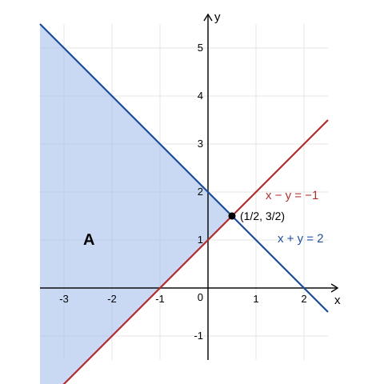

# BCE ECG — Maths 2 approfondies (ESCP-HEC) 2025 · Corrigé brut

*Corrigé rédigé par IA, non officiel. Signalez toute erreur.*

Épreuve de mathématiques 2 approfondies, conception ESCP BS – HEC Paris, voie générale, 4 heures, calculatrice interdite. Trois parties, 41 questions (sous-questions comprises).

---

## Première partie

### 1.

**(a)** Chaque $X_i$ suit la loi $\mathcal{N}(0,1)$ : elle admet une variance, donc un moment d'ordre 2, et $\mathbb{E}(X_i^2)=\mathbb{V}(X_i)+\mathbb{E}(X_i)^2=1$. Par linéarité, $S_n$ admet une espérance et :

$$\boxed{\mathbb{E}(S_n)=n.}$$

**(b)**

```python
def simul(n):
    X = rd.normal(0, 1, n)        # n réalisations indépendantes de N(0,1)
    s = 0
    for i in range(n):
        s = s + X[i]**2
    return s
```

**(c)** `f(n, N)` calcule la moyenne de $N$ réalisations indépendantes de $S_n^2$, moins $n^2$. $S_n^2$ admet une variance : la loi normale a des moments de tout ordre (transfert), donc $S_n^4$, polynôme en les $X_i$ indépendantes, admet une espérance.

D'après la loi faible des grands nombres, cette moyenne empirique approche $\mathbb{E}(S_n^2)$ pour $N=50000$. Comme $n^2=\mathbb{E}(S_n)^2$ (question (a)), `f(n, 50000)` est une valeur approchée de :

$$\mathbb{E}(S_n^2)-\mathbb{E}(S_n)^2=\mathbb{V}(S_n).$$

Les points de la figure sont proches de $(n,2n)$ pour $n=1,\dots,9$ (ordonnées voisines de $2$, $4$, $6$, …, $18$).

**On conjecture que $\mathbb{V}(S_n)=2n$.**

### 2.

**(a)** $W_1=\frac12X_1^2>0$ car $X_1$ ne s'annule pas. Notons $G$ sa fonction de répartition. Pour $x\leqslant0$, $G(x)=0$.

Pour $x>0$, $X_1$ étant à densité :

$$G(x)=\mathbb{P}\big(-\sqrt{2x}\leqslant X_1\leqslant\sqrt{2x}\big)=2\Phi(\sqrt{2x})-1.$$

$G$ est continue sur $]-\infty,0]$ (nulle) et sur $]0,+\infty[$ (composée de fonctions continues), et $\lim_{x\to0^+}G(x)=2\Phi(0)-1=0=G(0)$ : $G$ est continue sur $\mathbb{R}$.

Elle est de classe $C^1$ sur $\mathbb{R}^*$ : la fonction $\Phi$ est de classe $C^1$, de dérivée $\varphi$, et la fonction racine est de classe $C^1$ sur l'intervalle ouvert des réels strictement positifs.

**$W_1$ est donc une variable à densité.** Pour $x>0$ :

$$\begin{aligned}
G'(x)&=2\varphi(\sqrt{2x})\cdot\frac{1}{\sqrt{2x}}\\
&=\frac{2}{\sqrt{2\pi}\sqrt{2x}}e^{-x}\\
&=\frac{1}{\sqrt\pi}\,x^{-1/2}e^{-x}.
\end{aligned}$$

Une densité de $W_1$ est :

$$\boxed{f_{W_1}(x)=\begin{cases}0&\text{si }x\leqslant0,\\[1mm]\dfrac{1}{\sqrt\pi}\,x^{-1/2}e^{-x}&\text{si }x>0.\end{cases}}$$

**(b)** Une densité est d'intégrale 1 :

$$1=\int_0^{+\infty}\frac{1}{\sqrt\pi}x^{-1/2}e^{-x}\,\mathrm{d}x=\frac{1}{\sqrt\pi}\,\Gamma\Big(\frac12\Big).$$

$$\boxed{\Gamma\Big(\frac12\Big)=\sqrt\pi.}$$

**(c)** Par (a) et (b), $f_{W_1}(x)=\frac{1}{\Gamma(1/2)}x^{\frac12-1}e^{-x}$ pour $x>0$ : $W_1\hookrightarrow\gamma\big(\frac12\big)$. De même, chaque $\frac12X_i^2$ suit la loi $\gamma\big(\frac12\big)$, et ces variables sont mutuellement indépendantes (lemme des coalitions). Montrons par récurrence que $W_n\hookrightarrow\gamma\big(\frac n2\big)$.

- C'est vrai pour $n=1$.
- Si $W_n\hookrightarrow\gamma\big(\frac n2\big)$, alors $W_{n+1}=W_n+\frac12X_{n+1}^2$, où $W_n$ (fonction de $X_1,\dots,X_n$) et $\frac12X_{n+1}^2$ sont indépendantes.

  Par stabilité de la loi $\gamma$ pour la somme, $W_{n+1}\hookrightarrow\gamma\big(\frac n2+\frac12\big)=\gamma\big(\frac{n+1}{2}\big)$.

**Pour tout $n\in\mathbb{N}^*$, $W_n\hookrightarrow\gamma\big(\frac n2\big)$.**

**(d)** Une variable de loi $\gamma(\nu)$ a pour espérance et pour variance $\nu$. Donc $\mathbb{E}(W_n)=\mathbb{V}(W_n)=\frac n2$ et, avec $S_n=2W_n$ :

$$\begin{aligned}
\mathbb{E}(S_n)&=2\cdot\frac n2\\
&=n\\
\mathbb{V}(S_n)&=4\cdot\frac n2\\
&=2n.
\end{aligned}$$

**La conjecture de la question 1(c) est démontrée : $\mathbb{V}(S_n)=2n$.**

### 3.

**(a)** Soit $n\geqslant3$. $W_n>0$ et, par le théorème de transfert, $\frac{1}{W_n}$ admet une espérance si et seulement si l'intégrale suivante converge (absolument, l'intégrande étant positif) :

$$\int_0^{+\infty}\frac1x\cdot\frac{1}{\Gamma(n/2)}x^{\frac n2-1}e^{-x}\,\mathrm{d}x=\frac{1}{\Gamma(n/2)}\int_0^{+\infty}x^{\frac n2-2}e^{-x}\,\mathrm{d}x.$$

Comme $\frac n2-1>0$, la dernière intégrale est $\Gamma\big(\frac n2-1\big)$, convergente. Donc :

$$\boxed{\mathbb{E}\Big(\frac{1}{W_n}\Big)=\frac{\Gamma\big(\frac n2-1\big)}{\Gamma\big(\frac n2\big)}.}$$

Avec $\Gamma\big(\frac n2\big)=\big(\frac n2-1\big)\Gamma\big(\frac n2-1\big)$ :

$$\mathbb{E}\Big(\frac{1}{W_n}\Big)=\frac{1}{\frac n2-1}=\frac{2}{n-2}.$$

Comme $\frac{1}{S_n}=\frac12\cdot\frac{1}{W_n}$, par linéarité :

$$\boxed{\mathbb{E}\Big(\frac{1}{S_n}\Big)=\frac{1}{n-2}.}$$

**(b)** Pour tout réel $y>0$, $(1-\sqrt y)^2\geqslant0$ donne $\sqrt y\leqslant\frac{1+y}{2}$. Avec $y=\frac{1}{x}$, pour tout $x>0$ :

$$0\leqslant\frac{1}{\sqrt x}\leqslant\frac12\Big(1+\frac1x\Big).$$

$S_n=2W_n$ admet une densité $f_{S_n}$ nulle sur $]-\infty,0]$. L'intégrale $\int_0^{+\infty}\frac12\big(1+\frac1x\big)f_{S_n}(x)\,\mathrm{d}x$ converge (elle vaut $\frac12\big(1+\mathbb{E}(\frac{1}{S_n})\big)$ par (a) et le théorème de transfert).

Par comparaison d'intégrales de fonctions positives, $\int_0^{+\infty}\frac{1}{\sqrt x}f_{S_n}(x)\,\mathrm{d}x$ converge, et par le théorème de transfert **$\frac{1}{\sqrt{S_n}}$ admet une espérance** pour $n\geqslant3$.

### 4.

Soit $f_n$ la densité de $T_n$, continue et strictement positive sur $\mathbb{R}$.

Sa fonction de répartition $F_n$ est de classe $C^1$ sur $\mathbb{R}$, avec $F_n'=f_n$.

Pour $t\geqslant0$, posons :

$$g(t)=\mathbb{P}(|T_n|\leqslant t)=F_n(t)-F_n(-t).$$

$g$ est continue sur $[0,+\infty[$, dérivable avec $g'(t)=f_n(t)+f_n(-t)>0$ : elle est strictement croissante. De plus $g(0)=0$ et $\lim_{t\to+\infty}g(t)=1-0=1$.

Par le théorème de la bijection, $g$ réalise une bijection de $[0,+\infty[$ sur $[0,1[$.

Comme $1-\alpha\in\,]0,1[$, **il existe un unique réel $t_{n,\alpha}\geqslant0$ (en fait $>0$) tel que $\mathbb{P}(|T_n|\leqslant t_{n,\alpha})=1-\alpha$**, et aucun réel négatif ne convient puisque $\mathbb{P}(|T_n|\leqslant t)=0$ pour $t<0$.

### 5.

**(a)** Soit $n\geqslant3$. $T_n=\sqrt n\,Y\cdot\frac{1}{\sqrt{S_n}}$. $Y$ et $\frac{1}{\sqrt{S_n}}$ sont indépendantes (lemme des coalitions : $Y$ est indépendante de $(X_1,\dots,X_n)$) et admettent une espérance (question 3(b)). Donc leur produit admet une espérance et :

$$\mathbb{E}(T_n)=\sqrt n\,\mathbb{E}(Y)\,\mathbb{E}\Big(\frac{1}{\sqrt{S_n}}\Big)=0.$$

**(b)** $T_n^2=n\,Y^2\cdot\frac{1}{S_n}$, avec $Y^2$ et $\frac{1}{S_n}$ indépendantes, admettant des espérances égales à $1$ et à $\frac{1}{n-2}$ (question 3(a)).

Donc $T_n^2$ admet une espérance, $T_n$ une variance, et :

$$\mathbb{E}(T_n^2)=\frac{n}{n-2},$$

et comme $\mathbb{E}(T_n)=0$ :

$$\boxed{\mathbb{V}(T_n)=\frac{n}{n-2}.}$$

**(c)** $T_nY=\sqrt n\,Y^2\cdot\frac{1}{\sqrt{S_n}}$, produit de variables indépendantes admettant une espérance, et $\frac{1}{\sqrt{S_n}}=\frac{1}{\sqrt2}\cdot\frac{1}{\sqrt{W_n}}$ :

$$\mathbb{E}(T_nY)=\sqrt n\cdot1\cdot\frac{1}{\sqrt2}\,\mathbb{E}\Big(\frac{1}{\sqrt{W_n}}\Big)=\sqrt{\frac n2}\,\mathbb{E}\Big(\frac{1}{\sqrt{W_n}}\Big).$$

Par linéarité, $(T_n-Y)^2=T_n^2-2T_nY+Y^2$ admet une espérance et :

$$\begin{aligned}
\mathbb{E}\big((T_n-Y)^2\big)&=\frac{n}{n-2}-2\sqrt{\frac n2}\,\mathbb{E}\Big(\frac{1}{\sqrt{W_n}}\Big)+1\\
&=\frac{2n-2}{n-2}-\sqrt{2n}\,\mathbb{E}\Big(\frac{1}{\sqrt{W_n}}\Big).
\end{aligned}$$

### 6.

Pour $n\geqslant2$, $\frac n2-\frac12>0$ et, par le théorème de transfert (intégrande positif) :

$$u_n=\frac{1}{\Gamma(n/2)}\int_0^{+\infty}x^{-\frac12}x^{\frac n2-1}e^{-x}\,\mathrm{d}x=\frac{\Gamma\big(\frac{n-1}{2}\big)}{\Gamma\big(\frac n2\big)},$$

l'intégrale convergeant : $u_n$ est bien défini.

**(a)** $W_{n+1}=W_n+\frac12X_{n+1}^2\geqslant W_n>0$, donc $0<\frac{1}{\sqrt{W_{n+1}}}\leqslant\frac{1}{\sqrt{W_n}}$, et par croissance de l'espérance $u_{n+1}\leqslant u_n$ : **$(u_n)_{n\geqslant2}$ est décroissante.** Avec $\Gamma(1)=1$ et la question 2(b) :

$$\boxed{u_2=\frac{\Gamma(1/2)}{\Gamma(1)}=\sqrt\pi.}$$

**(b)** Avec $\Gamma(x+1)=x\Gamma(x)$ pour $x=\frac{n-1}{2}>0$ :

$$\begin{aligned}
u_{n+1}u_n&=\frac{\Gamma\big(\frac n2\big)}{\Gamma\big(\frac{n+1}{2}\big)}\cdot\frac{\Gamma\big(\frac{n-1}{2}\big)}{\Gamma\big(\frac n2\big)}\\
&=\frac{\Gamma\big(\frac{n-1}{2}\big)}{\frac{n-1}{2}\,\Gamma\big(\frac{n-1}{2}\big)}\\
&=\frac{2}{n-1}.
\end{aligned}$$

**(c)** Par (b), $u_{m+1}=\frac{2}{(m-1)u_m}$. La case d'indice $k$ du tableau contient $u_{k+2}$ :

```python
def suite_u(n):
    U = np.zeros(n - 1)
    U[0] = np.sqrt(np.pi)                # u_2
    for k in range(1, n - 1):
        U[k] = 2 / (k * U[k - 1])        # u_{k+2} = 2 / (k u_{k+1})
    return U
```

**(d)** Le programme trace $n\,u_n^2$ pour $n=2,\dots,80$. Les points décroissent (de $2\pi\approx6{,}28$ pour $n=2$) et se rapprochent de $2$.

**On conjecture que $\lim_{n\to+\infty}n\,u_n^2=2$, c'est-à-dire $u_n\sim\sqrt{\frac2n}$.**

**(e)** Soit $n\geqslant3$. Par (a) et (b) :

$$\begin{aligned}
u_n^2&\geqslant u_nu_{n+1}\\
&=\frac{2}{n-1}\\
u_n^2&\leqslant u_{n-1}u_n\\
&=\frac{2}{n-2}.
\end{aligned}$$

Donc :

$$\frac{2n}{n-1}\leqslant n\,u_n^2\leqslant\frac{2n}{n-2}.$$

Les deux bornes tendent vers 2 : $n\,u_n^2\to2$. Comme $u_n>0$, $\sqrt{\frac n2}\,u_n\to1$ par continuité de la racine carrée :

$$\boxed{u_n\underset{n\to+\infty}{\sim}\sqrt{\frac2n}.}$$

### 7.

Soit $\varepsilon>0$ et $n\geqslant3$. $(T_n-Y)^2$ est positive et admet une espérance. Par l'inégalité de Markov :

$$\mathbb{P}\big(|T_n-Y|>\varepsilon\big)\leqslant\mathbb{P}\big((T_n-Y)^2\geqslant\varepsilon^2\big)\leqslant\frac{\mathbb{E}\big((T_n-Y)^2\big)}{\varepsilon^2}.$$

Par 5(c) et 6(e), $\frac{2n-2}{n-2}\to2$ et $\sqrt{2n}\,u_n=\sqrt{2n}\sqrt{\tfrac2n}\cdot\frac{u_n}{\sqrt{2/n}}\to2$, donc :

$$\mathbb{E}\big((T_n-Y)^2\big)=\frac{2n-2}{n-2}-\sqrt{2n}\,u_n\xrightarrow[n\to+\infty]{}0.$$

Par encadrement, $\mathbb{P}(|T_n-Y|>\varepsilon)\to0$ pour tout $\varepsilon>0$ : **$(T_n)$ converge en probabilité vers $Y$.**

---

## Deuxième partie

### 8.

Avec $a=2$, $b=-1$ : $\mathcal{A}=\{(x,y)\ |\ y\leqslant2-x\ \text{et}\ y\geqslant x+1\}$. C'est la partie du plan située sous la droite $x+y=2$ et au-dessus de la droite $x-y=-1$. Ces deux droites, perpendiculaires, se coupent en $\big(\frac12,\frac32\big)=(c,d)$.

Un point de $\mathcal{A}$ vérifie $x+1\leqslant2-x$, soit $x\leqslant\frac12$ : $\mathcal{A}$ est un quart de plan (angle droit) de sommet $\big(\frac12,\frac32\big)$, ouvert vers les $x$ négatifs, bords compris.



### 9.

**(a)** $(x,y)\in\mathcal{A}\iff x\leqslant a-y\ \text{et}\ x\leqslant b+y$. Or :

$$y\geqslant d=\frac{a-b}{2}\iff2y\geqslant a-b\iff b+y\geqslant a-y.$$

Donc, pour $y\geqslant d$, $x\leqslant a-y$ entraîne $x\leqslant b+y$, et **$(x,y)\in\mathcal{A}\iff x\in\,]-\infty,a-y]$.**

**(b)** Pour $y\geqslant d$, $x\mapsto\mathbb{1}_{\mathcal{A}}(x,y)$ est l'indicatrice de $]-\infty,a-y]$, donc :

$$\int_{-\infty}^{+\infty}\mathbb{1}_{\mathcal{A}}(x,y)\varphi(x)\,\mathrm{d}x=\int_{-\infty}^{a-y}\varphi(x)\,\mathrm{d}x=\Phi(a-y).$$

### 10.

Pour $y\leqslant d$, $b+y\leqslant a-y$, donc $(x,y)\in\mathcal{A}\iff x\leqslant b+y$, et :

$$\int_{-\infty}^{+\infty}\mathbb{1}_{\mathcal{A}}(x,y)\varphi(x)\,\mathrm{d}x=\int_{-\infty}^{b+y}\varphi(x)\,\mathrm{d}x=\Phi(b+y).$$

### 11.

**(a)** Les applications $h_1:(x,y)\mapsto x+y$ et $h_2:(x,y)\mapsto x-y$ sont continues sur $\mathbb{R}^2$ (polynomiales).

Les ensembles $\{h_1\leqslant a\}$ et $\{h_2\leqslant b\}$ sont donc fermés, et leur intersection $\mathcal{A}$ est **une partie fermée de $\mathbb{R}^2$.**

**(b)** $X$ et $Y$ sont indépendantes, de densité $\varphi$, et $\mathcal{A}$ est fermée : le théorème admis, puis 9(b) et 10, donnent :

$$\mathbb{P}\big((X,Y)\in\mathcal{A}\big)=\int_{-\infty}^{d}\Phi(b+y)\varphi(y)\,\mathrm{d}y+\int_d^{+\infty}\Phi(a-y)\varphi(y)\,\mathrm{d}y.$$

Les changements de variable affines $y=d-z$ dans la première intégrale et $y=d+z$ dans la seconde, avec $b+d=a-d=c$, donnent :

$$\begin{aligned}
\int_{-\infty}^{d}\Phi(b+y)\varphi(y)\,\mathrm{d}y&=\int_0^{+\infty}\Phi(c-z)\varphi(d-z)\,\mathrm{d}z,\\
\int_d^{+\infty}\Phi(a-y)\varphi(y)\,\mathrm{d}y&=\int_0^{+\infty}\Phi(c-z)\varphi(d+z)\,\mathrm{d}z.
\end{aligned}$$

En sommant (intégrales convergentes) :

$$\mathbb{P}\big((X,Y)\in\mathcal{A}\big)=\int_0^{+\infty}\big(\varphi(d+z)+\varphi(d-z)\big)\Phi(c-z)\,\mathrm{d}z.$$

### 12.

Pour $z$ fixé, le changement de variable affine $s=t-z$ donne :

$$\Phi(c-z)=\int_{-\infty}^{c-z}\varphi(s)\,\mathrm{d}s=\int_{-\infty}^{c}\varphi(t-z)\,\mathrm{d}t.$$

En reportant dans 11(b), $\varphi(d+z)+\varphi(d-z)$ ne dépendant pas de $t$ :

$$\mathbb{P}\big((X,Y)\in\mathcal{A}\big)=\int_0^{+\infty}\Big(\int_{-\infty}^{c}\big(\varphi(d+z)+\varphi(d-z)\big)\varphi(t-z)\,\mathrm{d}t\Big)\mathrm{d}z.$$

### 13.

$\varphi(u)\varphi(v)=\frac{1}{2\pi}\exp\big(-\frac{u^2+v^2}{2}\big)$ et :

$$\Big(\frac{u+v}{\sqrt2}\Big)^2+\Big(\frac{u-v}{\sqrt2}\Big)^2=\frac{(u^2+2uv+v^2)+(u^2-2uv+v^2)}{2}=u^2+v^2.$$

Donc $\varphi\big(\frac{u+v}{\sqrt2}\big)\varphi\big(\frac{u-v}{\sqrt2}\big)=\frac{1}{2\pi}\exp\big(-\frac{u^2+v^2}{2}\big)=\varphi(u)\varphi(v)$.

### 14.

On part de la formule admise (ordre d'intégration échangé) et l'on calcule, pour $t$ fixé, l'intégrale intérieure.

*Premier terme.* Par la question 13 avec $u=d+z$, $v=t-z$ :

$$\varphi(d+z)\varphi(t-z)=\varphi\Big(\frac{t+d}{\sqrt2}\Big)\varphi\Big(\frac{2z+d-t}{\sqrt2}\Big).$$

Le changement de variable $s=\frac{2z+d-t}{\sqrt2}$, $\mathrm{d}z=\frac{\mathrm{d}s}{\sqrt2}$, puis $1-\Phi(x)=\Phi(-x)$ (parité de $\varphi$), donnent :

$$\int_0^{+\infty}\varphi\Big(\frac{2z+d-t}{\sqrt2}\Big)\mathrm{d}z=\frac{1}{\sqrt2}\int_{\frac{d-t}{\sqrt2}}^{+\infty}\varphi(s)\,\mathrm{d}s=\frac{1}{\sqrt2}\,\Phi\Big(\frac{t-d}{\sqrt2}\Big).$$

*Second terme.* Par la question 13 avec $u=d-z$, $v=t-z$, et la parité de $\varphi$ :

$$\varphi(d-z)\varphi(t-z)=\varphi\Big(\frac{t+d-2z}{\sqrt2}\Big)\varphi\Big(\frac{t-d}{\sqrt2}\Big).$$

Avec $s=\frac{t+d-2z}{\sqrt2}$ ($s$ décroît de $\frac{t+d}{\sqrt2}$ à $-\infty$, $\mathrm{d}z=-\frac{\mathrm{d}s}{\sqrt2}$) :

$$\int_0^{+\infty}\varphi\Big(\frac{t+d-2z}{\sqrt2}\Big)\mathrm{d}z=\frac{1}{\sqrt2}\int_{-\infty}^{\frac{t+d}{\sqrt2}}\varphi(s)\,\mathrm{d}s=\frac{1}{\sqrt2}\,\Phi\Big(\frac{t+d}{\sqrt2}\Big).$$

En sommant :

$$\mathbb{P}\big((X,Y)\in\mathcal{A}\big)=\frac{1}{\sqrt2}\int_{-\infty}^{c}\Big(\varphi\Big(\frac{t+d}{\sqrt2}\Big)\Phi\Big(\frac{t-d}{\sqrt2}\Big)+\varphi\Big(\frac{t-d}{\sqrt2}\Big)\Phi\Big(\frac{t+d}{\sqrt2}\Big)\Big)\mathrm{d}t.$$

### 15.

Soit $H(t)=\Phi\big(\frac{t+d}{\sqrt2}\big)\Phi\big(\frac{t-d}{\sqrt2}\big)$, de classe $C^1$ sur $\mathbb{R}$. Sa dérivée est exactement l'intégrande de la question 14 (avec le facteur $\frac{1}{\sqrt2}$) :

$$H'(t)=\frac{1}{\sqrt2}\Big(\varphi\Big(\frac{t+d}{\sqrt2}\Big)\Phi\Big(\frac{t-d}{\sqrt2}\Big)+\Phi\Big(\frac{t+d}{\sqrt2}\Big)\varphi\Big(\frac{t-d}{\sqrt2}\Big)\Big).$$

Pour $A<c$, $\int_A^cH'(t)\,\mathrm{d}t=H(c)-H(A)$, et $H(A)\to0$ quand $A\to-\infty$ (car $\Phi$ tend vers 0 en $-\infty$). Donc :

$$\boxed{\mathbb{P}\big((X,Y)\in\mathcal{A}\big)=\Phi\Big(\frac{c+d}{\sqrt2}\Big)\Phi\Big(\frac{c-d}{\sqrt2}\Big).}$$

### 16.

$(X,Y)\in\mathcal{A}\iff\big(X+Y\leqslant a\ \text{et}\ X-Y\leqslant b\big)\iff\Big(W\leqslant\frac{a}{\sqrt2}\ \text{et}\ Z\leqslant\frac{b}{\sqrt2}\Big)$. Avec $c+d=a$ et $c-d=b$, la question 15 s'écrit, pour tous réels $a,b$ :

$$\mathbb{P}\Big(\Big[W\leqslant\frac{a}{\sqrt2}\Big]\cap\Big[Z\leqslant\frac{b}{\sqrt2}\Big]\Big)=\Phi\Big(\frac{a}{\sqrt2}\Big)\Phi\Big(\frac{b}{\sqrt2}\Big).$$

Pour tous réels $w,z$, en prenant $a=\sqrt2w$ et $b=\sqrt2z$ : $\mathbb{P}([W\leqslant w]\cap[Z\leqslant z])=\Phi(w)\Phi(z)$.

- Faisons tendre $z$ vers $+\infty$ : les événements $[W\leqslant w]\cap[Z\leqslant k]$, $k\in\mathbb{N}$, croissent vers $[W\leqslant w]$ ; par continuité monotone, $\mathbb{P}(W\leqslant w)=\Phi(w)$.

  Donc $W\hookrightarrow\mathcal{N}(0,1)$, et de même $Z\hookrightarrow\mathcal{N}(0,1)$.
- La fonction de répartition du couple est alors le produit des fonctions de répartition : $F_{(W,Z)}(w,z)=F_W(w)F_Z(z)$, ce qui caractérise l'indépendance.

**$\frac{X+Y}{\sqrt2}$ et $\frac{X-Y}{\sqrt2}$ sont indépendantes et de loi $\mathcal{N}(0,1)$ : le théorème annoncé est démontré.**

---

## Troisième partie

### 17.

**(a)** La base $(a_1,\dots,a_n)$ étant orthonormée, $x=\sum_{k=1}^{n}\langle x,a_k\rangle a_k$. Or :

$$\langle x,a_1\rangle a_1=\frac{x_1+\cdots+x_n}{\sqrt n}\cdot\frac{(1,\dots,1)}{\sqrt n}=\overline x\,(1,\dots,1).$$

Donc :

$$\begin{aligned}
\sum_{k=2}^{n}\langle x,a_k\rangle a_k&=x-\overline x\,(1,\dots,1)\\
&=(x_1-\overline x,\dots,x_n-\overline x).
\end{aligned}$$

**(b)** La famille $(a_2,\dots,a_n)$ est orthonormée : par le théorème de Pythagore, la norme au carré du membre de gauche de (a) vaut $\sum_{k=2}^{n}\langle x,a_k\rangle^2$. Celle du membre de droite vaut $\sum_{i=1}^{n}(x_i-\overline x)^2$. D'où :

$$\begin{aligned}
\sum_{k=2}^{n}\langle x,a_k\rangle^2&=\|(x_1-\overline x,\dots,x_n-\overline x)\|^2\\
&=\sum_{i=1}^{n}(x_i-\overline x)^2.
\end{aligned}$$

### 18.

**(a)** Prenons $n=2$. Le vecteur $a_2$ est unitaire et orthogonal à $a_1=\frac{1}{\sqrt2}(1,1)$ : $a_2=\pm\frac{1}{\sqrt2}(1,-1)$.

Quitte à remplacer $a_2$ par $-a_2$ (la base reste orthonormée), $a_2=\frac{1}{\sqrt2}(1,-1)$. Alors :

$$\begin{aligned}
Y_1&=\frac{X_1+X_2}{\sqrt2}\\
Y_2&=\frac{X_1-X_2}{\sqrt2}.
\end{aligned}$$

Par le théorème de Cochran, $Y_1$ et $Y_2$ sont indépendantes et de loi $\mathcal{N}(0,1)$ : c'est le résultat de la deuxième partie (avec $X=X_1$, $Y=X_2$).

**(b)** $R_1$ et $R_2$ admettent une variance (combinaisons linéaires de variables normales indépendantes). Par bilinéarité de la covariance, avec $\operatorname{Cov}(X_1,X_2)=0$ :

$$\operatorname{Cov}(R_1,R_2)=\beta_1\mathbb{V}(X_1)+\beta_2\mathbb{V}(X_2)=\beta_1+\beta_2.$$

*Si $R_1$ et $R_2$ sont indépendantes*, elles ont une covariance nulle.

*Si $\operatorname{Cov}(R_1,R_2)=0$*, alors $\beta_2=-\beta_1$ et $\beta_1\neq0$ (car $(\beta_1,\beta_2)\neq(0,0)$). Donc $R_1=\sqrt2\,Y_1$ et $R_2=\beta_1(X_1-X_2)=\sqrt2\,\beta_1Y_2$, avec les notations de (a).

$Y_1$ et $Y_2$ étant indépendantes, $R_1$ et $R_2$, fonctions respectives de $Y_1$ et de $Y_2$, le sont aussi.

**$R_1$ et $R_2$ sont indépendantes si et seulement si $\operatorname{Cov}(R_1,R_2)=0$.**

### 19.

**(a)** Par stabilité de la loi normale pour la somme de variables indépendantes, $X_1+\cdots+X_n\hookrightarrow\mathcal{N}(0,n)$, donc :

$$\boxed{\overline X\hookrightarrow\mathcal{N}\Big(0,\frac1n\Big).}$$

**(b)** $Y_1=\langle X,a_1\rangle=\frac{X_1+\cdots+X_n}{\sqrt n}=\sqrt n\,\overline X$, et par 17(b) appliquée à $x=X(\omega)$ pour chaque $\omega$ :

$$\begin{aligned}
\overline X&=\frac{Y_1}{\sqrt n}\\
U&=\sum_{k=2}^{n}Y_k^2.
\end{aligned}$$

**(c)** Par le théorème de Cochran, $Y_1,\dots,Y_n$ sont mutuellement indépendantes.

Or $\overline X$ est fonction de $Y_1$ et $U$ de $(Y_2,\dots,Y_n)$ : par le lemme des coalitions, **$\overline X$ et $U$ sont indépendantes.**

De plus $U$ est la somme des carrés de $n-1$ variables indépendantes de loi $\mathcal{N}(0,1)$ (non nulles) : **$U\hookrightarrow\chi^2(n-1)$.**

### 20.

**(a)** $\overline X=\frac{\overline Z-\mu}{\sigma}$, donc $X_i-\overline X=\frac{Z_i-\overline Z}{\sigma}$ et $U=\frac{V}{\sigma^2}$ :

$$\boxed{V=\sigma^2U.}$$

**(b)** Les $X_i$ sont indépendantes (fonctions affines des $Z_i$) et de loi $\mathcal{N}(0,1)$. Par 19(c), $U\hookrightarrow\chi^2(n-1)$, donc $\mathbb{E}(U)=n-1$ (questions 1(a) ou 2(d)). Par linéarité :

$$\mathbb{E}\Big(\frac{1}{n-1}V\Big)=\frac{\sigma^2}{n-1}\,\mathbb{E}(U)=\sigma^2.$$

$\frac{1}{n-1}V$ est une fonction de $(Z_1,\dots,Z_n)$ qui ne dépend pas de $(\mu,\sigma^2)$ : **c'est un estimateur sans biais de $\sigma^2$.**

**(c)** Par (a) et $\overline Z-\mu=\sigma\overline X$ :

$$\begin{aligned}
\frac{\overline Z-\mu}{\sqrt{\frac{V}{n(n-1)}}}&=\frac{\sigma\overline X}{\sigma\sqrt{\frac{U}{n(n-1)}}}\\
&=\frac{\sqrt n\,\overline X}{\sqrt{\frac{U}{n-1}}}\\
&=\frac{Y_1}{\sqrt{\frac{1}{n-1}\sum_{k=2}^{n}Y_k^2}}.
\end{aligned}$$

Par le théorème de Cochran, $Y_1,Y_2,\dots,Y_n$ sont indépendantes de loi $\mathcal{N}(0,1)$ : le couple formé de $Y_1$ et de $(Y_2,\dots,Y_n)$ a donc la même loi que le couple formé de $Y$ et de $(X_1,\dots,X_{n-1})$ dans la définition de la loi de Student.

La variable ci-dessus a donc la loi de $\frac{Y}{\sqrt{S_{n-1}/(n-1)}}$ : **elle suit la loi de Student $\mathcal{T}(n-1)$.**

### 21.

Notons $T=\dfrac{\overline Z-\mu}{\sqrt{V/(n(n-1))}}\hookrightarrow\mathcal{T}(n-1)$ et $t=t_{n-1,\alpha}$. Par définition de $t$ (question 4) :

$$1-\alpha=\mathbb{P}(|T|\leqslant t)=\mathbb{P}\bigg(|\overline Z-\mu|\leqslant t\sqrt{\frac{V}{n(n-1)}}\bigg).$$

L'événement s'écrit $\overline Z-t\sqrt{\frac{V}{n(n-1)}}\leqslant\mu\leqslant\overline Z+t\sqrt{\frac{V}{n(n-1)}}$. Les bornes sont des estimateurs (elles ne dépendent pas de $\mu$ ni de $\sigma$). Un intervalle de confiance de $\mu$ au niveau de confiance $1-\alpha$ est donc :

$$\boxed{\bigg[\overline Z-t_{n-1,\alpha}\sqrt{\frac{V}{n(n-1)}}\ ;\ \overline Z+t_{n-1,\alpha}\sqrt{\frac{V}{n(n-1)}}\bigg].}$$
