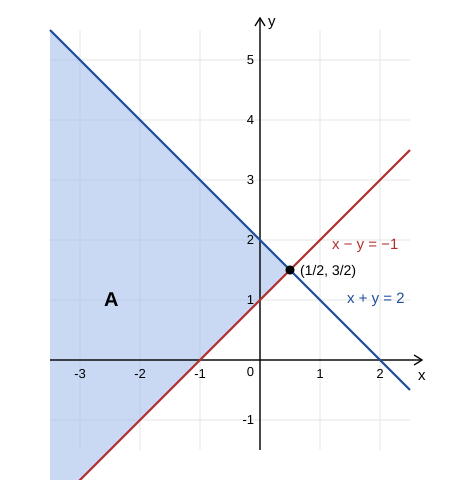

# BCE ECG — Maths 2 approfondies (ESCP-HEC) 2025 · Corrigé guidé

*Corrigé rédigé par IA, non officiel. Signalez toute erreur.*

## Présentation du sujet

**Cadre.** Épreuve de mathématiques 2 approfondies conçue par ESCP BS et HEC Paris, voie générale ECG, 4 heures, sans calculatrice ni document, avec un aide-mémoire Python en annexe. Trois parties, 41 questions (sous-questions comprises). Selon le rapport 2025, 2 814 copies ont été notées, avec une moyenne de 10,63 et un écart type de 5,93.

**Thème.** Le sujet construit l'intervalle de confiance de Student pour l'espérance d'un modèle gaussien de variance inconnue. Le rapport 2025 le résume ainsi : « Il s'intéressait à une méthode de construction d'intervalle de confiance non asymptotique pour l'espérance de modèles gaussiens de variance inconnue, en utilisant la loi de Student et le théorème de Cochran. »

- **Première partie (Q1–Q7, 19 questions) : lois du khi-deux et de Student.** Simulation de $S_n=\sum X_i^2$ et conjecture sur sa variance ; $W_n=S_n/2$ suit la loi $\gamma(\frac n2)$.
  Moments de $\frac{1}{W_n}$ et $\frac{1}{\sqrt{W_n}}$.
  Espérance et variance de $T_n$ ; la suite $u_n=\mathbb{E}(1/\sqrt{W_n})$ et son équivalent $\sqrt{2/n}$ ; convergence en probabilité de $T_n$ vers $Y$.
- **Deuxième partie (Q8–Q16, 11 questions) : rotation de deux gaussiennes.** Preuve que $\frac{X+Y}{\sqrt2}$ et $\frac{X-Y}{\sqrt2}$ sont indépendantes et normales centrées réduites, par un calcul de $\mathbb{P}((X,Y)\in\mathcal{A})$ sur un quart de plan.
- **Troisième partie (Q17–Q21, 11 questions) : Cochran et Student.** Indépendance de la moyenne empirique et de la somme des carrés des écarts, loi $\chi^2(n-1)$, estimateur sans biais de $\sigma^2$, statistique de Student et intervalle de confiance exact.

**Notions du programme.** Loi normale et fonction $\Phi$, lois $\gamma$ et fonction $\Gamma$, stabilité des lois $\gamma$ et normales pour la somme, théorème de transfert, espérance d'un produit de variables indépendantes, lemme des coalitions, caractérisation de l'indépendance par les fonctions de répartition, Markov, convergence en probabilité ; intégrales impropres et changements de variable ; bases orthonormées et Pythagore ; fermés de $\mathbb{R}^2$ ; estimation et intervalles de confiance.

**Barème (rapport 2025).** « Partie 1 : 45%, partie 2 : 34%, partie 3 : 21%. » « Pour obtenir 16/20, il fallait faire 41% et pour 20/20, 70% environ. » L'informatique représente 12 %. Les questions qui rapportent le plus de points sont 1(c), 2(a), 6(e), 8, 11(b) et 16.

**Questions abordables à ne pas laisser passer.** 1(a), 1(b), 2(a)–(d), 3(a), 5(a), 5(b), 6(a)–(c), 8, 9, 10, 11(a), 13, 17, 19(a), 20(a), 20(b), 21. Plusieurs questions de la troisième partie se traitent en admettant les précédentes.

**Gestion du temps.** Environ 1 h 45 pour la première partie, 1 h 15 pour la deuxième et 50 minutes pour la troisième, en gardant 10 minutes de relecture.

---

## Première partie — Lois du khi-deux et de Student

On identifie la loi de $S_n$ par une loi $\gamma$, on calcule des moments négatifs grâce à la fonction $\Gamma$, puis on étudie $T_n$ et l'on montre qu'elle « ressemble » à $Y$ quand $n$ est grand.

### Question 1(a)

> [!INDICATION]
> Que vaut $\mathbb{E}(X_i^2)$ quand $X_i\hookrightarrow\mathcal{N}(0,1)$ ? Pensez à la formule de König-Huygens.

#### Solution

$\mathbb{E}(X_i^2)=\mathbb{V}(X_i)+\mathbb{E}(X_i)^2=1$, donc par linéarité $\mathbb{E}(S_n)=n$.

### Question 1(b)

> [!INDICATION]
> Le formulaire donne `rd.normal(m, d, n)`. Faites la somme des carrés avec une boucle.

#### Solution

```python
def simul(n):
    X = rd.normal(0, 1, n)
    s = 0
    for i in range(n):
        s = s + X[i]**2
    return s
```

### Question 1(c)

> [!INDICATION]
> Que calcule `t/N` quand $N$ est grand ? Et que représente $n^2$ ?

> [!INDICATION]
> Lisez les ordonnées des points et comparez-les à $n$.

#### Solution

$S_n^2$ admet une variance : la loi normale a des moments de tout ordre (transfert), donc $S_n^4$, polynôme en les $X_i$ indépendantes, admet une espérance.

Par la loi faible des grands nombres, `t/N` approche $\mathbb{E}(S_n^2)$ ; comme $n^2=\mathbb{E}(S_n)^2$, `f(n, 50000)` est une valeur approchée de $\mathbb{V}(S_n)$.

Les points valent environ $2$, $4$, …, $18$ : on conjecture $\mathbb{V}(S_n)=2n$.

> [!JURY]
> Le rapport 2025 : « Très peu d'étudiants ont remarqué que l'on simulait la variance de $S_n$ et encore moins d'étudiants ont justifié leurs réponses. Nous avons eu des réponses farfelues comme $S_n$ diverge... »

### Question 2(a)

> [!INDICATION]
> Calculez la fonction de répartition de $W_1$ à l'aide de $\Phi$, en distinguant $x\leqslant0$ et $x>0$.

> [!INDICATION]
> Avant de dériver, justifiez la continuité sur $\mathbb{R}$ (en particulier en $0$) et le caractère $C^1$ sauf en un point.

#### Solution

$G(x)=0$ pour $x\leqslant0$ et $G(x)=2\Phi(\sqrt{2x})-1$ pour $x>0$.

$G$ est continue sur $\mathbb{R}$ (limite nulle en $0^+$) et de classe $C^1$ sur $\mathbb{R}^*$ : $W_1$ est à densité, et :

$$f_{W_1}(x)=\begin{cases}0&\text{si }x\leqslant0,\\[1mm]\dfrac{1}{\sqrt\pi}\,x^{-1/2}e^{-x}&\text{si }x>0.\end{cases}$$

> [!JURY]
> Le rapport 2025 : « la justification de la régularité de la fonction de répartition est bâclée ou inexistante. La densité proposée par les étudiants est souvent mal définie en 0. » Donner une valeur en $0$ (ici $0$) et justifier continuité et caractère $C^1$ par morceaux.

### Question 2(b)

> [!INDICATION]
> Une densité est d'intégrale 1 ; reconnaissez $\Gamma$.

#### Solution

$1=\frac{1}{\sqrt\pi}\int_0^{+\infty}x^{-1/2}e^{-x}\,\mathrm{d}x=\frac{\Gamma(1/2)}{\sqrt\pi}$, d'où $\Gamma(\frac12)=\sqrt\pi$.

> [!METHODE]
> Pour calculer une intégrale « à la Gamma », il est souvent plus rapide d'exhiber une densité connue que d'intégrer : l'intégrale d'une densité vaut 1.

### Question 2(c)

> [!INDICATION]
> Identifiez la loi de $W_1$, puis utilisez un résultat de stabilité du programme et une récurrence.

#### Solution

$W_1\hookrightarrow\gamma(\frac12)$ : sa densité est $\frac{1}{\Gamma(1/2)}x^{\frac12-1}e^{-x}$ sur $]0,+\infty[$.

Les $\frac12X_i^2$ sont indépendantes (coalitions) de loi $\gamma(\frac12)$. Par récurrence et stabilité des lois $\gamma$ pour la somme de variables indépendantes, $W_n\hookrightarrow\gamma(\frac n2)$.

> [!PIEGE]
> La stabilité exige l'indépendance de $W_n$ et de $\frac12X_{n+1}^2$ : elle découle du lemme des coalitions ($W_n$ ne dépend que de $X_1,\dots,X_n$). C'est ce qu'il faut écrire dans l'hérédité.

### Question 2(d)

> [!INDICATION]
> Espérance et variance d'une loi $\gamma(\nu)$, puis $S_n=2W_n$.

#### Solution

$\mathbb{E}(W_n)=\mathbb{V}(W_n)=\frac n2$, donc $\mathbb{E}(S_n)=n$ et $\mathbb{V}(S_n)=4\cdot\frac n2=2n$ : la conjecture est démontrée.

### Question 3(a)

> [!INDICATION]
> Théorème de transfert avec la densité de $\gamma(\frac n2)$ : quelle condition sur $n$ assure la convergence en $0$ ?

> [!INDICATION]
> Utilisez $\Gamma(x+1)=x\Gamma(x)$ avec $x=\frac n2-1$.

#### Solution

$$\mathbb{E}\Big(\frac{1}{W_n}\Big)=\frac{1}{\Gamma(n/2)}\int_0^{+\infty}x^{\frac n2-2}e^{-x}\,\mathrm{d}x=\frac{\Gamma\big(\frac n2-1\big)}{\Gamma\big(\frac n2\big)},$$

intégrale convergente car $\frac n2-1>0$ pour $n\geqslant3$. Puis $\mathbb{E}(\frac{1}{W_n})=\frac{2}{n-2}$ et $\mathbb{E}(\frac{1}{S_n})=\frac{1}{n-2}$.

> [!METHODE]
> Pour $W\hookrightarrow\gamma(\nu)$ et $s<\nu$, le théorème de transfert donne $\mathbb{E}(W^{-s})=\frac{\Gamma(\nu-s)}{\Gamma(\nu)}$ : on « absorbe » la puissance dans la densité et l'on reconnaît une autre fonction $\Gamma$. La même méthode donne $u_n$ à la question 6.

> [!JURY]
> Le rapport 2025 note que « L'existence des espérances est souvent admise et non prouvée. » Ici, c'est la convergence de l'intégrale en $0$ ($\frac n2-2>-1$) qui donne l'existence, et elle échoue pour $n\leqslant2$.

### Question 3(b)

> [!INDICATION]
> Majorez $\frac{1}{\sqrt x}$ par une expression affine en $\frac1x$, valable pour tout $x>0$.

> [!INDICATION]
> L'inégalité $\sqrt y\leqslant\frac{1+y}{2}$ découle d'un carré positif.

#### Solution

Pour $x>0$, $0\leqslant\frac{1}{\sqrt x}\leqslant\frac12(1+\frac1x)$. L'intégrale $\int_0^{+\infty}\frac12(1+\frac1x)f_{S_n}(x)\,\mathrm{d}x$ converge par (a) ; par comparaison de fonctions positives, $\int_0^{+\infty}\frac{1}{\sqrt x}f_{S_n}(x)\,\mathrm{d}x$ converge, donc $\frac{1}{\sqrt{S_n}}$ admet une espérance.

### Question 4

> [!INDICATION]
> Étudiez $t\mapsto\mathbb{P}(|T_n|\leqslant t)$ sur $[0,+\infty[$ : continuité, stricte monotonie, valeurs aux bornes.

#### Solution

$g(t)=F_n(t)-F_n(-t)$ est continue, de dérivée $f_n(t)+f_n(-t)>0$, avec $g(0)=0$ et $g(t)\to1$.

Par le théorème de la bijection, $g:[0,+\infty[\to[0,1[$ est bijective, et $1-\alpha\in\,]0,1[$ a un unique antécédent $t_{n,\alpha}$.

> [!METHODE]
> Existence et unicité d'un quantile : on écrit la probabilité comme une fonction continue strictement monotone du seuil, et l'on applique le théorème de la bijection. La stricte positivité de la densité donne la stricte monotonie.

### Question 5(a)

> [!INDICATION]
> Écrivez $T_n$ comme un produit de deux variables indépendantes qui admettent une espérance.

#### Solution

$T_n=\sqrt n\,Y\cdot\frac{1}{\sqrt{S_n}}$ avec $Y$ et $\frac{1}{\sqrt{S_n}}$ indépendantes, admettant une espérance (3(b)) : $\mathbb{E}(T_n)=\sqrt n\,\mathbb{E}(Y)\,\mathbb{E}(\frac{1}{\sqrt{S_n}})=0$.

> [!JURY]
> Le rapport 2025 range parmi les formules fausses vues dans les copies $\mathbb{E}\big(\frac XY\big)=\frac{\mathbb{E}(X)}{\mathbb{E}(Y)}$ et $\mathbb{V}(XY)=\mathbb{V}(X)\mathbb{V}(Y)$. Seule l'espérance d'un produit de variables indépendantes se factorise.

### Question 5(b)

> [!INDICATION]
> Même méthode avec $T_n^2=nY^2\cdot\frac{1}{S_n}$.

#### Solution

$\mathbb{E}(T_n^2)=n\cdot1\cdot\frac{1}{n-2}$, donc $\mathbb{V}(T_n)=\frac{n}{n-2}$.

### Question 5(c)

> [!INDICATION]
> Développez le carré ; le terme croisé fait apparaître $\mathbb{E}\big(\frac{1}{\sqrt{S_n}}\big)$, à réécrire avec $W_n$.

#### Solution

$\mathbb{E}(T_nY)=\sqrt n\,\mathbb{E}(Y^2)\,\mathbb{E}(\frac{1}{\sqrt{S_n}})=\sqrt{\frac n2}\,\mathbb{E}(\frac{1}{\sqrt{W_n}})$, donc :

$$\begin{aligned}
\mathbb{E}\big((T_n-Y)^2\big)&=\frac{n}{n-2}-2\sqrt{\frac n2}\,\mathbb{E}\Big(\frac{1}{\sqrt{W_n}}\Big)+1\\
&=\frac{2n-2}{n-2}-\sqrt{2n}\,\mathbb{E}\Big(\frac{1}{\sqrt{W_n}}\Big).
\end{aligned}$$

### Question 6(a)

> [!INDICATION]
> Comparez $W_{n+1}$ et $W_n$ pour chaque $\omega$.

> [!INDICATION]
> Pour $u_2$, $W_2$ suit une loi que vous connaissez bien.

#### Solution

$W_{n+1}=W_n+\frac12X_{n+1}^2\geqslant W_n>0$, donc $\frac{1}{\sqrt{W_{n+1}}}\leqslant\frac{1}{\sqrt{W_n}}$ et $u_{n+1}\leqslant u_n$. Par transfert, $u_n=\frac{\Gamma((n-1)/2)}{\Gamma(n/2)}$ ; en particulier $u_2=\Gamma(\frac12)=\sqrt\pi$.

> [!METHODE]
> Pour comparer deux espérances, une inégalité entre les variables, vraie pour chaque $\omega$, suffit (croissance de l'espérance). C'est souvent plus rapide que de comparer les intégrales.

### Question 6(b)

> [!INDICATION]
> Exprimez $u_n$ et $u_{n+1}$ à l'aide de $\Gamma$, puis utilisez $\Gamma(x+1)=x\Gamma(x)$.

#### Solution

$$\begin{aligned}
u_{n+1}u_n&=\frac{\Gamma\big(\frac{n-1}{2}\big)}{\Gamma\big(\frac{n+1}{2}\big)}\\
&=\frac{1}{\frac{n-1}{2}}\\
&=\frac{2}{n-1}.
\end{aligned}$$

### Question 6(c)

> [!INDICATION]
> La case d'indice $k$ contient $u_{k+2}$ ; traduisez la relation (b) avec ces indices.

#### Solution

```python
def suite_u(n):
    U = np.zeros(n - 1)
    U[0] = np.sqrt(np.pi)
    for k in range(1, n - 1):
        U[k] = 2 / (k * U[k - 1])
    return U
```

> [!PIEGE]
> Décalage d'indices : $u_{m+1}=\frac{2}{(m-1)u_m}$ avec $m=k+1$ donne $u_{k+2}=\frac{2}{k\,u_{k+1}}$, d'où `2 / (k * U[k-1])`. Vérifier sur le premier terme : $u_3=\frac{2}{\sqrt\pi}$.

### Question 6(d)

> [!INDICATION]
> Que représente l'expression tracée, `V*U**2` ?

#### Solution

Le graphique représente $n\,u_n^2$, qui tend visiblement vers 2 : on conjecture $n\,u_n^2\to2$, soit $u_n\sim\sqrt{\frac2n}$.

### Question 6(e)

> [!INDICATION]
> Encadrez $u_n^2$ entre deux produits de termes consécutifs, en utilisant la décroissance.

> [!INDICATION]
> $u_nu_{n+1}\leqslant u_n^2\leqslant u_{n-1}u_n$, puis la relation (b).

#### Solution

Pour $n\geqslant3$ : $\frac{2}{n-1}\leqslant u_n^2\leqslant\frac{2}{n-2}$, donc $n\,u_n^2\to2$ par encadrement, et $u_n\sim\sqrt{\frac2n}$.

> [!JURY]
> Le rapport 2025 signale comme fausse l'affirmation « si $(u_n)$ converge alors $u_{n+1}\sim u_n$ ». Ici on ne peut pas écrire $u_{n+1}\sim u_n$ sans preuve pour en déduire $u_n^2\sim\frac{2}{n-1}$ : c'est l'encadrement par la décroissance qui fait le travail.

### Question 7

> [!INDICATION]
> Inégalité de Markov appliquée à $(T_n-Y)^2$.

> [!INDICATION]
> Calculez la limite de $\mathbb{E}((T_n-Y)^2)$ à l'aide de 5(c) et 6(e).

#### Solution

$\mathbb{P}(|T_n-Y|>\varepsilon)\leqslant\frac{1}{\varepsilon^2}\mathbb{E}((T_n-Y)^2)$, et :

$$\mathbb{E}\big((T_n-Y)^2\big)=\frac{2n-2}{n-2}-\sqrt{2n}\,u_n\xrightarrow[n\to+\infty]{}2-2=0,$$

car $\sqrt{2n}\,u_n\sim\sqrt{2n}\sqrt{\frac2n}=2$. Donc $T_n$ converge en probabilité vers $Y$.

> [!METHODE]
> Pour montrer une convergence en probabilité vers une variable (et non vers une constante), on majore $\mathbb{P}(|T_n-Y|>\varepsilon)$ par Markov appliqué à $(T_n-Y)^2$ : il suffit que l'écart quadratique moyen $\mathbb{E}((T_n-Y)^2)$ tende vers 0. C'est la raison d'être de la question 5(c).

> [!PIEGE]
> On ne soustrait pas des équivalents : on calcule séparément les **limites** des deux termes (2 et 2), puis on soustrait les limites.

---

## Deuxième partie — Rotation de deux gaussiennes indépendantes

On calcule $\mathbb{P}(X+Y\leqslant a,\ X-Y\leqslant b)$ par une intégrale double (théorème admis), puis on reconnaît le produit des fonctions de répartition de deux lois normales. Outils : changements de variable affines, parité de $\varphi$, dérivée d'un produit.

### Question 8

> [!INDICATION]
> Tracez les deux droites $x+y=2$ et $x-y=-1$ ; de quel côté de chacune se trouve $\mathcal{A}$ ?

> [!INDICATION]
> Calculez le point d'intersection et testez un point simple, par exemple $(-2,0)$.

#### Solution

$\mathcal{A}$ est l'ensemble des points sous la droite $y=2-x$ et au-dessus de la droite $y=x+1$.

Ces droites perpendiculaires se coupent en $(\frac12,\frac32)=(c,d)$ ; $\mathcal{A}$ est le quart de plan d'angle droit de sommet $(\frac12,\frac32)$, ouvert vers la gauche ($x\leqslant\frac12$), bords inclus.



> [!JURY]
> Le rapport 2025 : « Le dessin demandé a posé beaucoup de problème aux étudiants et nous avons observé des carrés, losanges, cercle... » Deux inégalités affines définissent une intersection de deux demi-plans : ici un angle, non borné.

### Question 9(a)

> [!INDICATION]
> Écrivez les deux conditions sous la forme $x\leqslant\ldots$ et comparez les deux majorants selon la position de $y$ par rapport à $d$.

#### Solution

$(x,y)\in\mathcal{A}\iff x\leqslant\min(a-y,b+y)$, et $y\geqslant d\iff b+y\geqslant a-y$. Pour $y\geqslant d$, le minimum est $a-y$.

### Question 9(b)

> [!INDICATION]
> Pour $y$ fixé, l'indicatrice est celle d'une demi-droite.

#### Solution

$\int_{-\infty}^{+\infty}\mathbb{1}_{\mathcal{A}}(x,y)\varphi(x)\,\mathrm{d}x=\int_{-\infty}^{a-y}\varphi=\Phi(a-y)$.

### Question 10

> [!INDICATION]
> Même raisonnement, le minimum est maintenant l'autre majorant.

#### Solution

Pour $y\leqslant d$, $b+y\leqslant a-y$ et l'intégrale vaut $\Phi(b+y)$.

> [!METHODE]
> Pour intégrer l'indicatrice d'une partie du plan à $y$ fixé, on décrit la « tranche » $\{x\ |\ (x,y)\in\mathcal{A}\}$ : ici une demi-droite dont l'extrémité dépend de la position de $y$ par rapport à l'ordonnée $d$ du sommet.

### Question 11(a)

> [!INDICATION]
> Écrivez $\mathcal{A}$ à l'aide d'inégalités larges portant sur des fonctions continues.

#### Solution

$\mathcal{A}=\{h_1\leqslant a\}\cap\{h_2\leqslant b\}$ avec $h_1(x,y)=x+y$ et $h_2(x,y)=x-y$ continues : intersection de deux fermés, $\mathcal{A}$ est fermée.

### Question 11(b)

> [!INDICATION]
> Appliquez le théorème admis en coupant l'intégrale en $y=d$, puis 9(b) et 10.

> [!INDICATION]
> Changements de variable $y=d+z$ et $y=d-z$ ; calculez $a-d$ et $b+d$.

#### Solution

$$\mathbb{P}\big((X,Y)\in\mathcal{A}\big)=\int_{-\infty}^{d}\Phi(b+y)\varphi(y)\,\mathrm{d}y+\int_d^{+\infty}\Phi(a-y)\varphi(y)\,\mathrm{d}y.$$

Avec $y=d-z$ puis $y=d+z$, et $a-d=b+d=c$, on obtient $\int_0^{+\infty}(\varphi(d+z)+\varphi(d-z))\Phi(c-z)\,\mathrm{d}z$.

> [!PIEGE]
> Dans un changement de variable décroissant ($y=d-z$), les bornes s'échangent et le signe de $\mathrm{d}y$ compense : on retombe sur $\int_0^{+\infty}$. Le rapport 2025 dénonce, parmi les manques d'honnêteté, « changement de variable faux mais bon résultat entouré ».

### Question 12

> [!INDICATION]
> Écrivez $\Phi(c-z)$ comme une intégrale et faites un changement de variable de translation.

#### Solution

$\Phi(c-z)=\int_{-\infty}^{c-z}\varphi(s)\,\mathrm{d}s=\int_{-\infty}^{c}\varphi(t-z)\,\mathrm{d}t$ ($s=t-z$), puis on reporte dans 11(b).

### Question 13

> [!INDICATION]
> Développez les deux carrés.

#### Solution

$\big(\frac{u+v}{\sqrt2}\big)^2+\big(\frac{u-v}{\sqrt2}\big)^2=u^2+v^2$, d'où l'égalité des deux produits d'exponentielles.

> [!METHODE]
> C'est l'invariance de la densité gaussienne de $\mathbb{R}^2$ par rotation : $(u,v)\mapsto\big(\frac{u+v}{\sqrt2},\frac{u-v}{\sqrt2}\big)$ conserve $u^2+v^2$. Tout le résultat de la partie en découle.

### Question 14

> [!INDICATION]
> Dans l'intégrale intérieure (en $z$), appliquez 13 pour faire sortir un facteur qui ne dépend pas de $z$.

> [!INDICATION]
> Le facteur restant s'intègre en $z$ par un changement de variable affine, et donne une valeur de $\Phi$ (pensez à $1-\Phi(x)=\Phi(-x)$).

#### Solution

Avec 13, $\varphi(d+z)\varphi(t-z)=\varphi\big(\frac{t+d}{\sqrt2}\big)\varphi\big(\frac{2z+d-t}{\sqrt2}\big)$ et $\int_0^{+\infty}\varphi\big(\frac{2z+d-t}{\sqrt2}\big)\mathrm{d}z=\frac{1}{\sqrt2}\Phi\big(\frac{t-d}{\sqrt2}\big)$.

De même $\varphi(d-z)\varphi(t-z)=\varphi\big(\frac{t+d-2z}{\sqrt2}\big)\varphi\big(\frac{t-d}{\sqrt2}\big)$ et $\int_0^{+\infty}\varphi\big(\frac{t+d-2z}{\sqrt2}\big)\mathrm{d}z=\frac{1}{\sqrt2}\Phi\big(\frac{t+d}{\sqrt2}\big)$. On somme et l'on intègre en $t$ sur $]-\infty,c]$.

### Question 15

> [!INDICATION]
> Reconnaissez dans l'intégrande la dérivée d'un produit de deux valeurs de $\Phi$.

#### Solution

L'intégrande est $H'(t)$ avec $H(t)=\Phi\big(\frac{t+d}{\sqrt2}\big)\Phi\big(\frac{t-d}{\sqrt2}\big)$ ; comme $H(t)\to0$ en $-\infty$ :

$$\mathbb{P}\big((X,Y)\in\mathcal{A}\big)=H(c)=\Phi\Big(\frac{c+d}{\sqrt2}\Big)\Phi\Big(\frac{c-d}{\sqrt2}\Big).$$

### Question 16

> [!INDICATION]
> Traduisez $(X,Y)\in\mathcal{A}$ en termes de $W$ et $Z$.
>
> Exprimez ensuite $c+d$ et $c-d$ avec $a$ et $b$.

> [!INDICATION]
> Obtenez les lois marginales par passage à la limite, puis utilisez la caractérisation de l'indépendance par la fonction de répartition du couple.

#### Solution

$(X,Y)\in\mathcal{A}\iff W\leqslant\frac{a}{\sqrt2}$ et $Z\leqslant\frac{b}{\sqrt2}$, et $c+d=a$, $c-d=b$. Donc $\mathbb{P}(W\leqslant w,Z\leqslant z)=\Phi(w)\Phi(z)$ pour tous $w,z$.

En faisant tendre $z$ vers $+\infty$ (continuité monotone), $\mathbb{P}(W\leqslant w)=\Phi(w)$ ; de même pour $Z$.

La fonction de répartition du couple est le produit des marginales : $W$ et $Z$ sont indépendantes, de loi $\mathcal{N}(0,1)$.

> [!PIEGE]
> Montrer seulement que $W$ et $Z$ suivent $\mathcal{N}(0,1)$ ne suffit pas : l'indépendance demande la factorisation de la fonction de répartition **du couple**, pour tous $w$ et $z$.

---

## Troisième partie — Cochran et intervalle de Student

On généralise la deuxième partie à $n$ variables (théorème de Cochran, admis) pour séparer la moyenne empirique et la dispersion, puis on construit un intervalle de confiance exact pour $\mu$ quand $\sigma$ est inconnu.

### Question 17(a)

> [!INDICATION]
> Décomposez $x$ dans la base orthonormée et calculez le terme $\langle x,a_1\rangle a_1$.

#### Solution

$x=\sum_{k=1}^{n}\langle x,a_k\rangle a_k$ et $\langle x,a_1\rangle a_1=\overline x\,(1,\dots,1)$ : on soustrait.

### Question 17(b)

> [!INDICATION]
> Prenez la norme au carré des deux membres de (a).

#### Solution

Par Pythagore dans la famille orthonormée $(a_2,\dots,a_n)$, $\|\sum_{k\geqslant2}\langle x,a_k\rangle a_k\|^2=\sum_{k\geqslant2}\langle x,a_k\rangle^2$, et l'autre membre a pour norme au carré $\sum_i(x_i-\overline x)^2$.

### Question 18(a)

> [!INDICATION]
> Pour $n=2$, déterminez $a_2$ explicitement.

#### Solution

$a_2=\pm\frac{1}{\sqrt2}(1,-1)$ ; avec le signe $+$, $Y_1=\frac{X_1+X_2}{\sqrt2}$ et $Y_2=\frac{X_1-X_2}{\sqrt2}$ sont indépendantes de loi $\mathcal{N}(0,1)$ par Cochran : c'est le théorème de la deuxième partie.

### Question 18(b)

> [!INDICATION]
> Calculez la covariance par bilinéarité. Pour la réciproque, que devient $R_2$ quand la covariance est nulle ?

#### Solution

$\operatorname{Cov}(R_1,R_2)=\beta_1+\beta_2$. Indépendantes $\Rightarrow$ covariance nulle.

Réciproquement, si $\beta_2=-\beta_1$ (avec $\beta_1\neq0$), $R_1=\sqrt2\,Y_1$ et $R_2=\sqrt2\,\beta_1Y_2$ sont des fonctions de $Y_1$ et de $Y_2$, indépendantes par (a).

> [!PIEGE]
> En général, covariance nulle n'implique pas indépendance. Ici l'équivalence vient de la structure gaussienne (deuxième partie) : c'est tout l'intérêt de la question.

### Question 19(a)

> [!INDICATION]
> Stabilité de la loi normale pour la somme.

#### Solution

$\sum X_i\hookrightarrow\mathcal{N}(0,n)$, donc $\overline X\hookrightarrow\mathcal{N}(0,\frac1n)$.

> [!PIEGE]
> Le second paramètre de la loi normale est la variance : diviser par $n$ divise la variance par $n^2$, d'où $\frac{n}{n^2}=\frac1n$ (et non $\frac{1}{\sqrt n}$, qui est l'écart type).

### Question 19(b)

> [!INDICATION]
> Calculez $Y_1$ ; pour $U$, utilisez 17(b) pour chaque $\omega$.

#### Solution

$Y_1=\sqrt n\,\overline X$, donc $\overline X=\frac{Y_1}{\sqrt n}$, et $U=\sum_{k=2}^{n}Y_k^2$.

### Question 19(c)

> [!INDICATION]
> $\overline X$ et $U$ dépendent de groupes disjoints de $Y_k$.

#### Solution

Par Cochran et le lemme des coalitions, $\overline X$ (fonction de $Y_1$) et $U$ (fonction de $Y_2,\dots,Y_n$) sont indépendantes.

De plus $U$, somme de $n-1$ carrés de $\mathcal{N}(0,1)$ indépendantes, suit $\chi^2(n-1)$.

### Question 20(a)

> [!INDICATION]
> Exprimez $X_i-\overline X$ en fonction de $Z_i-\overline Z$.

#### Solution

$X_i-\overline X=\frac{Z_i-\overline Z}{\sigma}$, donc $U=\frac{V}{\sigma^2}$ et $V=\sigma^2U$.

### Question 20(b)

> [!INDICATION]
> Quelle est l'espérance d'une loi $\chi^2(n-1)$ ?

#### Solution

$\mathbb{E}(U)=n-1$, donc $\mathbb{E}(\frac{V}{n-1})=\sigma^2$ : $\frac{V}{n-1}$, qui ne dépend pas des paramètres inconnus, est un estimateur sans biais de $\sigma^2$.

> [!METHODE]
> On divise par $n-1$ et non par $n$ : une « dimension » est consommée par l'estimation de la moyenne ($Y_1$ disparaît de $U$). C'est exactement ce que montre Cochran.

### Question 20(c)

> [!INDICATION]
> Simplifiez par $\sigma$ et faites apparaître $Y_1$ et $\sum_{k\geqslant2}Y_k^2$.

> [!INDICATION]
> Comparez avec la définition de $T_{n-1}$ : quelles variables y jouent le rôle de $Y$ et des $X_i$ ?

#### Solution

$$\begin{aligned}
\frac{\overline Z-\mu}{\sqrt{\frac{V}{n(n-1)}}}&=\frac{\sqrt n\,\overline X}{\sqrt{\frac{U}{n-1}}}\\
&=\frac{Y_1}{\sqrt{\frac{1}{n-1}\sum_{k=2}^{n}Y_k^2}}.
\end{aligned}$$

$Y_1,\dots,Y_n$ sont indépendantes de loi $\mathcal{N}(0,1)$ : cette variable a la loi de $\frac{Y}{\sqrt{S_{n-1}/(n-1)}}$, c'est-à-dire $\mathcal{T}(n-1)$.

### Question 21

> [!INDICATION]
> Partez de $\mathbb{P}(|T|\leqslant t_{n-1,\alpha})=1-\alpha$ et isolez $\mu$.

#### Solution

$|T|\leqslant t$ équivaut à $\overline Z-t\sqrt{\frac{V}{n(n-1)}}\leqslant\mu\leqslant\overline Z+t\sqrt{\frac{V}{n(n-1)}}$, d'où l'intervalle de confiance de niveau $1-\alpha$ :

$$\bigg[\overline Z-t_{n-1,\alpha}\sqrt{\frac{V}{n(n-1)}}\ ;\ \overline Z+t_{n-1,\alpha}\sqrt{\frac{V}{n(n-1)}}\bigg].$$

> [!METHODE]
> Construire un intervalle de confiance : trouver une variable « pivot » dont la loi ne dépend d'aucun paramètre inconnu (ici $T\hookrightarrow\mathcal{T}(n-1)$), encadrer le pivot avec la probabilité voulue, puis isoler le paramètre. Les bornes doivent être des estimateurs.

---

## Bilan

- **Lois issues de la loi normale.** $\frac12X^2\hookrightarrow\gamma(\frac12)$, $\Gamma(\frac12)=\sqrt\pi$, somme de carrés : $\frac12\chi^2(n)=\gamma(\frac n2)$, d'espérance $n$ et de variance $2n$.
- **Moments négatifs.** $\mathbb{E}(W^{-s})$ pour $W\hookrightarrow\gamma(\nu)$ se calcule par transfert et vaut $\frac{\Gamma(\nu-s)}{\Gamma(\nu)}$ si $\nu>s$ : la condition d'existence vient du comportement en $0$.
- **Indépendance.** Espérance d'un produit de variables indépendantes, lemme des coalitions, caractérisation par la fonction de répartition du couple. Pas de formule pour $\mathbb{E}(X/Y)$ ni $\mathbb{V}(XY)$.
- **Suites définies par un produit.** De $u_nu_{n+1}=\frac{2}{n-1}$ et de la décroissance, on tire l'encadrement $u_nu_{n+1}\leqslant u_n^2\leqslant u_{n-1}u_n$ et l'équivalent. Technique classique (intégrales de Wallis).
- **Intégrales doubles.** Couper selon la position de $y$, changements de variable affines, reconnaître une dérivée de produit.
- **Statistique.** Théorème de Cochran, estimateur sans biais $\frac{1}{n-1}\sum(Z_i-\overline Z)^2$, statistique de Student et intervalle de confiance exact.
- **Conseil du rapport 2025.** « Rendez une copie le plus propre possible. Entourez les résultats, soulignez les théorèmes utilisés et les hypothèses. »
