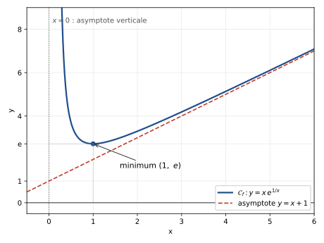

# BCE ECG — Mathématiques appliquées (emlyon) 2025 · Corrigé brut

*Corrigé rédigé par IA, non officiel. Signalez toute erreur.*

Épreuve de 4 heures (code sujet 296), calculatrice interdite. Trois exercices, 56 questions.

---

## Exercice 1

### Partie A : Étude de la suite $(u_n)_{n\in\mathbb{N}}$

#### 1. a)

Par récurrence sur $n$, notons $\mathcal P(n)$ : « $u_n>0$ ».

- $u_0=1>0$ : $\mathcal P(0)$ est vraie.
- Soit $n\in\mathbb{N}$ tel que $u_n>0$. Alors $\frac1{u_n}$ est défini et $\mathrm e^{1/u_n}>0$, donc $u_{n+1}=u_n\,\mathrm e^{1/u_n}>0$.

**Pour tout $n\in\mathbb{N}$, $u_n>0$.**

#### 1. b)

Pour tout $n$, $u_n>0$, donc $\frac1{u_n}>0$ et $\mathrm e^{1/u_n}>1$. Comme $u_n>0$ :

$$u_{n+1}-u_n=u_n\left(\mathrm e^{1/u_n}-1\right)>0 .$$

**La suite $(u_n)$ est strictement croissante.**

#### 1. c)

$(u_n)$ est croissante : elle converge ou tend vers $+\infty$. Supposons par l'absurde qu'elle converge vers un réel $\ell$.

Comme $u_n\geqslant u_0=1$ pour tout $n$, on a $\ell\geqslant 1>0$. La fonction $x\mapsto x\,\mathrm e^{1/x}$ est continue en $\ell$, donc $u_{n+1}=u_n\mathrm e^{1/u_n}\to\ell\,\mathrm e^{1/\ell}$. Par unicité de la limite :

$$\ell=\ell\,\mathrm e^{1/\ell}.$$

Comme $\ell\neq0$, on obtient $\mathrm e^{1/\ell}=1$, soit $\frac1\ell=0$ : c'est impossible. Donc $(u_n)$ ne converge pas.

Croissante et non convergente, elle n'est pas majorée, donc **$\lim\limits_{n\to+\infty}u_n=+\infty$.**

#### 2.

```python
import numpy as np
u = 1
n = 0
while u < 10**6:
    u = u * np.exp(1/u)
    n = n + 1
print(n)
```

La boucle s'arrête au premier $n$ tel que $u_n\geqslant10^6$, qui existe puisque $u_n\to+\infty$. (Exécuté : le programme affiche $999\,992$.)

### Partie B : Étude de la fonction $f$

#### 3.

**En $+\infty$** : $\frac1x\to0$ donc $\mathrm e^{1/x}\to1$, et $f(x)=x\,\mathrm e^{1/x}\to+\infty$.

**En $0^+$** : posons $X=\frac1x$, qui tend vers $+\infty$. Alors $f(x)=\dfrac{\mathrm e^{X}}{X}$, et par croissances comparées $\dfrac{\mathrm e^X}{X}\to+\infty$. Donc

$$\begin{aligned}
\boxed{\lim_{x\to0^+}f(x)=+\infty}\\
\boxed{\lim_{x\to+\infty}f(x)=+\infty}
\end{aligned}$$

#### 4.

$f$ est dérivable sur $]0,+\infty[$ (produit et composée de fonctions dérivables) et, pour $x>0$ :

$$\begin{aligned}
f'(x)&=\mathrm e^{1/x}+x\cdot\left(-\frac1{x^2}\right)\mathrm e^{1/x}\\
&=\frac{(x-1)\,\mathrm e^{1/x}}{x}.
\end{aligned}$$

Le signe de $f'(x)$ est celui de $x-1$. Avec $f(1)=\mathrm e$ :

| $x$ | $0$ (valeur interdite) | | $1$ | | $+\infty$ |
|---|---|---|---|---|---|
| $f'(x)$ | ‖ | $-$ | $0$ | $+$ | |
| $f$ | ‖ $+\infty$ | décroissante | $\mathrm e$ | croissante | $+\infty$ |

#### 5. a)

Pour $x>0$, $\frac{x^{-k}}{k!}=\frac{(1/x)^k}{k!}$. La série exponentielle $\sum\frac{t^k}{k!}$ converge pour tout réel $t$ et a pour somme $\mathrm e^{t}$. Avec $t=\frac1x$ :

$$\boxed{\sum_{k=0}^{+\infty}\frac{x^{-k}}{k!}=\mathrm e^{1/x}}$$

#### 5. b)

En multipliant la série convergente de 5. a) par $x$ :

$$\begin{aligned}
f(x)&=x\sum_{k=0}^{+\infty}\frac{x^{-k}}{k!}=\sum_{k=0}^{+\infty}\frac{x^{1-k}}{k!}\\
&=x+1+\sum_{k=2}^{+\infty}\frac{x^{1-k}}{k!}\\
&=x+1+\frac1x\sum_{k=2}^{+\infty}\frac{x^{2-k}}{k!}.
\end{aligned}$$

(La série de terme général $\frac{x^{2-k}}{k!}=x\cdot\frac{x^{1-k}}{k!}$ converge, comme multiple d'une série convergente.)

#### 6. a)

Soit $x\geqslant1$. Pour $k\geqslant2$, $2-k\leqslant0$ donc $0<x^{2-k}\leqslant1$.

- **Minoration.** Tous les termes sont positifs, donc la somme est supérieure à son premier terme ($k=2$) :

$$\sum_{k=2}^{+\infty}\frac{x^{2-k}}{k!}\geqslant\frac{x^0}{2!}=\frac12 .$$

- **Majoration.** Avec $x^{2-k}\leqslant1$ et la série exponentielle en $1$ :

$$\begin{aligned}
\sum_{k=2}^{+\infty}\frac{x^{2-k}}{k!}&\leqslant\sum_{k=2}^{+\infty}\frac1{k!}\\
&=\mathrm e-2\leqslant\mathrm e .
\end{aligned}$$

#### 6. b)

D'après 5. b), $f(x)-(x+1)=\frac1x\sum_{k\geqslant2}\frac{x^{2-k}}{k!}$. En multipliant l'encadrement de 6. a) par $\frac1x>0$ :

$$\frac1{2x}\leqslant f(x)-(x+1)\leqslant\frac{\mathrm e}{x}\qquad(x\geqslant1).$$

#### 7.

Quand $x\to+\infty$, $\frac1{2x}\to0$ et $\frac{\mathrm e}x\to0$ ; par encadrement, $f(x)-(x+1)\to0$, c'est-à-dire

$$\boxed{f(x)=x+1+o(1)\quad\text{au voisinage de }+\infty}$$

#### 8.

La courbe $\mathcal C_f$ présente :

- une asymptote verticale d'équation $x=0$ ($f\to+\infty$ en $0^+$) ;
- un minimum en $(1,\mathrm e)$, avec une tangente horizontale ;
- l'asymptote oblique $y=x+1$ en $+\infty$, avec $\mathcal C_f$ **au-dessus** d'elle (d'après 5. b), $f(x)-(x+1)>0$ pour tout $x>0$).



### Partie C : Comportement asymptotique de la suite $(u_n)_{n\in\mathbb{N}}$

#### 9. a)

Pour $k\in\mathbb{N}$, $u_k>0$ et $u_{k+1}=u_k\,\mathrm e^{1/u_k}>0$, donc

$$\ln(u_{k+1})=\ln(u_k)+\frac1{u_k},$$

soit

$$\ln(u_{k+1})-\ln(u_k)=\frac1{u_k}.$$

#### 9. b)

Soit $n\in\mathbb{N}^*$. On somme 9. a) pour $k\in[\![0,n-1]\!]$ ; la somme est télescopique et $\ln(u_0)=\ln1=0$ :

$$\begin{aligned}
\ln(u_n) &=\ln(u_n)-\ln(u_0)\\
&=\sum_{k=0}^{n-1}\frac1{u_k}.
\end{aligned}$$

#### 10. a)

Soit $k\in\mathbb{N}$. La suite étant croissante, $u_k\geqslant u_0=1$ : l'encadrement $(*)$ s'applique en $x=u_k$. Comme $f(u_k)=u_{k+1}$ :

$$\frac1{2u_k}\leqslant u_{k+1}-(u_k+1)\leqslant\frac{\mathrm e}{u_k},$$

$$\boxed{1+\frac1{2u_k}\leqslant u_{k+1}-u_k\leqslant1+\frac{\mathrm e}{u_k}}$$

#### 10. b)

Soit $n\in\mathbb{N}^*$. On somme 10. a) pour $k\in[\![0,n-1]\!]$. La somme centrale est télescopique et vaut $u_n-u_0=u_n-1$ :

$$n+\frac12\sum_{k=0}^{n-1}\frac1{u_k}\leqslant u_n-1\leqslant n+\mathrm e\sum_{k=0}^{n-1}\frac1{u_k}.$$

Avec 9. b), $\sum_{k=0}^{n-1}\frac1{u_k}=\ln(u_n)$ ; on retranche $n$ et on ajoute $1$ :

$$1+\frac12\ln(u_n)\leqslant u_n-n\leqslant1+\mathrm e\ln(u_n).$$

#### 11. a)

On a $u_n\to+\infty$ (1. c)) et $\lim\limits_{x\to+\infty}\frac{\ln x}{x}=0$ (croissances comparées). Par composition :

$$\boxed{\lim_{n\to+\infty}\frac{\ln(u_n)}{u_n}=0}$$

#### 11. b)

On divise l'encadrement de 10. b) par $u_n>0$ :

$$\frac1{u_n}+\frac12\cdot\frac{\ln(u_n)}{u_n}\leqslant1-\frac{n}{u_n}\leqslant\frac1{u_n}+\mathrm e\,\frac{\ln(u_n)}{u_n}.$$

Les deux bornes tendent vers $0$ (11. a) et $u_n\to+\infty$). Par encadrement, $1-\frac n{u_n}\to0$, donc $\frac{u_n}{n}\to1$ :

$$\boxed{u_n\underset{n\to+\infty}{\sim}n}$$

#### 12.

D'après 9. b), $\sum_{k=0}^{n-1}\frac1{u_k}=\ln(u_n)$. On écrit, pour $n\geqslant2$ :

$$\frac{\ln(u_n)}{\ln(n)}=1+\frac{\ln\left(\frac{u_n}{n}\right)}{\ln(n)}.$$

Comme $\frac{u_n}n\to1$, $\ln\left(\frac{u_n}n\right)\to0$ par continuité de $\ln$ en $1$, et $\ln(n)\to+\infty$ ; donc le quotient tend vers $1$ :

$$\boxed{\sum_{k=0}^{n-1}\frac1{u_k}\underset{n\to+\infty}{\sim}\ln(n)}$$

---

## Exercice 2

### Partie A : Réduction simultanée et spectre

#### 1.

$\mathcal E=\mathrm{Vect}(I,J,K)$ : la famille $(I,J,K)$ est **génératrice** de $\mathcal E$ par définition. Pour la liberté, soient $a,b,c$ réels :

$$aI+bJ+cK=\begin{pmatrix}a+c&b&b\\ b&a&c\\ b&c&a\end{pmatrix}.$$

Si cette matrice est nulle, les coefficients $(1,2)$, $(2,2)$ et $(2,3)$ donnent $b=0$, $a=0$ et $c=0$. La famille est libre.

**$(I,J,K)$ est une base de $\mathcal E$, et $\dim\mathcal E=3$.**

#### 2.

$J$ et $K$ sont **symétriques** ($^tJ=J$, $^tK=K$), donc diagonalisables.

#### 3. a)

$$J^2=\begin{pmatrix}2&0&0\\0&1&1\\0&1&1\end{pmatrix},\qquad J^3=J^2J=\begin{pmatrix}0&2&2\\2&0&0\\2&0&0\end{pmatrix}.$$

Donc $\boxed{J^3=2J}$.

#### 3. b)

D'après 3. a), le polynôme $Q(X)=X^3-2X=X(X-\sqrt2)(X+\sqrt2)$ est annulateur de $J$. Toute valeur propre de $J$ est racine de $Q$ :

$$\mathrm{Sp}(J)\subset\{-\sqrt2,\,0,\,\sqrt2\}.$$

#### 4. a)

$$JU_1=\begin{pmatrix}2\\ \sqrt2\\ \sqrt2\end{pmatrix}=\sqrt2\,U_1,$$

$$JU_2=\begin{pmatrix}0\\0\\0\end{pmatrix}=0\cdot U_2 .$$

Ces deux vecteurs sont non nuls.

**$U_1$ est vecteur propre de $J$ pour $\sqrt2$, et $U_2$ pour $0$.**

#### 4. b)

On résout $(J+\sqrt2\,I)X=0$ pour $X=\begin{pmatrix}x\\y\\z\end{pmatrix}$ :

$$\left\{\begin{aligned}
\sqrt2\,x+y+z&=0\quad(L_1)\\
x+\sqrt2\,y&=0\quad(L_2)\\
x+\sqrt2\,z&=0\quad(L_3)
\end{aligned}\right.$$

$L_2$ et $L_3$ donnent $y=z=-\frac{x}{\sqrt2}$ ; alors $L_1$ s'écrit $\sqrt2\,x-\sqrt2\,x=0$, toujours vraie. Avec $x=-\sqrt2$ :

$$\boxed{U_3=\begin{pmatrix}-\sqrt2\\1\\1\end{pmatrix}}\qquad\left(JU_3=\begin{pmatrix}2\\-\sqrt2\\-\sqrt2\end{pmatrix}=-\sqrt2\,U_3\right).$$

#### 5. a)

$U_1,U_2,U_3$ sont des vecteurs propres de $J$ associés aux trois valeurs propres distinctes $\sqrt2$, $0$, $-\sqrt2$.

Une concaténation de familles libres de sous-espaces propres associés à des valeurs propres distinctes est libre : $(U_1,U_2,U_3)$ est libre. C'est une famille de 3 vecteurs de $\mathcal M_{3,1}(\mathbb{R})$, de dimension 3 : **c'est une base de $\mathcal M_{3,1}(\mathbb{R})$.**

#### 5. b)

$P$ est la matrice de passage de la base canonique à $(U_1,U_2,U_3)$, inversible d'après 5. a) :

$$\boxed{P=\begin{pmatrix}\sqrt2&0&-\sqrt2\\1&1&1\\1&-1&1\end{pmatrix}}$$

Comme $JP=P\,\mathrm{diag}(\sqrt2,0,-\sqrt2)$ (colonne par colonne, d'après 4.), on a $P^{-1}JP=\mathrm{diag}(\sqrt2,0,-\sqrt2)$.

#### 6. a)

$K$ échange les deux dernières coordonnées : $K\begin{pmatrix}x\\y\\z\end{pmatrix}=\begin{pmatrix}x\\z\\y\end{pmatrix}$. Donc

$$KU_1=U_1,\qquad KU_2=\begin{pmatrix}0\\-1\\1\end{pmatrix}=-U_2,\qquad KU_3=U_3 .$$

Les vecteurs non nuls $U_1,U_2,U_3$ sont vecteurs propres de $K$, pour les valeurs propres $1$, $-1$, $1$.

**$(U_1,U_2,U_3)$ est donc une base de vecteurs propres de $K$.**

#### 6. b)

$KP=P\,\mathrm{diag}(1,-1,1)$, donc

$$\boxed{P^{-1}KP=\begin{pmatrix}1&0&0\\0&-1&0\\0&0&1\end{pmatrix}}$$

#### 7. a)

$M=aI+bJ+cK$, et la conjugaison par $P$ est linéaire :

$$\begin{aligned}
P^{-1}MP&=a\,I+b\,P^{-1}JP+c\,P^{-1}KP\\
&=\begin{pmatrix}a+b\sqrt2+c&0&0\\0&a-c&0\\0&0&a-b\sqrt2+c\end{pmatrix}.
\end{aligned}$$

#### 7. b)

$M$ est semblable à la matrice diagonale $D=P^{-1}MP$ ; elles ont les mêmes valeurs propres, qui sont les coefficients diagonaux de $D$ :

$$\mathrm{Sp}(M)=\left\{a+b\sqrt2+c,\ a-c,\ a-b\sqrt2+c\right\}.$$

#### 8. a)

Les colonnes de $S$ sont les images des vecteurs de la base $(I,J,K)$, exprimées dans la base canonique de $\mathbb{R}^3$ :

$$\begin{aligned}
s(I) &=(1,1,1)\\
s(J) &=(\sqrt2,0,-\sqrt2)\\
s(K) &=(1,-1,1),
\end{aligned}$$

$$\boxed{S=\begin{pmatrix}1&\sqrt2&1\\1&0&-1\\1&-\sqrt2&1\end{pmatrix}}$$

#### 8. b)

Cherchons le noyau de $s$. Si $s(aI+bJ+cK)=0$, alors

$$\left\{\begin{aligned}
a+b\sqrt2+c&=0\\
a-c&=0\\
a-b\sqrt2+c&=0
\end{aligned}\right.$$

La différence de la première et de la troisième équation donne $2\sqrt2\,b=0$, donc $b=0$. Il reste $a+c=0$ et $a=c$, donc $a=c=0$.

Ainsi $\mathrm{Ker}(s)=\{0\}$ et $s$ est injective.

Comme $\dim\mathcal E=3=\dim\mathbb{R}^3$, le théorème du rang donne $\mathrm{rg}(s)=3$ : $s$ est surjective. **$s$ est bijective.** (De manière équivalente, $S$ est inversible.)

### Partie B : Un algorithme de coloration des graphes

#### 9.

```python
def voisins(A, i):
    n = len(A[i])
    V = []
    for j in range(n):
        if j != i and A[i][j] == 1:
            V.append(j)
    return(V)
```

#### 10.

```python
def min_ext(L):
    m = 0
    while m in L:
        m = m + 1
    return(m)
```

(`min_ext([1, 0, 3])` renvoie bien `2`.)

#### 11.

```python
def coloration(A):
    n = len(A[0])
    C = [i for i in range(n)]
    for i in range(1, n):
        C_voisins = [C[j] for j in voisins(A, i)]
        C[i] = min_ext(C_voisins)
    return(C)
```

(Sur le graphe de la figure 1 de l'énoncé, `coloration` renvoie `[0, 1, 0, 1, 2]`, la coloration de la figure 2.)

#### 12. a)

Le graphe $G$ de la figure 3 a neuf arêtes : $s_0s_1$, $s_0s_3$, $s_0s_4$, $s_1s_2$, $s_1s_5$,
$s_2s_3$, $s_2s_5$, $s_3s_4$, $s_4s_5$.

On part de $C=[0,1,2,3,4,5]$ :

| $i$ | voisins de $s_i$ | couleurs des voisins | $C_i$ |
|---|---|---|---|
| 1 | $s_0,s_2,s_5$ | $0,2,5$ | $1$ |
| 2 | $s_1,s_3,s_5$ | $1,3,5$ | $0$ |
| 3 | $s_0,s_2,s_4$ | $0,0,4$ | $1$ |
| 4 | $s_0,s_3,s_5$ | $0,1,5$ | $2$ |
| 5 | $s_1,s_2,s_4$ | $1,0,2$ | $3$ |

La commande `coloration(A)` renvoie **`[0, 1, 0, 1, 2, 3]`** (quatre couleurs).

#### 12. b)

Oui. Par exemple $c(s_0)=0$, $c(s_1)=1$, $c(s_2)=2$, $c(s_3)=1$, $c(s_4)=2$, $c(s_5)=0$ :

| arête | couleurs des extrémités |
|---|---|
| $s_0s_1$ | 0 / 1 |
| $s_0s_3$ | 0 / 1 |
| $s_0s_4$ | 0 / 2 |
| $s_1s_2$ | 1 / 2 |
| $s_1s_5$ | 1 / 0 |
| $s_2s_3$ | 2 / 1 |
| $s_2s_5$ | 2 / 0 |
| $s_3s_4$ | 1 / 2 |
| $s_4s_5$ | 2 / 0 |

Les deux extrémités de chaque arête ont des couleurs différentes : **$G$ admet une coloration à trois couleurs.** (Trois couleurs sont d'ailleurs nécessaires, puisque $s_0,s_3,s_4$ sont deux à deux voisins.) L'algorithme glouton n'est donc pas optimal.

---

## Exercice 3

### Partie A : La variable aléatoire $V$

#### 1. a)

$U(\Omega)\subset\,]0,1]$, donc $\sqrt U\in\,]0,1]$ et $V=\frac1{\sqrt U}\in[1,+\infty[$.

#### 1. b)

- Si $x<1$ : $[V\leqslant x]=\varnothing$ puisque $V\geqslant1$, donc $F_V(x)=0$.
- Si $x\geqslant1$ : par stricte décroissance de $t\mapsto\frac1{\sqrt t}$ sur $]0,1]$,

$$[V\leqslant x]=\left[\sqrt U\geqslant\frac1x\right]=\left[U\geqslant\frac1{x^2}\right].$$

Comme $\frac1{x^2}\in\,]0,1]$ et $U\hookrightarrow\mathcal U(]0,1])$ :

$$F_V(x)=P\left(U\geqslant\frac1{x^2}\right)=1-\frac1{x^2}.$$

#### 1. c)

$F_V$ est une fonction de répartition (celle de $V$). Elle est continue sur $]-\infty,1[$ (constante) et sur $]1,+\infty[$ (rationnelle).

En $1$, $1-\frac1{1^2}=0$ : elle est continue en $1$.

Elle est de classe $\mathcal C^1$ sur $\mathbb{R}\setminus\{1\}$. **$V$ est une variable à densité**, et une densité s'obtient en dérivant $F_V$ là où elle est dérivable :

$$f_V(x)=\begin{cases}\dfrac{2}{x^3}&\text{si }x\geqslant1\\[4pt] 0&\text{si }x<1\end{cases}$$

#### 2.

**Espérance.** $V$ admet une espérance si et seulement si $\int_1^{+\infty}x f_V(x)\,\mathrm dx=\int_1^{+\infty}\frac2{x^2}\,\mathrm dx$ converge (absolument : fonction positive). C'est une intégrale de Riemann convergente ($2>1$). Pour $X>1$ :

$$\int_1^X\frac2{x^2}\,\mathrm dx=2-\frac2X\xrightarrow[X\to+\infty]{}2,$$

donc

$$\boxed{E(V)=2}.$$

**Variance.** La densité $f_V$ est nulle hors de $]0,+\infty[$ et $x\mapsto x^2$ y est continue : par le théorème de transfert (avec $]a,b[=]0,+\infty[$), $V$ admet un moment d'ordre 2 si et seulement si $\int_0^{+\infty}x^2f_V(x)\,\mathrm dx=\int_1^{+\infty}\frac2x\,\mathrm dx$ converge.

C'est une intégrale de Riemann divergente ($\alpha=1$) : $\int_1^X\frac{2}{x}\,\mathrm dx=2\ln X\to+\infty$. **$V$ n'admet pas de moment d'ordre 2, donc pas de variance.**

### Partie B : Loi du sinistre le plus coûteux

#### 3. a)

Soit $x\in\mathbb{R}$. Le maximum est inférieur à $x$ si et seulement si tous les $V_i$ le sont : $[M_n\leqslant x]=\bigcap_{i=1}^n[V_i\leqslant x]$. Par indépendance mutuelle et égalité des lois :

$$\begin{aligned}
F_n(x)&=\prod_{i=1}^nP(V_i\leqslant x)\\
&=F_V(x)^n,
\end{aligned}$$

donc

$$\boxed{F_n=(F_V)^n}.$$

#### 3. b)

- Si $x<1$ : $F_n(x)=0$ pour tout $n$, de limite $0$.
- Si $x\geqslant1$ : $F_V(x)=1-\frac1{x^2}\in[0,1[$, donc $F_n(x)=F_V(x)^n\to0$ (suite géométrique de raison dans $[0,1[$).

$$\boxed{\forall x\in\mathbb{R},\quad\lim_{n\to+\infty}F_n(x)=0}$$

#### 3. c)

Supposons que $(M_n)$ converge en loi vers une variable $X$, de fonction de répartition $F_X$. Alors $F_X(x)=\lim F_n(x)=0$ en tout point $x$ où $F_X$ est continue.

Or $F_X$ est croissante et tend vers $1$ en $+\infty$ : il existe $a$ tel que $F_X(x)\geqslant\frac12$ pour tout $x\geqslant a$.

Montrons que $F_X$ est continue en au moins un point $c\geqslant a$, à l'aide de deux suites adjacentes.

- **Construction.** On pose $\alpha_0=a$ et $\beta_0=a+1$. Si $\alpha_k<\beta_k$ sont construits, on découpe $[\alpha_k,\beta_k]$ en $2k+5$ segments de même longueur.

  Les $k+2$ segments de rang pair sont deux à deux disjoints et contenus dans $]\alpha_k,\beta_k[$.

  $F_X$ étant croissante, la somme de ses accroissements sur ces segments est au plus $F_X(\beta_k)-F_X(\alpha_k)\leqslant1$. L'un d'eux, noté $[\alpha_{k+1},\beta_{k+1}]$, vérifie donc

$$F_X(\beta_{k+1})-F_X(\alpha_{k+1})\leqslant\frac1{k+2}.$$

- **Suites adjacentes.** $(\alpha_k)$ est strictement croissante et $(\beta_k)$ strictement décroissante. De plus $\beta_{k+1}-\alpha_{k+1}=\frac{\beta_k-\alpha_k}{2k+5}$, donc $0<\beta_k-\alpha_k\leqslant5^{-k}\to0$.

  Les deux suites sont adjacentes : elles convergent vers une même limite $c$, avec $\alpha_k<c<\beta_k$ pour tout $k$ (stricte monotonie), et $c>a$.

- **Continuité en $c$.** Soit $\varepsilon>0$ et $k\geqslant1$ tel que $\frac1{k+1}\leqslant\varepsilon$.

  L'intervalle $]\alpha_k,\beta_k[$ contient $c$.

  Pour $x$ dans cet intervalle, $F_X(x)$ et $F_X(c)$ sont tous deux compris entre $F_X(\alpha_k)$ et $F_X(\beta_k)$, d'où

$$|F_X(x)-F_X(c)|\leqslant F_X(\beta_k)-F_X(\alpha_k)\leqslant\frac1{k+1}\leqslant\varepsilon .$$

  Donc $F_X$ est continue en $c$.

On aurait alors $F_X(c)=\lim F_n(c)=0$, alors que $c\geqslant a$ donne $F_X(c)\geqslant\frac12$ : contradiction.

**$(M_n)$ ne converge en loi vers aucune variable aléatoire** : la limite simple des $F_n$ est la fonction nulle, qui ne tend pas vers $1$ en $+\infty$.

#### 4. a)

Soit $x>0$. Pour $n\geqslant1$ :

$$\begin{aligned}
G_n(x) &=P\left(\frac{M_n}{\sqrt n}\leqslant x\right)\\
&=P\left(M_n\leqslant x\sqrt n\right)\\
&=F_V\left(x\sqrt n\right)^n .
\end{aligned}$$

Pour $n$ assez grand, $x\sqrt n\geqslant1$ ; alors

$$G_n(x)=\left(1-\frac{1}{n x^2}\right)^n=\exp\left(n\ln\left(1-\frac1{nx^2}\right)\right).$$

Comme $\frac1{nx^2}\to0$ et $\ln(1+u)\underset{u\to0}{\sim}u$ :

$$n\ln\left(1-\frac1{nx^2}\right)\underset{n\to+\infty}{\sim}n\cdot\left(-\frac1{nx^2}\right)=-\frac1{x^2}.$$

Par continuité de l'exponentielle : $\boxed{\lim\limits_{n\to+\infty}G_n(x)=\mathrm e^{-1/x^2}}$.

#### 4. b)

Si $x\leqslant0$ : $x\sqrt n\leqslant0<1$, donc $G_n(x)=F_V(x\sqrt n)^n=0=F_W(x)$ pour tout $n$.

Ainsi $G_n(x)\to F_W(x)$ pour **tout** réel $x$ (en particulier en tout point de continuité de $F_W$). **La suite $\left(\frac{M_n}{\sqrt n}\right)_{n\geqslant1}$ converge en loi vers $W$.**

### Partie C : Manipulation d'une base de données

#### 5. a)

```sql
SELECT montant FROM sinistres WHERE annee = 2024;
```

#### 5. b)

```sql
SELECT mois, annee FROM sinistres WHERE montant > 1000000;
```

#### 6.

La table s'appelle `sinistres` (l'énoncé écrit « sinistre » dans cette question) ; le mois est une chaîne en minuscules :

```sql
INSERT INTO sinistres (id, annee, mois, montant)
VALUES (7652, 2025, 'avril', 1540);
```

### Partie D : Nombre de sinistres graves

On suppose, comme le sous-entend la modélisation, que $N$ est indépendante de la suite $(V_i)_{i\geqslant1}$.

#### 7.

$N\hookrightarrow\mathcal P(\lambda)$ : $N(\Omega)=\mathbb{N}$ et, pour tout $n\in\mathbb{N}$,

$$P(N=n)=\mathrm e^{-\lambda}\frac{\lambda^n}{n!}.$$

#### 8.

$T(\omega)$ est le cardinal d'une partie de $[\![1,N(\omega)]\!]$ : c'est un entier compris entre $0$ et $N(\omega)$.

Toute valeur $k\in\mathbb{N}$ est possible (il suffit que $N\geqslant k$ et que $V_1,\dots,V_k$ dépassent $A$), donc

$$T(\Omega)=\mathbb{N}.$$

#### 9. a)

Sachant $[N=n]$, $T$ compte le nombre d'indices $i\in[\![1,n]\!]$ tels que $V_i>A$.

On répète $n$ fois, de manière indépendante (les $V_i$ sont mutuellement indépendantes et indépendantes de $N$), une épreuve de Bernoulli dont le succès est $[V_i>A]$, de probabilité

$$\begin{aligned}
P(V_i>A)&=1-F_V(A)\\
&=1-\left(1-\frac1{A^2}\right)\\
&=\frac1{A^2}
\end{aligned}$$

(car $A>1$, donc $F_V(A)=1-\frac1{A^2}$).

$T$ compte le nombre de succès : **la loi conditionnelle de $T$ sachant $[N=n]$ est la loi binomiale $\mathcal B\left(n,\frac1{A^2}\right)$.**

#### 9. b)

Notons $p=\frac1{A^2}$ et $q=1-p$. Pour $k\in\mathbb{N}$ :

$$P_{[N=n]}(T=k)=\begin{cases}\dbinom nk p^k q^{n-k}&\text{si }k\leqslant n\\[6pt] 0&\text{si }k>n\end{cases}$$

#### 10.

$([N=n])_{n\in\mathbb{N}}$ est un système complet d'événements de probabilités non nulles. Pour $n=0$, $T=0$ ; la formule de 9. b) reste valable ($\binom00=1$). Par la formule des probabilités totales, pour $k\in\mathbb{N}$ :

$$\begin{aligned}
P(T=k)&=\sum_{n=k}^{+\infty}P(N=n)\,P_{[N=n]}(T=k)\\
&=\sum_{n=k}^{+\infty}\mathrm e^{-\lambda}\frac{\lambda^n}{n!}\cdot\frac{n!}{k!\,(n-k)!}\,p^kq^{n-k}\\
&=\mathrm e^{-\lambda}\frac{(\lambda p)^k}{k!}\sum_{n=k}^{+\infty}\frac{(\lambda q)^{n-k}}{(n-k)!}\\
&=\mathrm e^{-\lambda}\frac{(\lambda p)^k}{k!}\,\mathrm e^{\lambda q}\\
&=\mathrm e^{-\lambda p}\frac{(\lambda p)^k}{k!}.
\end{aligned}$$

(On a posé $m=n-k$ et reconnu la série exponentielle ; $\lambda-\lambda q=\lambda p$.)

**$T$ suit la loi de Poisson de paramètre $\frac{\lambda}{A^2}$.**

#### 11.

Le nombre moyen de sinistres de coût supérieur à $A$ en un an est l'espérance de $T$ :

$$\boxed{E(T)=\frac{\lambda}{A^2}}$$
