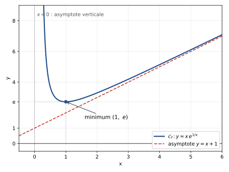

# BCE ECG — Mathématiques appliquées (emlyon) 2025 · Corrigé guidé

*Corrigé rédigé par IA, non officiel. Signalez toute erreur.*

## Présentation du sujet

**Cadre.** Épreuve de mathématiques appliquées conçue par emlyon business school (code sujet 296), 4 heures, calculatrice interdite. Trois exercices, 56 questions. D'après le rapport 2025 : 4 096 copies, moyenne 10,3, écart type 5, quartiles 6,3 – 10,4 – 14,1. Les points se répartissent à 33 % pour l'exercice 1, 33 % pour l'exercice 2, 32 % pour l'exercice 3 et 2 % pour la présentation et la rédaction.

**Exercice 1 (analyse, 19 questions).** La suite $u_{n+1}=u_n\mathrm e^{1/u_n}$, $u_0=1$ : monotonie et limite (partie A). La fonction $f(x)=x\,\mathrm e^{1/x}$ : variations, développement en série grâce à la série exponentielle, asymptote oblique $y=x+1$ (partie B). Retour à la suite : sommes télescopiques et encadrements donnent $u_n\sim n$ et $\sum_{k<n}\frac1{u_k}\sim\ln n$ (partie C).

**Exercice 2 (algèbre linéaire et informatique, 19 questions).** Partie A : diagonalisation simultanée des matrices du sous-espace $\mathcal E=\mathrm{Vect}(I,J,K)$ et application linéaire $s$ qui associe à $M$ son spectre. Partie B : algorithme glouton de coloration d'un graphe en Python.

**Exercice 3 (probabilités, 18 questions).** La loi de Pareto $V=\frac1{\sqrt U}$ (partie A), loi du maximum de $n$ sinistres et convergence en loi de $\frac{M_n}{\sqrt n}$ (partie B), trois requêtes SQL (partie C), loi du nombre de sinistres graves quand le nombre de sinistres suit une loi de Poisson (partie D).

**Notions mobilisées.** Récurrence, suites monotones, croissances comparées, dérivation, série exponentielle, encadrements, équivalents ; base et dimension, polynôme annulateur, vecteurs propres, matrice de passage, matrice d'une application linéaire, théorème du rang ; fonctions Python sur les listes, graphes ; fonction de répartition, densité, espérance et moment d'ordre 2, loi du maximum, convergence en loi, SQL (`SELECT`, `WHERE`, `INSERT INTO`), loi binomiale, loi de Poisson, formule des probabilités totales.

**Difficulté.** Le rapport 2025 note que « le début de chaque exercice se voulait abordable » et que le sujet « brassait un grand nombre de notions ». Les questions d'informatique (exercice 2 partie B, exercice 3 partie C) ont été peu traitées : ce sont des points faciles à prendre pour qui a travaillé Python et SQL. Les parties les plus techniques sont la partie C de l'exercice 1 et la partie B de l'exercice 3.

**Questions à ne pas laisser passer.** Ex. 1 : 1, 2, 3, 4, 5, 9. Ex. 2 : 1, 2, 3, 4 a), 5, 6, 9, 10. Ex. 3 : 1, 2, 3 a), 5, 7, 9 b).

**Gestion du temps.** Environ 1 h 20 par exercice, en gardant quelques minutes pour relire. La présentation est notée : numérotation des questions, résultats encadrés, tableaux tracés à la règle.

---

## Exercice 1 — Partie A : étude de la suite $(u_n)$

On établit positivité, monotonie, puis divergence vers $+\infty$ par l'absurde.

### Question 1. a)

> [!INDICATION]
> Récurrence immédiate : l'exponentielle est strictement positive.

#### Solution

Par récurrence : $u_0=1>0$, et si $u_n>0$, alors $\mathrm e^{1/u_n}>0$, donc $u_{n+1}=u_n\mathrm e^{1/u_n}>0$. Ainsi $u_n>0$ pour tout $n\in\mathbb{N}$.

> [!JURY]
> Le rapport 2025 relève que des candidats « écrivent « ∀n ∈ N » dans la preuve de l'hérédité ». Dans l'hérédité, $n$ est **fixé** : on écrit « Soit $n\in\mathbb N$ tel que $\mathcal P(n)$ ».

### Question 1. b)

> [!INDICATION]
> Signe de $u_{n+1}-u_n$, ou position du quotient $\frac{u_{n+1}}{u_n}$ par rapport à $1$.

#### Solution

$u_{n+1}-u_n=u_n\left(\mathrm e^{1/u_n}-1\right)>0$ car $u_n>0$ et $\frac1{u_n}>0$, donc $\mathrm e^{1/u_n}>1$. La suite est strictement croissante.

> [!JURY]
> Avec le quotient, le rapport 2025 rappelle que les candidats « doivent préciser que $(u_n)$ est à termes strictement positifs ».

### Question 1. c)

> [!INDICATION]
> Une suite croissante a toujours une limite, finie ou $+\infty$. Supposer la limite finie.

> [!INDICATION]
> Passer à la limite dans la relation de récurrence (la limite est non nulle : pourquoi ?).

#### Solution

$(u_n)$ étant croissante, elle converge ou tend vers $+\infty$. Si elle convergeait vers $\ell$, on aurait $\ell\geqslant u_0=1$.

Par continuité de $x\mapsto x\mathrm e^{1/x}$ en $\ell>0$, le passage à la limite donne $\ell=\ell\,\mathrm e^{1/\ell}$.

Comme $\ell\neq0$, cela impose $\mathrm e^{1/\ell}=1$, soit $\frac1\ell=0$ : c'est impossible. Donc $u_n\to+\infty$.

> [!PIEGE]
> Le rapport 2025 cite l'erreur « $\frac1\ell=0\iff\ell=0$ » : l'équation $\frac1\ell=0$ n'a **aucune** solution réelle. Il note aussi que le fait que la suite admette nécessairement une limite « est rarement justifié » : c'est le théorème de la limite monotone qui le donne.

### Question 2.

> [!INDICATION]
> On itère tant que la condition d'arrêt n'est pas atteinte ; que doit-on afficher ?

#### Solution

```python
import numpy as np
u = 1
n = 0
while u < 10**6:
    u = u * np.exp(1/u)
    n = n + 1
print(n)
```

La boucle termine car $u_n\to+\infty$. Exécuté, le programme affiche $999\,992$, ce qui est cohérent avec $u_n\sim n$ (question 11).

> [!JURY]
> Le rapport 2025 signale « des erreurs sur la syntaxe `np.exp` » et que « beaucoup de candidats renvoient `u` à la place de `n` ».

---

## Exercice 1 — Partie B : étude de la fonction $f$

Étude classique d'une fonction, puis développement en série qui donne la position par rapport à l'asymptote.

### Question 3.

> [!INDICATION]
> En $+\infty$, pas de forme indéterminée. En $0^+$, poser $X=\frac1x$.

#### Solution

En $+\infty$ : $\mathrm e^{1/x}\to1$ et $f(x)\to+\infty$. En $0^+$ : avec $X=\frac1x\to+\infty$, $f(x)=\frac{\mathrm e^X}{X}\to+\infty$ par croissances comparées.

> [!JURY]
> Le rapport 2025 est sévère : « Les candidats ne justifiant pas leurs résultats ne reçoivent aucun point. L'expression « par croissances comparées » n'est pas une formule magique, les candidats doivent se ramener à la forme donnée dans le cours pour l'utiliser. » D'où le changement de variable explicite.

### Question 4.

> [!INDICATION]
> Dériver un produit dont un facteur est une composée ; factoriser par $\mathrm e^{1/x}$.

#### Solution

$$\begin{aligned}
f'(x)&=\mathrm e^{1/x}-\frac1x\,\mathrm e^{1/x}\\
&=\frac{(x-1)\mathrm e^{1/x}}{x}.
\end{aligned}$$

$f'<0$ sur $]0,1[$, $f'>0$ sur $]1,+\infty[$, et $f(1)=\mathrm e$.

| $x$ | $0$ (valeur interdite) | | $1$ | | $+\infty$ |
|---|---|---|---|---|---|
| $f'(x)$ | ‖ | $-$ | $0$ | $+$ | |
| $f$ | ‖ $+\infty$ | décroissante | $\mathrm e$ | croissante | $+\infty$ |

> [!JURY]
> « Un grand nombre de candidats oublient de mentionner la valeur interdite dans la partie variations du tableau » (rapport 2025) : la double barre en $0$ est attendue.

### Question 5. a)

> [!INDICATION]
> Réécrire $x^{-k}$ comme une puissance $k$-ième.

#### Solution

$\frac{x^{-k}}{k!}=\frac{(1/x)^k}{k!}$ : c'est la série exponentielle en $\frac1x$, qui converge et a pour somme $\mathrm e^{1/x}$.

> [!JURY]
> Le rapport 2025 : « Un grand nombre de candidats n'ont pas vu que $x^{-k}=\left(\frac1x\right)^k$. Les candidats doivent respecter les notations : la somme de la série n'est pas la série. » On écrit $\sum_{k=0}^{+\infty}$ pour la somme, $\sum_{k\geqslant0}$ pour la série.

### Question 5. b)

> [!INDICATION]
> Multiplier par $x$, puis isoler les termes $k=0$ et $k=1$.

#### Solution

$$\begin{aligned}
f(x)&=\sum_{k=0}^{+\infty}\frac{x^{1-k}}{k!}\\
&=x+1+\sum_{k=2}^{+\infty}\frac{x^{1-k}}{k!}\\
&=x+1+\frac1x\sum_{k=2}^{+\infty}\frac{x^{2-k}}{k!}.
\end{aligned}$$

Chaque série écrite est un multiple d'une série convergente, donc converge.

### Question 6. a)

> [!INDICATION]
> Pour $k\geqslant2$ et $x\geqslant1$, situer $x^{2-k}$ entre $0$ et $1$.

> [!INDICATION]
> Minorer une somme de termes positifs par l'un d'eux ; majorer en remplaçant $x^{2-k}$ par $1$.

#### Solution

Pour $k\geqslant2$, $0<x^{2-k}\leqslant1$. La somme de termes positifs dépasse son premier terme $\frac1{2!}=\frac12$. Et

$$\begin{aligned}
\sum_{k=2}^{+\infty}\frac{x^{2-k}}{k!}&\leqslant\sum_{k=2}^{+\infty}\frac1{k!}\\
&=\mathrm e-2\leqslant\mathrm e .
\end{aligned}$$

> [!JURY]
> Le rapport 2025 indique que cette question « demandait de l'initiative » et que « les réponses partielles étaient valorisées » : il fallait écrire au moins l'une des deux inégalités.

### Question 6. b)

> [!INDICATION]
> Combiner 5. b) et 6. a).

#### Solution

$f(x)-(x+1)=\frac1x\sum_{k\geqslant2}\frac{x^{2-k}}{k!}$, et l'on multiplie l'encadrement de 6. a) par $\frac1x>0$ : $\frac1{2x}\leqslant f(x)-(x+1)\leqslant\frac{\mathrm e}x$.

### Question 7.

> [!INDICATION]
> Que signifie « $o(1)$ » ?

#### Solution

Par encadrement, $f(x)-(x+1)\to0$ en $+\infty$, c'est-à-dire $f(x)=x+1+o(1)$.

> [!PIEGE]
> $o(1)$ désigne une fonction qui tend vers $0$. Écrire « $\lim_{x\to+\infty}f(x)=x+1$ », relevé par le rapport 2025, n'a pas de sens : une limite ne dépend pas de $x$.

### Question 8.

> [!INDICATION]
> Rassembler ce qui a été établi : limites (asymptote verticale), minimum, asymptote oblique et position relative.

#### Solution



Éléments à faire figurer :

- l'asymptote verticale $x=0$ ;
- le minimum $(1,\mathrm e)$, à tangente horizontale ;
- la droite $y=x+1$, qui passe par $(0,1)$ et $(-1,0)$ ;
- la courbe au-dessus de la droite ($f(x)-(x+1)>0$ d'après 5. b)), et s'en rapprochant en $+\infty$.

> [!JURY]
> « Très peu de candidats sont capables de réaliser un dessin propre faisant apparaître les propriétés de $f$ établies dans les questions précédentes. Très peu de candidats savent tracer la droite d'équation $y=x+1$. » (rapport 2025)

---

## Exercice 1 — Partie C : comportement asymptotique de $(u_n)$

L'idée : $u_{k+1}=f(u_k)$, et l'encadrement $(*)$ contrôle les accroissements $u_{k+1}-u_k$ ; on somme, puis on divise par $u_n$.

### Question 9. a)

> [!INDICATION]
> Prendre le logarithme de la relation de récurrence (tout est strictement positif).

#### Solution

$\ln(u_{k+1})=\ln(u_k)+\ln\left(\mathrm e^{1/u_k}\right)=\ln(u_k)+\frac1{u_k}$.

### Question 9. b)

> [!INDICATION]
> Somme télescopique.

#### Solution

En sommant pour $k$ de $0$ à $n-1$ : $\ln(u_n)-\ln(u_0)=\sum_{k=0}^{n-1}\frac1{u_k}$, et $\ln(u_0)=0$.

### Question 10. a)

> [!INDICATION]
> Peut-on appliquer $(*)$ en $x=u_k$ ? Que vaut $f(u_k)$ ?

#### Solution

$u_k\geqslant u_0=1$ par croissance, donc $(*)$ s'applique en $x=u_k$, avec $f(u_k)=u_{k+1}$ : $\frac1{2u_k}\leqslant u_{k+1}-u_k-1\leqslant\frac{\mathrm e}{u_k}$, d'où l'encadrement.

> [!JURY]
> Le rapport 2025 : « les candidats devaient vérifier que $u_k\geqslant1$ pour pouvoir appliquer $(*)$ avec $x=u_k$ ».

### Question 10. b)

> [!INDICATION]
> Sommer pour $k$ de $0$ à $n-1$ : la somme du milieu est télescopique.

> [!INDICATION]
> Pour la seconde forme, remplacer $\sum\frac1{u_k}$ grâce à 9. b).

#### Solution

$\sum_{k=0}^{n-1}(u_{k+1}-u_k)=u_n-1$, d'où

$$n+\frac12\sum_{k=0}^{n-1}\frac1{u_k}\leqslant u_n-1\leqslant n+\mathrm e\sum_{k=0}^{n-1}\frac1{u_k}.$$

Avec $\sum_{k=0}^{n-1}\frac1{u_k}=\ln(u_n)$ : $1+\frac12\ln(u_n)\leqslant u_n-n\leqslant1+\mathrm e\ln(u_n)$.

> [!METHODE]
> Pour l'équivalent d'une suite récurrente $u_{k+1}=f(u_k)$ : encadrer l'accroissement $u_{k+1}-u_k$, sommer (télescopage), puis diviser par le terme dominant.

### Question 11. a)

> [!INDICATION]
> Une limite de cours en $+\infty$, et la limite de $(u_n)$.

#### Solution

$u_n\to+\infty$ et $\frac{\ln x}{x}\to0$ en $+\infty$ (croissances comparées) ; par composition, $\frac{\ln(u_n)}{u_n}\to0$.

> [!JURY]
> « la référence indispensable à $\lim_{x\to+\infty}\frac{\ln x}{x}$ est rarement évoquée » (rapport 2025).

### Question 11. b)

> [!INDICATION]
> Diviser l'encadrement de 10. b) par $u_n$.

#### Solution

$\frac1{u_n}+\frac12\frac{\ln u_n}{u_n}\leqslant1-\frac n{u_n}\leqslant\frac1{u_n}+\mathrm e\frac{\ln u_n}{u_n}$ ; les bornes tendent vers $0$, donc $\frac{n}{u_n}\to1$ et $u_n\sim n$.

### Question 12.

> [!INDICATION]
> La somme vaut $\ln(u_n)$. Peut-on « composer » l'équivalent $u_n\sim n$ par $\ln$ ?

> [!INDICATION]
> Écrire $\ln(u_n)=\ln(n)+\ln\left(\frac{u_n}n\right)$.

#### Solution

$\frac{\ln(u_n)}{\ln n}=1+\frac{\ln(u_n/n)}{\ln n}\to1$, car $\ln(u_n/n)\to0$ et $\ln n\to+\infty$. Donc $\sum_{k=0}^{n-1}\frac1{u_k}=\ln(u_n)\sim\ln(n)$.

> [!PIEGE]
> Le programme met en garde contre la composition des équivalents par $\ln$ : $u_n\sim v_n$ n'entraîne pas en général $\ln u_n\sim\ln v_n$ (contre-exemple : $1+\frac1n\sim1$, alors que $\ln(1+\frac1n)\sim\frac1n$ et $\ln 1=0$).
>
> L'argument doit être refait comme ci-dessus ; il marche ici parce que $\ln n\to+\infty$.

---

## Exercice 2 — Partie A : réduction simultanée et spectre

Les mêmes vecteurs propres $U_1,U_2,U_3$ diagonalisent $J$ et $K$, donc toute matrice de $\mathcal E$.

### Question 1.

> [!INDICATION]
> Une base : génératrice **et** libre. Écrire la matrice $aI+bJ+cK$.

#### Solution

$(I,J,K)$ engendre $\mathcal E$ par définition. $aI+bJ+cK=\begin{pmatrix}a+c&b&b\\b&a&c\\b&c&a\end{pmatrix}=0$ impose $b=a=c=0$. Donc $(I,J,K)$ est une base et $\dim\mathcal E=3$.

> [!JURY]
> Le rapport 2025 : « Certains candidats oublient de mentionner le caractère générateur de la famille (I, J, K). On relève d'importantes confusions : on évoque la dimension d'une famille, ou le cardinal d'un sous–espace vectoriel. »

### Question 2.

> [!INDICATION]
> Un résultat de cours sur une classe de matrices.

#### Solution

$J$ et $K$ sont symétriques, donc diagonalisables.

### Question 3. a)

> [!INDICATION]
> Calculer $J^2$, puis $J^3$.

#### Solution

$J^2=\begin{pmatrix}2&0&0\\0&1&1\\0&1&1\end{pmatrix}$ et $J^3=\begin{pmatrix}0&2&2\\2&0&0\\2&0&0\end{pmatrix}=2J$.

### Question 3. b)

> [!INDICATION]
> Un polynôme annulateur ; factoriser.

#### Solution

$X^3-2X=X(X-\sqrt2)(X+\sqrt2)$ annule $J$, donc $\mathrm{Sp}(J)\subset\{-\sqrt2,0,\sqrt2\}$.

> [!PIEGE]
> Le polynôme annulateur est un polynôme en $X$ ; écrire « $J(J-\sqrt2)(J+\sqrt2)$ », erreur relevée par le rapport 2025, oublie l'identité : $J(J-\sqrt2I)(J+\sqrt2I)=0$. Le rapport ajoute que beaucoup ont perdu du temps à étudier les sous-espaces propres, « ce qui n'était pas demandé ».

### Question 4. a)

> [!INDICATION]
> Calculer $JU_1$ et $JU_2$.

#### Solution

$JU_1=\begin{pmatrix}2\\\sqrt2\\\sqrt2\end{pmatrix}=\sqrt2\,U_1$ et $JU_2=0$. Les vecteurs étant non nuls, ce sont des vecteurs propres (pour $\sqrt2$ et $0$).

### Question 4. b)

> [!INDICATION]
> Résoudre $(J+\sqrt2I)X=0$ en indiquant les opérations faites sur les lignes.

#### Solution

On écrit le système :

$$\left\{\begin{aligned}
\sqrt2\,x+y+z&=0\quad(L_1)\\
x+\sqrt2\,y&=0\quad(L_2)\\
x+\sqrt2\,z&=0\quad(L_3)
\end{aligned}\right.$$

$L_2$ et $L_3$ donnent $y=z=-\frac{x}{\sqrt2}$ ; $L_1$ est alors vérifiée.

Pour $x=-\sqrt2$ : $U_3=\begin{pmatrix}-\sqrt2\\1\\1\end{pmatrix}$, et l'on vérifie $JU_3=-\sqrt2\,U_3$.

> [!JURY]
> « Les opérations sur les lignes sont trop rarement précisées » (rapport 2025).

### Question 5. a)

> [!INDICATION]
> Vecteurs propres associés à des valeurs propres distinctes.

#### Solution

$U_1,U_2,U_3$ sont associés aux valeurs propres distinctes $\sqrt2,0,-\sqrt2$ ; la concaténation de familles libres de sous-espaces propres associés à des valeurs propres distinctes est libre. Trois vecteurs libres en dimension 3 forment une base.

> [!JURY]
> Le rapport 2025 rappelle « que la caractérisation des matrices diagonalisables à l'aide de la somme des dimensions des sous–espaces propres n'est plus au programme ». Ici, on n'en a pas besoin.

### Question 5. b)

> [!INDICATION]
> Les colonnes de $P$ sont les vecteurs propres, dans l'ordre des valeurs propres de la diagonale.

#### Solution

$P=\begin{pmatrix}\sqrt2&0&-\sqrt2\\1&1&1\\1&-1&1\end{pmatrix}$, inversible (ses colonnes forment une base), et $JP=P\,\mathrm{diag}(\sqrt2,0,-\sqrt2)$.

> [!METHODE]
> $P^{-1}AP=D$ se lit colonne par colonne : $AP=PD$ signifie $AC_j=d_jC_j$ pour chaque colonne $C_j$ de $P$. Inutile de calculer $P^{-1}$.

### Question 6. a)

> [!INDICATION]
> Que fait $K$ sur les coordonnées d'un vecteur ?

#### Solution

$K$ échange les deux dernières coordonnées : $KU_1=U_1$, $KU_2=-U_2$, $KU_3=U_3$. Donc $(U_1,U_2,U_3)$ est une base de vecteurs propres de $K$.

> [!JURY]
> « Il était inutile de chercher des vecteurs propres de K, ceux-ci étaient proposés par l'énoncé. » (rapport 2025)

### Question 6. b)

> [!INDICATION]
> Même lecture colonne par colonne qu'en 5. b).

#### Solution

$P^{-1}KP=\mathrm{diag}(1,-1,1)$.

### Question 7. a)

> [!INDICATION]
> Linéarité de $M\mapsto P^{-1}MP$.

#### Solution

$P^{-1}MP=aI+bP^{-1}JP+cP^{-1}KP=\mathrm{diag}\left(a+b\sqrt2+c,\ a-c,\ a-b\sqrt2+c\right)$.

> [!JURY]
> « Beaucoup de candidats perdent du temps à calculer $P^{-1}$ » (rapport 2025) : la linéarité suffit.

### Question 7. b)

> [!INDICATION]
> Deux matrices semblables ont les mêmes valeurs propres.

#### Solution

$\mathrm{Sp}(M)=\{a+b\sqrt2+c,\ a-c,\ a-b\sqrt2+c\}$ (avec répétitions éventuelles).

### Question 8. a)

> [!INDICATION]
> La $j$-ième colonne de $S$ contient les coordonnées de l'image du $j$-ième vecteur de base.

#### Solution

$s(I)=(1,1,1)$, $s(J)=(\sqrt2,0,-\sqrt2)$, $s(K)=(1,-1,1)$, donc $S=\begin{pmatrix}1&\sqrt2&1\\1&0&-1\\1&-\sqrt2&1\end{pmatrix}$.

### Question 8. b)

> [!INDICATION]
> Montrer que $S$ est inversible, par exemple en résolvant $SX=0$.

> [!INDICATION]
> Pour conclure, comparer les dimensions de l'espace de départ et d'arrivée.

#### Solution

$S\begin{pmatrix}a\\b\\c\end{pmatrix}=0$ s'écrit :

$$\left\{\begin{aligned}
a+b\sqrt2+c&=0\quad(L_1)\\
a-c&=0\quad(L_2)\\
a-b\sqrt2+c&=0\quad(L_3)
\end{aligned}\right.$$

$L_1-L_3$ donne $b=0$, puis $a=c=0$.

Donc $\mathrm{Ker}(s)=\{0\}$ ($S$ est inversible) ; comme $\dim\mathcal E=\dim\mathbb{R}^3=3$, $s$ injective est bijective.

> [!JURY]
> « Peu de candidats, parmi ceux ayant déterminé S, ont utilisé cette matrice pour établir la bijectivité de s » (rapport 2025) : $s$ est bijective si et seulement si sa matrice $S$ est inversible.

---

## Exercice 2 — Partie B : un algorithme de coloration des graphes

Trois fonctions courtes ; la dernière applique la stratégie gloutonne. On termine par un exemple où elle n'est pas optimale.

### Question 9.

> [!INDICATION]
> Un sommet $j$ est voisin de $s_i$ si le coefficient correspondant de la matrice d'adjacence vaut $1$.

#### Solution

```python
def voisins(A, i):
    n = len(A[i])
    V = []
    for j in range(n):
        if j != i and A[i][j] == 1:
            V.append(j)
    return(V)
```

### Question 10.

> [!INDICATION]
> Traduire « tant que $m$ appartient à $L$ » avec l'opérateur `in`.

#### Solution

```python
def min_ext(L):
    m = 0
    while m in L:
        m = m + 1
    return(m)
```

> [!PIEGE]
> Le rapport 2025 signale que « de nombreux candidats confondent l'opérateur d'égalité == et l'opérateur d'inclusion in » : `m in L` teste l'appartenance, `m == L` compare un entier à une liste (toujours faux).

### Question 11.

> [!INDICATION]
> La liste initiale est $[0,1,\dots,n-1]$ ; la liste des couleurs des voisins s'écrit en compréhension.

#### Solution

```python
def coloration(A):
    n = len(A[0])
    C = [i for i in range(n)]
    for i in range(1, n):
        C_voisins = [C[j] for j in voisins(A, i)]
        C[i] = min_ext(C_voisins)
    return(C)
```

Testé sur le graphe de la figure 1 de l'énoncé : la fonction renvoie `[0, 1, 0, 1, 2]`, la coloration de la figure 2.

### Question 12. a)

> [!INDICATION]
> Lister les voisins de chaque sommet, puis dérouler la boucle à la main.

#### Solution

Voisins : $s_1:\{s_0,s_2,s_5\}$, $s_2:\{s_1,s_3,s_5\}$, $s_3:\{s_0,s_2,s_4\}$, $s_4:\{s_0,s_3,s_5\}$, $s_5:\{s_1,s_2,s_4\}$. À partir de $C=[0,1,2,3,4,5]$ :

| $i$ | couleurs des voisins | $C_i$ |
|---|---|---|
| 1 | $0,2,5$ | $1$ |
| 2 | $1,3,5$ | $0$ |
| 3 | $0,0,4$ | $1$ |
| 4 | $0,1,5$ | $2$ |
| 5 | $1,0,2$ | $3$ |

`coloration(A)` renvoie `[0, 1, 0, 1, 2, 3]`.

> [!PIEGE]
> Les voisins d'indice $j>i$ ont encore leur couleur initiale $j$ quand on traite $s_i$ : il faut les compter.

### Question 12. b)

> [!INDICATION]
> Le graphe contient deux triangles : il faut au moins trois couleurs. Essayer de colorier un triangle, puis compléter.

#### Solution

Oui : $c(s_0)=0$, $c(s_3)=1$, $c(s_4)=2$, puis $c(s_1)=1$, $c(s_2)=2$, $c(s_5)=0$. On vérifie les neuf arêtes : leurs extrémités ont toujours des couleurs différentes. L'algorithme glouton, qui en utilise quatre, n'est pas optimal.

---

## Exercice 3 — Partie A : la variable aléatoire $V$

### Question 1. a)

> [!INDICATION]
> Partir de $U(\Omega)\subset\,]0,1]$.

#### Solution

$0<\sqrt U\leqslant1$, donc $V=\frac1{\sqrt U}\geqslant1$.

### Question 1. b)

> [!INDICATION]
> Deux cas, $x<1$ et $x\geqslant1$. Dans le second, isoler $U$ en utilisant la monotonie.

#### Solution

Si $x<1$, $F_V(x)=0$. Si $x\geqslant1$, $[V\leqslant x]=\left[U\geqslant\frac1{x^2}\right]$ et $\frac1{x^2}\in\,]0,1]$, donc $F_V(x)=1-\frac1{x^2}$.

### Question 1. c)

> [!INDICATION]
> $F_V$ est déjà une fonction de répartition : il reste continuité et caractère $\mathcal C^1$ sauf en un nombre fini de points.

#### Solution

$F_V$ est continue sur $\mathbb{R}$ (en $1$, les deux expressions valent $0$) et de classe $\mathcal C^1$ sur $\mathbb{R}\setminus\{1\}$.

Donc $V$ est à densité.

Une densité : $f_V(x)=\frac2{x^3}$ si $x\geqslant1$, $0$ sinon.

> [!JURY]
> Le rapport 2025 note que des candidats vérifient toutes les conditions « sans remarquer qu'on sait déjà que F est une fonction de répartition » : la croissance et les limites en $\pm\infty$ sont inutiles ici.

### Question 2.

> [!INDICATION]
> Convergence (absolue) de $\int_1^{+\infty}x\,f_V(x)\,\mathrm dx$, puis de $\int_1^{+\infty}x^2f_V(x)\,\mathrm dx$.

#### Solution

$\int_1^{+\infty}\frac2{x^2}\,\mathrm dx$ converge (Riemann, $2>1$) et vaut $2$ : $E(V)=2$.

Pour le moment d'ordre 2, on applique le théorème de transfert sur $]0,+\infty[$, hors duquel $f_V$ est nulle. $\int_1^{+\infty}\frac2x\,\mathrm dx$ diverge : $V$ n'a pas de moment d'ordre 2, donc pas de variance.

> [!JURY]
> Le rapport 2025 conseille « d'éviter tout abus de l'expression « sous réserve de convergence » » : on établit la convergence avant d'écrire la valeur.

---

## Exercice 3 — Partie B : loi du sinistre le plus coûteux

### Question 3. a)

> [!INDICATION]
> Événement $[\max\leqslant x]$ et indépendance.

#### Solution

$[M_n\leqslant x]=\bigcap_{i=1}^n[V_i\leqslant x]$, et par indépendance mutuelle, $F_n(x)=F_V(x)^n$.

> [!METHODE]
> Loi du maximum : $P(\max\leqslant x)=\prod P(V_i\leqslant x)$. Loi du minimum : passer par $P(\min>x)$.

### Question 3. b)

> [!INDICATION]
> Distinguer $x<1$ et $x\geqslant1$.

#### Solution

Si $x<1$, $F_n(x)=0$. Si $x\geqslant1$, $0\leqslant F_V(x)<1$ et $F_V(x)^n\to0$. La limite est nulle pour tout réel $x$.

> [!JURY]
> « Beaucoup de candidats ne pensent pas à la disjonction de cas entre $x<1$ et $x\geqslant1$ » (rapport 2025).

### Question 3. c)

> [!INDICATION]
> Une fonction de répartition tend vers $1$ en $+\infty$. Que serait $F_X$ aux points où elle est continue ?

> [!INDICATION]
> Il reste à trouver un point de continuité de $F_X$ au-delà d'un réel $a$ où $F_X\geqslant\frac12$. Une fonction croissante ne peut pas avoir beaucoup de « gros sauts » dans un intervalle : leur somme est au plus $1$.

> [!INDICATION]
> Emboîter des segments de plus en plus courts sur lesquels l'accroissement de $F_X$ est de plus en plus petit ; leurs extrémités forment deux suites adjacentes.

#### Solution

Si $M_n\to X$ en loi, alors $F_X(x)=0$ en tout point de continuité $x$ de $F_X$.

Or il existe $a$ tel que $F_X\geqslant\frac12$ sur $[a,+\infty[$.

On pose $\alpha_0=a$, $\beta_0=a+1$. On découpe $[\alpha_k,\beta_k]$ en $2k+5$ segments égaux et l'on garde les $k+2$ de rang pair, disjoints et intérieurs.

La somme des accroissements de $F_X$ sur ces segments est au plus $1$ : l'un d'eux, $[\alpha_{k+1},\beta_{k+1}]$, a un accroissement au plus $\frac1{k+2}$.

Les suites $(\alpha_k)$ et $(\beta_k)$ sont adjacentes ($\beta_k-\alpha_k\leqslant5^{-k}$) ; leur limite commune $c$ vérifie $\alpha_k<c<\beta_k$ et $c>a$.

Sur $]\alpha_k,\beta_k[$, $F_X$ s'écarte de $F_X(c)$ d'au plus $\frac1{k+1}$ : $F_X$ est continue en $c$.

Donc $F_X(c)=0$ et $F_X(c)\geqslant\frac12$ : contradiction. Aucune convergence en loi.

> [!METHODE]
> Les suites adjacentes (programme d'ECG1) permettent de « localiser » un point par dichotomie ou découpage. On évite ainsi l'argument de dénombrabilité des discontinuités, qui n'est pas au programme.

> [!JURY]
> Le rapport 2025 juge que les réponses ne sont « généralement pas assez argumentées ». Un argument complet doit expliquer pourquoi la limite nulle est incompatible avec une fonction de répartition, en tenant compte de ce que la convergence en loi ne porte que sur les points de continuité de la limite.

### Question 4. a)

> [!INDICATION]
> Exprimer $G_n(x)$ à l'aide de $F_V$, pour $n$ assez grand.

> [!INDICATION]
> Forme $1^\infty$ : passer à l'exponentielle et utiliser $\ln(1+u)\sim u$.

#### Solution

$G_n(x)=F_V(x\sqrt n)^n=\left(1-\frac1{nx^2}\right)^n$ dès que $x\sqrt n\geqslant1$, puis $n\ln\left(1-\frac1{nx^2}\right)\sim-\frac1{x^2}$ et $G_n(x)\to\mathrm e^{-1/x^2}$.

### Question 4. b)

> [!INDICATION]
> Traiter aussi $x\leqslant0$, puis appliquer la définition.

#### Solution

Pour $x\leqslant0$, $G_n(x)=0=F_W(x)$. Donc $G_n\to F_W$ en tout point : $\frac{M_n}{\sqrt n}$ converge en loi vers $W$.

---

## Exercice 3 — Partie C : manipulation d'une base de données

### Question 5. a)

> [!INDICATION]
> `SELECT … FROM … WHERE …`

#### Solution

```sql
SELECT montant FROM sinistres WHERE annee = 2024;
```

### Question 5. b)

> [!INDICATION]
> Deux attributs à afficher, une condition sur le montant.

#### Solution

```sql
SELECT mois, annee FROM sinistres WHERE montant > 1000000;
```

### Question 6.

> [!INDICATION]
> Commande d'insertion avec `VALUES` ; attention au type `TEXT` du mois.

#### Solution

```sql
INSERT INTO sinistres (id, annee, mois, montant)
VALUES (7652, 2025, 'avril', 1540);
```

Requêtes testées sous SQLite sur une petite table. L'énoncé écrit « sinistre » au lieu de « sinistres » dans cette question : on garde le nom de la table.

---

## Exercice 3 — Partie D : nombre de sinistres graves

On suppose $N$ indépendante des $V_i$ (implicite dans l'énoncé).

### Question 7.

> [!INDICATION]
> Loi de Poisson.

#### Solution

$N(\Omega)=\mathbb{N}$ et $P(N=n)=\mathrm e^{-\lambda}\frac{\lambda^n}{n!}$.

> [!JURY]
> « On attend des candidats qu'ils précisent le support $N(\Omega)$ » (rapport 2025).

### Question 8.

> [!INDICATION]
> $T$ est un cardinal, majoré par $N$, qui n'est pas borné.

#### Solution

$T(\Omega)=\mathbb{N}$.

### Question 9. a)

> [!INDICATION]
> Phrase type : nombre de succès dans $n$ épreuves de Bernoulli indépendantes de même paramètre, à préciser.

#### Solution

Sachant $[N=n]$, $T$ est le nombre de succès (« $V_i>A$ ») lors de $n$ épreuves de Bernoulli indépendantes de même probabilité de succès $P(V_i>A)=1-F_V(A)=\frac1{A^2}$. D'où la loi $\mathcal B\left(n,\frac1{A^2}\right)$.

> [!JURY]
> « La phrase type avec tous les arguments indispensables pour justifier une loi binomiale est peu maitrisée. Le deuxième paramètre $\frac{1}{A^2}$ est souvent donné sans justification. » (rapport 2025)

### Question 9. b)

> [!INDICATION]
> Loi binomiale, en n'oubliant pas les valeurs impossibles.

#### Solution

Avec $p=\frac1{A^2}$, $q=1-p$ : $P_{[N=n]}(T=k)=\binom nkp^kq^{n-k}$ si $k\leqslant n$, et $0$ si $k>n$.

### Question 10.

> [!INDICATION]
> Probabilités totales avec le système complet $([N=n])_{n\in\mathbb{N}}$ ; seuls les $n\geqslant k$ contribuent.

> [!INDICATION]
> Simplifier les factorielles, poser $m=n-k$ et reconnaître une série exponentielle.

#### Solution

$$\begin{aligned}
P(T=k)&=\sum_{n=k}^{+\infty}\mathrm e^{-\lambda}\frac{\lambda^n}{n!}\binom nkp^kq^{n-k}\\
&=\mathrm e^{-\lambda}\frac{(\lambda p)^k}{k!}\sum_{m=0}^{+\infty}\frac{(\lambda q)^m}{m!}\\
&=\mathrm e^{-\lambda p}\frac{(\lambda p)^k}{k!}.
\end{aligned}$$

$T$ suit la loi de Poisson $\mathcal P\left(\frac\lambda{A^2}\right)$.

Contrôle par simulation, avec $\lambda=3$ et $A=1{,}7$ sur $10^5$ tirages : moyenne empirique $1{,}03$ pour $\frac{\lambda}{A^2}\approx1{,}04$.

> [!METHODE]
> « Amincissement » d'une loi de Poisson : si l'on garde chacun des $N\hookrightarrow\mathcal P(\lambda)$ objets indépendamment avec probabilité $p$, le nombre d'objets gardés suit $\mathcal P(\lambda p)$. Le calcul se fait toujours par probabilités totales et série exponentielle.

> [!JURY]
> Le rapport 2025 juge la question « peu guidée » et note que des candidats ont avancé « parfois avec des erreurs d'indices » : le décalage $m=n-k$ doit être écrit.

### Question 11.

> [!INDICATION]
> Espérance d'une loi de Poisson.

#### Solution

$E(T)=\frac{\lambda}{A^2}$ : en moyenne, $\frac{\lambda}{A^2}$ sinistres par an dépassent le montant $A$.

---

## Bilan

**Méthodes à retenir.**

- Suite croissante : convergence ou limite $+\infty$ ; exclure une limite finie par passage à la limite dans la récurrence.
- Croissances comparées : se ramener explicitement à la forme du cours ($\frac{\mathrm e^X}{X}$, $\frac{\ln x}{x}$).
- Développer $\mathrm e^{1/x}$ en série pour obtenir asymptote et position relative.
- Équivalent d'une suite récurrente : encadrer l'accroissement, télescoper, diviser.
- Diagonalisation simultanée : des vecteurs propres communs ; $P^{-1}MP$ par linéarité, sans calculer $P^{-1}$.
- Bijectivité d'une application linéaire : noyau nul et égalité des dimensions, ou matrice inversible.
- Lois du maximum, convergence en loi par les fonctions de répartition, amincissement d'une loi de Poisson.

**Prérequis à revoir.** Série exponentielle ; théorème de la limite monotone ; polynôme annulateur ; théorème de concaténation ; théorème du rang ; intégrales de Riemann ; loi binomiale (phrase type) ; requêtes SQL au programme (`SELECT`, `WHERE`, `INSERT INTO … VALUES`) ; listes en compréhension et opérateur `in` en Python.

**Questions transposables.** $u_{n+1}=u_n\mathrm e^{1/u_n}$ et ses cousines ($u_{n+1}=u_n+\frac1{u_n}$, $u_{n+1}=\ln(1+u_n)$) ; loi de Pareto et maximum d'échantillon (loi de Fréchet) ; loi de Poisson composée avec un tri de Bernoulli.
