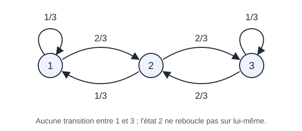

# BCE ECG — Mathématiques appliquées (ESSEC-HEC) 2025 · Corrigé brut

*Corrigé rédigé par IA, non officiel. Signalez toute erreur.*

Épreuve de 4 heures (code sujet 288), calculatrice interdite. Un problème en trois parties, 45 questions. Notations de l'énoncé : $\mathcal{ST}_r$ est l'ensemble des matrices carrées d'ordre $r$ à coefficients positifs dont chaque ligne a pour somme $1$ ; $\mu=(\mu_1\ \dots\ \mu_r)$ est une matrice ligne à coefficients strictement positifs de somme $1$.

---

## Partie 1 — Matrice stochastique réversible, exemples et caractérisation de Kolmogorov

### 1. a)

Supposons $M$ $\mu$-réversible et $m_{i,j}\neq0$. Comme $\mu_i>0$, on a $\mu_jm_{j,i}=\mu_im_{i,j}\neq0$, donc $m_{j,i}\neq0$.

### 1. b)

Si $M$ est symétrique, on prend $\mu=\left(\frac1r\ \dots\ \frac1r\right)$ : ses coefficients sont strictement positifs, de somme $1$, et pour tous $i,j$ :

$$\begin{aligned}
\mu_im_{i,j} &=\frac{m_{i,j}}{r}\\
&=\frac{m_{j,i}}{r}\\
&=\mu_jm_{j,i}.
\end{aligned}$$

**$M$ est $\mu$-réversible pour la loi uniforme $\mu=\left(\frac1r\ \dots\ \frac1r\right)$.**

### 1. c)

$\Delta$ étant diagonale, pour tous $i,j$ :

$$\begin{aligned}
(\Delta M)_{i,j} &=\mu_im_{i,j}\\
({}^tM\Delta)_{i,j} &=({}^tM)_{i,j}\,\mu_j\\
&=\mu_jm_{j,i}.
\end{aligned}$$

Deux matrices sont égales si et seulement si tous leurs coefficients le sont. Comme $M\in\mathcal{ST}_r$ :

$$\begin{aligned}
M\ \mu\text{-réversible}&\iff\forall(i,j),\ \mu_im_{i,j}=\mu_jm_{j,i}\\
&\iff\forall(i,j),\ (\Delta M)_{i,j}=({}^tM\Delta)_{i,j}\\
&\iff\Delta M={}^tM\Delta .
\end{aligned}$$

### 2.

Pour $j\in[\![1,r]\!]$, en utilisant la réversibilité puis le fait que la ligne $j$ de $M$ a pour somme $1$ :

$$\begin{aligned}
(\mu M)_j&=\sum_{i=1}^r\mu_im_{i,j}\\
&=\sum_{i=1}^r\mu_jm_{j,i}\\
&=\mu_j\sum_{i=1}^rm_{j,i}\\
&=\mu_j .
\end{aligned}$$

Donc $\boxed{\mu M=\mu}$.

### 3. a)

Le graphe probabiliste a pour sommets les états $1,2,3$ et une arête orientée $i\to j$ pondérée par $p_{i,j}$ dès que $p_{i,j}>0$ :

| arête | poids |
|---|---|
| $1\to1$ et $3\to3$ | $\frac13$ |
| $1\to2$ | $\frac23$ |
| $2\to1$ | $\frac13$ |
| $2\to3$ et $3\to2$ | $\frac23$ |



### 3. b)

Les conditions diagonales sont toujours vraies, et la condition sur $(i,j)$ est la même que sur $(j,i)$. Il reste trois conditions :

- $(1,2)$ : $\mu_1\cdot\frac23=\mu_2\cdot\frac13$, soit $\mu_2=2\mu_1$ ;
- $(1,3)$ : $\mu_1\cdot0=\mu_3\cdot0$, toujours vraie ;
- $(2,3)$ : $\mu_2\cdot\frac23=\mu_3\cdot\frac23$, soit $\mu_3=\mu_2$.

Avec $\mu_1+\mu_2+\mu_3=5\mu_1=1$ :

$$\boxed{\mu=\left(\tfrac15\ \ \tfrac25\ \ \tfrac25\right)}$$

### 4. a)

```python
def Trajectoire(L, n):
    r = len(L)
    x = rd.randint(1, r+1)          # X_0 uniforme sur [[1, r]]
    T = [x]
    for k in range(n):
        V = L[x-1]                  # voisins du sommet x
        x = V[rd.randint(0, len(V))]  # voisin choisi uniformément
        T.append(x)
    return T
```

La liste renvoyée contient $X_0,X_1,\dots,X_n$. Le graphe étant connexe avec $r\geqslant2$, chaque sommet a au moins un voisin, donc `V` n'est jamais vide.

### 4. b)

Soit $i\in[\![1,r]\!]$ et $n\in S_i$. Sachant $[X_n=i]$, on se déplace vers l'un des $d_i\geqslant1$ voisins de $i$, choisi de manière équiprobable.

Donc $P_{[X_n=i]}(X_{n+1}=j)$ vaut $\frac1{d_i}$ si $j$ est voisin de $i$, c'est-à-dire si $a_{i,j}=1$, et $0$ sinon :

$$\boxed{p_{i,j}=\frac{a_{i,j}}{d_i}}$$

### 4. c)

Posons $D=\sum_{k=1}^rd_k>0$ et $\mu_i=\frac{d_i}{D}$ : les $\mu_i$ sont strictement positifs, de somme $1$. Le graphe étant non orienté, $A$ est symétrique, donc

$$\begin{aligned}
\mu_ip_{i,j} &=\frac{d_i}{D}\cdot\frac{a_{i,j}}{d_i}\\
&=\frac{a_{i,j}}{D}\\
&=\frac{a_{j,i}}{D}\\
&=\mu_jp_{j,i}.
\end{aligned}$$

**$P$ est $\mu$-réversible pour $\mu_i=\dfrac{d_i}{\sum_{k=1}^rd_k}$** (probabilité proportionnelle au degré).

### 5.

Avec $i_n=j_0$, le produit des $n$ facteurs de $\theta_M(i_0,\dots,i_n)$ et des $s$ facteurs de $\theta_M(j_0,\dots,j_s)$ s'écrit

$$\Big(m_{i_0,i_1}\cdots m_{i_{n-1},i_n}\Big)\Big(m_{i_n,j_1}m_{j_1,j_2}\cdots m_{j_{s-1},j_s}\Big),$$

qui est exactement $\theta_M(i_0,\dots,i_n,j_1,\dots,j_s)$.

### 6.

**Équivalence.** Si $M$ vérifie $(K)$, la propriété avec $n=2$ et $(i_0,i_1,i_2)=(1,2,3)$ donne $\theta_M(1,2,3,1)=\theta_M(1,3,2,1)$, soit

$$m_{1,2}m_{2,3}m_{3,1}=m_{1,3}m_{3,2}m_{2,1}.$$

Réciproquement, supposons cette égalité. D'après le résultat admis, il suffit de vérifier $(K)$ pour $n\geqslant2$ et des $i_k$ deux à deux distincts.

Pour $r=3$, cela impose $n=2$ et $(i_0,i_1,i_2)$ permutation de $(1,2,3)$.

La propriété s'écrit alors $m_{i_0,i_1}m_{i_1,i_2}m_{i_2,i_0}=m_{i_0,i_2}m_{i_2,i_1}m_{i_1,i_0}$ : c'est l'égalité supposée si $(i_0,i_1,i_2)$ est une permutation circulaire de $(1,2,3)$, et l'égalité supposée lue de droite à gauche sinon.

Donc $M$ vérifie $(K)$.

**Pour $P$.** $p_{1,2}p_{2,3}p_{3,1}=\frac23\cdot\frac23\cdot0=0$ et $p_{1,3}p_{3,2}p_{2,1}=0\cdot\frac23\cdot\frac13=0$ : **$P$ vérifie $(K)$.**

### 7. a)

Par $\mu$-réversibilité, $\mu_{i_{k-1}}m_{i_{k-1},i_k}=\mu_{i_k}m_{i_k,i_{k-1}}$ pour tout $k\in[\![1,n]\!]$. En faisant le produit de ces $n$ égalités :

$$\begin{aligned}
\left(\prod_{k=1}^n\mu_{i_{k-1}}\right)\theta_M(i_0,\dots,i_n)&=\prod_{k=1}^n\mu_{i_{k-1}}m_{i_{k-1},i_k}\\
&=\prod_{k=1}^n\mu_{i_k}m_{i_k,i_{k-1}}\\
&=\left(\prod_{k=1}^n\mu_{i_k}\right)\theta_M(i_n,\dots,i_0),
\end{aligned}$$

car $\theta_M(i_n,\dots,i_0)=m_{i_n,i_{n-1}}\cdots m_{i_1,i_0}=\prod_{k=1}^nm_{i_k,i_{k-1}}$.

### 7. b)

Soient $n\in\mathbb{N}^*$ et $i_0,\dots,i_n$. On applique 7. a) à la suite de $n+2$ termes $(j_0,\dots,j_{n+1})=(i_0,i_1,\dots,i_n,i_0)$ :

$$\begin{aligned}
&\left(\prod_{k=1}^{n+1}\mu_{j_{k-1}}\right)\theta_M(i_0,i_1,\dots,i_n,i_0)\\
&\qquad=\left(\prod_{k=1}^{n+1}\mu_{j_k}\right)\theta_M(i_0,i_n,\dots,i_1,i_0).
\end{aligned}$$

Les deux produits de $\mu$ valent $\mu_{i_0}\mu_{i_1}\cdots\mu_{i_n}$ (mêmes facteurs, car $j_{n+1}=j_0$) et sont strictement positifs. En simplifiant : $\theta_M(i_0,i_1,\dots,i_n,i_0)=\theta_M(i_0,i_n,\dots,i_1,i_0)$. **$M$ vérifie $(K)$.**

### 8.

$M$ est à coefficients positifs, donc toutes ses puissances aussi (sommes de produits de réels positifs).

On appelle chemin de longueur $s$ toute suite $(i_0,\dots,i_s)$ ; il va de $i_0$ à $i_s$.

Montrons par récurrence sur $s\in\mathbb{N}^*$ la propriété $\mathcal H(s)$ :

« pour tous $i,j$, $m^{(s)}_{i,j}>0$ si et seulement s'il existe un chemin de $i$ à $j$ de longueur $s$ et de poids $\theta_M$ strictement positif ».

- **$s=1$** : $m^{(1)}_{i,j}=m_{i,j}=\theta_M(i,j)$, et la seule suite possible est $(i,j)$.
- **Hérédité.** Supposons $\mathcal H(s)$. Comme $M^{s+1}=M^sM$ :

$$m^{(s+1)}_{i,j}=\sum_{k=1}^rm^{(s)}_{i,k}\,m_{k,j}.$$

C'est une somme de termes positifs : elle est strictement positive si et seulement si l'un des termes l'est, c'est-à-dire s'il existe $k$ avec $m^{(s)}_{i,k}>0$ et $m_{k,j}>0$.

Par $\mathcal H(s)$, cela équivaut à l'existence de $k$ avec $m_{k,j}>0$ et d'un chemin $(i_0,\dots,i_s)$ de $i$ à $k$ de poids strictement positif.

D'après la question 5, $\theta_M(i_0,\dots,i_s,j)=\theta_M(i_0,\dots,i_s)\,m_{i_s,j}$ ; un produit de réels positifs est strictement positif si et seulement si chaque facteur l'est. La condition équivaut donc à l'existence de $(i_0,\dots,i_{s+1})$ avec $i_0=i$, $i_{s+1}=j$ et $\theta_M(i_0,\dots,i_{s+1})>0$ (on pose $k=i_s$).

D'où $\mathcal H(s+1)$.

### 9. a)

Soit $i\in[\![1,r]\!]$. Comme $m^{(\sigma)}_{i,1}>0$, la question 8 fournit $(i_0,\dots,i_\sigma)$ avec $i_0=i$, $i_\sigma=1$ et $\theta_M(i_0,\dots,i_\sigma)>0$.

Supposons de plus $m_{1,i}>0$. La suite fermée $(i_0,i_1,\dots,i_\sigma,i_0)$ vérifie

$$\theta_M(i_0,i_1,\dots,i_\sigma,i_0)=\theta_M(i_0,\dots,i_\sigma)\,m_{1,i}>0 .$$

La propriété $(K)$ (avec $n=\sigma$) donne $\theta_M(i_0,i_\sigma,i_{\sigma-1},\dots,i_1,i_0)>0$. Or, par la question 5,

$$\theta_M(i_0,i_\sigma,\dots,i_1,i_0)=m_{i,1}\,\theta_M(i_\sigma,\dots,i_0).$$

Un produit de réels positifs strictement positif a tous ses facteurs strictement positifs : **$\theta_M(i_\sigma,\dots,i_0)>0$ et $m_{i,1}>0$.**

### 9. b)

Soient deux états $i$ et $j$. On reprend les suites de 9. a) : $(i_0,\dots,i_\sigma)$ va de $i$ à $1$.

De même, $(j_0,\dots,j_\sigma)$ va de $j$ à $1$.

L'égalité $\nu_im_{i,j}=\nu_jm_{j,i}$ équivaut, après multiplication par les dénominateurs strictement positifs, à

$$\theta_M(i_\sigma,\dots,i_0)\,m_{i,j}\,\theta_M(j_0,\dots,j_\sigma)=\theta_M(j_\sigma,\dots,j_0)\,m_{j,i}\,\theta_M(i_0,\dots,i_\sigma).$$

Par la question 5, le membre de gauche est $\theta_M(1,i_{\sigma-1},\dots,i_0,j_0,\dots,j_{\sigma-1},1)$ : c'est le chemin fermé partant de $1$ qui va à $i$, puis à $j$, puis revient en $1$.

Le membre de droite est $\theta_M(1,j_{\sigma-1},\dots,j_0,i_0,\dots,i_{\sigma-1},1)$, le même chemin parcouru en sens inverse. Ils sont égaux par $(K)$ (avec $n=2\sigma$).

Donc

$$\forall(i,j),\quad\nu_im_{i,j}=\nu_jm_{j,i}.$$

**Interprétation matricielle.** Soit $N$ la matrice diagonale de coefficients $\nu_1,\dots,\nu_r$. Comme en 1. c), ces égalités s'écrivent $NM={}^tMN$. Par récurrence, $NM^s={}^t(M^s)N$ pour tout $s\geqslant1$ :

$$\begin{aligned}
NM^{s+1}&=(NM^s)M={}^t(M^s)\,NM\\
&={}^t(M^s)\,{}^tM\,N={}^t(MM^s)\,N={}^t(M^{s+1})N .
\end{aligned}$$

Avec $s=\sigma$, coefficient par coefficient : $\nu_im^{(\sigma)}_{i,j}=\nu_jm^{(\sigma)}_{j,i}$.

### 9. c)

La première ligne de $M$ a pour somme $1$ et des coefficients positifs : il existe $i$ tel que $m_{1,i}>0$. Par 9. a), $\theta_M(i_\sigma,\dots,i_0)>0$, donc $\nu_i>0$.

Pour tout $j$, 9. b) donne $\nu_jm^{(\sigma)}_{j,i}=\nu_im^{(\sigma)}_{i,j}>0$ (produit de deux réels strictement positifs). Comme $m^{(\sigma)}_{j,i}>0$ et $\nu_j\geqslant0$ (quotient de réels positifs), on obtient **$\nu_j>0$ pour tout $j$.**

### 9. d)

On pose $\mu_j=\dfrac{\nu_j}{\sum_{k=1}^r\nu_k}$ : les $\mu_j$ sont strictement positifs, de somme $1$.

En divisant 9. b) par $\sum_k\nu_k>0$ : $\mu_im_{i,j}=\mu_jm_{j,i}$ pour tous $i,j$.

Comme $M\in\mathcal{ST}_r$, **$M$ est $\mu$-réversible.**

---

## Partie 2 — Matrice de transition réversible ergodique, convergence

### 10. a)

$\boxed{D=\mathrm{diag}\left(\sqrt{\mu_1},\dots,\sqrt{\mu_r}\right)}$ convient : elle est diagonale à coefficients diagonaux non nuls, donc inversible, et $D^2=\Delta$.

### 10. b)

D'après 1. c), $\Delta P={}^tP\Delta=Q\Delta$ ; comme $\Delta$ est inversible, $Q=\Delta P\Delta^{-1}=D^2PD^{-2}$. Posons $S=D^{-1}QD$. Alors

$$S=D^{-1}D^2PD^{-2}D=DPD^{-1}.$$

D'autre part, $D$ et $D^{-1}$ sont diagonales donc symétriques, et ${}^tQ=P$ :

$$\begin{aligned}
{}^tS &={}^tD\,{}^tQ\,{}^t(D^{-1})\\
&=DPD^{-1}\\
&=S .
\end{aligned}$$

$S=D^{-1}QD$ est symétrique, **donc diagonalisable.**

### 10. c)

Il existe $R$ inversible et $\Lambda$ diagonale telles que $D^{-1}QD=R\Lambda R^{-1}$. Alors $Q=(DR)\Lambda(DR)^{-1}$, avec $DR$ inversible : **$Q$ est diagonalisable.**

### 11.

D'après la question 2, $\mu P=\mu$. En transposant (avec la règle admise) : ${}^tP\,{}^t\mu={}^t\mu$, soit

$$\boxed{Q\,{}^t\mu={}^t\mu}.$$

Comme ${}^t\mu\neq0$, **$1$ est valeur propre de $Q$** : $1\in\mathrm{Sp}(Q)$, et ${}^t\mu$ est un vecteur propre associé.

### 12. a)

En échangeant les deux sommes finies, puis avec $q_{i,j}=p_{j,i}$ et $\sum_ip_{j,i}=1$ :

$$\begin{aligned}
\sum_{i=1}^r\left(\sum_{j=1}^rq_{i,j}|y_j|\right)&=\sum_{j=1}^r|y_j|\sum_{i=1}^rp_{j,i}\\
&=\sum_{j=1}^r|y_j| .
\end{aligned}$$

### 12. b)

$QY=\lambda Y$ donne, pour tout $i$, $\lambda y_i=\sum_jq_{i,j}y_j$. Par l'inégalité triangulaire et $q_{i,j}\geqslant0$ :

$$|\lambda|\,|y_i|\leqslant\sum_{j=1}^rq_{i,j}|y_j| .$$

En sommant sur $i$ et avec 12. a) : $|\lambda|\left(\sum_{i=1}^r|y_i|\right)\leqslant\sum_{j=1}^r|y_j|=\sum_{i=1}^r|y_i|$.

### 12. c)

$Y$ est un vecteur propre, donc non nul : $\sum_i|y_i|>0$, et l'on peut diviser : $|\lambda|\leqslant1$. Ainsi $\boxed{\mathrm{Sp}(Q)\subset[-1,1]}$.

### 13. a)

Supposons $y_k>0$ et $y_\ell<0$. On a $y_k=\sum_jq_{k,j}y_j$.

Pour tout $j$, $q_{k,j}y_j\leqslant q_{k,j}|y_j|$, et pour $j=\ell$ l'inégalité est stricte, car $q_{k,\ell}=p_{\ell,k}>0$ et $y_\ell<|y_\ell|$.

Donc

$$y_k<\sum_{j=1}^rq_{k,j}|y_j| .$$

Pour $i\neq k$, $|y_i|=\left|\sum_jq_{i,j}y_j\right|\leqslant\sum_jq_{i,j}|y_j|$, et pour $i=k$, $|y_k|=y_k<\sum_jq_{k,j}|y_j|$. En sommant sur $i$, avec 12. a) :

$$\begin{aligned}
\sum_{i=1}^r|y_i|&<\sum_{i=1}^r\sum_{j=1}^rq_{i,j}|y_j|\\
&=\sum_{i=1}^r|y_i| .
\end{aligned}$$

C'est absurde. **Conclusion : si un vecteur propre de $Q$ pour la valeur propre $1$ a une composante strictement positive, toutes ses composantes sont positives.**

### 13. b)

Soit $Y$ un vecteur propre pour la valeur propre $1$. S'il a une composante strictement positive, toutes ses composantes sont positives (13. a)). Sinon, toutes sont négatives. Dans les deux cas, **ses composantes sont toutes de même signe (au sens large).**

Soit $Y\in E_1(Q)$ de somme des composantes nulle. Si $Y\neq0$, c'est un vecteur propre : ses composantes sont de même signe et non toutes nulles, donc leur somme est non nulle, ce qui est exclu. **Un élément de $E_1(Q)$ dont la somme des composantes est nulle est le vecteur nul.**

### 13. c)

Soit $Y\in E_1(Q)$ et $s=\sum_iy_i$. Posons $Z=Y-s\,{}^t\mu$.

Comme ${}^t\mu\in E_1(Q)$ (question 11) et que $E_1(Q)$ est un sous-espace vectoriel, $Z\in E_1(Q)$.

La somme de ses composantes vaut $s-s\sum_i\mu_i=0$. Par 13. b), $Z=0$ :

$$Y=\left(\sum_{i=1}^ry_i\right){}^t\mu .$$

Donc $E_1(Q)\subset\mathrm{Vect}({}^t\mu)$ ; l'inclusion réciproque vient de la question 11. $\boxed{E_1(Q)=\mathrm{Vect}({}^t\mu)}$.

### 13. d)

Si $QY=-Y$, en sommant les composantes et comme les colonnes de $Q$ ont pour somme $1$ (calcul de 12. a)) :

$$\begin{aligned}
-\sum_{i=1}^ry_i &=\sum_{i=1}^r\sum_{j=1}^rq_{i,j}y_j\\
&=\sum_{j=1}^ry_j,
\end{aligned}$$

donc $\sum_iy_i=0$.

Supposons par l'absurde que $-1$ est valeur propre de $Q$, et soit $Y\neq0$ avec $QY=-Y$.

Ses composantes sont de somme nulle et non toutes nulles : il existe $p$ avec $y_p>0$ et $\ell$ avec $y_\ell<0$.

Soit $i\in[\![1,r]\!]$. Les réels $a_j=q_{i,j}y_j$ (avec $q_{i,j}>0$) ne sont pas tous de même signe ; montrons que $\left|\sum_ja_j\right|<\sum_j|a_j|$.

Si $\sum_ja_j\geqslant0$, alors $\sum_j|a_j|-\sum_ja_j=\sum_j(|a_j|-a_j)\geqslant2|a_\ell|>0$. Si $\sum_ja_j<0$, alors $\sum_j|a_j|+\sum_ja_j=\sum_j(|a_j|+a_j)\geqslant2a_p>0$.

Ainsi

$$\begin{aligned}
|y_i|&=\left|\sum_{j=1}^rq_{i,j}y_j\right|\\
&<\sum_{j=1}^rq_{i,j}|y_j| .
\end{aligned}$$

En sommant sur $i$ et avec 12. a) : $\sum_i|y_i|<\sum_j|y_j|$, ce qui est absurde. **$-1$ n'est pas valeur propre de $Q$.**

### 14. a)

${}^t\mu\in E_1(Q)$ (question 11), donc $\mathrm{Vect}({}^t\mu)\subset E_1(Q)$. Réciproquement, si $QY=Y$, alors par récurrence $Q^uY=Y$, donc $Y\in E_1(Q^u)=\mathrm{Vect}({}^t\mu)$. Ainsi $\boxed{E_1(Q)=\mathrm{Vect}({}^t\mu)}$.

### 14. b)

Supposons par l'absurde que $-1$ est valeur propre de $Q$ et soit $Y\neq0$ avec $QY=-Y$. Par récurrence, $Q^uY=(-1)^uY$.

- **$u$ impair** : $Q^uY=-Y$ avec $Y\neq0$, donc $-1\in\mathrm{Sp}(Q^u)$, ce qui contredit $\mathrm{Sp}(Q^u)\subset\,]-1,1]$.
- **$u$ pair** : $Q^uY=Y$, donc $Y\in E_1(Q^u)=\mathrm{Vect}({}^t\mu)$ : $Y=c\,{}^t\mu$ avec $c\neq0$.

  Alors $QY=c\,Q\,{}^t\mu=c\,{}^t\mu=Y$. Avec $QY=-Y$, on obtient $Y=0$ : contradiction.

**$-1$ n'est pas valeur propre de $Q$.**

### 15. a)

Soit $n\in\mathbb{N}$ et $j\in[\![1,r]\!]$. Les événements $[X_n=i]$, $i\in[\![1,r]\!]$, forment un système complet.

Si $P(X_n=i)\neq0$, c'est-à-dire $n\in S_i$, alors $P([X_n=i]\cap[X_{n+1}=j])=P(X_n=i)\,p_{i,j}$ par (H3).

Si $P(X_n=i)=0$, ce terme est nul, comme $P(X_n=i)\,p_{i,j}$. Par la formule des probabilités totales :

$$\begin{aligned}
P(X_{n+1}=j) &=\sum_{i=1}^rP(X_n=i)\,p_{i,j}\\
&=(L_nP)_j .
\end{aligned}$$

Donc $L_{n+1}=L_nP$, puis, par une récurrence immédiate, $\boxed{L_n=L_0P^n}$.

### 15. b)

$Q$ est diagonalisable (10. c)) et $(\,{}^t\mu,Y_2,\dots,Y_r)$ est une base de $\mathcal M_{r,1}(\mathbb{R})$ formée de vecteurs propres de $Q$, associés à $\lambda_1=1,\lambda_2,\dots,\lambda_r$. On décompose ${}^tL_0=\alpha_1{}^t\mu+\sum_{k=2}^r\alpha_kY_k$.

En transposant 15. a) : ${}^tL_n={}^t(P^n)\,{}^tL_0=Q^n\,{}^tL_0$. Comme $Q^n\,{}^t\mu={}^t\mu$ et $Q^nY_k=\lambda_k^nY_k$ :

$${}^tL_n=\alpha_1{}^t\mu+\sum_{k=2}^r\alpha_k\lambda_k^nY_k .$$

En transposant : $L_n=\alpha_1\mu+\sum_{k=2}^r\alpha_k\lambda_k^n\,({}^tY_k)$, pour tout $n\in\mathbb{N}$.

### 15. c)

Pour $k\geqslant2$, $|\lambda_k|<1$, donc $\lambda_k^n\to0$. Coefficient par coefficient, pour tout $j$ :

$$\lim_{n\to+\infty}P(X_n=j)=\alpha_1\mu_j .$$

### 15. d)

Pour tout $n$, $X_n(\Omega)=[\![1,r]\!]$, donc $\sum_{j=1}^rP(X_n=j)=1$. En passant à la limite dans cette somme finie : $\alpha_1\sum_j\mu_j=\alpha_1=1$.

Soit $X$ une variable aléatoire à valeurs dans $[\![1,r]\!]$ de loi $P(X=j)=\mu_j$ (c'est une loi, car les $\mu_j$ sont positifs de somme $1$).

Les $X_n$ et $X$ sont à valeurs entières et, pour tout $k\in\mathbb{Z}$, $P(X_n=k)\to P(X=k)$ (pour $k\notin[\![1,r]\!]$, les deux valent $0$).

Par la caractérisation de la convergence en loi pour des variables à valeurs dans $\mathbb{Z}$ : **$(X_n)$ converge en loi vers $X$, avec $P(X=j)=\mu_j$.**

---

## Partie 3 — Un algorithme pour la réversibilité

### 16.

Les indices Python commencent à $0$ : la ligne $k$ de la matrice est `M[k-1]`. La fonction modifie `M` en place (c'est ainsi qu'elle est utilisée à la question 21) et la renvoie aussi.

```python
def opLigne(M, k, alph):
    r = np.shape(M)[0]
    for j in range(r):
        if j != k-1:
            M[k-1][j] = alph * M[k-1][j]
    M[k-1][k-1] = 1 - alph + alph * M[k-1][k-1]
    return M
```

(Testée sur l'exemple de l'énoncé avec $k=1$ et $\alpha=\frac12$ : on retrouve la première ligne $\left(\frac46,\frac16,\frac16\right)$.)

### 17. a)

D'après le résultat admis, $(K)$ équivaut à la propriété $(K')$ : « $\theta_M(i_0,\dots,i_n,i_0)=\theta_M(i_0,i_n,\dots,i_1,i_0)$ pour $n\geqslant2$ et $i_0,\dots,i_n$ deux à deux distincts ».

Fixons de tels indices, et notons $E=\{i_0,\dots,i_n\}$. Dans le chemin fermé $(i_0,\dots,i_n,i_0)$, deux indices consécutifs sont distincts : seuls des coefficients non diagonaux interviennent. Chaque élément de $E$ est l'origine d'exactement un arc et l'extrémité d'exactement un arc ; il en va de même pour le chemin inverse.

- **Opération sur la ligne $k$** : les seuls coefficients non diagonaux modifiés sont les $m_{k,j}$, multipliés par $\alpha$. Si $k\in E$, exactement un facteur de chacun des deux produits est multiplié par $\alpha$ ; sinon, aucun.
- **Opération sur la colonne $k$** : les seuls coefficients non diagonaux modifiés sont les $m_{i,k}$, multipliés par $\alpha$, et le même décompte vaut.

Dans tous les cas, avec $\varepsilon=1$ si $k\in E$ et $\varepsilon=0$ sinon :

$$\begin{aligned}
\theta_{M'}(i_0,\dots,i_n,i_0) &=\alpha^\varepsilon\,\theta_M(i_0,\dots,i_n,i_0)\\
\theta_{M'}(i_0,i_n,\dots,i_1,i_0) &=\alpha^\varepsilon\,\theta_M(i_0,i_n,\dots,i_1,i_0).
\end{aligned}$$

Comme $\alpha\neq0$, l'égalité est vraie pour $M$ si et seulement si elle l'est pour $M'$. **$M$ vérifie $(K)$ si et seulement si $M'$ la vérifie.**

### 17. b)

- Coefficients non diagonaux : $m'_{i,j}$ vaut $m_{i,j}$ ou $\alpha m_{i,j}$, strictement positif si $m_{i,j}>0$.
- Coefficients diagonaux, opération sur la ligne $k$ : $m'_{k,k}=1-\alpha+\alpha m_{k,k}\geqslant1-\alpha>0$ ; les autres sont inchangés.
- Coefficients diagonaux, opération sur la colonne $k$ : pour $i\neq k$, $m'_{i,i}=m_{i,i}+(1-\alpha)m_{i,k}\geqslant m_{i,i}$ ; $m'_{k,k}=m_{k,k}$.

Dans tous les cas, $m_{i,j}>0\Rightarrow m'_{i,j}>0$.

### 17. c)

Supposons $m^{(\sigma)}_{i,j}>0$ pour tous $i,j$. Fixons $i,j$.

Par la question 8 (appliquée à $M$), il existe un chemin $(i_0,\dots,i_\sigma)$ de $i$ à $j$ de poids $\theta_M>0$.

Tous ses arcs vérifient donc $m_{i_{t-1},i_t}>0$.

Par 17. b), $m'_{i_{t-1},i_t}>0$, donc $\theta_{M'}(i_0,\dots,i_\sigma)>0$. Par la question 8 appliquée à $M'\in\mathcal{ST}_r$ : $m'^{(\sigma)}_{i,j}>0$.

**$M'$ est ergodique.**

### 18.

**Cas $m_{\ell,k}\leqslant m_{k,\ell}$** : $\alpha=\frac{m_{\ell,k}}{m_{k,\ell}}\in\,]0,1]$ et l'on opère sur la ligne $k$.

Alors $m'_{k,\ell}=\alpha m_{k,\ell}=m_{\ell,k}$ (car $\ell\neq k$), et $m'_{\ell,k}=m_{\ell,k}$ (la ligne $\ell\neq k$ n'est pas modifiée).

Donc $m'_{k,\ell}=m'_{\ell,k}\neq0$.

**Cas $m_{\ell,k}>m_{k,\ell}$** : $\alpha=\frac{m_{k,\ell}}{m_{\ell,k}}\in\,]0,1[$ et l'on opère sur la colonne $k$.

Alors $m'_{\ell,k}=\alpha m_{\ell,k}=m_{k,\ell}$, et $m'_{k,\ell}=m_{k,\ell}$ (ni dans la colonne $k$, ni diagonal).

Donc $m'_{\ell,k}=m'_{k,\ell}\neq0$.

Dans les deux cas, **$\{k,\ell\}$ est une arête de $G_{M'}(I\cup\{k\})$.** (Si $m_{\ell,k}=m_{k,\ell}$, alors $\alpha=1$ : l'opération laisse $M$ inchangée et l'arête existe déjà.)

**Connexité.** Soient deux sommets distincts $i,j\in I$ ; ils diffèrent de $k$. Les deux coefficients d'indices $(i,j)$ et $(j,i)$ ne sont ni dans la ligne $k$, ni dans la colonne $k$, ni diagonaux : ils ne sont pas modifiés.

Les arêtes de $G_M(I)$ restent donc des arêtes du nouveau graphe. Comme $G_M(I)$ est connexe, tout sommet de $I$ y est relié à $\ell$.

Enfin $k$ est relié à $\ell$ par l'arête $\{k,\ell\}$.

**$G_{M'}(I\cup\{k\})$ est connexe.**

### 19. a)

$M$ vérifie $(K)$ et est ergodique : par la question 9, il existe $\mu$ telle que $M$ soit $\mu$-réversible.

Soient $i\in I$ et $j\notin I$ (possible car $I\neq\varnothing$ et $I\neq[\![1,r]\!]$).

Comme $m^{(\sigma)}_{i,j}>0$, la question 8 fournit $(i_0,\dots,i_\sigma)$ de $i$ à $j$ avec $m_{i_{t-1},i_t}>0$ pour tout $t$.

Comme $i_0\in I$ et $i_\sigma\notin I$, il existe un plus petit $t$ tel que $i_t\notin I$, et alors $i_{t-1}\in I$.

On pose $\ell=i_{t-1}$ et $k=i_t$ : $m_{\ell,k}>0$, et par la question 1. a), $m_{k,\ell}\neq0$.

### 19. b)

**Algorithme.** On part de $M_0=M$ et $I_0=\{1\}$ ; $G_{M_0}(\{1\})$ est connexe (un seul sommet). Pour $t$ de $0$ à $r-2$ :

- par 19. a) appliquée à $M_t$ et $I_t$, on choisit $\ell\in I_t$ et $k\notin I_t$ avec $m_{\ell,k}$ et $m_{k,\ell}$ non nuls ;
- on applique l'opération de la question 18 : on obtient $M_{t+1}$ avec $G_{M_{t+1}}(I_{t+1})$ connexe, où $I_{t+1}=I_t\cup\{k\}$.

Par 17. a) et 17. c), chaque $M_{t+1}$ est dans $\mathcal{ST}_r$, ergodique et vérifie $(K)$ : 19. a) s'applique à l'étape suivante.

Après $r-1$ opérations, $I_{r-1}=[\![1,r]\!]$ et $M^*=M_{r-1}$ est ergodique, vérifie $(K)$, et $G_{M^*}([\![1,r]\!])$ est connexe.

**$M^*$ est symétrique.** Par la question 9, $M^*$ est $\mu$-réversible pour une certaine $\mu$.

Pour toute arête $\{i,j\}$ de $G_{M^*}([\![1,r]\!])$, $m^*_{i,j}=m^*_{j,i}\neq0$ et $\mu_im^*_{i,j}=\mu_jm^*_{j,i}$, d'où $\mu_i=\mu_j$.

Le graphe étant connexe, $\mu$ est constante, égale à $\frac1r$. La réversibilité s'écrit alors $\frac1rm^*_{i,j}=\frac1rm^*_{j,i}$ pour tous $i,j$ : **$M^*$ est symétrique.**

### 20.

$M^*$ est symétrique, donc $\mu$-réversible pour la loi uniforme (1. b)), donc vérifie $(K)$ (7. b)).

Notons $M=M_0,M_1,\dots,M_p=M^*$ les matrices successives, toutes dans $\mathcal{ST}_r$. Par 17. a), $M_t$ vérifie $(K)$ si et seulement si $M_{t+1}$ la vérifie.

En remontant de $M_p$ à $M_0$, **$M$ vérifie $(K)$.**

### 21. a)

```python
def NonNul(M, I, J):
    for i in I:
        for j in J:
            if M[i-1][j-1] != 0:
                return (i, j)
    return (0, 0)
```

### 21. b)

`OpLigne` et `OpCol` désignent les fonctions `opLigne` et `opCol` de la question 16 (qui modifient `M` en place).

```python
def estRev(M):
    r = np.shape(M)[0]
    I = [1]; J = [k for k in range(2, r+1)]
    while len(I) < r:
        ell, k = NonNul(M, I, J)
        if (ell == 0) or M[k-1][ell-1]*M[ell-1][k-1] == 0:
            return False
        else:
            if M[ell-1][k-1] <= M[k-1][ell-1]:
                OpLigne(M, k, M[ell-1][k-1]/M[k-1][ell-1])
            else:
                OpCol(M, k, M[k-1][ell-1]/M[ell-1][k-1])
            I.append(k)
            J.remove(k)
    return (np.transpose(M) == M).all()
```

**Justification.** Supposons que $M$, ergodique, vérifie $(K)$. Toutes les matrices obtenues vérifient $(K)$ et sont ergodiques, donc réversibles (question 9).

À chaque passage, un couple $(\ell,k)$ avec $m_{\ell,k}\neq0$ existe (19. a)), et alors $m_{k,\ell}\neq0$ (1. a)) : le test ne renvoie jamais `False`. La boucle s'arrête quand $I=[\![1,r]\!]$ ; la matrice finale est symétrique (19. b)) et la fonction renvoie `True`.

Si $M$ ne vérifie pas $(K)$, la fonction renvoie `False` dans la boucle, ou bien l'algorithme aboutit à une matrice non symétrique (sinon $M$ vérifierait $(K)$ par la question 20) : elle renvoie `False`.

Mathématiquement, l'algorithme est juste. Sur machine, le test exact de la dernière ligne échoue le plus souvent pour une matrice réversible, à cause des arrondis des divisions (dans notre essai, 118 des quelque 150 matrices réversibles testées sont rejetées).

On utiliserait plutôt `return (np.abs(np.transpose(M) - M) < 1e-12).all()`. Les tests `== 0` du corps de la boucle sont, eux, fiables : un coefficient nul le reste après multiplication.
