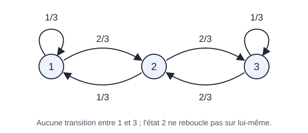

# BCE ECG — Mathématiques appliquées (ESSEC-HEC) 2025 · Corrigé guidé

*Corrigé rédigé par IA, non officiel. Signalez toute erreur.*

## Présentation du sujet

**Cadre.** Épreuve de mathématiques appliquées conçue par l'ESSEC et HEC Paris (code sujet 288), 4 heures, calculatrice interdite. Un seul problème sur les **chaînes de Markov réversibles**, en trois parties, 45 questions. D'après le rapport 2025 : 2 678 copies, moyenne 9,4, écart type 5,2 ; barème de 38 % pour la partie 1, 38 % pour la partie 2, 24 % pour la partie 3, dont 11 % pour l'informatique.

**Le thème.** Une matrice stochastique $M$ est $\mu$-réversible si $\mu_im_{i,j}=\mu_jm_{j,i}$ pour tous $i,j$.

Autrement dit, à l'équilibre, le flux de probabilité de $i$ vers $j$ égale le flux de $j$ vers $i$.

La marche aléatoire sur un graphe non orienté en est l'exemple type.

- **Partie 1 (18 questions)** : exemples, puis **critère de Kolmogorov** : une matrice ergodique est réversible si et seulement si, sur tout cycle, le produit des probabilités de transition est le même dans les deux sens (propriété $(K)$).
- **Partie 2 (17 questions)** : pour $P$ réversible, $Q={}^tP$ est diagonalisable (par symétrisation), de spectre dans $[-1,1]$.

  Si $P$ est ergodique, $1$ est valeur propre simple et $-1$ n'est pas valeur propre ; on en déduit que $X_n$ converge en loi vers $\mu$.
- **Partie 3 (10 questions)** : un algorithme qui teste $(K)$ en $r-1$ opérations élémentaires, en rendant progressivement la matrice symétrique ; programmation en Python.

**Notions mobilisées.** Matrices diagonales, transposée, produit matriciel coefficient par coefficient ; matrices symétriques diagonalisables, matrices semblables, sous-espaces propres ; chaînes de Markov (matrice de transition, $L_{n+1}=L_nP$) ; récurrence ; inégalité triangulaire ; convergence en loi de variables à valeurs entières ; graphes, listes d'adjacence ; Python (`numpy`, `rd.randint`, listes).

**Difficulté.** Sujet long et abstrait, avec beaucoup de notations nouvelles ($\theta_M$, $(K)$, $G_M(I)$). Le rapport 2025 conseille de prendre le temps d'assimiler ces définitions et rappelle que « Pour avoir une très bonne note, la résolution d'environ 50% des questions suffit en général. » Les parties 2 et 3 sont indépendantes ; seules les questions 1 et 2 de la partie 1 servent dans la partie 2.

**Questions à ne pas laisser passer.** 1 a) b) c), 2, 3, 4 b) c), 5, 7 a), 10 a), 11, 12, 15 a), 16, 21 a). Le rapport liste comme les plus pondérées : 4a, 7b, 8a (la question 8), 9b, 10b, 13a, 13c, 13d, 15a, 17a, 19a, 21a, 21b.

**Gestion du temps.** Environ 1 h 30 pour la partie 1, 1 h 30 pour la partie 2, 1 h pour la partie 3. Les questions de Python (4 a), 16, 21) peuvent se traiter à part.

---

## Partie 1 — Matrice stochastique réversible, exemples et caractérisation de Kolmogorov

On manipule la définition, on l'écrit matriciellement ($\Delta M={}^tM\Delta$), on traite deux exemples, puis on démontre le critère de Kolmogorov par des produits le long de chemins.

### Question 1. a)

> [!INDICATION]
> Écrire la relation de réversibilité pour le couple $(i,j)$ et isoler $m_{j,i}$.

#### Solution

$\mu_jm_{j,i}=\mu_im_{i,j}$, et $\mu_i>0$, $m_{i,j}\neq0$ : le membre de droite est non nul, donc $m_{j,i}\neq0$.

### Question 1. b)

> [!INDICATION]
> Chercher $\mu$ qui ne dépend pas de l'indice.

#### Solution

$\mu=\left(\frac1r\ \dots\ \frac1r\right)$ : ses coefficients sont strictement positifs de somme $1$, et $\frac1rm_{i,j}=\frac1rm_{j,i}$ par symétrie.

### Question 1. c)

> [!INDICATION]
> Calculer le coefficient $(i,j)$ de $\Delta M$ et celui de ${}^tM\Delta$ : multiplier à gauche par une diagonale agit sur les lignes, à droite sur les colonnes.

#### Solution

$(\Delta M)_{i,j}=\mu_im_{i,j}$ et $({}^tM\Delta)_{i,j}=m_{j,i}\mu_j$. L'égalité des matrices équivaut à l'égalité de tous les coefficients, c'est-à-dire à la $\mu$-réversibilité (pour $M\in\mathcal{ST}_r$).

> [!METHODE]
> Produit par une matrice diagonale : $(\Delta M)_{i,j}=\delta_im_{i,j}$ (ligne $i$ multipliée par $\delta_i$), $(M\Delta)_{i,j}=m_{i,j}\delta_j$ (colonne $j$ multipliée par $\delta_j$).

### Question 2.

> [!INDICATION]
> Écrire la $j$-ième composante de $\mu M$, puis utiliser la réversibilité terme à terme.

#### Solution

$$\begin{aligned}
(\mu M)_j&=\sum_{i=1}^r\mu_im_{i,j}\\
&=\mu_j\sum_{i=1}^rm_{j,i}\\
&=\mu_j .
\end{aligned}$$

Donc $\mu M=\mu$ : $\mu$ est un état stable de la chaîne.

> [!PIEGE]
> La somme qui vaut $1$ est une somme sur une **ligne** de $M$ ($\sum_jm_{i,j}=1$), pas sur une colonne. Après la réversibilité, c'est bien la ligne $j$ qui apparaît.

### Question 3. a)

> [!INDICATION]
> Un sommet par état ; une flèche $i\to j$ portant $p_{i,j}$ quand ce coefficient est non nul.

#### Solution



Boucles en $1$ et en $3$, de poids $\frac13$.

Flèches $1\to2$ (poids $\frac23$) et $2\to1$ (poids $\frac13$).

Flèches $2\to3$ et $3\to2$, de poids $\frac23$.

Aucune flèche entre $1$ et $3$, et pas de boucle en $2$ ($p_{2,2}=0$).

### Question 3. b)

> [!INDICATION]
> Il n'y a que trois couples $\{i,j\}$ avec $i\neq j$ ; écrire les trois conditions.

> [!INDICATION]
> Ne pas oublier la condition de normalisation $\sum\mu_i=1$.

#### Solution

$(1,2)$ : $\frac23\mu_1=\frac13\mu_2$, donc $\mu_2=2\mu_1$.

$(1,3)$ : $0=0$. $(2,3)$ : $\frac23\mu_2=\frac23\mu_3$, donc $\mu_3=\mu_2$.

Avec $5\mu_1=1$ : $\mu=\left(\frac15\ \ \frac25\ \ \frac25\right)$.

On peut contrôler avec la question 2 : $\mu P=\mu$.

### Question 4. a)

> [!INDICATION]
> Tirer $X_0$ uniformément parmi les $r$ sommets, puis, à chaque pas, un indice uniforme dans la liste des voisins du sommet courant.

> [!INDICATION]
> `rd.randint(a, b)` simule la loi uniforme sur $[\![a,b-1]\!]$ (aide-mémoire).

#### Solution

```python
def Trajectoire(L, n):
    r = len(L)
    x = rd.randint(1, r+1)
    T = [x]
    for k in range(n):
        V = L[x-1]
        x = V[rd.randint(0, len(V))]
        T.append(x)
    return T
```

Testé sur un graphe à 4 sommets (degrés $2,3,2,1$) avec $2\cdot10^5$ déplacements : les fréquences de passage sont proches de $\frac{d_i}{\sum d_k}$, ce qu'annonce la question 4. c).

> [!JURY]
> Le rapport 2025 : « SI la fonction doit retourner un objet “au hasard”, il doit bien y avoir au moins un appel à une fonction “random”. » Ici, deux tirages : l'état initial et chaque déplacement.

### Question 4. b)

> [!INDICATION]
> Sachant $[X_n=i]$, combien de sommets sont possibles, et avec quelle probabilité chacun ?

#### Solution

Sachant $[X_n=i]$, on choisit uniformément l'un des $d_i$ voisins : $p_{i,j}=\frac1{d_i}$ si $a_{i,j}=1$, $0$ sinon, soit $p_{i,j}=\frac{a_{i,j}}{d_i}$.

### Question 4. c)

> [!INDICATION]
> Que vaut $\mu_ip_{i,j}$ si $\mu_i$ est proportionnel à $d_i$ ?

#### Solution

Avec $\mu_i=\frac{d_i}{D}$, $D=\sum_kd_k$ : $\mu_ip_{i,j}=\frac{a_{i,j}}D=\frac{a_{j,i}}D=\mu_jp_{j,i}$ car $A$ est symétrique (graphe non orienté).

> [!METHODE]
> Pour une marche aléatoire sur un graphe non orienté, la loi stationnaire est proportionnelle aux degrés. C'est l'exemple fondamental de chaîne réversible.

### Question 5.

> [!INDICATION]
> Écrire les deux produits et les juxtaposer ; utiliser $i_n=j_0$.

#### Solution

$\theta_M(i_0,\dots,i_n)\,\theta_M(j_0,\dots,j_s)=m_{i_0,i_1}\cdots m_{i_{n-1},i_n}\cdot m_{i_n,j_1}\cdots m_{j_{s-1},j_s}$, qui est $\theta_M(i_0,\dots,i_n,j_1,\dots,j_s)$.

> [!METHODE]
> $\theta_M$ est la « probabilité d'un chemin » : la concaténation de deux chemins qui se raccordent donne le produit des poids. Toute la suite repose sur cette règle.

### Question 6.

> [!INDICATION]
> Pour $r=3$, quels cycles à sommets deux à deux distincts et $n\geqslant2$ existe-t-il ?

> [!INDICATION]
> Les permutations circulaires d'un cycle donnent le même produit ; un changement de sens échange les deux membres.

#### Solution

$(K)$ avec $(i_0,i_1,i_2)=(1,2,3)$ donne $m_{1,2}m_{2,3}m_{3,1}=m_{1,3}m_{3,2}m_{2,1}$.

Réciproquement, par le résultat admis, il suffit de traiter $n=2$ et $(i_0,i_1,i_2)$ permutation de $(1,2,3)$ : chacune des six conditions est l'égalité supposée ou sa symétrique.

Pour $P$ : $p_{1,2}p_{2,3}p_{3,1}=0=p_{1,3}p_{3,2}p_{2,1}$, car $p_{1,3}=p_{3,1}=0$. $P$ vérifie $(K)$.

> [!JURY]
> Le rapport 2025 relève dans la plupart des copies l'absence de « différences entre condition nécessaire, suffisante, équivalence ». Une équivalence se démontre dans les deux sens, et chaque sens doit être annoncé.

### Question 7. a)

> [!INDICATION]
> Appliquer la réversibilité à chaque transition $(i_{k-1},i_k)$ du chemin, puis multiplier.

#### Solution

$\mu_{i_{k-1}}m_{i_{k-1},i_k}=\mu_{i_k}m_{i_k,i_{k-1}}$ pour $k=1,\dots,n$. Le produit de ces égalités donne

$$\begin{aligned}
\left(\prod_{k=1}^n\mu_{i_{k-1}}\right)\theta_M(i_0,\dots,i_n)&=\prod_{k=1}^n\mu_{i_{k-1}}m_{i_{k-1},i_k}\\
&=\left(\prod_{k=1}^n\mu_{i_k}\right)\prod_{k=1}^nm_{i_k,i_{k-1}},
\end{aligned}$$

et le dernier produit est $\theta_M(i_n,\dots,i_0)$.

### Question 7. b)

> [!INDICATION]
> Appliquer 7. a) à un chemin **fermé** : que deviennent les deux produits de $\mu$ ?

#### Solution

Avec $(i_0,i_1,\dots,i_n,i_0)$, les deux produits de $\mu$ valent $\mu_{i_0}\cdots\mu_{i_n}>0$ ; on simplifie, et le chemin inverse de $(i_0,i_1,\dots,i_n,i_0)$ est $(i_0,i_n,\dots,i_1,i_0)$. D'où $(K)$.

> [!JURY]
> La question 7 b) figure parmi les plus pondérées selon le rapport 2025. Le point clé est l'égalité des deux produits de $\mu$, qu'il faut justifier (mêmes facteurs) et non affirmer.

### Question 8.

> [!INDICATION]
> Récurrence sur $s$ à partir de $M^{s+1}=M^sM$.

> [!INDICATION]
> Une somme de réels positifs est strictement positive si et seulement si l'un de ses termes l'est ; un produit de réels positifs, si et seulement si tous ses facteurs le sont.

#### Solution

$M$ et ses puissances sont à coefficients positifs. Pour $s=1$, $m^{(1)}_{i,j}=\theta_M(i,j)$. Si la propriété est vraie au rang $s$ :

$$m^{(s+1)}_{i,j}=\sum_{k=1}^rm^{(s)}_{i,k}m_{k,j},$$

et cette somme de termes positifs est strictement positive si et seulement s'il existe $k$ tel que $m^{(s)}_{i,k}>0$ et $m_{k,j}>0$.

Par hypothèse de récurrence et la question 5, cela équivaut à l'existence d'un chemin $(i_0,\dots,i_s,i_{s+1})$ de $i$ à $j$ (avec $i_s=k$) tel que $\theta_M(i_0,\dots,i_{s+1})=\theta_M(i_0,\dots,i_s)\,m_{k,j}>0$.

> [!METHODE]
> Le coefficient $(i,j)$ de $M^s$ est la somme des poids $\theta_M$ de tous les chemins de longueur $s$ de $i$ à $j$. C'est la version pondérée du résultat de première année sur la matrice d'adjacence.

> [!JURY]
> Le rapport 2025 note que « Les récurrences sont en général plutôt bien rédigées », mais que les quantificateurs « sont souvent négligés ou ignorés » : ici, « pour tous $i,j$ » fait partie de l'hypothèse de récurrence.

### Question 9. a)

> [!INDICATION]
> Pour l'existence du chemin, la question 8 avec $m^{(\sigma)}_{i,1}>0$.

> [!INDICATION]
> Si $m_{1,i}>0$, on peut refermer le chemin en revenant de $1$ à $i$ ; appliquer $(K)$ à ce cycle.

#### Solution

La question 8 donne $(i_0,\dots,i_\sigma)$ de $i$ à $1$ avec $\theta_M>0$.

Si $m_{1,i}>0$, alors $\theta_M(i_0,\dots,i_\sigma,i_0)=\theta_M(i_0,\dots,i_\sigma)m_{1,i}>0$. Par $(K)$ :

$$\theta_M(i_0,i_\sigma,\dots,i_1,i_0)=m_{i,1}\,\theta_M(i_\sigma,\dots,i_0)>0,$$

d'où $m_{i,1}>0$ et $\theta_M(i_\sigma,\dots,i_0)>0$.

### Question 9. b)

> [!INDICATION]
> Chasser les dénominateurs : l'égalité à montrer devient une égalité entre deux produits de $\theta_M$ et d'un coefficient de $M$.

> [!INDICATION]
> Interpréter chaque membre comme le poids d'un chemin fermé passant par $1$, $i$ et $j$ ; comparer les sens de parcours.

> [!INDICATION]
> Pour la forme matricielle, écrire $NM={}^tMN$ avec $N$ diagonale, puis récurrence sur la puissance.

#### Solution

L'égalité $\nu_im_{i,j}=\nu_jm_{j,i}$ équivaut à

$$\theta_M(i_\sigma,\dots,i_0)\,m_{i,j}\,\theta_M(j_0,\dots,j_\sigma)=\theta_M(j_\sigma,\dots,j_0)\,m_{j,i}\,\theta_M(i_0,\dots,i_\sigma).$$

À gauche, par deux applications de la question 5 :

$$\theta_M(i_\sigma,\dots,i_0)\,m_{i,j}\,\theta_M(j_0,\dots,j_\sigma)=\theta_M(i_\sigma,\dots,i_0,j_0,\dots,j_\sigma).$$

C'est le poids du chemin fermé qui part de $1=i_\sigma$, remonte jusqu'à $i=i_0$, saute en $j=j_0$, puis revient en $1=j_\sigma$.

De même, le membre de droite est le poids de ce chemin parcouru à l'envers. Ce chemin fermé passe par $2\sigma$ sommets intermédiaires : $(K)$ avec $n=2\sigma$ donne l'égalité.

Avec $N=\mathrm{diag}(\nu_1,\dots,\nu_r)$ : $NM={}^tMN$, puis par récurrence $NM^s={}^t(M^s)N$, et en particulier $\nu_im^{(\sigma)}_{i,j}=\nu_jm^{(\sigma)}_{j,i}$.

> [!PIEGE]
> $\nu_i$ dépend a priori du chemin choisi en 9. a). On fixe un chemin pour chaque $i$ une fois pour toutes ; la preuve de 9. b) marche pour n'importe quel choix.

> [!JURY]
> Question 9 b) parmi les plus pondérées (rapport 2025). Le rapport signale aussi des problèmes de « typage » : « une matrice égale un vecteur, un vecteur égale un nombre ». Ici, il faut bien distinguer l'égalité de matrices $NM={}^tMN$ et les égalités de coefficients.

### Question 9. c)

> [!INDICATION]
> La première ligne de $M$ a pour somme $1$.

> [!INDICATION]
> Trouver un $i$ avec $\nu_i>0$, puis utiliser l'égalité de 9. b) à la puissance $\sigma$, dont tous les coefficients sont strictement positifs.

#### Solution

Il existe $i$ avec $m_{1,i}>0$ ; par 9. a), $\nu_i>0$. Pour tout $j$ : $\nu_jm^{(\sigma)}_{j,i}=\nu_im^{(\sigma)}_{i,j}>0$, donc $\nu_j>0$.

### Question 9. d)

> [!INDICATION]
> Normaliser.

#### Solution

$\mu_j=\frac{\nu_j}{\sum_k\nu_k}$ : coefficients strictement positifs de somme $1$, et $\mu_im_{i,j}=\mu_jm_{j,i}$. $M$ est $\mu$-réversible.

> [!METHODE]
> Le critère de Kolmogorov fournit une loi réversible explicite : $\mu_i$ est proportionnel au rapport « poids du retour de $1$ vers $i$ » sur « poids de l'aller de $i$ vers $1$ ».

---

## Partie 2 — Matrice de transition réversible ergodique, convergence

On symétrise $Q={}^tP$ pour la diagonaliser, on localise son spectre dans $[-1,1]$, puis on montre que $1$ est valeur propre simple et que $-1$ n'est pas valeur propre. La décomposition de $L_0$ sur une base propre donne la limite.

### Question 10. a)

> [!INDICATION]
> Les $\mu_i$ sont strictement positifs.

#### Solution

$D=\mathrm{diag}(\sqrt{\mu_1},\dots,\sqrt{\mu_r})$, inversible, et $D^2=\Delta$.

### Question 10. b)

> [!INDICATION]
> 1. c) donne $\Delta P=Q\Delta$ ; en déduire $Q$ en fonction de $P$ et de $\Delta$.

> [!INDICATION]
> Montrer que $D^{-1}QD$ est égale à sa transposée.

#### Solution

$Q=\Delta P\Delta^{-1}$, donc $S=D^{-1}QD=DPD^{-1}$. Et ${}^tS=D\,{}^tQ\,D^{-1}=DPD^{-1}=S$ ($D$ diagonale, ${}^tQ=P$). $S$ est symétrique, donc diagonalisable.

> [!METHODE]
> Symétrisation : si $\Delta P={}^tP\Delta$ avec $\Delta$ diagonale à coefficients strictement positifs, alors $\Delta^{1/2}P\Delta^{-1/2}$ est symétrique. C'est l'outil standard pour diagonaliser une chaîne réversible.

> [!JURY]
> Question 10 b) parmi les plus pondérées (rapport 2025).

### Question 10. c)

> [!INDICATION]
> Deux matrices semblables : l'une diagonalisable entraîne l'autre.

#### Solution

$D^{-1}QD=R\Lambda R^{-1}$ donne $Q=(DR)\Lambda(DR)^{-1}$ : $Q$ est diagonalisable.

### Question 11.

> [!INDICATION]
> Transposer l'égalité de la question 2.

#### Solution

$\mu P=\mu$ donne ${}^tP\,{}^t\mu={}^t\mu$, soit $Q\,{}^t\mu={}^t\mu$ : $1\in\mathrm{Sp}(Q)$, ${}^t\mu$ étant non nul.

### Question 12. a)

> [!INDICATION]
> Intervertir les deux sommes finies.

#### Solution

$\sum_i\sum_jq_{i,j}|y_j|=\sum_j|y_j|\sum_ip_{j,i}=\sum_j|y_j|$.

> [!PIEGE]
> Le rapport 2025 signale que « De nombreux candidats confondent les matrices avec la somme de leurs coefficients ». Ici, ce sont les **colonnes** de $Q$ qui ont pour somme $1$, parce que les **lignes** de $P$ l'ont.

### Question 12. b)

> [!INDICATION]
> Écrire la $i$-ième ligne de $QY=\lambda Y$ et appliquer l'inégalité triangulaire.

#### Solution

$|\lambda||y_i|=\left|\sum_jq_{i,j}y_j\right|\leqslant\sum_jq_{i,j}|y_j|$ ; on somme sur $i$ et on conclut avec 12. a).

### Question 12. c)

> [!INDICATION]
> Un vecteur propre est non nul.

#### Solution

$\sum_i|y_i|>0$ donc $|\lambda|\leqslant1$ : $\mathrm{Sp}(Q)\subset[-1,1]$.

### Question 13. a)

> [!INDICATION]
> Avec un $y_\ell<0$ et $q_{k,\ell}>0$, l'inégalité triangulaire sur la ligne $k$ devient stricte.

> [!INDICATION]
> Sommer les inégalités des lignes (une stricte, les autres larges) et comparer avec 12. a).

#### Solution

$y_k=\sum_jq_{k,j}y_j<\sum_jq_{k,j}|y_j|$, car le terme $j=\ell$ vérifie $q_{k,\ell}y_\ell<q_{k,\ell}|y_\ell|$. Pour les autres lignes, $|y_i|\leqslant\sum_jq_{i,j}|y_j|$. En sommant, avec 12. a) :

$$\sum_i|y_i|<\sum_j|y_j| ,$$

ce qui est absurde. Conclusion : un vecteur propre pour $1$ qui a une composante strictement positive a toutes ses composantes positives.

> [!JURY]
> Question 13 a) parmi les plus pondérées (rapport 2025), qui recommande aussi, devant une question ouverte comme « Conclusion ? », d'« être critique avec les solutions que l'on pense avoir trouvées ».

### Question 13. b)

> [!INDICATION]
> Appliquer 13. a) à $Y$ ou à $-Y$.

#### Solution

Les composantes d'un vecteur propre pour $1$ sont toutes $\geqslant0$ ou toutes $\leqslant0$, et non toutes nulles : leur somme est non nulle. Un élément de $E_1(Q)$ de somme nulle est donc le vecteur nul.

### Question 13. c)

> [!INDICATION]
> Retrancher à $Y$ le bon multiple de ${}^t\mu$ pour obtenir un élément de $E_1(Q)$ de somme nulle.

#### Solution

$Z=Y-\left(\sum_iy_i\right){}^t\mu\in E_1(Q)$ et la somme de ses composantes est nulle, donc $Z=0$. Ainsi $E_1(Q)\subset\mathrm{Vect}({}^t\mu)$, et l'inclusion réciproque vient de 11.

> [!METHODE]
> Pour montrer qu'un sous-espace propre est une droite, on exhibe une forme linéaire (ici la somme des composantes) qui ne s'annule sur aucun vecteur propre ; tout vecteur du sous-espace se ramène alors au vecteur connu.

### Question 13. d)

> [!INDICATION]
> Sommer les composantes de $QY=-Y$.

> [!INDICATION]
> Un vecteur non nul de somme nulle a des composantes des deux signes : l'inégalité triangulaire devient stricte sur **chaque** ligne.

#### Solution

La somme des composantes de $QY$ est $\sum_jy_j$ (colonnes de $Q$ de somme $1$), donc $-\sum y_i=\sum y_i$ et $\sum y_i=0$.

Si $Y\neq0$, il existe $y_p>0$ et $y_\ell<0$ ; pour chaque $i$, les réels $q_{i,j}y_j$ ne sont pas tous de même signe, donc $|y_i|=\left|\sum_jq_{i,j}y_j\right|<\sum_jq_{i,j}|y_j|$.

En sommant : $\sum|y_i|<\sum|y_j|$, absurde. $-1\notin\mathrm{Sp}(Q)$.

> [!PIEGE]
> L'inégalité stricte $\left|\sum a_j\right|<\sum|a_j|$ pour des réels de signes différents se démontre en deux lignes (distinguer le signe de $\sum a_j$) : il faut l'écrire, pas l'affirmer.

### Question 14. a)

> [!INDICATION]
> Un vecteur propre de $Q$ pour $1$ est aussi vecteur propre de $Q^u$ pour $1$.

#### Solution

$QY=Y\Rightarrow Q^uY=Y\Rightarrow Y\in\mathrm{Vect}({}^t\mu)$ ; avec 11, $E_1(Q)=\mathrm{Vect}({}^t\mu)$.

### Question 14. b)

> [!INDICATION]
> Si $QY=-Y$, que vaut $Q^uY$ ? Distinguer selon la parité de $u$.

#### Solution

$Q^uY=(-1)^uY$. Si $u$ est impair, $-1\in\mathrm{Sp}(Q^u)$, exclu.

Si $u$ est pair, $Y\in E_1(Q^u)=\mathrm{Vect}({}^t\mu)$, donc $QY=Y$, et avec $QY=-Y$ on trouve $Y=0$ : contradiction.

> [!METHODE]
> Passer à une puissance $P^u$ qui a de meilleures propriétés (coefficients strictement positifs) puis redescendre à $P$ : technique classique pour les chaînes ergodiques.

### Question 15. a)

> [!INDICATION]
> Formule des probabilités totales avec le système complet $([X_n=i])_i$ ; attention aux $i$ pour lesquels $P(X_n=i)=0$.

#### Solution

$P(X_{n+1}=j)=\sum_iP(X_n=i)p_{i,j}$ : si $P(X_n=i)\neq0$, on utilise (H3) ; sinon le terme est nul des deux côtés. D'où $L_{n+1}=L_nP$ et $L_n=L_0P^n$.

> [!JURY]
> Question 15 a) parmi les plus pondérées (rapport 2025). L'énoncé a pris soin de définir $p_{i,j}$ seulement sur $S_i$ : la copie doit traiter le cas $P(X_n=i)=0$.

### Question 15. b)

> [!INDICATION]
> Transposer : ${}^tL_n=Q^n\,{}^tL_0$. Décomposer ${}^tL_0$ dans la base propre.

#### Solution

${}^tL_0=\alpha_1{}^t\mu+\sum_{k\geqslant2}\alpha_kY_k$ ; alors ${}^tL_n=Q^n\,{}^tL_0=\alpha_1{}^t\mu+\sum_{k\geqslant2}\alpha_k\lambda_k^nY_k$, et l'on transpose.

### Question 15. c)

> [!INDICATION]
> $|\lambda_k|<1$ pour $k\geqslant2$.

#### Solution

$\lambda_k^n\to0$ pour $k\geqslant2$, donc $P(X_n=j)\to\alpha_1\mu_j$.

### Question 15. d)

> [!INDICATION]
> La somme des $P(X_n=j)$ vaut $1$ pour tout $n$.

> [!INDICATION]
> Variables à valeurs entières : caractérisation de la convergence en loi par les $P(X_n=k)$.

#### Solution

En passant à la limite dans la somme finie $\sum_jP(X_n=j)=1$, on obtient $\alpha_1\sum_j\mu_j=\alpha_1=1$.

Soit $X$ de loi $\mu$ sur $[\![1,r]\!]$. Pour tout $k\in\mathbb{Z}$, $P(X_n=k)\to P(X=k)$ (les deux sont nuls hors de $[\![1,r]\!]$).

Par la caractérisation de la convergence en loi pour des variables à valeurs entières, $X_n$ converge en loi vers $X$.

> [!METHODE]
> Théorème ergodique dans le cas réversible : la loi de $X_n$ converge vers l'état stable $\mu$, quelle que soit la loi initiale, à vitesse géométrique (au plus $\max_{k\geqslant2}|\lambda_k|^n$).

---

## Partie 3 — Un algorithme pour la réversibilité

Les opérations élémentaires conservent $(K)$, l'ergodicité, et permettent d'ajouter un sommet à un graphe connexe d'arêtes « symétriques ». En $r-1$ étapes, on obtient une matrice symétrique si et seulement si $M$ vérifie $(K)$.

### Question 16.

> [!INDICATION]
> Décaler les indices de $1$ ; modifier les coefficients non diagonaux de la ligne, puis le coefficient diagonal.

#### Solution

```python
def opLigne(M, k, alph):
    r = np.shape(M)[0]
    for j in range(r):
        if j != k-1:
            M[k-1][j] = alph * M[k-1][j]
    M[k-1][k-1] = 1 - alph + alph * M[k-1][k-1]
    return M
```

Testée sur l'exemple de l'énoncé ($k=1$, $\alpha=\frac12$) : première ligne $\left(\frac46,\frac16,\frac16\right)$. La fonction modifie `M` en place, comme l'exige l'usage qui en est fait à la question 21.

> [!PIEGE]
> Si `M` est une matrice d'entiers (`np.array([[1, 0], …])`), les affectations `M[k-1][j] = …` tronquent les flottants. La matrice doit être de type flottant.

### Question 17. a)

> [!INDICATION]
> Grâce au résultat admis, il suffit de considérer des cycles à sommets deux à deux distincts. Quels coefficients de tels cycles sont modifiés par l'opération ?

> [!INDICATION]
> Dans un tel cycle, chaque sommet est l'origine d'un seul arc et l'extrémité d'un seul arc.

#### Solution

Seuls des coefficients non diagonaux interviennent. L'opération sur la ligne $k$ multiplie par $\alpha$ les $m_{k,j}$ ($j\neq k$) ; si $k$ est dans le cycle, exactement un arc part de $k$ dans chaque sens de parcours.

Les deux membres de $(K)$ sont donc multipliés par le même $\alpha^\varepsilon$ ($\varepsilon\in\{0,1\}$).

Même raisonnement pour la colonne $k$ (un seul arc arrive en $k$). Comme $\alpha\neq0$, $(K)$ est vraie pour $M$ si et seulement si elle l'est pour $M'$.

> [!JURY]
> Question 17 a) parmi les plus pondérées (rapport 2025).

### Question 17. b)

> [!INDICATION]
> Distinguer coefficients non diagonaux et diagonaux, puis les deux opérations.

#### Solution

Non diagonaux : multipliés par $\alpha>0$ ou inchangés. Diagonaux : $m'_{k,k}=1-\alpha+\alpha m_{k,k}>0$ (ligne), $m'_{i,i}=m_{i,i}+(1-\alpha)m_{i,k}\geqslant m_{i,i}$ (colonne), les autres inchangés.

### Question 17. c)

> [!INDICATION]
> Question 8 dans les deux sens : un chemin de poids positif pour $M$ l'est encore pour $M'$.

#### Solution

Fixons $i,j$. La question 8 fournit un chemin de longueur $\sigma$ de $i$ à $j$ de poids $\theta_M>0$ : tous ses arcs ont un coefficient strictement positif dans $M$.

Par 17. b), ils ont encore un coefficient strictement positif dans $M'$, donc le poids $\theta_{M'}$ du même chemin est strictement positif. La question 8, appliquée à $M'\in\mathcal{ST}_r$, donne $m'^{(\sigma)}_{i,j}>0$.

### Question 18.

> [!INDICATION]
> Calculer $m'_{k,\ell}$ et $m'_{\ell,k}$ dans chacun des deux cas.

> [!INDICATION]
> Pour la connexité, vérifier que les arêtes entre sommets de $I$ ne sont pas touchées.

#### Solution

Si $m_{\ell,k}\leqslant m_{k,\ell}$, l'opération sur la ligne $k$ avec $\alpha=\frac{m_{\ell,k}}{m_{k,\ell}}$ donne $m'_{k,\ell}=m_{\ell,k}=m'_{\ell,k}$.

Sinon, l'opération sur la colonne $k$ avec $\alpha=\frac{m_{k,\ell}}{m_{\ell,k}}$ donne $m'_{\ell,k}=m_{k,\ell}=m'_{k,\ell}$.

Dans les deux cas, ces coefficients sont non nuls et égaux : $\{k,\ell\}$ est une arête.

Pour $i,j\in I$ (donc différents de $k$), $m_{i,j}$ et $m_{j,i}$ ne sont pas modifiés : les arêtes de $G_M(I)$ subsistent.

Tout sommet de $I$ est relié à $\ell$, et $k$ est relié à $\ell$ : le graphe est connexe.

> [!PIEGE]
> Si $m_{\ell,k}=m_{k,\ell}$, le coefficient vaut $\alpha=1$, hors de $]0,1[$ : l'opération ne change rien et l'arête existe déjà. Le signaler montre qu'on a lu l'énoncé.

### Question 19. a)

> [!INDICATION]
> $M$ vérifie $(K)$ et est ergodique : que dit la partie 1 ?

> [!INDICATION]
> Un chemin de poids positif d'un sommet de $I$ à un sommet hors de $I$ doit « sortir » de $I$ à un moment.

#### Solution

Par la question 9, $M$ est réversible pour une certaine loi $\mu$.

Soient $i\in I$ et $j\notin I$. La question 8 fournit un chemin $(i_0,\dots,i_\sigma)$ de $i$ à $j$ dont tous les arcs ont un coefficient strictement positif.

Il part de $I$ et finit hors de $I$ : soit $t$ le premier indice tel que $i_t\notin I$.

Avec $\ell=i_{t-1}\in I$ et $k=i_t\notin I$, on a $m_{\ell,k}>0$, et par 1. a), $m_{k,\ell}\neq0$.

> [!JURY]
> Question 19 a) parmi les plus pondérées (rapport 2025). L'énoncé indique d'utiliser la question 8 : c'est le chemin qui fournit le couple $(\ell,k)$.

### Question 19. b)

> [!INDICATION]
> Itérer : 19. a) puis 18, en vérifiant que les hypothèses (ergodicité, $(K)$) se transmettent grâce à 17.

> [!INDICATION]
> Pour la symétrie : $M^*$ est réversible pour une certaine $\mu$ ; que dit la réversibilité le long d'une arête de $G_{M^*}$ ?

#### Solution

On part de $I=\{1\}$, pour lequel le graphe (un seul sommet) est connexe. À chaque étape :

- 19. a) fournit $\ell\in I$ et $k\notin I$ avec $m_{\ell,k}$ et $m_{k,\ell}$ non nuls ;
- la question 18 transforme la matrice par une opération élémentaire et rend connexe le graphe sur $I\cup\{k\}$ ;
- 17. a) et 17. c) assurent que la nouvelle matrice vérifie encore $(K)$ et reste ergodique, ce qui permet de recommencer.

Chaque étape ajoute un sommet : après $r-1$ étapes, $I=[\![1,r]\!]$ et $G_{M^*}([\![1,r]\!])$ est connexe.

$M^*$ est $\mu$-réversible (question 9). Sur une arête $\{i,j\}$, $m^*_{i,j}=m^*_{j,i}\neq0$, d'où $\mu_i=\mu_j$ ; par connexité, $\mu$ est constante.

La réversibilité devient alors $m^*_{i,j}=m^*_{j,i}$ : $M^*$ est symétrique.

### Question 20.

> [!INDICATION]
> Une matrice symétrique vérifie-t-elle $(K)$ ? Remonter ensuite la suite d'opérations.

#### Solution

$M^*$ symétrique est réversible pour la loi uniforme (1. b)), donc vérifie $(K)$ (7. b)). Chaque opération préserve l'équivalence (17. a)) : en remontant, $M$ vérifie $(K)$.

### Question 21. a)

> [!INDICATION]
> Deux boucles imbriquées sur les listes `I` et `J`, avec un `return` dès qu'un coefficient non nul est trouvé.

#### Solution

```python
def NonNul(M, I, J):
    for i in I:
        for j in J:
            if M[i-1][j-1] != 0:
                return (i, j)
    return (0, 0)
```

> [!JURY]
> Le rapport 2025 constate que « Les questions d'informatiques sont rarement totalement réussies ». Points d'attention : indices décalés de $1$ et retour de `(0, 0)` seulement après la fin des deux boucles.

### Question 21. b)

> [!INDICATION]
> La boucle tourne tant que tous les sommets ne sont pas dans `I`.

> [!INDICATION]
> Si l'on ne trouve pas de couple, ou si $m_{k,\ell}=0$ alors que $m_{\ell,k}\neq0$, la matrice ne peut pas vérifier $(K)$ (questions 1. a) et 19. a)).

#### Solution

```python
def estRev(M):
    r = np.shape(M)[0]
    I = [1]; J = [k for k in range(2, r+1)]
    while len(I) < r:
        ell, k = NonNul(M, I, J)
        if (ell == 0) or M[k-1][ell-1]*M[ell-1][k-1] == 0:
            return False
        else:
            if M[ell-1][k-1] <= M[k-1][ell-1]:
                OpLigne(M, k, M[ell-1][k-1]/M[k-1][ell-1])
            else:
                OpCol(M, k, M[k-1][ell-1]/M[ell-1][k-1])
            I.append(k)
            J.remove(k)
    return (np.transpose(M) == M).all()
```

Si $M$ vérifie $(K)$, aucune étape ne renvoie `False` et la matrice finale est symétrique (19). Si $M$ ne vérifie pas $(K)$, ou bien une étape renvoie `False`, ou bien la matrice finale n'est pas symétrique (20).

Contrôle numérique sur 300 matrices ergodiques aléatoires d'ordre 3 à 5, réversibles ou non : `estRev` concorde toujours avec une vérification directe de $(K)$ sur tous les cycles, à condition de comparer la matrice finale à sa transposée **à une tolérance près**.

> [!PIEGE]
> Le test exact `(np.transpose(M) == M).all()` imposé par l'énoncé échoue souvent sur machine à cause des arrondis des divisions : sur les mêmes essais, il renvoie `False` pour beaucoup de matrices réversibles. Mathématiquement, l'algorithme est juste ; numériquement, on comparerait à $10^{-12}$ près.

---

## Bilan

**Méthodes à retenir.**

- Réversibilité : $\mu_im_{i,j}=\mu_jm_{j,i}$, soit $\Delta M={}^tM\Delta$ ; elle entraîne $\mu M=\mu$ (état stable).
- Poids d'un chemin $\theta_M$ : concaténation multiplicative ; $m^{(s)}_{i,j}$ est la somme des poids des chemins de longueur $s$.
- Critère de Kolmogorov : réversible $\iff$ chaque cycle a le même poids dans les deux sens (pour une matrice ergodique).
- Symétrisation $D^{-1}QD$ d'une matrice réversible : diagonalisable, valeurs propres réelles dans $[-1,1]$.
- Inégalité triangulaire stricte pour montrer qu'un sous-espace propre est une droite, et que $-1$ n'est pas valeur propre.
- Convergence en loi d'une chaîne par décomposition de $L_0$ sur une base propre.

**Prérequis à revoir.** Produit de matrices diagonales, transposée d'un produit ; matrices symétriques ; matrices semblables ; formule des probabilités totales ; convergence en loi pour des variables à valeurs entières ; listes et indices en Python.

**Questions transposables.** Marche aléatoire sur un graphe (loi stationnaire proportionnelle aux degrés) ; chaîne de naissance et de mort ; algorithme de Metropolis, qui construit une chaîne réversible pour une loi $\mu$ donnée.
