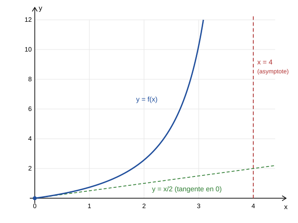

# BCE ECG — Maths approfondies (EDHEC) 2025 · Corrigé brut

*Corrigé rédigé par IA, non officiel. Signalez toute erreur.*

Épreuve de mathématiques approfondies, conception EDHEC BS, voie générale, 4 heures, calculatrice interdite. Trois exercices et un problème, 59 questions (sous-questions comprises).

---

## Exercice 1

### 1.

**(a)** $g$ est dérivable sur $\mathbb{R}_+^*$ et :

$$g'(x)=\frac{\frac1x\cdot x-\ln(x)}{x^2}=\frac{1-\ln(x)}{x^2}.$$

$g'(x)>0$ pour $x<e$ et $g'(x)<0$ pour $x>e$.

*Limites.* En $0^+$, $\ln(x)\to-\infty$ et $\frac1x\to+\infty$ : le produit tend vers $-\infty$ (forme non indéterminée). En $+\infty$, $g(x)\to0$ par croissances comparées.

| $x$ | $0$ | | $e$ | | $+\infty$ |
|---|---|---|---|---|---|
| $g'(x)$ | | $+$ | $0$ | $-$ | |
| $g$ | $-\infty$ | $\nearrow$ | $\frac1e$ | $\searrow$ | $0$ |

**(b)** $g$ est décroissante sur $[e,+\infty[$ et $3>e$.

Pour $k\geqslant3$, $g(k+1)\leqslant g(k)$ : **la suite $\left(\frac{\ln(k)}{k}\right)_{k\geqslant3}$ est décroissante.** Pour $k\geqslant4$ :

$$\frac{\ln(k)}{k}\leqslant\frac{\ln(4)}{4}=\frac{2\ln(2)}{4}=\frac{\ln(2)}{2}.$$

### 2.

**(a)** Sur $]n,+\infty[$, $x>0$ et $x-n>0$ : $\ln(x)$ et $\ln(x-n)$ sont dérivables, donc $f_n$ l'est, et :

$$f_n'(x)=\ln(x)+\frac{x-n}{x}-\ln(x-n)-\frac{x}{x-n}.$$

$$\boxed{f_n'(x)=\ln\Big(\frac{x}{x-n}\Big)+\frac{x-n}{x}-\frac{x}{x-n}.}$$

**(b)** Soit $\varphi(t)=t-1-\ln(t)$ sur $]0,+\infty[$ : $\varphi'(t)=1-\frac1t$, négative sur $]0,1]$ et positive sur $[1,+\infty[$.

Donc $\varphi$ admet un minimum en 1, égal à $\varphi(1)=0$.

**Pour tout $t>0$, $\ln(t)\leqslant t-1$.**

Avec $t=\frac{x}{x-n}>0$ :

$$\begin{aligned}
f_n'(x)&\leqslant\frac{x}{x-n}-1+\frac{x-n}{x}-\frac{x}{x-n}\\
&=\frac{x-n}{x}-1\\
&=-\frac nx<0.
\end{aligned}$$

**$f_n$ est strictement décroissante sur $]n,+\infty[$.**

**(c)** Soit $n\geqslant2$. $f_n$ est continue et strictement décroissante sur $[n+1,n+2]$.

- $f_n(n+1)=\ln(n+1)-(n+1)\ln(1)=\ln(n+1)>0$.
- $f_n(n+2)=2\ln(n+2)-(n+2)\ln(2)=2(n+2)\Big(\dfrac{\ln(n+2)}{n+2}-\dfrac{\ln(2)}{2}\Big)\leqslant0$ par 1.(b) avec $k=n+2\geqslant4$.

Par le théorème de la bijection, $f_n$ réalise une bijection de $[n+1,n+2]$ sur $[f_n(n+2),f_n(n+1)]$, qui contient $0$.

**L'équation $f_n(x)=0$ admet une unique solution $x_n\in[n+1,n+2]$.** (Pour $n=2$, $f_2(4)=0$ et $x_2=4$.)

### 3.

Pour $n\geqslant2$, $n+1\leqslant x_n\leqslant n+2$, donc :

$$1+\frac1n\leqslant\frac{x_n}{n}\leqslant1+\frac2n.$$

Par encadrement, $\frac{x_n}{n}\to1$ : $\boxed{x_n\underset{+\infty}{\sim}n.}$

### 4.

**(a)** $f_n(x_n)=0$ s'écrit $(x_n-n)\ln(x_n)=x_n\ln(x_n-n)$, et $x_n>0$ :

$$\ln(x_n-n)=(x_n-n)\frac{\ln(x_n)}{x_n}.$$

**(b)** $x_n\geqslant n+1$, donc $x_n\to+\infty$ et, par 1.(a), $\displaystyle\lim_{n\to+\infty}\frac{\ln(x_n)}{x_n}=0$. Comme $x_n-n\in[1,2]$ est bornée, 4.(a) donne $\ln(x_n-n)\to0$. Par continuité de l'exponentielle :

$$x_n-n=\exp\big(\ln(x_n-n)\big)\xrightarrow[n\to+\infty]{}e^0=1.$$

### 5.

**(a)** $u_n=x_n-n-1\to0$ (question 4). De plus $u_n\neq0$ : $f_n(n+1)>0$, donc $x_n\neq n+1$ ; ainsi $u_n\in\,]0,1]$. L'équivalent usuel $\ln(1+u)\underset{u\to0}{\sim}u$ donne :

$$\ln(1+u_n)\underset{+\infty}{\sim}u_n.$$

Ensuite $1+n+u_n=x_n$ et :

$$\ln(x_n)=\ln(n)+\ln\Big(\frac{x_n}{n}\Big),$$

donc :

$$\frac{\ln(x_n)}{\ln(n)}=1+\frac{\ln(x_n/n)}{\ln(n)}\xrightarrow[n\to+\infty]{}1,$$

car $\ln(x_n/n)\to\ln(1)=0$ (question 3) et $\ln(n)\to+\infty$. **$\ln(1+n+u_n)\underset{+\infty}{\sim}\ln(n)$.**

**(b)** Par 4.(a), avec $x_n-n=1+u_n$ :

$$\ln(1+u_n)=(1+u_n)\,\frac{\ln(x_n)}{x_n}.$$

Par 5.(a), $\ln(1+u_n)\sim u_n$ ; $1+u_n\to1$ ; $\ln(x_n)\sim\ln(n)$ et $x_n\sim n$. Par produit et quotient d'équivalents :

$$\boxed{u_n\underset{+\infty}{\sim}\frac{\ln(n)}{n}.}$$

### 6.

$u_n>0$ et $\frac{\ln(n)}{n}>0$ pour $n\geqslant2$.

*Série de terme général $u_n$.* Pour $n\geqslant3$, $\frac{\ln(n)}{n}\geqslant\frac1n$, et la série harmonique diverge : $\sum\frac{\ln(n)}{n}$ diverge. Par le critère d'équivalence pour les séries à termes positifs, **$\sum u_n$ diverge.**

*Série de terme général $u_n^2$.* $u_n^2\sim\frac{\ln(n)^2}{n^2}$ et :

$$\frac{\ln(n)^2/n^2}{1/n^{3/2}}=\frac{\ln(n)^2}{\sqrt n}\xrightarrow[n\to+\infty]{}0.$$

Donc $\frac{\ln(n)^2}{n^2}=o\big(\frac{1}{n^{3/2}}\big)$, et $\sum\frac{1}{n^{3/2}}$ converge (série de Riemann, $\frac32>1$). Par comparaison de séries à termes positifs, **$\sum u_n^2$ converge.**

---

## Exercice 2

### 1.

**(a)** Si $x\in F$, $p(x)=x$ donc $\|p(x)\|=\|x\|$ : **$F\subset\{x\in E,\ \|p(x)\|=\|x\|\}$.**

**(b)** Pour $x\in E$, $p(x)\in F$ et $x-p(x)\in F^\perp$ sont orthogonaux. Par le théorème de Pythagore appliqué à $x=(x-p(x))+p(x)$ :

$$\|x\|^2=\|x-p(x)\|^2+\|p(x)\|^2.$$

**(c)** Si $\|p(x)\|=\|x\|$, alors (b) donne $\|x-p(x)\|^2=0$, donc $x=p(x)\in F$. Avec (a) :

$$\boxed{F=\{x\in E,\ \|p(x)\|=\|x\|\}.}$$

Par (b), $\|p(x)\|^2\leqslant\|x\|^2$, donc **$\|p(x)\|\leqslant\|x\|$ pour tout $x\in E$.**

### 2.

**(a)** Soit $x\in F_1\cap F_2$. Alors $p_2(x)=x$ puis $p_1(x)=x$, donc $p_3(x)=p_1(p_2(x))=x$ et $x\in\operatorname{Im}(p_3)=F_3$. **$F_1\cap F_2\subset F_3$.**

**(b)** Soit $x\in F_3$ : $x=p_3(x)=p_1\big(p_2(x)\big)$. Par 1.(c) appliqué à $p_1$ et au vecteur $p_2(x)$ :

$$\|x\|=\big\|p_1\big(p_2(x)\big)\big\|\leqslant\|p_2(x)\|.$$

Par 1.(c) appliqué à $p_2$, $\|p_2(x)\|\leqslant\|x\|$.

Donc $\|p_2(x)\|=\|x\|$ et, par 1.(c), **$x\in F_2$.** Alors $p_2(x)=x$ et $x=p_1(p_2(x))=p_1(x)\in\operatorname{Im}(p_1)=F_1$ : **$x\in F_1$.**

**(c)** Par (b), $F_3\subset F_1\cap F_2$ ; avec (a) : $\boxed{F_1\cap F_2=F_3.}$

**(d)** $p_3$ est un projecteur orthogonal, donc un endomorphisme symétrique (résultat rappelé) : $\langle p_3(x),y\rangle=\langle x,p_3(y)\rangle$ pour tous $x,y$. En utilisant ensuite la symétrie de $p_1$, puis celle de $p_2$ :

$$\begin{aligned}
\langle p_1\circ p_2(x),y\rangle&=\langle x,p_1\circ p_2(y)\rangle\\
&=\langle p_1(x),p_2(y)\rangle\\
&=\langle p_2\circ p_1(x),y\rangle.
\end{aligned}$$

**(e)** Pour tous $x,y$, $\langle p_1\circ p_2(x)-p_2\circ p_1(x),y\rangle=0$. Avec $y=p_1\circ p_2(x)-p_2\circ p_1(x)$, ce vecteur est de norme nulle, donc nul. **$p_1\circ p_2=p_2\circ p_1$.**

### 3.

**(a)** $p$ est linéaire (composée d'applications linéaires) et, par commutation puis $p_1^2=p_1$, $p_2^2=p_2$ :

$$\begin{aligned}
p^2&=p_1\circ p_2\circ p_1\circ p_2\\
&=p_1\circ p_1\circ p_2\circ p_2\\
&=p_1\circ p_2\\
&=p.
\end{aligned}$$

**$p$ est un projecteur de $E$.**

**(b)** Pour $x,y\in E$, par symétrie de $p_1$ puis de $p_2$, puis commutation :

$$\begin{aligned}
\langle p(x),y\rangle&=\langle p_2(x),p_1(y)\rangle\\
&=\langle x,p_2\circ p_1(y)\rangle\\
&=\langle x,p(y)\rangle.
\end{aligned}$$

**$p$ est un endomorphisme symétrique.**

**(c)** Par le résultat rappelé, $p$ est le projecteur orthogonal sur $\operatorname{Im}(p)$. Montrons que $\operatorname{Im}(p)=F_1\cap F_2$.

- Si $x\in F_1\cap F_2$, $p(x)=p_1(p_2(x))=p_1(x)=x$, donc $x\in\operatorname{Im}(p)$.
- Si $y=p(x)$, alors $y=p_1(p_2(x))\in F_1$ et $y=p_2(p_1(x))\in F_2$.

**$p_1\circ p_2$ est la projection orthogonale sur $F_1\cap F_2$** (l'application nulle si $F_1\cap F_2=\{0\}$).

### 4.

**Soient $F_1$ et $F_2$ deux sous-espaces vectoriels de $E$, de projections orthogonales $p_1$ et $p_2$.

Alors $p_1\circ p_2$ est une projection orthogonale si et seulement si $p_1\circ p_2=p_2\circ p_1$. Dans ce cas, $p_1\circ p_2$ est la projection orthogonale sur $F_1\cap F_2$.**

---

## Exercice 3

### Partie 1. Étude d'une variable aléatoire.

#### 1.

$f$ est continue sur $]-\infty,0]$ et sur $]0,+\infty[$, et $f(0)=0$ : $f$ est continue sur $\mathbb{R}$.

Pour $x\leqslant0$, $-2x\geqslant0$ donc $f(x)\geqslant0$ ; $f$ est positive. Pour $A<0$ :

$$\int_A^0-2xe^{-x^2}\,\mathrm{d}x=\Big[e^{-x^2}\Big]_A^0=1-e^{-A^2}\xrightarrow[A\to-\infty]{}1.$$

Avec $\int_0^{+\infty}f=0$, $\int_{-\infty}^{+\infty}f$ converge et vaut 1 : **$f$ est une densité.**

#### 2.

Pour $x\leqslant0$ :

$$F(x)=\int_{-\infty}^{x}-2te^{-t^2}\,\mathrm{d}t=e^{-x^2}.$$

Pour $x>0$, $F(x)=\int_{-\infty}^{0}f+\int_0^xf=1+0=1$.

$$\boxed{F(x)=\begin{cases}e^{-x^2}&\text{si }x\leqslant0,\\1&\text{si }x>0.\end{cases}}$$

#### 3.

La loi $\mathcal{N}(m,\sigma^2)$ a pour densité $x\mapsto\frac{1}{\sigma\sqrt{2\pi}}e^{-\frac{(x-m)^2}{2\sigma^2}}$. Avec $m=0$ et $\sigma^2=\frac12$, $\sigma\sqrt{2\pi}=\sqrt\pi$ :

$$\boxed{\varphi(x)=\frac{1}{\sqrt\pi}\,e^{-x^2}.}$$

#### 4.

Soit $N\hookrightarrow\mathcal{N}(0,\frac12)$. $N$ admet une variance, égale à $\frac12$, et une espérance nulle, donc $\mathbb{E}(N^2)=\frac12$ : l'intégrale $\int_{\mathbb{R}}x^2\frac{1}{\sqrt\pi}e^{-x^2}\,\mathrm{d}x$ converge et vaut $\frac12$. Par parité de l'intégrande :

$$\int_{-\infty}^{0}x^2e^{-x^2}\,\mathrm{d}x=\frac12\cdot\frac{\sqrt\pi}{2}=\frac{\sqrt\pi}{4}.$$

L'intégrande $xf(x)=-2x^2e^{-x^2}$ est de signe constant sur $]-\infty,0]$ et nul sur $]0,+\infty[$ : l'intégrale $\int_{\mathbb{R}}xf(x)\,\mathrm{d}x$ converge absolument. **$X$ admet une espérance**, et :

$$\mathbb{E}(X)=-2\int_{-\infty}^{0}x^2e^{-x^2}\,\mathrm{d}x=-2\cdot\frac{\sqrt\pi}{4}.$$

$$\boxed{\mathbb{E}(X)=-\frac{\sqrt\pi}{2}.}$$

#### 5.

Pour $x\geqslant0$ : $Z\leqslant x\iff-\sqrt x\leqslant X\leqslant\sqrt x$. $X$ étant à densité, $\mathbb{P}(X=-\sqrt x)=0$, donc :

$$G(x)=F(\sqrt x)-F(-\sqrt x).$$

Pour $x>0$, $F(\sqrt x)=1$ et $F(-\sqrt x)=e^{-x}$, donc $G(x)=1-e^{-x}$ ; pour $x=0$, $G(0)=F(0)-F(0)=0=1-e^0$.

Pour $x<0$, $G(x)=0$ car $Z\geqslant0$.

$G$ est la fonction de répartition de la loi exponentielle de paramètre 1 : **$Z\hookrightarrow\mathcal{E}(1)$.**

#### 6.

$X^2=Z$ admet une espérance, égale à 1 : $X$ admet un moment d'ordre 2, donc **une variance**, et :

$$\mathbb{V}(X)=\mathbb{E}(X^2)-\mathbb{E}(X)^2=1-\frac\pi4.$$

#### 7.

$X$ est à valeurs négatives, donc $X=-\sqrt{X^2}=-\sqrt Z$. Réciproquement, si $Z\hookrightarrow\mathcal{E}(1)$, pour $x\leqslant0$ :

$$\begin{aligned}
\mathbb{P}(-\sqrt Z\leqslant x)&=\mathbb{P}(Z\geqslant x^2)\\
&=e^{-x^2}\\
&=F(x),
\end{aligned}$$

et $\mathbb{P}(-\sqrt Z\leqslant x)=1$ pour $x>0$ : $-\sqrt Z$ suit la loi de $X$.

```python
def simulX(n):
    M = np.zeros(n)  # Matrice ligne de taille n constituée de 0
    for i in range(n):
        M[i] = -np.sqrt(rd.exponential(1))
    return M

def EsperanceX(n):
    M = simulX(n)
    s = 0
    for i in range(n):
        s = s + M[i]
    return s / n
```

Par la loi faible des grands nombres ($X$ admet une variance), la moyenne de $n$ simulations indépendantes approche $\mathbb{E}(X)$ pour $n$ grand.

### Partie 2. Étude d'une convergence en loi.

#### 8.

$h$ est positive et continue sur $\mathbb{R}$ sauf en $0$. De plus :

$$\begin{aligned}
\int_{-\infty}^{+\infty}h&=\int_0^12(1-x)\,\mathrm{d}x\\
&=\Big[-(1-x)^2\Big]_0^1\\
&=1.
\end{aligned}$$

**$h$ est une densité.**

#### 9.

$$\boxed{H(x)=\begin{cases}0&\text{si }x<0,\\2x-x^2=1-(1-x)^2&\text{si }0\leqslant x\leqslant1,\\1&\text{si }x>1.\end{cases}}$$

Pour $x\in[0,1]$, $H(x)=\int_0^x2(1-t)\,\mathrm{d}t=2x-x^2$ ; pour $x>1$, $H(x)=\int_0^1h=1$.

#### 10.

Soit $x\in\mathbb{R}$. $T_n\leqslant x\iff M_n\leqslant1+\frac{x}{\sqrt n}\iff\forall k\in\llbracket1,n\rrbracket,\ Y_k\leqslant1+\frac{x}{\sqrt n}$. Par indépendance mutuelle des $Y_k$, de même fonction de répartition $H$ :

$$\begin{aligned}
F_n(x)&=\prod_{k=1}^{n}\mathbb{P}\Big(Y_k\leqslant1+\frac{x}{\sqrt n}\Big)\\
&=\Big[H\Big(1+\frac{x}{\sqrt n}\Big)\Big]^n.
\end{aligned}$$

#### 11.

Soit $y\in\mathbb{R}$. Pour $n>|y|$, $1+\frac yn>0$ et :

$$\Big(1+\frac yn\Big)^n=\exp\Big(n\ln\Big(1+\frac yn\Big)\Big).$$

Si $y\neq0$, $\ln\big(1+\frac yn\big)\sim\frac yn$, donc $n\ln\big(1+\frac yn\big)\to y$ ; si $y=0$, l'expression vaut $0$. Par continuité de l'exponentielle :

$$\boxed{\lim_{n\to+\infty}\Big(1+\frac yn\Big)^n=e^y.}$$

#### 12.

Soit $x\in\mathbb{R}$.

- Si $x>0$ : $1+\frac{x}{\sqrt n}>1$, donc $H\big(1+\frac{x}{\sqrt n}\big)=1$ et $F_n(x)=1=F(x)$.
- Si $x\leqslant0$ : pour $n\geqslant x^2$, $1+\frac{x}{\sqrt n}\in[0,1]$, et :

$$\begin{aligned}
F_n(x)&=\Big[1-\Big(\frac{x}{\sqrt n}\Big)^2\Big]^n\\
&=\Big(1+\frac{-x^2}{n}\Big)^n\xrightarrow[n\to+\infty]{}e^{-x^2}\\
&=F(x)
\end{aligned}$$

par la question 11 avec $y=-x^2$.

Pour tout réel $x$ (en particulier en tout point de continuité de $F$), $F_n(x)\to F(x)$ : **$(T_n)$ converge en loi vers $X$.**

---

## Problème

### Partie 1.

#### 1.

$$\begin{aligned}
\binom{2n}{n}&=\frac{(2n)!}{n!\,n!}\\
&=\frac{1}{n!}\prod_{k=1}^{n}(n+k)\\
&=\prod_{k=1}^{n}\frac{n+k}{k}.
\end{aligned}$$

En divisant par $4^n=\prod_{k=1}^{n}4$ : $\boxed{B_n=\prod_{k=1}^{n}\frac{k+n}{4k}}$, y compris pour $n=0$ (produit vide égal à 1, et $B_0=1$).

```python
def B(n):
    P = 1
    for k in range(1, n + 1):
        P = P * (k + n) / (4 * k)
    return P
```

### Partie 2.

#### 2.

$W_0=\int_0^{\pi/2}\mathrm{d}t=\frac\pi2$ et $W_1=\int_0^{\pi/2}\sin(t)\,\mathrm{d}t=\big[-\cos(t)\big]_0^{\pi/2}=1$.

#### 3.

Pour $t\in[0,\frac\pi2]$, $0\leqslant\sin(t)\leqslant1$, donc $\sin(t)^{n+1}\leqslant\sin(t)^n$. Par croissance de l'intégrale, $W_{n+1}\leqslant W_n$ : **$(W_n)$ est décroissante.**

#### 4.

On intègre par parties, $t\mapsto-\cos(t)$ et $t\mapsto\sin(t)^{n+1}$ étant de classe $C^1$ :

$$\begin{aligned}
W_{n+2}&=\int_0^{\pi/2}\sin(t)^{n+1}\sin(t)\,\mathrm{d}t\\
&=\Big[-\cos(t)\sin(t)^{n+1}\Big]_0^{\pi/2}+(n+1)\int_0^{\pi/2}\cos(t)^2\sin(t)^n\,\mathrm{d}t\\
&=(n+1)\int_0^{\pi/2}\big(1-\sin(t)^2\big)\sin(t)^n\,\mathrm{d}t\\
&=(n+1)(W_n-W_{n+2}).
\end{aligned}$$

Donc $(n+2)W_{n+2}=(n+1)W_n$ : $\boxed{W_{n+2}=\dfrac{n+1}{n+2}W_n.}$

#### 5.

*Relation sur $B_n$.* Pour $n\in\mathbb{N}$ :

$$\begin{aligned}
\frac{B_{n+1}}{B_n}&=\frac{(2n+2)!}{4\,(n+1)!^2}\cdot\frac{n!^2}{(2n)!}\\
&=\frac{(2n+2)(2n+1)}{4(n+1)^2}\\
&=\frac{2n+1}{2n+2}.
\end{aligned}$$

*Récurrence.* Soit $\mathcal{P}(n)$ : « $W_{2n}=\frac\pi2B_n$ et $W_{2n+1}=\frac{1}{(2n+1)B_n}$ ». $\mathcal{P}(0)$ est vraie par la question 2 ($B_0=1$). Si $\mathcal{P}(n)$ est vraie, par la question 4 :

$$\begin{aligned}
W_{2n+2}&=\frac{2n+1}{2n+2}\,W_{2n}=\frac\pi2\cdot\frac{2n+1}{2n+2}B_n=\frac\pi2B_{n+1},\\
W_{2n+3}&=\frac{2n+2}{2n+3}\,W_{2n+1}=\frac{2n+2}{(2n+3)(2n+1)B_n}=\frac{1}{(2n+3)B_{n+1}}.
\end{aligned}$$

D'où $\mathcal{P}(n+1)$, et le résultat pour tout $n\in\mathbb{N}$.

#### 6.

Pour $n\geqslant1$, par la question 5 au rang $n-1$, puis $B_n=\frac{2n-1}{2n}B_{n-1}$, soit $(2n-1)B_{n-1}=2nB_n$ :

$$W_{2n-1}=\frac{1}{(2n-1)B_{n-1}}=\frac{1}{2nB_n}.$$

#### 7.

$(W_n)$ est décroissante : $W_{2n+1}\leqslant W_{2n}\leqslant W_{2n-1}$, c'est-à-dire par les questions 5 et 6 :

$$\frac{1}{(2n+1)B_n}\leqslant\frac\pi2B_n\leqslant\frac{1}{2nB_n}.$$

En multipliant par $\frac{2B_n}{\pi}>0$ :

$$\frac{1}{\pi(n+\frac12)}\leqslant B_n^2\leqslant\frac{1}{\pi n}.$$

Comme $n+\frac12\leqslant n+1$ et $B_n>0$, la croissance de la racine carrée donne :

$$\frac{1}{\sqrt\pi\sqrt{n+1}}\leqslant B_n\leqslant\frac{1}{\sqrt\pi\sqrt n}.$$

#### 8.

En multipliant par $\sqrt{\pi n}>0$ : $\sqrt{\frac{n}{n+1}}\leqslant\sqrt{\pi n}\,B_n\leqslant1$. Le minorant tend vers 1 ; par encadrement $\sqrt{\pi n}\,B_n\to1$ :

$$\boxed{B_n\underset{+\infty}{\sim}\frac{1}{\sqrt{\pi n}}.}$$

### Partie 3.

#### 9.

**(a)** $X_k$ prend les valeurs $\pm1$ avec probabilité $\frac12$ chacune.

Donc $Y_k=\frac{X_k+1}{2}$ prend la valeur 1 (si $X_k=1$) et 0 (si $X_k=-1$) avec probabilité $\frac12$.

**$Y_k\hookrightarrow\mathcal{B}\big(\frac12\big)$**, $\mathbb{E}(Y_k)=\frac12$, $\mathbb{V}(Y_k)=\frac14$.

**(b)** $T_n=\sum_{k=1}^{n}\frac{X_k+1}{2}=\sum_{k=1}^{n}Y_k$. Les $Y_k$ sont mutuellement indépendantes (lemme des coalitions) et de loi $\mathcal{B}(\frac12)$ : **$T_n\hookrightarrow\mathcal{B}\big(n,\frac12\big)$.**

**(c)** $S_n=2T_n-n$ et $T_n(\Omega)=\llbracket0,n\rrbracket$, donc $S_n(\Omega)=\{2j-n,\ j\in\llbracket0,n\rrbracket\}$ et :

$$\begin{aligned}
\forall j\in\llbracket0,n\rrbracket,\quad\mathbb{P}(S_n=2j-n)&=\mathbb{P}(T_n=j)\\
&=\binom nj\frac{1}{2^n}.
\end{aligned}$$

#### 10.

**(a)** Pour $k$ impair, les valeurs $2j-k$ de $S_k$ sont impaires, donc $S_k\neq0$.

Les entiers $k\in\llbracket1,2n\rrbracket$ tels que $S_k=0$ sont donc les $2j$, $j\in\llbracket1,n\rrbracket$, tels que $S_{2j}=0$, et $j\mapsto2j$ est une bijection entre ces deux ensembles :

$$R_n=\operatorname{Card}\big(\{k\in\llbracket1,n\rrbracket,\ S_{2k}=0\}\big).$$

**(b)** Par 9.(c) avec $2k$ à la place de $n$ et $j=k$ :

$$\begin{aligned}
\mathbb{P}(S_{2k}=0)&=\mathbb{P}(T_{2k}=k)\\
&=\binom{2k}{k}\frac{1}{2^{2k}}\\
&=\frac{1}{4^k}\binom{2k}{k}\\
&=B_k.
\end{aligned}$$

**(c)** $\boxed{R_n=\sum_{k=1}^{n}\mathbb{1}_{A_k}.}$

**(d)** Par linéarité de l'espérance, avec $\mathbb{E}(\mathbb{1}_{A_k})=\mathbb{P}(A_k)=B_k$ :

$$\mathbb{E}(R_n)=\sum_{k=1}^{n}B_k.$$

#### 11.

Pour $k\geqslant1$, par la quantité conjuguée :

$$2(\sqrt{k+1}-\sqrt k)=\frac{2}{\sqrt{k+1}+\sqrt k}\leqslant\frac{2}{2\sqrt k}=\frac{1}{\sqrt k},$$

$$2(\sqrt k-\sqrt{k-1})=\frac{2}{\sqrt k+\sqrt{k-1}}\geqslant\frac{2}{2\sqrt k}=\frac{1}{\sqrt k}.$$

#### 12.

*Majoration.* Par 7 puis 11, et par télescopage :

$$\begin{aligned}
\mathbb{E}(R_n)&\leqslant\frac{1}{\sqrt\pi}\sum_{k=1}^{n}\frac{1}{\sqrt k}\\
&\leqslant\frac{2}{\sqrt\pi}\sum_{k=1}^{n}(\sqrt k-\sqrt{k-1})\\
&=\frac{2\sqrt n}{\sqrt\pi}.
\end{aligned}$$

*Minoration.* Par 7 puis 11 (avec $j=k+1$) :

$$\begin{aligned}
\mathbb{E}(R_n)&\geqslant\frac{1}{\sqrt\pi}\sum_{j=2}^{n+1}\frac{1}{\sqrt j}\\
&\geqslant\frac{2}{\sqrt\pi}\sum_{j=2}^{n+1}(\sqrt{j+1}-\sqrt j)\\
&=\frac{2}{\sqrt\pi}\big(\sqrt{n+2}-\sqrt2\big).
\end{aligned}$$

En divisant par $\frac{2\sqrt n}{\sqrt\pi}$ : $\sqrt{1+\frac2n}-\sqrt{\frac2n}\leqslant\frac{\mathbb{E}(R_n)}{2\sqrt n/\sqrt\pi}\leqslant1$, et le minorant tend vers 1. Par encadrement :

$$\boxed{\mathbb{E}(R_n)\underset{+\infty}{\sim}2\sqrt{\frac{n}{\pi}}.}$$

### Partie 4.

#### 13.

**(a)** $\frac{1}{\binom{2n}{n}}=\frac{1}{4^nB_n}$ et, par la question 8, $\frac{1}{B_n}\sim\sqrt{\pi n}$. Donc :

$$\frac{1}{\binom{2n}{n}}\underset{+\infty}{\sim}\frac{\sqrt{n\pi}}{4^n}.$$

**(b)** Soit $x\in[0,4[$. Si $x=0$, tous les termes ($n\geqslant1$) sont nuls. Si $x>0$, posons $q=\frac x4\in\,]0,1[$ : les termes sont positifs et, par (a), $\frac{x^n}{\binom{2n}{n}}\sim\sqrt\pi\,\sqrt n\,q^n$.

Or $0\leqslant\sqrt n\,q^n\leqslant n\,q^n=q\cdot nq^{n-1}$, terme général d'une série convergente (série géométrique dérivée, $0<q<1$). Par comparaison puis par équivalence (séries à termes positifs), **$\sum_{n\geqslant1}\frac{x^n}{\binom{2n}{n}}$ converge.**

#### 14.

Soient $0\leqslant x\leqslant y<4$. Pour tout $n\geqslant1$, $0\leqslant x^n\leqslant y^n$, donc les sommes partielles vérifient $\sum_{n=1}^{N}\frac{x^n}{\binom{2n}{n}}\leqslant\sum_{n=1}^{N}\frac{y^n}{\binom{2n}{n}}$.

Par passage à la limite quand $N\to+\infty$, $f(x)\leqslant f(y)$ : **$f$ est croissante sur $[0,4[$.**

#### 15.

**(a)** Par la question 7, pour $n\geqslant1$ :

$$\frac{\sqrt\pi\sqrt n}{4^n}\leqslant\frac{1}{4^nB_n}=\frac{1}{\binom{2n}{n}}\leqslant\frac{\sqrt\pi\sqrt{n+1}}{4^n}.$$

Comme $1\leqslant\sqrt n$ et $\sqrt{n+1}\leqslant n+1$, en multipliant par $x^n\geqslant0$ :

$$\sqrt\pi\Big(\frac x4\Big)^n\leqslant\frac{x^n}{\binom{2n}{n}}\leqslant\sqrt\pi\,(n+1)\Big(\frac x4\Big)^n.$$

**(b)** Avec $q=\frac x4\in[0,1[$, on somme pour $n\geqslant1$ (séries convergentes) :

$$\begin{aligned}
\sum_{n=1}^{+\infty}q^n&=\frac{q}{1-q}\\
&=\frac{x}{4-x}\\
\sum_{n=1}^{+\infty}nq^n&=q\sum_{n=1}^{+\infty}nq^{n-1}\\
&=\frac{q}{(1-q)^2}.
\end{aligned}$$

Donc, pour tout $x\in[0,4[$ :

$$\sqrt\pi\,\frac{x}{4-x}\leqslant f(x)\leqslant\sqrt\pi\Big(\frac x4\times\frac{1}{(1-x/4)^2}+\frac{x}{4-x}\Big).$$

*Limite en $0^+$.* Les deux bornes tendent vers $0$ : par encadrement, $\lim_{x\to0^+}f(x)=0$.

*Limite en $4^-$.* Le minorant tend vers $+\infty$ : $\lim_{x\to4^-}f(x)=+\infty$.

*En $0$.* $f(0)=0$ (tous les termes sont nuls) et $\lim_{x\to0^+}f(x)=0=f(0)$ : **$f$ est continue en $0$**, donc continue sur $[0,4[$.

#### 16.

Pour $x\in[0,4[$, tous les termes de la série sont positifs, donc $f(x)$ est supérieure à son premier terme :

$$f(x)\geqslant\frac{x}{\binom21}=\frac x2.$$

#### 17.

Bilan des résultats précédents :

- $f$ est continue et croissante sur $[0,4[$, avec $f(0)=0$ (questions 14 et 15) ;
- $f(x)=\frac x2+o(x)$ : la courbe admet en $0$ une demi-tangente d'équation $y=\frac x2$ ;
- $f(x)\geqslant\frac x2$ (question 16) : la courbe est au-dessus de cette tangente ;
- $f(x)\geqslant\sqrt\pi\frac{x}{4-x}$ et $\lim_{x\to4^-}f(x)=+\infty$ : la droite $x=4$ est asymptote verticale.


