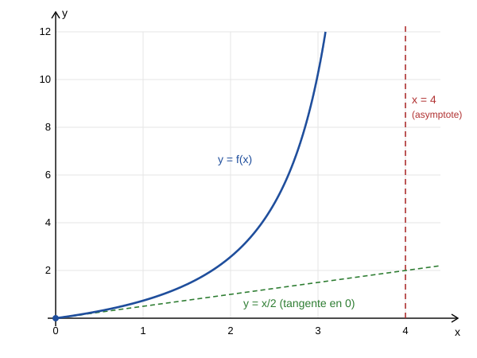

# BCE ECG — Maths approfondies (EDHEC) 2025 · Corrigé guidé

*Corrigé rédigé par IA, non officiel. Signalez toute erreur.*

## Présentation du sujet

**Cadre.** Épreuve de mathématiques approfondies conçue par EDHEC BS, voie générale ECG, 4 heures, sans calculatrice ni document. Trois exercices et un problème, 59 questions (sous-questions comprises). Selon le rapport 2025, 2 993 candidats ont composé ; la moyenne est de 11,25, la médiane de 11,4 et l'écart type de 5,52.

- **Exercice 1 (analyse, 11 questions).** Étude de $f_n(x)=(x-n)\ln(x)-x\ln(x-n)$, suite implicite $x_n$ définie par $f_n(x_n)=0$, puis développement asymptotique : $x_n\sim n$, $x_n-n\to1$, $x_n-n-1\sim\frac{\ln(n)}{n}$, et nature de deux séries.
- **Exercice 2 (algèbre bilinéaire, 12 questions).** Pour deux projections orthogonales $p_1$, $p_2$ : $p_1\circ p_2$ est une projection orthogonale si et seulement si $p_1$ et $p_2$ commutent, et c'est alors la projection sur $F_1\cap F_2$.
- **Exercice 3 (probabilités, 12 questions).** Une loi à densité sur $]-\infty,0]$ liée à la loi normale et à la loi exponentielle, simulation Python, puis convergence en loi de $\sqrt n(M_n-1)$ où $M_n$ est un maximum.
- **Problème (24 questions).** Le coefficient central $B_n=\binom{2n}{n}/4^n$ : calcul en Python, encadrement par les intégrales de Wallis et équivalent $B_n\sim\frac{1}{\sqrt{\pi n}}$. Application à la marche aléatoire simple (nombre moyen de retours à l'origine, équivalent à $2\sqrt{n/\pi}$), puis à l'étude de $f(x)=\sum_{n\geqslant1}x^n/\binom{2n}{n}$ sur $[0,4[$.

**Notions du programme.** Étude de fonctions, théorème de la bijection, suites implicites, équivalents (produits et quotients seulement), séries à termes positifs ; projections orthogonales, endomorphismes symétriques, Pythagore ; densités, fonctions de répartition, lois normale, exponentielle, binomiale, indépendance, convergence en loi ; intégrales de Wallis, intégration par parties, séries géométriques.

**Ce qu'en dit le rapport 2025.** L'exercice 3 est jugé le mieux réussi, l'exercice 2 « peu abordé et très peu réussi », et le problème a été abordé par de nombreux candidats « mais presque jamais dans son intégralité certainement par manque de temps ». Les correcteurs relèvent surtout des erreurs de manipulation des équivalents (exercice 1), des confusions entre vecteurs, sous-espaces et endomorphismes (exercice 2) et des fonctions de répartition fausses (exercice 3).

**Questions abordables à ne pas laisser passer.** Ex. 1 : 1, 2(a), 2(b), 3. Ex. 2 : 1(a)–(c), 2(a), 3(a), 3(b). Ex. 3 : 1 à 6, 8, 9, 10, 11. Problème : 1 à 4, 9, 10(b)–(d), 11, 13(a), 16.

**Gestion du temps.** Environ 45 minutes par exercice et 1 h 30 pour le problème, en commençant par l'exercice 3 si l'algèbre bilinéaire est fragile. Le rapport conseille : « Dans la pratique, il ne faut pas rester plus de 4 ou 5 minutes sur une question, sauf pour terminer un long calcul. »

---

## Exercice 1

On étudie la racine $x_n$ de $f_n$ dans $[n+1,n+2]$, puis on affine son comportement asymptotique en trois étapes. Toute la difficulté est dans la manipulation honnête des équivalents.

### Question 1(a)

> [!INDICATION]
> Dérivez $g$ et étudiez le signe de $1-\ln(x)$.

> [!INDICATION]
> En $0^+$, regardez si la limite est vraiment indéterminée avant d'invoquer un théorème.

#### Solution

$g'(x)=\frac{1-\ln(x)}{x^2}$ : $g$ croît sur $]0,e]$, décroît sur $[e,+\infty[$, avec $g(e)=\frac1e$.

En $0^+$, $\ln(x)\to-\infty$ et $\frac1x\to+\infty$, donc $g(x)\to-\infty$ (aucune indétermination). En $+\infty$, $g(x)\to0$ par croissances comparées.

| $x$ | $0$ | | $e$ | | $+\infty$ |
|---|---|---|---|---|---|
| $g'(x)$ | | $+$ | $0$ | $-$ | |
| $g$ | $-\infty$ | $\nearrow$ | $\frac1e$ | $\searrow$ | $0$ |

> [!JURY]
> Le rapport 2025 relève que certains candidats invoquent les croissances comparées pour la limite de $\frac{\ln(x)}{x}$ en $0^+$, alors que la limite n'est pas indéterminée. Les croissances comparées ne servent qu'en $+\infty$ ici.

### Question 1(b)

> [!INDICATION]
> Où se trouve $3$ par rapport à $e$ ? Calculez ensuite $\frac{\ln(4)}{4}$.

#### Solution

$g$ décroît sur $[e,+\infty[$ et $3>e$ : la suite $\big(\frac{\ln(k)}{k}\big)_{k\geqslant3}$ décroît. Pour $k\geqslant4$, $\frac{\ln(k)}{k}\leqslant\frac{\ln(4)}{4}=\frac{\ln(2)}{2}$.

> [!JURY]
> Selon le rapport 2025, un grand nombre de candidats n'a pas vu que $\frac{\ln(4)}{4}=\frac{\ln(2)}{2}$ : c'est pourtant le seul calcul de la question.

### Question 2(a)

> [!INDICATION]
> Vérifiez que les arguments des logarithmes sont strictement positifs, puis dérivez les deux produits.

#### Solution

Sur $]n,+\infty[$, $x>0$ et $x-n>0$ : $f_n$ est dérivable et :

$$f_n'(x)=\ln\Big(\frac{x}{x-n}\Big)+\frac{x-n}{x}-\frac{x}{x-n}.$$

### Question 2(b)

> [!INDICATION]
> Pour l'inégalité, étudiez $t\mapsto t-1-\ln(t)$ (ou invoquez la concavité de $\ln$).

> [!INDICATION]
> Appliquez-la avec $t=\frac{x}{x-n}$ dans l'expression de $f_n'(x)$.

#### Solution

$\varphi(t)=t-1-\ln(t)$ a pour dérivée $1-\frac1t$ : minimum en $1$, égal à $0$. Donc $\ln(t)\leqslant t-1$. Avec $t=\frac{x}{x-n}$ :

$$\begin{aligned}
f_n'(x)&\leqslant\frac{x}{x-n}-1+\frac{x-n}{x}-\frac{x}{x-n}\\
&=-\frac nx<0.
\end{aligned}$$

$f_n$ est strictement décroissante.

### Question 2(c)

> [!INDICATION]
> Calculez $f_n(n+1)$ et $f_n(n+2)$, puis appliquez le théorème de la bijection.

> [!INDICATION]
> Pour le signe de $f_n(n+2)$, factorisez par $2(n+2)$ et faites apparaître $\frac{\ln(n+2)}{n+2}$.

#### Solution

$f_n(n+1)=\ln(n+1)>0$ et :

$$f_n(n+2)=2(n+2)\Big(\frac{\ln(n+2)}{n+2}-\frac{\ln(2)}{2}\Big)\leqslant0$$

par 1(b), car $n+2\geqslant4$. $f_n$ étant continue et strictement décroissante sur $[n+1,n+2]$, elle réalise une bijection de cet intervalle sur $[f_n(n+2),f_n(n+1)]$, qui contient $0$ : il y a une unique solution $x_n$.

> [!PIEGE]
> Pour $n=2$, $f_2(4)=0$ : l'inégalité est large et la racine est la borne $x_2=4$. Il faut donc un intervalle fermé et une inégalité large ; un argument « $f_n(n+2)<0$ » serait faux pour $n=2$.

### Question 3

> [!INDICATION]
> Encadrez $\frac{x_n}{n}$.

#### Solution

$1+\frac1n\leqslant\frac{x_n}{n}\leqslant1+\frac2n$, donc $\frac{x_n}{n}\to1$ : $x_n\sim n$.

### Question 4(a)

> [!INDICATION]
> Écrivez $f_n(x_n)=0$ et isolez $\ln(x_n-n)$.

#### Solution

$(x_n-n)\ln(x_n)=x_n\ln(x_n-n)$ et $x_n>0$ : $\ln(x_n-n)=(x_n-n)\frac{\ln(x_n)}{x_n}$.

### Question 4(b)

> [!INDICATION]
> $x_n\to+\infty$ ; utilisez 1(a). Puis remarquez que $x_n-n$ est bornée.

#### Solution

$\frac{\ln(x_n)}{x_n}=g(x_n)\to0$ car $x_n\to+\infty$. Comme $x_n-n\in[1,2]$, $\ln(x_n-n)\to0$, et par continuité de $\exp$, $x_n-n\to1$.

> [!PIEGE]
> $x_n\sim n$ n'entraîne pas $x_n-n\to0$ : deux suites équivalentes peuvent avoir une différence qui tend vers l'infini, ou, comme ici, vers 1. Le rapport 2025 relève cette erreur.

### Question 5(a)

> [!INDICATION]
> Pour le premier équivalent, vérifiez que $u_n\to0$ et que $u_n\neq0$.

> [!INDICATION]
> Pour le second, ne composez pas l'équivalent $x_n\sim n$ par $\ln$ : écrivez $\ln(x_n)=\ln(n)+\ln(x_n/n)$.

#### Solution

$u_n\to0$ (question 4) et $u_n\neq0$ (car $f_n(n+1)>0$, donc $x_n\neq n+1$). L'équivalent usuel donne $\ln(1+u_n)\sim u_n$. Ensuite $1+n+u_n=x_n$ et :

$$\frac{\ln(x_n)}{\ln(n)}=1+\frac{\ln(x_n/n)}{\ln(n)}\xrightarrow[n\to+\infty]{}1,$$

car $\ln(x_n/n)\to0$ et $\ln(n)\to+\infty$.

> [!JURY]
> Le rapport 2025 : « Enfin la faute la plus fréquente a consisté à conclure sans aucun argument que, comme $x_n\sim n$, alors $\ln(x_n)\sim\ln(n)$ : la composition d'équivalents n'est pas autorisée par le programme car elle mène souvent à des résultats irrecevables. »

### Question 5(b)

> [!INDICATION]
> Réécrivez 4(a) avec $x_n-n=1+u_n$ et remplacez chaque facteur par un équivalent.

#### Solution

$\ln(1+u_n)=(1+u_n)\frac{\ln(x_n)}{x_n}$. Avec $\ln(1+u_n)\sim u_n$, $1+u_n\to1$, $\ln(x_n)\sim\ln(n)$ et $x_n\sim n$, les produits et quotients d'équivalents donnent $u_n\sim\frac{\ln(n)}{n}$.

> [!METHODE]
> Les seules opérations licites sur les équivalents sont le produit, le quotient et la puissance fixe. Pour une somme ou une composition, on revient à la définition (quotient qui tend vers 1) ou à un développement limité.

### Question 6

> [!INDICATION]
> Séries à termes positifs : critère d'équivalence. Comparez $\frac{\ln(n)}{n}$ à $\frac1n$.

> [!INDICATION]
> Pour $u_n^2$, comparez $\frac{\ln(n)^2}{n^2}$ à une série de Riemann d'exposant compris entre 1 et 2.

#### Solution

$\frac{\ln(n)}{n}\geqslant\frac1n$ pour $n\geqslant3$ : $\sum\frac{\ln(n)}{n}$ diverge, donc $\sum u_n$ diverge.

$u_n^2\sim\frac{\ln(n)^2}{n^2}=o\big(\frac{1}{n^{3/2}}\big)$ car $\frac{\ln(n)^2}{\sqrt n}\to0$ : $\sum u_n^2$ converge.

> [!PIEGE]
> Comparer $\frac{\ln(n)^2}{n^2}$ à $\frac{1}{n^2}$ ne marche pas : $\ln(n)^2\to+\infty$. Il faut « sacrifier » un peu de l'exposant ($\frac32$) pour absorber le logarithme.

---

## Exercice 2

On caractérise les compositions de projections orthogonales qui sont encore des projections orthogonales. Le levier est la caractérisation de $F$ par $\|p(x)\|=\|x\|$ (question 1), puis le résultat rappelé : un projecteur est orthogonal si et seulement s'il est symétrique.

### Question 1(a)

> [!INDICATION]
> Que vaut $p(x)$ si $x\in F$ ?

#### Solution

$x\in F\Rightarrow p(x)=x\Rightarrow\|p(x)\|=\|x\|$.

### Question 1(b)

> [!INDICATION]
> Décomposez $x=p(x)+(x-p(x))$ et identifiez deux vecteurs orthogonaux.

#### Solution

$p(x)\in F$ et $x-p(x)\in F^\perp$ ; Pythagore donne $\|x\|^2=\|x-p(x)\|^2+\|p(x)\|^2$.

> [!JURY]
> Le rapport 2025 signale que beaucoup pensent qu'un vecteur de $E=F\oplus F^\perp$ est soit dans $F$, soit dans $F^\perp$, « ce qui révèle une confusion avec la réunion disjointe de deux ensembles ». Un vecteur se décompose en une somme, il n'appartient pas à l'un des deux sous-espaces.

### Question 1(c)

> [!INDICATION]
> Si $\|p(x)\|=\|x\|$, que dit (b) de $\|x-p(x)\|$ ?

#### Solution

(b) donne $\|x-p(x)\|=0$, donc $x=p(x)\in F$ ; avec (a), $F=\{x,\ \|p(x)\|=\|x\|\}$. Et (b) donne aussi $\|p(x)\|\leqslant\|x\|$.

### Question 2(a)

> [!INDICATION]
> Pour $x\in F_1\cap F_2$, calculez $p_3(x)$.

#### Solution

$p_3(x)=p_1(p_2(x))=p_1(x)=x$, donc $x\in\operatorname{Im}(p_3)=F_3$.

### Question 2(b)

> [!INDICATION]
> Écrivez $x=p_1(p_2(x))$ et appliquez 1(c) à $p_1$ avec le vecteur $p_2(x)$, puis à $p_2$.

> [!INDICATION]
> Une fois $\|p_2(x)\|=\|x\|$ obtenu, 1(c) donne l'appartenance à $F_2$. Pour $F_1$, simplifiez $p_1(p_2(x))$.

#### Solution

$\|x\|=\|p_1(p_2(x))\|\leqslant\|p_2(x)\|\leqslant\|x\|$, donc $\|p_2(x)\|=\|x\|$ et $x\in F_2$ par 1(c). Alors $p_2(x)=x$ et $x=p_1(x)\in F_1$.

### Question 2(c)

> [!INDICATION]
> Combinez les deux inclusions.

#### Solution

(a) et (b) donnent $F_1\cap F_2=F_3$.

### Question 2(d)

> [!INDICATION]
> Un projecteur orthogonal est symétrique (résultat rappelé). Transportez ensuite $p_1$ puis $p_2$ de l'autre côté du produit scalaire.

#### Solution

$p_3$ est symétrique. Puis, par symétrie de $p_1$ et de $p_2$ :

$$\begin{aligned}
\langle p_1\circ p_2(x),y\rangle&=\langle x,p_1\circ p_2(y)\rangle\\
&=\langle p_1(x),p_2(y)\rangle\\
&=\langle p_2\circ p_1(x),y\rangle.
\end{aligned}$$

### Question 2(e)

> [!INDICATION]
> Un vecteur orthogonal à tous les vecteurs est nul.

#### Solution

Pour tout $x$, le vecteur $p_1\circ p_2(x)-p_2\circ p_1(x)$ est orthogonal à tout $y$, en particulier à lui-même : il est nul.

> [!METHODE]
> Pour prouver l'égalité de deux endomorphismes $u$ et $v$ d'un espace euclidien, il suffit d'établir $\langle u(x),y\rangle=\langle v(x),y\rangle$ pour tous $x,y$, puis de choisir $y=u(x)-v(x)$.

### Question 3(a)

> [!INDICATION]
> Un projecteur est un endomorphisme $p$ tel que $p\circ p=p$ : n'oubliez pas la linéarité.

#### Solution

$p$ est linéaire (composée) et $p^2=p_1p_2p_1p_2=p_1^2p_2^2=p_1p_2=p$.

> [!JURY]
> Le rapport 2025 : « La plupart oublient de traiter la linéarité pour établir que $p$ est un projecteur de $E$. »

### Question 3(b)

> [!INDICATION]
> Même calcul qu'en 2(d), en utilisant la commutation à la fin.

#### Solution

$$\begin{aligned}
\langle p(x),y\rangle&=\langle p_2(x),p_1(y)\rangle\\
&=\langle x,p_2\circ p_1(y)\rangle\\
&=\langle x,p(y)\rangle.
\end{aligned}$$

### Question 3(c)

> [!INDICATION]
> Le résultat rappelé dit que $p$ est la projection orthogonale sur un sous-espace : lequel ? Calculez $\operatorname{Im}(p)$ par double inclusion.

#### Solution

$p$ est un projecteur symétrique, donc la projection orthogonale sur $\operatorname{Im}(p)$.

Si $x\in F_1\cap F_2$, $p(x)=x$ ; si $y=p(x)$, $y=p_1(p_2(x))\in F_1$ et $y=p_2(p_1(x))\in F_2$. Donc $\operatorname{Im}(p)=F_1\cap F_2$.

> [!PIEGE]
> L'image d'un projecteur est l'ensemble de ses points fixes : pour $\operatorname{Im}(p)\subset F_1\cap F_2$, on utilise les deux écritures $p_1\circ p_2$ et $p_2\circ p_1$ de $p$.

### Question 4

> [!INDICATION]
> Énoncez une équivalence, avec ses hypothèses, et précisez le sous-espace.

#### Solution

Soient $p_1$ et $p_2$ les projections orthogonales sur $F_1$ et $F_2$.

Alors $p_1\circ p_2$ est une projection orthogonale si et seulement si $p_1\circ p_2=p_2\circ p_1$ ; c'est alors la projection orthogonale sur $F_1\cap F_2$.

---

## Exercice 3

Une variable $X$ négative, dont le carré suit la loi exponentielle de paramètre 1, puis une convergence en loi vers $X$ d'une suite construite à partir de maximums.

### Question 1

> [!INDICATION]
> Positivité, continuité, puis une primitive évidente de $-2xe^{-x^2}$.

#### Solution

$f$ est positive et continue ; $\int_A^0-2xe^{-x^2}\,\mathrm{d}x=1-e^{-A^2}\to1$ quand $A\to-\infty$ : $f$ est une densité.

### Question 2

> [!INDICATION]
> Distinguez $x\leqslant0$ et $x>0$ ; pour $x>0$, justifiez la valeur.

#### Solution

$F(x)=e^{-x^2}$ pour $x\leqslant0$ et $F(x)=\int_{-\infty}^0f+\int_0^x0=1$ pour $x>0$.

> [!JURY]
> Le rapport 2025 : « Donner la valeur 0 à $F(x)$ sur $[0,+\infty[$ ou $H(x)$ sur $]1,+\infty[$ est une très grave faute. Par ailleurs, donner la bonne valeur (à savoir 1) sans preuve ne permet pas d'accorder le bénéfice du doute... »

### Question 3

> [!INDICATION]
> Formule générale de la densité de $\mathcal{N}(m,\sigma^2)$ : attention, le second paramètre est la variance.

#### Solution

$\varphi(x)=\frac{1}{\sqrt\pi}e^{-x^2}$.

> [!PIEGE]
> Avec $\sigma^2=\frac12$, on a $2\sigma^2=1$ et $\sigma\sqrt{2\pi}=\sqrt\pi$. Le rapport 2025 indique que cette densité a été « source de grosses erreurs ».

### Question 4

> [!INDICATION]
> Faites apparaître $\int x^2e^{-x^2}$ et reliez-la au moment d'ordre 2 de la loi $\mathcal{N}(0,\frac12)$.

> [!INDICATION]
> Utilisez la parité pour passer de $\mathbb{R}$ à $]-\infty,0]$.

#### Solution

$\int_{\mathbb{R}}x^2\frac{1}{\sqrt\pi}e^{-x^2}\,\mathrm{d}x=\frac12$ (variance de $\mathcal{N}(0,\frac12)$), donc $\int_{-\infty}^0x^2e^{-x^2}\,\mathrm{d}x=\frac{\sqrt\pi}{4}$. L'intégrande $-2x^2e^{-x^2}$ est de signe constant : convergence absolue, et $\mathbb{E}(X)=-\frac{\sqrt\pi}{2}$.

> [!METHODE]
> Les intégrales $\int x^ke^{-x^2}$ se calculent sans intégration par parties en reconnaissant des moments d'une loi normale bien choisie ; la parité fait passer de $\mathbb{R}$ à une demi-droite.

### Question 5

> [!INDICATION]
> Traduisez $X^2\leqslant x$ en un encadrement de $X$.

#### Solution

Pour $x\geqslant0$, $G(x)=F(\sqrt x)-F(-\sqrt x)$ ($X$ à densité).

Pour $x>0$, $G(x)=1-e^{-x}$ ; $G(0)=0$ ; $G(x)=0$ pour $x<0$. C'est la fonction de répartition de $\mathcal{E}(1)$.

### Question 6

> [!INDICATION]
> L'existence de $\mathbb{E}(X^2)$ est équivalente à celle d'un moment d'ordre 2.

#### Solution

$\mathbb{E}(X^2)=\mathbb{E}(Z)=1$, donc $X$ a une variance : $\mathbb{V}(X)=1-\frac\pi4$.

### Question 7

> [!INDICATION]
> $X$ est négative : exprimez $X$ en fonction de $Z=X^2$. Vérifiez que $-\sqrt Z$ a bien la loi de $X$.

> [!INDICATION]
> Pour l'espérance, une moyenne empirique sur $n$ simulations, calculée par une boucle.

#### Solution

$X=-\sqrt Z$, et si $Z\hookrightarrow\mathcal{E}(1)$, $\mathbb{P}(-\sqrt Z\leqslant x)=\mathbb{P}(Z\geqslant x^2)=e^{-x^2}$ pour $x\leqslant0$.

```python
def simulX(n):
    M = np.zeros(n)
    for i in range(n):
        M[i] = -np.sqrt(rd.exponential(1))
    return M

def EsperanceX(n):
    M = simulX(n)
    s = 0
    for i in range(n):
        s = s + M[i]
    return s / n
```

La loi faible des grands nombres justifie l'approximation.

### Question 8

> [!INDICATION]
> Positivité, continuité par morceaux, intégrale sur $[0,1]$.

#### Solution

$h\geqslant0$, continue sauf en $0$, et $\int_0^12(1-x)\,\mathrm{d}x=1$.

### Question 9

> [!INDICATION]
> Trois cas : $x<0$, $0\leqslant x\leqslant1$, $x>1$.

#### Solution

$H(x)=0$ si $x<0$, $H(x)=2x-x^2$ si $0\leqslant x\leqslant1$, $H(x)=1$ si $x>1$.

### Question 10

> [!INDICATION]
> Un maximum est inférieur à $a$ si et seulement si chaque terme l'est.

#### Solution

$[T_n\leqslant x]=\bigcap_k\big[Y_k\leqslant1+\frac{x}{\sqrt n}\big]$ et, par indépendance, $F_n(x)=H\big(1+\frac{x}{\sqrt n}\big)^n$.

> [!METHODE]
> Fonction de répartition d'un maximum de variables indépendantes : $\mathbb{P}(\max\leqslant a)=\prod\mathbb{P}(Y_k\leqslant a)$. Pour un minimum, on passe par $\mathbb{P}(\min>a)=\prod\mathbb{P}(Y_k>a)$.

### Question 11

> [!INDICATION]
> Écrivez la puissance sous forme exponentielle, après avoir vérifié que $\ln$ s'applique.

#### Solution

Pour $n>|y|$, $1+\frac yn>0$ et $\big(1+\frac yn\big)^n=\exp\big(n\ln(1+\frac yn)\big)$.

Si $y\neq0$, $\ln\big(1+\frac yn\big)\sim\frac yn$ ; la limite est $e^y$ (aussi pour $y=0$).

> [!JURY]
> Le rapport 2025 indique qu'il aurait été apprécié de vérifier que $1+\frac yn>0$ pour $n$ assez grand, afin de pouvoir prendre le logarithme.

### Question 12

> [!INDICATION]
> Distinguez $x>0$ et $x\leqslant0$ ; dans le second cas, pour $n$ grand, $1+\frac{x}{\sqrt n}\in[0,1]$.

#### Solution

Pour $x>0$, $F_n(x)=1=F(x)$. Pour $x\leqslant0$ et $n\geqslant x^2$ :

$$F_n(x)=\Big(1-\frac{x^2}{n}\Big)^n\xrightarrow[n\to+\infty]{}e^{-x^2}=F(x).$$

Donc $(T_n)$ converge en loi vers $X$.

> [!PIEGE]
> La formule $H(t)=1-(1-t)^2$ n'est valable que pour $t\in[0,1]$ : il faut vérifier que $1+\frac{x}{\sqrt n}$ y est, ce qui demande $n\geqslant x^2$.

---

## Problème

Le coefficient binomial central normalisé $B_n$ est encadré grâce aux intégrales de Wallis. On en déduit l'équivalent $B_n\sim\frac{1}{\sqrt{\pi n}}$, que l'on applique à une marche aléatoire (partie 3) et à une série entière (partie 4), indépendantes l'une de l'autre.

### Question 1

> [!INDICATION]
> Simplifiez $\frac{(2n)!}{n!}$ en un produit de $n$ facteurs.

> [!INDICATION]
> Dans le code, $n$ est fixé et seul $k$ varie.

#### Solution

$\binom{2n}{n}=\frac{1}{n!}\prod_{k=1}^{n}(n+k)=\prod_{k=1}^{n}\frac{n+k}{k}$, d'où $B_n=\prod_{k=1}^{n}\frac{k+n}{4k}$.

```python
def B(n):
    P = 1
    for k in range(1, n + 1):
        P = P * (k + n) / (4 * k)
    return P
```

> [!PIEGE]
> L'indice $n$ apparaît dans chaque facteur : $B_{n+1}=\prod_{k=1}^{n+1}\frac{k+n+1}{4k}$, et non $\prod_{k=1}^{n+1}\frac{k+n}{4k}$. Le rapport 2025 cite cette erreur parmi les fautes de rigueur.

### Question 2

> [!INDICATION]
> Calculs directs.

#### Solution

$W_0=\frac\pi2$ et $W_1=1$.

### Question 3

> [!INDICATION]
> Comparez $\sin(t)^{n+1}$ et $\sin(t)^n$ sur $[0,\frac\pi2]$.

#### Solution

$0\leqslant\sin(t)\leqslant1$ donne $\sin(t)^{n+1}\leqslant\sin(t)^n$, puis $W_{n+1}\leqslant W_n$.

> [!JURY]
> Parmi les fautes de rigueur citées par le rapport 2025 : « $x\in[0,\pi/2]$ donc $\sin(x)>0$ » (faux en $0$). Les inégalités larges suffisent ici.

### Question 4

> [!INDICATION]
> Écrivez $\sin^{n+2}=\sin^{n+1}\cdot\sin$ et intégrez par parties ; puis $\cos^2=1-\sin^2$.

#### Solution

$$\begin{aligned}
W_{n+2}&=\Big[-\cos(t)\sin(t)^{n+1}\Big]_0^{\pi/2}+(n+1)\int_0^{\pi/2}\cos(t)^2\sin(t)^n\,\mathrm{d}t\\
&=(n+1)(W_n-W_{n+2}),
\end{aligned}$$

d'où $W_{n+2}=\frac{n+1}{n+2}W_n$.

### Question 5

> [!INDICATION]
> Calculez d'abord $\frac{B_{n+1}}{B_n}$.

> [!INDICATION]
> Faites une récurrence sur la double propriété (pair et impair).

#### Solution

$\frac{B_{n+1}}{B_n}=\frac{(2n+2)(2n+1)}{4(n+1)^2}=\frac{2n+1}{2n+2}$. Récurrence : vrai pour $n=0$, et :

$$\begin{aligned}
W_{2n+2}&=\frac{2n+1}{2n+2}\cdot\frac\pi2B_n=\frac\pi2B_{n+1},\\
W_{2n+3}&=\frac{2n+2}{2n+3}\cdot\frac{1}{(2n+1)B_n}=\frac{1}{(2n+3)B_{n+1}}.
\end{aligned}$$

### Question 6

> [!INDICATION]
> Appliquez 5 au rang $n-1$ et exprimez $B_{n-1}$ en fonction de $B_n$.

#### Solution

$W_{2n-1}=\frac{1}{(2n-1)B_{n-1}}$ et $(2n-1)B_{n-1}=2nB_n$, d'où $W_{2n-1}=\frac{1}{2nB_n}$.

### Question 7

> [!INDICATION]
> La décroissance de $(W_n)$ encadre $W_{2n}$ entre $W_{2n+1}$ et $W_{2n-1}$.

> [!INDICATION]
> Multipliez par $B_n>0$ pour obtenir un encadrement de $B_n^2$.

#### Solution

$\frac{1}{(2n+1)B_n}\leqslant\frac\pi2B_n\leqslant\frac{1}{2nB_n}$, donc $\frac{1}{\pi(n+\frac12)}\leqslant B_n^2\leqslant\frac{1}{\pi n}$, et, avec $n+\frac12\leqslant n+1$ et la racine carrée, $\frac{1}{\sqrt\pi\sqrt{n+1}}\leqslant B_n\leqslant\frac{1}{\sqrt\pi\sqrt n}$.

> [!JURY]
> Le rapport 2025 rappelle le bon usage des parenthèses : le produit de $2n+1$ par $B_n$ s'écrit $(2n+1)B_n$ et non $2n+1B_n$.

### Question 8

> [!INDICATION]
> Théorème d'encadrement appliqué à $\sqrt{\pi n}\,B_n$.

#### Solution

$\sqrt{\frac{n}{n+1}}\leqslant\sqrt{\pi n}\,B_n\leqslant1$ : $B_n\sim\frac{1}{\sqrt{\pi n}}$.

### Question 9(a)

> [!INDICATION]
> Quelles valeurs prend $Y_k$, avec quelles probabilités ?

#### Solution

$Y_k\hookrightarrow\mathcal{B}(\frac12)$ : $\mathbb{E}(Y_k)=\frac12$, $\mathbb{V}(Y_k)=\frac14$.

### Question 9(b)

> [!INDICATION]
> Reconnaissez $T_n$ comme une somme des $Y_k$.

#### Solution

$T_n=\sum_kY_k$, somme de $n$ variables de Bernoulli de paramètre $\frac12$ indépendantes (lemme des coalitions) : $T_n\hookrightarrow\mathcal{B}(n,\frac12)$.

### Question 9(c)

> [!INDICATION]
> Exprimez $S_n$ en fonction de $T_n$.

#### Solution

$S_n=2T_n-n$, donc $S_n(\Omega)=\{2j-n,\ j\in\llbracket0,n\rrbracket\}$ et $\mathbb{P}(S_n=2j-n)=\binom nj\frac{1}{2^n}$.

### Question 10(a)

> [!INDICATION]
> Quelle est la parité des valeurs de $S_k$ ?

#### Solution

$S_k$ a la parité de $k$ : il ne peut s'annuler que pour $k$ pair. Les zéros pour $k\in\llbracket1,2n\rrbracket$ correspondent aux $k=2j$, $j\in\llbracket1,n\rrbracket$.

### Question 10(b)

> [!INDICATION]
> Utilisez 9(c) avec $2k$ pas.

#### Solution

$\mathbb{P}(S_{2k}=0)=\mathbb{P}(T_{2k}=k)=\binom{2k}{k}\frac{1}{4^k}=B_k$.

### Question 10(c)

> [!INDICATION]
> Un cardinal est une somme d'indicatrices.

#### Solution

$R_n=\sum_{k=1}^{n}\mathbb{1}_{A_k}$.

### Question 10(d)

> [!INDICATION]
> Linéarité de l'espérance, et espérance d'une indicatrice (loi de Bernoulli).

#### Solution

$\mathbb{E}(R_n)=\sum_k\mathbb{P}(A_k)=\sum_{k=1}^{n}B_k$.

> [!METHODE]
> Pour l'espérance d'un « nombre d'événements réalisés », on écrit la variable comme une somme d'indicatrices et l'on applique la linéarité : aucune loi n'est nécessaire, et l'indépendance non plus.

### Question 11

> [!INDICATION]
> Quantité conjuguée.

#### Solution

$2(\sqrt{k+1}-\sqrt k)=\frac{2}{\sqrt{k+1}+\sqrt k}\leqslant\frac{1}{\sqrt k}$ et $2(\sqrt k-\sqrt{k-1})=\frac{2}{\sqrt k+\sqrt{k-1}}\geqslant\frac{1}{\sqrt k}$.

### Question 12

> [!INDICATION]
> Encadrez chaque $B_k$ par la question 7, puis chaque $\frac{1}{\sqrt k}$ par la question 11.

> [!INDICATION]
> Les sommes de différences se télescopent ; concluez par encadrement.

#### Solution

$$\begin{aligned}
\mathbb{E}(R_n)&\leqslant\frac{1}{\sqrt\pi}\sum_{k=1}^{n}\frac{1}{\sqrt k}\leqslant\frac{2\sqrt n}{\sqrt\pi},\\
\mathbb{E}(R_n)&\geqslant\frac{1}{\sqrt\pi}\sum_{j=2}^{n+1}\frac{1}{\sqrt j}\geqslant\frac{2}{\sqrt\pi}\big(\sqrt{n+2}-\sqrt2\big).
\end{aligned}$$

Le quotient par $\frac{2\sqrt n}{\sqrt\pi}$ est encadré par deux quantités qui tendent vers 1 : $\mathbb{E}(R_n)\sim2\sqrt{\frac n\pi}$.

> [!PIEGE]
> On ne peut pas « sommer les équivalents » $B_k\sim\frac{1}{\sqrt{\pi k}}$ directement : ce n'est pas un résultat du programme. L'encadrement de la question 7, valable pour tout $k$, et le télescopage contournent la difficulté.

### Question 13(a)

> [!INDICATION]
> Écrivez $\frac{1}{\binom{2n}{n}}=\frac{1}{4^nB_n}$.

#### Solution

Par la question 8, $\frac{1}{B_n}\sim\sqrt{\pi n}$, donc $\frac{1}{\binom{2n}{n}}\sim\frac{\sqrt{n\pi}}{4^n}$.

### Question 13(b)

> [!INDICATION]
> Séries à termes positifs : comparez $\sqrt n\,(\frac x4)^n$ à $n\,(\frac x4)^n$, terme d'une série connue.

#### Solution

Pour $x\in\,]0,4[$, $\frac{x^n}{\binom{2n}{n}}\sim\sqrt\pi\sqrt n\,q^n$ avec $q=\frac x4\in\,]0,1[$, et $\sqrt nq^n\leqslant nq^n$, terme général d'une série convergente (série géométrique dérivée). Pour $x=0$, la série est nulle.

### Question 14

> [!INDICATION]
> Comparez les sommes partielles terme à terme, puis passez à la limite.

#### Solution

Pour $0\leqslant x\leqslant y<4$, $x^n\leqslant y^n$, donc les sommes partielles sont rangées, et à la limite $f(x)\leqslant f(y)$.

> [!JURY]
> Le rapport 2025 : « Trop de candidats ont appliqué la linéarité de la dérivation pour dériver » $f$, « mais ceci n'est pas valable avec une somme infinie. » Il cite aussi l'implication fausse « $x\leqslant y$ donc $x^n<y^n$ ».

### Question 15(a)

> [!INDICATION]
> Repartez de l'encadrement de $B_n$ de la question 7.

#### Solution

$\frac{\sqrt\pi\sqrt n}{4^n}\leqslant\frac{1}{\binom{2n}{n}}\leqslant\frac{\sqrt\pi\sqrt{n+1}}{4^n}$, puis $1\leqslant\sqrt n$, $\sqrt{n+1}\leqslant n+1$ et multiplication par $x^n\geqslant0$.

### Question 15(b)

> [!INDICATION]
> Sommez pour $n\geqslant1$ : attention au premier indice des séries géométriques.

> [!INDICATION]
> Pour $\sum(n+1)q^n$, séparez $\sum nq^n$ et $\sum q^n$, et utilisez la série géométrique dérivée.

#### Solution

Avec $q=\frac x4$ : $\sum_{n\geqslant1}q^n=\frac{q}{1-q}=\frac{x}{4-x}$ et $\sum_{n\geqslant1}nq^n=\frac{q}{(1-q)^2}$, d'où l'encadrement demandé. Les deux bornes tendent vers $0$ en $0^+$ : $f(x)\to0$.

Le minorant tend vers $+\infty$ en $4^-$ : $f(x)\to+\infty$. Comme $f(0)=0$, $f$ est continue en $0$.

> [!JURY]
> Le rapport 2025 qualifie de « défaut de cours suivi d'une escroquerie » le calcul $\sum_{n=1}^{+\infty}\big(\frac x4\big)^n=\frac{1}{1-x/4}$ (faux : la somme commence à $n=1$), suivi d'une simplification fausse destinée à retomber sur $\frac{x}{4-x}$.

### Question 16

> [!INDICATION]
> Tous les termes de la série sont positifs.

#### Solution

$f(x)\geqslant$ premier terme $=\frac{x}{\binom21}=\frac x2$.

### Question 17

> [!INDICATION]
> Rassemblez : valeur et tangente en $0$, position par rapport à la tangente, monotonie, comportement en $4^-$.

#### Solution

$f(0)=0$ ; tangente $y=\frac x2$ en $0$ ; courbe au-dessus de sa tangente (question 16) ; $f$ croissante et continue ; asymptote verticale $x=4$.



> [!METHODE]
> Pour une « allure précise », on fait figurer tout ce que l'énoncé a établi : valeurs remarquables, tangentes, position relative, monotonie, asymptotes, avec des axes gradués.

---

## Bilan

- **Suites implicites.** Théorème de la bijection sur un segment bien choisi, puis encadrement pour un premier équivalent, puis réinjection dans l'équation pour affiner ($x_n-n\to1$, puis $u_n\sim\frac{\ln(n)}{n}$).
- **Équivalents.** Produits et quotients seulement ; pour $\ln(x_n)$, écrire $\ln(x_n)=\ln(n)+\ln(x_n/n)$. Deux suites équivalentes n'ont pas une différence qui tend vers 0.
- **Projections orthogonales.** $F=\{x,\ \|p(x)\|=\|x\|\}$, inégalité $\|p(x)\|\leqslant\|x\|$, projecteur orthogonal $\iff$ projecteur symétrique ; $p_1\circ p_2$ est une projection orthogonale si et seulement si $p_1$ et $p_2$ commutent.
- **Probabilités.** Fonction de répartition d'un maximum, convergence en loi par limite des fonctions de répartition, $(1+\frac yn)^n\to e^y$, moments de la loi normale pour calculer des intégrales.
- **Wallis.** Relation $W_{n+2}=\frac{n+1}{n+2}W_n$, formules pour les indices pairs et impairs, encadrement par décroissance, équivalent du coefficient central $\binom{2n}{n}\sim\frac{4^n}{\sqrt{\pi n}}$.
- **Sommes.** Indicatrices et linéarité pour une espérance de comptage ; télescopage par quantité conjuguée pour $\sum\frac{1}{\sqrt k}\sim2\sqrt n$ ; série géométrique dérivée.
- **Conseil du rapport 2025.** « il faut prendre le temps de lire correctement chaque question et d'en comprendre les enjeux avant de se lancer dans une résolution aventureuse menant à une réponse incomplète, voire complètement hors sujet. »
