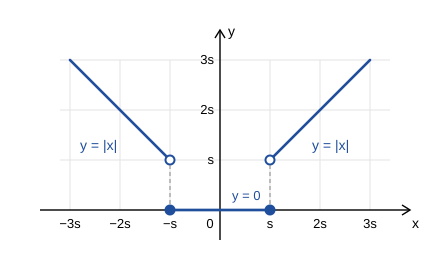

# BCE ECG — Maths approfondies (emlyon) 2025 · Corrigé brut

*Corrigé rédigé par IA, non officiel. Signalez toute erreur.*

Épreuve de mathématiques approfondies, conception emlyon Business School, voie générale, 4 heures, calculatrice interdite. Deux problèmes, 56 questions (sous-questions comprises).

---

## Problème 1

### Partie 1 - Une suite d'intégrales

#### 1.

Pour $n\in\mathbb{N}$, la fonction $t\mapsto(1-t^2)^n$ est polynomiale, donc continue sur les segments $[0,1]$ et $[-1,1]$ : **$I_n$ et $J_n$ sont bien définies.**

Cette fonction est paire, donc :

$$\boxed{J_n=2I_n.}$$

#### 2.

$$I_0=\int_0^1\mathrm{d}t=1.$$

#### 3.

Pour $t\in[0,1]$, $0\leqslant1-t^2\leqslant1$, donc $(1-t^2)^{n+1}\leqslant(1-t^2)^n$. Par croissance de l'intégrale (bornes dans l'ordre croissant), $I_{n+1}\leqslant I_n$ : **$(I_n)$ est décroissante.**

#### 4.

Soit $n\geqslant1$. On intègre par parties avec $t\mapsto t$ et $t\mapsto(1-t^2)^n$, de classe $C^1$ sur $[0,1]$ :

$$\begin{aligned}
I_n&=\big[t(1-t^2)^n\big]_0^1-\int_0^1t\cdot n(1-t^2)^{n-1}(-2t)\,\mathrm{d}t\\
&=0+2n\int_0^1t^2(1-t^2)^{n-1}\,\mathrm{d}t,
\end{aligned}$$

le crochet étant nul car $n\geqslant1$. En écrivant $t^2=1-(1-t^2)$ :

$$I_n=2n\big(I_{n-1}-I_n\big).$$

Donc $(2n+1)I_n=2nI_{n-1}$, c'est-à-dire :

$$\boxed{I_n=\frac{2n}{2n+1}I_{n-1}.}$$

#### 5.

Montrons par récurrence sur $n$ la propriété $\mathcal{P}(n)$ : $I_n=\dfrac{(2^nn!)^2}{(2n+1)!}$.

*Initialisation.* $\dfrac{(2^00!)^2}{1!}=1=I_0$.

*Hérédité.* Soit $n\geqslant1$ tel que $\mathcal{P}(n-1)$. Par la question 4 :

$$\begin{aligned}
I_n&=\frac{2n}{2n+1}\cdot\frac{(2^{n-1}(n-1)!)^2}{(2n-1)!}\\
&=\frac{(2n)\cdot(2n)\,(2^{n-1}(n-1)!)^2}{(2n+1)(2n)(2n-1)!}\\
&=\frac{(2^nn!)^2}{(2n+1)!},
\end{aligned}$$

car $2n\cdot2^{n-1}(n-1)!=2^nn!$. D'où $\mathcal{P}(n)$, et la propriété pour tout $n\in\mathbb{N}$.

Par la question 1 :

$$\boxed{J_n=2I_n=\frac{2^{2n+1}(n!)^2}{(2n+1)!}.}$$

#### 6.

La relation de récurrence de la question 4 donne :

```python
def I(n):
    i = 1
    for k in range(1, n + 1):
        i = 2 * k / (2 * k + 1) * i
    return i
```

#### 7.

Par la formule de Stirling, $(n!)^2\underset{n\to+\infty}{\sim}2\pi n\left(\frac ne\right)^{2n}$ et :

$$(2n+1)!=(2n+1)\,(2n)!\underset{n\to+\infty}{\sim}(2n+1)\sqrt{4\pi n}\left(\frac{2n}{e}\right)^{2n}=(2n+1)\,2\sqrt{\pi n}\;4^n\left(\frac ne\right)^{2n}.$$

Les équivalents sont compatibles avec le produit et le quotient, donc :

$$\begin{aligned}
J_n=\frac{2\cdot4^n(n!)^2}{(2n+1)!}&\underset{n\to+\infty}{\sim}\frac{2\cdot4^n\cdot2\pi n\left(\frac ne\right)^{2n}}{(2n+1)\,2\sqrt{\pi n}\;4^n\left(\frac ne\right)^{2n}}\\
&=\frac{2\sqrt{\pi n}}{2n+1}.
\end{aligned}$$

Comme $2n+1\sim2n$, on obtient :

$$\boxed{J_n\underset{n\to+\infty}{\sim}\sqrt{\frac{\pi}{n}}.}$$

### Partie 2 - Des polynômes orthogonaux

#### 8.

Pour $P,Q\in\mathbb{R}[x]$, $t\mapsto P(t)Q(t)$ est continue sur $[-1,1]$, donc $\langle P,Q\rangle$ existe.

- *Symétrie* : $\langle P,Q\rangle=\langle Q,P\rangle$ car $PQ=QP$.
- *Linéarité à gauche* : par linéarité de l'intégrale, $\langle\lambda P_1+P_2,Q\rangle=\lambda\langle P_1,Q\rangle+\langle P_2,Q\rangle$. Avec la symétrie, l'application est bilinéaire.
- *Positivité* : $\langle P,P\rangle=\int_{-1}^1P(t)^2\,\mathrm{d}t\geqslant0$ (intégrale d'une fonction positive, bornes croissantes).
- *Définie* : si $\langle P,P\rangle=0$, la fonction $P^2$ est continue, positive, d'intégrale nulle sur $[-1,1]$, donc nulle sur $[-1,1]$. Le polynôme $P$ a alors une infinité de racines : $P=0$.

**L'application est un produit scalaire sur $\mathbb{R}[x]$.**

#### 9.

Comme $n\geqslant2$, $e_0$ et $e_2$ sont dans $\mathcal{B}_n$, et :

$$\langle e_0,e_2\rangle=\int_{-1}^1t^2\,\mathrm{d}t=\frac23\neq0.$$

**Non, les polynômes de $\mathcal{B}_n$ ne sont pas deux à deux orthogonaux.**

#### 10.

Pour $P\in\mathbb{R}_n[x]$ :

$$u(P)=(1-x^2)P''-2xP'.$$

*Linéarité* : la dérivation est linéaire, ainsi que la multiplication par un polynôme fixé.

*Stabilité* : $\deg\big((1-x^2)P''\big)\leqslant2+(n-2)=n$ si $n\geqslant2$ et $\deg(xP')\leqslant n$ ; dans tous les cas $\deg u(P)\leqslant n$ (si $\deg P\leqslant1$, $P''=0$).

**$u$ est un endomorphisme de $\mathbb{R}_n[x]$.**

#### 11.

**a.** $e_0'=0$, donc $u(e_0)=0$. Et $(1-x^2)e_1'=1-x^2$, de dérivée $-2x$ : **$u(e_1)=-2e_1$.**

**b.** Pour $k\in\llbracket2,n\rrbracket$ :

$$(1-x^2)e_k'=kx^{k-1}-kx^{k+1}.$$

En dérivant :

$$\boxed{u(e_k)=k(k-1)e_{k-2}-k(k+1)e_k.}$$

**c.** Par a et b, la matrice de $u$ dans $\mathcal{B}_n$ est triangulaire supérieure (chaque colonne n'a de coefficients non nuls que sur la diagonale et deux lignes au-dessus), de coefficients diagonaux $-k(k+1)$, $k\in\llbracket0,n\rrbracket$.

Les valeurs propres d'une matrice triangulaire sont ses coefficients diagonaux :

$$\boxed{\operatorname{Sp}(u)=\{-k(k+1)\ |\ k\in\llbracket0,n\rrbracket\}.}$$

La suite $k\mapsto k(k+1)$ étant strictement croissante sur $\mathbb{N}$, ces $n+1$ valeurs propres sont distinctes. Un endomorphisme de $\mathbb{R}_n[x]$, de dimension $n+1$, ayant $n+1$ valeurs propres distinctes est diagonalisable et **chacun de ses sous-espaces propres est de dimension 1.**

#### 12.

Soient $P,Q\in\mathbb{R}_n[x]$. On intègre par parties, $(1-x^2)P'$ et $Q$ étant de classe $C^1$ :

$$\begin{aligned}
\langle u(P),Q\rangle&=\int_{-1}^1\big((1-t^2)P'(t)\big)'Q(t)\,\mathrm{d}t\\
&=\Big[(1-t^2)P'(t)Q(t)\Big]_{-1}^{1}-\int_{-1}^1(1-t^2)P'(t)Q'(t)\,\mathrm{d}t\\
&=-\int_{-1}^1(1-t^2)P'(t)Q'(t)\,\mathrm{d}t,
\end{aligned}$$

car $1-t^2$ s'annule en $\pm1$.

Cette expression est symétrique en $P$ et $Q$, donc $\langle u(P),Q\rangle=\langle P,u(Q)\rangle$ : **$u$ est un endomorphisme symétrique de l'espace euclidien $\mathbb{R}_n[x]$.**

Par le théorème spectral, **il existe une base orthonormale $(V_0,\dots,V_n)$ de $\mathbb{R}_n[x]$ formée de vecteurs propres de $u$.** Chaque sous-espace propre étant une droite (question 11.c), on indexe cette base de sorte que $V_k$ soit associé à $-k(k+1)$.

Chaque $V_k$ est un polynôme non nul ; notons $a_k\neq0$ son coefficient dominant et $L_k=\dfrac{1}{a_k}V_k$.

Les $L_k$ sont des vecteurs propres (non nuls, multiples des $V_k$), deux à deux orthogonaux, de coefficient dominant 1 : **$\mathcal{L}_n=(L_0,\dots,L_n)$ est une base orthogonale de $\mathbb{R}_n[x]$ formée de vecteurs propres unitaires** (au sens du coefficient dominant).

#### 13.

**a.** $\mathbb{R}_m[x]$, muni de la restriction de $\langle\cdot,\cdot\rangle$, est un espace euclidien et $\mathbb{R}_n[x]$ en est un sous-espace vectoriel.

Par le théorème de la projection orthogonale, en notant $p_n$ le projecteur orthogonal sur $\mathbb{R}_n[x]$, $T_n=p_n(f)$ est l'unique élément de $\mathbb{R}_n[x]$ tel que :

$$\|f-T_n\|=\min_{g\in\mathbb{R}_n[x]}\|f-g\|.$$

Comme $(L_0,\dots,L_n)$ est une base orthogonale de $\mathbb{R}_n[x]$, le projeté s'écrit :

$$\boxed{\begin{aligned}
T_n&=\sum_{k=0}^{n}c_kL_k\\
c_k&=\frac{\langle f,L_k\rangle}{\|L_k\|^2}.
\end{aligned}}$$

**b.** $f-T_n\in\mathbb{R}_n[x]^\perp$ et $T_n\in\mathbb{R}_n[x]$ sont orthogonaux. Le théorème de Pythagore appliqué à $f=T_n+(f-T_n)$ donne $\|f\|^2=\|T_n\|^2+\|f-T_n\|^2$. La famille $(L_k)$ étant orthogonale, $\|T_n\|^2=\sum_{k=0}^{n}c_k^2\|L_k\|^2$. D'où :

$$\|f-T_n\|^2=\|f\|^2-\sum_{k=0}^{n}c_k^2\|L_k\|^2.$$

#### 14.

**a.** Par la formule du binôme, $P_k=(x^2-1)^k=x^{2k}+R$ avec $\deg R\leqslant2k-2$.

Dériver $k$ fois $x^{2k}$ donne $\frac{(2k)!}{k!}x^k$.

Dériver $k$ fois $R$ donne un polynôme de degré au plus $k-2$ (nul si $k\leqslant1$).

**$Q_k$ est de degré $k$, de coefficient dominant $\dfrac{(2k)!}{k!}$.**

**b.** $Q_0=1$, $Q_1=(x^2-1)'=2x$ et :

$$Q_2=\big(x^4-2x^2+1\big)''=12x^2-4.$$

**c. i.** $P_k'(x)=2kx(x^2-1)^{k-1}$ pour $k\geqslant1$, donc :

$$P_1(x)P_k'(x)=2kx(x^2-1)^k=2k\,e_1(x)P_k(x).$$

Pour $k=0$, les deux membres sont nuls. L'égalité vaut pour tout $k\in\mathbb{N}$ et tout $x\in\mathbb{R}$.

**ii.** On dérive $k+1$ fois. Comme $P_1'=2x$, $P_1''=2$ et $P_1^{(j)}=0$ pour $j\geqslant3$, la formule de Leibniz donne :

$$\begin{aligned}
(P_1P_k')^{(k+1)}&=\sum_{j=0}^{k+1}\binom{k+1}{j}P_1^{(j)}P_k^{(k+2-j)}\\
&=(x^2-1)Q_k''+(k+1)\,2x\,Q_k'+\binom{k+1}{2}\,2\,Q_k\\
&=(x^2-1)Q_k''+2(k+1)xQ_k'+k(k+1)Q_k.
\end{aligned}$$

De même, avec $e_1'=1$ et $e_1''=0$ :

$$\big(2k\,e_1P_k\big)^{(k+1)}=2k\big(xQ_k'+(k+1)Q_k\big).$$

En égalant les deux expressions :

$$(x^2-1)Q_k''+2xQ_k'-k(k+1)Q_k=0.$$

En multipliant par $-1$ :

$$\boxed{\forall x\in\mathbb{R},\quad(1-x^2)Q_k''(x)-2xQ_k'(x)+k(k+1)Q_k(x)=0.}$$

Pour $k\in\llbracket0,n\rrbracket$, $Q_k\in\mathbb{R}_n[x]$ est non nul (de degré $k$).

De plus $u(Q_k)=(1-x^2)Q_k''-2xQ_k'=-k(k+1)Q_k$ : **$Q_k$ est un vecteur propre de $u$ associé à $-k(k+1)$.**

**iii.** Le sous-espace propre associé à $-k(k+1)$ est une droite (question 11.c) qui contient $L_k$ et $Q_k\neq0$.

Il existe donc $\lambda\in\mathbb{R}$ tel que $L_k=\lambda Q_k$, avec $\lambda\neq0$ puisque $L_k\neq0$.

Ainsi $L_k$ est de degré $k$ et son coefficient dominant vaut $\lambda\frac{(2k)!}{k!}$ ; il vaut 1, d'où :

$$\boxed{L_k=\frac{k!}{(2k)!}\,Q_k.}$$

**d.** Récurrence sur $k$.

*Initialisation ($k=0$).* La somme est indexée par l'ensemble vide, elle est nulle par convention, et la formule s'écrit $\int_{-1}^1fg=\int_{-1}^1fg$.

*Hérédité.* Supposons la formule vraie au rang $k$ pour tous $f,g$. Par intégration par parties (polynômes) :

$$\int_{-1}^1f^{(k+1)}g=\Big[f^{(k)}g\Big]_{-1}^1-\int_{-1}^1f^{(k)}g'.$$

L'hypothèse de récurrence appliquée au couple $(f,g')$ donne :

$$\int_{-1}^1f^{(k)}g'=\sum_{j=0}^{k-1}(-1)^j\Big[f^{(k-1-j)}g^{(j+1)}\Big]_{-1}^1+(-1)^k\int_{-1}^1fg^{(k+1)}.$$

En reportant et en posant $i=j+1$ dans la somme :

$$\begin{aligned}
\int_{-1}^1f^{(k+1)}g&=\Big[f^{(k)}g\Big]_{-1}^1+\sum_{i=1}^{k}(-1)^i\Big[f^{(k-i)}g^{(i)}\Big]_{-1}^1+(-1)^{k+1}\int_{-1}^1fg^{(k+1)}\\
&=\sum_{i=0}^{k}(-1)^i\Big[f^{(k-i)}g^{(i)}\Big]_{-1}^1+(-1)^{k+1}\int_{-1}^1fg^{(k+1)},
\end{aligned}$$

ce qui est la formule au rang $k+1$.

**e. i.** $P_k=x^{2k}+R$ avec $\deg R<2k$ : $R^{(2k)}=0$ et $(x^{2k})^{(2k)}=(2k)!$. **$P_k^{(2k)}=(2k)!$.**

**ii.** Récurrence finie sur $\ell\in\llbracket0,k\rrbracket$.

*Initialisation.* $P_k^{(0)}=(x^2-1)^kR_{k,0}$ avec $R_{k,0}=1$, de degré $0$.

*Hérédité.* Soit $\ell\in\llbracket0,k-1\rrbracket$ tel que $P_k^{(\ell)}=(x^2-1)^{k-\ell}R_{k,\ell}$ avec $\deg R_{k,\ell}\leqslant\ell$. En dérivant :

$$\begin{aligned}
P_k^{(\ell+1)}&=(k-\ell)(x^2-1)^{k-\ell-1}\,2x\,R_{k,\ell}+(x^2-1)^{k-\ell}R_{k,\ell}'\\
&=(x^2-1)^{k-\ell-1}\Big(2(k-\ell)xR_{k,\ell}+(x^2-1)R_{k,\ell}'\Big).
\end{aligned}$$

Le polynôme $R_{k,\ell+1}=2(k-\ell)xR_{k,\ell}+(x^2-1)R_{k,\ell}'$ est de degré au plus $\ell+1$. D'où la propriété au rang $\ell+1$.

**iii.** Pour $\ell\in\llbracket0,k-1\rrbracket$, $k-\ell\geqslant1$, donc $(x^2-1)^{k-\ell}$ s'annule en $\pm1$ et :

$$P_k^{(\ell)}(-1)=P_k^{(\ell)}(1)=0.$$

On applique d. avec $f=P_k$ et $g=Q_k$ (pour $k=0$, $\|Q_0\|^2=2$ directement). Dans les crochets, $f^{(k-1-j)}=P_k^{(k-1-j)}$ avec $k-1-j\in\llbracket0,k-1\rrbracket$ : ils sont tous nuls.

Avec $Q_k^{(k)}=P_k^{(2k)}=(2k)!$ :

$$\begin{aligned}
\|Q_k\|^2=\int_{-1}^1P_k^{(k)}Q_k&=(-1)^k\int_{-1}^1(t^2-1)^k\,(2k)!\,\mathrm{d}t\\
&=(2k)!\int_{-1}^1(1-t^2)^k\,\mathrm{d}t\\
&=(2k)!\,J_k.
\end{aligned}$$

Par la question 5 de la partie 1 :

$$\boxed{\|Q_k\|^2=(2k)!\cdot\frac{2^{2k+1}(k!)^2}{(2k+1)!}=\frac{2^{2k+1}(k!)^2}{2k+1}.}$$

Enfin, par c.iii :

$$\begin{aligned}
\|L_k\|&=\frac{k!}{(2k)!}\,\|Q_k\|\\
&=\frac{k!}{(2k)!}\cdot2^k\sqrt2\,\frac{k!}{\sqrt{2k+1}}\\
&=2^k\sqrt{\frac{2}{2k+1}}\cdot\frac{(k!)^2}{(2k)!},
\end{aligned}$$

soit :

$$\boxed{\|L_k\|=2^k\sqrt{\frac{2}{2k+1}}\binom{2k}{k}^{-1}.}$$

---

## Problème 2

### Partie 1 - Loi de Cauchy

#### 1.

$f$ est continue et positive sur $\mathbb{R}$. Pour $A<B$ :

$$\int_A^Bf(x)\,\mathrm{d}x=\frac1\pi\big(\arctan B-\arctan A\big)\xrightarrow[A\to-\infty,\ B\to+\infty]{}\frac1\pi\Big(\frac\pi2+\frac\pi2\Big)=1.$$

L'intégrale $\int_{-\infty}^{+\infty}f$ converge et vaut 1 : **$f$ est une densité de probabilité.**

#### 2.

*Espérance.* La fonction $x\mapsto xf(x)$ est continue, positive sur $[1,+\infty[$, et $xf(x)\underset{+\infty}{\sim}\dfrac{1}{\pi x}$. L'intégrale de Riemann $\int_1^{+\infty}\frac{\mathrm{d}x}{x}$ diverge ; par comparaison de fonctions positives, $\int_1^{+\infty}xf(x)\,\mathrm{d}x$ diverge. **$X$ n'admet pas d'espérance.**

*Variance.* Une variable sans espérance n'a pas de variance (la variance $\mathbb{E}\big((X-\mathbb{E}(X))^2\big)$ suppose l'existence de $\mathbb{E}(X)$). On peut aussi le voir directement : $x^2f(x)\to\frac1\pi$ en $+\infty$, donc $\int_1^{+\infty}x^2f(x)\,\mathrm{d}x$ diverge. **$X$ n'admet pas de variance.**

#### 3.

Pour $x\in\mathbb{R}$ :

$$\begin{aligned}
F(x)&=\int_{-\infty}^{x}\frac{\mathrm{d}t}{\pi(1+t^2)}\\
&=\frac1\pi\Big(\arctan x+\frac\pi2\Big)\\
&=\frac12+\frac{\arctan x}{\pi}.
\end{aligned}$$

$F$ est continue et strictement croissante sur $\mathbb{R}$ (car $F'=f>0$), de limite 0 en $-\infty$ et de limite 1 en $+\infty$.

Par le théorème de la bijection, **$F$ réalise une bijection de $\mathbb{R}$ sur $]0,1[$.**

Soit $y\in\,]0,1[$. Pour $x\in\mathbb{R}$, $F(x)=y$ équivaut à $\arctan x=\pi\big(y-\frac12\big)$.

Comme $\pi\big(y-\frac12\big)\in\,]-\frac\pi2,\frac\pi2[$, intervalle sur lequel $\tan$ est la réciproque de $\arctan$ :

$$\boxed{F^{-1}(y)=\tan\Big(\pi\Big(y-\frac12\Big)\Big).}$$

#### 4.

**a.** $U$ prend ses valeurs dans $]0,1[$, donc $Y=F^{-1}(U)$ est bien défini. Soit $x\in\mathbb{R}$.

Comme $F$ est strictement croissante, $F^{-1}(U)\leqslant x\iff U\leqslant F(x)$, et $F(x)\in\,]0,1[$ :

$$\mathbb{P}(Y\leqslant x)=\mathbb{P}\big(U\leqslant F(x)\big)=F(x).$$

$Y$ a même fonction de répartition que $X$ : **$Y$ suit la loi de Cauchy.**

**b.**

```python
def cauchy():
    u = rd.random()                      # loi uniforme sur [0, 1[
    return np.tan(np.pi * (u - 1 / 2))
```

#### 5.

$Z$ est à valeurs positives. Pour $z<0$, $F_Z(z)=0$.

Pour $z\geqslant0$, $Z\leqslant z\iff|X|\leqslant z^2$, et $X$ étant à densité, $\mathbb{P}(X=-z^2)=0$ :

$$F_Z(z)=F(z^2)-F(-z^2)=\frac{2}{\pi}\arctan(z^2).$$

$F_Z$ est continue sur $\mathbb{R}$ (en 0, les deux expressions valent 0) et de classe $C^1$ sur $\mathbb{R}\setminus\{0\}$ : **$Z$ est une variable à densité**, et une densité s'obtient en dérivant là où c'est possible :

$$\boxed{f_Z(z)=\begin{cases}\dfrac{4z}{\pi(1+z^4)}&\text{si }z\geqslant0,\\[2mm]0&\text{si }z<0.\end{cases}}$$

#### 6.

*Espérance.* $z\mapsto zf_Z(z)=\dfrac{4z^2}{\pi(1+z^4)}$ est continue et positive sur $[0,+\infty[$, et équivalente en $+\infty$ à $\dfrac{4}{\pi z^2}$.

L'intégrale de Riemann $\int_1^{+\infty}\frac{\mathrm{d}z}{z^2}$ converge ; par comparaison, $\int_1^{+\infty}zf_Z(z)\,\mathrm{d}z$ converge, et $\int_0^1zf_Z(z)\,\mathrm{d}z$ est l'intégrale d'une fonction continue sur un segment. **$Z$ admet une espérance.**

*Variance.* $z^2f_Z(z)=\dfrac{4z^3}{\pi(1+z^4)}\underset{+\infty}{\sim}\dfrac{4}{\pi z}$, positive, et $\int_1^{+\infty}\frac{\mathrm{d}z}{z}$ diverge : $Z$ n'admet pas de moment d'ordre 2, **donc pas de variance.**

#### 7.

**a.** $(x^2-\sqrt2x+1)(x^2+\sqrt2x+1)=(x^2+1)^2-2x^2=x^4+1$. On cherche $\alpha,\beta$ tels que, pour tout $x\geqslant0$ :

$$\alpha x(x^2+\sqrt2x+1)+\beta x(x^2-\sqrt2x+1)=x^2,$$

soit $(\alpha+\beta)x^3+\sqrt2(\alpha-\beta)x^2+(\alpha+\beta)x=x^2$. Il suffit que $\alpha+\beta=0$ et $\sqrt2(\alpha-\beta)=1$ :

$$\boxed{\begin{aligned}
\alpha&=\frac{\sqrt2}{4}\\
\beta&=-\frac{\sqrt2}{4}.
\end{aligned}}$$

**b.** $x^2\mp\sqrt2x+1=\big(x\mp\frac{\sqrt2}{2}\big)^2+\frac12>0$ : les deux fonctions sont continues et positives sur $[0,+\infty[$, équivalentes à $\frac{1}{x^2}$ en $+\infty$. Par comparaison à l'intégrale de Riemann convergente $\int_1^{+\infty}\frac{\mathrm{d}x}{x^2}$, **les deux intégrales convergent.**

On pose $x=\dfrac{t-1}{\sqrt2}$ (changement de variable affine, $t$ allant de $1$ à $+\infty$, $\mathrm{d}x=\frac{\mathrm{d}t}{\sqrt2}$) :

$$\begin{aligned}
x^2+\sqrt2x+1&=\Big(x+\frac{\sqrt2}{2}\Big)^2+\frac12\\
&=\frac{t^2}{2}+\frac12\\
&=\frac{t^2+1}{2}.
\end{aligned}$$

Donc :

$$\begin{aligned}
\int_0^{+\infty}\frac{\mathrm{d}x}{x^2+\sqrt2x+1}&=\int_1^{+\infty}\frac{2}{t^2+1}\cdot\frac{\mathrm{d}t}{\sqrt2}\\
&=\sqrt2\Big(\frac\pi2-\frac\pi4\Big)\\
&=\frac{\pi}{2\sqrt2}.
\end{aligned}$$

**c.** Notons $q_-(x)=x^2-\sqrt2x+1$ et $q_+(x)=x^2+\sqrt2x+1$. Par a. et $\beta=-\alpha$, l'identité de l'énoncé donne, pour $x\geqslant0$ :

$$\frac{x^2}{x^4+1}=\frac\alpha2\Big(\frac{2x-\sqrt2}{q_-(x)}-\frac{2x+\sqrt2}{q_+(x)}\Big)+\frac{\alpha\sqrt2}{2}\Big(\frac{1}{q_-(x)}+\frac{1}{q_+(x)}\Big).$$

Les intégrales de $\frac{2x\mp\sqrt2}{q_\mp}$ divergent séparément : on travaille sur $[0,A]$. Comme $q_\mp'=2x\mp\sqrt2$ et $q_\mp>0$ :

$$\int_0^A\Big(\frac{2x-\sqrt2}{q_-(x)}-\frac{2x+\sqrt2}{q_+(x)}\Big)\mathrm{d}x=\ln\frac{q_-(A)}{q_+(A)}-\ln\frac11\xrightarrow[A\to+\infty]{}0,$$

car $\frac{q_-(A)}{q_+(A)}\to1$. Par b. :

$$\int_0^{+\infty}\Big(\frac{1}{q_-}+\frac{1}{q_+}\Big)=\frac{3\pi}{2\sqrt2}+\frac{\pi}{2\sqrt2}=\sqrt2\,\pi.$$

Donc $\displaystyle\int_0^{+\infty}\frac{x^2}{x^4+1}\,\mathrm{d}x=\frac{\alpha\sqrt2}{2}\cdot\sqrt2\,\pi=\alpha\pi=\frac{\sqrt2\,\pi}{4}$, et :

$$\mathbb{E}(Z)=\frac4\pi\int_0^{+\infty}\frac{x^2}{1+x^4}\,\mathrm{d}x=\frac4\pi\cdot\frac{\sqrt2\,\pi}{4}.$$

$$\boxed{\mathbb{E}(Z)=\sqrt2.}$$

#### 8.

*Interprétation.* `mystere(eps, n)` répète 1000 fois l'expérience suivante : simuler un échantillon de $n$ variables indépendantes de même loi que $Z=\sqrt{|X|}$, calculer la moyenne empirique $\overline{Z}_n$ et noter si $|\overline{Z}_n-\sqrt2|\leqslant\varepsilon$. Elle renvoie la fréquence de succès, qui approche $\mathbb{P}\big(|\overline{Z}_n-\sqrt2|\leqslant\varepsilon\big)$.

La matrice affichée contient ces fréquences, $\varepsilon\in\{1;0{,}5;0{,}1;0{,}05\}$ en ligne et $n\in\{100,\dots,50000\}$ en colonne.

Sur chaque ligne, la fréquence croît vers 1 quand $n$ augmente (de $0{,}21$ à $0{,}992$ pour $\varepsilon=0{,}05$), d'autant plus lentement que $\varepsilon$ est petit.

*Conjecture.* Pour tout $\varepsilon>0$, $\lim_{n\to+\infty}\mathbb{P}\big(|\overline{Z}_n-\sqrt2|>\varepsilon\big)=0$ : $\overline{Z}_n$ converge en probabilité vers $\mathbb{E}(Z)=\sqrt2$.

*Résultat du cours.* La loi faible des grands nombres : si $(Z_k)$ est une suite de variables indépendantes, de même loi, admettant une espérance $m$ **et une variance**, alors $\overline{Z}_n$ converge en probabilité vers $m$. Sa démonstration repose sur l'inégalité de Bienaymé-Tchebychev, $\mathbb{P}(|\overline{Z}_n-m|\geqslant\varepsilon)\leqslant\frac{\mathbb{V}(Z)}{n\varepsilon^2}$, qui exige une variance.

*Pourquoi on ne peut pas l'appliquer.* $Z$ n'admet pas de variance (question 6) : l'hypothèse n'est pas satisfaite.

### Partie 2 - Variables indicatrices et une extension de théorème

#### 9.

$\mathbb{1}_A$ prend les valeurs 0 et 1, avec $\mathbb{P}(\mathbb{1}_A=1)=\mathbb{P}(A)$ : **$\mathbb{1}_A$ suit la loi de Bernoulli de paramètre $\mathbb{P}(A)$**, d'espérance $\mathbb{P}(A)$ et de variance $\mathbb{P}(A)\big(1-\mathbb{P}(A)\big)$.

#### 10.

**a.** Pour $\omega\in\Omega$ : $\mathbb{1}_{[X>s]}(\omega)=1$ si et seulement si $X(\omega)>s$, si et seulement si $X(\omega)\in\,]s,+\infty[$, si et seulement si $\chi_{]s,+\infty[}(X(\omega))=1$.

Les deux fonctions ne prennent que les valeurs $0$ et $1$ : elles sont égales.

**b.** $\varphi_s(x)=|x|$ si $|x|>s$ et $\varphi_s(x)=0$ si $|x|\leqslant s$.

La courbe est formée du segment $[-s,s]\times\{0\}$ et des deux demi-droites $y=|x|$ pour $|x|>s$, d'extrémités exclues $(\pm s,s)$.



**Points de discontinuité : $-s$ et $s$.**

#### 11.

Comme $\mathbb{1}_{[|X_k|\leqslant M]}+\mathbb{1}_{[|X_k|>M]}=1$ :

$$\boxed{X_k=Y_k+Z_k.}$$

#### 12.

Si $|X_k|\leqslant M$, $Y_k=X_k$ ; sinon $Y_k=0$. Donc $|Y_k|\leqslant M$ et $0\leqslant Y_k^2\leqslant M^2$.

Par existence par domination (étendue aux variables quelconques par le programme), $Y_k^2$ admet une espérance : **$Y_k$ admet un moment d'ordre 2, et $\mathbb{E}(Y_k^2)\leqslant M^2$.**

#### 13.

**a.** Par 10.a (avec $|X_k|$ et $s=M$), $\mathbb{1}_{[|X_k|>M]}=\chi_{]M,+\infty[}(|X_k|)$, donc :

$$|Z_k|=|X_k|\,\chi_{]M,+\infty[}(|X_k|)=\varphi_M(X_k).$$

$X_k$ a pour densité $g$ et $\varphi_M$ est continue sauf en $\pm M$ (10.b), positive, avec $0\leqslant\varphi_M(x)g(x)\leqslant|x|g(x)$.

Comme $X$ admet une espérance, $\int_{\mathbb{R}}|x|g(x)\,\mathrm{d}x$ converge, donc $\int_{\mathbb{R}}\varphi_M(x)g(x)\,\mathrm{d}x$ aussi. Par le théorème de transfert :

$$\mathbb{E}(|Z_k|)=\int_{-\infty}^{-M}|x|g(x)\,\mathrm{d}x+\int_M^{+\infty}|x|g(x)\,\mathrm{d}x.$$

Ce sont des restes d'intégrales convergentes : ils tendent vers 0 quand $M\to+\infty$. **$\lim_{M\to+\infty}\mathbb{E}(|Z_k|)=0$.**

**b.** $|Z_k|$ admet une espérance, donc $Z_k$ aussi, et $|\mathbb{E}(Z_k)|\leqslant\mathbb{E}(|Z_k|)\xrightarrow[M\to+\infty]{}0$. **$\lim_{M\to+\infty}\mathbb{E}(Z_k)=0$.**

**c.** Par 11 et linéarité, $\mathbb{E}(Y_k)=\mathbb{E}(X_k)-\mathbb{E}(Z_k)=-\mathbb{E}(Z_k)$, qui tend vers 0. **$\lim_{M\to+\infty}\mathbb{E}(Y_k)=0=\mathbb{E}(X_k)$.**

#### 14.

Par contraposée : si $|x|\leqslant\frac t2$ et $|y|\leqslant\frac t2$, l'inégalité triangulaire donne $|x+y|\leqslant|x|+|y|\leqslant t$. Donc :

$$|x+y|>t\Longrightarrow\Big(|x|>\frac t2\ \text{ou}\ |y|>\frac t2\Big).$$

#### 15.

Par 11, $\overline{X}_n=\overline{Y}_n+\overline{Z}_n$. Par 14, l'événement $[|\overline{X}_n|>t]$ est inclus dans $\big[|\overline{Y}_n|>\frac t2\big]\cup\big[|\overline{Z}_n|>\frac t2\big]$. Par croissance de $\mathbb{P}$ et sous-additivité :

$$\mathbb{P}\big(|\overline{X}_n|>t\big)\leqslant\mathbb{P}\Big(|\overline{Y}_n|>\frac t2\Big)+\mathbb{P}\Big(|\overline{Z}_n|>\frac t2\Big).$$

#### 16.

**a.** $|\overline{Z}_n|$ est positive et admet une espérance, avec $|\overline{Z}_n|\leqslant\frac1n\sum_{k=1}^{n}|Z_k|$. Par 13.a, $\mathbb{E}(|Z_k|)=\int_{|x|>M}|x|g(x)\,\mathrm{d}x$ ne dépend pas de $k$, donc $\mathbb{E}(|Z_k|)=\mathbb{E}(|Z_1|)$. Par l'inégalité de Markov :

$$\begin{aligned}
\mathbb{P}\Big(|\overline{Z}_n|>\frac t2\Big)&\leqslant\mathbb{P}\Big(|\overline{Z}_n|\geqslant\frac t2\Big)\\
&\leqslant\frac2t\,\mathbb{E}\big(|\overline{Z}_n|\big)\\
&\leqslant\frac2t\cdot\frac1n\sum_{k=1}^{n}\mathbb{E}(|Z_k|)\\
&=\frac2t\,\mathbb{E}(|Z_1|).
\end{aligned}$$

**b.** Par 13.a, $\mathbb{E}(|Z_1|)\to0$ quand $M\to+\infty$. Il existe donc $M_1>0$ tel que, pour tout $M\geqslant M_1$, $\mathbb{E}(|Z_1|)\leqslant\frac{t\varepsilon}{6}$. Alors, pour tout $n\in\mathbb{N}^*$, par a. :

$$\mathbb{P}\Big(|\overline{Z}_n|>\frac t2\Big)\leqslant\frac2t\cdot\frac{t\varepsilon}{6}=\frac\varepsilon3.$$

#### 17.

**a.** Les $Y_k$ sont bornées, donc tous les produits $Y_iY_j$ admettent une espérance. En développant le carré et par linéarité :

$$\begin{aligned}
\mathbb{E}\big(\overline{Y}_n^2\big)&=\frac{1}{n^2}\,\mathbb{E}\Big(\Big(\sum_{k=1}^{n}Y_k\Big)^2\Big)\\
&=\frac{1}{n^2}\Big(\sum_{k=1}^{n}\mathbb{E}(Y_k^2)+2\sum_{1\leqslant i<j\leqslant n}\mathbb{E}(Y_iY_j)\Big).
\end{aligned}$$

**b.** Pour $i\neq j$, $Y_i$ et $Y_j$ sont des fonctions de $X_i$ et $X_j$, indépendantes : par le lemme des coalitions, elles sont indépendantes, et $\mathbb{E}(Y_iY_j)=\mathbb{E}(Y_i)\mathbb{E}(Y_j)=\mathbb{E}(Y_1)^2$.

En effet $\mathbb{E}(Y_k)=\int_{-M}^{M}xg(x)\,\mathrm{d}x$ (transfert) ne dépend pas de $k$.

Il y a $\frac{n(n-1)}{2}$ couples $i<j$, donc :

$$2\sum_{1\leqslant i<j\leqslant n}\mathbb{E}(Y_iY_j)=n(n-1)\,\mathbb{E}(Y_1)^2\leqslant n(n-1)\,\mathbb{E}(Y_1)^2.$$

**c.** Par a., b. et la question 12 :

$$\begin{aligned}
\mathbb{E}\big(\overline{Y}_n^2\big)&\leqslant\frac{1}{n^2}\big(nM^2+n(n-1)\mathbb{E}(Y_1)^2\big)\\
&=\frac{M^2}{n}+\frac{n-1}{n}\,\mathbb{E}(Y_1)^2\\
&\leqslant\frac{M^2}{n}+\mathbb{E}(Y_1)^2.
\end{aligned}$$

**d.** Par 13.c, $\mathbb{E}(Y_1)^2\to0$ quand $M\to+\infty$. Comme $\frac{t^2\varepsilon}{12}>0$, **il existe $M_2>0$ tel que, pour tout $M\geqslant M_2$, $\mathbb{E}(Y_1)^2\leqslant\frac{t^2\varepsilon}{12}$.**

**e.** Soit $M\geqslant M_2$ et $n\in\mathbb{N}^*$. $\overline{Y}_n^2$ est positive et admet une espérance. Par l'inégalité de Markov, puis c. et d. :

$$\begin{aligned}
\mathbb{P}\Big(|\overline{Y}_n|>\frac t2\Big)&\leqslant\mathbb{P}\Big(\overline{Y}_n^2\geqslant\frac{t^2}{4}\Big)\\
&\leqslant\frac{4}{t^2}\,\mathbb{E}\big(\overline{Y}_n^2\big)\\
&\leqslant\frac{4}{t^2}\Big(\frac{M^2}{n}+\frac{t^2\varepsilon}{12}\Big)\\
&=\frac{4M^2}{t^2n}+\frac\varepsilon3.
\end{aligned}$$

#### 18.

Si $M\geqslant\max(M_1,M_2)$, les questions 15, 16.b et 17.e donnent, pour tout $n\in\mathbb{N}^*$ :

$$\mathbb{P}\big(|\overline{X}_n|>t\big)\leqslant\frac{4M^2}{t^2n}+\frac\varepsilon3+\frac\varepsilon3=\frac{4M^2}{t^2n}+\frac{2\varepsilon}{3}.$$

#### 19.

Les variables $X_k$ ne dépendent pas de $M$ : on fixe $M=\max(M_1,M_2)$ dans 18.

Comme $\frac{4M^2}{t^2n}\to0$, il existe $N\in\mathbb{N}^*$ tel que $\frac{4M^2}{t^2n}\leqslant\frac\varepsilon3$ pour $n\geqslant N$. Alors :

$$\forall n\geqslant N,\quad0\leqslant\mathbb{P}\big(|\overline{X}_n|>t\big)\leqslant\varepsilon.$$

Ceci vaut pour tout $\varepsilon>0$ :

$$\boxed{\lim_{n\to+\infty}\mathbb{P}\big(|\overline{X}_n|>t\big)=0.}$$

#### 20.

*Interprétation.* On a démontré la conclusion de la **loi faible des grands nombres** du cours (pour une suite de variables indépendantes de même loi, admettant une espérance $m$ et une variance, $\overline{X}_n$ converge en probabilité vers $m$) **sans l'hypothèse de variance** : pour des variables indépendantes de même loi, à densité, admettant une espérance nulle, $\overline{X}_n$ converge en probabilité vers 0. Par translation ($X_k-m$), le résultat vaut pour une espérance $m$ quelconque.

*Retour à la question 8.* Les $Z_k-\sqrt2$, où $Z_k=\sqrt{|X_k|}$ avec $X_k$ de loi de Cauchy indépendantes, sont indépendantes, de même loi, à densité ($z\mapsto f_Z(z+\sqrt2)$) et d'espérance nulle (question 7.c). Leur moyenne est $\overline{Z}_n-\sqrt2$, donc pour tout $\varepsilon>0$ :

$$\lim_{n\to+\infty}\mathbb{P}\big(|\overline{Z}_n-\sqrt2|\leqslant\varepsilon\big)=1.$$

C'est exactement la conjecture de la question 8 : chaque ligne de la matrice affichée tend vers 1. Le résultat vaut malgré l'absence de variance de $Z$ ; en revanche, sans variance, on ne dispose plus de la majoration $\frac{\mathbb{V}(Z)}{n\varepsilon^2}$, donc d'aucune vitesse de convergence explicite, ce qui est cohérent avec la lenteur observée pour les petites valeurs de $\varepsilon$.
