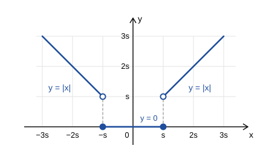

# BCE ECG — Maths approfondies (emlyon) 2025 · Corrigé guidé

*Corrigé rédigé par IA, non officiel. Signalez toute erreur.*

## Présentation du sujet

**Cadre.** Épreuve de mathématiques approfondies conçue par emlyon Business School, voie générale ECG, 4 heures, sans calculatrice ni document. Deux problèmes indépendants, 56 questions (sous-questions comprises), avec des questions Python dans chacun. Selon le rapport 2025, le sujet est noté sur 150 points : 65 pour le problème 1, 75 pour le problème 2 et 10 pour la présentation. Les questions d'informatique pèsent 10 points. Sur 3 066 copies, la moyenne est de 11,48 et l'écart type de 4,86.

**Problème 1 : intégrales de Wallis et polynômes de Legendre.**

- *Partie 1 (Q1–Q7)* : la suite $I_n=\int_0^1(1-t^2)^n\,\mathrm{d}t$, relation de récurrence par intégration par parties, formule close, équivalent par Stirling.
- *Partie 2 (Q8–Q14)* : produit scalaire $\int_{-1}^1PQ$ sur $\mathbb{R}[x]$, endomorphisme $u(P)=\big((1-x^2)P'\big)'$, spectre par une matrice triangulaire, symétrie par intégration par parties, base orthogonale de vecteurs propres, projection orthogonale. On identifie ensuite ces vecteurs propres aux dérivées $k$-ièmes de $(x^2-1)^k$ (formule de Rodrigues) et l'on calcule leur norme grâce à la partie 1.

**Problème 2 : une loi faible des grands nombres sans variance.**

- *Partie 1 (Q1–Q8)* : loi de Cauchy, absence d'espérance, simulation par inversion de la fonction de répartition, loi de $Z=\sqrt{|X|}$ (espérance $\sqrt2$, pas de variance), conjecture sur une simulation Python.
- *Partie 2 (Q9–Q20)* : troncature $X_k=Y_k+Z_k$, inégalités de Markov, et preuve que $\overline{X}_n$ converge en probabilité vers 0 pour des variables indépendantes de même loi, d'espérance nulle, sans hypothèse de variance.

**Notions du programme.** Intégration par parties, récurrence, formule de Stirling (admise) et équivalents ; produit scalaire, matrices triangulaires et valeurs propres, endomorphismes symétriques et théorème spectral, projection orthogonale ; formule de Leibniz. Densités, fonction de répartition, théorème de la bijection, intégrales impropres et critères de comparaison, théorème de transfert, inégalité de Markov, lemme des coalitions, loi faible des grands nombres.

**Difficulté.** Le rapport 2025 juge la difficulté « très variable selon les questions » et note qu'« aucun candidat ne traite l'intégralité du sujet ». Les meilleures copies traitent environ les trois quarts du sujet ; 63 % de questions bien traitées suffisaient pour 20/20. La plupart des candidats commençant par le problème 1, très peu ont abordé la fin du problème 2.

**Questions abordables à ne pas laisser passer.** Problème 1 : Q1 à Q6, Q8 à Q11, 14.a, 14.b, 14.c.i, 14.e.i. Problème 2 : Q1 à Q6, Q9, Q10, Q11, Q12, Q14, Q15. Plusieurs questions de la partie 2 du problème 2 (Q14, Q15, Q16.a, Q17.a à c) se traitent sans les précédentes.

**Gestion du temps.** Environ 1 h 45 pour le problème 1 (dont 1 h 10 pour la partie 2) et 2 h pour le problème 2, en gardant 15 minutes de relecture. Ne pas sacrifier la partie 2 du problème 2, dont les premières questions sont courtes.

---

## Problème 1 — Partie 1 : une suite d'intégrales

Une suite d'intégrales de Wallis : récurrence par intégration par parties, formule close par récurrence, puis équivalent. Les résultats servent à la toute fin de la partie 2 (calcul de $\|Q_k\|$).

### Question 1

> [!INDICATION]
> Quelle est la régularité de l'intégrande sur un segment ? Quelle symétrie possède-t-il ?

#### Solution

$t\mapsto(1-t^2)^n$ est continue sur les segments $[0,1]$ et $[-1,1]$ : les intégrales existent. Cette fonction étant paire, $J_n=2I_n$.

### Question 2

> [!INDICATION]
> Calcul direct.

#### Solution

$I_0=\int_0^1\mathrm{d}t=1$.

### Question 3

> [!INDICATION]
> Comparez $(1-t^2)^{n+1}$ et $(1-t^2)^n$ pour $t\in[0,1]$.

#### Solution

Pour $t\in[0,1]$, $0\leqslant1-t^2\leqslant1$, donc $(1-t^2)^{n+1}\leqslant(1-t^2)^n$. Par croissance de l'intégrale, $I_{n+1}\leqslant I_n$.

### Question 4

> [!INDICATION]
> Intégrez par parties en dérivant $(1-t^2)^n$ et en primitivant $1$ en $t$.

> [!INDICATION]
> Il apparaît $t^2(1-t^2)^{n-1}$ : écrivez $t^2=1-(1-t^2)$.

#### Solution

Pour $n\geqslant1$, le crochet $\big[t(1-t^2)^n\big]_0^1$ est nul et :

$$I_n=2n\int_0^1t^2(1-t^2)^{n-1}\,\mathrm{d}t=2n\big(I_{n-1}-I_n\big).$$

D'où $(2n+1)I_n=2nI_{n-1}$, soit $I_n=\dfrac{2n}{2n+1}I_{n-1}$.

> [!METHODE]
> Pour les intégrales de Wallis et leurs cousines, l'intégration par parties fait apparaître un terme de degré supérieur qu'on réexprime avec $I_n$ et $I_{n-1}$ : on obtient une relation entre trois termes qu'on résout en $I_n$.

### Question 5

> [!INDICATION]
> Récurrence directe à partir de la question 4 : écrivez soigneusement $2n\cdot2^{n-1}(n-1)!$.

> [!INDICATION]
> N'oubliez pas la seconde partie de la question.

#### Solution

L'initialisation est $I_0=1$. Si $I_{n-1}=\dfrac{(2^{n-1}(n-1)!)^2}{(2n-1)!}$, alors :

$$\begin{aligned}
I_n&=\frac{2n\cdot2n\,(2^{n-1}(n-1)!)^2}{(2n+1)(2n)(2n-1)!}\\
&=\frac{(2^nn!)^2}{(2n+1)!}.
\end{aligned}$$

Puis $J_n=2I_n=\dfrac{2^{2n+1}(n!)^2}{(2n+1)!}$.

> [!JURY]
> Le rapport 2025 rappelle que certaines questions en contiennent plusieurs : « Certains candidats n'ont par exemple pas donné $J_n$ dans la Question 5. du Problème 1 ou la densité de Z dans Question 5. du Problème 2, alors qu'ils avaient manifestement tout sur leur copie pour le faire. »

### Question 6

> [!INDICATION]
> Partez de $I_0=1$ et appliquez la relation de la question 4 pour $k$ allant de 1 à $n$.

#### Solution

```python
def I(n):
    i = 1
    for k in range(1, n + 1):
        i = 2 * k / (2 * k + 1) * i
    return i
```

### Question 7

> [!INDICATION]
> Partez de l'expression de $J_n$ et remplacez $n!$ et $(2n)!$ par leurs équivalents ; écrivez $(2n+1)!=(2n+1)(2n)!$.

> [!INDICATION]
> On peut multiplier et diviser des équivalents, pas les additionner : regroupez tout en un seul quotient avant de simplifier.

#### Solution

$(n!)^2\sim2\pi n\left(\frac ne\right)^{2n}$ et $(2n)!\sim2\sqrt{\pi n}\,4^n\left(\frac ne\right)^{2n}$. Par produit et quotient d'équivalents :

$$J_n=\frac{2\cdot4^n(n!)^2}{(2n+1)\,(2n)!}\sim\frac{2\cdot4^n\cdot2\pi n}{(2n+1)\cdot2\sqrt{\pi n}\cdot4^n}=\frac{2\sqrt{\pi n}}{2n+1}.$$

Avec $2n+1\sim2n$, $J_n\sim\sqrt{\pi/n}$.

> [!JURY]
> Selon le rapport 2025, « La Question 7. du Problème 1 a permis de mettre en lumière d'énormes difficultés pour une majorité de candidat.e.s à manipuler correctement (et sans écrire de réelles horreurs) les équivalents. »

> [!PIEGE]
> Ne pas élever un équivalent à la puissance $n$ ni composer par l'exponentielle sans précaution. Ici tout est produit et quotient : c'est licite. On simplifie les puissances exactement ($(2n)^{2n}=4^nn^{2n}$) avant de passer aux équivalents.

---

## Problème 1 — Partie 2 : des polynômes orthogonaux

On munit $\mathbb{R}[x]$ du produit scalaire $\int_{-1}^1PQ$ et l'on diagonalise l'opérateur de Legendre $u$ dans une base orthogonale. Le cœur de la partie : symétrie de $u$ par intégration par parties, théorème spectral, puis identification explicite des vecteurs propres.

### Question 8

> [!INDICATION]
> Vérifiez les quatre propriétés : symétrie, bilinéarité, positivité, caractère défini.

> [!INDICATION]
> Pour le caractère défini : une fonction continue positive d'intégrale nulle sur un segment est nulle sur ce segment ; que dire d'un polynôme qui a une infinité de racines ?

#### Solution

Symétrie et bilinéarité découlent de $PQ=QP$ et de la linéarité de l'intégrale ; $\langle P,P\rangle=\int_{-1}^1P^2\geqslant0$.

Si $\langle P,P\rangle=0$, $P^2$ continue positive d'intégrale nulle est nulle sur $[-1,1]$ : $P$ a une infinité de racines, donc $P=0$.

> [!METHODE]
> Le caractère défini est le seul point délicat d'un produit scalaire intégral. Le schéma est toujours le même : continuité et positivité de l'intégrande, intégrale nulle, donc fonction nulle sur l'intervalle, puis un argument propre à l'espace (ici, un polynôme ayant une infinité de racines est nul).

### Question 9

> [!INDICATION]
> Testez deux monômes de même parité.

#### Solution

$\langle e_0,e_2\rangle=\int_{-1}^1t^2\,\mathrm{d}t=\frac23\neq0$ (et $e_2\in\mathcal{B}_n$ car $n\geqslant2$) : la réponse est non.

### Question 10

> [!INDICATION]
> Développez $u(P)$ et contrôlez le degré de chaque terme.

#### Solution

$u(P)=(1-x^2)P''-2xP'$ est linéaire en $P$. Pour $\deg P\leqslant n$, chaque terme est de degré au plus $n$ : $u$ est un endomorphisme de $\mathbb{R}_n[x]$.

> [!JURY]
> Le rapport 2025 insiste : « Les éléments de $\mathbb{R}_n[x]$ sont des (fonctions) polynom(ial)es de degré inférieur ou égal à n et pas seulement égal à n. »

### Question 11.a

> [!INDICATION]
> Calcul direct.

#### Solution

$u(e_0)=0$ car $e_0'=0$, et $u(e_1)=\big(1-x^2\big)'=-2x=-2e_1$.

### Question 11.b

> [!INDICATION]
> Développez $(1-x^2)kx^{k-1}$ avant de dériver.

#### Solution

$(1-x^2)e_k'=kx^{k-1}-kx^{k+1}$, donc $u(e_k)=k(k-1)e_{k-2}-k(k+1)e_k$.

### Question 11.c

> [!INDICATION]
> Quelle est la forme de la matrice de $u$ dans $\mathcal{B}_n$ ? Où lit-on les valeurs propres d'une telle matrice ?

> [!INDICATION]
> Combien y a-t-il de valeurs propres distinctes, comparé à la dimension ?

#### Solution

La matrice est triangulaire supérieure, de diagonale $\big(-k(k+1)\big)_{0\leqslant k\leqslant n}$. Donc $\operatorname{Sp}(u)=\{-k(k+1)\ |\ 0\leqslant k\leqslant n\}$. Ces $n+1$ valeurs sont distinctes ($k\mapsto k(k+1)$ est strictement croissante) en dimension $n+1$ : $u$ est diagonalisable et chaque sous-espace propre est une droite.

> [!METHODE]
> $n+1$ valeurs propres distinctes en dimension $n+1$ : diagonalisable, sous-espaces propres de dimension 1. Cette information resservira en 14.c.iii pour identifier deux vecteurs propres.

### Question 12

> [!INDICATION]
> Montrez que $u$ est symétrique : calculez $\langle u(P),Q\rangle$ en intégrant par parties.

> [!INDICATION]
> Le crochet fait apparaître $1-t^2$ en $\pm1$. Ensuite, quel théorème du programme donne une base orthonormale de vecteurs propres ?

#### Solution

Par intégration par parties :

$$\langle u(P),Q\rangle=\Big[(1-t^2)P'Q\Big]_{-1}^1-\int_{-1}^1(1-t^2)P'Q'=-\int_{-1}^1(1-t^2)P'Q'.$$

L'expression est symétrique en $P,Q$ : $u$ est symétrique. Par le théorème spectral, il existe une base orthonormale $(V_0,\dots,V_n)$ de vecteurs propres, indexée de sorte que $V_k$ soit associé à $-k(k+1)$.

En divisant chaque $V_k$ par son coefficient dominant, on obtient une base orthogonale $(L_0,\dots,L_n)$ de vecteurs propres de coefficient dominant 1.

> [!PIEGE]
> Diviser par le coefficient dominant détruit la normalisation mais pas l'orthogonalité : la base obtenue est orthogonale, pas orthonormale. C'est bien ce que demande l'énoncé.

### Question 13.a

> [!INDICATION]
> Placez-vous dans l'espace euclidien $\mathbb{R}_m[x]$ et reconnaissez un théorème de minimisation du cours.

> [!INDICATION]
> Pour les coefficients, utilisez l'expression du projeté orthogonal dans une base orthogonale de $\mathbb{R}_n[x]$.

#### Solution

Par le théorème de la projection orthogonale dans l'espace euclidien $\mathbb{R}_m[x]$, $T_n=p_n(f)$, projeté orthogonal de $f$ sur $\mathbb{R}_n[x]$, est l'unique minimiseur de $\|f-g\|$ sur $\mathbb{R}_n[x]$.

Dans la base orthogonale $(L_k)$ :

$$\begin{aligned}
T_n&=\sum_{k=0}^{n}c_kL_k\\
c_k&=\frac{\langle f,L_k\rangle}{\|L_k\|^2}.
\end{aligned}$$

### Question 13.b

> [!INDICATION]
> Quels sont les deux vecteurs orthogonaux dans la décomposition $f=T_n+(f-T_n)$ ?

#### Solution

$f-T_n$ est orthogonal à $\mathbb{R}_n[x]$, donc à $T_n$. Par Pythagore, $\|f\|^2=\|T_n\|^2+\|f-T_n\|^2$, et $\|T_n\|^2=\sum_kc_k^2\|L_k\|^2$ (famille orthogonale).

> [!JURY]
> Le rapport 2025 signale une erreur grossière fréquente sur ce chapitre : « f et $p_n(f)$ ne sont pas orthogonaux ! » C'est $f-p_n(f)$ qui est orthogonal à $p_n(f)$.

### Question 14.a

> [!INDICATION]
> Isolez le terme de plus haut degré de $(x^2-1)^k$ et dérivez-le $k$ fois.

#### Solution

$P_k=x^{2k}+R$ avec $\deg R\leqslant2k-2$.

La dérivée $k$-ième de $x^{2k}$ est $\frac{(2k)!}{k!}x^k$ et celle de $R$ est de degré au plus $k-2$.

Donc $Q_k$ est de degré $k$, de coefficient dominant $\frac{(2k)!}{k!}$.

### Question 14.b

> [!INDICATION]
> Développez $(x^2-1)^2$ avant de dériver.

#### Solution

$Q_0=1$, $Q_1=2x$, $Q_2=(x^4-2x^2+1)''=12x^2-4$.

### Question 14.c.i

> [!INDICATION]
> Dérivez $P_k$ par composition.

#### Solution

$P_k'=2kx(x^2-1)^{k-1}$, donc $P_1P_k'=2kx(x^2-1)^k=2k\,e_1P_k$ (les deux membres sont nuls si $k=0$).

### Question 14.c.ii

> [!INDICATION]
> Appliquez la formule de Leibniz aux deux membres : seules les trois premières dérivées de $x^2-1$ et les deux premières de $x$ sont non nulles.

> [!INDICATION]
> Simplifiez, puis comparez avec l'expression de $u(Q_k)$.

#### Solution

Par Leibniz, avec $(x^2-1)'=2x$ et $(x^2-1)''=2$ :

$$(P_1P_k')^{(k+1)}=(x^2-1)Q_k''+2(k+1)xQ_k'+k(k+1)Q_k.$$

$$\big(2kxP_k\big)^{(k+1)}=2kxQ_k'+2k(k+1)Q_k.$$

En égalant : $(x^2-1)Q_k''+2xQ_k'-k(k+1)Q_k=0$, d'où la relation demandée en changeant de signe. Elle s'écrit $u(Q_k)=-k(k+1)Q_k$ avec $Q_k\neq0$ : $Q_k$ est vecteur propre pour $-k(k+1)$.

> [!JURY]
> Le rapport 2025 note qu'« il manquait les coefficients binomiaux dans la formule de Leibniz un grand nombre de fois ». Écrire la formule complète $\sum_j\binom{k+1}{j}f^{(j)}g^{(k+1-j)}$ avant de la simplifier.

### Question 14.c.iii

> [!INDICATION]
> $L_k$ et $Q_k$ sont dans le même sous-espace propre : quelle est sa dimension ?

#### Solution

Le sous-espace propre pour $-k(k+1)$ est une droite contenant $L_k$ et $Q_k\neq0$ : $L_k=\lambda Q_k$.

En comparant les coefficients dominants ($1$ et $\lambda\frac{(2k)!}{k!}$), $\lambda=\frac{k!}{(2k)!}$.

### Question 14.d

> [!INDICATION]
> Récurrence sur $k$ : pour passer de $k$ à $k+1$, intégrez par parties une fois, puis appliquez l'hypothèse de récurrence au couple $(f,g')$.

> [!INDICATION]
> Pour $k=0$, la somme porte sur un ensemble vide d'indices.

#### Solution

Pour $k=0$, la somme est vide donc nulle, et la formule est triviale. Si la formule vaut au rang $k$ pour tous $f,g$ :

$$\int_{-1}^1f^{(k+1)}g=\Big[f^{(k)}g\Big]_{-1}^1-\int_{-1}^1f^{(k)}g'.$$

On applique l'hypothèse à $(f,g')$ et l'on réindexe ($i=j+1$) : le crochet $\big[f^{(k)}g\big]$ devient le terme $i=0$ de la somme, et le signe devant l'intégrale devient $(-1)^{k+1}$.

> [!JURY]
> Le rapport 2025 précise qu'« une somme indexée par une variable évoluant dans un ensemble vide est par convention égale à 0, ceci semble avoir posé des problèmes à certain.e.s candidat.e.s. »

### Question 14.e.i

> [!INDICATION]
> Seul le terme dominant survit à $2k$ dérivations.

#### Solution

$P_k=x^{2k}+R$ avec $\deg R<2k$, donc $P_k^{(2k)}=(2k)!$.

### Question 14.e.ii

> [!INDICATION]
> Dérivez $(x^2-1)^{k-\ell}R_{k,\ell}$ et factorisez par $(x^2-1)^{k-\ell-1}$.

#### Solution

$R_{k,0}=1$. Si $P_k^{(\ell)}=(x^2-1)^{k-\ell}R_{k,\ell}$ avec $\ell\leqslant k-1$, alors :

$$P_k^{(\ell+1)}=(x^2-1)^{k-\ell-1}\Big(2(k-\ell)xR_{k,\ell}+(x^2-1)R_{k,\ell}'\Big),$$

et le facteur entre parenthèses est de degré au plus $\ell+1$.

> [!METHODE]
> Une récurrence « finie » (sur $\ell\in\llbracket0,k\rrbracket$) se rédige comme une récurrence ordinaire, en précisant que l'hérédité ne sert que pour $\ell\leqslant k-1$ : c'est là que l'exposant $k-\ell-1$ reste positif.

### Question 14.e.iii

> [!INDICATION]
> Pour les valeurs en $\pm1$ : quel est l'exposant de $(x^2-1)$ dans ii quand $\ell\leqslant k-1$ ?

> [!INDICATION]
> Appliquez d. avec $f=P_k$ et $g=Q_k$ : tous les crochets s'annulent, et $Q_k^{(k)}$ est connu par e.i. Reconnaissez ensuite $J_k$.

#### Solution

Pour $\ell\leqslant k-1$, $(x^2-1)^{k-\ell}$ s'annule en $\pm1$, donc $P_k^{(\ell)}(\pm1)=0$. Par d. avec $f=P_k$, $g=Q_k$, les crochets sont nuls et :

$$\begin{aligned}
\|Q_k\|^2&=(-1)^k(2k)!\int_{-1}^1(t^2-1)^k\,\mathrm{d}t\\
&=(2k)!\,J_k\\
&=\frac{2^{2k+1}(k!)^2}{2k+1}.
\end{aligned}$$

Puis $\|L_k\|=\frac{k!}{(2k)!}\|Q_k\|=2^k\sqrt{\frac{2}{2k+1}}\,\frac{(k!)^2}{(2k)!}=2^k\sqrt{\frac{2}{2k+1}}\binom{2k}{k}^{-1}$.

> [!PIEGE]
> $(-1)^k(t^2-1)^k=(1-t^2)^k$ : c'est ce signe qui fait apparaître $J_k$ (et non $-J_k$ ou $(-1)^kJ_k$).

---

## Problème 2 — Partie 1 : loi de Cauchy

La loi de Cauchy n'a pas d'espérance ; la variable $Z=\sqrt{|X|}$ en a une, mais pas de variance. On simule $X$ par inversion de sa fonction de répartition et l'on observe que la moyenne empirique de $Z$ semble converger, bien que la loi faible des grands nombres du cours ne s'applique pas.

### Question 1

> [!INDICATION]
> Continuité, positivité, et une primitive classique de $\frac{1}{1+x^2}$.

#### Solution

$f$ est continue, positive et $\int_A^Bf=\frac1\pi(\arctan B-\arctan A)\to1$ : $f$ est une densité.

### Question 2

> [!INDICATION]
> Étudiez la convergence absolue de $\int xf(x)\,\mathrm{d}x$ en $+\infty$ à l'aide d'un équivalent.

> [!INDICATION]
> Pour la variance, quelle hypothèse sa définition suppose-t-elle ?

#### Solution

$xf(x)\sim\frac{1}{\pi x}$ en $+\infty$, positive, et $\int_1^{+\infty}\frac{\mathrm{d}x}{x}$ diverge : pas d'espérance. Sans espérance, pas de variance (on peut aussi voir que $x^2f(x)\to\frac1\pi$).

> [!JURY]
> Le rapport 2025 rappelle que « Le fait de ne pas avoir d'espérance implique ne pas avoir de variance non plus; mais naturellement la réciproque est fausse (comme on le voit dans ce sujet). »

### Question 3

> [!INDICATION]
> Calculez $F$ avec la primitive $\arctan$, puis justifiez la bijection par les propriétés de $F$.

> [!INDICATION]
> Pour inverser, vérifiez que l'argument de $\tan$ reste dans $]-\frac\pi2,\frac\pi2[$.

#### Solution

$F(x)=\frac12+\frac{\arctan x}{\pi}$. $F$ est continue, strictement croissante ($F'=f>0$), de limites $0$ et $1$ : par le théorème de la bijection, $F:\mathbb{R}\to\,]0,1[$ est bijective.

Pour $y\in\,]0,1[$, $\pi(y-\frac12)\in\,]-\frac\pi2,\frac\pi2[$ et $F^{-1}(y)=\tan\big(\pi(y-\frac12)\big)$.

> [!JURY]
> Le rapport 2025 : « Attention, avant d'appliquer la fonction tan à s'assurer que l'argument est dans le bon domaine de définition. »

### Question 4.a

> [!INDICATION]
> Calculez la fonction de répartition de $Y$ en utilisant la stricte croissance de $F$.

#### Solution

Pour $x\in\mathbb{R}$, $F^{-1}(U)\leqslant x\iff U\leqslant F(x)$, donc $\mathbb{P}(Y\leqslant x)=F(x)$ car $F(x)\in\,]0,1[$ : $Y$ a la loi de $X$.

> [!METHODE]
> Méthode d'inversion : si $F$ est une bijection continue strictement croissante de $\mathbb{R}$ sur $]0,1[$, alors $F^{-1}(U)$ suit la loi de fonction de répartition $F$. C'est la méthode standard de simulation d'une loi à densité. Ce n'est pas un théorème du programme : le rapport 2025 demande de le redémontrer à chaque fois, en citant la stricte croissance de $F$.

> [!JURY]
> Le rapport 2025 : « Le théorème d'inversion n'est pas un résultat du programme, il convient de démontrer la chose à chaque fois et de bien citer la stricte croissance de F. »

### Question 4.b

> [!INDICATION]
> Traduisez a. en Python avec `rd.random()`.

#### Solution

```python
def cauchy():
    u = rd.random()
    return np.tan(np.pi * (u - 1 / 2))
```

### Question 5

> [!INDICATION]
> Calculez $\mathbb{P}(Z\leqslant z)$ en distinguant $z<0$ et $z\geqslant0$, puis dérivez.

#### Solution

Pour $z\geqslant0$, $F_Z(z)=\mathbb{P}(-z^2\leqslant X\leqslant z^2)=\frac2\pi\arctan(z^2)$ ; $F_Z(z)=0$ pour $z<0$.

$F_Z$ est continue sur $\mathbb{R}$, de classe $C^1$ sauf en $0$ : $Z$ est à densité, et :

$$f_Z(z)=\begin{cases}\dfrac{4z}{\pi(1+z^4)}&\text{si }z\geqslant0,\\[2mm]0&\text{sinon}.\end{cases}$$

> [!METHODE]
> Loi de $g(X)$ quand $X$ est à densité : on calcule la fonction de répartition de $g(X)$ en se ramenant à des événements sur $X$, on vérifie qu'elle est continue sur $\mathbb{R}$ et de classe $C^1$ sauf en un nombre fini de points, puis on dérive. La valeur de la densité aux points exceptionnels est arbitraire.

### Question 6

> [!INDICATION]
> Équivalents en $+\infty$ de $zf_Z(z)$ et de $z^2f_Z(z)$, puis comparaison à une intégrale de Riemann.

#### Solution

$zf_Z(z)\sim\frac{4}{\pi z^2}$ : par comparaison avec $\int_1^{+\infty}\frac{\mathrm{d}z}{z^2}$ (convergente), et continuité sur $[0,1]$, $Z$ a une espérance. $z^2f_Z(z)\sim\frac{4}{\pi z}$ : $\int_1^{+\infty}\frac{\mathrm{d}z}{z}$ diverge, pas de moment d'ordre 2, donc pas de variance.

> [!PIEGE]
> L'intégrale de Riemann de comparaison est $\int_1^{+\infty}\frac{\mathrm{d}z}{z^2}$, pas $\int_0^{+\infty}\frac{\mathrm{d}z}{z^2}$ (qui diverge en $0$). Le rapport 2025 indique que cette confusion a été lourdement pénalisée. On traite séparément $[0,1]$ (fonction continue sur un segment) et $[1,+\infty[$.

### Question 7.a

> [!INDICATION]
> Réduisez au même dénominateur et identifiez les coefficients.

#### Solution

Le produit des dénominateurs vaut $x^4+1$. On veut $(\alpha+\beta)x^3+\sqrt2(\alpha-\beta)x^2+(\alpha+\beta)x=x^2$ : $\alpha=\frac{\sqrt2}{4}$, $\beta=-\frac{\sqrt2}{4}$.

### Question 7.b

> [!INDICATION]
> Mettez $x^2+\sqrt2x+1$ sous forme canonique.

> [!INDICATION]
> Le changement de variable affine doit transformer le dénominateur en un multiple de $t^2+1$.

#### Solution

Les dénominateurs sont $\big(x\mp\frac{\sqrt2}{2}\big)^2+\frac12>0$ ; les intégrandes sont continues et équivalentes à $\frac1{x^2}$ en $+\infty$ : convergence. Avec $x=\frac{t-1}{\sqrt2}$ :

$$\begin{aligned}
\int_0^{+\infty}\frac{\mathrm{d}x}{x^2+\sqrt2x+1}&=\sqrt2\int_1^{+\infty}\frac{\mathrm{d}t}{1+t^2}\\
&=\sqrt2\cdot\frac\pi4\\
&=\frac{\pi}{2\sqrt2}.
\end{aligned}$$

### Question 7.c

> [!INDICATION]
> Avec $\beta=-\alpha$, regroupez les deux termes en $\frac{2x\mp\sqrt2}{x^2\mp\sqrt2x+1}$ : ce sont des dérivées logarithmiques.

> [!INDICATION]
> Ces deux termes ne sont pas intégrables séparément sur $[0,+\infty[$ : travaillez sur $[0,A]$ puis faites tendre $A$ vers $+\infty$.

#### Solution

Avec $q_\mp=x^2\mp\sqrt2x+1$ :

$$\int_0^A\Big(\frac{2x-\sqrt2}{q_-}-\frac{2x+\sqrt2}{q_+}\Big)=\ln\frac{q_-(A)}{q_+(A)}\xrightarrow[A\to+\infty]{}0.$$

Il reste $\frac{\alpha\sqrt2}{2}\Big(\frac{3\pi}{2\sqrt2}+\frac{\pi}{2\sqrt2}\Big)=\alpha\pi$. Donc $\int_0^{+\infty}\frac{x^2}{1+x^4}\,\mathrm{d}x=\frac{\sqrt2\pi}{4}$ et $\mathbb{E}(Z)=\frac4\pi\cdot\frac{\sqrt2\pi}{4}=\sqrt2$.

> [!PIEGE]
> Écrire $\int_0^{+\infty}\frac{2x-\sqrt2}{q_-}-\int_0^{+\infty}\frac{2x+\sqrt2}{q_+}$ sépare deux intégrales divergentes : la linéarité de l'intégrale impropre exige la convergence de chaque morceau. Le passage par $[0,A]$ est indispensable.

### Question 8

> [!INDICATION]
> Que calcule `mystere(eps, n)` ? Lisez l'évolution des fréquences le long de chaque ligne.

> [!INDICATION]
> Le résultat du cours qui parle de convergence en probabilité de la moyenne empirique a une hypothèse que $Z$ ne vérifie pas (question 6).

#### Solution

`mystere(eps, n)` estime, sur 1000 répétitions, la probabilité $\mathbb{P}\big(|\overline{Z}_n-\sqrt2|\leqslant\varepsilon\big)$, où $\overline{Z}_n$ est la moyenne de $n$ copies indépendantes de $Z$. Sur chaque ligne, les fréquences tendent vers 1 quand $n$ augmente (plus lentement pour $\varepsilon$ petit).

On conjecture que $\overline{Z}_n$ converge en probabilité vers $\sqrt2=\mathbb{E}(Z)$. On serait tenté d'invoquer la loi faible des grands nombres, mais celle du cours suppose que les variables admettent une variance (sa preuve passe par Bienaymé-Tchebychev), et $Z$ n'en a pas.

---

## Problème 2 — Partie 2 : variables indicatrices et une extension de théorème

On démontre la loi faible des grands nombres sans hypothèse de variance, par **troncature** : $X_k=Y_k+Z_k$ où $Y_k$ est bornée (donc de variance finie) et $Z_k$ est petite en moyenne quand le seuil $M$ est grand. Outils : théorème de transfert, inégalité de Markov, indépendance.

### Question 9

> [!INDICATION]
> Quelles valeurs prend $\mathbb{1}_A$ ?

#### Solution

$\mathbb{1}_A$ suit la loi de Bernoulli de paramètre $\mathbb{P}(A)$ : espérance $\mathbb{P}(A)$, variance $\mathbb{P}(A)(1-\mathbb{P}(A))$.

> [!JURY]
> Le rapport 2025 : « Ne pas reconnaître une loi de Bernoulli est quand même assez regrettable ».

### Question 10.a

> [!INDICATION]
> Comparez les cas où chacune des deux fonctions vaut 1.

#### Solution

Les deux fonctions ne prennent que les valeurs 0 et 1, et valent 1 exactement quand $X(\omega)>s$ : elles sont égales.

### Question 10.b

> [!INDICATION]
> Distinguez $|x|\leqslant s$ et $|x|>s$. La valeur en $\pm s$ est donnée par la définition de $\chi_{]s,+\infty[}$.

#### Solution

$\varphi_s(x)=0$ pour $|x|\leqslant s$ et $\varphi_s(x)=|x|$ pour $|x|>s$.

Discontinuités en $-s$ et $s$ (saut de hauteur $s$).



> [!JURY]
> Le rapport 2025 regrette de ne pas savoir « dessiner le graphe d'une fonction continue par morceaux ou rendre irrecevable celui-ci par l'absence d'une quelconque graduation sur les axes ». Graduer les axes et marquer les points pleins et vides en $\pm s$.

### Question 11

> [!INDICATION]
> Que vaut $\mathbb{1}_{[|X_k|\leqslant M]}+\mathbb{1}_{[|X_k|>M]}$ ?

#### Solution

Cette somme vaut 1, donc $X_k=Y_k+Z_k$.

### Question 12

> [!INDICATION]
> Majorez $|Y_k|$.

#### Solution

$|Y_k|\leqslant M$, donc $0\leqslant Y_k^2\leqslant M^2$ : par existence par domination (étendue aux variables quelconques par le programme), $Y_k^2$ admet une espérance et $\mathbb{E}(Y_k^2)\leqslant M^2$.

### Question 13.a

> [!INDICATION]
> Écrivez $|Z_k|=\varphi_M(X_k)$ et appliquez le théorème de transfert.

> [!INDICATION]
> Vous obtenez des « queues » d'une intégrale convergente : laquelle ?

#### Solution

$|Z_k|=\varphi_M(X_k)$ et, par le théorème de transfert (justifié par $0\leqslant\varphi_Mg\leqslant|x|g$, intégrable car $X$ a une espérance) :

$$\mathbb{E}(|Z_k|)=\int_{-\infty}^{-M}|x|g(x)\,\mathrm{d}x+\int_M^{+\infty}|x|g(x)\,\mathrm{d}x\xrightarrow[M\to+\infty]{}0.$$

> [!METHODE]
> Le reste $\int_M^{+\infty}h$ d'une intégrale convergente tend vers 0 quand $M\to+\infty$ : c'est la traduction même de la convergence. C'est l'argument clé de toute troncature.

### Question 13.b

> [!INDICATION]
> Comparez $|\mathbb{E}(Z_k)|$ et $\mathbb{E}(|Z_k|)$.

#### Solution

$|\mathbb{E}(Z_k)|\leqslant\mathbb{E}(|Z_k|)\to0$.

### Question 13.c

> [!INDICATION]
> Utilisez la question 11 et la linéarité.

#### Solution

$\mathbb{E}(Y_k)=\mathbb{E}(X_k)-\mathbb{E}(Z_k)=-\mathbb{E}(Z_k)\to0$.

### Question 14

> [!INDICATION]
> Raisonnez par contraposée et utilisez l'inégalité triangulaire.

#### Solution

Si $|x|\leqslant\frac t2$ et $|y|\leqslant\frac t2$, alors $|x+y|\leqslant|x|+|y|\leqslant t$. La contraposée est l'implication demandée.

> [!JURY]
> Le rapport 2025 relève que la logique « dans le raisonnement par contraposée de la Question 14. du Problème 2 » a souvent été douteuse. La négation de « $A$ ou $B$ » est « non $A$ et non $B$ ».

### Question 15

> [!INDICATION]
> Traduisez la question 14 en une inclusion d'événements.

#### Solution

$\overline{X}_n=\overline{Y}_n+\overline{Z}_n$ et, par 14, $[|\overline{X}_n|>t]\subset\big[|\overline{Y}_n|>\frac t2\big]\cup\big[|\overline{Z}_n|>\frac t2\big]$. On conclut par sous-additivité de $\mathbb{P}$.

> [!METHODE]
> Une implication entre propriétés numériques devient une inclusion d'événements, puis une inégalité entre probabilités : $A\subset B\cup C$ entraîne $\mathbb{P}(A)\leqslant\mathbb{P}(B)+\mathbb{P}(C)$.

### Question 16.a

> [!INDICATION]
> Inégalité de Markov appliquée à une variable positive bien choisie.

> [!INDICATION]
> Majorez $\mathbb{E}(|\overline{Z}_n|)$ par l'inégalité triangulaire, puis utilisez que les $Z_k$ ont même loi.

#### Solution

$|\overline{Z}_n|$ est positive et admet une espérance ; par Markov :

$$\mathbb{P}\Big(|\overline{Z}_n|>\frac t2\Big)\leqslant\frac2t\,\mathbb{E}(|\overline{Z}_n|)\leqslant\frac2t\cdot\frac1n\sum_{k=1}^{n}\mathbb{E}(|Z_k|)=\frac2t\,\mathbb{E}(|Z_1|).$$

> [!JURY]
> Le rapport 2025 : « Lorsque l'on applique un résultat du cours, on doit s'assurer que les hypothèses sont satisfaites (exemple : pour appliquer Markov, v.a positive admettant une espérance) ».

### Question 16.b

> [!INDICATION]
> Traduisez la limite de 13.a avec un seuil adapté à $\frac{t\varepsilon}{6}$.

#### Solution

Par 13.a, il existe $M_1>0$ tel que $M\geqslant M_1$ entraîne $\mathbb{E}(|Z_1|)\leqslant\frac{t\varepsilon}{6}$, d'où $\mathbb{P}\big(|\overline{Z}_n|>\frac t2\big)\leqslant\frac\varepsilon3$ pour tout $n$.

### Question 17.a

> [!INDICATION]
> Développez le carré d'une somme.

#### Solution

$\big(\sum_kY_k\big)^2=\sum_kY_k^2+2\sum_{i<j}Y_iY_j$ ; on divise par $n^2$ et l'on prend l'espérance (les $Y_k$ sont bornées).

### Question 17.b

> [!INDICATION]
> Pour $i\neq j$, $Y_i$ et $Y_j$ sont-elles indépendantes ? Comptez les couples $i<j$.

#### Solution

Par le lemme des coalitions, $Y_i$ et $Y_j$ sont indépendantes, donc $\mathbb{E}(Y_iY_j)=\mathbb{E}(Y_1)^2$. Il y a $\frac{n(n-1)}{2}$ couples : $2\sum_{i<j}\mathbb{E}(Y_iY_j)=n(n-1)\mathbb{E}(Y_1)^2$, ce qui donne l'inégalité (c'est même une égalité).

### Question 17.c

> [!INDICATION]
> Combinez a., b. et la question 12.

#### Solution

$$\mathbb{E}\big(\overline{Y}_n^2\big)\leqslant\frac{nM^2+n(n-1)\mathbb{E}(Y_1)^2}{n^2}\leqslant\frac{M^2}{n}+\mathbb{E}(Y_1)^2.$$

### Question 17.d

> [!INDICATION]
> Utilisez 13.c.

#### Solution

$\mathbb{E}(Y_1)^2\to0$ quand $M\to+\infty$ (13.c) : il existe $M_2>0$ tel que $M\geqslant M_2$ entraîne $\mathbb{E}(Y_1)^2\leqslant\frac{t^2\varepsilon}{12}$.

### Question 17.e

> [!INDICATION]
> Inégalité de Markov appliquée à $\overline{Y}_n^2$.

#### Solution

$$\mathbb{P}\Big(|\overline{Y}_n|>\frac t2\Big)\leqslant\frac{4}{t^2}\,\mathbb{E}\big(\overline{Y}_n^2\big)\leqslant\frac{4M^2}{t^2n}+\frac\varepsilon3.$$

> [!METHODE]
> Markov appliqué au carré, c'est Bienaymé-Tchebychev sans centrer. On l'utilise ici parce que $\overline{Y}_n$ n'est pas centrée : son espérance $\mathbb{E}(Y_1)$ est seulement petite, d'où le terme $\mathbb{E}(Y_1)^2$.

### Question 18

> [!INDICATION]
> Assemblez 15, 16.b et 17.e.

#### Solution

Pour $M\geqslant\max(M_1,M_2)$ et tout $n$ : $\mathbb{P}(|\overline{X}_n|>t)\leqslant\frac{4M^2}{t^2n}+\frac{2\varepsilon}{3}$.

### Question 19

> [!INDICATION]
> $M$ est un paramètre auxiliaire que vous pouvez fixer ; seul $n$ tend vers l'infini.

#### Solution

On fixe $M=\max(M_1,M_2)$. Il existe $N$ tel que $\frac{4M^2}{t^2n}\leqslant\frac\varepsilon3$ pour $n\geqslant N$, et alors $\mathbb{P}(|\overline{X}_n|>t)\leqslant\varepsilon$. Comme $\varepsilon>0$ est quelconque, la limite est nulle.

> [!PIEGE]
> Les variables $X_k$ et $\overline{X}_n$ ne dépendent pas de $M$ : on peut choisir $M$ librement. C'est ce qui permet de fixer $M$ avant de faire tendre $n$ vers l'infini.

### Question 20

> [!INDICATION]
> Comparez les hypothèses de ce résultat à celles de la loi faible des grands nombres du programme.

> [!INDICATION]
> Pour revenir à la question 8, à quelles variables appliquer le résultat ?

#### Solution

On a prouvé la loi faible des grands nombres **sans hypothèse de variance** (pour des variables indépendantes, de même loi, à densité, d'espérance nulle ; par translation, pour une espérance $m$ quelconque). Le cours la démontre avec une variance, via Bienaymé-Tchebychev.

Appliqué aux $Z_k-\sqrt2$ (indépendantes, de même loi à densité, d'espérance nulle par 7.c), il donne $\mathbb{P}(|\overline{Z}_n-\sqrt2|\leqslant\varepsilon)\to1$ pour tout $\varepsilon>0$ : la conjecture de la question 8 est démontrée, et chaque ligne de la matrice tend vers 1. Sans variance, on n'a en revanche plus de vitesse de convergence explicite.

---

## Bilan

- **Wallis et Stirling.** Intégration par parties pour obtenir une récurrence, formule close par récurrence, équivalent par Stirling avec produits et quotients d'équivalents uniquement.
- **Algèbre bilinéaire.** Prouver qu'un endomorphisme est symétrique par une intégration par parties dont le crochet s'annule ; matrice triangulaire et valeurs propres distinctes ; théorème spectral ; projection orthogonale et Pythagore ($f-p(f)\perp p(f)$).
- **Polynômes de Legendre.** Formule de Rodrigues $L_k=\frac{k!}{(2k)!}\big((x^2-1)^k\big)^{(k)}$, identification par la dimension des sous-espaces propres, calcul de norme par intégrations par parties répétées.
- **Probabilités.** Méthode d'inversion pour simuler une loi, loi d'une fonction d'une variable à densité, critères de convergence des intégrales impropres (Riemann sur $[1,+\infty[$), théorème de transfert.
- **Troncature.** Couper $X=X\mathbb{1}_{[|X|\leqslant M]}+X\mathbb{1}_{[|X|>M]}$ : la partie bornée a une variance, la partie restante est petite en moyenne. Inégalité de Markov sur $|\cdot|$ et sur le carré.
- **À revoir.** Formule de Leibniz (avec les coefficients binomiaux), somme vide, théorème de la bijection, définition de $\mathbb{R}_n[x]$, hypothèses de Markov, contraposée.
- **Conseil du rapport 2025.** « Bien lire le sujet et tenter de rester dans l'optique du concepteur du sujet. Voir les enchaînements entre les questions afin d'économiser ses forces. »
