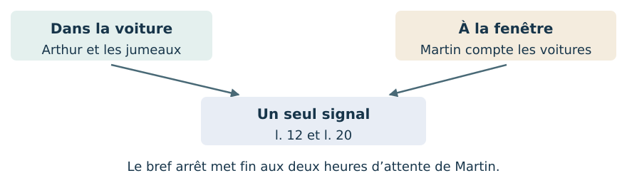

# BEL A/L — Allemand, commentaire et version 2025 · Corrigé guidé

*Corrigé rédigé par IA, non officiel. Signalez toute erreur.*

**Rédaction** · GPT-6.2 Astra Ultra · vitesse non renseignée · 26 novembre 2026

**Révision** · GPT-6.2 Astra Ultra · vitesse non renseignée · 26 novembre 2026

Daniel Kehlmann, *F* (2013). Commentaire des lignes 1–59 et version des lignes 13–27. Six heures, dictionnaire unilingue autorisé.

[Sujet officiel, p. 2–3](https://www.ens-lyon.fr/sites/default/files/2025-07/Commentaire%20et%20traduction.pdf#page=2) · [Rapport du jury, p. 2–16](https://www.ens-lyon.fr/sites/default/files/2025-11/Allemand%202025%20OK%20Lyon%20RELU.pdf#page=2)

## Entendre deux fois le même coup de klaxon

> [!INDICATION]
> Comparez les lignes 11–12 et 20. Combien de voitures attendues par Martin se sont arrêtées devant chez lui ? Entre les deux mentions d’un même signal, qu’a-t-on appris que les passagers ignorent ?

L’ouverture regarde en arrière depuis l’âge adulte des fils. Elle annonce leurs malheurs sans en donner la cause et souligne qu’aucun d’eux ne se rappelle à qui l’on doit cette sortie. À l’intérieur de ce cadre, le récit passe de l’habitacle animé à la fenêtre de Martin. Refaites la phrase interrogative de la ligne 17 en ajoutant « pensa Martin ». Puis retirez l’incise. Cette petite expérience fait sentir la proximité entre le récit à la troisième personne et la voix intérieure du garçon.

### Montrer ce que les dédoublements font au récit

Le signal entendu deux fois permet de mesurer le temps de deux côtés de la vitre. Dans l’habitacle, on a parlé de tout avec Arthur. De l’autre côté, Martin efface la buée et recommence. Quand il court, l’évocation de sa mère ouvre pourtant dans cette course une parenthèse de quatorze ans. Un commentaire peut ainsi changer d’échelle au lieu de dresser un inventaire des répétitions.

À la ligne 35, distinguez le garçon qui a pris place sur le siège passager et le double qu’il s’imagine encore sur l’asphalte. Ses deux demi-frères sont physiquement présents à l’arrière. Cette différence rend possible le rapprochement littéraire entre les deux sortes de jumeaux. Pour Martin, les deux issues coexistent un instant. Les autres demandent ensuite si prévoir la réalisation d’une issue et la vouloir ont les mêmes implications. Le second « Mon Dieu » d’Arthur et sa réponse péremptoire sur Dieu font entendre le déplacement de la parole. À la fin, le tiret qui suspend le récit scolaire donne la mesure du peu de temps accordé à Martin.

### Conserver l’attente et la géographie dans la version

Les plus-que-parfaits du premier paragraphe remontent en deçà du premier signal donné par Arthur. La question de la ligne 17 et les groupes sans verbe de la ligne 18 font entendre les attentes déçues. Gardez les reprises et le singulier indéfini dans la phrase isolée. Une voiture se détache d’abord de toutes les autres avant que Martin rejoigne son père. *Die Scheibe* et *das Glas* désignent une seule vitre. Les visages que le garçon dessine ont des expressions différentes, et la buée est produite chaque fois par son souffle.

Dans le dernier paragraphe, *vorbei an* régit le datif et décrit le dépassement d’un point de repère. *In das Zimmer* prend l’accusatif à l’intérieur de la relative parce que la mère est entrée dans cette chambre. C’est elle qui s’y retire et c’est Martin qui passe devant. Le garçon descend ensuite l’escalier, parcourt un second couloir et traverse la chaussée. Une voiture approche à vive allure, puis il est assis dans celle de son père. Le texte juxtapose les deux instants. *Schon* et *jetzt erst* règlent très précisément le décalage entre le salut acquis et sa perception corporelle.

## Commentaire en allemand

Zweimal hupen genügt, und schon fliegt eine Haustür auf. Wer mit Arthur und den Zwillingen ankommt, hat auf niemanden warten müssen. Für den Jungen hinter der Tür endet mit dem Signal eine Wartezeit von zwei Stunden. Mit einem Wechsel des Blickpunkts macht Daniel Kehlmann im Eingang seines Romans »F« (2013) eine Asymmetrie zwischen Angehörigen derselben Familie erfahrbar. Wie kann die Erzählung einer beinahe tödlichen Straßenüberquerung zeigen, was es für Martin heißt, in das Auto seines Vaters aufgenommen zu werden?

Schon der erste Satz überspringt die bevorstehende Fahrt. Die drei Söhne werden erwachsen sein und jeder wird sein eigenes Unglück kennen, doch keiner wird sich erinnern, wer den Besuch beim Hypnotiseur vorgeschlagen hat (Z. 1–3). Die Rückschau verspricht Wissen über die Zukunft und räumt zugleich eine Wissenslücke ein. Im nächsten Absatz zählt der Erzähler überaus nüchtern auf, womit sich der Vater 1984 beschäftigt. Arthurs Romane finden keinen Verleger, seine Frau verdient den Lebensunterhalt. Im Auto dagegen begegnet er den Dreizehnjährigen als müheloser Gesprächspartner. Nietzsche und Kaugummi stehen in derselben Aufzählung, ein erlösender Roboter und die Kräfte zweier Superhelden beschäftigen die Mitfahrenden gleichermaßen (Z. 4–12). Durch den gemeinsamen Rhythmus dieser Überlegungen ist der Wagen schon ein kleiner sozialer Raum, ehe er vor Martins Haus hält.

Die Erzählung holt die Zeit nach, die für den ältesten Sohn vergangen ist. Auf der Fensterscheibe zeichnet und verwischt er Gesichter. Sobald sie wieder blank ist, beschlägt sie von neuem. Die Wiederholungen im Satz machen diesen Kreislauf auch nach dem letzten Wisch noch hörbar. Zur tickenden Uhr kommt eine ungeduldige Frage, für die es keine Redeeinleitung braucht (Z. 13–19). Das doppelte Hupen verbindet die beiden Perspektiven. Der Vater drückt auf die Hupe, für Martin hingegen hält zunächst nur »ein Auto«. Die Blicke treffen bereits hier nicht unmittelbar aufeinander. Auf dem Weg hinaus läuft Martin auch an der Zimmertür seiner Mutter vorbei. Für einen Satz bekommt die Trennung der Eltern ihre eigene Zeit. Vierzehn Jahre sind verstrichen, und noch immer schmerzt die Mutter, wie leicht Arthur ohne sie auskommt.

Die Erzählung beschleunigt sich mit Martins Schritten. Als die Bremsen neben ihm quietschen, findet ihn der Leser einen Teilsatz später auf dem Beifahrersitz. Erst dort setzt der Herzschlag aus (Z. 24–27). Im Bewusstsein des Jungen sind nun ausgerechnet zwei Orte zugleich besetzt. Er fühlt sich im Wagen sitzen und sieht sich noch auf dem Asphalt liegen. Für einen Augenblick hat auch derjenige einen Zwilling, der bis dahin als Einzelner einem eingespielten Paar gegenüberstand. Dieser mögliche Bruder verblasst, während die wirklichen Brüder den Vorfall auf der Rückbank besprechen (Z. 34–46). Sie fragen auf einmal recht genau, ob Gottes Vorwissen dasselbe sei wie eine Verfügung über den Ausgang. Was für Martin eine körperliche Erfahrung zweier Möglichkeiten war, wird im Gespräch zu einem logischen Problem.

Arthur hat seinen Schrecken zweimal im selben Ausruf hören lassen. Auf die theologische Frage, in die seine Söhne diesen Schrecken übersetzen, antwortet er mit der knappen Behauptung, Gott existiere nicht. Der Motor springt an, der normale Herzschlag kehrt zurück. Schließlich erkundigt sich der Vater sogar nach der Schule. Doch wie kostbar seine Aufmerksamkeit ist, verrät das Tempo, mit dem Martin zu antworten versucht. Mitten im Satz über die Experimente wendet sich Arthur an Iwan und erkundigt sich nach den Eintrittskarten (Z. 48–59). Der Junge hat die Straße überquert und sitzt gleich neben dem Vater. Gerade darum tritt der Abstand zwischen beiden am Ende so deutlich hervor. Vom Warten vor der Scheibe bis zum abgebrochenen Satz gilt Martins Anstrengung einer Zuwendung, über deren Dauer er nicht verfügen kann.

## Version française

Martin, son fils aîné, avait passé les deux heures précédentes assis à la fenêtre à les attendre, pris de vertige à force d’impatience et d’ennui. Son haleine avait embué la vitre, il y avait dessiné du bout du doigt des visages, les uns graves, d’autres rieurs, d’autres encore la bouche grande ouverte. Sans cesse il avait essuyé la vitre jusqu’à la rendre parfaitement claire, puis regardé son souffle y déposer une brume légère. La pendule au mur avait fait tic-tac, tic-tac, qu’est-ce qui prenait tant de temps ? Encore une voiture, encore une autre que la leur, encore une, et eux, toujours pas.

Et soudain une voiture s’arrêta et donna deux coups de klaxon.

Martin se précipita dans le couloir, passa devant la chambre où sa mère s’était retirée pour ne pas avoir à voir Arthur. Quatorze ans s’étaient écoulés depuis qu’il avait disparu de sa vie en un rien de temps et avec désinvolture, mais elle souffrait toujours à l’idée qu’il puisse vivre sans avoir besoin d’elle. Martin dévala les marches, parcourut le couloir du bas, se rua dehors et traversa la rue, si vite qu’il ne vit pas la voiture qui fonçait vers lui. Des freins crissèrent tout près de lui, mais il était déjà assis sur le siège passager, les mains jointes au-dessus de la tête, et ce fut seulement alors que son cœur cessa de battre un instant.
