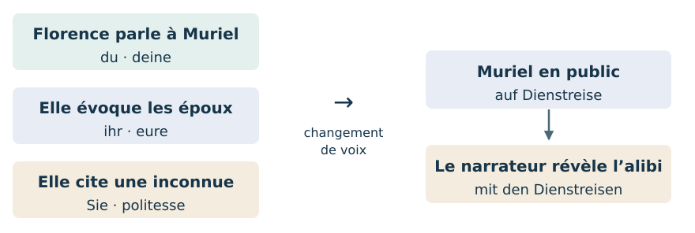

# BEL A/L — Allemand (thème, Lyon) 2025 · Corrigé brut

*Corrigé rédigé par IA, non officiel. Signalez toute erreur.*

**Rédaction** · GPT-6.2 Astra Ultra · vitesse non renseignée · 26 novembre 2026

**Révision** · GPT-6.2 Astra Ultra · vitesse non renseignée · 26 novembre 2026

Dominique Barbéris, *L’année de l’Éducation sentimentale* (2018). Thème de quatre heures, sans dictionnaire.

[Sujet officiel, p. 10](https://www.ens-lyon.fr/sites/default/files/2025-09/251113.pdf#page=10) · [Rapport du jury, p. 17–27](https://www.ens-lyon.fr/sites/default/files/2025-11/Allemand%202025%20OK%20Lyon%20RELU.pdf#page=17)

## Proposition de thème

»Weißt du, Muriel, an deine Hochzeit erinnere ich mich noch ganz genau«, sagte Florence und streckte sich. »Ihr hattet an alle Fenster des Saals kleine Lichter gehängt. Das sah so hübsch aus! Ich sehe dich und Jean-Louis noch vor mir, an eurem Hochzeitstag. Ihr wart wunderschön. Abends fing es an zu regnen, ein feiner Regen, so ein herrlich leichter Regen, ich bin nach draußen gegangen. Im Park standen große runde Laternen und diese Bäume mit den dunklen Blättern, dunkel wie gewachste Möbel. Magnolien, Tulpenbäume. Ich hatte mit einem deiner Cousins getanzt, einem Mann aus dem Vertrieb. Als ich ging, kamen gleichzeitig mit mir noch andere Leute heraus. Die Frau spannte gerade ihren Schirm auf, sie hatte ein rotes Kleid an. Ich werde sie immer vor mir sehen, diese dicke Frau in Rot, die mich gefragt hat: ›Zu welcher Seite gehören Sie? Sind Sie mit dem Bräutigam befreundet oder mit der Braut?‹ Für sie schien das einen gewaltigen Unterschied zu machen. Sie wirkte richtig misstrauisch, als wäre ich bloß zum Essen da oder was weiß ich. ›Zu welcher Seite gehören Sie?‹«

»Das muss Tante Hélène gewesen sein«, sagte Muriel. »Das passt zu ihr.«

»Die ganze Clique war da, du hattest uns ja alle eingeladen, bis auf Pierre natürlich. Sonst hätte Irène sich geweigert zu kommen. Und du, Anne«, fuhr Florence fort, »du bist mit Éric gekommen. Bei der Hochzeit warst du mit ihm da. Er trug eine Fliege, zum allerersten Mal. Das war das letzte Mal, dass ich Éric gesehen habe, und das erste Mal im Anzug. Bekommen wir Jean-Louis heute Abend nicht zu sehen?«

»Nein«, sagte Muriel. »Heute Abend nicht. Er ist auf Dienstreise. Es tut ihm leid.«

Sie sah auf das Feld und biss sich auf die Lippe.

Jean-Louis war fortgegangen. Es war nicht das erste Mal. Er hatte sie schon mehrmals wegen anderer Frauen verlassen. Sie erzählte nichts davon. Niemand hatte je etwas erfahren. Anfangs kam er zurück, und mit der Zeit glätteten sich die Wogen. Sie zog den Kopf ein und wartete ab.

Sie griff zu allerlei Kniffen und ließ sich nichts anmerken. Mit den Dienstreisen und den Besprechungen redete sie sich heraus. Einzig ihrer Mutter hatte sie davon erzählt, und bei ihrer Mutter bestand keine Gefahr, dass sie so etwas weitererzählte.

