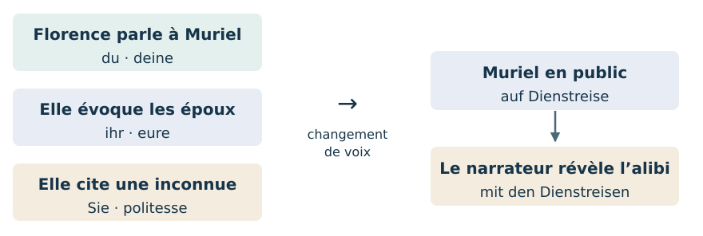

# BEL A/L — Allemand (thème, Lyon) 2025 · Corrigé guidé

*Corrigé rédigé par IA, non officiel. Signalez toute erreur.*

**Rédaction** · GPT-6.2 Astra Ultra · vitesse non renseignée · 26 novembre 2026

**Révision** · GPT-6.2 Astra Ultra · vitesse non renseignée · 26 novembre 2026

Dominique Barbéris, *L’année de l’Éducation sentimentale* (2018). Thème de quatre heures, sans dictionnaire.

[Sujet officiel, p. 10](https://www.ens-lyon.fr/sites/default/files/2025-09/251113.pdf#page=10) · [Rapport du jury, p. 17–27](https://www.ens-lyon.fr/sites/default/files/2025-11/Allemand%202025%20OK%20Lyon%20RELU.pdf#page=17)

Le rapport situe les retrouvailles de Florence, Anne et Muriel dans le jardin de Muriel. Le lecteur entend l’alibi avant d’en découvrir la raison.

## La fête racontée et le secret de Muriel

> [!INDICATION]
> À qui s’adresse chaque « vous » du dialogue ? Replacez mentalement les deux époux devant Florence, puis Florence devant l’inconnue en robe rouge. Le passage du pluriel familier à la politesse doit s’entendre.

### Organiser les voix

Florence tutoie Muriel quand elle parle de *deine Hochzeit*. Quand elle évoque les deux époux, *ihr hattet* et *an eurem Hochzeitstag* mettent le couple au pluriel. L’inconnue, en revanche, pose sa question à une seule personne qu’elle vouvoie. *Zu welcher Seite gehören Sie?* marque le changement, et les guillemets intérieurs ouvrent une citation à l’intérieur du souvenir. La seconde occurrence reprend les mêmes mots. Le rapport insiste sur ces changements de personne et sur la ponctuation du discours direct.

Les incises sont au passé du récit. La suite *sagte Florence und streckte sich* associe le geste de s’étirer à la réplique. La conversation mêle le parfait des expériences, des prétérits usuels comme *ihr wart* et le plus-que-parfait *ich hatte … getanzt* pour une danse antérieure au départ. *Als ich ging* renvoie à un départ unique.

### Les détails que Florence a retenus

*Lichter gehängt* retient l’image de lampes suspendues. *An alle Fenster* prend l’accusatif pour dire vers quels supports va le geste, comme le recommande le rapport. *Runde Laternen* et *Tulpenbäume* appartiennent au décor extérieur. Le cousin est un professionnel de la vente. Dans *mit einem deiner Cousins, einem Mann aus dem Vertrieb*, *mit* commande le datif et l’apposition reprend le cas de *einem*. Les répétitions sur la robe rouge reproduisent l’insistance de Florence.

Dans *als wäre ich bloß zum Essen da*, le Konjunktiv II indique le soupçon de l’inconnue. Florence rapporte l’accusation sans l’admettre. Une autre possibilité est *als hätte ich mich zum Essen eingeschlichen*, qui insiste davantage sur l’idée d’une intrusion. Pour l’absence de Pierre, *sonst hätte Irène sich geweigert zu kommen* exprime une conséquence qui ne s’est pas produite.

### Faire basculer le récit après la réponse de Muriel

Le nœud papillon d’Éric se dit *Fliege* en allemand. La phrase sur le costume superpose la dernière rencontre et la première vision d’Éric en tenue habillée. Le pronom de *er ist auf Dienstreise* vise ensuite Jean-Louis, le mari de Muriel. Son prénom est conservé, comme ceux de tous les convives.

Une fois les répliques closes, *sie sah … und biss sich auf die Lippe* revient au prétérit du narrateur. *Er hatte sie … verlassen* ouvre la série des séparations antérieures. *Sie zog den Kopf ein und wartete ab* traduit l’attitude de celle qui laisse passer les crises. Enfin *Dienstreisen* reprend le mot même dont elle s’est servie devant ses amies. Les réunions prolongent l’alibi. Les deux mentions de la mère distinguent la seule personne à qui Muriel s’est confiée et la certitude que cette confidence restera secrète.

## Proposition de thème

»Weißt du, Muriel, an deine Hochzeit erinnere ich mich noch ganz genau«, sagte Florence und streckte sich. »Ihr hattet an alle Fenster des Saals kleine Lichter gehängt. Das sah so hübsch aus! Ich sehe dich und Jean-Louis noch vor mir, an eurem Hochzeitstag. Ihr wart wunderschön. Abends fing es an zu regnen, ein feiner Regen, so ein herrlich leichter Regen, ich bin nach draußen gegangen. Im Park standen große runde Laternen und diese Bäume mit den dunklen Blättern, dunkel wie gewachste Möbel. Magnolien, Tulpenbäume. Ich hatte mit einem deiner Cousins getanzt, einem Mann aus dem Vertrieb. Als ich ging, kamen gleichzeitig mit mir noch andere Leute heraus. Die Frau spannte gerade ihren Schirm auf, sie hatte ein rotes Kleid an. Ich werde sie immer vor mir sehen, diese dicke Frau in Rot, die mich gefragt hat: ›Zu welcher Seite gehören Sie? Sind Sie mit dem Bräutigam befreundet oder mit der Braut?‹ Für sie schien das einen gewaltigen Unterschied zu machen. Sie wirkte richtig misstrauisch, als wäre ich bloß zum Essen da oder was weiß ich. ›Zu welcher Seite gehören Sie?‹«

»Das muss Tante Hélène gewesen sein«, sagte Muriel. »Das passt zu ihr.«

»Die ganze Clique war da, du hattest uns ja alle eingeladen, bis auf Pierre natürlich. Sonst hätte Irène sich geweigert zu kommen. Und du, Anne«, fuhr Florence fort, »du bist mit Éric gekommen. Bei der Hochzeit warst du mit ihm da. Er trug eine Fliege, zum allerersten Mal. Das war das letzte Mal, dass ich Éric gesehen habe, und das erste Mal im Anzug. Bekommen wir Jean-Louis heute Abend nicht zu sehen?«

»Nein«, sagte Muriel. »Heute Abend nicht. Er ist auf Dienstreise. Es tut ihm leid.«

Sie sah auf das Feld und biss sich auf die Lippe.

Jean-Louis war fortgegangen. Es war nicht das erste Mal. Er hatte sie schon mehrmals wegen anderer Frauen verlassen. Sie erzählte nichts davon. Niemand hatte je etwas erfahren. Anfangs kam er zurück, und mit der Zeit glätteten sich die Wogen. Sie zog den Kopf ein und wartete ab.

Sie griff zu allerlei Kniffen und ließ sich nichts anmerken. Mit den Dienstreisen und den Besprechungen redete sie sich heraus. Einzig ihrer Mutter hatte sie davon erzählt, und bei ihrer Mutter bestand keine Gefahr, dass sie so etwas weitererzählte.
