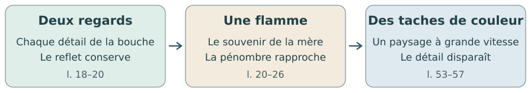

# BEL A/L — Anglais (commentaire et traduction) 2025 · Corrigé guidé

*Corrigé rédigé par IA, non officiel. Signalez toute erreur.*

**Rédaction** · GPT-6.2 Astra Ultra · vitesse non renseignée · 26 novembre 2026

**Révision** · GPT-6.2 Astra Ultra · vitesse non renseignée · 26 novembre 2026

Ray Bradbury, *Fahrenheit 451* (1953). Épreuve commune de six heures. Le commentaire porte sur les deux feuillets. La version commence ligne 14 et finit ligne 30.

[Sujet officiel, p. 4–5](https://www.ens-lyon.fr/sites/default/files/2025-07/Commentaire%20et%20traduction.pdf#page=4) · [Rapport du jury, p. 2–22](https://www.ens-lyon.fr/sites/default/files/2025-11/Anglais%202025%20RELU.pdf#page=2)

## Préparer les deux exercices

### Mesurer la rencontre à ses interruptions

> [!INDICATION]
> Comparer l’empressement avec lequel Montag demande l’âge de Clarisse, sa difficulté à comprendre son propre rire et sa dernière réaction à une observation très simple.

Montag sait répondre sur son métier et sur la loi. Lorsqu’on lui demande pourquoi il rit, il commence à rire de nouveau puis s’arrête. Ces interruptions de plus en plus visibles fournissent un argument sur la formation du doute. Un relevé des interrogations serait moins parlant si chacune se voyait attribuer la même fonction. Clarisse interroge d’abord un individu sur une peur collective, fait apparaître une autre histoire possible des pompiers, puis ramène la conversation à des choses qui se vérifient en regardant.

### Tenir ensemble deux sortes de feu

La lumière électrique suggère l’agitation. Le souvenir d’une bougie associe l’absence de courant à un temps partagé. L’image de l’ambre conserve un visage jusque dans ses plus petits détails. À l’autre bout de l’extrait, un automobiliste identifie une catégorie à partir d’une simple tache de couleur. Il y a là deux façons de voir, jusque dans le traitement du détail et de l’échelle par la prose. Les panneaux dix fois plus longs, la vitesse imposée et la télévision dite murale prolongent cette analyse. Le jury souligne la nécessité d’articuler les conventions dystopiques au détail du dialogue. La dernière ligne constate une longue inattention sans annoncer une conversion accomplie. [Commentaire du jury, p. 2–11](https://www.ens-lyon.fr/sites/default/files/2025-11/Anglais%202025%20RELU.pdf#page=2)

### Différencier les voix dans la version

On commence à la reprise de la marche, ligne 14. Le passé simple place le nouvel échange au premier plan. Le plus-que-parfait replace le souvenir de la mère en amont de la scène. Lorsque la voix se demande de quelle lumière il s’agit, la question surgit au sein de la narration focalisée sur Montag. La ponctuation peut suffire à faire entendre sa recherche. Les guillemets d’une réplique transformeraient cette hésitation intérieure en question posée à Clarisse. Le vouvoiement convient à la première rencontre de la jeune fille avec un adulte. Le jury accepte aussi une dissymétrie si Montag la tutoie.

### Traduire les images et l’accent de la dernière question

L’adjectif *violet* qualifie l’ambre. *Milk crystal* qualifie le cristal du visage par sa couleur et sa transparence, sans y ajouter une matière nouvelle. *Flattering* décrit l’effet de la lueur sur les traits. « Qui faisait doucement ressortir les traits à leur avantage » en expliciterait le sens. Dans le souvenir, la mère et le fils espèrent le retour tardif du courant, et l’espace rétréci leur offre un abri. Enfin, *How long* porte sur une activité qui se prolonge et appelle le présent en français. La dernière question doit rendre l’habitude éventuelle, le choix parmi les livres et l’insistance sur *read*. La réponse de Montag ouvre la ligne suivante et relève du commentaire seul. [Analyse de la version, p. 11–22](https://www.ens-lyon.fr/sites/default/files/2025-11/Anglais%202025%20RELU.pdf#page=11)

## Commentaire

A man and a girl exchange names and walk home. By the end of the extract from *Fahrenheit 451*, Guy Montag has been invited to look at the moon, and the narrative has given no assurance that he has even raised his eyes. Between these modest events lies an extraordinary displacement of authority. The fireman can state the law and point to the number on his sleeve. Clarisse can make him hesitate about what he knows of grass. How does Bradbury make a walk alter the conditions under which anything can be seen, remembered or said to be true?

### Walking at the pace of a question

Montag begins by asking two questions in quick succession. The girl takes the time to turn them over, and the narration stays with him long enough for us to feel him notice the delay. That slight interval anticipates her eventual criticism of his own instantaneous answers (ll. 41–45). From their first steps, perception has an awkward relation to established knowledge. The scent of soft fruit reaches him in a season when he considers it impossible. The reader apprehends the night through his senses before hearing his objection. Even the compound “warm-cool” (l. 4) makes it possible to feel two things that a tidy account might keep apart.

The formula by which Clarisse joins her youth to her supposed madness comes from her uncle. She too has inherited words, but she tries them out playfully and follows them with an account of what she likes to do. Walking occupies time that might otherwise have been filled in advance. When she says she is unafraid she discloses an expectation that the title *fireman* ought to arouse fear. Then she addresses a person whom the title cannot exhaust. The ordinary exchange by which two strangers become acquainted begins to prise the man away from his uniform.

### Two ways of producing light

The moment of recognition occurs through a remarkable change of scale. The fireman who might inspire fear becomes a minute, sharply delineated figure in another person’s eyes. The detail of the lines around his mouth retains his individuality even as his image shrinks. Water gives way to amber in a single comparison (ll. 18–20). A reflection that could vanish in an instant acquires the possibility of preservation. When his attention turns to her face, the search for a kind of light interrupts the syntax. The short internal question gives us time to experience a search of his own, between the dialogue partners’ audible questions.

Electricity suggests agitation to him, while the candle’s flame steadies the remembered room. The outage was once a technical failure. For a child and his mother, it made it possible to inhabit a smaller space together and even to wish the current would stay off a little longer. The mother’s act of lighting a candle gives fire a history of care that the fireman can retrieve without consulting official records. His profession claims to know what fire is for. His memory has just supplied a different answer by the time Clarisse asks about his reading.

Montag’s public language can make an argument feel superfluous. Poets’ names take their places in an alliterative weekday schedule, and the extra command about burning the ashes reduces annihilation to a verbal routine (ll. 31–34). The reader who hears a catchphrase where a literary work should have been has been put in a position to hear what the catchphrase excludes. Clarisse then approaches the history of his profession by way of hearsay and a question. Montag answers by invoking what houses have “always” been (l. 37). The duration of that adverb is much greater than the ten years of service on which he has just reported.

### What speed makes invisible

Laughter keeps arriving in place of an answer until Clarisse asks why he is laughing. For once he starts, stops, and finally stops walking as well. His next appeal to the number sewn on his uniform invites her to recognise a sign. Her apparent change of subject asks just what recognising a sign amounts to. From a speeding vehicle, a patch of green is enough to prompt the answer *grass*. It gives the driver no opportunity to see a blade of grass. Clarisse impersonates such a driver in a volley of confident colour identifications. For several beats her speech itself moves at the speed she is questioning.

The uncle’s punishment makes speed enforceable, while the billboards show a world materially rebuilt to suit it. A tenfold increase in their length allows the commercial message to last as long as before. No corresponding apparatus slows a driver down to look at a rose. The televised walls and organised entertainments that Clarisse generally avoids occupy both space and attention. For Montag the most disturbing claim comes when she leaves all that machinery behind. Dew appears without anyone organising or advertising it. His inability to remember whether he already knew of it introduces the first real gap into his certainty. The last sentence, in the past perfect, measures a long stretch of inattention by a single familiar sight. The encounter has achieved something quieter than a conversion. A man accustomed to giving answers now has a past omission to account for.

## Version

Ils reprirent leur marche en silence. Enfin, d’un air songeur, elle lui dit :

— Vous savez, je n’ai vraiment pas peur de vous.

Il en fut surpris.

— Pourquoi auriez-vous peur ?

— Tant de gens ont peur. Des pompiers, je veux dire. Mais après tout, vous n’êtes qu’un homme…

Il se vit dans ses yeux, en suspens dans deux gouttes d’eau claire et brillante. Il s’y voyait, sombre, minuscule, dans les moindres détails, avec les plis autour de sa bouche, tout y était, comme si les yeux de Clarisse étaient deux fragments miraculeux d’ambre violet, capables de le saisir et de le garder intact. Son visage, à présent tourné vers lui, était un fragile cristal laiteux où brillait une lumière douce et égale. Ce n’était pas la lumière affolée de l’électricité, mais… quoi donc ? Mais la lumière d’une bougie, cette lumière étrangement réconfortante, si rare, qui flattait les traits avec tant de douceur. Un jour, lorsqu’il était enfant, pendant une panne d’électricité, sa mère avait trouvé et allumé une dernière bougie. Ils avaient eu une petite heure pour tout redécouvrir, une heure d’une telle clarté que l’espace avait perdu son immensité et s’était resserré autour d’eux comme un abri, et tous deux, la mère et le fils, seuls, s’en étaient trouvés transformés, espérant que le courant ne reviendrait pas trop vite…

Puis Clarisse McClellan dit :

— Je peux vous poser une question ? Depuis combien de temps êtes-vous pompier ?

— Depuis mes vingt ans. Ça fait dix ans.

— Et parmi les livres que vous brûlez, est-ce qu’il vous arrive d’en *lire* ?
