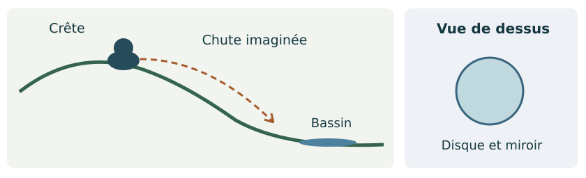

# BEL A/L — Anglais (thème, Lyon) 2025 · Corrigé brut

*Corrigé rédigé par IA, non officiel. Signalez toute erreur.*

**Rédaction** · GPT-6.2 Astra Ultra · vitesse non renseignée · 26 novembre 2026

**Révision** · GPT-6.2 Astra Ultra · vitesse non renseignée · 26 novembre 2026

Philippe Forest, *Je reste roi de mes chagrins* (2019). Thème de quatre heures, sans dictionnaire.

[Sujet officiel, p. 11](https://www.ens-lyon.fr/sites/default/files/2025-09/251113.pdf#page=11) · [Rapport du jury, p. 23–29](https://www.ens-lyon.fr/sites/default/files/2025-11/Anglais%202025%20RELU.pdf#page=23)

## Proposition de thème

His face is out of sight. It could be anybody. The photograph shows him from behind, enormously round, bundled into a thick coat, his hat on his head. A ball at rest. He is sitting on a rock, one stone laid upon another.

Lost in thought, the man is gazing at an English country scene. Before him the faultlessly mown lawn stretches as far as the eye can see. Further off are the few hills on which several trees stand, older even than the man looking at them, though he himself is now drawing towards the end of his life. Down below, at his feet, before his very eyes, at the foot of the slope on whose crest he sits and down which he looks about to hurtle, rolling with nothing to stop him, the perfect disc of an ornamental pool stands out. It has the look of a round mirror lying flat on the ground, its surface reflecting the sky.

Perhaps that day he did not bring his canvas, his easel, his brushes and his paints. Perhaps he is waiting for someone to bring them to him so that he can start work. At any rate they are nowhere in sight in the photograph. For now the man is probably tired of painting. But he is not tired of looking. In his mind he is composing his next picture. He has already painted several times that little stretch of water he is making for and on which his thoughts now dwell. So many times. This has been going on for years! So much so that his absurd attachment to this picturesque corner of the landscape, tucked away somewhere on the great estate he owns, has become a standing joke among those around him. They have made a tale of it, one that is told and will go on being told for years to come to visitors who make the pilgrimage to this spot to hear it.

Yet, oddly enough, the artist feels he has not finished with it yet. It is not that he is displeased with what he has painted so far. If anything, in all he does he has a reputation for being well pleased with himself. Modesty is hardly his strong point. Whatever he sets his hand to, and however modest his success may sometimes be, he will seldom admit that he has made a hash of it. His regrets, his remorse — he has long been in the habit of keeping them to himself.

