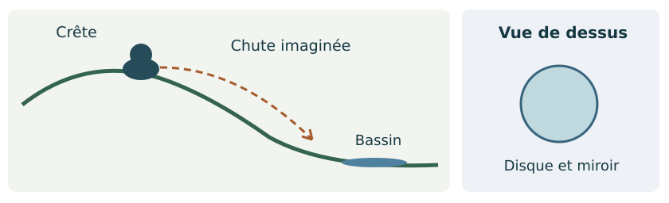

# BEL A/L — Anglais (thème, Lyon) 2025 · Corrigé guidé

*Corrigé rédigé par IA, non officiel. Signalez toute erreur.*

**Rédaction** · GPT-6.2 Astra Ultra · vitesse non renseignée · 26 novembre 2026

**Révision** · GPT-6.2 Astra Ultra · vitesse non renseignée · 26 novembre 2026

Philippe Forest, *Je reste roi de mes chagrins* (2019). Thème de quatre heures, sans dictionnaire.

[Sujet officiel, p. 11](https://www.ens-lyon.fr/sites/default/files/2025-09/251113.pdf#page=11) · [Rapport du jury, p. 23–29](https://www.ens-lyon.fr/sites/default/files/2025-11/Anglais%202025%20RELU.pdf#page=23)

Le sujet date l’œuvre de 2019. Le jury cite l’édition Folio de 2024 et replace le passage dans le récit du portrait de Churchill par Graham Sutherland.

## Décrire ce que la photographie laisse voir

### Installer l’anonymat

> [!INDICATION]
> Cacher un moment le nom du roman et le contexte du rapport. Quels éléments du premier paragraphe suffisent à composer une silhouette sans lui donner d’identité ?

Le corps dessine une boule, puis une pierre sur une autre pierre. Une proposition complète pour le rocher suivie de *one stone laid upon another* garde la différence entre *rock* et *stone*. Le fragment *A ball at rest* suspend la syntaxe comme la silhouette immobile. *A motionless ball* resserrerait encore le rythme. *His face is out of sight* fait porter la première phrase sur ce qui échappe à l’image. *You cannot see his face* placerait le spectateur au premier plan. Le rapport situe le livre autour de Churchill, mais aucun nom propre n’apparaît dans l’extrait à traduire.

### Placer le bassin dans le champ

La deuxième phrase descriptive empile des repères de hauteur et de distance avant de livrer son sujet. On peut retenir la figure par trois points, la crête, le corps, le bassin. Le groupe *down which he looks about to hurtle* prête au personnage une chute virtuelle sans le faire bouger. *Rolling with nothing to stop him* prolonge la forme ronde du début. Ensuite, le reflet du ciel appartient à l’image du miroir. Avec *its surface reflecting the sky*, la comparaison ouverte par *has the look of* porte sur tout le groupe. Reprendre *would* pour chaque conditionnel donnerait au reflet une valeur d’événement futur.

### Choisir l’aspect et le matériel du peintre

*Is gazing*, *is waiting* et *is composing* cadrent un geste ou une pensée dans son déroulement. Les arbres *stand*, le domaine est celui qu’il *owns*. Pour le matériel, *canvas*, *easel*, *brushes* et *paints* occupent quatre places distinctes. *Perhaps … he did not bring* rapporte une hypothèse à ce jour-là, puis *Perhaps he is waiting* revient au moment que l’image fixe. *Perhaps he had left his painting things behind* serait grammatical, mais résumerait abusivement les quatre objets. *Tired of painting* puis *not tired of looking* maintient la distinction entre l’activité qu’il suspend et celle qu’il continue.

### Passer de son regard à la parole des autres

Une œuvre déjà produite peut encore retenir son attention. *He has already painted* inscrit les tableaux passés dans la situation présente. Les deux fragments de relance font passer de *several times* au sentiment d’une répétition interminable. Pour la plaisanterie, *a standing joke among those around him* conserve le public restreint avant l’élargissement aux visiteurs. *A running joke in his circle* conviendrait également. L’avenir des récits compte autant que leur présent, d’où *is told and will go on being told*. Le *on* de ces récits appartient à ceux qui racontent, alors que celui de l’ouverture pouvait désigner quiconque regarde la photographie.

### Écouter l’ironie du dernier paragraphe

*If anything* reprend l’explication que vient d’écarter le narrateur. Rejeter *rather* devant *pleased* risquerait de lui donner seulement le sens de « assez », quand le propos inverse le jugement sur l’artiste. *He has made a hash of it* transpose la familiarité de l’aveu en anglais britannique. *He has come up short* rendrait l’échec de façon plus retenue. *Regrets* accepte le pluriel, tandis que *remorse* fonctionne comme un nom massif. Les deux mots reviennent en tête de la dernière phrase. Le lecteur entend ainsi ce que l’homme a pris, depuis longtemps, l’habitude de taire.

## Proposition de thème

His face is out of sight. It could be anybody. The photograph shows him from behind, enormously round, bundled into a thick coat, his hat on his head. A ball at rest. He is sitting on a rock, one stone laid upon another.

Lost in thought, the man is gazing at an English country scene. Before him the faultlessly mown lawn stretches as far as the eye can see. Further off are the few hills on which several trees stand, older even than the man looking at them, though he himself is now drawing towards the end of his life. Down below, at his feet, before his very eyes, at the foot of the slope on whose crest he sits and down which he looks about to hurtle, rolling with nothing to stop him, the perfect disc of an ornamental pool stands out. It has the look of a round mirror lying flat on the ground, its surface reflecting the sky.

Perhaps that day he did not bring his canvas, his easel, his brushes and his paints. Perhaps he is waiting for someone to bring them to him so that he can start work. At any rate they are nowhere in sight in the photograph. For now the man is probably tired of painting. But he is not tired of looking. In his mind he is composing his next picture. He has already painted several times that little stretch of water he is making for and on which his thoughts now dwell. So many times. This has been going on for years! So much so that his absurd attachment to this picturesque corner of the landscape, tucked away somewhere on the great estate he owns, has become a standing joke among those around him. They have made a tale of it, one that is told and will go on being told for years to come to visitors who make the pilgrimage to this spot to hear it.

Yet, oddly enough, the artist feels he has not finished with it yet. It is not that he is displeased with what he has painted so far. If anything, in all he does he has a reputation for being well pleased with himself. Modesty is hardly his strong point. Whatever he sets his hand to, and however modest his success may sometimes be, he will seldom admit that he has made a hash of it. His regrets, his remorse — he has long been in the habit of keeping them to himself.
