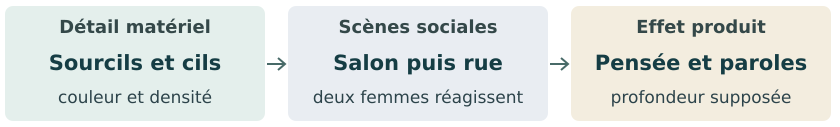

# BEL A/L — Arabe (thème, Lyon) 2025 · Corrigé brut

*Corrigé rédigé par IA, non officiel. Signalez toute erreur.*

**Rédaction** · GPT-6.2 Astra Ultra · vitesse non renseignée · 26 novembre 2026

**Révision** · GPT-6.2 Astra Ultra · vitesse non renseignée · 26 novembre 2026

Guy de Maupassant, *Une vie* (1883). Thème de l’ENS de Lyon, quatre heures. Le sujet de spécialité autorise l’usage d’un dictionnaire bilingue.

[Sujet officiel, p. 12](https://www.ens-lyon.fr/sites/default/files/2025-09/251113.pdf#page=12) · [Rapport du jury, p. 4](https://www.ens-lyon.fr/sites/default/files/2025-11/Arabe%202025%20OK%20Lyon%20RELU.pdf#page=4)

## Proposition de thème

انحنى الفيكونت، وأعرب للسيّدات عن رغبة قديمة في التعرّف إليهنّ، ثم أخذ يتحدّث في يُسر حديثَ رجل من أهل اللياقة خبِر الحياة. وكان له وجه من تلك الوجوه التي وُهبت حسن الطلعة، تحلم بها النساء ويضيق بها الرجال جميعًا. وكان شعره الأسود الأجعد يظلّل جبينه الأملس الأسمر، وفوق عينيه الداكنتين حاجبان كبيران منتظمان كأنّ يدًا رسمتهما، يضفيان عليهما عمقًا ورقّة. وكان بياض عينيه مشوبًا فيما يبدو بمسحة خفيفة من الزرقة.

وكانت أهدابه الكثيفة الطويلة تُكسب نظرته تلك البلاغة المشبوبة بالعاطفة التي تربك الحسناء المتعالية في الصالونات وتجعل الفتاة التي تعتمر قلنسوة وتحمل سلّة في الشوارع تلتفت وراءها.

وكان في فتور تلك العين سحر يوهم الناظر بعمق فكر صاحبها ويُضفي على أبسط كلماته شأنًا.

