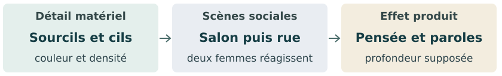

# BEL A/L — Arabe (thème, Lyon) 2025 · Corrigé guidé

*Corrigé rédigé par IA, non officiel. Signalez toute erreur.*

**Rédaction** · GPT-6.2 Astra Ultra · vitesse non renseignée · 26 novembre 2026

**Révision** · GPT-6.2 Astra Ultra · vitesse non renseignée · 26 novembre 2026

Guy de Maupassant, *Une vie* (1883). Thème de l’ENS de Lyon, quatre heures. Le sujet de spécialité autorise l’usage d’un dictionnaire bilingue.

[Sujet officiel, p. 12](https://www.ens-lyon.fr/sites/default/files/2025-09/251113.pdf#page=12) · [Rapport du jury, p. 4](https://www.ens-lyon.fr/sites/default/files/2025-11/Arabe%202025%20OK%20Lyon%20RELU.pdf#page=4)

## Distinguer ce qui se voit de ce que le regard suggère

> [!INDICATION]
> Classer trois traits de l’œil selon qu’ils touchent à sa couleur, à son expression ou à l’idée que le spectateur se fait du vicomte. À quel moment le portrait se met-il à décrire celui qui regarde ?

Le premier geste est une révérence. Le titre de vicomte est conservé sous sa forme d’emprunt pour situer la scène dans son milieu. L’homme sait se tenir et a de l’expérience. Pour le tour « ayant vécu », il suffit de faire entendre cette assurance dans la manière de converser. Selon le jury, Jeanne et sa mère rencontrent ici Julien de Lamare après la messe. Ces noms éclairent le contexte sans entrer dans la traduction d’un passage qui ne les prononce pas.

### Garder les contrastes sociaux et l’ironie du portrait

Les sourcils dessinent un cadre artificiellement régulier, tandis que le bleu très discret nuance le blanc de l’œil. « Ses cils serrés » appelle un mot de densité. L’éloquence passe singulièrement du discours à la physionomie. Elle trouble la dame dans un salon et fait se retourner une jeune fille coiffée d’un bonnet, son panier à la main, dans la rue. Le dernier paragraphe évoque l’impression de profondeur produite par la langueur du regard. La valeur de la pensée et celle des paroles dépendent de cette impression. Un verbe comme *يوحي* garde ouverte la distance entre la personne et son effet sur autrui.

Le duel aide à suivre le regard dans la longue phrase sur les yeux. *Ḥāǧibān* installe les deux sourcils comme sujet. Le verbe qui suit garde le duel et le pronom renvoie aux deux yeux sur lesquels ils agissent. Pour la couleur, on peut ensuite reprendre le nom et parler du « blanc de ses yeux ». Dans la dernière phrase, Maupassant revient au singulier. Ce changement permet de passer des traits du visage à la puissance d’un regard que les femmes interprètent.

## Proposition de thème

انحنى الفيكونت، وأعرب للسيّدات عن رغبة قديمة في التعرّف إليهنّ، ثم أخذ يتحدّث في يُسر حديثَ رجل من أهل اللياقة خبِر الحياة. وكان له وجه من تلك الوجوه التي وُهبت حسن الطلعة، تحلم بها النساء ويضيق بها الرجال جميعًا. وكان شعره الأسود الأجعد يظلّل جبينه الأملس الأسمر، وفوق عينيه الداكنتين حاجبان كبيران منتظمان كأنّ يدًا رسمتهما، يضفيان عليهما عمقًا ورقّة. وكان بياض عينيه مشوبًا فيما يبدو بمسحة خفيفة من الزرقة.

وكانت أهدابه الكثيفة الطويلة تُكسب نظرته تلك البلاغة المشبوبة بالعاطفة التي تربك الحسناء المتعالية في الصالونات وتجعل الفتاة التي تعتمر قلنسوة وتحمل سلّة في الشوارع تلتفت وراءها.

وكان في فتور تلك العين سحر يوهم الناظر بعمق فكر صاحبها ويُضفي على أبسط كلماته شأنًا.
