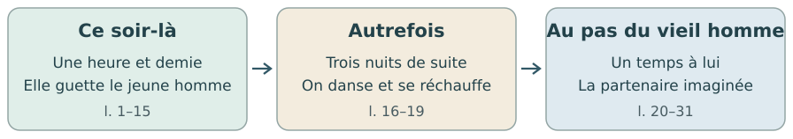

# BEL A/L — Chinois (commentaire et traduction) 2025 · Corrigé guidé

*Corrigé rédigé par IA, non officiel. Signalez toute erreur.*

**Rédaction** · GPT-6.2 Astra Ultra · vitesse non renseignée · 26 novembre 2026

**Révision** · GPT-6.2 Astra Ultra · vitesse non renseignée · 26 novembre 2026

Li Juan 李娟, « Le Bal au village » (乡村舞会), *Mon Altaï* (我的阿勒泰, 2010). Épreuve commune de six heures. Le commentaire porte sur les deux feuillets. La version commence ligne 16 et finit ligne 25.

[Sujet officiel, p. 8–9](https://www.ens-lyon.fr/sites/default/files/2025-07/Commentaire%20et%20traduction.pdf#page=8) · [Rapport du jury, p. 2–4](https://www.ens-lyon.fr/sites/default/files/2025-11/Chinois%202025%20OK%20Lyon%20RELU.pdf#page=2)

## Du souvenir collectif au danseur

> [!INDICATION]
> Comparer le temps passé à attendre sur le tas de bois et les trois nuits que durait le plaisir d’autrefois. Puis retrouver les deux occurrences du nom de la danse du cheval noir.

### Situer la voix qui raconte

Li Juan publie ce texte dans un recueil de 散文. L’épisode du vieux danseur naît d’une déception intime. Relier le départ pour se changer, l’attente, les invitations acceptées et la fascination finale pour un partenaire de danse invisible. Les mentions de l’Altaï, du clavier, de la dombra et des danses locales font entendre des pratiques qui coexistent dans une même cour. Le titre du recueil et sa date figurent au bas du second feuillet. [Rapport du jury, commentaire, p. 2 et 4](https://www.ens-lyon.fr/sites/default/files/2025-11/Chinois%202025%20OK%20Lyon%20RELU.pdf#page=4)

### Les pronoms et les temps des lignes 16 à 25

以往 introduit un souvenir répété. Le sujet de 说不清有多兴奋 est la narratrice ; le français peut ensuite passer au « on » du groupe réuni. 场场不缺 ramène le vieux danseur à chacune des fêtes, 而今夜 et 仍然 à cette soirée en particulier. 七八十岁 couvre approximativement deux âges. 大爷 est une appellation familière et respectueuse adressée à un homme plus âgé. Aucun lien de parenté avec la narratrice n’est donné.

### Regarder où se trouvent les corps

Dans 围在大炕上, les participants forment un cercle **sur** le grand lit chauffé. Dans 做鬼脸, le verbe et le nom constituent l’expression « faire des grimaces ». La dernière construction lie 再怎么 à 也 : l’amplitude du clavier peut croître à volonté, le danseur garde son rythme. Le nom 黑走马 désigne la danse et son air ; « Cheval noir à l’amble » rappelle l’allure de la monture. Arrêter la traduction là où le texte passe de cette indépendance musicale à la description du corps vieillissant. [Rapport du jury, version, p. 2–4](https://www.ens-lyon.fr/sites/default/files/2025-11/Chinois%202025%20OK%20Lyon%20RELU.pdf#page=2)

## Commentaire

### 换一条裙子，错过一个人

《乡村舞会》收在李娟二〇一〇年出版的散文集《我的阿勒泰》里。开头说“我”在舞会上认识了麦西拉，仿佛接下来应该看见两个人怎样跳起舞来。结果年轻人只在头两句里露了面，篇末独占舞场的却是个七八十岁的老头儿。一次没有等到人的约会怎么会引出这样一个人物？转折的关键在“我”的目光：它起初只顾打量自己，后来才有工夫看见别人的快乐，最后竟想到了一个人一生中最充盈的时光。

麦西拉的漂亮温和一笔写过，轮到自己的模样，“我”可看得仔细了：鞋脏，裤腿上沾着干面糊，外套还是干活穿的那件。晚饭和一天的活计都留在衣服上。姑娘着急得连问句也不等人回答，就跑回家去。接连两个“还”，叫读者数得出她洗脸、换裙子费的心；“亮晶晶”尤其传神，好像打扮停当后心里那点指望也在发光。等她跑回来，迎面恰是一句“他已经走了”。这场小小的失约甚至没有约定，对方还不知道她这一趟是为谁跑的，她也就不好意思问人。于是舞场突然有了中心和角落：琴声在人群中，她却坐在柴禾垛上等。

### 一个人的等待，两种夜里的时间

舞会十二点半开始，不知不觉已过了两点。这个算得颇准的钟点，把她等人的工夫写得格外长。院子里却没有什么停下来等她：唱歌的轮换，月亮舞、“黑走马”、交际舞一轮轮跳过，连迪斯科也开始了。报曲目似的排列，是用变化来计时，而麦西拉“就是不来”。她应邀起来跳的时候确实也想跳，因此笑着应邀；心里挂着一个人，于是快乐总差那么一点。两种心情都是真的，这才有了“为什么舍不得离开”的自问。

写到“以往这种时候”，眼前的一夜暂时让位给无数个从前的夜晚。累了便找暖屋，围坐在热炕上弹冬不拉、拉手风琴，唱唱喝喝，暖过来再去跳。短短几句一直不出现“我”，读来像是大家共用一个身体，累也一道累，暖也一道暖。三个通宵似乎也嫌短，正好对照今夜孤零零等过的那一个多钟头。“拖依”是地方叫法，作者顺手解释冬不拉是双弦琴。这些细节都有动作、有温度，读者先明白为什么这样的夜晚使人留恋，随后才看得懂今晚缺了什么。

### 跟着自己的调子

“而今夜似乎没什么不同”并未抹去这一夜的不同，那个“似乎”把相同之中一点没有看清的东西留到后面。阿提坎木大爷照例到场，照例受人欢呼。他一看谁谁就笑，五官拧得几乎能把眼睛鼻子调换过来。“我是说”像讲故事的人怕听众没有领会，忍不住凑过来补一句。到了舞步却生出奇怪的反差：四周的人跟着电子琴，他偏要半蹲着扭“黑走马”，自己大声哼，脚下只认自己的调。前面列曲目时已经跳过的老舞，此刻一直活在他身上。满院的声音越响，读者越听得清这一个人的拍子。

末段仍在跟着他的肩膀和手臂看，语气却慢了下来。“又像是”“好像”接连出现：他仿佛与往昔的人一同狂欢，又仿佛有个旁人看不见的舞伴。“我”能看清他步子一起一落，能看清老迈的身躯，却不能代他说出他依恋的究竟是谁。开头姑娘希望与一个看得见却已经离开的年轻人跳舞，结尾老人像在与一个谁也看不见却并未缺席的人共舞。最后那句问话把打量的目光变成了体贴的揣想。读者始终不知道麦西拉回来没有，散文却已经写出了这次等待使“我”得以看到的东西。

## Version

Autrefois, dans ces moments-là, je ne saurais dire à quel point j’étais excitée. Je trouvais le *tuoyi* tout bonnement merveilleux. Quelle animation, et comme on pouvait s’y faire remarquer ! Je passais mon temps à chanter, à danser. Quand le jeu nous avait bien fatigués, on allait se reposer un peu dans une pièce baignée d’une chaleur de fournaise, manger un morceau et boire un peu de thé. En cercle avec les autres sur le grand lit chauffé, on jouait de la dombra, ce luth à deux cordes, on tirait sur le soufflet de l’accordéon, on buvait un verre, on poussait la chansonnette. Une fois réchauffés, on ressortait danser. À ce train-là, on aurait pu passer trois nuits blanches d’affilée sans en avoir assez.

Et ce soir-là, rien ne semblait avoir changé. Le père Atikanmu, qui n’en manquait pas une, était venu comme toujours, et tout le monde l’acclamait. Qu’il était drôle, ce bonhomme de soixante-dix ou quatre-vingts ans ! Il n’arrêtait pas de faire des grimaces, se tordait la figure comme on l’aurait à peine cru possible — je veux dire que ses yeux et son nez auraient pu échanger leurs places. Il n’avait qu’à regarder quelqu’un pour que celui-ci se mette à rire malgré lui. Plus drôle encore, quelle que soit la musique, il se déhanchait, à demi accroupi, au pas de l’antique « Cheval noir à l’amble », et tout en dansant il en fredonnait l’air à tue-tête, « hou, hou, hou ! ». Et il ne réglait ses pas que sur le refrain qu’il fredonnait lui-même. La mélodie du clavier électrique avait beau résonner jusqu’au ciel, rien n’y faisait.
