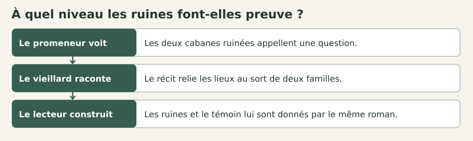
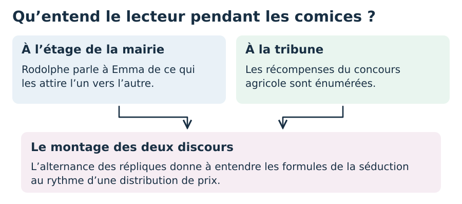

# BEL AL — Composition française 2025 · Corrigé brut

*Corrigé rédigé par IA, non officiel. Signalez toute erreur.*

**Rédaction** · Claude Opus 4.8 · effort non renseigné · vitesse non renseignée

**Révision (tour 1)** · GPT-6 · effort non renseigné · vitesse non renseignée

**Révision (tour 2)** · modèle exact non renseigné (famille GPT-6) · effort non renseigné · vitesse non renseignée

**Révision (tour 3)** · GPT-6.2 Astra Ultra · vitesse non renseignée

**Révision (tour 4)** · GPT-6.2 Astra Ultra · vitesse non renseignée

**Révision (tour 5)** · GPT-6.2 Astra Ultra · vitesse non renseignée · 26 novembre 2026

Sujet (session 2025, épreuve écrite du tronc commun de la Banque d'épreuves littéraires — ENS Paris-Saclay, ENS de Lyon, ENS Paris ; durée 6 heures, coefficient 3) : « Alors que le récit véridique a toujours l'appui, la ressource d'une évidence extérieure, le roman doit suffire à susciter ce dont il nous entretient. C'est pourquoi il est le domaine phénoménologique par excellence, le lieu par excellence où étudier de quelle façon la réalité nous apparaît ou peut nous apparaître ; c'est pourquoi le roman est le laboratoire du récit. » (Michel Butor, « Le roman comme recherche », 1955, dans *Essais sur le roman*, Paris, Gallimard, coll. « Tel », 1992, p. 9.) Vous discuterez cette proposition, en vous appuyant plus particulièrement sur les œuvres au programme.

[Sujet officiel, p. 1](https://www.ens.psl.eu/sites/default/files/2025_al_tronc_commun_francais.pdf#page=1) · [Rapport du jury, partie écrite, p. 1–12](https://www.ens.psl.eu/sites/default/files/2025_bel_rapport_ecrit_composition_francaise.pdf#page=1)

**Problématique** : comment le roman peut-il expérimenter les manières dont la réalité nous apparaît, alors qu’il dépend lui-même de formes de témoignage et d’expériences partagées ?

## Introduction

Lorsque Flaubert écrit, dans *Madame Bovary*, « Il se fit un bruit de pas sur le trottoir », il ne nous livre pas un fait vérifiable mais une sensation qui n'existe que par la phrase : le monde du roman n'a d'autre appui que les mots qui le font paraître. C'est cette autonomie que Michel Butor érige en principe dans « Le roman comme recherche ». Le critique y oppose deux régimes du récit. Le « récit véridique » — article de presse, témoignage, chronique historique — possède « l'appui, la ressource d'une évidence extérieure » : son objet existe hors de lui et peut être vérifié. Le roman, lui, « doit suffire à susciter ce dont il nous entretient » : il doit rendre présent par ses propres moyens un événement dont aucun témoin extérieur ne répond. De cette première opposition, Butor infère une conséquence au moyen du redoublement expressif de la locution « c'est pourquoi » : le roman serait « le domaine phénoménologique par excellence ».

Le terme demande à être pris au sérieux, et Butor le glose aussitôt : le roman est « le lieu par excellence où étudier de quelle façon la réalité nous apparaît ou peut nous apparaître ». *Phénoménologique* ne désigne donc pas le réel représenté, mais le *mode d'apparition* du réel à une conscience — la perception, le regard, la manière dont une chose se donne à un sujet. La gradation finale, du *domaine* au *lieu* puis au *laboratoire*, précise l'idée : le roman n'imite pas le réel, il expérimente les conditions dans lesquelles ce réel vient à paraître, et il rend cette expérimentation visible. Reste un mot ambigu : est « véridique » ce qui est fondé en existence, mais aussi ce qui est *dit vrai* ; et le « nous » de « nous apparaît » embrasse à la fois le romancier et son lecteur, « co-instance » l'un de l'autre. La frontière que Butor trace entre récit véridique et roman se révèle ainsi poreuse.

On se demandera dès lors **dans quelle mesure le roman, en faisant *apparaître* le réel au lieu de l'attester, se constitue en laboratoire du récit — et si cette vérité phénoménologique le coupe vraiment du régime véridique qui structure notre rapport au monde.**

Nous verrons d'abord que le roman est bien ce laboratoire où le réel ne se donne que comme phénomène perçu et travaillé par le style. Nous montrerons ensuite que cette fiction n'en demeure pas moins arrimée au « récit véridique », dont elle emprunte les dispositifs et dont elle prolonge la vérité sur le monde. Nous établirons enfin que le laboratoire n'opère pleinement que par l'engagement du lecteur, dont les rapprochements donnent un sens aux écarts ménagés par le récit.

## I. Le roman, laboratoire où le réel apparaît et se réfléchit

Dans les *Lettres portugaises*, la cinquième lettre annonce à l’officier que Mariane cessera de lui écrire. La preuve de la rupture pourrait être matérielle. Le portrait et les bracelets seront renvoyés, et Dona Brites veillera à l’expédition. Pourtant Mariane explique longuement au destinataire pourquoi elle ne mettra même pas son nom sur le paquet. Elle tient à ce qu’il mesure ce que lui coûte le geste. Cette page promise au silence fait encore une place à l’absent, puisqu’il importe toujours qu’il la lise. Où en est Mariane de son amour ? Le lecteur l’apprend dans l’écart entre ce que la lettre annonce et ce que son écriture accomplit. La succession des phrases fait éprouver une hésitation que le seul inventaire des objets renvoyés laisserait échapper.

Le paquet pourrait être renvoyé sans commentaire. Le fait d’en annoncer le retour à l’officier ouvre au contraire une nouvelle durée dans la relation. Le lecteur éprouve cette durée en lisant les phrases nécessaires à l’annonce de la rupture. Le roman produit ainsi son évidence par la forme même de l’acte raconté.

Chez Duras, Jacques Hold reconstruit la scène du bal de T. Beach auquel il n’a pas assisté. Il dépend du témoignage de Tatiana Karl et assume une part d’invention. Si l’on y cherchait la déposition d’un témoin unique, cette narration paraîtrait défectueuse. Mais ses hésitations déplacent la question. Que peut-on faire apparaître d’une expérience dont Lol ne fournit pas le récit complet ? Le lecteur suit ainsi la production d’une image du bal et peut distinguer ses sources sans prétendre accéder enfin à un événement délivré de toute médiation.

Chez Flaubert, la construction de la phrase suffit quelquefois à modifier l’ordre de la découverte. Dans la phrase « Il se fit un bruit de pas sur le trottoir », le passé simple *se fit* marque une survenue. Le pronom impersonnel laisse d’abord sans visage la personne qui marche. On entend quelque chose avant de pouvoir nommer quelqu’un. Cette brève expérience tient à l’ordre des mots et au choix du sujet grammatical. Elle invite à lire la description de Yonville, au seuil de la deuxième partie, avec la même attention. Décrire l’entrée dans le bourg, conduire le regard vers les bâtiments, prolonger la visite en donnant des renseignements au voyageur imaginaire, c’est régler le parcours qui nous fera connaître le lieu avant même l’arrivée des Bovary.

Le laboratoire romanesque est en outre un lieu de diffraction : un même objet y est éclairé par plusieurs regards, qui en révèlent la relativité. Dans *Paul et Virginie*, les objets-reliques ne prennent leur sens plénier qu'aux yeux de Paul ; chez Duras, la blancheur, le bal, le corps de Tatiana Karl changent de valeur selon le personnage qui les investit. Flaubert multiplie, lui, les portraits diffractés de Charles Bovary — à travers sa mère, son père, sa première épouse, puis Emma — selon un *decrescendo* qui fait paraître, dans la dévaluation progressive du personnage, sa dimension tragique. Ces variations déplacent l’image que le lecteur se forme de Charles. Elles n’abolissent pas les faits que l’intrigue établit ; elles changent le sens que ces faits prennent pour chacun.

Dans la deuxième partie de *Madame Bovary* (chapitre VIII), le dispositif des comices fait l’expérience d’une simultanéité. Les paroles de Rodolphe et les prix proclamés sur la place se succèdent pour le lecteur dans le temps même où les personnages les entendent retentir ensemble. Ce montage produit un jugement par rapprochement. Le redoublement du récit vient après, lorsque l’éloge publié par Homais recompose à sa façon le même événement. Le roman nous donne ainsi, pour un seul jour, deux façons de faire paraître la réalité. Nous pouvons éprouver ce que chacune retient et ce qu’elle efface.

## II. Un laboratoire qui n'abolit pas le « récit véridique »

Les ruines de deux cabanes apparaissent dès l’ouverture de *Paul et Virginie*. Le promeneur peut les voir, mais elles ne lui apprennent pas à elles seules qui y a vécu. Il faut qu’il pose la question au vieillard rencontré sur place et que ce dernier accepte de raconter l’histoire de ces « particuliers obscurs ». On aperçoit ici deux sens de l’« évidence extérieure ». Pour le promeneur, les ruines sont extérieures au récit qu’il va entendre ; pour le lecteur de Bernardin, les cabanes, la rencontre et la voix du vieillard sont produites ensemble par le roman. Ce qui sert de preuve à l’intérieur de la fiction n’authentifie donc pas pour nous les vies de Paul et de Virginie. Le livre tire de cette différence une expérience de lecture : nous dépendons d’une parole pour passer d’un site visible à une histoire singulière. Les *Lettres portugaises* déplacent autrement la frontière en présentant les cinq lettres comme des documents traduits, tandis que Jacques Hold, chez Duras, laisse paraître les limites de sa restitution.

Il en prolonge aussi la vocation : dire vrai sur le monde. Chacune des œuvres se présente, « peu ou prou », comme une étude — psychologique, anthropologique, sociale. Les *Lettres portugaises* explorent la mécanique de la passion amoureuse et dénoncent, en creux, le sort des femmes cloîtrées et les ravages des séducteurs ; *Madame Bovary* dissèque les mœurs de la province ; *Le Ravissement de Lol V. Stein* observe la haute société et les fantasmes pathologiques. Parce qu'une intrigue ne peut se nouer sans recourir aux logiques d'action qui ont cours dans le monde réel, le roman possède une authentique transitivité : il « nous guide […] dans la compréhension de ce que nous sommes », et peut à ce titre faire l'objet, comme le récit véridique, d'une évaluation à l'aune des faits.

Mais ce serait trahir Butor que d'en conclure à une adéquation du roman et du réel : la vérité romanesque est une vérité *médiée* par l'art. Flaubert récuse qu'on fasse de *Madame Bovary* une œuvre « réaliste » au sens plat, tant la stylisation y prime la copie. Maupassant le théorise dans la préface de *Pierre et Jean* : le réaliste « cherchera, non pas à nous montrer la photographie banale de la vie, mais à nous en donner la vision plus complète, plus saisissante, plus probante que la réalité même », en « mett[ant] en pleine lumière, par la seule adresse de la composition, les événements essentiels ». La vérité du roman n'est donc pas purement factuelle : elle n'acquiert son statut de vérité que dans un projet esthétique. Le réalisme de Butor est un « réalisme réflexif » : s'il emprunte au véridique, c'est pour mieux en exhiber les conditions, et faire paraître ce que le régime ordinaire du récit laisse inaperçu.

## III. Le laboratoire à l'épreuve du lecteur : l'avènement du sensible

Le « nous » de « nous apparaît » n'est pas une cheville : il fait du lecteur une instance constitutive. Butor l'affirme : « il a absolument besoin du lecteur […] comme complice de sa constitution, comme personne, intelligence, et regard ». Le réel ne « peut apparaître » — la modalisation par le verbe *pouvoir* ouvre un régime du possible — que si une lecture l'actualise. Or les œuvres mettent en abyme cette lecture. Bernardin de Saint-Pierre figure les réactions des lecteurs des lettres de Virginie ; Flaubert fait du danger de la lecture le ressort même de son roman, invitant à ne pas lire le réel « à la manière d'Emma », de façon sentimentale et naïve, lectrice romantique dupe de ses « rêveries touristiques » rendues dans une tradition pittoresque jusqu'au ridicule. Mariane, de son côté, devient lectrice d'elle-même : à mesure qu'elle déchiffre la trahison dont elle est « victime », elle renonce à son amour ; Giovanni Cacciavillani a montré la part masochiste de cette conscience qui préfère la douleur de l'absence à la paix de l'oubli. Le sens, chez Duras, se fait et se défait « sous nos yeux », dans une enquête à réécrire sans cesse.

La scène des comices de *Madame Bovary* permet de saisir cette activité du lecteur. Rodolphe s’est installé avec Emma à l’étage de la mairie. À mesure qu’il presse sa main et lui parle de la destinée qui les rapproche, les récompenses du concours agricole sont proclamées. Le texte fait alterner l’appel aux sentiments et l’attribution des prix, parfois d’une réplique à la suivante. Le narrateur envisage, au moment où Rodolphe lui serre la main, deux gestes possibles, se dégager ou répondre à la pression. Rodolphe choisit d’y lire un consentement. Le lecteur peut de son côté éprouver combien les formules de Rodolphe ressemblent dans leur mécanique au discours public. Aucun commentateur n’a besoin de qualifier sa sincérité. À la fin de la liste des prix lue par le président du jury, Catherine-Nicaise-Élisabeth Leroux reçoit une médaille d’argent d’une valeur de vingt-cinq francs pour cinquante-quatre ans dans la même ferme. Le conseiller de préfecture appelle la lauréate, puis Tuvache lui crie la durée du service, la nature et la valeur du prix. La récompense proclamée n’est pas encore une récompense comprise. Cette exactitude administrative contraste avec les mains que le récit donne à voir, raidies et marquées par le travail. Ce corps remet en question la cérémonie qui prétend lui rendre hommage. Le compte rendu qu’Homais fait paraître ensuite dans le *Fanal de Rouen* pourrait attester qu’une médaille a été distribuée. Il ne produirait pas la même discordance entre les voix, les gestes et le sens que le lecteur leur trouve.

Reste à nommer cette puissance. Le laboratoire romanesque ne décompose pas le réel pour le tenir à distance : il le rend plus intense, plus habitable. Proust, dans *Le Temps retrouvé*, en donne la formule la plus haute : « Grâce à l'art, au lieu de voir un seul monde, le nôtre, nous le voyons se multiplier, et autant qu'il y a d'artistes originaux, autant nous avons de mondes à notre disposition. » Le roman fait voir notre propre vie, que nous ne pouvons pas observer directement, et dont les apparences doivent être traduites et déchiffrées. Ainsi *Paul et Virginie* confine-t-il au « récit poétique » (Y. Charara) lorsque les tempêtes tropicales, loin d'être consignées comme des faits météorologiques, « élèvent l'âme malgré l'effroi » et font naître le sentiment d'une présence divine : « L'orbe de la lune, tout rouge, se levait, dans un horizon embrumé, d'une grandeur démesurée. » De même le blason quasi impressionniste par lequel Charles détaille les nuances de la peau d'Emma, ou le corps de Tatiana « amoureusement exploré » que Lol livre au lecteur, font-ils du phénomène perçu une révélation esthétique. Le laboratoire du récit n'est pas un froid dispositif d'analyse : c'est le lieu où la réalité, soustraite au régime ordinaire du véridique, nous est rendue dans un surcroît d'intensité sensible.

## Conclusion

La formule de Butor résiste à l'examen : le roman est bien le « domaine phénoménologique par excellence », non parce qu'il représenterait davantage de choses, mais parce qu’il peut faire varier les conditions dans lesquelles le réel apparaît, dans la subjectivité d'un regard et l'épaisseur d'une langue. Des *Lettres portugaises* à *Lol V. Stein*, les œuvres au programme ne nous donnent jamais une « évidence extérieure » : elles suscitent le monde qu'elles nous confient, et le soumettent à l'expérimentation du style. La citation n'est toutefois exacte qu'à condition de ne pas durcir l'opposition qu'elle pose : le roman emprunte au « récit véridique » ses dispositifs et sa vocation à dire vrai, et c'est précisément en retravaillant le véridique qu'il devient laboratoire. Son résultat n'est pas une vérité de fait, mais une vérité esthétique qui, par le détour de la fiction, rend le réel plus intense — à charge pour le lecteur, « co-instance » du romancier, d'en opérer l'actualisation.

Dès lors, peut-être la métaphore du laboratoire déborde-t-elle le seul genre romanesque : ce que Butor décrit est aussi un *registre*, une attitude devant le réel, refusant de le réduire à une perspective unique. C'est en cela que le roman, « fiction mimant la vérité », demeure ce que son titre annonçait — une *recherche*, toujours à reprendre.
