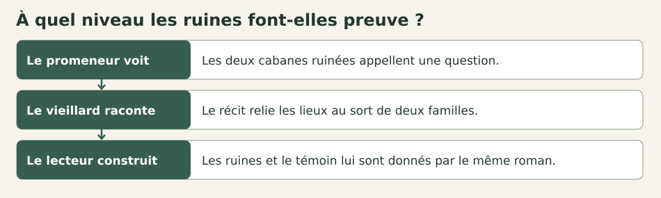
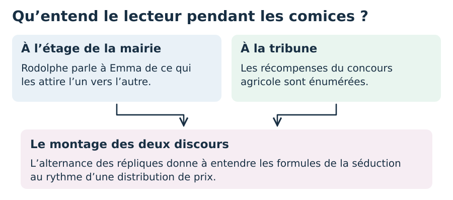

# BEL AL — Composition française 2025 · Corrigé guidé

*Corrigé rédigé par IA, non officiel. Signalez toute erreur.*

**Rédaction** · Claude Opus 4.8 · effort non renseigné · vitesse non renseignée

**Révision (tour 1)** · GPT-6 · effort non renseigné · vitesse non renseignée

**Révision (tour 2)** · modèle exact non renseigné (famille GPT-6) · effort non renseigné · vitesse non renseignée

**Révision (tour 3)** · GPT-6.2 Astra Ultra · vitesse non renseignée

**Révision (tour 4)** · GPT-6.2 Astra Ultra · vitesse non renseignée

**Révision (tour 5)** · GPT-6.2 Astra Ultra · vitesse non renseignée · 26 novembre 2026

## Présentation du sujet

**Nature de l'épreuve.** Composition française, épreuve écrite du tronc commun de la Banque d'épreuves littéraires (BEL — ENS Paris-Saclay, ENS de Lyon, ENS Paris), session 2025. Durée 6 heures, coefficient 3, sans calculatrice. Une citation à discuter, sans document, en s'appuyant « plus particulièrement sur les œuvres au programme » (les *Lettres portugaises* de Guilleragues, *Paul et Virginie* de Bernardin de Saint-Pierre, *Madame Bovary* de Flaubert, *Le Ravissement de Lol V. Stein* de Duras). Le sujet ne fixe pas de longueur.

**Le sujet.** « Alors que le récit véridique a toujours l'appui, la ressource d'une évidence extérieure, le roman doit suffire à susciter ce dont il nous entretient. C'est pourquoi il est le domaine phénoménologique par excellence, le lieu par excellence où étudier de quelle façon la réalité nous apparaît ou peut nous apparaître ; c'est pourquoi le roman est le laboratoire du récit. » (Michel Butor, « Le roman comme recherche », 1955, dans *Essais sur le roman*, Paris, Gallimard, coll. « Tel », 1992, p. 9.) Vous discuterez cette proposition, en vous appuyant plus particulièrement sur les œuvres au programme.

[Sujet officiel, p. 1](https://www.ens.psl.eu/sites/default/files/2025_al_tronc_commun_francais.pdf#page=1) · [Rapport du jury, partie écrite, p. 1–12](https://www.ens.psl.eu/sites/default/files/2025_bel_rapport_ecrit_composition_francaise.pdf#page=1)

**Le champ du sujet.** Le rapport précise : « Le sujet traitait explicitement du genre romanesque (axe 1, domaine 1). Il consistait à interroger le roman par rapport à des notions connexes telles que le récit (« véridique », en l'occurrence) ou (de façon à peine plus implicite) vis-à-vis de la fiction, mais encore, plus largement, à questionner les régimes de vérité ou de véracité d'un récit. » La citation croise en outre le domaine « L'œuvre littéraire et l'auteur », puisqu'elle ouvre sur le rôle de l'auteur dans les mécanismes de perception et de (re)présentation du réel.

**Résultats de la session 2025.** « La moyenne de l'épreuve de composition française a été cette année de 9,96 / 20, avec 15,44 % de notes égales ou supérieures à 14, les notes s'échelonnant de 0,5 / 20 à 20 / 20. Un peu moins de la moitié des copies (48,73 %) ont obtenu une note strictement inférieure à 10/20. » Coefficient 3 et forte dispersion : l'épreuve récompense la précision de l'analyse et la qualité de la langue.

**Ce que le rapport valorise.** Quatre leviers : (1) ne pas contourner l'adjectif « phénoménologique », qui est « l'obstacle central de la citation » ; (2) mobiliser l'ensemble du programme, « l'exclusion d'une œuvre […] est absolument à proscrire et […] très sévèrement sanctionnée par le jury » ; (3) prouver par des micro-analyses stylistiques plutôt que par un florilège de citations ; (4) une introduction avec amorce articulée et problématique simple, un plan non mécanique, une conclusion ferme, et une langue relue.

**Difficulté.** Le piège est double : d'une part la tentation de réduire « phénoménologique » aux choses, aux faits, aux personnages — « une majorité de candidats s'est contentée d'assimiler le « domaine phénoménologique » aux choses, aux faits, aux personnages qui peuplent et meublent les récits, voire aux événements » ; d'autre part le plan mécanique en trois parties calqué sur les trois propositions de la citation.

**Gestion du temps conseillée.** Environ 1 h d’analyse de la citation et de rappel des scènes au brouillon, 45 min de construction du plan et d'inventaire des exemples, 3 h 30 de rédaction au propre, et 45 min de relecture (citations, orthographe des noms propres, constructions).

## Partie I — Comprendre le sujet et le problématiser

Sources de la session et passages analysés. [Sujet officiel](https://www.ens.psl.eu/sites/default/files/2025_al_tronc_commun_francais.pdf) · [Rapport de l’écrit](https://www.ens.psl.eu/sites/default/files/2025_bel_rapport_ecrit_composition_francaise.pdf) · [Cinquième lettre de Mariane](https://fr.wikisource.org/wiki/Lettres_portugaises_traduites_en_fran%C3%A7ois/Texte_entier) · [Les comices, deuxième partie, chapitre VIII](https://fr.wikisource.org/wiki/Madame_Bovary/Deuxi%C3%A8me_partie/08)

### Étape 1 — Lire la citation dans sa structure

> [!INDICATION]
> La citation se construit en trois temps : une opposition, une conséquence introduite deux fois par « c'est pourquoi », une gradation. Ne les aplatissez pas : demandez-vous ce que chaque temps apporte de nouveau.

> [!INDICATION]
> Interrogez les mots pièges : « véridique » (fondé en existence, ou dit vrai ?), « nous » (qui parle ? le romancier, le lecteur ?), et la gradation « domaine » / « lieu » / « laboratoire ».

#### Solution

Premier temps : l'opposition entre le « récit véridique » — article de presse, témoignage, chronique — qui possède « l'appui, la ressource d'une évidence extérieure », et le roman, fiction qui « doit suffire à susciter ce dont il nous entretient ». Deuxième temps : la conséquence, introduite par le redoublement expressif de « c'est pourquoi » — la capacité de la fiction à faire apparaître son objet ouvre une enquête d’un autre ordre, « phénoménologique ». Troisième temps : la gradation « domaine phénoménologique par excellence », « lieu par excellence où étudier de quelle façon la réalité nous apparaît ou peut nous apparaître », « laboratoire du récit » — du constat à l'expérimentation. Le rapport invite à prêter attention au double sens de « véridique » : « ce qui est « véridique », n'est-ce pas aussi ce « qui est dit vrai », ce qui relève du régime discursif et des représentations ? La conception de Butor suppose aussi une interrogation sur l'instance d'énonciation ». Il souligne aussi « l'emploi du pronom personnel « nous », qui peut embrasser le romancier et le récepteur, chacun d'ailleurs apparaissant finalement comme une co-instance de l'autre », et la modalisation de « apparaître » par « pouvoir » (un régime du possible). Enfin, la métaphore du laboratoire invite à voir dans le roman un lieu où le récit est analysé, rendu visible : « le réalisme de Butor est un réalisme réflexif ».

### Étape 2 — Saisir l'obstacle central : le mot « phénoménologique »

> [!INDICATION]
> Butor glose lui-même l'adjectif dans la citation : partez de cette paraphrase interne (« de quelle façon la réalité nous apparaît ou peut nous apparaître ») avant toute importation philosophique.

> [!INDICATION]
> « Phénoménologique » ne désigne pas le réel représenté (les choses, les faits, les personnages), mais le mode d'apparition du réel à une conscience : perception, regard, subjectivation.

#### Solution

*Phénoménologique* renvoie ici non à l'objet, mais à la façon dont l'objet se donne : le roman saisit la réalité « en formation », au moment où elle advient à une conscience et à une langue. C'est ce que le rapport attend explicitement : « le jury pouvait raisonnablement s'attendre à ce que les candidates et candidats éclairassent l'adjectif à partir au moins de ce qu'en disait explicitement Butor, « le lieu par excellence où étudier de quelle façon la réalité nous apparaît ou peut nous apparaître » ». Et : « Il était important que la copie, à un moment de son développement, mît l'accent, de quelque manière que ce fût, sur les modalités de présence du réel dans l'espace romanesque, sur le caractère apparaissant, selon Butor, de ce réel en lien avec l'idée d'un genre romanesque soustrait au régime ordinaire de la représentation « véridique », sur la subjectivation, la perception, le regard, etc. »

> [!JURY]
> « Souvent, cette « méthode » était présente dans les copies de candidates et candidats qui ont refusé de sauter ce qui est finalement apparu comme l'obstacle central de la citation : la dimension « phénoménologique », selon Butor, de la (re)présentation propre au genre romanesque. »

La phrase de *Madame Bovary* sur le bruit de pas est au passé simple. L’imparfait étudié à la même page du rapport appartient à *L’Éducation sentimentale*, dans un autre exemple sur Mlle Marthe. Distinguer les deux passages évite d’attribuer au temps verbal l’effet produit ici par l’apparition d’un bruit avant l’identification de sa cause. [Rapport, p. 5](https://www.ens.psl.eu/sites/default/files/2025_bel_rapport_ecrit_composition_francaise.pdf#page=5) · [Bernardin de Saint-Pierre, ouverture de *Paul et Virginie*](https://fr.wikisource.org/wiki/Paul_et_Virginie/Texte_entier)

### Étape 3 — Construire une problématique

> [!INDICATION]
> La problématique naît de la tension entre les deux régimes : le roman fait apparaître le réel par les mots. À qui le pronom « nous » attribue-t-il cette expérience ? Et cette vérité phénoménologique coupe-t-elle vraiment le roman du véridique ?

> [!INDICATION]
> Une seule question, simple et directe, vaut mieux qu'une liste de questions en cascade. Formulez-la après avoir défini les termes, pas avant.

#### Solution

**Problématique retenue** : comment le roman peut-il expérimenter les manières dont la réalité nous apparaît, alors qu’il dépend lui-même de formes de témoignage et d’expériences partagées ?

Elle articule le verbe *apparaître* (contre *attester*), le sujet (le roman comme genre), et la seconde question qui ouvre la discussion (le rapport au « récit véridique » n'est pas aboli, il est retravaillé).

> [!JURY]
> « Les problématiques à rallonge (sous la forme de plusieurs questions, plus ou moins courtes, ou de phrases excessivement longues, denses et sophistiquées) ne trompent personne […] Mieux vaut être simple, direct et clair, au risque de paraître un peu fruste – pour commencer et monter en puissance – que laborieux, exhaustif, alambiqué, mais peu intelligible. » Et : « tout n'est pas joué, loin de là, dès l'introduction ».

## Partie II — Construire le plan et mobiliser le corpus

### Étape 4 — Choisir un plan

> [!INDICATION]
> Un plan dialectique fonctionne très bien ici (laboratoire phénoménologique / mais arrimage au véridique / dépassement), à condition que la troisième partie apporte un gain réel.

> [!INDICATION]
> Ne calquez pas mécaniquement les trois propositions de la citation sur trois parties : chaque partie doit répondre à la problématique, pas au découpage du texte cité.

#### Solution

Plan retenu, en trois parties : **I.** le roman, laboratoire où le réel apparaît et se réfléchit (advenue du phénomène par le langage, variation des points de vue, montage des comices et réécriture par Homais) ; **II.** un laboratoire qui n'abolit pas le « récit véridique » (dispositifs énonciatifs testimonials, vérité sur le monde, requalification en vérité esthétique) ; **III.** le laboratoire à l'épreuve du lecteur (le « nous » comme co-instance, médiation des choses sensibles, effet romanesque).

> [!JURY]
> « Le jury rappelle toutefois que d'autres types de plans pouvaient naturellement être adoptés – même si, bien évidemment, le plan dialectique « fonctionnait » très bien. Cela étant dit, on ne saurait trop insister sur le fait qu'il est dommageable d'adopter un plan dialectique quand la troisième partie s'avère creuse ou, pire, consiste simplement à reformuler les deux premières parties (ou l'une de ces parties) en nuançant quelque peu, voire en contredisant outrancièrement ce qui a été précédemment développé ! »

> [!PIEGE]
> « Ne sont pas plus acceptables les développements fondés sur le « découpage » du texte de la citation en trois temps faisant chacun l'objet, de façon très mécanique, d'une partie de plan. Une telle démarche n'est pas conforme à l'esprit de la composition française. » De même, évitez la troisième partie « simpliste » : « Beaucoup de « troisièmes parties » reposaient par ailleurs sur une proposition aussi simpliste que discutable, « reprochant » (!) à Butor de ne pas considérer la littérature comme un plaisir et un divertissement ».

### Étape 5 — Mobiliser les quatre œuvres et un corpus personnel

> [!INDICATION]
> Chaque œuvre au programme doit être citée précisément et mise à profit selon les enjeux du sujet — y compris la plus courte. Ne sacrifiez aucune des quatre.

> [!INDICATION]
> Privilégiez la micro-analyse d'un détail stylistique fidèle au texte plutôt que l'accumulation de citations approximatives ; un corpus personnel (critique, Proust) est apprécié s'il sert la démonstration.

#### Solution

Les quatre œuvres du programme interviennent à des moments différents du raisonnement : les *Lettres portugaises* (la passion qui advient à elle-même par l'écriture épistolaire, la « fiction du non-fictif » de l'« Au lecteur »), *Paul et Virginie* (le narrateur témoin du vieillard, les « paysages-états d'âme », le ciel comme espace de révélation), *Madame Bovary* (le passé simple impersonnel « Il se fit un bruit de pas », la description de Yonville, la casquette de Charles, la scène des comices, le danger de la lecture chez Emma), *Le Ravissement de Lol V. Stein* (le narrateur qui « invente », l'enquête, le bal de T. Beach). S'y ajoutent des références critiques (Killeen, Philippe, Rousset, Charara, Gosselin, Cacciavillani) et Proust pour penser la littérature comme vie « éclaircie ».

> [!JURY]
> « Il n'y a pas, de ce point de vue, de règle quantitative « objective » – si ce n'est que l'exclusion d'une œuvre, insistons sur ce point, est absolument à proscrire et qu'elle est très sévèrement sanctionnée par le jury. » Le rapport déplore aussi un déséquilibre : « le jury a été surpris cette année par la sous-représentation des références aux Lettres portugaises dans les copies. Précisons en passant qu'indépendamment du problème de l'ancrage historique, une œuvre courte n'est pas moins importante pour l'argumentation qu'une somme de plusieurs centaines de pages. »

> [!JURY]
> « Enchaîner les noms d'auteurs, les titres d'œuvres, les citations du programme ou de hors-programme comme les références critiques ne s'appelle pas « démontrer » : trop de candidats récitent encore des fiches de citations (pas toujours bien restituées ni attribuées d'ailleurs…) ». À l'inverse : « le jury rappelle à ce sujet qu'il est sensible à des micro-analyses approfondies attestant une vraie capacité à entrer dans le détail stylistique d'une citation (fidèle au texte, cela va sans dire) plutôt qu'à une collection de citations, approximatives et/ou traitées de façon cosmétique et allusive. »

## Partie III — Rédiger la composition

Distinguer le trajet du paquet et celui de la lettre. Le premier dessaisit Mariane de certains objets. Le second fait encore de l’officier le destinataire d’une parole présente.

### Étape 6 — Rédiger l'introduction

> [!INDICATION]
> Ouvrez par une amorce réellement articulée au sujet (une micro-citation de *Madame Bovary* analysée en deux lignes fait l'affaire), puis définissez les deux notions, puis la problématique, puis annoncez le plan en une phrase.

> [!INDICATION]
> Ne jouez pas tout dans l'introduction : l'annonce du plan ouvre le développement, elle ne le résume pas.

#### Solution

L'amorce part d'un détail flaubertien (« Il se fit un bruit de pas sur le trottoir ») pour poser l'autonomie du monde romanesque ; vient l'analyse de la citation de Butor (opposition véridique/roman, redoublement de « c'est pourquoi », glose de « phénoménologique » par « de quelle façon la réalité nous apparaît ou peut nous apparaître »), puis la problématique et l'annonce du plan en trois mouvements.

> [!JURY]
> « On rappelle la nécessité de faire débuter l'introduction, et donc la composition, par une amorce : celle-ci doit être, sinon originale, du moins réellement articulée au sujet. En aval, la fin de l'introduction doit énoncer clairement les grandes étapes de ce qui va suivre. »

### Étape 7 — Rédiger le développement

> [!INDICATION]
> Première partie : montrez que le roman saisit la réalité en formation, comme phénomène perçu — appuyez-vous sur l'advenue du sentiment par l'écriture (Lettres portugaises), sur le narrateur qui invente (Duras), sur le détail stylistique flaubertien (passé simple impersonnel « Il se fit un bruit de pas », description de Yonville).

> [!INDICATION]
> Deuxième partie : nuancez sans renier — le roman emprunte au « récit véridique » ses dispositifs (ethos testimonial, « Au lecteur » des Lettres, enquête durassienne) et sa vocation à dire vrai sur le monde, mais sa vérité est médiée par l'art, esthétique.

> [!INDICATION]
> Troisième partie : le lecteur comme instance d'actualisation — le « nous » de la citation, les figurations du lecteur chez Bernardin de Saint-Pierre et Flaubert, puis l'« effet romanesque » et l'enchantement.

#### Solution

Les trois mouvements du plan retenu suivent l’une des progressions examinées par le rapport : « On pouvait montrer dans une première partie – mais d'autres plans étaient naturellement possibles – que le roman est bien un « laboratoire du récit » en tant qu'il met en avant une expérience phénoménologique du réel. Le roman est un laboratoire où apparaît et se réfléchit l'expérience du réel. » Puis : « On pouvait ainsi nuancer, dans un deuxième mouvement, la position de Butor en montrant que le contenu romanesque et la forme même du roman, la mise en intrigue, le travail du style, ne sont pas sans lien avec le « récit véridique » grâce auquel se construit notre rapport au réel. » Enfin : « Un troisième moment pouvait enfin montrer que le roman est, en effet, un « laboratoire du récit » pour autant que le lecteur s'engage dans l'actualisation du texte, établissant un trait d'union entre réalité sensible et réalité romanesque. » Le rapport ouvre aussi sur la piste de l'« effet romanesque » : « Ne peut-on pas parler, dès lors, d'« effet romanesque » par-delà la question de l'appartenance à telle ou telle catégorie générique et sous-générique […] ? »

### Étape 8 — Rédiger la conclusion

> [!INDICATION]
> La conclusion doit trancher : répondez fermement à la problématique, sans « ni oui ni non », puis revenez au sens précis de « laboratoire » que la démonstration a établi.

#### Solution

La conclusion reprend la thèse (le roman est bien le « domaine phénoménologique par excellence », à condition d'entendre « phénoménologique » comme mode d'apparition et non comme contenu), rappelle que le roman emprunte au véridique pour mieux le retravailler, et ouvre sur le laboratoire comme registre — une attitude devant le réel refusant de le réduire à une perspective unique, le roman demeurant une « recherche » toujours à reprendre.

> [!JURY]
> « Une conclusion redondante, et relativiste qui plus est, ne remplit pas sa fonction. Elle doit constituer une réponse ferme à la problématique énoncée dans l'introduction – ce qui n'implique pas une réponse sommaire du type « Butor a tort » / « Butor a raison » – sans se terminer par une simple pirouette argumentative, intellectuelle, voire morale. »

### Étape 9 — Rédiger la copie intégrale et la relire

> [!INDICATION]
> Rédigez au propre en annonçant chaque partie par une phrase claire, avec une mise en page aérée (alinéas, sauts de ligne), puis relisez en cherchant les fautes de langue et l'orthographe des noms propres.

#### Solution

Le devoir complet rédigé est le suivant (c'est le corrigé brut) :

**Problématique** : comment le roman peut-il expérimenter les manières dont la réalité nous apparaît, alors qu’il dépend lui-même de formes de témoignage et d’expériences partagées ?

## Introduction

Lorsque Flaubert écrit, dans *Madame Bovary*, « Il se fit un bruit de pas sur le trottoir », il ne nous livre pas un fait vérifiable mais une sensation qui n'existe que par la phrase : le monde du roman n'a d'autre appui que les mots qui le font paraître. C'est cette autonomie que Michel Butor érige en principe dans « Le roman comme recherche ». Le critique y oppose deux régimes du récit. Le « récit véridique » — article de presse, témoignage, chronique historique — possède « l'appui, la ressource d'une évidence extérieure » : son objet existe hors de lui et peut être vérifié. Le roman, lui, « doit suffire à susciter ce dont il nous entretient » : il doit rendre présent par ses propres moyens un événement dont aucun témoin extérieur ne répond. De cette première opposition, Butor infère une conséquence au moyen du redoublement expressif de la locution « c'est pourquoi » : le roman serait « le domaine phénoménologique par excellence ».

Le terme demande à être pris au sérieux, et Butor le glose aussitôt : le roman est « le lieu par excellence où étudier de quelle façon la réalité nous apparaît ou peut nous apparaître ». *Phénoménologique* ne désigne donc pas le réel représenté, mais le *mode d'apparition* du réel à une conscience — la perception, le regard, la manière dont une chose se donne à un sujet. La gradation finale, du *domaine* au *lieu* puis au *laboratoire*, précise l'idée : le roman n'imite pas le réel, il expérimente les conditions dans lesquelles ce réel vient à paraître, et il rend cette expérimentation visible. Reste un mot ambigu : est « véridique » ce qui est fondé en existence, mais aussi ce qui est *dit vrai* ; et le « nous » de « nous apparaît » embrasse à la fois le romancier et son lecteur, « co-instance » l'un de l'autre. La frontière que Butor trace entre récit véridique et roman se révèle ainsi poreuse.

On se demandera dès lors **dans quelle mesure le roman, en faisant *apparaître* le réel au lieu de l'attester, se constitue en laboratoire du récit — et si cette vérité phénoménologique le coupe vraiment du régime véridique qui structure notre rapport au monde.**

Nous verrons d'abord que le roman est bien ce laboratoire où le réel ne se donne que comme phénomène perçu et travaillé par le style. Nous montrerons ensuite que cette fiction n'en demeure pas moins arrimée au « récit véridique », dont elle emprunte les dispositifs et dont elle prolonge la vérité sur le monde. Nous établirons enfin que le laboratoire n'opère pleinement que par l'engagement du lecteur, dont les rapprochements donnent un sens aux écarts ménagés par le récit.

## I. Le roman, laboratoire où le réel apparaît et se réfléchit

Dans les *Lettres portugaises*, la cinquième lettre annonce à l’officier que Mariane cessera de lui écrire. La preuve de la rupture pourrait être matérielle. Le portrait et les bracelets seront renvoyés, et Dona Brites veillera à l’expédition. Pourtant Mariane explique longuement au destinataire pourquoi elle ne mettra même pas son nom sur le paquet. Elle tient à ce qu’il mesure ce que lui coûte le geste. Cette page promise au silence fait encore une place à l’absent, puisqu’il importe toujours qu’il la lise. Où en est Mariane de son amour ? Le lecteur l’apprend dans l’écart entre ce que la lettre annonce et ce que son écriture accomplit. La succession des phrases fait éprouver une hésitation que le seul inventaire des objets renvoyés laisserait échapper.

Chez Duras, Jacques Hold reconstruit la scène du bal de T. Beach auquel il n’a pas assisté. Il dépend du témoignage de Tatiana Karl et assume une part d’invention. Si l’on y cherchait la déposition d’un témoin unique, cette narration paraîtrait défectueuse. Mais ses hésitations déplacent la question. Que peut-on faire apparaître d’une expérience dont Lol ne fournit pas le récit complet ? Le lecteur suit ainsi la production d’une image du bal et peut distinguer ses sources sans prétendre accéder enfin à un événement délivré de toute médiation.

Chez Flaubert, la construction de la phrase suffit quelquefois à modifier l’ordre de la découverte. Dans la phrase « Il se fit un bruit de pas sur le trottoir », le passé simple *se fit* marque une survenue. Le pronom impersonnel laisse d’abord sans visage la personne qui marche. On entend quelque chose avant de pouvoir nommer quelqu’un. Cette brève expérience tient à l’ordre des mots et au choix du sujet grammatical. Elle invite à lire la description de Yonville, au seuil de la deuxième partie, avec la même attention. Décrire l’entrée dans le bourg, conduire le regard vers les bâtiments, prolonger la visite en donnant des renseignements au voyageur imaginaire, c’est régler le parcours qui nous fera connaître le lieu avant même l’arrivée des Bovary.

Le laboratoire romanesque est en outre un lieu de diffraction : un même objet y est éclairé par plusieurs regards, qui en révèlent la relativité. Dans *Paul et Virginie*, les objets-reliques ne prennent leur sens plénier qu'aux yeux de Paul ; chez Duras, la blancheur, le bal, le corps de Tatiana Karl changent de valeur selon le personnage qui les investit. Flaubert multiplie, lui, les portraits diffractés de Charles Bovary — à travers sa mère, son père, sa première épouse, puis Emma — selon un *decrescendo* qui fait paraître, dans la dévaluation progressive du personnage, sa dimension tragique. Ces variations déplacent l’image que le lecteur se forme de Charles. Elles n’abolissent pas les faits que l’intrigue établit ; elles changent le sens que ces faits prennent pour chacun.

Dans la deuxième partie de *Madame Bovary* (chapitre VIII), le dispositif des comices fait l’expérience d’une simultanéité. Les paroles de Rodolphe et les prix proclamés sur la place se succèdent pour le lecteur dans le temps même où les personnages les entendent retentir ensemble. Ce montage produit un jugement par rapprochement. Le redoublement du récit vient après, lorsque l’éloge publié par Homais recompose à sa façon le même événement. Le roman nous donne ainsi, pour un seul jour, deux façons de faire paraître la réalité. Nous pouvons éprouver ce que chacune retient et ce qu’elle efface.

## II. Un laboratoire qui n'abolit pas le « récit véridique »

Les ruines de deux cabanes apparaissent dès l’ouverture de *Paul et Virginie*. Le promeneur peut les voir, mais elles ne lui apprennent pas à elles seules qui y a vécu. Il faut qu’il pose la question au vieillard rencontré sur place et que ce dernier accepte de raconter l’histoire de ces « particuliers obscurs ». On aperçoit ici deux sens de l’« évidence extérieure ». Pour le promeneur, les ruines sont extérieures au récit qu’il va entendre ; pour le lecteur de Bernardin, les cabanes, la rencontre et la voix du vieillard sont produites ensemble par le roman. Ce qui sert de preuve à l’intérieur de la fiction n’authentifie donc pas pour nous les vies de Paul et de Virginie. Le livre tire de cette différence une expérience de lecture : nous dépendons d’une parole pour passer d’un site visible à une histoire singulière. Les *Lettres portugaises* déplacent autrement la frontière en présentant les cinq lettres comme des documents traduits, tandis que Jacques Hold, chez Duras, laisse paraître les limites de sa restitution.

Il en prolonge aussi la vocation : dire vrai sur le monde. Chacune des œuvres se présente, « peu ou prou », comme une étude — psychologique, anthropologique, sociale. Les *Lettres portugaises* explorent la mécanique de la passion amoureuse et dénoncent, en creux, le sort des femmes cloîtrées et les ravages des séducteurs ; *Madame Bovary* dissèque les mœurs de la province ; *Le Ravissement de Lol V. Stein* observe la haute société et les fantasmes pathologiques. Parce qu'une intrigue ne peut se nouer sans recourir aux logiques d'action qui ont cours dans le monde réel, le roman possède une authentique transitivité : il « nous guide […] dans la compréhension de ce que nous sommes », et peut à ce titre faire l'objet, comme le récit véridique, d'une évaluation à l'aune des faits.

Mais ce serait trahir Butor que d'en conclure à une adéquation du roman et du réel : la vérité romanesque est une vérité *médiée* par l'art. Flaubert récuse qu'on fasse de *Madame Bovary* une œuvre « réaliste » au sens plat, tant la stylisation y prime la copie. Maupassant le théorise dans la préface de *Pierre et Jean* : le réaliste « cherchera, non pas à nous montrer la photographie banale de la vie, mais à nous en donner la vision plus complète, plus saisissante, plus probante que la réalité même », en « mett[ant] en pleine lumière, par la seule adresse de la composition, les événements essentiels ». La vérité du roman n'est donc pas purement factuelle : elle n'acquiert son statut de vérité que dans un projet esthétique. Le réalisme de Butor est un « réalisme réflexif » : s'il emprunte au véridique, c'est pour mieux en exhiber les conditions, et faire paraître ce que le régime ordinaire du récit laisse inaperçu.

## III. Le laboratoire à l'épreuve du lecteur : l'avènement du sensible

Le « nous » de « nous apparaît » n'est pas une cheville : il fait du lecteur une instance constitutive. Butor l'affirme : « il a absolument besoin du lecteur […] comme complice de sa constitution, comme personne, intelligence, et regard ». Le réel ne « peut apparaître » — la modalisation par le verbe *pouvoir* ouvre un régime du possible — que si une lecture l'actualise. Or les œuvres mettent en abyme cette lecture. Bernardin de Saint-Pierre figure les réactions des lecteurs des lettres de Virginie ; Flaubert fait du danger de la lecture le ressort même de son roman, invitant à ne pas lire le réel « à la manière d'Emma », de façon sentimentale et naïve, lectrice romantique dupe de ses « rêveries touristiques » rendues dans une tradition pittoresque jusqu'au ridicule. Mariane, de son côté, devient lectrice d'elle-même : à mesure qu'elle déchiffre la trahison dont elle est « victime », elle renonce à son amour ; Giovanni Cacciavillani a montré la part masochiste de cette conscience qui préfère la douleur de l'absence à la paix de l'oubli. Le sens, chez Duras, se fait et se défait « sous nos yeux », dans une enquête à réécrire sans cesse.

La scène des comices de *Madame Bovary* permet de saisir cette activité du lecteur. Rodolphe s’est installé avec Emma à l’étage de la mairie. À mesure qu’il presse sa main et lui parle de la destinée qui les rapproche, les récompenses du concours agricole sont proclamées. Le texte fait alterner l’appel aux sentiments et l’attribution des prix, parfois d’une réplique à la suivante. Le narrateur envisage, au moment où Rodolphe lui serre la main, deux gestes possibles, se dégager ou répondre à la pression. Rodolphe choisit d’y lire un consentement. Le lecteur peut de son côté éprouver combien les formules de Rodolphe ressemblent dans leur mécanique au discours public. Aucun commentateur n’a besoin de qualifier sa sincérité. À la fin de la liste des prix lue par le président du jury, Catherine-Nicaise-Élisabeth Leroux reçoit une médaille d’argent d’une valeur de vingt-cinq francs pour cinquante-quatre ans dans la même ferme. Le conseiller de préfecture appelle la lauréate, puis Tuvache lui crie la durée du service, la nature et la valeur du prix. La récompense proclamée n’est pas encore une récompense comprise. Cette exactitude administrative contraste avec les mains que le récit donne à voir, raidies et marquées par le travail. Ce corps remet en question la cérémonie qui prétend lui rendre hommage. Le compte rendu qu’Homais fait paraître ensuite dans le *Fanal de Rouen* pourrait attester qu’une médaille a été distribuée. Il ne produirait pas la même discordance entre les voix, les gestes et le sens que le lecteur leur trouve.

Reste à nommer cette puissance. Le laboratoire romanesque ne décompose pas le réel pour le tenir à distance : il le rend plus intense, plus habitable. Proust, dans *Le Temps retrouvé*, en donne la formule la plus haute : « Grâce à l'art, au lieu de voir un seul monde, le nôtre, nous le voyons se multiplier, et autant qu'il y a d'artistes originaux, autant nous avons de mondes à notre disposition. » Le roman fait voir notre propre vie, que nous ne pouvons pas observer directement, et dont les apparences doivent être traduites et déchiffrées. Ainsi *Paul et Virginie* confine-t-il au « récit poétique » (Y. Charara) lorsque les tempêtes tropicales, loin d'être consignées comme des faits météorologiques, « élèvent l'âme malgré l'effroi » et font naître le sentiment d'une présence divine : « L'orbe de la lune, tout rouge, se levait, dans un horizon embrumé, d'une grandeur démesurée. » De même le blason quasi impressionniste par lequel Charles détaille les nuances de la peau d'Emma, ou le corps de Tatiana « amoureusement exploré » que Lol livre au lecteur, font-ils du phénomène perçu une révélation esthétique. Le laboratoire du récit n'est pas un froid dispositif d'analyse : c'est le lieu où la réalité, soustraite au régime ordinaire du véridique, nous est rendue dans un surcroît d'intensité sensible.

## Conclusion

La formule de Butor résiste à l'examen : le roman est bien le « domaine phénoménologique par excellence », non parce qu'il représenterait davantage de choses, mais parce qu’il peut faire varier les conditions dans lesquelles le réel apparaît, dans la subjectivité d'un regard et l'épaisseur d'une langue. Des *Lettres portugaises* à *Lol V. Stein*, les œuvres au programme ne nous donnent jamais une « évidence extérieure » : elles suscitent le monde qu'elles nous confient, et le soumettent à l'expérimentation du style. La citation n'est toutefois exacte qu'à condition de ne pas durcir l'opposition qu'elle pose : le roman emprunte au « récit véridique » ses dispositifs et sa vocation à dire vrai, et c'est précisément en retravaillant le véridique qu'il devient laboratoire. Son résultat n'est pas une vérité de fait, mais une vérité esthétique qui, par le détour de la fiction, rend le réel plus intense — à charge pour le lecteur, « co-instance » du romancier, d'en opérer l'actualisation.

Dès lors, peut-être la métaphore du laboratoire déborde-t-elle le seul genre romanesque : ce que Butor décrit est aussi un *registre*, une attitude devant le réel, refusant de le réduire à une perspective unique. C'est en cela que le roman, « fiction mimant la vérité », demeure ce que son titre annonçait — une *recherche*, toujours à reprendre.

> [!METHODE]
> La méthode de la composition française tient en cinq réflexes : (1) une amorce articulée au sujet, pas une généralité ; (2) définir chaque terme de la citation en s'aidant des gloses internes de l'auteur ; (3) une problématique en une question simple, direct[e] et clair[e] ; (4) un plan qui répond à la problématique, jamais un découpage mécanique de la citation ; (5) une conclusion qui tranche et ouvre. Relisez-vous en vérifiant chaque citation (fidélité au texte, attribution) et chaque nom propre.

> [!PIEGE]
> Le double piège de ce sujet est de réduire « phénoménologique » aux choses, faits et personnages représentés, et d'oublier une œuvre du programme — les *Lettres portugaises* ont été sous-représentées cette année. Autre piège : la troisième partie « creuse » ou « simpliste » qui se contente de reprocher à Butor d'oublier le plaisir de la littérature.

> [!JURY]
> Sur la langue, le rapport de la session 2025 insiste : « les fautes de langue étaient plus nombreuses et flagrantes cette année […] le niveau d'exigence placé dans la clarté, la qualité et la correction ne faillit et ne faillira pas aux yeux du jury. Aussi est-il absolument nécessaire que les candidates et candidats réservent un temps de relecture pour reprendre une étourderie, dépister une faute de langue, corriger une construction erronée (pensons en particulier aux interrogatives indirectes…) ou l'orthographe d'un nom propre (celui de l'héroïne de Guilleragues par exemple). » Sur le Nouveau Roman, pas d'obligation : « le jury n'attendait pas des candidates et des candidats des remarques précises sur le Nouveau Roman ou sur Butor lui-même » — mais un élément de contextualisation peut aider.

## Bilan

- **Méthode à retenir** : lire la citation dans sa structure (opposition, conséquence redoublée, gradation) ; définir « phénoménologique » par la glose interne de Butor (mode d'apparition du réel, perception, regard) et non comme contenu représenté ; problématique en une question simple ; plan dialectique à trois parties non creuses ; conclusion ferme puis ouverte.
- **Œuvres et exemples à retenir** : *Lettres portugaises* (lyrisme amoureux, « Au lecteur » et « fiction du non-fictif », Mariane lectrice d'elle-même) ; *Paul et Virginie* (narrateur témoin du vieillard, « paysages-états d'âme », ciel et révélation divine) ; *Madame Bovary* (passé simple impersonnel « Il se fit un bruit de pas », description de Yonville, casquette de Charles, comices, danger de la lecture) ; *Lol V. Stein* (narrateur qui « invente », enquête sur le bal de T. Beach) ; Proust, *Le Temps retrouvé* pour la littérature comme vie éclaircie ; critique (Killeen, Philippe, Rousset, Charara).
- **Attentes du jury (rapport 2025)** : mobiliser tout le programme sans exclusion (sanction sévère), micro-analyses stylistiques fidèles au texte plutôt que florilège de citations, amorce articulée, problématique simple et claire, pas de plan mécanique en trois temps, conclusion ferme non relativiste, langue et orthographe des noms propres relues.
- **Résultats de la session** : moyenne 9,96/20, 15,44 % de notes ≥ 14, 48,73 % de notes < 10, notes de 0,5 à 20.
- **Sujets voisins transposables** : toute citation à discuter sur un genre littéraire se traite par la même démarche — structure de la citation, gloses internes, termes pièges (ici « véridique », « nous », « phénoménologique »), plan dialectique ou autre, corpus complet, conclusion ferme.
