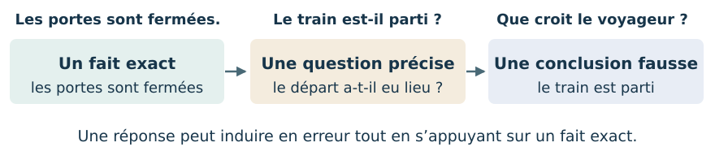

# BEL A/L — Deuxième composition de philosophie, Lyon 2025 · Corrigé brut

*Corrigé rédigé par IA, non officiel. Signalez toute erreur.*

**Rédaction** · GPT-6.2 Astra Ultra · vitesse non renseignée · 26 novembre 2026

**Révision** · GPT-6.2 Astra Ultra · vitesse non renseignée · 26 novembre 2026

**Sujet** · Dire la vérité. Écrit de spécialité de la série Sciences humaines, durée de six heures.

[Sujet officiel, p. 3](https://www.ens-lyon.fr/sites/default/files/2025-09/251113.pdf#page=3) · [Rapport du jury, p. 11–23](https://www.ens-lyon.fr/sites/default/files/2025-11/Philosophie%202025%20OK%20Lyon%20RELU.pdf#page=11)

## Dissertation

À la personne qui lui demande si le train est parti, un agent répond qu’il a fermé les portes à l’heure prévue. Les portes ont en effet été fermées. Le train, retenu à quai, peut encore être pris. L’agent a prononcé une phrase vraie, et le voyageur pourra néanmoins lui reprocher de lui avoir caché la vérité. Un autre agent peut, de bonne foi, annoncer un départ qui n’a pas eu lieu. Il ne voulait tromper personne, et le voyageur n’est guère mieux renseigné. Dire la vérité paraît engager ensemble ce qui est, ce que croit celui qui parle et ce qu’il donne à entendre. Comment prendre la mesure de ce que l’on fait en disant vrai, si ni la seule sincérité de la personne ni l’exactitude littérale d’une phrase ne suffisent à qualifier son acte ?

### Avancer quelque chose dont le réel décide

Quand je dis que le train est parti, les circonstances de l’énonciation fixent quel train et à quel moment je m’y réfère. La réponse dépend ensuite d’un état de choses que mon affirmation ne produit pas. La distinction d’Aristote, au livre Gamma de la *Métaphysique*, rend intelligible ce trait élémentaire. Affirmer de ce qui est qu’il est, ou de ce qui n’est pas qu’il n’est pas, donne lieu au vrai. L’état du train se prête ainsi à un jugement, qui pouvait aussi être faux. L’ordre de fermer les portes peut réussir ou échouer, être sage ou prématuré. L’annonce qu’elles sont fermées s’expose en outre à être démentie par quiconque les voit encore ouvertes. Dire la vérité suppose cette dépendance envers ce dont on parle.

On objectera qu’une telle condition suffit. Puisque les portes étaient fermées, l’agent a bien dit quelque chose de vrai. C’est accorder trop peu de poids à la question posée. Dans l’usage ordinaire, fermer les portes rend le départ imminent ou irrévocable pour qui veut monter. Celui qui souligne cette circonstance en réponse dispose d’une ressource pour induire une conclusion qu’il sait fausse. L’omission tire son efficacité du fait que l’interlocuteur a des raisons de tenir la remarque pour pertinente. Un relevé technique qui consignerait la même heure de fermeture à la demande du mécanicien serait parfaitement loyal. C’est donc une différence dans ce que l’on répond à quelqu’un qui modifie l’acte, alors que les mots et les faits invoqués peuvent demeurer identiques.

Pour autant, le voyageur ne saurait exiger que l’agent garantisse l’interprétation la plus extravagante qu’il voudrait donner à ses mots. On peut demander à celui qui parle qu’il prenne en charge ce que, dans cette situation, ses paroles donnent raisonnablement à comprendre. Si le voyageur conclut que la rame a déjà quitté le quai, l’agent qui sait qu’elle y est encore a ici de quoi le détromper. La véracité s’engage dans la relation à une question en même temps que dans la relation à la chose. Aucun procédé consistant à énumérer tous les faits ne délivrerait de la nécessité de juger lesquels éclairent la situation.

### Répondre de ce qu’on affirme

Un agent voit de loin le train de la voie voisine démarrer et, le prenant pour celui du voyageur, en annonce le départ. Il formule ce qu’il croit et se trompe. Cette possibilité fait comprendre à la fois pourquoi la sincérité importe et pourquoi l’on demande davantage à celui que l’on interroge. Le menteur entend agir sur la croyance d’autrui en lui dissimulant sa propre conviction. Le témoin qui s’est trompé s’est avancé au-delà de ce que lui permettait son observation. Corriger le second n’appelle pas le même jugement moral que dénoncer le premier, mais les deux affirmations appellent une correction. L’intention du locuteur ne redresse pas le monde par sa seule droiture.

À l’inverse, quelqu’un qui voulait égarer le voyageur peut annoncer au hasard un départ qu’il croit faux et qui se trouve exact. Il a atteint le vrai comme on touche une cible derrière soi. Lui attribuer sur ce fondement l’acte de dire la vérité méconnaîtrait le type de crédit qu’il sollicite. Quand nous nous adressons à une personne en position de savoir, nous lui demandons de nous faire profiter de raisons auxquelles nous n’avons pas directement accès. Dans *Truth and Truthfulness*, Bernard Williams distingue deux vertus dont l’alliance rend ce crédit possible. La sincérité concerne l’expression fidèle de ce que l’on croit, l’exactitude le soin que l’on met à former ses croyances en tenant compte de ce qui pourrait les démentir. Ce soin comporte des degrés selon ce qui est en jeu et ce dont le locuteur dispose. Signaler que l’on a vu un train bouger sans réussir à lire son numéro est une information précise. Une certitude jouée pour rassurer ferait disparaître le renseignement le plus précieux, la limite de l’observation.

La parole vraie admet aussi une rectification qui ne la déshonore pas. Des témoins d’une même scène peuvent s’apercevoir, en rapprochant leurs récits, que l’un a confondu deux horaires. Maintenir publiquement le premier horaire au nom de la constance personnelle donnerait davantage de prix à l’image du témoin qu’à la chose racontée. Se reprendre, indiquer le détail qui a permis de corriger, c’est rétablir pour l’interlocuteur l’accès au fait. La vérité n’est donc pas ce que les témoins ont décidé de tenir pour vrai en se mettant d’accord. C’est ce sur quoi leur accord peut encore être mis à l’épreuve. Reste à savoir envers qui et jusqu’où un homme est tenu de prendre ainsi la parole.

### À qui doit-on la vérité ?

Un fait peut être connu de celui qui en garde le silence. Pour dire ce fait, il lui faut parfois une scène où sa parole puisse compter. Dans *Vérité et politique*, Hannah Arendt souligne la fragilité particulière des vérités de fait dans l’espace public. Un événement contingent aurait pu ne pas avoir lieu. Le souvenir des témoins, les traces et les archives permettent qu’on en discute encore après coup. Effacer les traces et disqualifier les témoins comme partisans fait passer une question de fait pour un simple choix d’opinion. Si un rapport annonce qu’une ligne a assuré ses liaisons tout le mois, l’agent qui en a enregistré les interruptions peut produire les relevés datés. Cette intervention rouvre un désaccord légitime sur la manière d’assurer le service en retirant à ses protagonistes la liberté de fabriquer chacun leurs chiffres.

L’intervention peut coûter au témoin l’estime de sa hiérarchie. Le risque assumé montre ce que vaut pour lui le fait de parler. Il ne fournit pas une preuve de ce qu’il avance. Les relevés doivent pouvoir être examinés, même par ceux que sa démarche contrarie. En retour, des documents sans personne pour les rendre accessibles pourraient rester enfouis et le fait disparaître de toute délibération. Il faut donc tenir ensemble les conditions de preuve et les conditions de parole. C’est parce qu’elles peuvent se séparer qu’on peut admirer un courage tout en demandant une vérification, ou réclamer la publication d’un résultat précisément parce qu’il est déjà vérifié.

Faut-il pour cela répondre à toute question de qui que ce soit ? Si un tiers demande à l’agent l’adresse personnelle du témoin, l’exactitude de l’adresse ne crée par elle-même aucun droit à la recevoir. Une réponse franche peut prendre la forme d’un refus motivé. Il reste une différence décisive entre déclarer qu’on garde une information et exploiter une phrase vraie pour laisser croire à une réponse qu’on sait fausse. La discrétion a sa place dans le régime de confiance qui oblige l’agent à répondre sur le départ du train. Dans l’un et l’autre cas il doit mesurer ce qu’il a qualité pour attester et ce qu’il doit à ceux dont sa parole engage la situation.

Dire la vérité consiste ainsi à porter à la connaissance de quelqu’un, sous sa propre responsabilité, ce dont la réalité peut décider. La vérité de ce qui est affirmé garde son indépendance à l’égard de l’intention et du succès de la parole. L’acte de la dire exige en outre qu’on prenne soin de savoir, qu’on s’exprime loyalement sur la question posée et qu’on rende possible une reprise si l’on s’est trompé. À la gare, toute cette exigence peut tenir en quelques mots qui rendent au voyageur son pouvoir d’agir. Les portes ont été fermées, le train est encore là, on va vérifier si vous pouvez monter.

