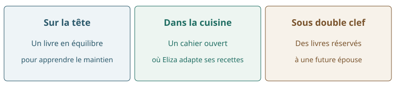

# BEL A/L — Espagnol (commentaire et traduction) 2025 · Corrigé guidé

*Corrigé rédigé par IA, non officiel. Signalez toute erreur.*

**Rédaction** · GPT-6.2 Astra Ultra · vitesse non renseignée

**Révision (tour 1)** · GPT-6.2 Astra Ultra · vitesse non renseignée

Isabel Allende, *Hija de la fortuna* (1998). Épreuve commune de six heures. [Sujet, p. 10–11](https://www.ens-lyon.fr/sites/default/files/2025-07/Commentaire%20et%20traduction.pdf#page=10) · [Rapport du jury, p. 2–11](https://www.ens-lyon.fr/sites/default/files/2025-11/Espagnol%202025%20OK%20Lyon%20RELU.pdf#page=2)

## Préparer le commentaire et la version

### Comparer les deux calendriers d’Eliza

À quatorze puis à quinze ans, Eliza mesure ses progrès en cuisine. Quand Rose examine ses chances de se marier, vingt ans devient un âge limite et deux ans le délai accordé à la recherche. Le temps de la recette, des essais et des progrès personnels devient celui d’une échéance sociale. Un autre rapprochement passe par le livre tenu sur la tête, le cahier de cuisine et les livres gardés sous clef. Suivre qui les possède et qui s’en sert permet de discuter les différentes formes d’apprentissage.

### Écouter l’éloge du prétendant

Distinguez les voix. Le narrateur rend perceptible le jugement de Rose, parfois jusque dans ses expressions. John loue les états de service du marin puis le trouve sot en société. Les deux jugements portent sur des choses différentes. Enfin, Rose prête au mariage une utilité économique à laquelle son frère n’avait pas songé. Le rapport invite à restituer les contradictions de Rose. Son souci de l’avenir d’une jeune fille vulnérable et son désir de le régler à sa place sont présents dans les mêmes phrases.

### Décisions de version

« Había averiguado » désigne l’enquête déjà menée par Rose grâce à John. Le jugement défavorable qui suit est celui de la famille du marin, d’où le passage à un sujet collectif. « Patillas » désigne ici les favoris. Le menton fuyant explique le projet de barbe. Après l’éloge de l’uniforme, le pronom masculin « él » renvoie à l’uniforme. Dans la dernière réplique, « entretener » signifie divertir, « mantener » désigne la prise en charge matérielle. Le balancement « pour qu’on… pour qu’on… » garde le rythme de la sentence sans introduire de nom de mari dans la formule générale.

## Comentario en español

En el pasaje de Hija de la fortuna, crecer parece al principio algo que le sucede al cuerpo de Eliza sin que nadie intervenga. Muy pronto, sin embargo, la «metamorfosis» de la niña en una muchacha se vuelve asunto de disputa. ¿Quién tendrá autoridad para decidir en qué ha de convertirse? Al pasar de una cocina a un consejo de familia, el relato desplaza poco a poco a su protagonista del centro de la acción. La ironía nace precisamente de que el lector ha conocido a Eliza trabajando antes de oír a los demás proyectar su vida.

En las primeras líneas la simultaneidad importa tanto como el contraste. Mientras aprende piano y hace equilibrios con un libro en la cabeza, la muchacha cultiva plantas con Mama Fresia. La lista de remedios coloca en un mismo plano el cuerpo y los afectos, y desemboca en un pequeño suceso doméstico. Eliza sazona la sopa de Miss Rose con la planta que remedia el mal humor. La discípula se ha puesto a tratar a su tutora. El roce de las ollas y el olor a ajo, inadmisibles en una dama para Rose, son el precio de otra forma de saber. Al libro que equilibra sobre la cabeza responde el cuaderno donde recoge recetas que luego modifica. Los hitos de los catorce y los quince años miden conquistas suyas, desde superar a la maestra en repostería hasta servir un festín. Su olfato distingue las especias de la India antes de saber nombrarlas. Sería difícil reducir semejante aprendizaje a la conservación pasiva de una sola tradición.

La idea de Jeremy de que Eliza abra un salón de té tropieza con la aritmética social de su hermana. Ganar dinero con el propio trabajo equivaldría a bajar de categoría. Ahora el tiempo se cuenta de otra manera. Los años que antes medían lo aprendido se transforman en un plazo para encontrar novio antes de los veinte. El relato se acerca al discurso de Rose hasta alojar en él el rechazo tajante de una boda entre chilenos, «ni pensarlo» (línea 29). Pero su cálculo también incluye el deseo de ahorrarle estrecheces a una joven cuyo origen la vuelve vulnerable. Donde Mama Fresia ve suerte, Rose ve inteligencia. Acepta e incluso admira la capacidad de Eliza para resolver situaciones a su favor. Lo que pretende es dirigirla hacia un matrimonio en el que esa capacidad sirva para manejar al marido.

La soltera que, según el narrador, podría dar cátedra sobre el amor tiene sus propios libros, guardados bajo doble llave. El elogio aparente de su ciencia se lee de otro modo cuando se recuerda que, en la cocina, era Eliza quien prefería la práctica a la teoría. No faltan, en cambio, ocasiones para ejercitar el arte de disponer la vida ajena. Rose reclama a Jeremy la adopción legal porque un apellido usado durante años todavía ha de poder exhibirse ante la familia del pretendiente. El deseo de que Eliza se case «con la cabeza en alto» recuerda irónicamente aquella cabeza que la niña aprendía a tener erguida. El buen porte ya no basta. Hacen falta apellido y dote.

También el pretendiente pasa revista como si su cuerpo debiera acreditar una posición social. La nariz es aristocrática, el mentón decepciona, una barba futura corregiría el defecto. Hasta las largas ausencias en alta mar pasan al haber del esposo ideal. La ocurrencia del uniforme nos hace distinguir al hombre de lo poco que se ha visto de él. John pincha el retrato con un solo adjetivo, «tonto». Rose se reserva el remate al hacer rimar en «entretengan» y «mantengan» dos ideas incompatibles del matrimonio. La simetría de la réplica le concede autoridad cómica, no la certeza de haber resuelto el destino de su protegida. Mientras Rose habla con sus hermanos, la voz de Eliza queda fuera del diálogo. Hasta el propio cálculo de Rose depende, sin embargo, de algo que nadie puede hacer por su protegida, enamorarse.

## Version française, lignes 51–69

Rose avait appris par son frère John que le marin appartenait à une famille de vieille souche. Les siens verraient d’un mauvais œil le fils aîné, seul héritier, marié à une inconnue sans fortune venue d’un pays dont ils n’avaient jamais entendu le nom. Il fallait absolument qu’Eliza dispose d’une dot alléchante et que Jeremy l’adopte. Du moins la question de ses origines ne ferait-elle plus obstacle au mariage.

Michael Steward avait une allure athlétique, un regard candide, des yeux bleus, des favoris blonds, une moustache blonde, de belles dents et un nez aristocratique. Son menton fuyant lui ôtait de la prestance et Miss Rose attendait de le connaître mieux pour lui suggérer de le dissimuler en se laissant pousser la barbe. Selon le capitaine Sommers, le jeune homme était un modèle de moralité et ses états de service irréprochables lui garantissaient une brillante carrière dans la marine. Aux yeux de Miss Rose, tout ce temps qu’il passait en mer constituait un immense avantage pour celle qui l’épouserait. Plus elle y pensait, plus elle était persuadée d’avoir découvert l’homme idéal. Mais, connaissant le caractère d’Eliza, elle savait que la jeune fille ne l’accepterait pas par pure convenance. Il fallait qu’elle tombe amoureuse. Il y avait de l’espoir. Il avait fière allure dans son uniforme et personne ne l’avait encore vu en civil.

— Steward n’est qu’un sot bien élevé. Si elle l’épousait, Eliza mourrait d’ennui, fit observer le capitaine John Sommers quand sa sœur lui exposa ses projets.

— Tous les maris sont ennuyeux, John. Une femme qui a deux sous de jugeote ne se marie pas pour qu’on la distraie, mais pour qu’on l’entretienne.
