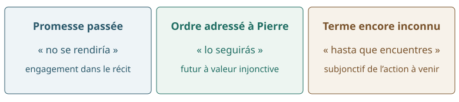

# BEL A/L — Espagnol (thème Lyon) 2025 · Corrigé brut

*Corrigé rédigé par IA, non officiel. Signalez toute erreur.*

**Rédaction** · GPT-6.2 Astra Ultra · vitesse non renseignée

**Révision (tour 1)** · GPT-6.2 Astra Ultra · vitesse non renseignée

René Barjavel, *Ravage* (1943). Thème de spécialité, quatre heures, sans dictionnaire. [Sujet, p. 14](https://www.ens-lyon.fr/sites/default/files/2025-09/251113.pdf#page=14) · [Rapport du jury, p. 12–22](https://www.ens-lyon.fr/sites/default/files/2025-11/Espagnol%202025%20OK%20Lyon%20RELU.pdf#page=12)

## Proposition de thème

En el silencio que había caído sobre los cuerpos derrumbados se dejó oír un ruido extraño. Teste rechinaba los dientes. Colette lo hizo callar de una bofetada. Un guardia corpulento rompió a llorar. Los dos caballos, tendidos, con las patas rígidas, respiraban deprisa.

François se puso en pie. Mientras le quedara un soplo de vida, no se rendiría. Entre las provisiones que aún quedaban había dos latas de granos de soja en salsa, de cinco kilos cada una. Deshizo los paquetes. Sus compañeros, postrados, lo oyeron mover las latas. Al fin dio con lo que buscaba, perforó las tapas y fue de garganta en garganta. Se inclinaba, sacudía un bulto oscuro, susurraba «¡Abre la boca!», buscaba la abertura entre los labios y dejaba caer por ella un hilillo del precioso líquido. Reconoció en la oscuridad la voz de Blanche, que le dijo «¡Gracias!», y a la señora Durillot al lado de su marido. A la joven embarazada le dio una ración más generosa. Cuando terminó, abrió del todo las latas e intentó comer, pero no lo consiguió. Aquellas pocas gotas de bebida espesa parecían haberles devuelto algo de vida a sus compañeros. Seguro de que todos lo oían, se dirigió a Pierre en voz alta:

—Pierrot, de los dos caballos vas a montar el que aún puede arrastrarse y salir en busca de agua. Estoy seguro de que tú sí volverás, por tu mujer y por el hijo que lleva dentro. Bajarás por el cauce del arroyo. Te llevará al del río. Tal vez haya desembocado en él un afluente por la otra orilla y allí encuentres agua. Si no, lo seguirás hacia el sur. Lo seguirás hasta que encuentres agua y, si hace falta, hasta algún río mayor en el que vaya a desembocar. Te llevarás estas dos latas vacías. Si no encuentras un recipiente más práctico, tráenos en ellas lo que puedas.

»Nosotros, después de dormir unas horas, caminaremos siguiendo tus huellas. Caminaremos mientras podamos. Nuestras vidas dependen de ti. Dale un beso a tu mujer y ponte en camino…

## Repère de lecture

