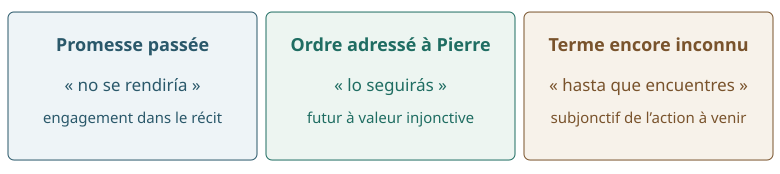

# BEL A/L — Espagnol (thème Lyon) 2025 · Corrigé guidé

*Corrigé rédigé par IA, non officiel. Signalez toute erreur.*

**Rédaction** · GPT-6.2 Astra Ultra · vitesse non renseignée

**Révision (tour 1)** · GPT-6.2 Astra Ultra · vitesse non renseignée

René Barjavel, *Ravage* (1943). Thème de spécialité, quatre heures, sans dictionnaire. [Sujet, p. 14](https://www.ens-lyon.fr/sites/default/files/2025-09/251113.pdf#page=14) · [Rapport du jury, p. 12–22](https://www.ens-lyon.fr/sites/default/files/2025-11/Espagnol%202025%20OK%20Lyon%20RELU.pdf#page=12)

## Lecture du passage

### Comment passe-t-on du silence à la tournée de François ?

> [!INDICATION]
> Souligner les gestes qui ne se produisent qu’une fois, puis les gestes que François recommence devant chaque compagnon.

*Había caído* installe le silence avant le bruit. Le grincement des dents et la respiration se prolongent à l’imparfait, tandis que la gifle et les premiers pleurs constituent des événements. Après *perforó las tapas*, la suite *se inclinaba, sacudía, susurraba, buscaba* détaille le geste recommencé devant chaque bouche. *Fue de garganta en garganta* maintient la métonymie des corps réduits à leur soif. *Repartió el líquido entre todos* donnerait l’information pratique mais sacrifierait l’image.

### Comment traduire les corps, les personnes et les objets ?

*Un guardia corpulento* est un homme, avec l’article masculin malgré la finale en *-a*. Les *latas* sont des récipients métalliques dont les couvercles se percent. *Cajas* suggérerait des boîtes d’une autre nature. Dans *reconoció… la voz… y a la señora Durillot*, le premier complément est une voix et le second une personne déterminée, d’où *a* devant la dame seule. *Le dio una ración más generosa* fait de la femme enceinte la bénéficiaire, que l’espagnol peut aussi placer en tête avec *a la joven embarazada*. [Rapport du jury, p. 16–18](https://www.ens-lyon.fr/sites/default/files/2025-11/Espagnol%202025%20OK%20Lyon%20RELU.pdf#page=16)

### Que suivent les pronoms du trajet ?

Le premier référent de *te llevará al del río* est le *cauce del arroyo*, puis *al del río* reprend le nom masculin *cauce*. Le pronom de *lo seguirás* reprend *río*, même si le nom français de départ est féminin. *Cauce* et *lecho* conviennent à un lit qui peut être à sec. *Corriente* suggérerait que de l’eau y coule déjà. *Río mayor* permet ensuite de distinguer en espagnol les deux cours d’eau que le français nomme différemment. Le lieu où l’affluent aurait débouché reste une hypothèse. [Rapport du jury, p. 19–20](https://www.ens-lyon.fr/sites/default/files/2025-11/Espagnol%202025%20OK%20Lyon%20RELU.pdf#page=19)

### Qui peut encore agir, et quand ?

Avant l’ordre, *mientras le quedara un soplo de vida, no se rendiría* conserve l’engagement tel que François le pensait à cet instant passé. Dans l’adresse directe, le futur *lo seguirás* a force d’instruction. La découverte de l’eau reste à venir, d’où *hasta que encuentres*. De même *tráenos… lo que puedas* laisse ouverte la quantité rapportée. *Tráenos* conjugue *tú* et ajoute *nos*, le groupe resté derrière. Dans la dernière réplique, *nosotros* reprend explicitement ce groupe, *ti* désigne Pierre, et l’injonction familière finale reste au singulier. *Abraza a tu mujer y ponte en camino* conviendrait aussi, avec l’étreinte plutôt que le baiser. [Rapport du jury, p. 20–21](https://www.ens-lyon.fr/sites/default/files/2025-11/Espagnol%202025%20OK%20Lyon%20RELU.pdf#page=20)

## Proposition de thème

En el silencio que había caído sobre los cuerpos derrumbados se dejó oír un ruido extraño. Teste rechinaba los dientes. Colette lo hizo callar de una bofetada. Un guardia corpulento rompió a llorar. Los dos caballos, tendidos, con las patas rígidas, respiraban deprisa.

François se puso en pie. Mientras le quedara un soplo de vida, no se rendiría. Entre las provisiones que aún quedaban había dos latas de granos de soja en salsa, de cinco kilos cada una. Deshizo los paquetes. Sus compañeros, postrados, lo oyeron mover las latas. Al fin dio con lo que buscaba, perforó las tapas y fue de garganta en garganta. Se inclinaba, sacudía un bulto oscuro, susurraba «¡Abre la boca!», buscaba la abertura entre los labios y dejaba caer por ella un hilillo del precioso líquido. Reconoció en la oscuridad la voz de Blanche, que le dijo «¡Gracias!», y a la señora Durillot al lado de su marido. A la joven embarazada le dio una ración más generosa. Cuando terminó, abrió del todo las latas e intentó comer, pero no lo consiguió. Aquellas pocas gotas de bebida espesa parecían haberles devuelto algo de vida a sus compañeros. Seguro de que todos lo oían, se dirigió a Pierre en voz alta:

—Pierrot, de los dos caballos vas a montar el que aún puede arrastrarse y salir en busca de agua. Estoy seguro de que tú sí volverás, por tu mujer y por el hijo que lleva dentro. Bajarás por el cauce del arroyo. Te llevará al del río. Tal vez haya desembocado en él un afluente por la otra orilla y allí encuentres agua. Si no, lo seguirás hacia el sur. Lo seguirás hasta que encuentres agua y, si hace falta, hasta algún río mayor en el que vaya a desembocar. Te llevarás estas dos latas vacías. Si no encuentras un recipiente más práctico, tráenos en ellas lo que puedas.

»Nosotros, después de dormir unas horas, caminaremos siguiendo tus huellas. Caminaremos mientras podamos. Nuestras vidas dependen de ti. Dale un beso a tu mujer y ponte en camino…
