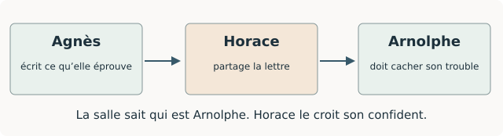

# BEL A/L — Explication d’un texte français, 21 juin 2025 · Corrigé brut

*Corrigé rédigé par IA, non officiel. Signalez toute erreur.*

**Rédaction** · GPT-6.2 Astra Ultra · vitesse non renseignée · 26 novembre 2026

**Autocontrôle** · GPT-6.2 Astra Ultra · vitesse non renseignée · 26 novembre 2026

## Le feuillet du 21 juin

La page porte « Concours A/L ». Les sept références sont publiées dans cet ordre. Le rapport annuel cite plusieurs d’entre elles parmi ses exemples, dont un billet associant Molière au Confiteor. Le jour de ce tirage n’y est pas indiqué. Le feuillet est une liste de sept références. Le choix des candidats et la composition de leurs tirages le 21 ne sont pas indiqués. [Feuillet du jury](https://www.ens.psl.eu/sites/default/files/francais_1_21.06.pdf)

## Référence 1 — Cyrano de Bergerac, Les États et Empires du Soleil

**Bornes** · De « On était aux escarmouches de la Bataille » à « qui n’eût commerce avec la Lune ».

Le narrateur voit entrer chez Colignac des hommes désignés par leurs barbes et leurs robes. L’autorité sociale paraît d’abord comme un costume collectif. La députation invoque l’alliance, la parenté, l’amitié et surtout la honte qui rejaillirait sur ses membres. Ce souci de réputation précède toute preuve. Puis les interlocuteurs rapprochent les voyages racontés, les cheminées et la Lune comme si une série de mots suffisait à démontrer la sorcellerie. À la fin, la bouche qui s’approche de l’oreille traduit en geste le passage du discours officiel à l’insinuation. Le récit fantastique découvre ainsi un autre pouvoir de la fiction, celui des soupçons que la société fabrique elle-même.

[Lecture de référence](https://fr.wikisource.org/wiki/L%E2%80%99Autre_monde_%28Cyrano_de_Bergerac%29/L%E2%80%99Autre_monde/II._Les_%C3%89tats_et_Empires_du_Soleil)

## Référence 2 — Boileau, L’Art poétique

**Bornes** · Chant III, vers 1–37, de « Il n’est point de Serpent » à « assez tost expliqué ». Le rapport annuel donne aussi p. 96–97.

Boileau part d’un paradoxe accessible au regard. Une imitation réussie peut faire plaisir là même où l’objet inspirerait l’effroi. Il transporte ensuite le raisonnement vers la tragédie. L’art organise la pitié et la terreur, et sa réussite se vérifie dans le mouvement qu’elles impriment au spectateur. L’apostrophe aux auteurs déplace alors la question. À quelles conditions l’intrigue peut-elle captiver dès l’ouverture ? La critique de l’exposition obscure ou pesante conduit à la maxime du vers 37. Le passage dessine donc un trajet du pouvoir de l’image au travail très concret de la première scène. Les exemples et les formules symétriques donnent à la leçon l’efficacité immédiate qu’elle réclame des dramaturges.

[Lecture de référence](https://fr.wikisource.org/wiki/Boileau_-_%C5%92uvres_po%C3%A9tiques/L%E2%80%99Art_po%C3%A9tique/Chant_III)

## Référence 3 — Molière, L’École des femmes

**Bornes** · III, 4, de « Mais il faut qu’en ami » à « C’est que je tousse ». Le rapport annuel indique p. 68.

Horace croit confier à un ami la lettre d’Agnès. Le spectateur sait que cet ami est le tuteur dont les projets sont menacés. La lettre fait entendre une troisième voix au milieu d’un dialogue d’hommes. Agnès pèse les mots qu’on lui a appris à redouter et leur oppose ce que sa propre expérience lui fait reconnaître. La prose de la lettre suspend le discours en vers. Lorsque les deux hommes reprennent la parole, le sens du moindre bruit a changé. Arnolphe doit déguiser son émotion en toux afin de préserver la méprise d’Horace. Le passage rend simultanément perceptibles l’éveil d’un jugement et l’impuissance comique de celui qui voulait l’empêcher.

[Lecture de référence](https://libretheatre.fr/wp-content/uploads/2016/05/l_ecole_des_femmes_Moliere_LT.pdf)

## Référence 4 — Crébillon fils, Lettres de la Marquise de M*** au Comte de R***

**Bornes** · Lettre XI, de « Cependant vous croyez » à « qui m’y force ». Les bornes correspondent aux p. 30–31 de l’édition électronique du Boucher.

La marquise commence par attribuer au comte une erreur sur ses sentiments. À peine l’a-t-elle formulée qu’elle lui reconnaît des raisons de l’avoir commise. Les interrogations vont de sa conduite passée à la connaissance qu’elle a de son propre cœur. L’injonction de rendre les lettres et le portrait semble alors clore l’échange. Mais l’interdiction de la voir se réduit aussitôt à celle de lui parler d’amour. Le dernier mouvement généralise le danger couru par une femme avant de revenir au fait matériel de cette lettre. Pour refuser toute correspondance, la marquise a encore écrit. La chute déplace la responsabilité vers l’obstination du destinataire, sans effacer ce que les reprises et corrections viennent de faire entendre.

[Lecture de référence](https://www.leboucher.com/pdf/crebillon/marquise.pdf)

## Référence 5 — Baudelaire, Le Spleen de Paris, « Le Confiteor de l’artiste »

**Bornes** · Poème en prose nommé sans coupe. Le rapport annuel situe le texte p. 9–10.

Le titre promet une confession. Au début pourtant, l’exclamation célèbre la fin des journées d’automne. L’expansion de la phrase suit la houle et le regard jusqu’à une petite voile qui ressemble au sujet solitaire. Un doute de syntaxe rend bientôt incertaine la frontière entre regarder le monde et être pensé par lui. Le plaisir de cette dissolution se retourne en douleur. L’apostrophe à la nature et la figure terminale du duel donnent à l’artiste une limite qu’il n’avait pas reconnue au début. La confession porte ainsi sur le désir démesuré de saisir le beau et sur le moment où le langage de la contemplation devient celui de la défaite.

[Lecture de référence](https://fr.wikisource.org/wiki/Le_Confiteor_de_l%27artiste)

## Référence 6 — Ponge, Le Parti pris des choses, « Le Cageot »

**Bornes** · Poème en prose nommé sans coupe. Le rapport annuel indique p. 38.

Ponge commence par situer le mot au voisinage de deux autres noms, cage et cachot. L’attente d’un enfermement se heurte à la minceur d’une caisse faite pour un usage unique. Le détour par les fruits déplace le problème de la solidité. Il faut protéger une matière fragile, puis pouvoir défaire son emballage sans effort. Le dernier mouvement rencontre l’objet abandonné à la rue, encore clair et neuf. La compassion que fait naître cette destinée est aussitôt retenue par la chute. En peu de paragraphes, la prose règle la durée de son attention sur celle de l’objet.

[Lecture de référence](https://www.education.pf/wp-content/uploads/2017/07/FRANCAIS_BTN-1.pdf)

## Référence 7 — Ponge, Le Parti pris des choses, « L’Huître »

**Bornes** · Poème en prose nommé sans coupe.

La description commence par l’enveloppe. Les comparaisons en précisent la taille et la surface, mais la fermeture déplace aussitôt la question vers les gestes nécessaires pour voir l’intérieur. L’énonciation engage la main du lecteur imaginaire. L’ouverture fait changer brutalement d’échelle, du petit objet difficile à tenir jusqu’au monde que ses deux faces semblaient tenir ensemble. Les rapprochements de matières donnent une impression à la fois somptueuse et peu engageante. La dernière phrase isole enfin la rare perle et la rapproche d’un mot ou d’une formule. Le poème nous a fait traverser la résistance de la chose avant d’autoriser ce retour réflexif au langage.

[Lecture de référence](https://eduscol.education.gouv.fr/sites/default/files/document/0409-coll-3e-francais-l-huitre-francis-ponge1294945pdf-88407.pdf)
